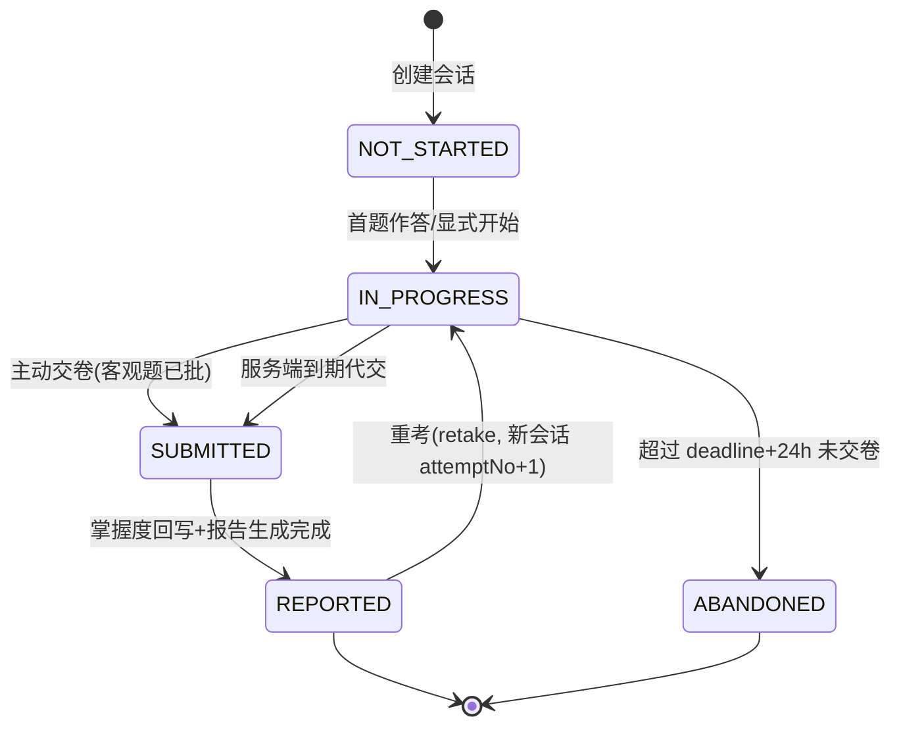
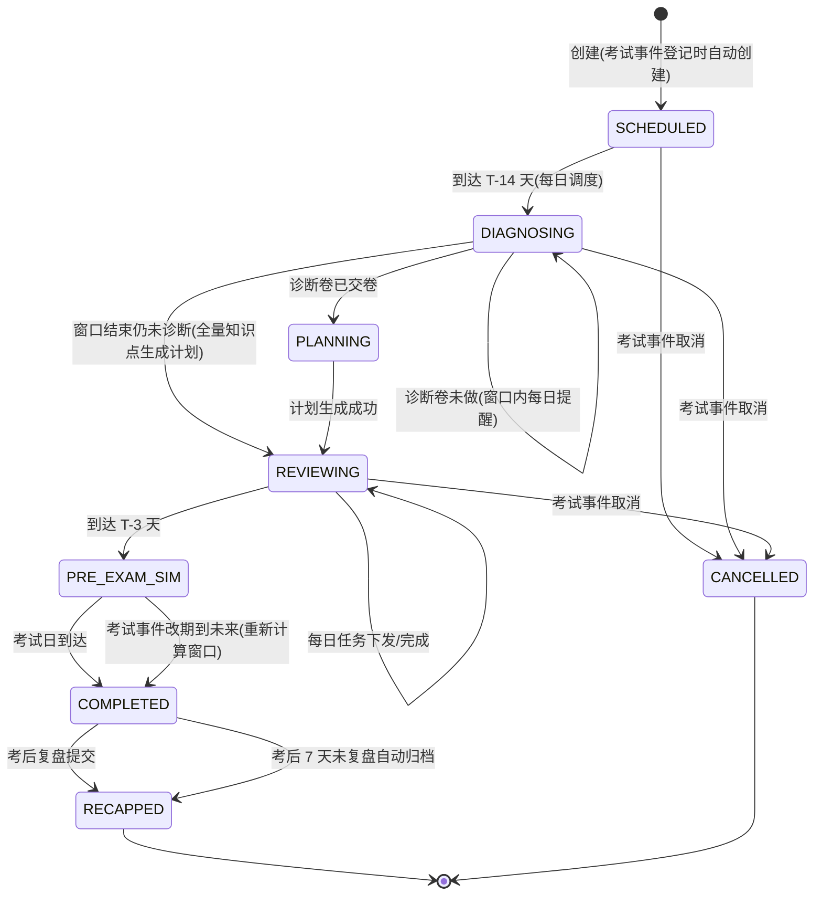

# 单元检测与期中期末复习系统 - 详细设计

> 关联文档：`考试模拟与真题练习系统-详细设计.md`、`服务端-章节同步练习智能编排与分层递进题目组卷引擎-详细设计.md`、`考前冲刺学习包-详细设计.md`、`寒暑假专题与备考冲刺专区-详细设计.md`、`间隔重复算法与遗忘曲线复习调度引擎-详细设计.md`、`服务端-学习日历事件与考试日程管理服务-详细设计.md`、`服务端-多源学习任务统一调度与优先级仲裁引擎-详细设计.md`、`服务端统一业务异常码与错误分类体系-详细设计.md`

## 1. 模块概述

### 1.1 功能定位

本模块覆盖两类"阶段性学习检验与复习"场景，与已有的三个相邻模块形成互补：

| 模块 | 场景 | 触发时机 | 典型形态 |
| --- | --- | --- | --- |
| 章节同步练习引擎 | 随堂练，小节级即时巩固 | 学生任意发起 | 10-15 题轻量练习，答一题出一题解析 |
| **本模块-单元检测** | **阶段检验，教材单元级** | **完成单元学习后由系统引导发起** | **20-30 题限时小测卷，交卷后输出单元掌握度报告** |
| **本模块-期中期末复习** | **围绕校内考试周期的复习闭环** | **考试日程驱动（T-14 天启动）** | **诊断卷 → 复习计划 → 每日复习任务 → 考前模拟 → 考后复盘** |
| 考试模拟与真题练习 | 套卷模考/真题演练 | 学生任意发起 | 整卷模考，全真计时 |
| 考前冲刺学习包 | 付费冲刺内容 | 购买激活 | 内容编排型冲刺产品 |

### 1.2 核心目标

1. **单元检测**：把"学完一个单元"转化为可度量的掌握度事件，未达标单元自动回流到复习队列（对接间隔重复引擎）。
2. **期中期末复习**：把校历考试事件转化为结构化复习周期，做到"考前 14 天有诊断、每天有任务、考前有模拟、考后有复盘"。
3. **统一调度**：复习任务作为一路任务源接入多源学习任务统一调度与优先级仲裁引擎，与每日任务/学习计划共存而不打架。

### 1.3 目标用户

- 学生端：小学三年级及以上（低龄学生由家长端代设考试日程）。
- 家长端：查看单元检测与复习周期报告、帮孩子登记考试日程。
- 服务端/运营：无需人工配置，全部内容按教材版本与知识点体系自动生成；仅保留模板参数调控入口。

### 1.4 与其他模块的关系

| 依赖模块 | 关系说明 |
| --- | --- |
| 章节同步练习引擎 | 复用其组卷能力（练习场景模板新增 `unit_test` 模板），本模块负责"何时发起、达标判定、报告生成" |
| 考试模拟系统 | 考前模拟环节复用 `exam-sessions` 接口与批阅能力，本模块只负责编排与收口 |
| 间隔重复引擎 | 单元检测未达标知识点、诊断卷薄弱知识点统一写入该引擎生成复习调度 |
| 学习日历事件服务 | 期中期末复习周期的锚点事件（期中考试/期末考试日历事件） |
| 多源学习任务仲裁引擎 | 复习周期产生的每日复习任务经其统一排序进入学生任务列表 |
| 错题服务 | 检测/诊断/模拟中的错题自动走错题收录标准链路（双触发源已在错题链路定义） |
| 用户额度与功能门控 | 单元检测/复习报告属于会员功能，免费用户有体验次数限制（见 §9） |

### 1.5 范围边界（明确不做）

- 不做教师端的班级统考编排（已有班级学情/作业链路）。
- 不做主观题人工批阅流程（复用考试模拟的批阅链路）。
- 不重复建设组卷引擎，仅新增模板参数与达标判定逻辑。

## 2. 核心概念与数据结构

### 2.1 术语定义

| 术语 | 定义 |
| --- | --- |
| UnitQuiz（单元检测） | 针对一个教材单元生成的阶段测验卷 |
| UnitQuizSession（检测会话） | 学生某次单元检测的答题过程记录 |
| ReviewCycle（复习周期） | 绑定一次期中/期末考试事件的复习闭环实例 |
| DiagnosticQuiz（诊断卷） | 复习周期启动时生成的摸底测验，用于定位薄弱面 |
| ReviewTask（复习任务） | 复习周期内每日下发给学生的具体学习任务项 |
| 达标线（passThreshold） | 单元检测通过分数线，默认 80 分，按学段可调 |

### 2.2 核心实体（TypeScript 接口）

```typescript
// ============ 单元检测 ============

/** 教材单元检测定义（由系统按模板自动生成，无人工维护） */
interface UnitQuiz {
  id: string;                        // uq_<ulid>
  tenantId: string;
  textbookId: string;                // 教材版本
  grade: number;                     // 年级
  subjectId: string;                 // 学科
  unitId: string;                    // 教材单元 ID（一个单元对应一份检测卷）
  unitName: string;
  chapterIds: string[];              // 覆盖的章节范围
  knowledgePointIds: string[];       // 覆盖的知识点全集（组卷时从中采样）
  questionCount: number;             // 题目数，默认 25
  timeLimitMinutes: number;          // 限时，默认 30 分钟
  passThreshold: number;             // 达标线（百分制），默认 80
  difficultyMix: { easy: number; medium: number; hard: number }; // 默认 3:5:2
  totalScore: number;                // 卷面总分 100
  status: 'draft' | 'published' | 'deprecated';  // 由内容流水线发布后生效
  contentVersion: number;            // 内容版本，变更即 +1（客户端幂等键组成之一）
  publishedAt: Date;
  createdAt: Date;
  updatedAt: Date;
}

/** 单元检测答题会话 */
interface UnitQuizSession {
  id: string;                        // uqs_<ulid>
  unitQuizId: string;
  contentVersion: number;            // 开卷时快照的版本
  userId: string;
  studentId: string;                 // 家庭账户下的学生档案 ID
  status: UnitQuizSessionStatus;
  startedAt?: Date;
  submittedAt?: Date;
  deadlineAt?: Date;                 // 开卷后 deadline = now + timeLimit
  remainingSeconds?: number;         // 断线重连/恢复时由服务端重算下发
  answers: Map<string, UserAnswer>;  // 复用考试模拟的 UserAnswer 结构
  result?: UnitQuizResult;
  retakeOfSessionId?: string;        // 重考会话指向首次会话
  attemptNo: number;                 // 第几次作答（1 起）
  clientRequestId: string;           // 幂等键
  createdAt: Date;
}

enum UnitQuizSessionStatus {
  NOT_STARTED = 'not_started',
  IN_PROGRESS = 'in_progress',
  SUBMITTED = 'submitted',          // 已交卷，客观题批阅完成
  REPORTED = 'reported',            // 报告已生成（含主观题/掌握度回写完成）
  ABANDONED = 'abandoned'           // 超时未交卷（保留已答部分用于薄弱分析）
}

/** 单元检测报告 */
interface UnitQuizResult {
  totalScore: number;                // 百分制
  passed: boolean;                   // >= passThreshold
  objectiveScore: number;            // 客观题得分
  subjectiveScore?: number;          // 主观题得分（异步批阅后回补）
  objectiveCorrectCount: number;
  questionCount: number;
  timeSpentSeconds: number;
  kpMasteryDeltas: KpMasteryDelta[]; // 知识点掌握度增量（交卷即算客观题部分）
  weakKnowledgePointIds: string[];   // 本次检测暴露的薄弱知识点
  passedKpCount: number;
  totalKpCount: number;
  reportToken: string;               // 报告分享脱敏令牌（复用学情报告分享链路）
  generatedAt: Date;
}

interface KpMasteryDelta {
  knowledgePointId: string;
  beforeMastery: number;             // 0-1
  afterMastery: number;
  evidence: 'unit_quiz';             // 掌握度更新证据来源（错题链路要求双源记账）
}

// ============ 期中期末复习 ============

/** 复习周期定义：绑定考试日历事件 */
interface ReviewCycle {
  id: string;                        // rc_<ulid>
  tenantId: string;
  userId: string;
  studentId: string;
  examCalendarEventId: string;       // 学习日历中的期中/期末考试事件（SSOT 锚点）
  scopeType: 'midterm' | 'final' | 'unit_range';
  scopeName: string;                 // 如 "七年级上册期中（1-4 单元）"
  coveredUnitIds: string[];          // 覆盖教材单元
  coveredChapterIds: string[];
  coveredKnowledgePointIds: string[]; // 覆盖知识点全集
  examAt: Date;                      // 考试日期（冗余自日历事件，事件改期需联动，见 §5.3）
  phase: ReviewCyclePhase;
  diagnosticQuizId?: string;         // 诊断卷（复用 UnitQuiz 结构，scopeType=unit_range）
  diagnosticSessionId?: string;
  diagnosticReportId?: string;
  planId?: string;                   // 生成的复习计划 ID（对接学习计划服务）
  stats: ReviewCycleStats;
  createdAt: Date;
  updatedAt: Date;
}

enum ReviewCyclePhase {
  SCHEDULED = 'scheduled',          // 已创建未到启动时间（T-14 之前）
  DIAGNOSING = 'diagnosing',        // 诊断阶段（T-14 ~ T-10，默认窗口）
  PLANNING = 'planning',            // 计划生成中（诊断卷批改完成后）
  REVIEWING = 'reviewing',          // 每日复习执行中（T-10 ~ T-2）
  PRE_EXAM_SIM = 'pre_exam_sim',    // 考前模拟窗口（T-3 ~ T-1）
  COMPLETED = 'completed',          // 考试已过，待复盘
  RECAPPED = 'recapped',            // 已复盘归档
  CANCELLED = 'cancelled'          // 考试事件取消/删除
}

interface ReviewCycleStats {
  diagnosticScore?: number;
  kpTotalCount: number;
  weakKpCount: number;               // 诊断确定的薄弱知识点数
  taskTotalCount: number;
  taskDoneCount: number;
  simSessionIds: string[];           // 考前模拟会话
  recapScore?: number;               // 考后回填的实际考试分数
}

/** 复习周期内的每日复习任务（任务源之一，最终经仲裁引擎下发） */
interface ReviewTask {
  id: string;                        // rt_<ulid>
  reviewCycleId: string;
  userId: string;
  studentId: string;
  taskDate: string;                  // YYYY-MM-DD（学生时区）
  taskType: ReviewTaskType;
  knowledgePointIds: string[];       // 本任务覆盖的知识点
  estimatedMinutes: number;
  payload: ReviewTaskPayload;        // 按 taskType 携带不同载荷
  status: 'pending' | 'dispatched' | 'done' | 'skipped' | 'expired';
  dispatchTaskId?: string;           // 仲裁引擎统一任务 ID（下发后回填）
  doneAt?: Date;
  createdAt: Date;
}

enum ReviewTaskType {
  KP_REVIEW = 'kp_review',          // 知识点复习卡 + 微课/讲解
  WEAK_REINFORCE = 'weak_reinforce', // 薄弱点强化练习（对接章节练习引擎生成练习集）
  MISTAKE_RETRY = 'mistake_retry',  // 本周期范围内的错题重练（对接错题服务）
  RECITE_CHECK = 'recite_check',    // 文科背诵抽检（对接背诵服务）
  SIM_EXAM = 'sim_exam'             // 考前模拟（对接考试模拟）
}

interface ReviewTaskPayload {
  practiceSetId?: string;            // WEAK_REINFORCE → 章节练习引擎
  mistakeIds?: string[];             // MISTAKE_RETRY → 错题 ID 列表
  reciteMaterialId?: string;         // RECITE_CHECK
  examPaperIds?: string[];           // SIM_EXAM → 组卷引擎生成的模拟卷
  contentIds?: string[];             // KP_REVIEW → 知识点讲解内容 ID
}
```

### 2.3 数据库 DDL

```sql
-- 单元检测定义表
CREATE TABLE unit_quiz (
  id                VARCHAR(40)  NOT NULL PRIMARY KEY COMMENT 'uq_<ulid>',
  tenant_id         VARCHAR(40)  NOT NULL,
  textbook_id       VARCHAR(40)  NOT NULL,
  grade             TINYINT      NOT NULL,
  subject_id        VARCHAR(40)  NOT NULL,
  unit_id           VARCHAR(40)  NOT NULL,
  unit_name         VARCHAR(128) NOT NULL,
  chapter_ids       JSON         NOT NULL COMMENT '章节范围',
  knowledge_point_ids JSON       NOT NULL COMMENT '覆盖知识点全集',
  question_count    SMALLINT     NOT NULL DEFAULT 25,
  time_limit_minutes SMALLINT    NOT NULL DEFAULT 30,
  pass_threshold    TINYINT      NOT NULL DEFAULT 80,
  difficulty_mix    JSON         NOT NULL COMMENT '{"easy":0.3,"medium":0.5,"hard":0.2}',
  total_score       SMALLINT     NOT NULL DEFAULT 100,
  status            VARCHAR(16)  NOT NULL DEFAULT 'draft',
  content_version   INT          NOT NULL DEFAULT 1,
  published_at      DATETIME     NULL,
  created_at        DATETIME     NOT NULL DEFAULT CURRENT_TIMESTAMP,
  updated_at        DATETIME     NOT NULL DEFAULT CURRENT_TIMESTAMP ON UPDATE CURRENT_TIMESTAMP,
  UNIQUE KEY uk_unit_ver (unit_id, content_version),
  KEY idx_quiz_lookup (tenant_id, textbook_id, grade, subject_id, status)
) ENGINE=InnoDB DEFAULT CHARSET=utf8mb4 COMMENT='单元检测定义';

-- 单元检测会话表
CREATE TABLE unit_quiz_session (
  id                VARCHAR(40)  NOT NULL PRIMARY KEY COMMENT 'uqs_<ulid>',
  unit_quiz_id      VARCHAR(40)  NOT NULL,
  content_version   INT          NOT NULL,
  user_id           VARCHAR(40)  NOT NULL,
  student_id        VARCHAR(40)  NOT NULL,
  status            VARCHAR(16)  NOT NULL DEFAULT 'not_started',
  started_at        DATETIME     NULL,
  submitted_at      DATETIME     NULL,
  deadline_at       DATETIME     NULL,
  attempt_no        TINYINT      NOT NULL DEFAULT 1,
  retake_of_session_id VARCHAR(40) NULL,
  result_json       JSON         NULL COMMENT 'UnitQuizResult 快照',
  client_request_id VARCHAR(64)  NOT NULL,
  created_at        DATETIME     NOT NULL DEFAULT CURRENT_TIMESTAMP,
  updated_at        DATETIME     NOT NULL DEFAULT CURRENT_TIMESTAMP ON UPDATE CURRENT_TIMESTAMP,
  UNIQUE KEY uk_req (user_id, client_request_id),
  UNIQUE KEY uk_attempt (unit_quiz_id, user_id, attempt_no),
  KEY idx_user_status (user_id, status, updated_at),
  CONSTRAINT fk_uqs_quiz FOREIGN KEY (unit_quiz_id) REFERENCES unit_quiz(id)
) ENGINE=InnoDB DEFAULT CHARSET=utf8mb4 COMMENT='单元检测会话';

-- 复习周期表
CREATE TABLE review_cycle (
  id                 VARCHAR(40) NOT NULL PRIMARY KEY COMMENT 'rc_<ulid>',
  tenant_id          VARCHAR(40) NOT NULL,
  user_id            VARCHAR(40) NOT NULL,
  student_id         VARCHAR(40) NOT NULL,
  exam_calendar_event_id VARCHAR(40) NOT NULL,
  scope_type         VARCHAR(16) NOT NULL COMMENT 'midterm|final|unit_range',
  scope_name         VARCHAR(128) NOT NULL,
  covered_unit_ids   JSON NOT NULL,
  covered_chapter_ids JSON NOT NULL,
  covered_knowledge_point_ids JSON NOT NULL,
  exam_at            DATETIME NOT NULL,
  phase              VARCHAR(16) NOT NULL DEFAULT 'scheduled',
  diagnostic_quiz_id VARCHAR(40) NULL,
  diagnostic_session_id VARCHAR(40) NULL,
  plan_id            VARCHAR(40) NULL,
  stats_json         JSON NOT NULL COMMENT 'ReviewCycleStats',
  version            INT NOT NULL DEFAULT 0 COMMENT '乐观锁',
  created_at         DATETIME NOT NULL DEFAULT CURRENT_TIMESTAMP,
  updated_at         DATETIME NOT NULL DEFAULT CURRENT_TIMESTAMP ON UPDATE CURRENT_TIMESTAMP,
  UNIQUE KEY uk_event_student (exam_calendar_event_id, student_id),
  KEY idx_user_phase (user_id, phase, exam_at),
  KEY idx_exam_at (exam_at, phase)
) ENGINE=InnoDB DEFAULT CHARSET=utf8mb4 COMMENT='期中期末复习周期';

-- 复习任务表
CREATE TABLE review_task (
  id           VARCHAR(40) NOT NULL PRIMARY KEY COMMENT 'rt_<ulid>',
  review_cycle_id VARCHAR(40) NOT NULL,
  user_id      VARCHAR(40) NOT NULL,
  student_id   VARCHAR(40) NOT NULL,
  task_date    DATE NOT NULL,
  task_type    VARCHAR(20) NOT NULL,
  knowledge_point_ids JSON NOT NULL,
  estimated_minutes SMALLINT NOT NULL DEFAULT 15,
  payload_json JSON NOT NULL,
  status       VARCHAR(16) NOT NULL DEFAULT 'pending',
  dispatch_task_id VARCHAR(40) NULL,
  done_at      DATETIME NULL,
  created_at   DATETIME NOT NULL DEFAULT CURRENT_TIMESTAMP,
  updated_at   DATETIME NOT NULL DEFAULT CURRENT_TIMESTAMP ON UPDATE CURRENT_TIMESTAMP,
  UNIQUE KEY uk_cycle_date_type (review_cycle_id, task_date, task_type, (CAST(knowledge_point_ids AS CHAR(64)))),
  KEY idx_user_date (user_id, task_date, status),
  KEY idx_cycle (review_cycle_id, status),
  CONSTRAINT fk_rt_cycle FOREIGN KEY (review_cycle_id) REFERENCES review_cycle(id)
) ENGINE=InnoDB DEFAULT CHARSET=utf8mb4 COMMENT='复习周期任务';
```

> **说明**：MySQL 不支持在唯一键中直接使用 JSON 表达式（8.0.13+ 支持函数索引但写法不同），实际落地时 `uk_cycle_date_type` 改为冗余一个 `task_fingerprint CHAR(64)` 列（= sha1(reviewCycleId|taskDate|taskType|sortedKpIds)），其上建唯一索引，实现复习任务幂等防重。

### 2.4 Redis 键设计

| 键 | 类型 | TTL | 说明 |
| --- | --- | --- | --- |
| `uq:quiz:{quizId}` | STRING(JSON) | 1h | 检测卷定义热点缓存（发布态） |
| `uq:session:{sessionId}` | HASH | 检测时长+30min | 会话实时态：剩余秒数、当前题、已答题数 |
| `uq:lock:start:{quizId}:{userId}` | SET NX EX | 10s | 并发开卷锁（防双击产生两次会话） |
| `uq:lock:submit:{sessionId}` | SET NX EX | 30s | 交卷幂等锁 |
| `rc:cycle:{cycleId}` | STRING(JSON) | 30min | 复习周期热点缓存 |
| `rc:user:{studentId}:active` | SET | - | 该学生进行中的复习周期 ID 集合（SCHEDULED~REVIEWING） |
| `rc:lock:phase:{cycleId}` | SET NX EX | 10s | 阶段推进互斥锁 |

## 3. API 接口设计

### 3.1 接口总览

| 接口 | 方法 | 说明 |
| --- | --- | --- |
| `/api/v1/unit-quizzes/{unitId}` | GET | 查询当前教材单元的检测卷（未发布返回 40414） |
| `/api/v1/unit-quizzes/{unitId}/sessions` | POST | 开始单元检测（幂等） |
| `/api/v1/unit-quiz-sessions/{sid}` | GET | 获取会话状态（断线恢复） |
| `/api/v1/unit-quiz-sessions/{sid}/answers/{qid}` | PUT | 保存单题答案（自动保存） |
| `/api/v1/unit-quiz-sessions/{sid}/submit` | POST | 交卷 |
| `/api/v1/unit-quiz-sessions/{sid}/result` | GET | 获取检测报告 |
| `/api/v1/unit-quiz-sessions/{sid}/retake` | POST | 未达标重考（attemptNo+1，冷却规则见 §5.2） |
| `/api/v1/review-cycles` | GET | 我的复习周期列表 |
| `/api/v1/review-cycles` | POST | 为考试日程事件创建复习周期（幂等） |
| `/api/v1/review-cycles/{cid}` | GET | 复习周期详情（含进度） |
| `/api/v1/review-cycles/{cid}/diagnostic` | GET | 获取/生成诊断卷并开卷 |
| `/api/v1/review-cycles/{cid}/tasks` | GET | 查询复习任务（按日） |
| `/api/v1/review-cycles/{cid}/tasks/{tid}/done` | POST | 任务完成回执（由任务执行方回调） |
| `/api/v1/review-cycles/{cid}/sim` | POST | 发起考前模拟（透传组卷+考试模拟） |
| `/api/v1/review-cycles/{cid}/recap` | POST | 考后复盘（回填分数或试卷扫描归档） |
| `/api/v1/review-cycles/{cid}/cancel` | POST | 取消复习周期（考试取消时） |

### 3.2 开始单元检测 `POST /api/v1/unit-quizzes/{unitId}/sessions`

**请求**

```json
{
  "clientRequestId": "req_9f3a2c",
  "forceNew": false
}
```

**前置校验**（按序短路返回）：
1. 检测卷存在且 `status=published` → 否则 `40414 QUIZ_NOT_PUBLISHED`
2. 功能门控：会员或当日体验次数未耗尽 → 否则 `40310 QUIZ_QUOTA_EXHAUSTED`
3. 章节前置：单元内章节学习完成度 ≥ 80%（对接章节进度服务） → 否则 `40312 UNIT_PREREQUISITE_UNMET`，响应附未完成章节列表
4. 无进行中的同卷会话（`IN_PROGRESS`）→ 否则 `40910 QUIZ_IN_PROGRESS`，响应附该会话 ID 用于恢复
5. 重考冷却检查（见 §5.2）→ 否则 `42910 QUIZ_RETAKE_COOLDOWN`，响应附 `cooldownUntil`

**响应 201**

```json
{
  "sessionId": "uqs_01JZX8...",
  "unitQuizId": "uq_01JZX0...",
  "contentVersion": 3,
  "status": "in_progress",
  "deadlineAt": "2026-11-02T10:30:00+08:00",
  "remainingSeconds": 1800,
  "paper": {
    "sections": [
      {
        "sectionType": "objective",
        "questions": [
          {
            "questionId": "q_8821",
            "orderNo": 1,
            "questionType": "single_choice",
            "stemRich": "<p>……</p>",
            "options": [{"label": "A", "contentRich": "..."}],
            "score": 4,
            "knowledgePointIds": ["kp_301", "kp_302"]
          }
        ]
      }
    ],
    "totalScore": 100,
    "passThreshold": 80
  },
  "attemptNo": 1
}
```

> **红线**：响应中的题目快照即为本次会话的 SSOT，中途检测卷定义变更（contentVersion 变更）不影响已开卷会话（客户端提交时带 `contentVersion` 校验，不一致返回 `40911 CONTENT_VERSION_STALE`，允许继续作答但报告按开卷版本生成）。

### 3.3 交卷 `POST /api/v1/unit-quiz-sessions/{sid}/submit`

**请求**

```json
{ "clientRequestId": "req_9f3a2d", "contentVersion": 3 }
```

**处理**：`uq:lock:submit:{sid}` 加锁 → 客观题同步批阅（复用多题型统一判题引擎）→ 主观题进入异步批阅队列 → `SUBMITTED` → 掌握度增量计算 → `REPORTED`。

**响应 200**

```json
{
  "sessionId": "uqs_01JZX8...",
  "status": "reported",
  "result": {
    "totalScore": 86,
    "passed": true,
    "objectiveScore": 86,
    "subjectiveScore": null,
    "objectiveCorrectCount": 22,
    "questionCount": 25,
    "timeSpentSeconds": 1123,
    "weakKnowledgePointIds": ["kp_305"],
    "passedKpCount": 18,
    "totalKpCount": 19
  }
}
```

> 存在主观题时首次返回 `status=submitted`、`objectiveScore` 有效、`subjectiveScore=null`；批阅完成后经消息推送 + 客户端拉取 `GET result` 回补（主观题批阅 SLA 5 分钟，超时告警）。

### 3.4 创建复习周期 `POST /api/v1/review-cycles`

**请求**

```json
{
  "clientRequestId": "req_7e1b9a",
  "examCalendarEventId": "ce_01K2M...",
  "scopeType": "midterm"
}
```

**行为**：读取考试日程事件 → 按 `教材版本+学期周次` 推断覆盖单元（见 §5.3 覆盖推断规则）→ 幂等创建（`uk_event_student` 冲突时返回已存在的周期）。

**响应 201**

```json
{
  "reviewCycleId": "rc_01K2M...",
  "scopeName": "七年级上册期中（第1-4单元）",
  "examAt": "2026-11-10T09:00:00+08:00",
  "phase": "scheduled",
  "phaseSchedule": [
    {"phase": "diagnosing", "window": ["2026-10-27", "2026-10-31"]},
    {"phase": "reviewing", "window": ["2026-11-01", "2026-11-08"]},
    {"phase": "pre_exam_sim", "window": ["2026-11-09", "2026-11-09"]}
  ],
  "kpTotalCount": 156,
  "taskPreviewCount": 24
}
```

### 3.5 诊断卷开卷 `GET /api/v1/review-cycles/{cid}/diagnostic`

首次调用触发生成（懒生成）：以 `coveredKnowledgePointIds` 为范围、按知识点重要度采样 30 题（满分 100，限时 45 分钟）生成诊断卷（落地为一条 `scopeType=unit_range` 的 `UnitQuiz` 记录），开卷并返回与 §3.2 同构的会话响应。非首次返回当前诊断会话状态。

### 3.6 考后复盘 `POST /api/v1/review-cycles/{cid}/recap`

```json
{
  "clientRequestId": "req_9c4d2e",
  "recapType": "manual_score",
  "score": 92,
  "paperScanSessionId": null
}
```

`recapType` 三选一：`manual_score`（手填分数）/ `paper_scan`（试卷拍照扫描归档，走试卷扫描识别链路）/ `skip`（不复盘直接归档）。复盘完成后周期进入 `recapped`，沉淀为长期学情数据，并向间隔重复引擎提交"考试验证信号"（考前复习覆盖的知识点，考后按实际得分回写掌握度可信度，见 §5.4）。

## 4. 状态流转

### 4.1 单元检测会话状态机



| 迁移 | 守卫规则 |
| --- | --- |
| `IN_PROGRESS → SUBMITTED` | 必须持有交卷锁；已过 deadline 拒绝主动交卷（返回 40913），由到期代交流程处理 |
| 到期代交 | 定时任务每 30s 扫描 `deadline_at < now AND status=IN_PROGRESS` → 以已答部分代交 |
| `ABANDONED` | 代交后 24h 内未拉取结果的会话归档；已答部分仍计入薄弱分析（不因弃考浪费数据） |
| 重考 | 未达标（<passThreshold）才允许；同卷 24h 冷却（见 §5.2）；最多 3 次，仍不达标走薄弱回流链路 |
| 分数口径 | 以首次会话为准进入学情统计；重考会话单独标记 `attemptNo>1`，用于看"重考提分"，不回刷首次成绩 |

### 4.2 复习周期阶段机



**阶段推进实现**：每日 04:00（学生时区）调度任务扫描全部活跃周期（Redis `rc:user:*:active` 预热 + 全表兜底），持 `rc:lock:phase:{cycleId}` 锁做 CAS 推进（`UPDATE review_cycle SET phase=? WHERE id=? AND phase=?`），失败即被并发任务抢先，直接跳过。

**关键守卫**：

| 编号 | 守卫 |
| --- | --- |
| G1 | 阶段只允许沿定义方向前进，禁止回退（考试改期属特殊迁移：置回 `REVIEWING`/`SCHEDULED` 并重算窗口与任务日期，version+1，旧日期任务置 `expired`） |
| G2 | 同一学生同一考试事件仅一个周期（`uk_event_student`） |
| G3 | 诊断窗口内重复请求诊断卷返回同一会话（幂等），不重复生成 |
| G4 | 任务下发以 `task_fingerprint` 唯一键防重；仲裁引擎回调 `done` 必须携带 `dispatchTaskId` 并校验任务归属本周期 |
| G5 | 考试改期联动：监听日历事件变更事件 → 重算 `exam_at`、阶段窗口、顺延未过期任务日期，已 `done` 任务不动 |
| G6 | 多学生（家庭账户）数据严格按 `student_id` 隔离，家长端跨孩子查看走数据权限框架行级隔离 |

## 5. 业务逻辑核心

### 5.1 单元检测组卷（复用章节练习引擎）

检测卷不单独建设组卷能力。内容流水线发布教材单元时，调用章节练习引擎生成 `scopeType=unit_test` 的练习集作为检测卷题集（25 题、3:5:2 难度比、知识点全覆盖采样）。差异点仅在于：

1. **抽样策略**：章节练习按"分层递进"出题，检测卷按"知识点覆盖优先 + 重要度加权"采样（每个知识点至少 1 题，剩余名额按重要度分配）。
2. **题目顺序**：检测卷题目顺序由服务端一次性定序下发（不同于练习的逐题生成），交卷前不展示解析。
3. **达标判定与报告**：见 §5.2。

### 5.2 达标判定、重考冷却与薄弱回流

```
判定流程（交卷后同步执行）:
  score = 客观题得分 + 主观题得分(回补后修正一次, 报告标注"分数修正")
  passed = score >= passThreshold
  未达标 →
    a. 薄弱知识点(得分贡献<50% 的知识点) 写入间隔重复引擎, 调度优先于常规复习
    b. 错题自动收录(走错题标准链路)
    c. 24h 冷却后可重考, 重考卷按薄弱点重新组卷(attemptNo>=2 时
       组卷策略切换为 weakKpFocused: 60% 题量来自上次薄弱点)
  达标 →
    a. 单元标记"检测通过", 章节进阶解锁(对接章节进度服务)
    b. 掌握度回写: 检测证据权重 0.3, 与练习/错题证据按错题链路的
       双源记账规则合并(ReviewSchedule.retention_score 为 SSOT)
```

**重考冷却表**：

| attemptNo | 冷却 | 卷型 |
| --- | --- | --- |
| 1 → 2 | 24h | 原卷重新抽题（同知识点范围） |
| 2 → 3 | 72h | 薄弱点聚焦卷（weakKpFocused） |
| ≥3 仍未达标 | 不再开放重考按钮，改推"薄弱点专项练习"引导（防挫败） | - |

### 5.3 复习周期覆盖推断与编排

**覆盖推断**（创建周期时执行一次，可人工确认后修正）：

```
输入: 教材版本 + 学年学期 + scopeType(midterm|final)
规则:
  midterm → 上学期: 第 1~ceil(N/2) 单元; 下学期: 第 ceil(N/2)+1 ~ N 单元
            (N 为该册单元总数; 也可由校历事件携带的 coveredUnitIds 显式指定, 显式优先)
  final   → 全册 1~N 单元
输出: coveredUnitIds → 展开 chapterIds → 展开 knowledgePointIds
```

**任务编排**（诊断完成后，计划生成流水线）：

```typescript
interface ReviewPlanComposer {
  compose(cycle: ReviewCycle, diagnostic?: DiagnosticReport): ReviewTaskDraft[];
}

/**
 * 编排原则:
 * 1. 知识点分桶: 诊断已测 → weakBucket(score<60)/okBucket(60-85)/solidBucket(>=85)
 *    未诊断(跳过诊断) → 全部进入 unknownBucket 按均匀覆盖排布
 * 2. 每日任务量: 复习窗口天数 D = examAt - 3 - 今天; 每日 30~45 分钟,
 *    按 estimatedMinutes 15min/任务 计 2~3 个任务/天
 * 3. 编排优先级(每日桶内排序): WEAK_REINFORCE > MISTAKE_RETRY > RECITE_CHECK > KP_REVIEW
 * 4. 遗忘曲线对齐: 每个知识点在周期内安排 2 次接触(首日 + 考前 2 天),
 *    第二次接触间隔 >= 3 天(对接间隔重复引擎计算下次到期日, 避免与其调度冲突,
 *    若冲突则复习任务合并复用间隔重复的计划, 不重复下发)
 * 5. 文科科目穿插 RECITE_CHECK 抽检(背诵内容来自覆盖范围内的背诵材料)
 * 6. 考前 T-3 至 T-1 不再生成新复习任务, 仅保留: 错题扫尾 + SIM_EXAM 模拟卷 1~2 套
 */
```

**下发**：任务草稿经 `task_fingerprint` 落库（pending）→ 每日 05:30 批量提交多源任务仲裁引擎 → 回填 `dispatch_task_id`，状态 `dispatched` → 学生完成任务执行方（练习/错题/背诵/模考）回调 `done`（携带仲裁任务 ID，经 G4 校验）。

### 5.4 考后复盘与掌握度可信度回写

```typescript
/**
 * 考后验证信号: 复习周期覆盖的知识点集合 K, 实际考试分数 S
 * 可信度回写(作为掌握度数据的第三方校验源):
 *  - S >= passThreshold*1.1 : K 中"考前掌握度 < 0.7"的知识点 → 上调掌握度至 ≥0.7
 *    (说明学生实际已会, 此前评估偏保守), 证据权重 0.25
 *  - S < passThreshold*0.7 : K 全部知识点 → 标注"考试验证未通过",
 *    触发跨年级知识漏洞根因追溯链路(见关联文档), 证据权重 0.25
 *  - 介于两者之间: 不回写, 仅记录观测值
 * 红线: 考后回写只做"可信度修正", 禁止覆盖检测/练习证据主链路(仍是双源记账)
 */
```

### 5.5 关键代码示例：阶段推进调度器（TypeScript）

```typescript
@Injectable()
export class ReviewCyclePhaseScheduler {
  constructor(
    private readonly cycleRepo: ReviewCycleRepository,
    private readonly lock: DistributedLock,          // SET NX EX 封装
    private readonly eventBus: EventBus,             // Outbox 事件总线
    private readonly taskComposer: ReviewPlanComposer,
  ) {}

  /** 每日 04:00 触发（按学生时区分片） */
  async advanceBatch(shard: number): Promise<{ advanced: number }> {
    const dueCycles = await this.cycleRepo.findPhaseDueCycles(shard, 500);
    let advanced = 0;
    for (const cycle of dueCycles) {
      const lockKey = `rc:lock:phase:${cycle.id}`;
      const acquired = await this.lock.acquire(lockKey, 10);
      if (!acquired) continue;                        // 并发执行者抢先
      try {
        const next = this.resolveNextPhase(cycle);    // 纯函数见下
        if (!next) continue;
        // CAS 推进 + 乐观锁双重保护（G1）
        const ok = await this.cycleRepo.casPhase(
          cycle.id, cycle.phase, next.phase, cycle.version);
        if (!ok) continue;
        await this.onPhaseEntered(cycle, next);       // 副作用见下
        advanced++;
      } finally {
        await this.lock.release(lockKey);
      }
    }
    return { advanced };
  }

  private resolveNextPhase(cycle: ReviewCycle): { phase: ReviewCyclePhase } | null {
    const today = studentLocalDate(cycle.studentId);
    const daysToExam = diffDays(today, cycle.examAt);
    switch (cycle.phase) {
      case 'scheduled':
        return daysToExam <= 14 ? { phase: 'diagnosing' } : null;
      case 'diagnosing': {
        const diagDone = !!cycle.diagnosticSessionId;
        const windowEnd = addDays(cycle.examAt, -10);
        if (diagDone || today > windowEnd)
          return { phase: 'planning' };               // 未诊断也推进，走全量计划
        return null;
      }
      case 'planning':
        return { phase: 'reviewing' };
      case 'reviewing':
        return daysToExam <= 3 ? { phase: 'pre_exam_sim' } : null;
      case 'pre_exam_sim':
      case 'completed':
        return today >= startOfDay(cycle.examAt) ? { phase: 'completed' } : null;
      default:
        return null;
    }
  }

  private async onPhaseEntered(cycle: ReviewCycle, next: { phase: ReviewCyclePhase }) {
    switch (next.phase) {
      case 'diagnosing':
        // 下发"开始诊断"通知（走通知服务，家长端同步可见）
        await this.eventBus.publish(new ReviewCyclePhaseChangedEvent(
          cycle.id, cycle.userId, cycle.studentId, 'diagnosing', cycle.examAt));
        break;
      case 'planning': {
        // 同步生成计划+任务草稿；诊断结果异步可用时二次修正（planner 幂等）
        const diagnostic = cycle.diagnosticReportId
          ? await this.diagnosticRepo.find(cycle.diagnosticReportId) : undefined;
        const drafts = this.taskComposer.compose(cycle, diagnostic);
        await this.taskRepo.insertIgnore(drafts);     // fingerprint 唯一键防重
        break;
      }
      case 'pre_exam_sim':
        await this.simExamArranger.arrange(cycle);    // 组卷引擎出 1~2 套模拟卷
        break;
      case 'completed':
        await this.eventBus.publish(new ReviewCyclePhaseChangedEvent(
          cycle.id, cycle.userId, cycle.studentId, 'completed', cycle.examAt));
        break;
    }
  }
}
```

## 6. 错误处理与降级矩阵

### 6.1 错误码（学习服务 04xxxx 段，新增分配）

| 错误码 | HTTP | 级别 | 用户提示 | 说明 |
| --- | --- | --- | --- | --- |
| 40410 | 404 | LOW | 检测卷不存在 | unitId 无对应发布卷 |
| 40411 | 404 | LOW | 检测会话不存在 | |
| 40412 | 404 | LOW | 复习周期不存在 | |
| 40413 | 404 | LOW | 复习任务不存在或不属于该周期 | G4 |
| 40414 | 404 | MEDIUM | 本单元检测卷暂未上线 | 卷未发布/教材无此单元 |
| 40310 | 403 | LOW | 今日检测体验次数已用完 | 非会员每日 1 次体验，会员不限 |
| 40311 | 403 | LOW | 考试日程不存在或不属于该学生 | 创建周期越权 |
| 40312 | 403 | LOW | 请先完成本单元章节学习（进度 xx%） | 前置未达，附进度 |
| 40910 | 409 | LOW | 有一份进行中的检测，已为你恢复 | 并发开卷拦截 |
| 40911 | 409 | LOW | 检测内容已更新，本次作答不受影响 | contentVersion 漂移提示 |
| 40912 | 409 | LOW | 该复习周期已存在 | uk_event_student 幂等返回 |
| 40913 | 409 | LOW | 检测已超时，结果已自动提交 | 过 deadline 交卷拦截 |
| 40914 | 409 | LOW | 已达最大重考次数 | |
| 42910 | 429 | LOW | 重考冷却中，请于 xx 后再试 | 附 cooldownUntil |

### 6.2 降级矩阵

| 故障 | 影响 | 降级策略 |
| --- | --- | --- |
| 章节练习引擎（组卷）不可用 | 无法新开检测/诊断/强化练习 | 返回 000010 降级码；客户端隐藏"开始检测"入口；周期调度跳过 PLANNING，进入"保底计划"模式：仅下发 KP_REVIEW + MISTAKE_RETRY 两类不依赖组卷的任务（内容/错题均走独立存储） |
| 主观题批阅队列积压 | 报告缺主观题分 | 客观题报告先行展示并标注"主观题批阅中"；积压 >10min P2 告警，>30min P1 告警 |
| 仲裁引擎不可用 | 任务无法进入学生任务列表 | 任务落库 pending 后重试（指数退避 1m/5m/15m/1h ×24），超过 24h 标记 expired 并记录对账事件 |
| 考试日程事件被删除 | 周期锚点丢失 | 周期不自动取消（G5 只处理改期）；发送家长端确认通知，7 天未响应自动 CANCELLED |
| 日历改期到已过期 | 窗口重算为负 | 直接置 `completed` → 走自动归档（考后 7 天规则），不产生任务 |
| 掌握度服务不可用 | 交卷后掌握度回写失败 | 结果正常返回；回写事件进 Outbox 重试（≥3 次失败进死信队列，每日对账任务补偿） |

### 6.3 幂等与并发设计要点

1. **开卷幂等**：`uk_req(user_id, client_request_id)` + Redis 并发锁双保险；客户端断网重发同一 `clientRequestId` 返回原会话。
2. **交卷幂等**：`uq:lock:submit` 锁 + 状态机校验（`IN_PROGRESS` 才能迁移），重复提交返回首次结果。
3. **答案自动保存**：`PUT answers/{qid}` 天然幂等（覆盖写）；客户端本地草稿与服务端以 `answeredAt` 比对，冲突取服务端并提示。
4. **周期创建幂等**：`uk_event_student`，冲突返回 40912 + 已有周期 ID，客户端直接跳转。
5. **任务防重**：`task_fingerprint` 唯一键；调度器重跑、计划二次修正（诊断报告异步回补）均不产生重复任务。
6. **阶段推进互斥**：Redis 锁 + 数据库 CAS + version 乐观锁三层，任何一层失败即放弃本轮（幂等，次日兜底）。

## 7. 事件与埋点

### 7.1 领域事件（Outbox）

| 事件 | 触发点 | 消费者 |
| --- | --- | --- |
| `UnitQuizStartedEvent` | 开卷 | 消息服务（家长端"孩子开始单元检测"通知）、学习时长归因 |
| `UnitQuizSubmittedEvent` | 交卷 | 掌握度服务、错题服务（自动收录）、学情聚合 |
| `UnitQuizReportedEvent` | 报告生成 | 首页薄弱点提醒服务、间隔重复引擎 |
| `ReviewCyclePhaseChangedEvent` | 阶段推进 | 消息服务（分阶段提醒：诊断提醒/每日复习提醒/考前模拟提醒）、家长端周报素材 |
| `ReviewTaskDispatchedEvent` | 任务下发仲裁成功 | 仲裁引擎 |
| `ReviewCycleRecappedEvent` | 复盘完成 | 学情分析（长期趋势）、掌握度可信度回写 |

### 7.2 关键埋点

| 事件 | 参数 | 用途 |
| --- | --- | --- |
| `unit_quiz_start_click` | unit_id, entry（章节页/首页/复习页） | 入口归因 |
| `unit_quiz_abandon` | answered_count/total, duration | 弃卷率分析 |
| `unit_quiz_retake` | attempt_no, prev_score | 重考转化 |
| `diagnostic_done` | cycle_id, score, weak_kp_count | 诊断完成漏斗 |
| `review_task_done` | task_type, est_minutes, actual_minutes | 任务完成率与估时校准 |
| `sim_exam_in_cycle` | cycle_id, score | 考前模拟参与率 |
| `recap_submit` | recap_type, score | 复盘率 |

### 7.3 监控指标与告警

| 指标 | 口径 | 告警 |
| --- | --- | --- |
| 检测达标率 | 首考 passed / submitted | 按教材版本环比下跌 >10pp 持续 3 天 → P2（可能卷难度标定问题，转题库质量监控） |
| 主观题批阅 P95 延迟 | submit → subjectiveScore 回补 | >5min P2，>30min P1 |
| 复习任务完成率 | done / dispatched | 周期级 <40% → 运营复盘任务量是否过载（预计 3 天窗口） |
| 周期阶段推进积压 | 应推进未推进数 | >100 或最老 >2h → P2（调度器故障） |
| Outbox 死信量 | 掌握度回写死信 | >0 → P1 |

## 8. 性能与缓存

1. 检测卷定义读多写少：`uq:quiz:{quizId}` 缓存 1h，发布/下线事件主动失效。
2. 会话状态实时存 Redis（答题进度 SSOT 在 Redis，交卷时落库），断线重连 `GET session` 由 Redis 重算 `remainingSeconds`，Redis 故障时降级从 DB 恢复 + 不做强制收卷（客户端继续作答，提交时以 deadline 判定）。
3. 复习周期列表页为家长端/学生端共用接口，按 `student_id` + `phase` 索引覆盖，单页 ≤20 条，预计 QPS <50，无需缓存预热；详情页缓存 30min，阶段推进事件主动失效。
4. 每日调度（04:00 推进 + 05:30 下发）均按 `student_id` 时区分片，全量活跃周期预估 <50 万行，批处理窗口 1h 内完成，与既有定时任务框架的批处理规范一致。

## 9. 功能门控与合规

1. **额度**：单元检测/诊断卷非会员每日各 1 次体验，超出提示开通会员（40310）；复习周期报告（含考后复盘报告）为会员权益，免费用户可见周期进度但报告打码。
2. **未成年人保护**：家长端可见全部检测与复习数据；复习提醒通知遵循统一通知偏好与频率管控（每日学习类通知 ≤3 条，由通知仲裁统一裁决）。
3. **数据口径**：检测报告中的掌握度展示必须标注"评估值"字样，考试验证回写在报告中区分展示"考前评估 vs 考后验证"，避免向家长输出绝对化结论。
4. **防作弊**：检测/诊断卷为个人独立抽题，无同卷可比性；考前模拟不承诺押题，运营文案红线沿用内容合规规范。

## 10. 验收场景

| # | 场景 | 预期 |
| --- | --- | --- |
| 1 | 完成单元全部章节学习（≥80%）后进入单元页 | 出现"单元检测"入口，显示题量/限时/达标线 |
| 2 | 章节进度 50% 时点击"开始检测" | 40312，提示当前进度 xx%，列出未完成章节 |
| 3 | 断网 10 分钟后恢复，继续作答 | 剩余时间按服务端口径恢复，已答答案不丢 |
| 4 | 到 deadline 未交卷 | 30s 内被代交，再次进入显示已交卷与成绩 |
| 5 | 首考 65 分（达标线 80） | 24h 内重考按钮置灰并显示冷却倒计时；薄弱知识点进入复习队列；错题已收录 |
| 6 | 重考 2 次仍未达标 | 不再出现重考按钮，推荐"薄弱点专项练习" |
| 7 | 登记期中考试事件（11-10 考） | 自动生成复习周期，展示三阶段窗口 |
| 8 | T-14 当天 | 阶段推进为 diagnosing，收到诊断提醒；诊断卷可开卷作答 |
| 9 | 跳过诊断，T-10 后 | 按计划进入 reviewing，任务为全量均匀覆盖型 |
| 10 | 诊断卷交卷 | 24h 内生成复习计划，每日 2~3 个任务进入任务列表（与每日任务共存，排序由仲裁引擎决定） |
| 11 | 点击 WEAK_REINFORCE 任务 | 跳转章节练习引擎生成的练习集，完成后任务自动 done |
| 12 | 考试改期 +5 天 | 周期阶段与任务日期顺延，已完成任务保留；改期到过去则自动走考后归档 |
| 13 | T-3 天 | 不再下发新复习任务；出现 1~2 套考前模拟卷入口 |
| 14 | 考后家长代填分数 92 | 周期进入 recapped；报告中出现"考后验证"区块；掌握度可信度修正生效 |
| 15 | 同一考试事件重复创建周期 | 40912 返回已有周期并直接跳转 |
| 16 | 组卷引擎故障期间打开复习周期页 | 周期可见，仅组卷类任务标记"暂不可用"，KP_REVIEW/错题任务不受影响 |
| 17 | 多孩子家庭切换 | 数据严格隔离，不串数据（G6） |
| 18 | 双机同时交卷同一检测会话 | 一次成功一次返回首次结果，成绩不重复记账 |
