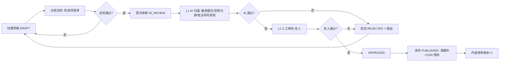
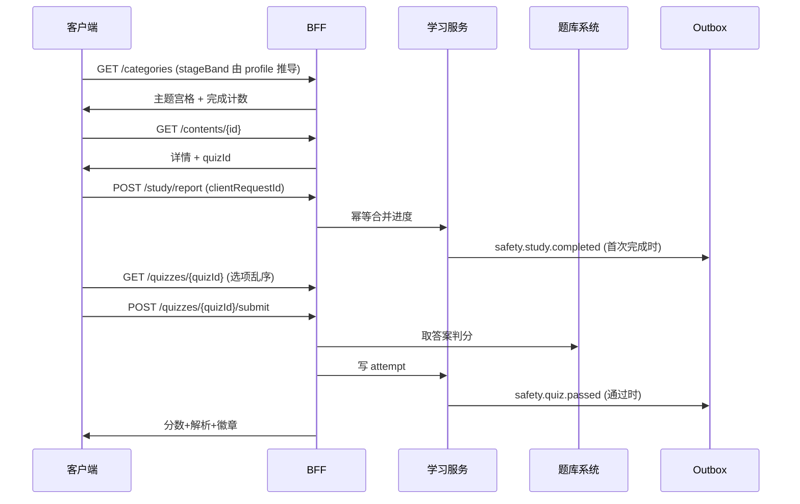
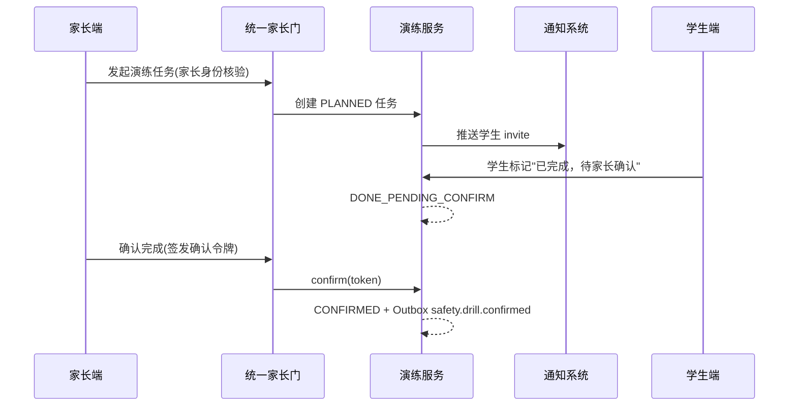

# 安全教育内容模块详细设计

> **模块定位**：本模块为 PrimeTop 提供覆盖幼儿至高中全学段的**安全教育通识内容**能力，包括防溺水、防拐骗、交通安全、消防安全、用电安全、校园安全（防欺凌）、网络安全、急救常识、自然灾害应对、身心自护十大主题。内容形态包含情景动画、图文课件、互动问答、儿歌与家庭演练任务，构建"学—练—演—测—巩固"的完整安全教育闭环。
> **对应原设计**：《启硕-PrimeTop-全学段AI辅助学习软件项目设计文档》§2.1 建设目标（全学段学习入口）、§4.3 用户痛点（家长辅导能力有限）、§6.5.2（幼儿启蒙"简单常识"）、§8.7 安全与合规架构（未成年人保护）。安全教育此前在 docs2 各文档中**零覆盖**，本模块为首次细化。

## 1. 概述

### 1.1 模块定位

安全教育内容模块是 PrimeTop"全学段覆盖"产品定位下的一块通识学习内容域。它与学科类内容（语文/数学/英语等）并行，属于**非考试导向的素养类内容**，与"幼儿启蒙-简单常识""道德与法治"学科内容存在边界：

| 维度 | 安全教育（本模块） | 道德与法治（学科内容） |
| --- | --- | --- |
| 目标 | 保命技能与风险规避行为习惯 | 法治观念、社会规则、价值观 |
| 内容来源 | 权威公益素材授权改编 + 原创 | 教材课标体系 |
| 组织方式 | 主题制（十大主题×适龄版本） | 教材章节制 |
| 交互方式 | 情景动画、演练任务、互动问答 | 课件阅读、同步练习 |
| 考核方式 | 情景判断题（通过制，不打分排名） | 常规判分、纳入学情 |

本模块与既有系统的关系：

- **内容生产**：复用《服务端-教育内容审核工作流与多级审核管线》与《服务端-教育内容供应商接入与外部资源标准化导入引擎》，本模块只增加"安全主题合规检查项"。
- **适龄分级**：复用《教育内容适龄性评估与分级引擎》的年龄段分级框架（K/P1-3/P4-6/J/S 五档），但增加安全域特有的**心理安全分级**（不得出现血腥、伤亡、恐吓画面）。
- **互动问答**：题目注册进题库系统 safety 学科域（学科 code=`safety`，全学段可用），复用《题目管理与题库系统》与统一判题引擎。
- **掌握度**：本模块**不直接写**知识点掌握度，学习结果通过 Outbox 事件交由《知识追踪模型引擎与学生能力动态评估服务》统一更新，避免双写。
- **成长激励**：测验通过、演练完成触发徽章/积分，复用《成长激励体系》，事件经激励规则引擎消费。
- **家长协同**：家庭演练任务的创建与确认复用《服务端-统一家长门与监护人授权核验引擎》。

### 1.2 核心职责

1. **安全主题内容管理**：十大主题内容的元数据管理、适龄版本管理、媒体资源管理。
2. **内容合规生产管线**：权威来源校验、双人审校、心理安全红线检查、AIGC 标识。
3. **分龄学习分发**：按学生学段/年龄分发对应适龄版本，客户端不得渲染非本学段内容。
4. **互动测验**：情景判断题测验（通过制），支持重复练习。
5. **家庭演练任务**：家长发起、学生完成、家长确认的线下演练闭环（如火灾逃生路线演练）。
6. **学习报告**：向学生端和家长端输出主题掌握情况与演练记录。

### 1.3 非职责（明确排除）

- 不做实时安全预警（如天气灾害推送）——归《通知中心与站内消息系统》。
- 不做心理健康危机干预——已有《服务端-学生AI对话心理危机信号检测与分级预警干预编排引擎》专项负责，本模块内容中出现的心理求助信息仅做静态指引（如"告诉信任的大人"话术）。
- 不做网络安全行为管控——归《服务端-学生数字安全防护与上网行为保护引擎》。

### 1.4 依赖关系

```
安全教育内容模块
    ├─ 依赖：用户服务（学生画像、学段/年龄）
    ├─ 依赖：题库系统（safety 学科互动题）
    ├─ 依赖：教育内容审核管线（L1/L2 审核）
    ├─ 依赖：适龄性评估引擎（五档分级框架）
    ├─ 依赖：统一家长门（演练任务确认）
    ├─ 依赖：知识追踪引擎（掌握度单写者）
    ├─ 依赖：成长激励体系（徽章/积分消费事件）
    ├─ 依赖：对象存储/CDN（媒体资源分发）
    └─ 被依赖：首页工作台（主题入口卡片）、家长中心（安全报告 Tab）
```

## 2. 系统架构

### 2.1 整体分层

```
客户端层（Flutter）
    ├─ 安全教育主题广场（分类宫格）
    ├─ 内容学习页（情景动画/图文课件播放器）
    ├─ 情景测验页（互动问答）
    ├─ 演练任务卡（家长确认入口）
    └─ 安全徽章墙（复用成就勋章组件）

BFF 层
    └─ /api/v1/safety/* 聚合（内容+进度+测验+演练 一次下发）

服务层
    ├─ 安全教育内容服务：主题/内容元数据 CRUD、版本与发布
    ├─ 安全教育学习服务：学习进度、测验提交、记录查询
    ├─ 安全教育演练服务：家庭演练任务生命周期
    └─ 安全教育报告服务：学生/家长视角报告聚合

AI 能力层
    ├─ 内容审核（L1 AI 扫描：敏感画面/文字/恐怖元素）
    ├─ 情景题生成辅助（AI 辅助出题，必须人工复核 + AIGC 标识）
    └─ 学习引导话术（鼓励语，复用 AI 对话引擎）

数据层
    ├─ PostgreSQL：主题/内容/记录/演练任务
    ├─ Redis：内容清单缓存、测验限流
    ├─ 对象存储 + CDN：动画/音频/图片资源
    └─ 题库系统：safety 学科互动题（复用）
```

### 2.2 服务边界

| 服务 | 负责 | 不负责 |
| --- | --- | --- |
| 安全教育内容服务 | 主题与内容元数据、适龄版本、发布生命周期 | 学习记录、掌握度计算 |
| 安全教育学习服务 | 学习进度上报、测验提交与判定、记录查询 | 内容生产、题库管理 |
| 安全教育演练服务 | 演练任务创建/确认/过期调度 | 家长身份核验（委托统一家长门） |
| 安全教育报告服务 | 聚合报告（读模型，T+1 预计算 + 实时明细） | 报告生成用 AI 解读（委托学情诊断引擎） |

## 3. 数据模型

### 3.1 核心实体关系

```
SafetyCategory (1) <--(1:N)--> SafetyContent
SafetyContent (1) <--(1:N)--> SafetyContentVersion   -- 按适龄档多版本
SafetyContent (1) <--(1:N)--> SafetyContentKp        -- 知识点映射（可选）
SafetyQuiz (1) <--(1:N)--> SafetyQuizItem             -- 测验与题目绑定（题目实体在题库系统）
StudentProfile (1) <--(1:N)--> SafetyStudyRecord
StudentProfile (1) <--(1:N)--> SafetyQuizAttempt
StudentProfile (1) <--(1:N)--> SafetyDrillTask
```

### 3.2 数据库表设计

#### 3.2.1 safety_category（安全主题分类）

| 字段 | 类型 | 约束 | 说明 |
| --- | --- | --- | --- |
| id | UUID | PK, NOT NULL | 唯一标识 |
| code | VARCHAR(32) | UNIQUE, NOT NULL | 编码：water_drowning/anti_abduct/traffic/fire/electric/campus_anti_bully/net_safety/first_aid/natural_disaster/self_care |
| name | VARCHAR(64) | NOT NULL | 主题名：防溺水、防拐骗… |
| icon_url | VARCHAR(512) | | 主题图标（CDN） |
| sort_order | INTEGER | NOT NULL DEFAULT 0 | 宫格排序 |
| target_stage_bands | JSONB | NOT NULL | 适用年龄档数组，如 ["K","P1_3","P4_6"] |
| intro_text | VARCHAR(256) | | 主题一句话简介 |
| status | VARCHAR(16) | NOT NULL DEFAULT 'ACTIVE', CHECK(status IN ('ACTIVE','HIDDEN','ARCHIVED')) | |
| created_at / updated_at | TIMESTAMPTZ | NOT NULL DEFAULT now() | |

#### 3.2.2 safety_content（内容主表）

| 字段 | 类型 | 约束 | 说明 |
| --- | --- | --- | --- |
| id | UUID | PK, NOT NULL | |
| category_id | UUID | FK→safety_category, NOT NULL | 所属主题 |
| stage_band | VARCHAR(8) | NOT NULL, CHECK(stage_band IN ('K','P1_3','P4_6','J','S')) | 适龄档：幼儿/小学低/小学高/初中/高中 |
| content_type | VARCHAR(16) | NOT NULL, CHECK(content_type IN ('ANIMATION','SLIDES','ARTICLE','SONG','SCENARIO')) | 形态 |
| title | VARCHAR(128) | NOT NULL | 标题 |
| subtitle | VARCHAR(256) | | 副标题 |
| cover_url | VARCHAR(512) | | 封面 |
| media_url | VARCHAR(512) | | 媒体地址（动画/音频），SLIDES/ARTICLE 可为空 |
| duration_sec | INTEGER | | 预计学习时长（秒） |
| learning_points | JSONB | | 学习目标要点数组（≤5 条） |
| key_facts | JSONB | | 必须记住的关键事实数组（如紧急电话、口诀） |
| source_type | VARCHAR(16) | NOT NULL, CHECK(source_type IN ('OFFICIAL_LICENSED','ORIGINAL','AI_ASSISTED')) | 来源 |
| source_ref | VARCHAR(256) | | 来源引用（如"应急管理部公益宣传素材，授权号 xxx"） |
| aigc_flag | BOOLEAN | NOT NULL DEFAULT FALSE | AIGC 内容标识（AI_ASSISTED 必为 TRUE，发布时强制展示标识） |
| emergency_numbers | JSONB | | 文中出现的紧急电话号码数组，用于合规校验（见 G3） |
| version | INTEGER | NOT NULL DEFAULT 1 | 内容版本号 |
| status | VARCHAR(16) | NOT NULL DEFAULT 'DRAFT', CHECK(status IN ('DRAFT','IN_REVIEW','APPROVED','PUBLISHED','REJECTED','OFFLINE','ARCHIVED')) | |
| review_checklist_version | VARCHAR(16) | NOT NULL DEFAULT 'v1' | 合规检查项版本 |
| published_at | TIMESTAMPTZ | | |
| created_by / updated_by | UUID | | 操作人 |
| created_at / updated_at | TIMESTAMPTZ | NOT NULL DEFAULT now() | |

唯一约束：`UNIQUE(category_id, stage_band, title)` —— 同主题同年龄档同标题去重。

#### 3.2.3 safety_content_version（适龄版本快照，可选启用）

MVP 阶段 `safety_content` 一行即一个适龄版本（由 UNIQUE 约束保证）。当同一主题某年龄档需要多形态内容（如既有动画又有儿歌）时启用本表，将 media 字段迁移至此表。v1.0 暂不建表，预留演进。

#### 3.2.4 safety_content_kp（知识点映射，可选）

| 字段 | 类型 | 约束 | 说明 |
| --- | --- | --- | --- |
| content_id | UUID | FK, NOT NULL | |
| kp_id | UUID | NOT NULL | 知识点体系 ID（复用知识点体系与教材映射引擎） |
| rel_type | VARCHAR(16) | NOT NULL DEFAULT 'RELATED', CHECK(rel_type IN ('CORE','RELATED')) | |

安全主题知识点挂在 `subject.code='safety'`（安全教育）学科域下，该学科由《学科与科目基础数据管理》以"素养学科"类型注册，不参与考试与排名。

#### 3.2.5 safety_quiz（情景测验）

| 字段 | 类型 | 约束 | 说明 |
| --- | --- | --- | --- |
| id | UUID | PK, NOT NULL | |
| content_id | UUID | FK→safety_content, NOT NULL | 关联学习内容 |
| title | VARCHAR(128) | NOT NULL | 测验名 |
| pass_score | INTEGER | NOT NULL DEFAULT 80 | 通过分（百分制，默认 80） |
| max_attempts_per_day | INTEGER | NOT NULL DEFAULT 10 | 每日限次（防刷） |
| status | VARCHAR(16) | NOT NULL DEFAULT 'PUBLISHED', CHECK(status IN ('DRAFT','PUBLISHED','OFFLINE')) | |

#### 3.2.6 safety_quiz_item（测验题目绑定）

题目本体注册在题库系统（subject=safety），本表仅做绑定与排序：

| 字段 | 类型 | 约束 | 说明 |
| --- | --- | --- | --- |
| quiz_id | UUID | FK→safety_quiz, NOT NULL | |
| question_id | UUID | NOT NULL | 题库系统题目 ID |
| sort_order | INTEGER | NOT NULL | 出题顺序 |
| PRIMARY KEY (quiz_id, question_id) | | | |

题目题型限定为 `SCENARIO_JUDGE`（情景判断）与 `SINGLE_CHOICE`（单选），由题库系统题型注册中心支持。

#### 3.2.7 safety_study_record（学习记录）

| 字段 | 类型 | 约束 | 说明 |
| --- | --- | --- | --- |
| id | UUID | PK | |
| user_id | UUID | NOT NULL | |
| content_id | UUID | NOT NULL | |
| progress_pct | SMALLINT | NOT NULL DEFAULT 0, CHECK(0-100) | |
| completed | BOOLEAN | NOT NULL DEFAULT FALSE | |
| duration_sec | INTEGER | NOT NULL DEFAULT 0 | 累计有效学习时长 |
| first_studied_at | TIMESTAMPTZ | | |
| last_studied_at | TIMESTAMPTZ | NOT NULL DEFAULT now() | |
| client_request_id | VARCHAR(64) | NOT NULL | 幂等键（见 §8） |
| created_at / updated_at | TIMESTAMPTZ | NOT NULL DEFAULT now() | |

唯一约束：`UNIQUE(user_id, content_id)`；进度上报按 (user_id, content_id, client_request_id) 幂等。

#### 3.2.8 safety_quiz_attempt（测验记录）

| 字段 | 类型 | 约束 | 说明 |
| --- | --- | --- | --- |
| id | UUID | PK | |
| user_id | UUID | NOT NULL | |
| quiz_id | UUID | NOT NULL | |
| score | SMALLINT | NOT NULL | 得分 |
| passed | BOOLEAN | NOT NULL | 是否通过 |
| answers | JSONB | NOT NULL | 作答明细 [{question_id, choice, correct}] |
| attempt_seq | INTEGER | NOT NULL | 当日第 N 次 |
| idempotency_key | VARCHAR(64) | NOT NULL | |
| created_at | TIMESTAMPTZ | NOT NULL DEFAULT now() | |

唯一约束：`UNIQUE(user_id, quiz_id, idempotency_key)`。

#### 3.2.9 safety_drill_task（家庭演练任务）

| 字段 | 类型 | 约束 | 说明 |
| --- | --- | --- | --- |
| id | UUID | PK | |
| family_id | UUID | NOT NULL | 家庭账户 ID |
| user_id | UUID | NOT NULL | 学生 |
| content_id | UUID | NOT NULL | 由哪条学习内容发起 |
| drill_type | VARCHAR(32) | NOT NULL | 演练类型：fire_escape/route_plan/emergency_call/self_protection_drill…（内容模板声明） |
| plan_date | DATE | NOT NULL | 计划日期 |
| status | VARCHAR(16) | NOT NULL DEFAULT 'PLANNED', CHECK(status IN ('PLANNED','DONE_PENDING_CONFIRM','CONFIRMED','EXPIRED','CANCELLED')) | |
| parent_confirm_token | VARCHAR(64) | | 家长确认令牌（统一家长门签发） |
| note | VARCHAR(256) | | 家长备注 |
| completed_at / confirmed_at | TIMESTAMPTZ | | |
| created_by | UUID | NOT NULL | 家长 user_id |
| created_at / updated_at | TIMESTAMPTZ | NOT NULL DEFAULT now() | |

### 3.3 Redis 键规划

| 键 | 类型 | TTL | 说明 |
| --- | --- | --- | --- |
| safety:cat:list:{stageBand} | STRING(JSON) | 10 min | 主题宫格清单 |
| safety:content:list:{categoryId}:{stageBand} | STRING(JSON) | 10 min | 内容列表 |
| safety:content:{id} | STRING(JSON) | 30 min | 内容详情 |
| safety:quiz:daycount:{userId}:{quizId}:{yyyyMMdd} | STRING | 24 h | 当日测验次数 |
| safety:drill:confirm:{taskId} | STRING | 15 min | 家长确认令牌缓存 |

## 4. API 接口设计

统一约定：
- 认证：Bearer Token（复用统一认证授权体系）；家长端接口需家长角色。
- 响应封装：复用《服务端统一响应封装与分页查询规范》`{ code, message, data }`。
- 分页：page（1 起）+ page_size（≤50）。
- 全部写接口支持幂等（Idempotency-Key 头或 client_request_id 字段）。

### 4.1 学生端接口

#### 4.1.1 GET /api/v1/safety/categories — 主题宫格

响应：

```json
{
  "code": 0,
  "message": "ok",
  "data": {
    "items": [
      {
        "categoryId": "c-01",
        "code": "water_drowning",
        "name": "防溺水",
        "iconUrl": "https://cdn.example.com/safety/icons/water.png",
        "introText": "不到危险水域玩耍，学会正确呼救",
        "contentCount": 4,
        "myCompletedCount": 2
      }
    ]
  }
}
```

服务端按学生 profile 的 stage_band 过滤 target_stage_bands 包含该档的主题；`myCompletedCount` 为实时联表统计（走索引，见 §11 性能说明）。

#### 4.1.2 GET /api/v1/safety/contents — 内容列表

请求：`categoryId`（必填）、`page`、`page_size`。

响应 data.items：`[{contentId, title, subtitle, coverUrl, contentType, durationSec, learningPoints(前2条), aigcFlag, myProgressPct, completed}]`。

#### 4.1.3 GET /api/v1/safety/contents/{contentId} — 内容详情

守卫：stage_band 与学生年龄档不匹配时返回 `SAFETY_003`（403），客户端应拦截深链接（G2）。

响应：内容全字段 + `mediaUrl` + `quizId`（若有测验）+ `relatedContentIds`（同主题相邻年龄档不返回，仅同学段相关，防跨档渲染）。

#### 4.1.4 POST /api/v1/safety/study/report — 学习进度上报

请求：

```json
{
  "contentId": "cnt-123",
  "progressPct": 100,
  "durationSec": 210,
  "completed": true,
  "clientRequestId": "8f2d-...-uuid"
}
```

语义：
- 首次上报创建记录，之后为增量合并：`progressPct = max(旧值, 新值)`、`durationSec += 增量`、`completed` 单向 true。
- 同一 `clientRequestId` 重复提交返回上次结果（200，幂等语义码 SAFETY_102）。
- `completed` 首次由 false→true 时同事务写 Outbox `safety.study.completed`（见 §9）。

#### 4.1.5 GET /api/v1/safety/quizzes/{quizId} — 取题

响应：题目列表（题干 + 情景描述 + 选项，**不含正确答案**），选项由服务端乱序下发（防位置记忆，复用练习测评会话规范）。

#### 4.1.6 POST /api/v1/safety/quizzes/{quizId}/submit — 提交测验

请求：

```json
{
  "answers": [
    {"questionId": "q-1", "choice": "B"},
    {"questionId": "q-2", "choice": "A"}
  ],
  "idempotencyKey": "req-uuid"
}
```

服务端行为：限次预检（超次 SAFETY_005）→ 拉取正确答案（题库系统）→ 判分 → 写 attempt → 通过则写 Outbox `safety.quiz.passed` → 返回分数与逐题正误及解析。

响应：

```json
{
  "code": 0,
  "data": {
    "score": 85,
    "passed": true,
    "results": [
      {"questionId": "q-1", "correct": true, "explanation": "发现同伴落水应立即呼救，不可盲目下水……"},
      {"questionId": "q-2", "correct": false, "yourChoice": "A", "correctChoice": "C", "explanation": "……"}
    ],
    "badgeAwarded": {"badgeCode": "safety_water_guard", "name": "防溺水小卫士"}
  }
}
```

`badgeAwarded` 由激励引擎同步计算后在响应中回填（同一请求内同步调用，延迟预算见 §11）。

### 4.2 家长端接口

#### 4.2.1 GET /api/v1/parent/safety/overview — 安全学习总览

返回每个主题的 `{contentCount, completedCount, lastStudiedAt, quizPassCount}` 矩阵。

#### 4.2.2 POST /api/v1/parent/safety/drill-tasks — 发起演练任务

请求：`{contentId, planDate, note?}`。服务端校验内容已 PUBLISHED 且演练类型存在，创建 PLANNED 任务并推送学生端（复用通知系统，模板 `safety.drill.invite`）。

#### 4.2.3 POST /api/v1/parent/safety/drill-tasks/{taskId}/confirm — 确认完成

请求头需携带来自统一家长门的确认令牌（家长操作上下文）。状态机 PLANNED/DONE_PENDING_CONFIRM → CONFIRMED，写 Outbox `safety.drill.confirmed`。

#### 4.2.4 GET /api/v1/parent/safety/reports — 阶段报告

返回近 90 天学习/测验/演练汇总，数据来自报告服务读模型（T+1）+ 近 7 天实时明细拼接。

### 4.3 管理后台接口

| 接口 | 说明 |
| --- | --- |
| POST /admin/v1/safety/categories | 新建主题 |
| PUT /admin/v1/safety/categories/{id} | 编辑主题（排序/简介/适龄档） |
| POST /admin/v1/safety/contents | 新建内容草稿 |
| PUT /admin/v1/safety/contents/{id} | 编辑草稿（仅 DRAFT/REJECTED 态） |
| POST /admin/v1/safety/contents/{id}/submit-review | 提交审核（触发 L1 AI 扫描） |
| POST /admin/v1/safety/contents/{id}/approve | 双人审校通过（记录第二审校人） |
| POST /admin/v1/safety/contents/{id}/reject | 驳回（必填理由） |
| POST /admin/v1/safety/contents/{id}/publish | 发布（仅 APPROVED 态，幂等） |
| POST /admin/v1/safety/contents/{id}/offline | 紧急下线（立即清缓存+CDN 失效，见 G7） |
| GET /admin/v1/safety/review-queue | 审核队列（按状态/主题/适龄档过滤） |
| GET /admin/v1/safety/stats | 看板：主题维度学习/测验/演练聚合 |

## 5. 核心流程

### 5.1 内容生产与发布管线



发布后为不可变快照（修改需走新版本，version+1 重新审核，老版本继续服务至新版本发布）。

### 5.2 学习主链路时序



### 5.3 家庭演练任务时序



过期调度：每日 02:10 批任务将 `plan_date < today-3` 且仍为 PLANNED/DONE_PENDING_CONFIRM 的任务置 EXPIRED。

### 5.4 状态机汇总

**内容状态机**：`DRAFT → IN_REVIEW → APPROVED → PUBLISHED → OFFLINE/ARCHIVED`；`IN_REVIEW → REJECTED → DRAFT`（修改后重提）。

**学习记录**：隐式两态（未完成/完成），completed 单向迁移，不可回退（复学重看只累加时长与进度）。

**测验尝试**：无状态机，attempt 只增不改；限次计数为派生值（Redis 计数 + 日终落 attempt 表校准）。

**演练任务**：`PLANNED → DONE_PENDING_CONFIRM → CONFIRMED`；`PLANNED → EXPIRED/CANCELLED`；`DONE_PENDING_CONFIRM → EXPIRED`（家长 3 天未确认）。

## 6. 关键代码示例

### 6.1 学习进度上报（幂等合并，Java/Spring）

```java
@Transactional
public StudyReportResponse reportProgress(UUID userId, StudyReportRequest req) {
    SafetyStudyRecord rec = recordRepo.findByUserIdAndContentId(userId, req.contentId())
        .orElseGet(() -> {
            SafetyStudyRecord n = new SafetyStudyRecord();
            n.setUserId(userId); n.setContentId(req.contentId());
            n.setClientRequestId(req.clientRequestId());
            return n;
        });

    // G5: clientRequestId 重复 -> 幂等返回
    if (rec.getId() != null && req.clientRequestId().equals(rec.getClientRequestId())
            && rec.getUpdatedAt().isAfter(Instant.now().minusSeconds(300))) {
        return toResponse(rec, true); // SAFETY_102 语义，HTTP 200
    }

    boolean firstComplete = !rec.isCompleted() && req.completed();
    rec.setProgressPct((short) Math.max(rec.getProgressPct(), req.progressPct()));
    rec.setDurationSec(rec.getDurationSec() + Math.max(0, req.durationSec()));
    if (req.completed()) rec.setCompleted(true);
    if (rec.getFirstStudiedAt() == null) rec.setFirstStudiedAt(Instant.now());
    rec.setLastStudiedAt(Instant.now());
    recordRepo.save(rec);

    if (firstComplete) {
        outboxRepo.save(OutboxEvent.of("safety.study.completed",
            Map.of("userId", userId, "contentId", req.contentId(),
                   "categoryId", rec.getContent().getCategoryId(),
                   "stageBand", rec.getContent().getStageBand())));
    }
    return toResponse(rec, false);
}
```

### 6.2 情景测验提交（限次 + 判分 + 徽章回填）

```java
@Transactional
public QuizSubmitResponse submit(UUID userId, UUID quizId, QuizSubmitRequest req) {
    String dayKey = "safety:quiz:daycount:" + userId + ":" + quizId + ":" + LocalDate.now();
    Long count = redis.opsForValue().increment(dayKey);
    if (count == 1) redis.expire(dayKey, Duration.ofHours(24));
    SafetyQuiz quiz = quizRepo.findById(quizId).orElseThrow(() -> new BizException(SAFETY_001));
    if (count > quiz.getMaxAttemptsPerDay()) throw new BizException(SAFETY_005);

    List<UUID> qids = req.answers().stream().map(Answer::questionId).toList();
    Map<UUID, QuestionAnswer> answerMap = questionClient.getAnswers(qids); // 题库系统
    int correct = 0;
    List<ResultItem> results = new ArrayList<>();
    for (Answer a : req.answers()) {
        QuestionAnswer qa = answerMap.get(a.questionId());
        boolean ok = qa.correctChoice().equals(a.choice());
        if (ok) correct++;
        results.add(new ResultItem(a.questionId(), ok, a.choice(), qa.correctChoice(), qa.explanation()));
    }
    int score = Math.round(100f * correct / req.answers().size());

    attemptRepo.save(SafetyQuizAttempt.of(userId, quizId, score, score >= quiz.getPassScore(),
        req.answers(), req.idempotencyKey(), count.intValue()));

    BadgeAward badge = null;
    if (score >= quiz.getPassScore()) {
        outboxRepo.save(OutboxEvent.of("safety.quiz.passed",
            Map.of("userId", userId, "quizId", quizId, "contentId", quiz.getContentId())));
        badge = incentiveClient.tryAward(userId, "safety_" + quiz.getContent().getCategory().getCode() + "_guard");
    }
    return new QuizSubmitResponse(score, score >= quiz.getPassScore(), results, badge);
}
```

### 6.3 发布管线中的紧急电话合规校验（G3）

```java
private static final Map<String, String> EMERGENCY_WHITELIST = Map.of(
    "110", "报警", "119", "火警", "120", "急救", "122", "交通事故"
);

public void validateEmergencyNumbers(SafetyContent content) {
    if (content.getEmergencyNumbers() == null) return;
    for (String num : content.getEmergencyNumbers()) {
        if (!EMERGENCY_WHITELIST.containsKey(num)) {
            throw new BizException(SAFETY_006, "非白名单紧急电话: " + num
                + "，安全内容仅允许引用权威号码 110/119/120/122");
        }
    }
}
```

### 6.4 客户端适龄渲染守卫（Flutter，G2）

```dart
class SafetyContentGate {
  static const _bandOrder = ['K', 'P1_3', 'P4_6', 'J', 'S'];

  static bool canRender(String contentStageBand, StudentProfile p) {
    if (contentStageBand == p.stageBand) return true;
    // 只允许向上兼容一档以内（如 P4_6 可看 P1_3），禁止低龄看高龄内容
    final gap = _bandOrder.indexOf(contentStageBand) - _bandOrder.indexOf(p.stageBand);
    return gap < 0 && gap >= -1;
  }
}
// 深链接进入时同样过闸，拦截返回 SAFETY_003 错误页，不可绕过
```

## 7. 守卫规则（G1–G10）

| 编号 | 规则 | 级别 |
| --- | --- | --- |
| G1 | 内容发布前必须完成双人人工审校，缺一不可发布（fail-closed） | 红线 |
| G2 | 客户端适龄渲染闸门：低龄档不可渲染高龄档内容，深链接不可绕过 | 红线 |
| G3 | 紧急电话仅允许 110/119/120/122 白名单号码，其他号码在审核阶段硬拦截 | 红线 |
| G4 | 掌握度不双写：本模块只发事件，统一由知识追踪引擎更新 | 红线 |
| G5 | 学习上报幂等：同 clientRequestId 5 分钟窗口内重复上报视为成功不回滚进度 | 强约束 |
| G6 | 演练任务确认必须经统一家长门令牌，学生端不可自确认 | 红线 |
| G7 | 紧急下线 5 分钟内生效：Redis 清单删除 + CDN 失效 + 客户端内容清单版本号+1 | 强约束 |
| G8 | AI 辅助生成/出题内容必须 `aigcFlag=true` 且经人工复核后方可发布 | 红线 |
| G9 | 血腥、伤亡、惊悚画面零容忍：L1 图片审核 + L2 人工逐帧确认动画 | 红线 |
| G10 | 用户注销后 30 天内删除其学习/测验/演练全部记录（事件订阅 user.account.deleted） | 红线 |

## 8. 幂等与并发

| 场景 | 机制 |
| --- | --- |
| 学习上报重复提交 | (user_id, content_id) 单行 + clientRequestId 窗口幂等；离线补报 48h 窗口 |
| 测验提交重复 | UNIQUE(user_id, quiz_id, idempotency_key)，冲突返回首次结果 |
| 演练任务重复创建 | 同一 (family_id, content_id, plan_date) 存在 PLANNED 任务时返回已有任务（合并语义） |
| 发布接口重复点击 | PUBLISHED 态重复 publish 返回成功（幂等）；APPROVED 外的 publish 返回 SAFETY_007 |
| 确认令牌重放 | 令牌一次性消费，CONFIRMED 后重放返回 SAFETY_104（200 语义，当前态回显） |
| 多端并发上报 | 单行 upsert + 乐观字段合并（max 进度、累加时长），无 lost update |
| 审核并发操作 | 状态迁移统一走 `UPDATE ... WHERE status = 期望前置态` CAS，影响行数 0 抛 SAFETY_008 |

## 9. 事件 Outbox

| 事件 | 发布时机 | 订阅方 |
| --- | --- | --- |
| safety.study.completed | 学习首次完成 | 知识追踪引擎（掌握度）、成长激励（积分）、报告服务（读模型） |
| safety.quiz.passed | 测验首次通过（重复通过不重复发，以 quiz 维度去重 24h） | 成长激励（徽章）、知识追踪引擎、报告服务 |
| safety.drill.confirmed | 演练任务确认 | 成长激励（家庭协作徽章）、报告服务 |
| safety.content.published | 内容发布 | 搜索索引、内容清单缓存刷新 |
| safety.content.offlined | 内容下线 | 搜索索引、缓存清理 |

对账：每日 04:30 对账任务核对「attempt 通过数 = quiz.passed 事件数」与「completed 学习记录数 = study.completed 事件数」，偏差 >0 触发补偿重放（幂等消费保证安全）。

## 10. 错误码（SAFETY_xxx 符号化体系）

| 错误码 | HTTP | 说明 |
| --- | --- | --- |
| SAFETY_001 | 404 | 内容/测验不存在或已下线 |
| SAFETY_002 | 400 | 参数校验失败（progressPct 越界等） |
| SAFETY_003 | 403 | 适龄档不匹配，禁止访问 |
| SAFETY_004 | 429 | 学习上报过于频繁（客户端节流不当） |
| SAFETY_005 | 429 | 测验当日次数超限 |
| SAFETY_006 | 400 | 非白名单紧急电话（管理端审核拦截） |
| SAFETY_007 | 409 | 非法状态迁移（如 DRAFT 直接发布） |
| SAFETY_008 | 409 | 审核并发冲突，请刷新后重试 |
| SAFETY_102 | 200 | 学习上报幂等命中（语义码，同 SAFETY_005 类幂等码不透传为错误） |
| SAFETY_104 | 200 | 演练任务已是确认态（幂等回显） |

## 11. 降级矩阵与性能

### 11.1 降级 D1–D8

| 编号 | 故障 | 降级行为 |
| --- | --- | --- |
| D1 | Redis 不可用 | 读穿透到 DB；限次计数降级为 attempt 表当日 COUNT（可能略慢，不阻断） |
| D2 | 题库系统不可用 | 测验提交返回 SAFETY_001 并引导稍后重试；学习功能不受影响 |
| D3 | 激励服务超时 | 徽章字段返回 null，事件已入 Outbox 不丢（最终一致） |
| D4 | 报告读模型未生成 | 家长报告回退实时明细查询（近 90 天），仅 T+1 部分缺失 |
| D5 | CDN 故障 | 媒体走对象存储直连 + 客户端本地缓存已学内容照常可看 |
| D6 | 通知系统故障 | 演练任务照创，学生端下次启动拉取待办兜底 |
| D7 | 家长门不可用 | 演练确认失败提示稍后再试（fail-closed，学生端不可代确认） |
| D8 | 总红线 | 适龄过滤（G2）与紧急电话校验（G3）**无任何降级路径** |

### 11.2 性能预算

- 宫格/列表/详情接口 P95 ≤ 200ms（清单走 Redis，完成计数走覆盖索引）。
- 测验提交（含判分+徽章）P95 ≤ 800ms。
- 容量假设：DAU 50 万，安全教育渗透率 15%，日学习上报约 20 万次、测验 5 万次，PostgreSQL 主表轻松承载；媒体流量走 CDN 不回源。
- 内容清单变更通过 `safety:manifest:version` 广播，客户端增量拉取（复用客户端资源包差分机制）。

## 12. 监控指标

| 指标 | 告警阈值 |
| --- | --- |
| 测验提交成功率 | < 99% 持续 15min P2 |
| 学习上报 P95 延迟 | > 500ms 持续 30min P3 |
| 徽章发放失败率 | > 1% 持续 30min P2（事件积压检查） |
| 内容下线生效时长 | > 5min P1（红线 G7） |
| 适龄拦截命中量突增 | 环比 10 倍 P3（可能深链接刷量或分类配置错误） |
| Outbox 对账偏差 | 非零即 P3，持续 3 天升 P2 |
| AI 审核误杀率（人工复核推翻率） | > 15% 提示检查项需调优 P3 |

## 13. 合规红线（C1–C10）

1. **C1 不恐吓**：内容以正向引导（"怎么做是对的"）为主，禁止用血腥后果恐吓低龄儿童；初中以上可适度呈现风险后果但不展示伤亡画面。
2. **C2 权威来源**：涉及急救操作、报警流程等保命知识的内容必须引用权威来源（应急管理部门、红十字会、交管部门官方素材）并在 `source_ref` 留痕。
3. **C3 AIGC 标识**：AI 辅助生成内容发布时强制展示"AIGC 辅助生成"标识（客户端渲染，不可关闭）。
4. **C4 无商业植入**：安全内容内禁止任何商品推荐、广告与会员转化弹窗。
5. **C5 不排名**：安全测验通过制，不打分排名、不进任何排行榜，不与学科成绩混同展示。
6. **C6 家长可见**：家长端默认可查看安全学习全部记录（安全内容无学习隐私边界，与学科类数据的家长可见度分级策略不同，由家庭共享可见度引擎按"安全例外"白名单处理）。
7. **C7 肖像与场景**：情景动画人物不使用真实儿童肖像；拐骗情景不得提供可被模仿的犯罪手法细节（只教识别与应对）。
8. **C8 心理求助指引**：涉及欺凌、自护等主题必须包含"告诉信任的大人/求助渠道"话术，不得替代专业心理干预。
9. **C9 版权**：公益素材改编需取得授权并记录授权号，到期前 30 天由内容版权到期预警引擎接管。
10. **C10 数据最小化**：演练任务仅存计划日期与状态，不上传任何演练过程影像。

## 14. 契约对齐（R1–R10）

| 编号 | 对齐说明 |
| --- | --- |
| R1 | 内容审核复用《教育内容审核工作流与多级审核管线》，本模块只追加安全域检查项（G3/G9/C1-C9），不新建审核流 |
| R2 | 互动题注册进题库系统 safety 学科，判分复用统一判题引擎，本模块不实现判分逻辑（仅编排） |
| R3 | 知识点掌握度权威归知识追踪引擎（G4），徽章权威归成长激励体系 |
| R4 | 家长身份核验权威归统一家长门（G6），演练服务不存家长凭证 |
| R5 | 适龄分档词汇与《教育内容适龄性评估与分级引擎》五档一致：K/P1_3/P4_6/J/S |
| R6 | 通知模板 `safety.drill.invite` 注册进统一通知模板引擎，频控复用通知疲劳度管控 |
| R7 | 媒体分发复用《服务端-CDN内容分发网络与多区域边缘缓存策略》，客户端离线缓存复用资源包差分机制 |
| R8 | AIGC 标识展示复用《服务端-AIGC内容标识与生成内容溯源水印系统》的标识规范 |
| R9 | 紧急下线复用《服务端-教育内容紧急下线与安全事故应急响应工作流引擎》的 L0 通道 |
| R10 | 埋点模块名 `module=safety`，事件注册进埋点规范（见 §15） |

## 15. 埋点事件

| 事件 | 触发 | 关键属性 |
| --- | --- | --- |
| safety_category_view | 主题宫格曝光 | categoryId |
| safety_content_open | 打开内容 | contentId, contentType |
| safety_study_complete | 学习完成（客户端确认） | contentId, durationSec |
| safety_quiz_submit | 提交测验 | quizId, score, passed |
| safety_quiz_explain_view | 查看解析 | questionId |
| safety_drill_view | 演练任务卡曝光 | taskId, drillType |
| safety_drill_mark_done | 学生标记完成 | taskId |
| safety_aigc_flag_view | AIGC 标识曝光 | contentId（用于合规审计） |

隐私：不采集测验作答内容本身（answers 仅存业务库用于解析展示，不进埋点/数仓，数仓仅聚合指标）。

## 16. 验收场景

1. 幼儿档（K）学生访问初中档"防欺凌"内容，被 SAFETY_003 拦截，客户端展示适龄提示页。
2. 同一 clientRequestId 重复上报学习完成，进度不翻倍、事件不重复发。
3. 内容草稿未经双人审校直接调 publish，返回 SAFETY_007。
4. 审核员在内容中填写紧急电话"999"，提交审核被 G3 硬拦截并提示。
5. 测验通过后可重复练习，但 quiz.passed 事件 24h 内仅发一次。
6. 演练任务学生端不可自行确认（无家长门令牌返回 403）。
7. 紧急下线后 5 分钟内：客户端清单刷新不再展示该内容，搜索无结果，深链接打开返回 SAFETY_001。
8. AI 辅助生成内容未勾选 AIGC 标识时无法提交审核（前端禁用 + 服务端校验双保险）。
9. 家长端总览数据与报告服务读模型在 T+1 后一致（抽样 20 用户核对）。
10. 用户注销后 30 天内 safety_study_record / safety_quiz_attempt / safety_drill_task 全部物理删除。
11. Redis 故障期间测验限次不失效也不误放行（DB COUNT 兜底，双写校准日终对账）。
12. 断网重连后离线学习记录 48h 内补报成功且幂等。

## 17. 关联文档

- 《幼儿启蒙-详细设计》（"简单常识"启蒙内容的幼小衔接）
- 《服务端-教育内容审核工作流与多级审核管线》（审核管线复用）
- 《教育内容适龄性评估与分级引擎》（五档分级框架）
- 《题目管理与题库系统》《服务端-多题型统一判题引擎与答案评估策略框架》（互动题复用）
- 《服务端-知识追踪模型引擎与学生能力动态评估服务》（掌握度单写者）
- 《成长激励体系》（徽章/积分消费）
- 《服务端-统一家长门与监护人授权核验引擎》（演练确认）
- 《服务端-教育内容紧急下线与安全事故应急响应工作流引擎》（L0 下线通道）
- 《服务端-AIGC内容标识与生成内容溯源水印系统》（AIGC 标识）
- 《服务端-CDN内容分发网络与多区域边缘缓存策略》（媒体分发）

## 18. 维护记录

- v1.0（2026-10-21）：首次创建。覆盖安全教育内容模块全链路：十大主题内容模型、适龄五档分发、情景测验、家庭演练任务、双人审校发布管线、守卫 G1-G10、幂等并发、Outbox 五事件、SAFETY_xxx 符号化错误码、降级 D1-D8、合规红线 C1-C10、契约对齐 R1-R10、验收 12 条。确定与审核管线/题库/掌握度/家长门/激励等既有权威模块的边界，本模块只做安全域编排与元数据。
