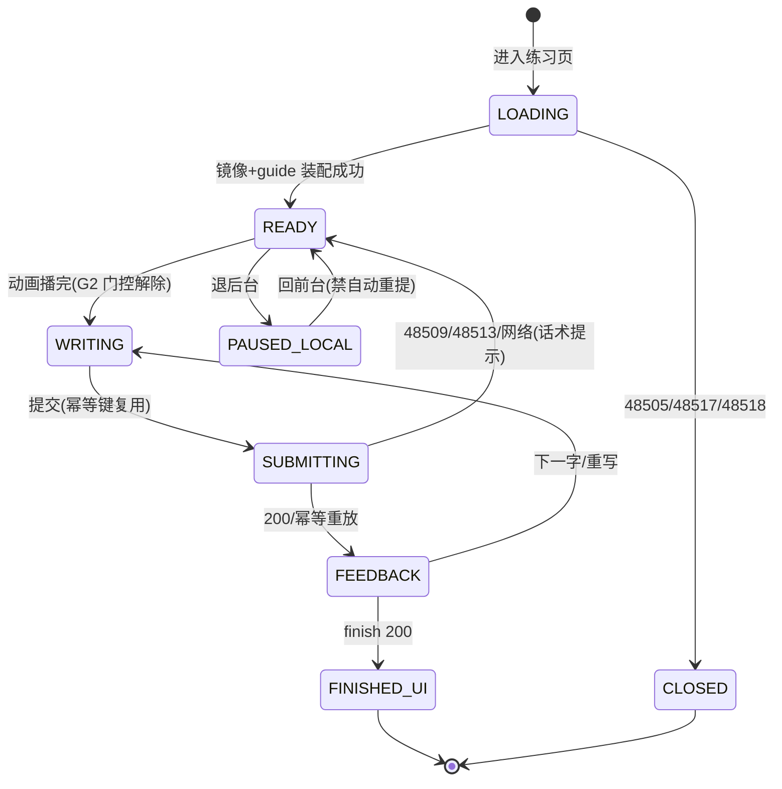
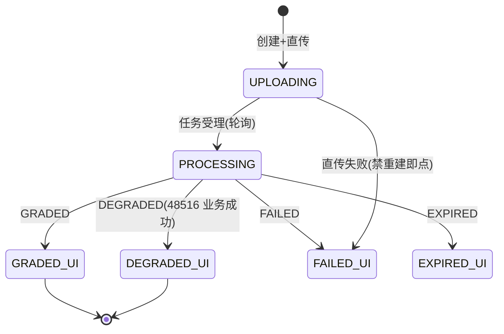

# 客户端-写字练字页面架构与交互设计 详细设计

- 版本: v1.0
- 日期: 2026-11-23
- 状态: 新增初版
- 符号码: WR-001~022 + WR-500(与服务端 48500-48520/48530 在用码 1:1 映射,零新增数字段位;48514/48515/48516/48530 四帧按 200 业务语义诚实渲染)
- 服务端契约: 《服务端-规范汉字书写训练引擎(XZI)》v1.0(2026-11-23)§3 数据结构/§6 API/§8 状态机/§11 错误码 1:1 引用,零发明

## 1. 模块概述

### 1.1 功能定位

本文档是规范汉字书写训练(写字练字)域的**客户端呈现层权威**,兑现 README 批次(四十八)登记的"客户端写字练字页面(字帖渲染/描红交互/整页结果页,服务端已就绪,客户端页面层零覆盖)"缺口。

经全目录关键词扫描确认(2026-11-23,`字帖/描红/练字/田字格/米字格`):服务端《规范汉字书写训练引擎》当日就绪,写字练字**客户端页面层零覆盖**——《汉字笔画顺序检测与评估系统》为学前笔顺判定服务(委托方 R1 而非页面),《客户端-AI听写默写页面架构与交互设计》仅含听写书写格(蹭词命中),《客户端富文本编辑器与作文书写引擎》为作文输入场景,均不含小学同步写字表训练的字帖渲染/描红轨迹采集/整页批改结果呈现链路。本文补齐该缺口(模式同批次(四十)棋类/(四十五)配音/(四十六)词语辨析/(四十七)口算拍照:服务端已就绪→客户端页面层补全)。

写字练字页面的核心交互是**书写过程的无感采集与评分结果的诚实呈现**:描红跟写(TRACE)与临写(COPY)双模式下,客户端负责字格与范字渲染、手写轨迹千分比采集、提交幂等与四维评分结果呈现;整页批改模式负责练字纸拍照直传、轮询进度、服务端标注图叠加格级热区呈现。客户端只做呈现与采集:零判分、零笔顺裁决、零权重、零识别。

### 1.2 覆盖范围

| 范围 | 内容 | 说明 |
| --- | --- | --- |
| 页面族 | `/writing/*` 七路由 + `/parent/writing` 家长端路由 | 见 §2 |
| 描红跟写 | 田字格/米字格渲染、范字笔顺动画播放、轨迹采集与提交 | TRACE 模式,渲染器注册表分发 |
| 临写 | 字帖页渲染(范字+空格)、轨迹或拍照双提交载体 | COPY 模式 |
| 单字反馈 | 四维分呈现(无权重)、verdict 成长型话术、错因枚举映射 | 全部服务端权威,禁本地重算 |
| 整页批改 | 拍照直传/轮询进度/标注图主渲染/bbox 热区/逐格抽屉 | 模式对齐 OCB 客户端 |
| 复习联动 | 今日复习字列表(读间隔重复引擎快照)→一键建复习会话 | 复习调度零本地计算 |
| 书写画像 | 等级成长曲线/薄弱结构类型/错笔型分布 | 统计全部服务端权威 |
| 家长端 | 多孩子切换/书写报告/图片留存说明/改判申请入口 | 改判一次性,学生端无入口 |

### 1.3 明确不做(本期)

1. 不做客户端判分/笔顺裁决/结构分析/权重计算(零判分红线,CI 禁词表 §6.2 G4);
2. 不做 LISTEN(听写联动)书写页面——听写整体委托《客户端-AI听写默写页面架构与交互设计》,书写维度回写为服务端对服务端回调,客户端无感知;
3. 不做软笔书法/毛笔教学与评价(服务端 1.5 非目标);
4. 不做书写速度竞赛/全服排名/班级排名/同学比较组件(零排行组件 CI 白名单,§6.2 G9);
5. 不做规范字等级与社会书法考级的任何挂钩表述(禁考级话术,C6);
6. 不做教师端集体练字作业入口(P2 预留);
7. 不做离线评分伪响应——识别与评分全在服务端,弱网仅诚实提示;
8. 不做 SSE 进度推送(整页轮询 + 推送召回双通道,推送仅完成召回);
9. 不做描红范字本地字库——笔顺数据零内置,全部经服务端快照下发(G6);
10. 不做会话结果本地持久化——镜像仅内存,历史与画像每次回源。

### 1.4 权威边界

| 边界 | 裁决 |
| --- | --- |
| R1 服务端契约权威 | REST/错误码/状态语义/四维口径/verdict 阈值 1:1 引用服务端 §3/§6/§8/§11,本文零发明;字段冲突以服务端正文为准 |
| R2 轨迹坐标协议 | 千分比坐标系(canvas 1000×1000)对齐服务端 §6.3 与 OCB bbox 约定,本文仅采集与回放渲染,禁数值语义解释 |
| R3 笔顺数据 SSOT | 范字笔顺 svgPath 数据权威归《通用词典与汉字字典查询服务》,经服务端写字项快照/guide 下发,客户端零内置零持久化(G6) |
| R4 采集与上传委托 | 拍照/预处理/直传委托《客户端-拍照图像采集与预处理引擎》《客户端-文件上传服务与断点续传机制》,本文定义页序与上传编排 |
| R5 图片加载委托 | 标注图/缩略图加载缓存委托《客户端-统一图片加载缓存框架与智能预加载引擎》(PrimeImageLoader),标注图缓存 TTL 7 天对齐服务端 C3 |
| R6 复习调度委托 | 今日复习字/下次到期全部由间隔重复引擎经服务端快照下发,客户端零计算零缓存调度(与词语辨析 R9 同约定) |
| R7 图表委托 | 成长曲线/雷达图委托《客户端-学习数据可视化与图表渲染引擎》,本文只提供数据接口契约 |
| R8 弹窗与路由 | 模态弹窗委托《客户端-统一对话框与模态弹出层调度管理系统》,路由注册归《客户端-路由与深链接系统》,本文定义 WritingRouteGuard 三闸语义 |
| R9 家长门委托 | 家长-孩子绑定校验委托家长门客户端链路,本文不维护绑定关系;改判申请拉起统一家长门流程 |
| R10 激励不预发 | 等级提升/徽章只消费服务端事件弹窗,禁本地预发(同 puzzle/棋类/配音/口算约定) |
| R11 话术映射权威 | issues[].code 枚举→成长型话术映射与 WRITING_GROWTH_XX 鼓励模板为呈现层客户端权威(服务端 §4.6 裁决),禁扩展枚举值、禁贬义词、禁比较句式 |
| R12 命名空间隔离 | `/writing/*` 与 `/oral-calc/*`(口算拍照)、`/dictation/*`(听写)、`/wd/*`(词语辨析)隔离,深链接互不清意 |

## 2. 路由与页面族

| 路由 | 页面 | 进入条件 | 核心数据源 |
| --- | --- | --- | --- |
| `/writing` | 练字首页(写字表/今日复习/整页入口/画像卡) | 登录;1-6 年级学生身份 | GET /characters + /reviews + /profile |
| `/writing/practice/:sessionNo` | 通用练习页(TRACE/COPY 渲染器分发) | 会话 ACTIVE 且归属本人 | GET /sessions/{sessionNo}(+guide 按需) |
| `/writing/session/:sessionNo/result` | 会话结算页 | 会话 FINISHED | GET /sessions/{sessionNo} + finish 响应 |
| `/writing/page/capture` | 整页拍照上传页 | 登录;当日整页配额未满 | POST /pages + /pages/upload-token |
| `/writing/page/:taskNo` | 整页批改进度页 | 任务归属本人/绑定家长 | GET /pages/{taskNo}(轮询) |
| `/writing/page/:taskNo/result` | 整页结果页(标注图+热区) | status 为 GRADED/DEGRADED | GET /pages/{taskNo} |
| `/writing/profile` | 书写画像页 | 本人 | GET /profile |
| `/parent/writing` | 家长端报告页 | 家长身份+已选孩子 | 聚合 BFF(学生端只读域) |

辅助界面(非独立路由):单字反馈卡(练习页内)、逐格详情抽屉(整页结果页内)、分享卡预览半屏(结算页/整页结果页)。

深链接统一经 WritingRouteGuard 三闸(§5.4);`/writing/*` 与 `/oral-calc/*` 命名空间隔离(R12)。

## 3. 页面架构

### 3.1 `/writing` 练字首页

**布局**:顶部学段标识条(年级×教材版本,委托学科上下文组件)+ 今日复习字卡 + 功能宫格(描红练一练/临写字帖/整页批改)+ 书写画像卡 + 最近会话列表。

**今日复习字卡**:GET /writing/reviews 返回快照 `{date, items: [{charItemId, char, dueFrom, issueCodes}]}`(读间隔重复引擎,服务端权威,R6)。渲染为可横向滑动的字卡序列(≤10 张,超出"更多"入口);"开始复习"按钮 → POST /writing/sessions(mode=COPY,itemIds=快照前 8 项,source=PLAN)→ 直达练习页。复习卡空态渲染"今天没有要复习的字,去练几个新字吧"(中性话术,禁焦虑话术);**禁本地计算到期/优先级**(G12 复习零计算)。

**功能宫格**:
- 描红练一练(TRACE)→ 写字表选择半屏(年级×学期×单元三级,GET /characters 缓存 24h)→ 选 1-8 字 → 建会话(TRACE);
- 临写字帖(COPY)→ 同上,选 4-12 字;
- 整页批改 → `/writing/page/capture`;当日配额卡(服务端下发 used/limit,禁本地预扣 G2):已满渲染"今天批改次数已用完,明天再来吧"(48512 预呈现,WR-013)。

**最近会话卡要素**:sessionNo、日期、模式角标(描红/临写)、字数、状态角标(进行中/已完成/已过期)、PASS 数(仅完成态,服务端值原样渲染)。进行中卡点击直达练习页(48508 单活跃会话裁决的恢复入口)。

### 3.2 `/writing/practice/:sessionNo` 通用练习页(核心页)

**结构**:顶部进度条(第 N/共 M 字)+ 字格主区(渲染器分发)+ 底部工具条(重写/提交/跳过提示)。渲染器注册表按 `session.mode` 分发:

| mode | 渲染器 | 关键差异 |
| --- | --- | --- |
| TRACE | TraceRenderer | 范字笔顺动画全程/分段示范后描红层解锁,轨迹必采 |
| COPY | CopyRenderer | 范字静态呈现+空格临写,支持轨迹或拍照双载体切换 |

**TraceRenderer 交互(描红)**:
1. 进入写字项 → 请求 guide 数据(含 svgPath 笔顺数据,TRACE 按需下发,服务端 §6.2 裁决)→ 内存装配,**禁写磁盘/Hive/文件缓存**(G6 数据零落盘);
2. 范字笔顺动画:按 svgPath 逐笔描绘示范;分龄策略(呈现层参数,数值权威归《分龄UI适配与交互设计规范》):1-2 年级全字示范后解锁描红层;3-4 年级首两笔示范;5-6 年级仅首笔提示;动画播完前提交按钮置灰(G2 门控防穿透);
3. 描红层:半透范字衬底,用户手写轨迹实时渲染(笔锋委托手势系统,千分比坐标 R2);
4. 提交 → TrajectoryCollector 输出 `{strokes: [[[x,y,t],...],...], canvas: {w:1000,h:1000}}`,端侧体积预检 >240KB 即吐司"这一笔内容太多,写简洁些再提交"(48500 客户端预检兜底,引导改用 COPY 拍照模式,禁截断轨迹伪造提交);
5. 服务端响应 → 单字反馈卡(§3.2.1)。

**CopyRenderer 交互(临写)**:
1. 字帖页渲染:范字列 + 空格列(格型来自写字项 gridType:TIAN/MI/HENG 按学段,服务端下发),范字静态渲染(笔顺动画不提供,与服务端 §4.2 口径一致);
2. 载体切换 Tab:"手写板"(轨迹提交,同 TRACE 采集) / "拍照"(委托采集引擎,单张直传 OSS R4,imageRef 提交);
3. 拍照载体走 7 天留存声明条(服务端 C3):"批改后照片将保留 7 天用于复批,到期自动删除"(显形承诺,与 OCB C1 同约定)。

**单字反馈卡(3.2.1)**:提交后底部弹出,四要素:
1. verdict 成长型主话术(映射表 §6.2 G4):PASS→"写得很规范,继续保持!"/ IMPROVE→"已经很接近了,再留意一个小地方"/ RETRY→"这个字我们再来一次会更好";
2. 四维条呈现:笔顺/完整/结构/整洁 各维度 score 原样渲染(服务端值,无权重,不计算总分 G4);`source=DISABLED` 或响应含 degraded 声明时,该维度条渲染"本次未评分"灰条 + 角标(48514/WR-015 诚实呈现 G7),**禁隐藏维度**;
3. 错因枚举卡:issues[].code → 话术映射(R11 权威)渲染,如 BOTTOM_FLAT→"下半部分稍微写扁了一点",MISSING_STROKE→"这一笔容易漏掉,再看看范字";禁渲染 severitiy 原始值、禁技术词;
4. retryAdvice 原文(服务端规则话术)或 AI 异步讲解(若下发 advice 文本,渲染 AIGC 徽标,常量合规);`encourageTpl` 本地模板映射渲染鼓励语。

**会话结算**:末字反馈卡提供"完成练习"→ POST /sessions/{sessionNo}/finish(幂等 clientRequestId=sessionNo 派生)→ 结算页。**进行中退出**:二次确认弹窗(委托模态系统 R8),"退出后本次练习进度保留 24 小时";退出不打断已提交计分(G11)。

### 3.3 `/writing/session/:sessionNo/result` 会话结算页

**数据**:finish 响应 + GET /sessions/{sessionNo} 镜像。要素:练字字数/模式/四维均值(服务端 summary 原样渲染)/等级进度条(若 level.upgraded 事件弹窗,激励不预发 R10)/AI 练习建议异步回填区(生成中骨架→失败则整区隐藏,48530/WR-022 兜底为规则话术)。

**分享卡**:仅服务端脱敏统计卡(字数+等级进度+日期,无姓名无字迹图无四维分明细 G9);分享组件委托,**禁拼入轨迹回放图/字迹照片**。

**下一行动**:复习入口(若服务端标记 reviewRegistered)/返回首页/再来一组。

### 3.4 `/writing/page/capture` 整页拍照上传页

**结构**:顶部页卡横条(1-2 页,每页缩略图+删除+重拍)+ 取景区(委托采集引擎)+ 底部操作条。**相机强制禁相册**(对齐听写 G12 同约定):练字纸必须现场拍摄,禁相册导入(防历史照片混入与隐私最小化)。

**拍照规约**:单页拍摄(服务端整页任务单图血缘,image_sha256 秒传);端侧预处理固定"整页文档模式"(透视矫正/去阴影/增强,R4 委托);本地预检:格式 jpg/png/webp、≤20MB、最小分辨率 1200×1600(过小即吐司"请把纸放平,靠近一点拍",48510/WR-011 客户端预检兜底)。

**上传编排**:
1. "开始批改"→ 按钮置 LOADING 防双击 → POST /writing/pages(clientRequestId=UUID v7,grade/gridType 经学科上下文带入);
2. POST /writing/pages/upload-token(重放 30min)→ 直传 OSS(R4 委托,重试≤2 次仍败整体失败引导重拍);
3. 直传完成 → 本地临时文件 CLEANUP finally 删除(G5),跳进度页;
4. image_sha256 秒传命中(同图 24h):服务端返回原任务,客户端提示"这张已经批改过了"并直达原结果(G11 提示义务)。

**家长发起场景**:经 `/parent/writing` 进入时,创建前渲染确认条"将为 <孩子昵称> 批改练字纸"(昵称脱敏);服务端家长发起不计防沉迷,客户端禁渲染学生端防沉迷文案(呈现区分,WR-005 仅学生端渲染)。

### 3.5 `/writing/page/:taskNo` 整页批改进度页

**阶段呈现**:服务端 status→阶段条映射(禁本地推断):

| 服务端 status | 阶段条呈现 |
| --- | --- |
| CREATED/UPLOADED | "照片已收到,准备开始…" |
| ANALYZING | "正在分析字格版面…" |
| GRADING | "正在逐格评分…"(48515/WR-016 轮询语义帧期间保持) |
| GRADED/DEGRADED | 自动跳结果页 |
| FAILED | 失败态:原因码映射话术(预检不合格→重拍引导;其他→"批改出错了,请重试"禁技术词) |
| EXPIRED | 过期态:"任务已过期,请重新拍照" |

**轮询规则**:1s 起 1.5 倍退避封顶 5s×30 次(对齐 OCB 约定);30 次超时渲染"进度保留中"手动刷新按钮(禁自动重建任务);推送召回通道与服务端完成通知对齐,到达即触发一次轮询(禁推送直驱跳转,以轮询状态为准)。

### 3.6 `/writing/page/:taskNo/result` 整页结果页(核心页)

**主渲染**:服务端标注图(annotatedImageUrl 签名 1h)全幅渲染,格级 bbox(千分比 R2)热区叠加层(透明命中区,委托手势系统);缩放手势委托图片查看组件。

**逐格视觉语义**(全部来自服务端 cell_results,禁本地计算):
- verdict=PASS → 绿角标;IMPROVE → 黄角标;RETRY → 橙角标;UNRECOGNIZED → 灰斜纹"未识别";
- scoreTotal 仅逐格抽屉内呈现(原样值,不计算分布统计 G4)。

**逐格详情抽屉**:点热区弹底部抽屉:范字对照(guide 快照)/格内字迹裁剪图(标注图局部,非原图)/四维条/错因话术/建议重练按钮(跳转单字 COPY 会话,itemId=该格 charItemId)。

**降级诚实呈现**(G7):summary.degradedCells>0 时顶部渲染"有 N 个字没能识别,已按其余字出结果"(48516/WR-017);DEGRADED 状态正常渲染结果,不视为失败。**改判入口**:学生端无;家长端经 `/parent/writing` 任务详情发起 appeal(服务端每任务 1 次,客户端渲染"已申请复核"终态,禁重复入口)。

**报告要素**:summary.avgScore/weakStructures TOP3(枚举→话术映射 R11:"上下结构的字要注意比例")/adviceRef 异步建议区(AI 生成渲染 AIGC 徽标,失败 48530 兜底隐藏整区)。

**分享**:仅服务端脱敏报告卡;**禁分享标注图原图与逐格字迹**(G9 红线)。

### 3.7 `/writing/profile` 书写画像页

要素:规范字等级进度(1-6 级,产品内自比成长,禁考级表述)/PASS 率趋势(图表委托 R7)/薄弱结构类型分布(服务端 structure_weak 原样)/错笔型 TOP(服务端 stroke_issue_ema 原样,枚举映射话术)。**零排行组件**:不渲染百分位/班级/同学比较(零对比红线 CI 白名单 §6.2 G9);样本不足(服务端标记 insufficient)渲染"坚持练字,数据会越来越多"占位(对齐词语辨析 45520 语义)。

### 3.8 `/parent/writing` 家长端报告页

要素:多孩子切换条(委托家庭账户组件)/周书写报告(次数/PASS 率/薄弱结构,服务端聚合)/整页任务历史(含 7 天留存说明条与删除入口,对齐 OCB C1)/改判申请入口(每任务 1 次)/成长型建议区。家长端禁渲染 AI 讲解原文外链与四维分明细打分板(家庭可见度分级,对齐科学客户端约定);audio/轨迹不留存说明条显形:"书写照片保留 7 天,轨迹数据不留存"。

### 3.9 分龄交互参数(呈现层,数值权威归《分龄UI适配与交互设计规范》)

| 参数 | 1-2 年级 | 3-4 年级 | 5-6 年级 |
| --- | --- | --- | --- |
| 范字笔顺示范(TRACE) | 全字 | 前两笔 | 首笔 |
| 动画播完前提交 | 禁 | 禁 | 禁(G2) |
| 字格大小(dp) | 240 | 200 | 168 |
| 反馈卡文字档位 | 大字号+图标 | 标准 | 标准(时长展示) |
| 书写目标时长提示 | 不显示 | 柔和提示 | 显示(targetSeconds 服务端值) |
| 免确认提交 | 是 | 否(轻确认) | 否(轻确认) |

## 4. Dart 模型(与服务端契约 1:1)

```dart
enum WritingMode { trace, copy }                       // 服务端 xzi_mode TRACE/COPY
enum SubmitKind { trajectory, photo }                  // xzi_submit_kind
enum WritingVerdict { pass, improve, retry }           // xzi_verdict(null 可)
enum PageStatus { created, uploaded, analyzing, grading,
                  graded, degraded, failed, expired }  // xzi_page_status

class GuideData {                                      // guide 按需下发(仅 TRACE 装配)
  final String char;
  final int strokeCount;
  final List<String> strokeNames;
  final String svgPath;                                // 笔顺描绘数据,内存级,G6 零落盘
  final GridGuide gridGuide;                           // anchorPoints/partBoxes 呈现用
}

class WritingSessionMirror {                           // GET /sessions/{sessionNo}
  final String sessionNo;
  final WritingMode mode;
  final String status;                                 // ACTIVE/FINISHED/ABANDONED/EXPIRED
  final List<SessionItem> items;                       // itemNo/charItemId/char/gridType/guide
  final DateTime serverTime;                           // 服务端时钟权威
}

class AttemptResult {                                  // POST .../attempts 响应
  final int attemptId;
  final WritingVerdict? verdict;                       // null=识别失败引导重拍(48510 语义)
  final double? scoreTotal;                            // 原样渲染,禁参与任何本地计算 G4
  final DimScores dimScores;                           // 四维,含 source/disabled 声明
  final JudgeDetail judgeDetail;                       // issues[].code/encourageTpl/retryAdvice
  final List<String> degraded;                         // 48514 诚实呈现依据,禁隐藏 G7
  final String profileSync;                            // SYNCED/STALE → 同步中角标
}

class PageTaskMirror {                                 // GET /pages/{taskNo}
  final String taskNo;
  final PageStatus status;
  final int? cellCount;
  final List<PageCell> cells;                          // cellNo/char/bbox/scoreTotal/verdict
  final PageSummary summary;                           // avgScore/weakStructures/adviceRef/degradedCells
  final String? annotatedImageUrl;                     // 签名 1h,禁本地转存
}

class ReviewSnapshot {                                 // GET /reviews(间隔重复引擎快照)
  final String date;
  final List<ReviewItem> items;                        // charItemId/char/dueFrom/issueCodes
}
```

模型字段名与服务端 JSON 1:1(wire 名以服务端为准,禁客户端私有扩展字段);`scoreTotal/dimScores` 为只读渲染值,代码内标注 `@RenderOnly` lint 组(G4 CI 静态断言)。

## 5. 核心控制器与关键代码

### 5.1 WritingPracticeController(练习主控)

```dart
class WritingPracticeController extends Notifier<PracticeState> {
  GuideData? _guide;                                    // 内存级,dispose 即弃(G6)
  StreamSubscription? _animSub;

  Future<void> loadSession(String sessionNo) async {
    state = const PracticeLoading();
    final mirror = await ref.read(writingRepoProvider).getSession(sessionNo);
    if (mirror.status != 'ACTIVE') {                    // 48517/48505 裁决
      state = PracticeClosed(mirror.status);
      return;
    }
    if (mirror.mode == WritingMode.trace) {
      _guide = await ref.read(writingRepoProvider)
          .getGuide(sessionNo, mirror.items.first.itemNo);
    }
    state = PracticeReady(mirror, guide: _guide);
  }

  Future<void> submitAttempt(int itemNo, Trajectory t, Duration d) async {
    final mirror = (state as PracticeReady).mirror;
    if (state is PracticeSubmitting) return;            // G3 防重:提交中不可再入
    state = PracticeSubmitting(mirror, itemNo);
    try {
      final result = await ref.read(writingRepoProvider).submitAttempt(
        sessionNo: mirror.sessionNo,
        itemNo: itemNo,
        body: {
          'clientRequestId': ref.read(idempotencyProvider)
              .keyFor('writing', [mirror.sessionNo, itemNo]),  // (sessionId,itemNo,req) 复用
          'submitKind': 'TRAJECTORY',
          'trajectory': t.toJson(),
          'durationMs': d.inMilliseconds,
        },
      );
      // 幂等重放:同键重提交返回首次裁决,原样渲染(G3)
      state = PracticeFeedback(mirror, result);          // degraded 非空→反馈卡灰条(G7)
    } on WritingException catch (e) {
      state = PracticeReady(mirror, error: e.toUserHint()); // WR-xxx 话术映射,禁重试风暴
    }
  }

  @override
  void dispose() {
    _animSub?.cancel();
    _guide = null;                                       // G6:笔顺数据随 dispose 释放
    super.dispose();
  }
}
```

### 5.2 TrajectoryCollector(轨迹采集,千分比坐标)

```dart
class TrajectoryCollector {
  static const int kCanvas = 1000;                       // 千分比坐标系(R2)
  final List<List<(int x, int y, int t)>> _strokes = [];
  List<(int x, int y, int t)>? _cur;
  int _bytes = 0;

  void onPanStart(Offset p, Size box, int nowMs) {
    _cur = [_norm(p, box, nowMs)];
  }

  void onPanUpdate(Offset p, Size box, int nowMs) {
    final pt = _norm(p, box, nowMs);
    final last = _cur!.last;
    if (pt.$3 - last.$3 >= 16 || _dist(pt, last) >= 6) { // 16ms/6‰ 双阈值采样
      _cur!.add(pt);
      _bytes += 12;
      if (_bytes > 240 * 1024) throw TrajectoryTooLarge();// 48500 预检,禁截断伪造
    }
  }

  void onPanEnd() { _strokes.add(_cur!); _cur = null; }

  (int x, int y, int t) _norm(Offset p, Size box, int t) => (
    (p.dx / box.width * kCanvas).round().clamp(0, kCanvas),
    (p.dy / box.height * kCanvas).round().clamp(0, kCanvas),
    t,
  );

  double _dist(a, b) => math.sqrt(math.pow(a.$1 - b.$1, 2) + math.pow(a.$2 - b.$2, 2));

  Map<String, dynamic> toJson() => {
    'strokes': _strokes.map((s) => s.map((p) => [p.$1, p.$2, p.$3]).toList()).toList(),
    'canvas': {'w': kCanvas, 'h': kCanvas},
  };
  // G5:采集缓冲仅内存,提交成功/失败后由调用方 finally 清空,禁写盘禁分享
}
```

### 5.3 WritingPageResultController(标注图+热区+轮询)

```dart
class WritingPageResultController extends Notifier<PageResultState> {
  Timer? _poll;

  Future<void> watch(String taskNo) async {
    state = const PageResultLoading();
    _poll = Timer.periodic(const Duration(seconds: 1), (_) => _tick(taskNo));
  }

  Future<void> _tick(String taskNo) async {
    _backoff();                                          // 1s→1.5x→5s 封顶,30 次超时停轮询
    final m = await ref.read(writingRepoProvider).getPage(taskNo);
    switch (m.status) {
      case PageStatus.graded:
      case PageStatus.degraded:
        _poll?.cancel();
        // DEGRADED 为业务成功:degradedCells>0 渲染顶部降级条(48516/WR-017,G7)
        state = PageResultReady(m, degradedBanner: m.summary.degradedCells > 0);
      case PageStatus.failed:
        _poll?.cancel();
        state = PageResultFailed(m.toUserHint());        // WR-011/WR-014 等映射
      case PageStatus.expired:
        _poll?.cancel();
        state = const PageResultExpired();               // "请重新拍照"
      default:
        state = PageResultProcessing(m.status);          // 48515 阶段条呈现
    }
  }

  void openCell(int cellNo) {                            // 热区命中:仅读 cells 快照
    final m = (state as PageResultReady).mirror;
    final cell = m.cells.firstWhere((c) => c.cellNo == cellNo);
    ref.read(overlayProvider).show(CellDetailSheet(cell)); // 委托模态系统 R8
    // G4:scoreTotal 原样透传渲染,禁分布/均值/判定等任何本地计算
  }

  void _backoff() { /* 1s 起 1.5 倍退避,封顶 5s,第 30 次后停轮询渲染手动刷新 */ }
}
```

### 5.4 WritingRouteGuard(深链接三闸)

```dart
class WritingRouteGuard {
  static Future<String?> guard(GoRouterState s) async {
    final ctx = ref.read(sessionContextProvider);
    if (!ctx.isLoggedIn) return '/login?from=${s.uri}';          // 闸1 登录
    final stage = ctx.childProfile.stage;
    final grade = ctx.childProfile.grade;
    if (stage != 'primary' || grade < 1 || grade > 6) {
      return '/home?hint=writing_age_gate';                       // 闸2 学段 fail-closed
    }
    final gate = await ref.read(writingRepoProvider).checkGate(); // 闸3 实名/家长门/门控/防沉迷
    return switch (gate.code) {                                   // 48501-48504 顺序呈现
      GateOk() => null,
      RealNameRequired() => '/realname?from=${s.uri}',
      ParentGateRequired() => '/parent-gate?purpose=writing&from=${s.uri}',
      FeatureGated() => null,                                     // 闸内提示卡,不跳转
      AntiAddiction() => '/rest?reason=anti_addiction',           // 禁带重试按钮
    };
  }
}
```

## 6. 状态机与守卫

### 6.1 客户端镜像状态机





镜像仅内存,禁 Hive/文件持久化(服务端 §11.3 会话有效期以服务端为准,进程被杀后回源重拉)。

### 6.2 守卫表

| 守卫 | 规则 | 违反处置 |
| --- | --- | --- |
| G1 | 深链接三闸 fail-closed:登录/学段(1-6)/实名+家长门+门控+防沉迷 | WritingRouteGuard,WR-002~005 话术,防沉迷禁重试按钮 |
| G2 | 单学生同模式单 ACTIVE 会话;TRACE 动画播完前提交置灰 | 48508→恢复/放弃双按钮;CI 断言提交按钮门控存在 |
| G3 | 提交幂等键 `(sessionId,itemNo,clientRequestId)` 全链路复用,提交中不可再入 | 幂等重放原样渲染;双击防抖 300ms |
| G4 | 零判分零权重零识别:scoreTotal/dimScores/verdict 只读渲染,禁本地计算/重算/预测 | CI 禁词表:`calculateScore/weighted/verdictOf/judgeStroke/isPass`,命中即构建失败 |
| G5 | 轨迹/照片零留存:禁写系统相册、禁进分享组件、禁第三方 SDK 读取;临时文件 finally 删除 | CI 断言:文件删除路径覆盖+分享白名单校验 |
| G6 | 描红 guide 数据(含 svgPath)仅内存装配,禁磁盘缓存/内置字库/跨会话复用 | dispose 释放;CI 断言无 guide 序列化路径 |
| G7 | 降级诚实呈现:48514 维度灰条"本次未评分"、48516 降级条、48530 兜底话术;禁隐藏降级 | degraded 字段非空必须可见;CI 断言渲染分支存在 |
| G8 | profileSync=STALE 渲染"成长记录同步中"角标,禁本地镜像画像 | 角标组件常驻反馈卡/结算页 |
| G9 | 分享仅服务端脱敏卡:禁字迹图/标注图原图/轨迹回放/姓名/四维分明细 | 分享白名单字段校验(字数+等级+日期) |
| G10 | 防沉迷呈现 fail-closed:WR-005 禁重试/绕过按钮;休息引导文案白名单 | CI 白名单校验 |
| G11 | 终局一次性:finish 幂等(禁重复结算),秒传命中提示直达旧结果,改判仅家长端每任务 1 次 | finish 响应缓存终态;重复入口置灰 |
| G12 | 复习零计算+多孩子隔离:到期/优先级全服务端;会话/任务绑定 childId 渲染前校验 | 切换孩子即清镜像重拉;48518→切换引导 |

### 6.3 竞态裁决

| 竞态 | 裁决 |
| --- | --- |
| 双击提交 | G3 防抖+SUBMITTING 不可再入,幂等键相同服务端回放首次裁决 |
| 提交中与切后台 | 请求继续,回前台以响应为准;禁自动重发(G3) |
| finish 与 EXPIRED 调度并发 | 以 finish 响应为准(服务端 finish 优先,§15 测试要点);客户端渲染 finish 结果 |
| 轮询超时与推送同到 | 推送仅触发一次轮询,以轮询结果为准(禁推送直驱跳转) |
| 秒传命中与新建任务 | 客户端提示"已批改过"直达旧结果,禁静默覆盖(G11) |
| 多孩子快速切换 | 镜像按 childId 键控,旧响应丢弃(version 校验),48518 兜底 |

## 7. 错误码映射(WR-xxx → 485xx)

| 符号码 | 服务端码 | HTTP | 客户端话术与呈现 |
| --- | --- | --- | --- |
| WR-001 | 48500 | 400 | "页面数据需要刷新,请重试" |
| WR-002 | 48501 | 403 | "该功能需要实名认证后使用"(跳实名引导) |
| WR-003 | 48502 | 403 | "请家长确认后使用"(拉起家长门) |
| WR-004 | 48503 | 403 | "当前账号暂不能使用该功能"(中性,无营销) |
| WR-005 | 48504 | 403 | "休息一下吧,明天再来"(休息引导页,禁重试按钮 G10) |
| WR-006 | 48505 | 404 | "练习已失效,请重新开始" |
| WR-007 | 48506 | 404 | "内容准备中,请稍后再试"(写字项缺失) |
| WR-008 | 48507 | 409 | "请求冲突,请刷新页面" |
| WR-009 | 48508 | 409 | "有正在进行的练习" + [继续/放弃] 双按钮(G2) |
| WR-010 | 48509 | 409 | "操作太快了,稍等一下"(防抖提示) |
| WR-011 | 48510 | 422 | "这张照片看不清,请重拍"(附拍摄示例图三张:平拍/光线/无遮挡) |
| WR-012 | 48511 | 403 | "上传凭证过期,请重新上传" |
| WR-013 | 48512 | 429 | "今天批改次数已用完,明天再来吧"(首页配额卡预呈现一致) |
| WR-014 | 48513 | 503 | "网络开小差了,请重试"(不评分语义诚实呈现,禁伪分数) |
| WR-015 | 48514 | 200 | 维度灰条"本次未评分"+顶部角标(G7 诚实呈现) |
| WR-016 | 48515 | 200 | 进度页阶段条保持(轮询语义,不呈现为错误) |
| WR-017 | 48516 | 200 | "有 N 个字没能识别,已按其余字出结果"(DEGRADED 业务成功) |
| WR-018 | 48517 | 410 | "本次练习已结束"(终局页引导) |
| WR-019 | 48518 | 403 | "先看看是不是选对了孩子"(切换引导,无技术词) |
| WR-020 | 48519 | 500 | "评分准备中,稍后再试"(笔顺服务 fail-closed 话术) |
| WR-021 | 48520 | 422 | "图片无法使用,请重新拍摄" |
| WR-022 | 48530 | 200 | AI 讲解失败:反馈卡回退 retryAdvice 规则话术(兜底不报错) |
| WR-500 | 全局通用 | — | 网络/未知异常归口全局异常系统(40103/40001),映射"网络不太好,请稍后再试" |

## 8. 降级矩阵

| # | 故障 | 降级行为 |
| --- | --- | --- |
| D1 | 笔画系统不可用(服务端降级) | 48514 语义帧:笔顺维度灰条"本次未评分",其余三维照常呈现(G7) |
| D2 | 识别服务不可用 | 48513:不评分,诚实提示重试;禁本地伪分 |
| D3 | guide/svgPath 快照缺失 | 该写字项不可进入(WR-007),禁实时回源/内置字库(G6) |
| D4 | AI 讲解生成失败 | 48530:规则话术兜底(retryAdvice),整区隐藏不报错 |
| D5 | 弱网 | 练习页已加载内容可离线书写,提交排队待网恢复;整页禁离线伪响应 |
| D6 | 画像同步积压 | profileSync=STALE 角标(G8),禁本地镜像画像数据 |
| D7 | 推送通道不可用 | 仅轮询通道(退避封顶),完成延迟可接受 |
| D8 | 可视化图表引擎异常 | 画像页降级数值列表呈现(委托方降级,数据仍服务端权威) |
| D9 | OSS 签名 URL 过期(标注图 1h) | 重新拉取任务详情换新签名,禁本地转存原图 |
| D10 | 总红线(不可降级) | 零判分(G4)/笔顺数据零落盘(G6)/轨迹照片零留存(G5)/防沉迷呈现(G10)/分享脱敏(G9) 任何情况下无降级路径 |

## 9. 合规红线(客户端侧)

| # | 红线 |
| --- | --- |
| C1 | 未成年人为唯一用户群:三闸 fail-closed(G1),防沉迷页禁重试按钮(G10) |
| C2 | 书写照片保留 7 天显形声明(拍摄页/家长端);轨迹数据不留存,退出即清 |
| C3 | 相机强制禁相册(整页批改)+临时文件 finally 删除;照片禁分享组件透出(G5) |
| C4 | 零贬义话术:话术白名单禁"差/丑/难看/不规范的同学"等词;禁比较句式("比同学...") |
| C5 | 零排行零对比:不渲染百分位/班级榜/同学对比组件(CI 白名单 G9);等级为产品内自比成长 |
| C6 | 规范字等级禁挂钩社会书法考级,禁"考级/证书/等级评定"话术(CI 词表) |
| C7 | AI 讲解内容渲染 AIGC 徽标且不可关闭;AI 话术禁复述分数(服务端 §5.2 约束,客户端透传) |
| C8 | 改判仅家长端入口且每任务 1 次;学生端无改判能力(G11);埋点白名单禁采轨迹坐标/字迹图像(§10) |

## 10. 埋点(module=writing,字段白名单)

| 事件 | 触发 | 允许字段 | 禁止字段 |
| --- | --- | --- | --- |
| writing_home_view | 首页曝光 | grade_band/entry_source | 孩子姓名 |
| writing_session_create | 建会话 | mode/item_count/source | itemIds 明文关联轨迹 |
| writing_practice_start | 首字书写开始 | mode/item_no | 轨迹坐标 |
| writing_attempt_submit | 提交 | submit_kind/duration_ms/degraded_count | 轨迹内容/图片哈希 |
| writing_feedback_view | 反馈卡曝光 | verdict_kind/dim_disabled_count | scoreTotal 明细 |
| writing_session_finish | 会话完成 | item_count/pass_count(服务端回传) | 四维分明细 |
| writing_page_create | 整页创建 | grid_type | image_sha256 |
| writing_page_result_view | 整页结果曝光 | cell_count/degraded_cells | bbox/字迹图 |
| writing_review_start | 复习会话开始 | review_count | issueCodes 明文 |
| writing_profile_view | 画像页曝光 | level_band | structure_weak 明细 |

通用字段(device_id/session_id/ts)按埋点平台规范;全部事件禁 payload 级轨迹/图像/题目内容(白名单外字段 SDK 层丢弃)。

## 11. 契约对齐

| # | 契约 | 对齐说明 |
| --- | --- | --- |
| R1 | 服务端 XZI §3/§6/§11 | REST/错误码/状态语义 1:1 引用零发明;guide 端点字段以服务端 v1.1 契约为准,客户端按 §3.2 TRACE 按需装配 |
| R2 | 千分比坐标系 | 轨迹 canvas 1000×1000 与整页 bbox 千分比同约定,与 OCB/笔画系统一致 |
| R3 | 词典服务数据 SSOT | svgPath 零内置,经服务端快照下发(G6);客户端禁直连词典服务 |
| R4 | 复习调度权威 | 间隔重复引擎为 SSOT,客户端零计算(G12/R6) |
| R5 | 激励不预发 | 等级提升/徽章弹窗仅消费服务端事件,禁本地预发 |
| R6 | 时长归因 | category=WRITING 归服务端时长归因引擎,客户端只上报埋点学习行为事件,禁本地累计时长 |
| R7 | 家长门拉起 | 改判/家长端入口统一拉起家长门流程(服务端 §6.1 gRPC CheckWritingGate 同语义) |
| R8 | 模式呈现分工 | TRACE=动画示范+描红;COPY=静态范字+双载体;LISTEN 无客户端页面(委托听写) |
| R9 | 拍照场景矩阵 | 写字整页=相机强制禁相册(现场拍摄);听写=相机强制禁相册;口算=允许相册(家长整理)——场景矩阵以本文/听写/OCB 三文档为准,禁跨场景复用配置 |
| R10 | 命名空间隔离 | `/writing/*` 与 `/oral-calc/*` `/dictation/*` `/wd/*` 路由与深链接隔离(R12) |
| R11 | 话术映射权威 | issues[].code 与 WRITING_GROWTH_XX 鼓励模板映射为客户端呈现层权威,禁扩枚举禁贬义 |
| R12 | 权重禁下发 | 四维权重服务端权威,客户端模型无权重字段(G4 CI 断言) |

## 12. 验收场景

| # | 场景 | 预期 |
| --- | --- | --- |
| AC01 | 深链接 `/writing/practice/X` 未登录/非 1-6 年级 | 闸1/闸2 拦截 fail-closed,无中间态闪现 |
| AC02 | 实名/家长门/防沉迷未过 | 依次呈现 WR-002/003/005,防沉迷页无重试按钮(G10) |
| AC03 | TRACE 动画播完前点提交 | 按钮置灰(G2);播完后正常提交 |
| AC04 | 轨迹采集 250KB+ | 端侧预检吐司(48500 兜底),禁截断伪造提交 |
| AC05 | 同 clientRequestId 并发提交 10 次 | 仅 1 次生效,其余渲染首次裁决(G3) |
| AC06 | 服务端返回 degraded=[STROKE_ORDER] | 笔顺维度灰条"本次未评分"+角标(WR-015),其余三维照常 |
| AC07 | profileSync=STALE | 反馈卡渲染"成长记录同步中"角标(G8) |
| AC08 | 48508 同模式进行中会话 | 恢复/放弃双按钮;恢复直达原会话 |
| AC09 | 整页 DEGRADED(degradedCells=3) | 顶部降级条+逐格灰斜纹"未识别"(WR-017),其余格正常呈现 |
| AC10 | 轮询 30 次超时 | 渲染"进度保留中"手动刷新,禁自动重建 |
| AC11 | 秒传命中同图 24h 内重拍 | 提示"已批改过"直达旧结果(G11) |
| AC12 | 切后台再回前台 | 书写保留不丢,禁自动重提(G3);轨迹缓冲在内存 |
| AC13 | 多孩子切换 | 旧镜像清空重拉,跨孩子数据不可见(48518 用例) |
| AC14 | 弱网提交 | 排队待恢复,失败话术诚实,禁伪分数(D2/D5) |
| AC15 | CI 静态扫描 | 禁词表(G4 判分词/G9 排行词/C6 考级词)零命中;G5/G6 文件与序列化断言通过 |
| AC16 | 分享卡生成 | 仅字数+等级+日期,无姓名/字迹/四维分明细(G9) |

## 13. 关联文档

1. 《服务端-规范汉字书写训练引擎(XZI)》——服务端契约权威(本文 1:1 引用)
2. 《汉字笔画顺序检测与评估系统》——笔顺判定委托方(R1),轨迹协议同源
3. 《客户端-口算拍照批改页面架构与交互设计》——整页批改交互模式参考(直传/轮询/标注图/改判)
4. 《客户端-AI听写默写页面架构与交互设计》——LISTEN 委托方+相机禁相册同约定
5. 《客户端-拍照图像采集与预处理引擎》《客户端-文件上传服务与断点续传机制》——采集与直传委托
6. 《客户端-统一图片加载缓存框架与智能预加载引擎》——标注图加载缓存委托
7. 《客户端-统一对话框与模态弹出层调度管理系统》《客户端-路由与深链接系统》——弹窗/路由委托
8. 《分龄UI适配与交互设计规范》——分龄参数数值权威(§3.9 呈现层引用)
9. 《间隔重复算法与遗忘曲线复习调度引擎》——复习调度 SSOT(R4)
10. 《客户端-学习数据可视化与图表渲染引擎》——画像图表委托(R7)

## 维护记录

- v1.0 (2026-11-23): 新增初版。兑现 README 批次(四十八)登记的"客户端写字练字页面(服务端已就绪,客户端页面层零覆盖)"缺口——全库关键词扫描(字帖/描红/练字/田字格/米字格)确认客户端页面层零覆盖(笔画系统为委托服务、听写仅蹭词、作文书写引擎为输入场景)。覆盖:`/writing/*` 七学生端路由 + `/parent/writing` 家长端页面族;TRACE 描红/COPY 临写双渲染器注册表分发(笔顺动画分龄示范+描红层解锁门控);轨迹千分比采集(16ms/6‰ 采样+240KB 预检禁截断伪造);四维反馈卡原样渲染+degraded 灰条诚实呈现(48514/48516/48530);整页批改链路(相机强制禁相册/直传/退避轮询/标注图主渲染+bbox 热区/逐格抽屉);WR-001~022+WR-500 符号码与 48500-48520/48530 在用码 1:1 映射零新增数字段位;守卫 G1-G12(零判分 CI 禁词/笔顺数据零落盘/轨迹照片零留存/防沉迷禁重试/分享脱敏);降级 D1-D10(D10 总红线五项);合规 C1-C8(零贬义/零排行/禁考级话术/AIGC 徽标);埋点 10 事件白名单(禁采轨迹与图像);契约 R1-R12(复习零计算/激励不预发/拍照场景矩阵 R9);验收 AC01-AC16(含 CI 扫描 AC15)。LISTEN 模式无客户端页面(整体委托听写客户端)。附交核验脚本 _verify_write_client.js。
