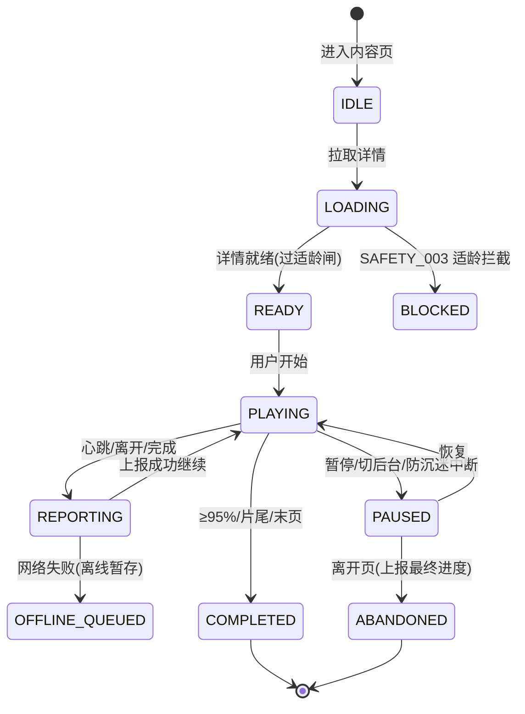
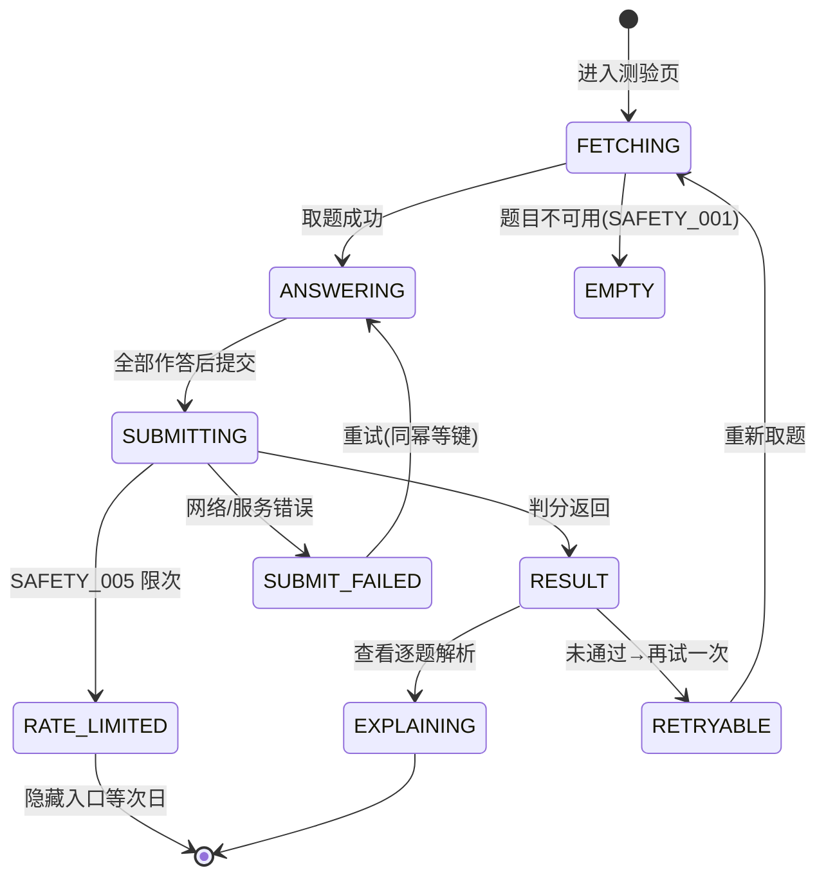

# 客户端-安全教育页面架构与交互设计 - 详细设计

> **模块定位**：本文档定义 PrimeTop Flutter 客户端**安全教育**功能的完整页面架构与交互设计，覆盖主题广场、内容学习（情景动画/图文课件/儿歌）、情景测验、家庭演练任务卡、安全徽章墙与家长端安全报告七个页面单元。服务端权威为《安全教育内容模块-详细设计》（主题内容模型/测验判定/演练生命周期/错误码 SAFETY_xxx），本文档仅定义客户端呈现层、交互层与端侧守卫，**不重复服务端业务规则，冲突时以服务端文档为准**。
> **关联文档**：`docs2/安全教育内容模块-详细设计.md`（服务端契约权威，本文 §3/§8 与其 1:1 对齐）、`docs2/客户端-多媒体内容播放与交互引擎-详细设计.md`（播放器委托）、`docs2/客户端-全局防误触与儿童安全交互保护机制-详细设计.md`（低龄防误触）、`docs2/客户端-成就勋章与奖励展示组件-详细设计.md`（徽章墙委托）、`docs2/客户端-统一对话框与模态弹出层调度管理系统-详细设计.md`（弹窗委托）、`docs2/客户端-统一图片加载缓存框架与智能预加载引擎-详细设计.md`（图片加载）、`docs2/客户端-页面状态模式与骨架屏加载空态错误态设计规范-详细设计.md`（状态规范）。

## 1. 概述

### 1.1 模块定位

安全教育是 PrimeTop"全学段覆盖"定位下的**素养通识内容域**（十大主题：防溺水/防拐骗/交通安全/消防安全/用电安全/校园安全/网络安全/急救常识/自然灾害应对/身心自护），面向 3-18 岁全学段。客户端本模块的核心使命：

1. **适龄呈现**：按学生年龄档（K/P1_3/P4_6/J/S 五档）渲染对应内容，低龄档零恐吓、高龄档可呈现适度风险后果（合规 C1）。
2. **学练演测闭环呈现**：学习内容 → 情景测验 → 家庭演练任务 → 徽章激励的完整链路 UI。
3. **安全红线端侧兜底**：适龄渲染闸门（G2）、紧急电话白名单展示（G3）、AIGC 标识强制展示（C3）、零商业植入（C4）在客户端有独立 fail-closed 实现，不依赖服务端"已审核"假设。

### 1.2 设计原则

| 原则 | 说明 |
| --- | --- |
| 适龄优先 | 一切交互参数（字号/按钮/动画时长/防误触抖动）按学段分档，参数矩阵见 §5 |
| 正向引导 | 文案以"怎么做是对的"为主，禁止血腥后果恐吓；测验通过制不排名（C5） |
| 零商业植入 | 安全模块内**禁止**会员弹窗、支付入口、广告、裂变分享（C4）；徽章激励不属于商业植入，允许 |
| 权威委托 | 播放器委托多媒体引擎、徽章委托成就组件、弹窗委托统一对话框、判分与答案**永远不在端侧** |
| 弱网可用 | 学习内容离线可看（预下载+本地缓存），进度离线暂存 48h 补报（服务端 §8 窗口） |

### 1.3 职责边界（客户端不做）

- 不持有测验正确答案（服务端 §4.1.5 取题不下发答案，客户端零答案明文）。
- 不做判分（提交后服务端判分返回逐题结果，服务端 R2）。
- 不做内容生产/审核（管理后台域）。
- 不做演练任务确认（G6：学生端不可自确认，确认走家长端+统一家长门）。
- 不做时长权威统计（时长归因归《服务端-学生学习时长跨模块统一归因与对账引擎》，客户端只上报原始进度事件）。

## 2. 信息架构与页面地图

### 2.1 路由表

路由注册进《客户端路由与深链接系统》，统一前缀 `/safety`：

| 路由 | 页面 | 入口 | 鉴权/守卫 |
| --- | --- | --- | --- |
| `/safety/square` | 主题广场 | 首页工作台"安全教育"卡片、底部导航"素养"Tab | 学生登录态 |
| `/safety/content/:contentId` | 内容学习页 | 主题广场/深链接/测验返回 | 登录态 + **适龄闸 G2** |
| `/safety/quiz/:quizId` | 情景测验页 | 内容学习页入口/主题广场（已通过内容） | 登录态 |
| `/safety/drills` | 演练任务列表 | 主题广场入口/推送点击 | 登录态 |
| `/safety/badges` | 安全徽章墙 | 主题广场顶部徽章入口 | 登录态 |
| `/parent/safety/report` | 家长端安全报告 | 家长中心"安全报告"Tab | **家长角色** + 家长门 |

深链接（push/分享/搜索跳转）进入 `/safety/content/:contentId` 时**必须先过适龄闸**（§7.3），命中 SAFETY_003 展示适龄拦截页而非内容页——深链接不可绕过 G2。

### 2.2 页面地图

```
首页工作台 ──[安全教育卡片]──▶ /safety/square 主题广场
                                    │
        ┌───────────────┬──────────┼───────────────┬──────────────┐
        ▼               ▼          ▼               ▼              ▼
  内容列表(按主题)   演练任务入口   徽章墙入口     主题宫格        家长报告(家长端)
        │               │          │               │
        ▼               ▼          ▼               ▼
  /safety/content   /safety/drills /safety/badges  /safety/content(下一主题)
        │(学习完成)
        ▼
  /safety/quiz/:quizId ──(通过)──▶ 通过庆祝(轻量) + 徽章弹窗(委托成就组件)
```

### 2.3 页面状态规范

全部页面复用《客户端-页面状态模式与骨架屏加载空态错误态设计规范》：

- 首屏加载：骨架屏（主题宫格骨架 2×4 宫格 / 内容详情骨架：封面区+三段文本）。
- 空态：主题广场空态展示"内容准备中"插画（服务端清单为空时）；演练列表空态展示"暂无演练任务，和爸爸妈妈一起制定一个吧"。
- 错误态：按 §8.1 错误码映射渲染，可重试按钮统一走 `ErrorMessageFactory` 话术（契约 R3）。

## 3. 数据模型与 API 契约

### 3.1 Dart 数据模型（与服务端 §4 响应 1:1）

```dart
/// 安全主题分类 —— 对齐服务端 GET /api/v1/safety/categories
class SafetyCategory {
  final String categoryId;
  final String code;            // water_drowning / anti_abduct / traffic / fire / ...
  final String name;            // 防溺水
  final String iconUrl;
  final String introText;
  final int contentCount;
  final int myCompletedCount;   // 实时联表统计，客户端只读展示
  const SafetyCategory({...});
  factory SafetyCategory.fromJson(Map<String, dynamic> j) => ...;
}

/// 内容形态 —— 对齐服务端 content_type
enum SafetyContentType { animation, slides, article, song, scenario }

/// 安全内容 —— 对齐服务端 GET /api/v1/safety/contents 与 /contents/{id}
class SafetyContent {
  final String contentId;
  final String categoryId;
  final String stageBand;       // K / P1_3 / P4_6 / J / S —— 客户端渲染闸判据
  final SafetyContentType contentType;
  final String title;
  final String? subtitle;
  final String? coverUrl;
  final String? mediaUrl;       // 动画/音频地址；slides/article 可为空
  final int? durationSec;
  final List<String> learningPoints;   // ≤5 条学习目标
  final List<String> keyFacts;         // 必须记住的关键事实
  final bool aigcFlag;                 // C3：强制展示 AIGC 标识
  final String? quizId;                // 详情接口返回
  final int myProgressPct;             // 0-100
  final bool completed;
  const SafetyContent({...});
}

/// 测验题目（取题响应，无正确答案）
class SafetyQuizQuestion {
  final String questionId;
  final String stem;            // 题干
  final String? scenarioText;   // 情景描述
  final List<QuizOption> options; // 服务端已乱序下发（防位置记忆）
  const SafetyQuizQuestion({...});
}

class QuizOption {
  final String choice;          // "A"/"B"/"C"/"D"
  final String text;
  const QuizOption({...});
}

/// 测验提交结果 —— 对齐服务端 POST /quizzes/{quizId}/submit 响应
class SafetyQuizResult {
  final int score;
  final bool passed;
  final List<QuestionResult> results;
  final BadgeAward? badgeAwarded;  // 激励服务同步回填，超时为 null（D3 降级）
  const SafetyQuizResult({...});
}

class QuestionResult {
  final String questionId;
  final bool correct;
  final String? yourChoice;     // 答错时回显
  final String? correctChoice;  // 答错时回显
  final String explanation;
  const QuestionResult({...});
}

/// 家庭演练任务 —— 对齐服务端 safety_drill_task 状态机
enum DrillTaskStatus { planned, donePendingConfirm, confirmed, expired, cancelled }

class SafetyDrillTask {
  final String taskId;
  final String contentId;
  final String drillType;       // fire_escape / route_plan / emergency_call / ...
  final DateTime planDate;
  final DrillTaskStatus status;
  final String? note;           // 家长备注
  const SafetyDrillTask({...});
}
```

### 3.2 Repository 层

```dart
class SafetyRepository {
  /// 主题宫格（服务端按学生 stage_band 过滤，客户端不传档）
  Future<List<SafetyCategory>> fetchCategories();

  /// 内容列表
  Future<PagedList<SafetyContent>> fetchContents(String categoryId, {int page = 1, int pageSize = 20});

  /// 内容详情（先过适龄闸再调用）
  Future<SafetyContent> fetchContentDetail(String contentId);

  /// 学习进度上报（clientRequestId 幂等，见 §7.2）
  Future<StudyReportAck> reportStudy(StudyReportRequest req);

  /// 取题（无答案）
  Future<List<SafetyQuizQuestion>> fetchQuizQuestions(String quizId);

  /// 提交测验
  Future<SafetyQuizResult> submitQuiz(String quizId, QuizSubmitRequest req);

  /// 学生演练任务列表
  Future<List<SafetyDrillTask>> fetchDrillTasks();

  /// 学生标记演练完成（→ DONE_PENDING_CONFIRM，等家长确认）
  Future<void> markDrillDone(String taskId);
}
```

所有接口走《客户端网络请求治理与弱网适配方案》统一网关：鉴权头自动注入、429 退避、离线写操作排队重放（幂等键保证重放安全）。

### 3.3 幂等键生成策略

- `clientRequestId` / `idempotencyKey`：UUID v7（时间有序，便于服务端排查），每次用户动作生成一次，**重试与离线补报复用同一键**。
- 学习上报的 clientRequestId 绑定"内容 × 上报批次"：进入内容页生成会话级键，页内多次心跳上报共用同一键（服务端 §4.1.4 语义：窗口内重复视为成功）；离开页再次进入生成新键。
- 测验提交的 idempotencyKey 绑定"测验 × 一次提交动作"，双击/重试/离线重放均复用。

## 4. 页面详细设计

### 4.1 主题广场页（/safety/square）

**布局**：顶部标题栏（"安全小卫士"+徽章墙入口图标）+ 2×N 主题宫格（按服务端 sort_order 排序）+ 演练任务横滑卡片区（有任务时展示）。

宫格卡片要素：主题图标（PrimeImageLoader 加载）、主题名、简介（单行截断）、完成进度（`myCompletedCount/contentCount` 环形或 `x/y` 文案，幼儿档用图标不用数字——C5 不排名只在此处体现为**不与他人比，只展示自我进度**）。

**交互**：

| 交互 | 行为 |
| --- | --- |
| 点击主题 | 进入该主题内容列表（页内二级视图，不跳路由，保返回栈轻量） |
| 点击徽章图标 | 跳 `/safety/badges` |
| 下拉刷新 | 强制刷新宫格（清除 `safety:cat:list:{stageBand}` 本地缓存并重新拉取） |
| 演练卡点击 | 跳 `/safety/drills` |

**空态/降级**：清单接口失败 → 错误态 + 重试；清单为空（新学段内容未上架）→ 空态插画 + "内容准备中"（禁止展示其他学段内容填充，G2）。

### 4.2 内容学习页（/safety/content/:contentId）

页面结构（自上而下）：

```
┌─────────────────────────────┐
│ 封面/播放器区（按形态分发）    │  ← 见 4.2.1-4.2.3
├─────────────────────────────┤
│ AIGC 标识条（aigcFlag=true 时  │
│ 强制展示，不可关闭，C3）        │
├─────────────────────────────┤
│ 标题 + 副标题                 │
├─────────────────────────────┤
│ 学习目标要点（learningPoints  │
│ ≤5 条，勾选式清单）            │
├─────────────────────────────┤
│ 必须记住（keyFacts 卡片高亮）  │
├─────────────────────────────┤
│ [开始情景测验]（有 quizId 时） │
└─────────────────────────────┘
```

#### 4.2.1 情景动画播放器（contentType=animation）

委托《客户端-多媒体内容播放与交互引擎》：自定义 controls、锁屏续播、断点续播（myProgressPct 映射 seek 点）。**安全域附加约束**：

- 动画内容经双人审校（服务端 G1/G9），客户端不做内容过滤，但**播放前展示适龄提示浮层**（幼儿档首次进入主题时："这是教你保护自己的小故事"）。
- 播放完成（≥95% 或片尾事件）触发 `completed=true` 上报；中途离开按实际进度上报。

#### 4.2.2 图文课件（contentType=slides）

横向翻页 Slide 组件（PageView + 页码指示器），最后一张为"要点回顾"页（learningPoints 汇总）。进度 = `当前页/总页 × 100`，末页停留 ≥3s 计 completed。

#### 4.2.3 儿歌/音频（contentType=song）

迷你播放器：封面旋转动画 + 播放/暂停 + 进度条。锁屏/切后台暂停（幼儿使用场景多为家长陪同，不默认后台播放）。音频结束计 completed。

#### 4.2.4 进度采集与心跳上报

```dart
/// 学习进度上报策略（对齐服务端 §4.1.4 幂等语义）
class StudyProgressReporter {
  static const _heartbeatInterval = Duration(seconds: 15);
  Timer? _timer;
  int _accumulatedSec = 0;
  int _lastReportedPct = 0;
  late final String _clientRequestId;  // 会话级，页内共用

  void start(SafetyContent content) {
    _clientRequestId = const Uuid().v7();
    _timer = Timer.periodic(_heartbeatInterval, (_) => _flush(completed: false));
  }

  Future<void> _flush({required bool completed}) async {
    final pct = _currentProgressPct();
    final payload = StudyReportRequest(
      contentId: _content.contentId,
      progressPct: pct,
      durationSec: _accumulatedSec,      // 服务端语义为增量累加（服务端 §6.1）
      completed: completed || pct >= 95,
      clientRequestId: _clientRequestId,
    );
    try {
      await SafetyRepository.instance.reportStudy(payload);
      _lastReportedPct = pct;
    } on NetworkException {
      await OfflineQueue.instance.enqueueStudyReport(payload); // 48h 窗口补报
    }
  }

  Future<void> onLeave() async {
    _timer?.cancel();
    await _flush(completed: _currentProgressPct() >= 95);
  }
}
```

守卫：`_flush` 节流——进度较上次上报无变化且未离开时跳过节流心跳（防 SAFETY_004 频控）。

### 4.3 情景测验页（/safety/quiz/:quizId）

**流程**：取题（加载态）→ 逐题作答 → 提交 → 结果页（分数+逐题解析）→ 通过庆祝/未通过鼓励。

| 元素 | 设计 |
| --- | --- |
| 逐题作答 | 一次一题：情景描述卡（scenarioText）+ 题干 + 2-4 选项大按钮；幼儿档选项配插画 |
| 选项 | 服务端已乱序（防位置记忆），客户端不再二次乱序，保证多端一致性 |
| 提交 | 全部作答后方可提交；提交中按钮 loading 防双击（幂等键同时兜底） |
| 结果页 | 得分（不展示排名/百分比击败人数，C5）+ 逐题对错 + 解析（错题优先展示 yourChoice vs correctChoice） |
| 通过庆祝 | 轻量 ConfettiEffect（幼儿档 ≤1.5s，对齐动效规范 G7 粒子上限；触发前查 reduceMotion）+ "安全小卫士"文案 |
| 未通过 | 成长型话术："再学一遍内容，你会更棒"（**禁止**"不及格/失败"字样，话术白名单见 §9 C2）+ 返回学习内容按钮 |
| 徽章 | `badgeAwarded != null` 时委托成就组件弹窗（契约 R6）；为 null 时静默（D3 已入 Outbox 最终一致，不提示"徽章丢失"） |
| 限次 | 服务端 SAFETY_005（429）时展示"今天练习次数用完了，明天再来吧"，**隐藏提交入口**直至次日（客户端本地日期判断，不预估服务端计数） |

**作答中途离开**：已作答本地暂存（内存+Hive 草稿，30 分钟有效），返回恢复；超过 30 分钟作废重取题（题目选项乱序可能变化，恢复旧选项无意义）。

### 4.4 演练任务列表页（/safety/drills）

任务卡三态渲染：

| 状态 | 卡片呈现 | 可操作 |
| --- | --- | --- |
| PLANNED | 演练类型图标 + 计划日期 + 家长备注 + "我和爸爸妈妈完成了"按钮 | 标记完成 |
| DONE_PENDING_CONFIRM | 同上 + 状态条"等待爸爸妈妈确认" | 不可再点（防刷） |
| CONFIRMED | 已完成勾选 + 确认时间 | 查看 |
| EXPIRED/CANCELLED | 灰置 + "已过期/已取消" | 不可操作 |

点击"我和爸爸妈妈完成了"（G6 前置约束：仅状态迁移到 DONE_PENDING_CONFIRM，**不展示任何学生自助确认入口**）：

- 幼儿档（K）：复用全局防误触机制（300ms 抖动 + 二次确认弹窗"真的完成了吗？要请爸爸妈妈确认哦"）。
- 标记成功后 Toast "已通知爸爸妈妈确认"，同时触发服务端通知（家长端收到确认请求）。
- 网络失败入离线队列，恢复后补发（同一 taskId 重复标记，服务端合并语义）。

### 4.5 安全徽章墙（/safety/badges）

完全委托《客户端-成就勋章与奖励展示组件》：本模块仅按 `badgeCode` 前缀 `safety_*` 过滤展示安全域徽章（防溺水小卫士/交通安全员等 10 主题 × 获得态/未获得态），并注入安全域专属文案（未获得态："学完 {主题名} 并通过测验就能获得"）。**不自建徽章组件**（契约 R6）。

### 4.6 家长端安全报告页（/parent/safety/report）

挂在家长中心（家长端 App 或学生设备家长中心），对接服务端 `GET /api/v1/parent/safety/overview` 与 `/reports`：

- 顶部矩阵：每主题 `{contentCount, completedCount, lastStudiedAt, quizPassCount}` 横向滚动卡。
- 近 90 天汇总（T+1 读模型）+ 近 7 天实时明细拼接；读模型缺失时按 D4 降级展示实时明细并标注"部分数据次日更新"。
- 演练记录区：历史演练任务及确认状态。
- **C6 例外说明**：安全学习数据对家长默认全可见（家庭共享可见度引擎"安全例外"白名单），本页不设"对孩子隐藏"开关。

进入本页需家长角色鉴权 + 家长门验证（复用家长中心既有验证流程，不重复实现）。

## 5. 分龄交互适配参数矩阵

| 参数 | K（3-6 岁） | P1_3 | P4_6 | J/S |
| --- | --- | --- | --- | --- |
| 正文字号 | 20sp | 18sp | 16sp | 15sp |
| 按钮最小高度 | 64dp | 56dp | 48dp | 44dp |
| 选项按钮 | 纵向全宽+插画 | 纵向全宽 | 2 列网格 | 2 列网格 |
| 触达区域（防误触） | ≥88dp + 300ms 抖动 + 边缘抑制 | ≥64dp + 抖动 | 标准 | 标准 |
| 动画时长倍率 | 1.2×（MotionTokens） | 1.0× | 0.9× | 0.8× |
| 情景描述呈现 | 语音朗读按钮（TTS 委托语音服务）+ 文字 | 文字为主 | 纯文字 | 纯文字 |
| 进度呈现 | 星星/图标 | 环形+数字 | 数字 | 数字 |
| 测验选项数 | 2 | 2-3 | 3-4 | 4 |
| 确认弹窗 | 家长验证网关（防误触机制方式 D） | 二次确认 | 二次确认 | 直接执行 |

参数来源：MotionTokens 归《客户端-手势交互与动画系统》权威，本文只消费（契约 R7）；防误触参数归全局防误触机制权威。

## 6. 状态机

### 6.1 学习会话状态机



- 切后台/防沉迷强制休息时自动 PAUSED 并 `_flush`，回前台不自动恢复播放（对齐防沉迷规范：恢复需用户主动点击）。
- BLOCKED 为终态展示适龄拦截页（含"这是给哥哥姐姐的内容"文案 + 返回按钮）。

### 6.2 测验会话状态机



守卫：SUBMITTING 态重复点击提交无效（UI 门控 + 幂等键双保险）；FETCHING 失败重取 ≤3 次（退避 1s/2s/4s）。

### 6.3 演练任务状态机（客户端镜像）

客户端镜像服务端 `safety_drill_task` 状态机（服务端为权威，客户端状态仅用于渲染，不写）：`PLANNED →(学生标记)→ DONE_PENDING_CONFIRM →(家长端确认)→ CONFIRMED`；`PLANNED/DONE_PENDING_CONFIRM → EXPIRED/CANCELLED`（服务端 02:10 批任务过期，客户端每次拉取时刷新本地镜像）。

### 6.4 守卫规则（G1–G12）

| 编号 | 规则 | 级别 |
| --- | --- | --- |
| G1 | 进入内容页（含深链接）必须先过适龄闸，命中即拦截页，任何缓存/预加载内容渲染前校验 | 红线 |
| G2 | 测验页永不缓存正确答案；应用退出/清缓存时作答草稿一并清除 | 红线 |
| G3 | 渲染 emergency_numbers/key_facts 中的电话号码前过白名单（110/119/120/122），非白名单号码**不渲染**并上报 SAFE_005（fail-closed，不可降级） | 红线 |
| G4 | AIGC 标识（aigcFlag=true）展示不可被设置项关闭、不被简洁模式隐藏 | 红线 |
| G5 | 安全模块内禁止渲染任何支付/会员/广告/裂变组件（C4），接入审查列入 CI 静态检查 | 红线 |
| G6 | 演练任务学生端无确认入口；标记完成按钮文案/流程不得暗示"自己确认" | 红线 |
| G7 | 测验通过庆祝动画遵守 reduceMotion；低端设备降级静态帧（粒子/时长归动效规范） | 强约束 |
| G8 | 离线缓存内容渲染前同样过适龄闸（缓存不豁免 G1） | 红线 |
| G9 | 学习页离开（dispose）必须触发最终进度上报或入离线队列，禁止静默丢弃 | 强约束 |
| G10 | 多孩子设备切换时清空安全模块内存态（进度/草稿/清单缓存按孩子隔离，对齐多孩子隔离规范） | 强约束 |
| G11 | 安全内容页不挂载全局浮窗 AI 助手提问"如何伤害自己/他人"类问题的护栏由输入护栏引擎负责，客户端只保证浮窗在考试/防沉迷管控时段不可用（复用既有约束） | 强约束 |
| G12 | 埋点不采集测验作答内容/情景描述原文，仅事件与元数据（对齐服务端 §15 隐私约束） | 红线 |

## 7. 关键代码示例

### 7.1 适龄渲染闸门（G1/G8，与服务端 §6.4 语义一致）

```dart
/// 适龄渲染闸门 —— 客户端 fail-closed 实现，深链接/缓存渲染前必过
class SafetyContentGate {
  SafetyContentGate._();
  static const _bandOrder = ['K', 'P1_3', 'P4_6', 'J', 'S'];

  /// 当前学生档可看的内容档：本档 + 向上回看一档（如 P4_6 可看 P1_3）
  static bool canRender(String contentStageBand, String studentBand) {
    final c = _bandOrder.indexOf(contentStageBand);
    final s = _bandOrder.indexOf(studentBand);
    if (c < 0 || s < 0) return false;          // 未知档一律拦截（fail-closed）
    final gap = c - s;
    return gap == 0 || (gap < 0 && gap >= -1); // 同龄或低龄一档，禁止高龄
  }
}
```

拦截页实现：

```dart
class SafetyAgeGatePage extends StatelessWidget {
  final String contentId;
  const SafetyAgeGatePage({super.key, required this.contentId});

  @override
  Widget build(BuildContext context) {
    // 命中 SAFETY_003：不渲染内容任何字段，只展示通用提示（不回显内容标题/封面，防侧信道）
    return Scaffold(
      body: Center(child: Column(mainAxisSize: MainAxisSize.min, children: [
        const Icon(Icons.shield_outlined, size: 72),
        const SizedBox(height: 16),
        Text('这是给哥哥姐姐的安全内容', style: context.titleMedium),
        const SizedBox(height: 8),
        const Text('等你长大一点就能学习啦'),
        const SizedBox(height: 24),
        FilledButton(onPressed: () => context.pop(), child: const Text('返回')),
      ])),
    );
  }
}
```

### 7.2 测验会话控制器（节选）

```dart
class QuizSessionController extends Notifier<QuizSessionState> {
  late final String _idempotencyKey;

  Future<void> load(String quizId) async {
    state = const QuizSessionState.fetching();
    try {
      final questions = await SafetyRepository.instance.fetchQuizQuestions(quizId);
      state = questions.isEmpty
          ? const QuizSessionState.empty()
          : QuizSessionState.answering(questions, {}, 0);
    } catch (e) {
      state = QuizSessionState.fetchFailed(e);
    }
  }

  Future<void> submit(String quizId) async {
    final s = state;
    if (s is! Answering || s.submitted) return;      // 双击门控
    if (s.answers.length < s.questions.length) return; // 未答完
    state = s.copyWith(submitted: true);
    _idempotencyKey = const Uuid().v7();             // 本提交动作唯一键
    try {
      final result = await SafetyRepository.instance.submitQuiz(
        quizId,
        QuizSubmitRequest(
          answers: s.answers.entries
              .map((e) => Answer(questionId: e.key, choice: e.value))
              .toList(),
          idempotencyKey: _idempotencyKey,          // 重试复用，服务端幂等
        ),
      );
      state = QuizSessionState.result(result);
    } on BizException catch (e) {
      if (e.code == 'SAFETY_005') {
        state = const QuizSessionState.rateLimited();
      } else {
        state = s.copyWith(submitted: false);        // 可重试，同键
      }
    }
  }
}
```

### 7.3 紧急电话白名单渲染守卫（G3）

```dart
class EmergencyNumberText extends StatelessWidget {
  final String text; // keyFacts 中可能含电话号码的整段文案
  const EmergencyNumberText({super.key, required this.text});

  static const _whitelist = {'110', '119', '120', '122'};

  @override
  Widget build(BuildContext context) {
    // 抽取连续数字串逐一校验，命中非白名单 3 位以上号码 → 不渲染并上报
    final numbers = RegExp(r'\d{3,}').allMatches(text).map((m) => m.group(0)!).toSet();
    final illegal = numbers.where((n) => !_whitelist.contains(n));
    if (illegal.isNotEmpty) {
      unawaited(Analytics.instance.reportGuardViolation(
          module: 'safety', code: 'SAFE_005', detail: {'illegal': illegal.toList()}));
      return const SizedBox.shrink(); // fail-closed：整段不渲染
    }
    return Text(text, style: context.bodyMedium);
  }
}
```

### 7.4 路由守卫（深链接过闸）

```dart
GoRoute(
  path: '/safety/content/:contentId',
  redirect: (context, state) async {
    final profile = ref.read(studentProfileProvider);
    final content = await SafetyRepository.instance
        .fetchContentDetail(state.pathParameters['contentId']!); // 未过闸前先取档
    if (!SafetyContentGate.canRender(content.stageBand, profile.stageBand)) {
      return '/safety/gate-blocked'; // 拦截页，不携带内容任何字段
    }
    return null;
  },
  builder: (context, state) => SafetyContentPage(/* ... */),
)
```

## 8. 错误处理与降级

### 8.1 错误码映射（服务端 SAFETY_xxx → 客户端 SAFE_xxx 符号码，零新增数字段位）

| 服务端码 | HTTP | 客户端码 | 页面表现 | 话术（ErrorMessageFactory） |
| --- | --- | --- | --- | --- |
| SAFETY_001 | 404 | SAFE_001 | 内容失效页 | "内容已下线，看看其他安全知识吧" |
| SAFETY_002 | 400 | SAFE_002 | 参数错误（内部） | 上报诊断，用户侧重试 |
| SAFETY_003 | 403 | SAFE_003 | 适龄拦截页（§7.1） | "这是给哥哥姐姐的安全内容" |
| SAFETY_004 | 429 | SAFE_004 | 静默节流（自动降心跳频率） | 无（G9 保证最终一致） |
| SAFETY_005 | 429 | SAFE_006 | 限次页（隐藏提交至次日） | "今天练习次数用完了，明天再来吧" |
| —（网络） | — | SAFE_010 | 离线队列暂存 | "网络不太好，已保存，联网后自动提交" |
| —（未知） | 5xx | SAFE_011 | 通用错误态 + 重试 | "出了点小问题，请重试" |

SAFE_005（紧急电话守卫）为埋点诊断码，不向用户展示（§7.3）。

### 8.2 客户端降级矩阵 D1–D10

| 编号 | 故障 | 降级行为 |
| --- | --- | --- |
| D1 | 主题/详情接口失败 | 骨架屏→错误态+重试；有本地缓存清单则展示缓存并标注"可能不是最新" |
| D2 | 媒体资源加载失败（CDN 故障，服务端 D5） | 已缓存媒体照常播放；未缓存展示重试按钮，图文要点区不受影响 |
| D3 | 测验服务不可用（服务端 D2） | 测验入口置灰"暂时不可用"，学习功能不受影响 |
| D4 | 徽章服务超时（服务端 D3） | badgeAwarded 为 null 静默通过，不弹窗不提示 |
| D5 | 报告读模型缺失（服务端 D4） | 家长报告展示实时明细 + "部分数据次日更新"标注 |
| D6 | 推送未达（服务端 D6） | 演练任务靠学生端下次启动拉取待办兜底（列表页自动刷新） |
| D7 | 低端设备性能不足 | 动画封面降级静态帧（PrimeImageLoader 自适应档位）、庆祝动画降级 |
| D8 | 弱网/离线 | 已预下载内容照常学习，进度离线暂存 48h 补报（幂等键保序） |
| D9 | TTS 不可用（幼儿档情景朗读） | 降级纯文字展示，不出现错字朗读 |
| D10 | **总红线** | 适龄闸（G1/G8）、紧急电话白名单（G3）、AIGC 标识（G4）、零商业植入（G5）、答案不落端（G2）**无任何降级路径**，相关代码不得出现 try-catch 后放行分支 |

## 9. 合规红线（客户端侧 C1–C8）

1. **C1 不恐吓渲染**：客户端不得为"吸引注意"给安全内容加红色惊悚配色/警示音效；风险主题（如防拐骗）的插画风格须温和（由内容方保证，客户端审核接入时检查）。
2. **C2 话术白名单**：测验未通过/演练过期等负向场景话术走成长型话术白名单（"再试一次你会更棒"/"和家人约定个新时间吧"），禁止"不及格/失败/危险分子"等词；词库与《服务端-教育场景敏感词多层次过滤与内容安全规则引擎》共享。
3. **C3 AIGC 标识**：`aigcFlag=true` 内容在标题下方常驻展示"AIGC 辅助生成"小字标识条，任何模式/设置不可隐藏（G4）。
4. **C4 零商业植入**：安全模块路由树内禁渲染支付/会员/广告/裂变组件（CI 静态检查 + CodeReview 清单，G5）。
5. **C5 不排名**：不展示分数排名、击败百分比、同学对比；进度只与"自己的完成数"比。
6. **C6 家长可见**：家长报告页无"对孩子隐藏"开关；学生端不设安全学习记录删除入口（家长可见例外，服务端 C6）。
7. **C7 危机让位**：安全模块任何拦截/降级不得阻碍心理危机求助通道（复用平台 C10 危机让位总则）；情景内容中出现的求助话术（"告诉信任的大人"）原样展示不删减。
8. **C8 数据最小化**：埋点与诊断日志不含作答内容/情景原文/孩子演练影像（G12）；离线队列消息体与线上报文同约束。

## 10. 埋点事件（module=safety，权威归埋点体系）

| 事件 | 触发 | 关键属性 | 备注 |
| --- | --- | --- | --- |
| safety_category_view | 宫格曝光 | categoryId | 列表曝光去重（同会话一次） |
| safety_content_open | 打开内容 | contentId, contentType |  |
| safety_study_complete | 学习完成（客户端确认 ≥95%） | contentId, durationSec | 与服务端 completed 事件互补，不重复计量 |
| safety_quiz_submit | 提交测验 | quizId, score, passed | **不采 answers 内容**（G12） |
| safety_quiz_explain_view | 查看解析 | questionId |  |
| safety_drill_view | 演练卡曝光 | taskId, drillType |  |
| safety_drill_mark_done | 学生标记完成 | taskId |  |
| safety_aigc_flag_view | AIGC 标识曝光 | contentId | 合规审计用（C3 证明标识确已展示） |

## 11. 性能设计

| 项 | 预算 |
| --- | --- |
| 主题广场首屏 | ≤ 1.5s（骨架屏首帧 ≤ 300ms） |
| 内容详情页 | 文本秒开；封面 PrimeImageLoader 磁盘命中 ≤ 100ms |
| 测验取题→可作答 | ≤ 1s |
| 提交→结果页（含徽章） | 跟随服务端 P95 800ms，客户端渲染增量 ≤ 100ms |
| 内存 | 播放器单实例；离开页释放；图片缓存遵循 PrimeImageLoader 内存水位 |
| 预加载 | 宫格图标预加载（进入广场时）；内容详情不预加载（G8 缓存渲染前须过闸，避免缓存绕过审查，故仅预加载"已过闸预测档位"的封面缩略图） |

## 12. 契约对齐（R1–R12）

| 编号 | 对齐说明 |
| --- | --- |
| R1 | 内容/测验/演练全部业务规则与错误码以《安全教育内容模块-详细设计》为唯一权威，本文只做客户端映射（§3/§8.1 1:1） |
| R2 | 判分与答案权威在服务端，客户端零答案明文、零判分逻辑（G2） |
| R3 | 错误文案统一走 ErrorMessageFactory（《客户端全局异常处理与安全恢复机制》），业务页禁止自拼 |
| R4 | 播放器委托《客户端-多媒体内容播放与交互引擎》，本文只定义安全域附加约束（§4.2.1） |
| R5 | 低龄防误触/家长验证委托《客户端-全局防误触与儿童安全交互保护机制》，参数不私自改写 |
| R6 | 徽章展示委托《客户端-成就勋章与奖励展示组件》，本文只按 `safety_*` 前缀过滤与文案注入 |
| R7 | 动画参数（MotionTokens/reduceMotion）归《客户端-手势交互与动画系统》权威，本文消费不定义 |
| R8 | 弹窗委托《客户端-统一对话框与模态弹出层调度管理系统》（演练二次确认/限次提示均走业务弹窗队列） |
| R9 | 适龄五档词汇 K/P1_3/P4_6/J/S 与《教育内容适龄性评估与分级引擎》一致，禁止客户端另造档位名 |
| R10 | 离线缓存与补报复用《客户端-断点续学与学习上下文恢复》与网络层离线队列，48h 窗口与服务端一致 |
| R11 | AIGC 标识视觉样式以《服务端-AIGC内容标识与生成内容溯源水印系统》下发规范为准 |
| R12 | 埋点事件 schema 注册进《客户端埋点事件体系与数据采集规范》，模块名 `safety` 与服务端 §15 一致 |

## 13. 验收场景（AC01–AC16）

1. K 档学生经深链接打开 J 档内容 ID，展示适龄拦截页，页面不含内容标题/封面任何字段，请求日志出现 SAFETY_003。
2. 同一份离线缓存内容在切换到低龄孩子账号后打开，被 G1/G8 拦截（缓存不豁免）。
3. 断网完成学习后 48h 内联网，进度自动补报成功且进度/时长不翻倍（clientRequestId 幂等）。
4. 测验提交按钮连点 5 次，服务端仅产生 1 条 attempt（幂等键生效）。
5. 服务端返回 SAFETY_005 后，测验页隐藏提交入口，次日 0 点后重新进入恢复（客户端日期判断）。
6. keyFacts 文案含"999"号码时该段不渲染并上报 SAFE_005，其余合规字段正常展示。
7. aigcFlag=true 内容在简洁模式/青少年模式下标识条仍展示（G4）。
8. 安全模块页面树内出现支付/广告组件时 CI 静态检查失败（G5）。
9. 演练任务学生端全程无"确认完成"入口，标记完成后状态为"等待爸爸妈妈确认"。
10. reduceMotion 开启时测验通过无 Confetti，仅静态祝贺文案。
11. 家长报告页在 T+1 读模型缺失时展示实时明细并标注"部分数据次日更新"。
12. 多孩子设备切换账号后，前一孩子的测验草稿与进度内存态清空（G10）。
13. 测验中途杀进程重进，30 分钟内恢复已选答案，超过 30 分钟作废重取题。
14. 埋点抓包验证 safety_quiz_submit 事件体不含 answers 内容（G12）。
15. 幼儿档（K）全程触达区域 ≥88dp，按钮带 300ms 防误触抖动（复用全局机制生效）。
16. 防沉迷强制休息触发时学习会话自动 PAUSED 并上报进度，休息结束不自动续播。

## 14. 关联文档

- 《安全教育内容模块-详细设计》（服务端契约权威）
- 《客户端-多媒体内容播放与交互引擎-详细设计》（播放器委托，R4）
- 《客户端-全局防误触与儿童安全交互保护机制-详细设计》（低龄防误触，R5）
- 《客户端-成就勋章与奖励展示组件-详细设计》（徽章墙委托，R6）
- 《客户端-统一对话框与模态弹出层调度管理系统-详细设计》（弹窗委托，R8）
- 《客户端-统一图片加载缓存框架与智能预加载引擎-详细设计》（图片加载）
- 《客户端-页面状态模式与骨架屏加载空态错误态设计规范-详细设计》（状态规范）
- 《客户端全局异常处理与安全恢复机制-详细设计》（错误文案权威，R3）
- 《客户端-手势交互与动画系统-详细设计》（动效参数权威，R7）
- 《客户端埋点事件体系与数据采集规范-详细设计》（埋点注册，R12）
- 《客户端-断点续学与学习上下文恢复-详细设计》（离线补报，R10）
- 《客户端路由与深链接系统-详细设计》（路由注册与深链接守卫）

## 15. 维护记录

- v1.0（2026-11-17）：首次创建。此前《安全教育内容模块-详细设计》（服务端，2026-10-21）已就绪但客户端页面层零覆盖，本文补全客户端侧：七大页面单元架构、与服务端 API/错误码 1:1 契约（R1）、适龄渲染闸门 fail-closed 实现（G1/G8，含缓存豁免裁决）、紧急电话白名单端侧守卫（G3）、AIGC 标识强制展示（G4）、零商业植入 CI 检查（G5）、学习/测验/演练三套页面状态机、分龄参数矩阵、离线补报 48h 幂等策略、降级 D1-D10（D10 总红线）、合规 C1-C8、埋点 8 事件（module=safety 与服务端 §15 对齐）、验收 AC01-AC16。客户端符号码 SAFE_001~011 零新增数字段位，SAFE_005 为 G3 守卫诊断码。
