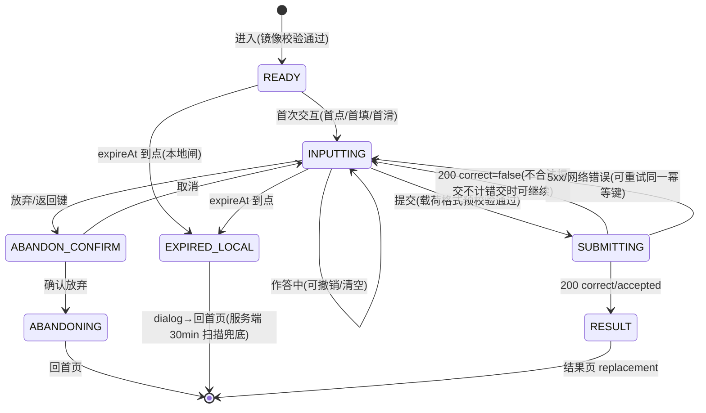

# 客户端-思维训练与益智游戏页面架构与交互设计

> 版本:v1.0 | 2026-11-22 | 状态:新增初版
> 边界声明:本文档为 PrimeTop 思维训练/益智游戏场景的客户端呈现层权威(页面架构、交互、本地状态、渲染执行);判题/生成/画像/日限权威全部在服务端《思维训练与益智游戏系统》(下称"服务端文档"),本文零判分、零答案接触、零日限裁决。

## 目录

- [1. 概述](#1-概述)
- [2. 信息架构与页面地图](#2-信息架构与页面地图)
- [3. 数据模型与 API 契约](#3-数据模型与-api-契约)
- [4. 页面详细设计](#4-页面详细设计)
- [5. 题型渲染器矩阵与分龄交互参数](#5-题型渲染器矩阵与分龄交互参数)
- [6. 状态机与守卫](#6-状态机与守卫)
- [7. 关键代码示例](#7-关键代码示例)
- [8. 错误处理与降级](#8-错误处理与降级)
- [9. 合规红线(客户端侧)](#9-合规红线客户端侧)
- [10. 埋点事件](#10-埋点事件)
- [11. 性能设计](#11-性能设计)
- [12. 契约对齐](#12-契约对齐)
- [13. 验收场景](#13-验收场景)
- [14. 关联文档](#14-关联文档)
- [15. 维护记录](#15-维护记录)

## 1. 概述

### 1.1 模块定位

服务端《思维训练与益智游戏系统》v1.0(2026-11-17)已就绪并在其契约 R10 中明确"客户端渲染契约独立客户端页面文档列为后续批次"。本文档兑现该缺口,覆盖五种题型(SUDOKU/POINT24/SCHULTE/SLIDING/MATCHSTICK)在 Flutter 客户端的页面架构、交互组件、本地状态机与错误处理,使开发人员可直接开始编码。

### 1.2 设计原则

1. **零判分原则(对齐听写默写/科学页面 G5 同源)**:客户端只做输入采集与合法性预校验(格式级,非结果级),一切正误/得分/降级判定以服务端响应为唯一权威。
2. **零答案原则**:客户端任何状态(内存/磁盘/埋点/日志)不得出现标准答案、提示解集;断线重取走服务端 gRPC→REST 桥接接口,不缓存题面到磁盘。
3. **娱乐定位显形**:页面文案与视觉不宣称"提分/学习效果";时长计入防沉迷娱乐时长;不做学习时长展示(对齐服务端 C2)。
4. **家长可关**:家长端关闭入口后,学生端 fail-closed,无本地绕过路径(对齐服务端 C7/D7)。
5. **单活跃会话**:同用户同题型仅一个进行中会话(服务端 G3),客户端路由守卫先查本地再尊重服务端 47512。

### 1.3 职责边界(客户端不做)

| 职责 | 权威归属 | 客户端行为 |
| --- | --- | --- |
| 判题/得分/评级 | 服务端判题引擎(G2 LLM 禁入) | 只提交终态载荷,渲染结果 |
| 日限/防沉迷/适龄裁决 | 服务端+防沉迷服务 | 只读展示剩余额度,失败展示成长型话术 |
| 积分/勋章发放 | 用户学习激励中心 | 只展示 rewardHint 提示语,不本地预发放(R1) |
| 排行榜 | 学习挑战赛与排行榜竞技系统 | 不内嵌榜单页;仅成绩海报分享(脱敏,R4) |
| 能力画像计算 | 服务端 puzzle_profile 单写者(R6) | 雷达图只读渲染 |
| 游戏化闯关地图 | 教育游戏化学习关卡编排引擎(R5) | 不渲染关卡地图,入口与成就均经激励中心归口 |

## 2. 信息架构与页面地图

### 2.1 路由表

注册进《客户端路由与深链接系统》,统一前缀 `/puzzle`:

| 路由 | 页面 | 登录 | 说明 |
| --- | --- | --- | --- |
| `/puzzle` | 益智游戏首页(游戏列表) | 是 | 适龄闸后展示可用题型/难度/今日剩余 |
| `/puzzle/play/:sessionNo` | 通用对局页 | 是 | 题型渲染器注册表分发;直接进入需本地存在会话镜像,否则 47505→回首页 |
| `/puzzle/result` | 单局结果页 | 是 | 由对局页以 replacement 方式推入,不回传对局页 |
| `/puzzle/profile` | 我的益智画像页 | 是 | 五维雷达+推荐难度;义务教育学段无全服百分位 |
| `/puzzle/records` | 历史成绩页 | 是 | 分页列表,仅本人可见 |
| `/parent/puzzle` | 家长端游戏管理页 | 家长 | 时长统计+总开关+分题型开关 |

> 深链接仅开放 `/puzzle`、`/puzzle/records`;对局页与结果页禁深链接(防绕过适龄闸与防沉迷前置校验,守卫 G1)。

### 2.2 页面地图

```
/puzzle (首页)
 ├─ 题型卡(SCHULTE/SUDOKU/POINT24/SLIDING/MATCHSTICK,按适龄矩阵显隐)
 │   └─ 难度选择 bottomSheet → 创建会话 → /puzzle/play/:sessionNo
 ├─ 今日统计条(playCnt/playMinutes/dailyRemaining)
 ├─ 画像入口 → /puzzle/profile
 └─ 历史入口 → /puzzle/records

/puzzle/play/:sessionNo (通用对局页)
 ├─ PuzzleRendererRegistry.dispatch(gameType) → 五题型渲染器之一
 ├─ 顶栏:题型名+难度+会话计时(秒表,只读)+放弃按钮
 ├─ 题型交互区(棋盘/表达式/方格/滑块/算式)
 ├─ 主操作区(提交/重开输入/撤销,按题型裁剪)
 └─ 提交中遮罩(不可取消,防重复提交)

/puzzle/result (结果页)
 ├─ 正误+得分+耗时+判分明细(timeFactor/errPenalty/streakBonus)
 ├─ 画像变化(rating/recommendedDifficulty 前后对比)
 ├─ rewardHint 展示(积分提示语;徽章/勋章弹窗归激励中心/成就模块)
 ├─ 再来一局(同题型同难度,新 clientRequestId)/返回首页
 └─ 成绩海报分享(脱敏模板,合规 C4)

/parent/puzzle (家长端)
 ├─ 今日/近 7 日游戏时长柱状图(娱乐时长口径,与学习时长分卡)
 ├─ 益智游戏总开关+分题型开关(写入家长管控,服务端 C7)
 └─ 说明文案:游戏时长不计入有效学习时长
```

### 2.3 页面状态规范

对齐《客户端页面状态模式与骨架屏加载空态错误态设计规范》:首页/画像/历史三页采用骨架屏→内容/空态/错误态四态;对局页无骨架屏(创建会话成功后才进入,进入即 READY);结果页为纯展示页。空态文案:无记录时"还没有对战记录,去首页来一局吧";无画像时"玩几局后这里会出现你的能力雷达"。

## 3. 数据模型与 API 契约

### 3.1 Dart 数据模型(与服务端响应 1:1)

```dart
/// 游戏类型,枚举值与服务端 puzzle_game_config.game_type 严格一致。
enum PuzzleGameType { sudoku, point24, schulte, sliding, matchstick }

/// 难度项,对应 GET /games 的 difficulties[]。
class PuzzleDifficultyOption {
  final int level;
  final bool unlocked;
  final bool recommended;
  const PuzzleDifficultyOption({required this.level, required this.unlocked, required this.recommended});
  factory PuzzleDifficultyOption.fromJson(Map<String, dynamic> j) => PuzzleDifficultyOption(
        level: j['level'], unlocked: j['unlocked'], recommended: j['recommended']);
}

class PuzzleGameEntry {
  final PuzzleGameType gameType;
  final String name;
  final List<PuzzleDifficultyOption> difficulties;
  final int dailyRemainingCnt;
  final int dailyRemainingMin;
  const PuzzleGameEntry({required this.gameType, required this.name, required this.difficulties,
      required this.dailyRemainingCnt, required this.dailyRemainingMin});
}

class PuzzleTodayStats { final int playCnt; final int playMinutes; }

/// 对局镜像(内存+应用生命周期内有效;进程被杀后不恢复,重新创建)。
/// puzzleJson 为题目面原样透传,客户端按题型解析;字段形态权威归服务端。
class PuzzleSessionMirror {
  final String sessionNo;
  final PuzzleGameType gameType;
  final int difficulty;
  final Map<String, dynamic> puzzleJson;
  final DateTime expireAt;
  bool abandonedReported; // 放弃上报一次性语义
  PuzzleSessionMirror({required this.sessionNo, required this.gameType, required this.difficulty,
      required this.puzzleJson, required this.expireAt, this.abandonedReported = false});
}

/// 提交载荷 kind 枚举,与服务端判题分发一一对应。
enum PuzzlePayloadKind { grid, expr, seq, moves, equation }

class PuzzleSubmitResult {
  final bool correct;
  final int score;
  final int durationMs;
  final Map<String, dynamic> judgeDetail;
  final Map<String, dynamic>? profile;
  final Map<String, dynamic>? rewardHint;
  /// 47520/47521 语义:成绩未采纳(accepted=false),不处罚。
  final bool accepted;
  final String? reasonCode;
  const PuzzleSubmitResult({required this.correct, required this.score, required this.durationMs,
      required this.judgeDetail, this.profile, this.rewardHint, this.accepted = true, this.reasonCode});
}

class PuzzleProfilePoint {
  final PuzzleGameType gameType;
  final double rating;
  final int bestScore;
  final int? bestDurationMs;
  final int playCnt;
  final int recommendedDifficulty;
  const PuzzleProfilePoint({required this.gameType, required this.rating, required this.bestScore,
      this.bestDurationMs, required this.playCnt, required this.recommendedDifficulty});
}
```

> 解析约束:`puzzleJson` 结构按题型解析(见 §5),客户端不得为未知题型字段抛错(前向兼容:忽略未知键);`gameType` 字符串映射失败时按 47502 语义引导回首页,不 crash(G10)。

### 3.2 Repository 层

```dart
class PuzzleRepository {
  /// GET /api/v1/puzzle/games → { games:[], todayStats:{} }
  Future<PuzzleGameListResp> fetchGames();

  /// POST /api/v1/puzzle/sessions(幂等:clientRequestId 由调用方持有并随镜像个案化)
  Future<PuzzleSessionMirror> createSession({
    required PuzzleGameType gameType, required int difficulty, required String clientRequestId});

  /// 断线重取题面:GetPuzzleSnapshot gRPC 的 BFF 桥(服务端 §6.3),
  /// 仅允许取回与本地 mirror 同 sessionNo 的题面;返回前校验 puzzle_hash 一致性由服务端负责。
  Future<PuzzleSessionMirror> refetchSnapshot(String sessionNo);

  /// POST /api/v1/puzzle/sessions/{sessionNo}/submit
  Future<PuzzleSubmitResult> submit(String sessionNo, PuzzleSubmitPayload payload, {required String clientRequestId});

  /// GET /api/v1/puzzle/profile
  Future<List<PuzzleProfilePoint>> fetchProfile();

  /// GET /api/v1/puzzle/records?gameType=&page=&size=
  Future<Paged<PuzzleRecordItem>> fetchRecords(PuzzleGameType? type, int page, int size);

  /// 放弃上报(客户端语义,服务端 CREATED/PLAYING→ABANDONED;幂等由服务端会话状态裁决)
  Future<void> abandon(String sessionNo);
}
```

### 3.3 幂等键生成策略

- 创建会话与提交判分均使用 UUID v7;键由页面控制器生成,**随会话镜像个案化持有**(创建成功后保存于 mirror 所在控制器,防止进程内复用池串键)。
- 双击/重试/断网重发复用同一键;响应 `idemReplay=true` 时原样渲染首个响应(守卫 G6)。
- 提交幂等键与创建幂等键互相独立(两个不同 UUID),不得复用(对齐服务端 uk_client_req 每请求唯一语义)。

## 4. 页面详细设计

### 4.1 益智游戏首页(/puzzle)

**布局**:顶部今日统计条(局数/分钟/剩余额度)→ 题型卡列表(2 列网格)→ 底部"我的画像/历史成绩"双入口。

**交互**:

1. 进入即 `fetchGames()`;401/网络错误走全局错误态重试;47504(适龄)不下发该题型卡片(服务端已过滤),客户端不补判。
2. 题型卡点击 → 难度选择 bottomSheet:难度点按 `unlocked` 置灰;`recommended` 档带"推荐"角标(推荐依据服务端画像,客户端不计算)。
3. 选档后进入创建流程:按钮置 Loading → 成功跳 `/puzzle/play/:sessionNo`(extra 携带 mirror,replacement 压入);**创建失败留在首页并 toast+额度刷新**:
   - 47508(日限达顶):dialog 成长型话术"今天玩够 N 局啦,明天再来挑战自己吧",无充值/分享引导;
   - 47509(防沉迷时段):dialog"现在是休息时间,先去放松眼睛吧",fail-closed,不展示重试按钮;
   - 47512(存在进行中会话):dialog"你有一局还没结束"→ 按钮"继续上一局"(路由至该会话;会话号由 47512 响应 meta 或本地活跃镜像给出)与"放弃并新开"(调 abandon 后重新创建);
   - 47522(池空转异步):toast"题目准备中,3 秒后自动重试",3s 后自动重发同一幂等键(自动重试仅一次,再失败转错误态)。
4. 下拉刷新重新拉取列表与额度;额度条为只读展示,客户端不做本地扣减预演(G2)。

**空态/边界**:家长关闭全部题型时,服务端 games 返回空数组 → 展示"益智游戏已由家长关闭"插画页(C7),无创建入口。

### 4.2 通用对局页(/puzzle/play/:sessionNo)

**进入守卫(路由层)**:

1. 无 extra 且无本地活跃镜像 → 视为深链接绕过,redirect `/puzzle`(守卫 G1);
2. mirror.expireAt 已过期 → 先尝试一次提交?否——过期会话不可提交(47507),直接 dialog"这局已超时"→ 回首页;
3. 家长关闭校验:进入时若收到服务端 47502(关闭即时生效缓存失效)→ dialog 回首页。

**页面结构**:

```
┌────────────────────────────┐
│ ← 数独 · L2      ⏱ 01:23 │
├────────────────────────────┤
│                            │
│   PuzzleRendererRegistry   │
│   .dispatch(gameType)      │
│   渲染题型交互区            │
│                            │
├────────────────────────────┤
│ 撤销   清空输入   提交      │
└────────────────────────────┘
```

- **会话计时**:从页面 ready 起走的只读秒表(基于单调时钟 `Stopwatch`,非 wall clock);展示口径仅供玩家参考,成绩耗时永远以服务端为准(G4 对齐);切后台计时继续但页面叠加"已暂停"遮罩(见 §6.2 后台态)。
- **放弃按钮**:二次确认 dialog("这局将不计成绩")→ 调 abandon → replacement 回首页;返回键与放弃同语义(守卫 G7:放弃不弹系统返回直接退出,必须先 dialog)。
- **提交主按钮**:loading 态禁点;提交期间全屏遮罩不可取消(G4 防双击);成功后 replacement 至结果页。

### 4.3 数独渲染器(SUDOKU)

**题面解析**:`puzzleJson.grid`(N×N,0=空格)与给定数布局;N∈{4,6,9} 由服务端配置决定。

**交互**:

- 棋盘 `SudokuBoardWidget`:给定数深色锁定,空格可点选;选中格行/列/宫高亮(同数高亮仅义务教育外可选,简化 v1.0 统一开启)。
- 数字输入条(1..N):点选数字填入选中格;再次点击已填格可改数(不限次,不产生惩罚——扣分仅由提交判题产生,客户端本地改动零成本)。
- 支持"清空输入"一键重置所有非给定格。
- **不提供笔记/提示功能**:服务端未开放 hint API,计分公式中 hint_cnt 字段为预留,客户端不得自建提示(否则构成变相答案通道,违反 G1)。

**提交载荷**:`{ kind: GRID, grid: N×N 终盘 }`,客户端仅做"无 0 残留"格式校验,不做事前合法判定。

### 4.4 24 点渲染器(POINT24)

**题面解析**:`puzzleJson.numbers`(四数数组)。

**交互**:

- 顶部四张数字卡(显示可用次数点),点击数字卡→追加到表达式并标记该卡已用;表达式条支持 `+ - * / ( )` 运算符键、退格、清空。
- 数字卡全部用完且表达式语法可解析时提交键高亮;**客户端只做语法级预校验**(括号配对/运算符位置合法/数字 multiset 与题目一致),合法性预校验失败 toast"表达式还没写完整";**不做结果判定**(结果判定=判题,权威在服务端,G5)。
- 表达式上限 100 字符(输入截断,对齐服务端 §4.3 防爆限)。

**提交载荷**:`{ kind: EXPR, expr: "..." }`。

### 4.5 舒尔特方格渲染器(SCHULTE)

**题面解析**:`puzzleJson.numbers`(1..N² 乱序平铺)。

**交互**:

- N×N 方格随机布局渲染;**计时 starts at first tap**(首点前秒表显示"点击开始");每点对一个数字,格子消失/置灰;点错:该格红闪 300ms + 轻振动(触感可关),`tapErrorCnt++`,不重排(对齐经典规则)。
- 全部点完自动提交(无需手动提交键);提交中展示"成绩校验中"。
- 反作弊地板提示:不展示地板值;客户端不预测成绩有效性(G9 零裁决)。

**计时口径**:`durationMs` 取首点至最后一点的 `Stopwatch` 毫秒数;与服务端时钟偏差 >2s 时以服务端为准(服务端 G4 自动裁决),客户端不做对齐修正。

**提交载荷**:`{ kind: SEQ, seq: [点击值...], tapErrorCnt: n }`(tapErrorCnt 进入 detail_json 供画像参考,不直接扣分——扣分口径权威在服务端计分公式)。

### 4.6 数字华容道渲染器(SLIDING)

**题面解析**:`puzzleJson.tiles`(展平数组,0=空位)与目标态说明(服务端快照内含;客户端渲染"复原"提示图仅展示目标排列,属题目面而非答案——题目面快照含 goal 表述时渲染,无则隐藏,以服务端快照字段为准,不自行推导)。

**交互**:

- 滑块手势:支持点击邻位块与滑动手势双通道(滑动判定阈值 12dp);每步动画 120ms(低端机 0ms 直跳,MotionTokens 对齐《客户端手势交互与动画系统》)。
- 步数计数器展示(仅自我参考);撤销一步/重开(回到题目面初态)均免费。
- 达到目标态 → 自动弹出"复原成功"内联确认 → 自动提交移动序列。

**提交载荷**:`{ kind: MOVES, moves: [方向枚举...] }`,方向枚举 `up/down/left/right`(含义:空格移动方向;与服务端 `applyMove` 语义在契约 R3 中锁定)。重放合法性由服务端校验(AC07:非法步→correct=false)。

### 4.7 火柴棒算式渲染器(MATCHSTICK)

**题面解析**:`puzzleJson.equation`(原始算式串,如 `"5+3=9"`),`puzzleJson.taskDesc`(服务端随题面下发的任务描述,如"移动 1 根火柴使等式成立");`puzzleJson.stickMap`(可选:各字符段布局,用于精确渲染;缺失时按内置 0-9 段表渲染,内置表仅描述字形不含解)。

**交互**:

- 火柴棒风格字体渲染算式(段数合法即可,视觉样式由客户端主题承担)。
- 两步操作:"拿起"(点选一根)→"放下"(点选目标位置/目标字符);拿起态高亮;支持放回原地(取消);操作历史栈支持逐步撤销。
- 提交键旁常驻 `taskDesc` 提示条;**不提供解法提示**(G1)。

**提交载荷**:`{ kind: EQUATION, equation: "移动后的完整算式串" }`;客户端仅做"数字/运算符字符集合法"格式校验。

### 4.8 单局结果页(/puzzle/result)

- 结果头:正误插画(对/错两套,义务教育学段不使用排名式措辞)+ 大字号得分。
- 判分明细卡:耗时、timeFactor、errPenalty、streakBonus 逐项展示(服务端 judgeDetail 原样渲染,不本地重算)。
- 画像变化:rating 前后对比条+推荐难度变化("下次推荐 L3");profile 缺失时隐藏该卡(服务端降级场景 D6)。
- `accepted=false`(47520/47521 语义):不展示"错"插画,展示"这局成绩没有计入"中性文案+原因白话("完成得太快,系统没有采纳这局成绩"),**不处罚话术、不弹任何惩罚弹窗**(服务端 C5)。
- rewardHint:展示"积分已入账"提示语;实际积分/徽章以激励中心推送为准,客户端不本地预加(R1);激励中心下发后由消息中心/成就弹窗模块承接,本文不实现。
- CTA:再来一局(同题型同难度)→ 首页创建流程(避免在对局栈内连续压入);返回首页。
- 成绩海报分享:调《客户端-学习报告卡片生成与社交分享图片渲染引擎》模板(成绩+日期+题型,**不含题目内容/答案/全服排名**),对齐 C4。

### 4.9 我的益智画像页(/puzzle/profile)

- 五维雷达图(五题型 rating);数据来自 `fetchProfile()`;义务教育学段服务端不下发百分位字段,客户端也不展示"超过 xx% 同学"(G12 双保险)。
- 每题型卡:bestScore/bestDuration/局数/推荐难度;点击可跳对应题型首页创建流程。
- 低样本提示:playCnt<3 的维度标注"样本较少,仅供参考"(口径与服务端画像引擎一致,客户端不计算置信度)。

### 4.10 历史成绩页(/puzzle/records)

- 题型筛选 chips(全部+五题型)+ 分页列表(对齐《客户端通用列表组件与分页加载引擎》);行内展示:题型/难度/得分/耗时/日期/正误;反作弊剔除局(is_record=0 对应服务端响应字段)标注"未计入",不展示原因码原文(47520/47521 对用户仅中性文案)。
- 仅本人可见;不提供他人查询入口。

### 4.11 家长端游戏管理页(/parent/puzzle)

- 数据:游戏时长统计(今日/7 日,娱乐时长口径,与学习时长分卡展示,文案明示"游戏时长不计入学习时长",对齐 C2)。
- 控制:总开关+分题型开关;写入家长管控配置(权威归《家长端使用管控与权限配置服务》,本文仅调用);开关关闭即时生效(服务端缓存失效 10min 内,客户端提示"约 10 分钟内生效")。
- 关闭后学生端行为:首页插画态(§4.1);对局页在途会话按服务端 G3/G9 跑完,不强制踢出(裁决归服务端,客户端不预判)。

## 5. 题型渲染器矩阵与分龄交互参数

### 5.1 渲染器注册表(委托模式,对齐科学页 StageRendererRegistry 模式)

```dart
abstract class PuzzleRenderer {
  PuzzleGameType get type;
  /// 解析题面并构建交互组件树;不得在此写入任何判分逻辑。
  Widget build(BuildContext context, PuzzleSessionMirror mirror, PuzzleRendererHost host);
  /// 组装提交载荷;返回 null 表示格式级预校验未通过(已 toast)。
  PuzzleSubmitPayload? buildPayload();
  void dispose();
}

class PuzzleRendererRegistry {
  static final _map = <PuzzleGameType, PuzzleRenderer Function()>{
    PuzzleGameType.sudoku: () => SudokuRenderer(),
    PuzzleGameType.point24: () => Point24Renderer(),
    PuzzleGameType.schulte: () => SchulteRenderer(),
    PuzzleGameType.sliding: () => SlidingRenderer(),
    PuzzleGameType.matchstick: () => MatchstickRenderer(),
  };
  static PuzzleRenderer dispatch(PuzzleGameType t) => _map[t]!();
}
```

新增题型(服务端扩展时)只需注册新渲染器;未注册题型命中时 fail-safe 回首页并上报 PZC-009(守卫 G10 前向兼容)。

### 5.2 分龄交互参数矩阵(呈现层,数值权威归《分龄UI适配与交互设计规范》)

| 参数 | 幼儿 | 小学低 | 小学高 | 初中 | 高中 |
| --- | --- | --- | --- | --- | --- |
| 棋盘最小触控区(dp) | 56 | 44 | 40 | 36 | 32 |
| 动画时长基准(ms) | 200 | 160 | 120 | 100 | 80 |
| 数字字号(sp) | 28 | 24 | 22 | 20 | 18 |
| 点错反馈 | 色闪+语音鼓励 | 色闪+轻振动 | 色闪 | 色闪 | 色闪 |
| 结果页激励音 | 有(可关) | 有(可关) | 有(可关) | 无 | 无 |
| 提交前确认 dialog | 无 | 无 | 无 | 无 | 无 |

> 呈现层参数仅影响体验,不改变任何判定口径;减少动画/无障碍设置权威归《客户端无障碍访问与辅助功能系统》,全局优先(红色减动效时动画时长×0)。

## 6. 状态机与守卫

### 6.1 对局页客户端镜像状态机(权威在服务端 §8.1)



说明:

- SUBMITTING 不可取消(遮罩拦截手势+返回键);5xx/超时展示"提交失败,请检查网络"重试条,**重试复用同一幂等键**(服务端 uk+SETNX 双保险幂等)。
- 200+correct=false 且 reason 为表达式非法/终盘不合法类(47510/判题 fail 类)时留在 INPUTTING 允许修正重交;NUMBERS_MISMATCH 类由服务端 judgeDetail.reason 驱动 toast,提交入口保持可用(服务端口径:不合法提交不计 wrong_submit,客户端一致不本地惩罚)。
- 本地 EXPIRED_LOCAL 仅提前于服务端扫描做体验收口,成绩裁决以服务端 CAS 为准(竞态:本地过期瞬间提交成功 → 照常进结果页,以服务端响应为准,守卫 G8)。

### 6.2 前后台与中断策略

| 事件 | 行为 | 裁决 |
| --- | --- | --- |
| 切后台 | 叠加"已暂停"遮罩;秒表继续(服务端耗时口径不含暂停,故客户端仅做展示冻结) | 不自动提交、不自动放弃 |
| 切后台 >10min | 保持遮罩;回前台时校验 expireAt,过期走 EXPIRED_LOCAL | 服务端 30min 超时为权威 |
| 进程被杀 | 镜像仅存内存 → 不恢复;会话由服务端 G3/G9 兜底;重进首页 47512 可"继续上一局"(refetchSnapshot 重取题面) | 不本地持久化题面(G1) |
| 来电/弹窗打断 | 遮罩同切后台 | — |

### 6.3 守卫规则

| 编号 | 规则 | 级别 |
| --- | --- | --- |
| G1 | 对局页/结果页禁深链接;进入必须先经首页适龄+日限+防沉迷前置 | fail-closed |
| G2 | 客户端不做本地额度扣减预演;剩余额度只读展示 | fail-closed |
| G3 | 单活跃会话:收到 47512 必须给"继续/放弃"选择,不得静默覆盖旧会话 | fail-closed |
| G4 | 提交防重:SUBMITTING 全遮罩+幂等键复用,双击/连点/重试不可能产生重复判分请求 | fail-closed |
| G5 | 零判分:客户端任何代码路径不得出现 correct/score 本地计算;预校验仅限格式级 | fail-closed |
| G6 | idemReplay=true 原样渲染首个响应,不重新动画计分 | fail-closed |
| G7 | 放弃/返回键必须先经二次确认;确认后 abandon 请求以 fire-and-forget+Outbox 补传(失败不阻塞退出) | fail-safe |
| G8 | 本地过期与服务端响应冲突时一律以服务端为准 | 自动裁决 |
| G9 | 反作弊地板/成绩剔除不由客户端预判或展示技术原因 | 合规 |
| G10 | 未知题型/未知题面字段:忽略未知键+fail-safe 回首页+上报诊断,不 crash | fail-safe |
| G11 | 进程内任何缓存(内存/磁盘/图片缓存)不得写入题目面与答案;题面仅存活于对局控制器生命周期 | fail-closed |
| G12 | 义务教育学段结果页/画像页不渲染全服百分位/排名文案(服务端不下发,客户端双保险) | 合规 |

### 6.4 关键竞态裁决

| 竞态 | 裁决 |
| --- | --- |
| 双击提交 | G4 遮罩+幂等键,第二次点击不可达;极端穿透时服务端 SETNX 60s 拒绝,G6 渲染首个响应 |
| 提交中按返回键 | 遮罩拦截;系统返回手势经 PopScope 拦截(拦截失败由服务端幂等兜底,不丢成绩) |
| 放弃与提交并发(用户手快) | 客户端串行化:放弃请求仅在非 SUBMITTING 态可发起;若服务端已 SUBMITTED,abandon 被状态机拒绝,忽略其错误 |
| 创建会话自动重试(47522)与手动离开 | 重试计数器随控制器销毁作废;离开后重试响应丢弃(幂等键已废,不会重复建局) |
| 切后台期间会话被服务端超时 | 回前台 EXPIRED_LOCAL dialog;若用户恰在提交,以服务端 CAS 结果为准(G8) |

## 7. 关键代码示例

### 7.1 对局控制器(会话生命周期+提交通道)

```dart
class PuzzlePlayController extends ChangeNotifier {
  final PuzzleRepository repo;
  PuzzleSessionMirror mirror;
  final Stopwatch _sw = Stopwatch();
  final String _submitIdempotencyKey = const Uuid().v7();
  bool _submitting = false;

  PuzzlePlayController({required this.repo, required this.mirror});

  Duration get elapsed => _sw.elapsed;
  bool get isSubmitting => _submitting;

  void onFirstInteraction() { if (!_sw.isRunning) _sw.start(); }

  Future<void> submit(PuzzleSubmitPayload payload, WidgetRef ref) async {
    if (_submitting) return; // G4 双击闸门
    _submitting = true; notifyListeners();
    try {
      final r = await repo.submit(
        mirror.sessionNo, payload, clientRequestId: _submitIdempotencyKey);
      if (!r.accepted) {
        // 47520/47521 语义:中性文案,不处罚不弹惩罚窗(C5)
        ref.context.go('/puzzle/result', extra: ResultArgs.unaccepted(r));
      } else {
        ref.context.go('/puzzle/result', extra: ResultArgs.judged(r));
      }
    } on PuzzleApiException catch (e) {
      if (e.code == 47507 || e.code == 47506) {
        ref.context.go('/puzzle'); // 过期/状态非法,服务端已收口
      } else {
        _submitting = false; notifyListeners(); // 留在本页展示重试条,幂等键复用
        rethrow;
      }
    }
  }

  Future<void> abandon() async {
    if (_submitting) return; // 与提交串行化(§6.4)
    mirror.abandonedReported = true;
    try { await repo.abandon(mirror.sessionNo); }
    catch (_) { /* G7: 失败不阻塞退出,Outbox 补传 */ }
  }
}
```

### 7.2 舒尔特渲染器(首点计时+错误反馈+自动提交)

```dart
class SchulteRenderer implements PuzzleRenderer {
  late List<int> _nums;
  int _next = 1, _tapErrors = 0;
  bool _started = false;
  final Stopwatch _sw = Stopwatch();
  PuzzleRendererHost? _host;

  @override
  Widget build(BuildContext ctx, PuzzleSessionMirror m, PuzzleRendererHost host) {
    _host = host;
    _nums = (m.puzzleJson['numbers'] as List).cast<int>();
    return GridView.count(crossAxisCount: _gridN(m), children: [
      for (final n in _nums)
        _SchulteCell(
          n: n, consumed: n < _next,
          onTap: () => _onTap(n, host),
        )
    ]);
  }

  int _gridN(PuzzleSessionMirror m) {
    final total = (m.puzzleJson['numbers'] as List).length;
    return sqrt(total).round(); // 3x3/4x4/5x5
  }

  Future<void> _onTap(int n, PuzzleRendererHost host) async {
    if (n < _next) return;
    if (!_started) { _started = true; _sw.start(); host.onFirstInteraction(); }
    if (n == _next) {
      _next++;
      host.notifyDirty(); // 重渲染置灰
      if (_next > _nums.length) {
        _sw.stop();
        // 全对自动提交;载荷含点击序列与点错数(§4.5)
        await host.submit(PuzzleSubmitPayload(
          kind: PuzzlePayloadKind.seq,
          body: {'seq': _seqRecord, 'tapErrorCnt': _tapErrors, 'durationMs': _sw.elapsedMilliseconds},
        ));
      }
    } else {
      _tapErrors++;
      HapticFeedback.lightImpact();
      host.flashError(n); // 红闪 300ms;不重排
    }
  }
}
```

### 7.3 提交载荷组装与格式级预校验(以 24 点为例)

```dart
class Point24Renderer implements PuzzleRenderer {
  final List<String> _tokens = [];
  final Map<int, bool> _used = {}; // 数字卡序号→已用

  @override
  PuzzleSubmitPayload? buildPayload() {
    final expr = _tokens.join();
    if (expr.isEmpty || expr.length > 100) return null; // toast 由调用方补
    if (!_parenBalanced(expr)) return null;
    // 仅格式级校验:数字 multiset 一致性(用没用对四个数),不判结果(G5)
    if (!_numbersMultisetMatch(expr)) { toast('要把题目里的四个数字都用上哦'); return null; }
    return PuzzleSubmitPayload(kind: PuzzlePayloadKind.expr,
        body: {'expr': expr, 'durationMs': host.elapsedMs});
  }

  bool _numbersMultisetMatch(String expr) {
    final used = RegExp(r'\d+').allMatches(expr)
        .map((m) => int.parse(m.group(0)!)).toList()..sort();
    final origin = [..._questionNumbers]..sort();
    return listEquals(used, origin);
  }
  bool _parenBalanced(String s) { /* 计数器配对即可 */ return true; }
}
```

### 7.4 路由守卫(适龄/深链接/过期三闸)

```dart
class PuzzlePlayGuard extends GoRouterRedirect {
  @override
  Future<String?> redirect(BuildContext context, GoRouterState state) async {
    final extra = state.extra;
    if (extra is! PuzzleSessionMirror) return '/puzzle'; // G1 深链接拦截
    final m = extra;
    if (m.expireAt.isBefore(DateTime.now())) return '/puzzle'; // 本地过期闸
    final cfg = await ref.read(puzzleConfigProvider.future); // 家长关闭缓存
    if (cfg != null && !cfg.enabled) return '/puzzle'; // C7 fail-closed
    return null;
  }
}
```

## 8. 错误处理与降级

### 8.1 错误码映射(服务端 475xx → 客户端 PZC_xxx 符号码,零新增数字段位)

| 服务端码 | 客户端码 | 触发场景 | 客户端处理 |
| --- | --- | --- | --- |
| 47501 | PZC-001 | 参数校验失败 | 表单内联提示,不 dialog |
| 47502 | PZC-002 | 类型未开放/家长关闭 | 首页插画态或 toast,无重试 |
| 47503 | PZC-003 | 难度未解锁 | 难度 bottomSheet 置灰刷新 |
| 47504 | PZC-004 | 不符合适龄 | 成长型引导"去试试适合你的内容",跳适龄题型 |
| 47505 | PZC-005 | 会话不存在 | 回首页+刷新列表 |
| 47506 | PZC-006 | 会话状态非法 | dialog 后回首页 |
| 47507 | PZC-007 | 会话过期 | "这局已超时"dialog,回首页 |
| 47508 | PZC-008 | 日限达顶 | 成长型话术 dialog,无充值/分享引导 |
| 47509 | PZC-009 | 防沉迷时段 | fail-closed dialog,无重试按钮(服务端 D7 语义) |
| 47510 | PZC-010 | 载荷非法 | toast 引导修正,留局 |
| 47511 | PZC-011 | 判题器内部错误 | 重试条(幂等键复用),重试仍失败提示"这局已关闭"(服务端退额语义) |
| 47512 | PZC-012 | 存在进行中会话 | "继续/放弃"双按钮 dialog |
| 47513 | PZC-013 | 配置冲突/限流 | 静默退避 1s 重读配置 |
| 47520 | PZC-020 | 成绩未采纳(速度异常) | accepted=false 中性结果页 |
| 47521 | PZC-021 | 成绩未采纳(时长口径异常) | 同上 |
| 47522 | PZC-022 | 池空转异步 | toast+3s 自动重试一次 |
| 5xx/网络 | PZC-500 | 网络/服务端故障 | 重试条;对局内不丢已输入(载荷在内存) |

> 通用码(40103/40001 等)归口《服务端统一业务异常码与错误分类体系》,本地不重定义;PZC-xxx 仅作模块内诊断与埋点字段,不出现在用户文案。

### 8.2 客户端降级矩阵 D1-D10

| 编号 | 场景 | 降级策略 | 红线 |
| --- | --- | --- | --- |
| D1 | 无网络进首页 | 缓存上次 games 列表(仅元数据,不含题面)并标"离线不可玩",创建请求必失败提示 | 题面/答案零本地缓存(G11) |
| D2 | 低端设备 | 动画时长×0/直跳;棋盘用 Canvas 自绘替代多层 Widget;帧率<45fps 自动关插画 | 判定口径不变 |
| D3 | 减少动画/无障碍开启 | 全局动效关闭(权威归无障碍系统),舒尔特红闪改纯文字提示 | 无障碍不可被覆盖(总红线) |
| D4 | 提交超时(>10s) | 展示"还在校验"不可取消态,后台继续等;再 20s 无响应提示稍后从消息中心查看 | 不自动重发新幂等键 |
| D5 | rewardHint 缺失(激励中心降级) | 结果页隐藏积分提示卡,其余照常 | 不本地承诺积分 |
| D6 | profile 字段缺失 | 结果页/画像页隐藏对应卡,不渲染 0 值冒充 | 不本地估算画像(R6) |
| D7 | 家长管控接口失败 | 沿用上次开关缓存(仅收紧方向可信),提示"管控状态可能滞后" | 不得因缓存失败放行关闭态(fail-closed) |
| D8 | 埋点上报失败 | 本地队列补传;作答内容明细本就零采集(C8),补传无敏感面 | — |
| D9 | 渲染器异常(catch 于 build) | fail-safe 回首页+PZC-009 上报,不黑屏 | 不静默吞异常 |
| D10 | 总红线 | G1/G4/G5/G11 与防沉迷 fail-closed 展示无任何降级路径 | — |

## 9. 合规红线(客户端侧)

| 编号 | 红线 |
| --- | --- |
| C1 | 页面不得出现"提分/成绩提升/学习效果"等疗效宣称;文案统一为"脑力挑战/思维游戏"口径 |
| C2 | 游戏时长不得混入学习时长展示(家长端也分卡,口径对齐服务端 C2) |
| C3 | 义务教育学段不渲染全服个人排名/百分位(G12 双保险);结果页仅自我突破对比 |
| C4 | 零商业植入:无广告位、无内购引导、无分享裂变任务入口;分享仅成绩海报且脱敏(不含题目/答案/排名) |
| C5 | 反作弊剔除场景仅中性文案,无处罚话术、无惩罚弹窗、无账号警示 |
| C6 | 埋点不采题目内容、作答过程明细、点击坐标序列;仅采结果元数据(§10) |
| C7 | 家长关闭入口后 fail-closed;缓存不得用于放行 |
| C8 | 题面/答案零落盘(内存仅存,G11);退出对局即弃;进程被杀不恢复题面 |

## 10. 埋点事件

module=puzzle,事件 schema 权威归《客户端埋点事件体系与数据采集规范》;下表为业务事件清单:

| 事件 | 触发 | 关键属性 | 备注 |
| --- | --- | --- | --- |
| puzzle_home_view | 首页曝光 | play_cnt_today, remaining_cnt | 额度值只读透传 |
| puzzle_game_select | 点击题型卡 | game_type | — |
| puzzle_difficulty_select | 选定难度 | game_type, difficulty | — |
| puzzle_session_create_result | 创建结果 | game_type, difficulty, result(succeed/47504/47508/47509/47512/47522/…), idem_replay | 错误码原值 |
| puzzle_play_start | 首次交互计时起点 | game_type, difficulty | 不采操作明细 |
| puzzle_submit_result | 判题结果返回 | game_type, difficulty, correct, score, duration_ms, accepted, reason_code | 不采载荷/题目 |
| puzzle_abandon | 放弃会话 | game_type, stage(ready/inputting) | — |
| puzzle_result_view | 结果页曝光 | correct, accepted, has_reward_hint | — |
| puzzle_profile_view | 画像页曝光 | dimension_cnt | — |
| puzzle_records_view | 历史页曝光 | filter_type | — |
| puzzle_parent_toggle | 家长端开关变更 | scope(all/game_type), enabled | 家长端 module=parent_control |

监控客户端侧:ANR/crash 率归入全局;模块专项指标为提交成功率(1-PZC-500 占比)与渲染器异常率(PZC-009,>0.1% 告警)。

## 11. 性能设计

1. **对局页首帧**:渲染器 build <100ms(低端 845 平台实测预算);题面解析放 `compute` 仅在 N=9 数独时启用。
2. **舒尔特/华容道**:棋盘采用 `RepaintBoundary`+Canvas 自绘,连续交互帧 ≥55fps(低端 ≥45fps);滑块动画 120ms 基准可直跳(D2)。
3. **图片**:题型插画/插画态走《客户端-统一图片加载缓存框架与智能预加载引擎》;题面图形(火柴棒段图)为矢量/自绘,无网络图。
4. **内存**:对局控制器销毁即释放镜像;单局内存峰值预算 <20MB(N=9 数独)。
5. **电池**:对局页无轮询(提交一次性);秒表用 `Timer.periodic(1s)` 仅驱动展示文本,插值刷新 250ms 足够。

## 12. 契约对齐

| 编号 | 对齐项 |
| --- | --- |
| R1 | 积分/勋章不本地预发放,以激励中心下发为准;客户端只展示 rewardHint 提示语(《用户学习激励中心与行为奖励统一规则引擎》) |
| R2 | 日限/防沉迷/适龄全部服务端裁决,客户端零本地预演(《思维训练与益智游戏系统》G2/G8) |
| R3 | 提交载荷 kind 枚举(GRID/EXPR/SEQ/MOVES/EQUATION)与华容道方向语义以服务端判题引擎为唯一权威;若服务端实现命名不同,以服务端字段为准并回改本文 |
| R4 | 不内嵌排行榜;分享仅脱敏成绩海报(《学习挑战赛与排行榜竞技系统》《客户端-学习报告卡片生成与社交分享图片渲染引擎》) |
| R5 | 不渲染游戏化闯关地图;成就弹窗归成就模块,本文不实现(《教育游戏化学习关卡编排与知识点闯关挑战引擎》) |
| R6 | puzzle_profile 客户端只读;不估算、不缓存画像结果(《思维训练与益智游戏系统》R6) |
| R7 | 统一响应封装/分页/错误码规范对齐《服务端统一响应封装与分页查询规范》;PZC-xxx 为内部符号码不出用户文案 |
| R8 | 动画/手势参数归《客户端手势交互与动画系统》与《分龄UI适配与交互设计规范》权威,本文仅消费 |
| R9 | 无障碍/减少动画归《客户端无障碍访问与辅助功能系统》权威,全局优先 |
| R10 | 页面状态四态规范归《客户端页面状态模式与骨架屏加载空态错误态设计规范》 |
| R11 | 路由注册/深链接禁入规则归《客户端路由与深链接系统》 |
| R12 | 结果页不入学习报告体系,学时统计零对接(《学习时长统计与有效性判定引擎》R3 对齐) |

## 13. 验收场景

| 编号 | 场景 | 预期 |
| --- | --- | --- |
| AC01 | 深链接直接进入 /puzzle/play/xxx(无镜像) | 重定向首页,无请求发出 |
| AC02 | 创建会话双击 | 单次请求;幂等键唯一;响应后单跳对局页 |
| AC03 | 创建返回 idemReplay=true | 直接复用首个 mirror,不重复动画跳页 |
| AC04 | 47512 双会话冲突 | "继续/放弃"dialog;继续→refetchSnapshot 重取题面进局 |
| AC05 | 舒尔特 3x3 点错一格 | 红闪+tapErrors+1,不重排,可继续 |
| AC06 | 舒尔特全部点对 | 自动提交,SEQ 载荷含完整点击序列 |
| AC07 | 24 点未用全四数点提交 | 格式预校验 toast,无网络请求 |
| AC08 | 24 点提交 `(5-3)*(4+8)` | 服务端判 true,客户端渲染 correct=true 与 judgeDetail,无本地重算 |
| AC09 | 提交中双击/返回键 | 遮罩拦截;至多一个请求;网络重试复用同一幂等键 |
| AC10 | 200+accepted=false(47520 语义) | 中性结果页"成绩未计入",无处罚话术 |
| AC11 | 对局切后台 12 分钟后回前台且已过期 | "这局已超时"dialog 回首页,无成绩提交 |
| AC12 | 家长端关闭 SUDOKU 后学生端进入 | 首页卡隐藏;直进被拦截回首页(缓存失效后以服务端 47502 为准) |
| AC13 | 进程被杀后重进并存在活跃会话 | 首页 47512 路径可"继续上一局",题面来自服务端重取,非本地恢复 |
| AC14 | 义务教育学段结果页/画像页 | 无全服百分位/排名文案与字段 |
| AC15 | 低端机开一局 9x9 数独 | 首帧<100ms,填数帧率≥45fps(D2 直跳生效) |
| AC16 | 埋点审计 | puzzle_submit_result 不含载荷/题目/答案字段;本地无题面落盘(G11) |

## 14. 关联文档

- 《思维训练与益智游戏系统》(服务端权威,本文全部契约来源)
- 《客户端路由与深链接系统》(路由注册)
- 《客户端手势交互与动画系统》《分龄UI适配与交互设计规范》(交互参数权威)
- 《客户端无障碍访问与辅助功能系统》(减动效权威)
- 《客户端页面状态模式与骨架屏加载空态错误态设计规范》
- 《客户端通用列表组件与分页加载引擎》(历史成绩分页)
- 《客户端-统一图片加载缓存框架与智能预加载引擎》
- 《客户端-学习报告卡片生成与社交分享图片渲染引擎》(成绩海报)
- 《用户学习激励中心与行为奖励统一规则引擎》《客户端-成就勋章与奖励展示组件》(激励承接)
- 《家长端使用管控与权限配置服务》(家长端开关)
- 《客户端-AI听写默写页面架构与交互设计》《客户端-小学科学探究式学习页面架构与交互设计》(同批页面层补全模式参照)

## 15. 维护记录

- v1.0(2026-11-22)新增初版:兑现服务端《思维训练与益智游戏系统》v1.0(2026-11-17)契约 R10 的"客户端页面文档后续批次"缺口。经全目录关键词扫描确认:数独/24点/舒尔特/华容道/火柴棒此前仅服务端单文档,客户端页面层零覆盖。本文档确立 `/puzzle/*` 页面族(6 路由+家长端 1 路由)与五题型渲染器注册表委托模式;Dart 模型与服务端响应 1:1;客户端镜像状态机+守卫 G1-G12(零判分 G5/零答案 G11/单会话 G3/防重 G4 为核心);关键代码四段(对局控制器/舒尔特渲染器/24点载荷预校验/路由守卫);错误码 PZC-xxx 符号码与服务端 47500-47599 全项映射(零新增数字段位,47520-47522 按 200 语义处理);降级 D1-D10(D10 总红线);合规 C1-C8(娱乐定位显形/不计学习时长/无全服榜/零商业植入/反作弊中性话术);埋点 10 事件(结果元数据级,零题目内容);契约 R1-R12;验收 AC01-AC16。附交核验脚本 _verify_puzzle_client.js。
