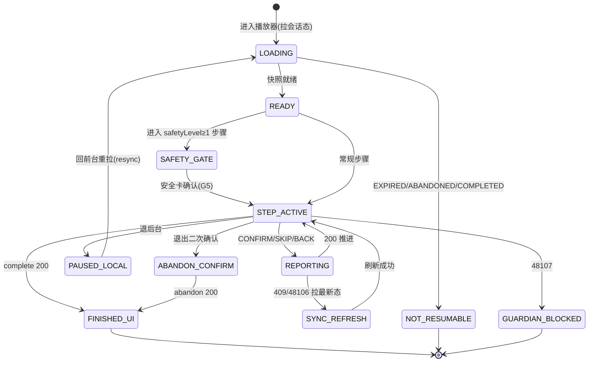

# 客户端-手工美育创作引导页面架构与交互设计 详细设计

- 版本: v1.0
- 日期: 2026-11-23
- 状态: 新增初版
- 错误码映射: CRA-xxx 符号码 ↔ 服务端 48100-48199 在用码 1:1(零新增数字段位,通用码 40001/40103 归口全局)

## 1. 模块概述

### 1.1 功能定位

本文是"手工美育"域(折纸/剪纸/简笔画/涂色/黏土/综合小制作)的**客户端呈现层权威**,兑现服务端《服务端-手工美育创作引导引擎》(CAG,2026-11-22)v1.0 契约 R10 声明的"客户端页面(跟做播放器/作品墙/AI 引导浮窗)为后续批次"缺口。服务端跟做会话/步骤 DSL/审核/激励/时长/防沉迷全部权威在 CAG,本文档只定义页面架构、交互流程、客户端镜像状态机与呈现层守卫,不重复服务端语义。

全库扫描确认:puzzle(静态题)/chess(博弈)/science(探究)客户端页面均不含动手创作跟做场景,手工美育客户端页面层零覆盖,本文补齐。

### 1.2 覆盖范围

| 范围 | 内容 |
| --- | --- |
| 页面族 | `/craft/*` 七学生端路由 + `/parent/craft` 一家长端路由 |
| 六类手工 | ORIGAMI/PAPERCUT/DOODLE/COLORING/CLAY/CRAFT_SCIENCE 呈现矩阵(服务端列表驱动) |
| 三模式 | GUIDED 跟做 / FREE 自由创作 / CHALLENGE 主题挑战 |
| AI 引导 | 四类场景(STEP_HELP/ENCOURAGE/MATERIAL_SUB/SafetyTip)浮窗+SSE 流式渲染+降级内置话术 |
| 作品链路 | 相机拍摄(禁相册)→直传→送审前置→审核状态诚实呈现→挑战参赛 |
| 家长端 | 参与时长/类型覆盖/作品数报告(隐私最小集) |

### 1.3 明确不做(本期)

- 不做任何"判分/打分/美观评价/标准答案对比"呈现(零判分红线 G4,CI 静态扫描)。
- 不做作品公开广场/点赞/投票/评论/排名(C5,零社交攀比)。
- 不做 AI 绘画生成作品图入口(禁 AIGC 冒充学生创作,C4)。
- 不做材料电商/考级挂钩话术(C6)。
- 不做直播美术课/真人在线课堂。

### 1.4 权威边界

| # | 契约 | 对齐 |
| --- | --- | --- |
| R1 | 步骤 DSL/会话状态/完成判定 | 服务端 CAG 为唯一权威,客户端只读渲染;客户端禁本地推演步骤合法性 |
| R2 | 素材 URL | 服务端装配时下发完整 CDN URL,客户端经 PrimeImageLoader 加载,禁自拼域名 |
| R3 | 路由命名空间 | `/craft/*` 与 `/puzzle/*`、`/chess/*`、`/science/*` 独立,互不内嵌入口 |
| R4 | 拍摄与上传 | 相机委托多媒体选取服务;OSS 直传委托文件上传服务(作品为单次直传,不走断点续传分片) |
| R5 | 家长门 | 首次上传/8 岁以下全程家长门,拉起统一流程委托家长门组件,48108 映射 |
| R6 | 审核状态 | 以服务端列表/推送为准,客户端禁本地推断审核结果(G8) |
| R7 | 时长口径 | 跟做计时仅表现;ARTS 素养时长权威归时长对账引擎;拍摄/上传页计时停止 |
| R8 | AI 话术渲染 | SSE 增量渲染委托 Markdown/富文本引擎,客户端禁自调 LLM |
| R9 | 防沉迷 | 只呈现不裁决;48107/48130 为 200 语义引导帧,呈现无重试按钮 |
| R10 | 激励 | 徽章/积分弹窗委托激励中心组件,客户端不预发、不本地计算里程碑 |
| R11 | 错误文案 | 统一 ErrorMessageFactory,CRA-xxx 符号码仅作映射键 |
| R12 | 隐私 | 会话镜像零落盘(G9);作品临时文件即传即删;注销/登出本地零残留 |

## 2. 路由与页面族

| 路由 | 页面 Widget | 说明 | 深链接闸 |
| --- | --- | --- | --- |
| `/craft` | `CraftHomePage` | 首页:六类手工卡+适龄显隐+继续未完成会话+挑战横滑条 | 登录闸 |
| `/craft/template/:templateNo` | `CraftTemplateDetailPage` | 模板详情:材料清单/安全等级徽标/步骤预览/开始按钮 | 登录闸+适龄闸 |
| `/craft/session/:sessionNo` | `CraftPlayPage` | **跟做播放器**(核心页):步骤卡/媒体区/进度/AI 浮窗/安全卡 | 登录闸+会话态闸 G1 |
| `/craft/works` | `CraftWorkWallPage` | 我的作品墙:审核五态呈现(PRIVATE/UNDER_REVIEW/APPROVED/REJECTED/DELETED) | 登录闸 |
| `/craft/works/upload` | `CraftWorkUploadPage` | 拍摄上传:相机强制→压缩→sha256→直传→送审 | 登录闸+家长门+48130 闸 |
| `/craft/challenges` | `CraftChallengeListPage` | 进行中挑战列表(仅 PUBLISHED) | 登录闸 |
| `/craft/challenges/:challengeNo` | `CraftChallengeDetailPage` | 挑战详情+用 APPROVED 作品参赛 | 登录闸+适龄闸 |
| `/parent/craft` | `ParentCraftReportPage` | 家长端报告:时长/类型覆盖/作品数 | 家长门令牌 |

路由注册委托《客户端路由与深链接系统》;`/craft/session/:sessionNo` 深链接进入必先拉服务端会话态(见 §6.2 G1)。

## 3. 页面架构

### 3.1 `/craft` 首页

布局(自上而下):

1. **顶部栏**:标题"手工小作坊"+ 我的作品入口(相机图标)+ 挑战入口(奖杯图标,无红点诱导)。
2. **继续跟做卡**(条件渲染):本地内存无、冷启动后由 `GET /sessions` 最近会话恢复——实际实现为服务端在模板详情/首页 BFF 不另开接口,客户端在进入首页时不预拉会话;未完成会话的恢复入口出现在模板详情页(见 §3.2)。**首页不渲染跨页会话卡**,避免双端会话态撕裂(puzzle/chess 同约定)。
3. **六类手工宫格**:2×3 大卡片(图标+名称+适龄标签),数据 `GET /api/v1/craft/categories`;类别级适龄标签仅展示,模板级过滤以服务端列表为准(G10)。
4. **挑战横滑条**:进行中的挑战卡片(主题/截止时间),`GET /api/v1/craft/challenges?status=PUBLISHED`;空态隐藏整段(D6 服务端故障时同)。
5. **最近作品横滑条**(≤10):`GET /api/v1/craft/works?page=1&size=10`,缩略图经 PrimeImageLoader,审核状态角标原样呈现(G8)。

交互:类别卡点击→模板列表(复用通用列表组件分页加载,`craftType` 入参);挑战卡→挑战详情;作品卡→作品墙并定位。

### 3.2 `/craft/template/:templateNo` 模板详情

数据:`GET /api/v1/craft/templates/{templateNo}`(详情+步骤 DSL 全量)。

区块:

1. **头图区**:cover 图(16:9)+ craftType 徽标+ageBand 标签+难度星标(仅适龄提示,**禁出现"评分/等级考核"文案**)。
2. **材料清单**:materialList 逐项(名称/用量/替代方案),safetyLevel≥1 的材料带橙色安全小标;材料替代方案仅展示模板内置 substitute(客户端禁自增建议,AI MATERIAL_SUB 场景同约束)。
3. **安全提示横幅**(条件):模板任一步骤 safetyLevel≥1 时,详情页顶部常驻黄色横幅"这个手工会用到工具,请在家长陪同下完成",不可关闭(C3 客户端侧)。
4. **步骤预览**:折叠列表(步骤标题+media 缩略图),仅预览不可跟做;skippable=false 的步骤带"不可跳过"小标。
5. **底部固定按钮**:"开始跟做"(GUIDED)/"自由创作"(FREE)。点击创建会话:
   - `POST /api/v1/craft/sessions {templateNo, mode, clientRequestId}`(幂等键 UUID v7);
   - 成功→跳 `/craft/session/{sessionNo}`;
   - 48102(模板下架)→ 弹窗展示 offlineReason 中性话术(版权到期:"这个手工暂时休息了,换一个试试");
   - 48103(适龄)→ 不可达(入口已按服务端列表过滤,G10 双保险);
   - 48107(防沉迷)→ 跳休息引导页(G7);
   - 48130(家长端关闭)→ 首页入口本应隐藏(G7),深链接兜底跳家长提示页。
6. **未完成会话恢复**:同模板存在 IN_PROGRESS/PAUSED 会话时,按钮文案变"继续上次(第 X 步)",X 以服务端会话态为准;点击 `GET /api/v1/craft/sessions/{sessionNo}` 校验后直入播放器(G1/G9)。

### 3.3 `/craft/session/:sessionNo` 跟做播放器(核心页)

布局:

```
┌─────────────────────────────┐
│ ← 退出(二次确认)   进度 ●●○○○ 3/8 │
├─────────────────────────────┤
│  [安全卡层(条件,全屏,不可跳过)] │  ← safetyLevel≥1 步骤进入时强制
├─────────────────────────────┤
│                             │
│        媒体区(图/视频)        │  ← 步骤 media, PrimeImageLoader
│                             │
├─────────────────────────────┤
│ 第3步 · 剪出后腿形状            │
│ 操作说明(适龄文案, 大字)        │
│ 💡 小贴士: 可以先请家长帮忙扶住纸 │
├─────────────────────────────┤
│ [上一步]  [完成这一步 ✓] [跳过] │  ← skippable=false 时跳过按钮不渲染
├─────────────────────────────┤
│        🤖 帮帮我(AI 浮窗按钮)   │  ← 常显, 点击拉起 AI 引导抽屉
└─────────────────────────────┘
```

关键交互:

1. **步骤推进**:点击"完成这一步"→ REPORTING 态(按钮 loading 禁连点,G3)→ `POST steps/{stepNo}/report {action:CONFIRM, durationSec, clientRequestId}` → 成功渲染下一步;409/48106 → 拉最新会话态整体刷新,不本地推演。
2. **跳过**:仅 skippable=true 渲染跳过按钮,点击二次确认("确定要跳过这一步吗?")→ action:SKIP。skippable=false 步骤禁渲染跳过(G5),服务端 48106 兜底。
3. **上一步**:action:BACK,仅用于回看媒体,不产生推进;回看后须从当前步 CONFIRM 继续。
4. **安全卡层**(G5 核心):进入 safetyLevel≥1 步骤时全屏覆盖安全卡(safetyNote 原文+趣味图标),须点击"我知道了,我会小心"才可看步骤;**禁手势关闭/返回键跳过**(PopScope manual 拦截)。CRAFT_SCIENCE 含 heating/power 的步骤(safetyLevel=3)额外要求勾选"家长在我身边"复选框才可继续(C3 家长协同)。
5. **AI 引导浮窗**:底部"帮帮我"按钮拉起 AI 抽屉(见 §3.3.1)。
6. **计时器**:右上角小计时(仅表现),进入页面起走,离开页面/退后台暂停展示;**拍摄跳转时计时停止**(R7 口径)。
7. **完成**:最后一步 CONFIRM 后或任意时刻点顶部"完成"→ 二次确认 → `POST /complete` → 结算页(见 §3.3.2)。
8. **退出**:返回键/左上角 → 二次确认("退出后可以在作品页继续")→ `POST /abandon {reason}`(或仅退出页面保留会话,由用户选"暂离"vs"放弃";暂离不发 abandon,PAUSED 由服务端心跳超时裁决)。

#### 3.3.1 AI 引导抽屉

- 入口三快 chip:"这一步怎么做"(STEP_HELP)/"我没有 xx 材料"(MATERIAL_SUB,xx 取当前材料名)/"鼓励我一下"(ENCOURAGE);SafetyTip 场景由客户端在进入安全卡步骤时自动触发一次("听安全小提示"),不经用户输入。
- 请求:`POST /api/v1/craft/ai/messages`(SSE 流式),锚定当前步骤 anchorStepNo。
- 渲染:Markdown 增量渲染(委托 R8),禁显示"第 X 步之后"的剧透内容(服务端已过滤,客户端不做二次处理)。
- 降级帧:
  - 48109 频控 → 吐司"AI 小助手有点累,先自己试试看";
  - 48120 引擎超时 / 48121 安全过滤命中 → 抽屉顶部黄色降级条"AI 休息了,送你一句鼓励"(degraded=true 埋点),正文换本地内置分龄鼓励话术包(本地 asset,按 ageBand 三档:3-5/5-7/7+);
- 频控客户端侧不做预扣,仅呈现服务端结果(G12 禁本地计数替代)。

#### 3.3.2 完成结算页(播放器内全屏替换)

- 文案:"你完成了《会跳的纸青蛙》!"+"做自己的作品,真棒!"——**零分数/零星级/零评价**(G4)。
- 展示:耗时(仅展示)、步骤完成数/总步数、下一步建议(服务端模板推荐位或回首页)。
- 作品引导:"给作品拍张照"(→上传页,携带 sessionNo);"下次再拍"(→回首页)。
- 激励弹窗(若有)委托激励中心组件(R10),不内嵌。

### 3.4 `/craft/works` 作品墙

- 网格 2 列瀑布(高宽比原图),`GET /api/v1/craft/works?page` 分页加载。
- 审核状态角标矩阵(G8 诚实呈现):

| reviewStatus | 角标文案 | 缩略图处理 |
| --- | --- | --- |
| PRIVATE | "审核中"(灰) | 正常显示(本人可见) |
| UNDER_REVIEW | "审核中"(灰) | 正常显示 |
| APPROVED | 无角标 | 正常显示 |
| REJECTED | "未通过"(灰,中性) | 正常显示;点击弹"再试一次"引导(禁展示拒绝原因细节,AC09) |
| DELETED | 不渲染 | — |

- 点击作品→大图页(纯本地放大,无分享按钮——作品分享本期不做;分享海报如 P2 开放须走脱敏管线)。
- 右上角删除:二次确认→`DELETE /works/{workNo}`;删除后网格移除,禁本地撤销(服务端级联 G12)。
- 顶部"+ 拍作品"→上传页。

### 3.5 `/craft/works/upload` 拍摄上传流程

步骤条(四步):**拍摄 → 确认 → 上传 → 送审**

1. **拍摄**(G6 相机强制):仅 `image_picker` 的 camera 来源/原生相机通道,**禁 gallery 来源**(CI 静态扫描 `ImageSource.gallery` 禁词);支持连拍 1-6 张或 1 段 ≤60s 视频(mime 白名单 jpeg/png/webp/mp4)。
2. **确认**:网格预览(可删重拍),标题输入(≤64 字,可选),selfRating 自评五星(可选,**仅自评展示,不进入任何排名或对外展示**,服务端字段原样提交);48130 闸在本页入口前置(家长端关闭则入口隐藏,深链接兜底)。
3. **上传**:
   - 图片压缩(长边≤2048,质量 85;>20MB 拒绝,本地提示);
   - 计算 sha256(纯 Dart `crypto` 包,上传前本地校验重复帧);
   - `POST /works/upload-init {sessionNo?, challengeId?, mime, size, sha256}`(clientRequestId 幂等)→ 直传凭证(30min);
   - OSS 直传(委托文件上传服务;单文件单次 PUT,不走分片断点续传——作品文件小且凭证单次);
   - `POST /works/upload-complete` → 返回 workNo, reviewStatus=PRIVATE;
   - 48116 凭证过期 → 重新 upload-init 一次(D7)。
4. **送审**:客户端禁做审核判定;成功页文案"作品已提交,审核通过后会出现在挑战精选里"(诚实呈现 G8);48122(送审失败)→ 成功页变体文案"作品已保存,正在排队审核"(作品 PRIVATE 留存,禁展示"已通过")。
5. **隐私**:临时文件在 upload-complete 响应后必经 CLEANUP 删除(try/finally 断言,同听写 G1);拍摄页禁截图水印委托数字内容防截屏系统。

### 3.6 `/craft/challenges` 与 `/craft/challenges/:challengeNo`

- 列表:主题卡(theme/brief 摘要/起止时间/允许的手工类型徽标),禁显示参与人数排名(G11)。
- 详情:创作要求+材料建议(brief 原文渲染)+我的参赛作品(从作品墙选 APPROVED 作品)→ `POST /challenges/{challengeNo}/entries {workNo}`(clientRequestId 幂等)。
- 48113(未开始/已结束)→ 按钮置灰"挑战未开始/已结束";48114(重复参赛)→ 吐司"这个作品已经参赛啦"。
- 挑战页**禁出现**:点赞/投票/评论/排行榜/获奖名单(精选由运营后置,客户端仅展示 FEATURED 标记的精选作品卡,无交互)。

### 3.7 `/parent/craft` 家长端报告页

- 数据:`GET /api/v1/parent/craft/report?childUserId&range`(家长门令牌,R5)。
- 三卡:参与时长(ARTS 素养时长,与学习时长分卡展示)/类型覆盖(六类参与分布条)/作品数(按审核状态计数)。
- 功能开关:手工美育总开关(关闭→学生端 48130 fail-closed,G7);开关状态缓存 ≤24h,**缓存失效方向从严**(过期按开启处理,但关闭指令即时生效经推送)。
- 隐私最小集:不含作品图明细、不含 AI 对话文本(C1/R12)。

### 3.8 分龄交互参数(呈现层,数值权威归《分龄UI适配与交互设计规范》)

| 参数 | 3-5 岁 | 5-7 岁 | 7-9 岁 | 9-12 岁 |
| --- | --- | --- | --- | --- |
| 步骤说明字号 | 22sp | 20sp | 18sp | 16sp |
| 媒体区高度占比 | 46% | 44% | 40% | 36% |
| 安全卡图标化 | 大图+语音朗读按钮 | 大图+文字 | 图+文字 | 文字为主 |
| 按钮最小触达 | 96dp | 88dp | 88dp | 56dp |
| AI 话术语速(TTS 朗读时) | 0.85x | 0.9x | 1.0x | 1.0x |
| 单步最大连续跟做提示 | 3 步后建议休息 | 5 步 | 6 步 | 8 步 |

上表仅客户端呈现默认值;适龄过滤权在服务端列表(G10),本表不做准入计算。安全卡与防沉迷呈现不受分龄参数影响(不可降级,D10)。

## 4. Dart 模型(与服务端契约 1:1)

```dart
enum CraftType { origami, papercut, doodle, coloring, clay, craftScience }
enum CraftMode { guided, free, challenge }
enum CraftSessionStatus { created, inProgress, paused, completed, abandoned, expired }
enum CraftStepAction { confirm, skip, back, help }
enum CraftWorkReviewStatus { private, underReview, approved, rejected, deleted }

class CraftStep {
  final int stepNo;
  final String title;
  final String instruction;
  final List<CraftMedia> media;      // [{assetId,kind,url}]
  final String keyPoint;
  final String tip;
  final String safetyNote;
  final int safetyLevel;             // 0-3
  final int estDurationSec;
  final bool skippable;
}

class CraftSessionMirror {           // 仅内存,零落盘(G9)
  final String sessionNo;
  final String templateNo;
  final int templateVersionNo;
  final CraftMode mode;
  final CraftSessionStatus status;   // 服务端权威镜像
  final int currentStep;
  final List<CraftStep> stepSnapshot;// 快照 SSOT,断线重拉禁回源模板
  final int version;
}

class CraftWorkItem {
  final String workNo;
  final String? sessionNo;
  final String title;
  final List<CraftMedia> mediaAssets;
  final int? selfRating;
  final CraftWorkReviewStatus reviewStatus;
  final String visibility;           // 恒 FAMILY,本期无公开态
  final DateTime createdAt;
}

class CraftAiGuideRequest {
  final String sessionNo;
  final String scene;                // STEP_HELP/ENCOURAGE/MATERIAL_SUB/SafetyTip
  final int? anchorStepNo;
  final String? userText;
}
```

模型与服务端 JSON 字段经 `fromJson` 严格对齐;枚举序列化用小写蛇形,**禁客户端自定义枚举值**(R1)。

## 5. 核心控制器与关键代码

### 5.1 CraftPlayController(跟做主控制器)

```dart
class CraftPlayController extends Notifier<CraftPlayState> {
  String? _activeClientReqId;               // 上报幂等键(G3)
  CraftSessionMirror? get mirror => state.mirror;

  Future<void> confirmStep(int stepNo, int durationSec) async {
    if (state.phase == CraftPlayPhase.reporting) return;   // G3 双击门控
    final step = state.mirror!.stepSnapshot[stepNo - 1];
    // G5 安全卡门控: 含工具步骤必须先过安全卡
    if (step.safetyLevel >= 1 && !state.safetyAckedSteps.contains(stepNo)) {
      state = state.copyWith(phase: CraftPlayPhase.safetyGate);
      return;
    }
    state = state.copyWith(phase: CraftPlayPhase.reporting);
    final reqId = _activeClientReqId ??= Uuid.v7();
    try {
      final resp = await _repo.reportStep(
          sessionNo: mirror!.sessionNo, stepNo: stepNo,
          action: 'CONFIRM', durationSec: durationSec, clientRequestId: reqId);
      state = state.copyWith(
          phase: CraftPlayPhase.stepActive,
          mirror: mirror!.copyWith(currentStep: resp.currentStep, version: resp.version),
          safetyAckedSteps: {...state.safetyAckedSteps});  // 推进后清空本步 ack
      _activeClientReqId = null;
    } on CraftApiException catch (e) {
      if (e.code == 48105 || e.code == 48106) {
        await resync();                    // 竞态裁决: 拉服务端最新态整体刷新
      } else if (e.code == 48107) {
        state = state.copyWith(phase: CraftPlayPhase.guardianBlocked);
      } else {
        state = state.copyWith(phase: CraftPlayPhase.stepActive); // 可重试
        rethrow;
      }
    }
  }

  void ackSafety(int stepNo, {bool parentPresent = false}) {
    final step = state.mirror!.stepSnapshot[stepNo - 1];
    if (step.safetyLevel >= 3 && !parentPresent) return;  // C3 家长协同硬门
    state = state.copyWith(
        phase: CraftPlayPhase.stepActive,
        safetyAckedSteps: {...state.safetyAckedSteps, stepNo});
  }

  Future<void> resync() async {            // 409/恢复/退后台回前台统一入口
    final fresh = await _repo.getSession(mirror!.sessionNo);
    if (fresh.status == CraftSessionStatus.expired ||
        fresh.status == CraftSessionStatus.abandoned) {
      state = state.copyWith(phase: CraftPlayPhase.notResumable); // G1
    } else {
      state = state.copyWith(mirror: fresh, phase: CraftPlayPhase.stepActive);
    }
  }
}
```

### 5.2 CraftAiGuideController(SSE 流式+降级话术)

```dart
class CraftAiGuideController {
  final _chunks = <String>[];
  SseSubscription? _sub;

  Future<void> ask(CraftAiGuideRequest req) async {
    _chunks.clear();
    try {
      _sub = await _sseClient.stream(
        path: '/api/v1/craft/ai/messages',
        body: req.toJson(),
        onChunk: (text, seq) { _appendDedup(text, seq); },   // 断线重连按 seq 去重
        onDegraded: (code) {                                  // 48120/48121
          _renderDegradedBanner(code);                        // 降级条+本地话术包
          tracker.track('craft_ai_guide_used', {'scene': req.scene, 'degraded': true});
        },
        onRateLimited: () { _toast(localized.aiGuideTired); }, // 48109
      );
    } on TimeoutException {
      _renderDegradedBanner(48120);                           // D1 本地兜底
    }
  }

  void _renderDegradedBanner(int code) {
    final line = LocalEncouragementPack.forAge(AppContext.ageBand).random();
    _ui.showDegradedBanner(code, fallbackText: line);         // 禁词校验过的话术包
  }
}
```

### 5.3 CraftUploadController(拍摄→直传→送审)

```dart
class CraftUploadController {
  Future<void> captureAndUpload({String? sessionNo, String? challengeId}) async {
    final files = await _mediaPicker.pickFromCameraOnly(maxCount: 6);  // G6 禁相册
    if (files.isEmpty) return;
    final compressed = await _compressor.compressAll(files, maxEdge: 2048, quality: 85);
    for (final f in compressed) {
      if (f.size > 20 * 1024 * 1024) throw CraftClientError(48111);
    }
    final reqId = Uuid.v7();
    try {
      final init = await _repo.uploadInit(
          sessionNo: sessionNo, challengeId: challengeId,
          files: compressed.map((f) => FileMeta(mime: f.mime, size: f.size, sha256: f.sha256)).toList(),
          clientRequestId: reqId);
      for (final (file, cred) in zip(compressed, init.credentials)) {
        await _uploader.directUpload(cred, file);             // R4 委托
      }
      final work = await _repo.uploadComplete(clientRequestId: reqId);
      state = UploadPhase.done(workNo: work.workNo, reviewStatus: work.reviewStatus);
    } on CraftApiException catch (e) {
      if (e.code == 48116) {
        final retry = await _repo.uploadInitReplay(reqId);    // D7 凭证重申请一次
        if (retry != null) { /* 重放直传 */ }
      }
      rethrow;
    } finally {
      await _tmpFileCleaner.assertAllDeleted();               // G12 临时文件零留存
    }
  }
}
```

### 5.4 CraftRouteGuard(深链接四闸)

```dart
class CraftRouteGuard {
  static Future<RouteDecision> checkSessionDeepLink(String sessionNo) async {
    if (!AuthContext.isLoggedIn) return RouteDecision.loginGate;
    final s = await _repo.getSession(sessionNo);
    if (s.status == CraftSessionStatus.expired ||
        s.status == CraftSessionStatus.abandoned ||
        s.status == CraftSessionStatus.completed) {
      return RouteDecision.notResumable;                      // G1 中性提示页
    }
    if (GuardianContext.isBlockedNow) return RouteDecision.guardianBlocked; // G7
    if (await ParentControlCache.isCraftDisabled) return RouteDecision.parentDisabled; // G7 48130
    return RouteDecision.allow;
  }
}
```

## 6. 状态机与守卫

### 6.1 客户端镜像状态机

客户端镜像为表现层状态机,**会话权威状态恒以服务端为准**(R1):



服务端会话六态(CREATED/IN_PROGRESS/PAUSED/COMPLETED/ABANDONED/EXPIRED)与客户端镜像映射:CREATED/IN_PROGRESS/PAUSED→STEP_ACTIVE 族渲染;PAUSED(心跳缺失>10min 服务端裁决)→客户端回前台 resync 后可继续;EXPIRED/ABANDONED→NOT_RESUMABLE 中性页("这个手工会话已结束")禁恢复按钮。

心跳约定:播放器前台驻留期间每 60s±10s 上报一次轻量心跳(委托实时通信通道,携带 sessionNo;失败静默不重试,服务端以 10min 缺失裁决 PAUSED);退后台即停心跳,回前台触发 resync 而非补发心跳。

### 6.2 守卫表

| 守卫 | 规则 | 违反后果 |
| --- | --- | --- |
| G1 深链接会话态闸 | `/craft/session/*` 深链接必先拉服务端态;EXPIRED/ABANDONED/COMPLETED 禁入播放器 | 中性提示页 |
| G2 单活跃会话 | 同时只跟一个做会话,新开模板详情按钮优先"继续上次" | 入口合并 |
| G3 上报幂等防重 | REPORTING 态按钮禁连点;clientRequestId 会话内复用;409/48106 只拉取不重试本地推演 | 整体刷新 |
| G4 零判分呈现 | 全页面族无分数/星级评价/标准答案对比/美观评价组件;CI 静态扫描禁词(score/rating/判分/标准答案/好看吗) | 编译检查拦截 |
| G5 安全卡不可关闭 | safetyLevel≥1 步骤全屏安全卡,PopScope manual 拦截禁返回键跳过;skippable=false 禁渲染跳过按钮;safetyLevel=3 须家长在场复选 | 硬门不可绕 |
| G6 相机强制禁相册 | 作品拍摄仅 camera 来源;CI 扫描 `ImageSource.gallery`/`.gallery` 禁词 | CI 拦截 |
| G7 防沉迷/管控 fail-closed 呈现 | 48107→休息引导页无重试按钮;48130→入口隐藏+深链接兜底家长提示页;关闭指令推送即时生效 | 无降级路径 |
| G8 审核状态诚实呈现 | reviewStatus 原样渲染角标;禁乐观预显 APPROVED;48122 展示"排队审核" | 文案矩阵 §3.4 |
| G9 镜像零落盘 | CraftSessionMirror 仅内存;kill/重启后重拉服务端;禁 Hive/SQLite 存会话与步骤 | 重拉即恢复 |
| G10 适龄闸 fail-closed | 模板入口以服务端列表(适龄过滤后)为准;客户端禁按本地年龄计算过滤规则;深链接 48103→适龄提示页 | 双保险 |
| G11 零排行零社交 | 挑战页无点赞/投票/评论/排行/获奖名单组件;CI 白名单扫描(like/vote/rank/comment 禁词) | CI 拦截 |
| G12 隐私最小化 | 临时文件即传即删(finally 断言);埋点禁采作品图内容/AI 消息文本/步骤全文 | 埋点白名单 |

### 6.3 竞态裁决

| 竞态 | 裁决 |
| --- | --- |
| 步骤上报 409/48106(双端/重复) | resync() 拉服务端最新态整体刷新,客户端禁本地推演后续步 |
| complete 双击 | 服务端幂等 200;客户端以 clientRequestId 去重,结算页只弹一次 |
| abandon 与 complete 并发 | 先发请求者胜;后达响应按返回态渲染(409→刷新),禁二次弹结算 |
| AI SSE 断线/重连 | 已收 chunk 保留展示;重连按 seq 去重追加;48120/48121 走本地话术兜底不重试流 |
| 上传中断(kill/弱网) | 凭证 30min 内 upload-init 同 clientRequestId 重放恢复;直传幂等(OSS 覆盖同 sha256)禁重复计费帧 |

## 7. 错误码映射(CRA-xxx ↔ 481xx)

| 符号码 | 服务端码 | HTTP | 客户端呈现 |
| --- | --- | --- | --- |
| CRA-001 | 48101 参数非法 | 400 | ErrorMessageFactory 通用参数提示 |
| CRA-002 | 48102 模板不存在/下架 | 404 | 弹窗+offlineReason 中性话术(版权:"暂时休息了") |
| CRA-003 | 48103 适龄限制 | 403 | 适龄提示页(禁回显模板内容字段) |
| CRA-004 | 48104 会话不存在 | 404 | 中性提示+回首页 |
| CRA-005 | 48105 会话状态非法 | 409 | resync 刷新;终态→NOT_RESUMABLE 页 |
| CRA-006 | 48106 步骤非法 | 409 | resync 刷新(禁本地重试) |
| CRA-007 | 48107 防沉迷限制 | 200* | 休息引导页,无重试按钮(G7) |
| CRA-008 | 48108 家长门失败 | 403 | 拉起家长门组件(R5),取消则回原页 |
| CRA-009 | 48109 AI 频控 | 429 | 吐司"AI 小助手有点累"(退避禁连点) |
| CRA-010 | 48110 文件类型不允许 | 400 | 拍摄前本地白名单预拦截;兜底提示 |
| CRA-011 | 48111 文件大小超限 | 400 | 本地压缩后仍超→提示重拍 |
| CRA-012 | 48112 作品不可见 | 404 | 中性提示 |
| CRA-013 | 48113 挑战不存在/未开始/已结束 | 404 | 按钮置灰或中性弹窗 |
| CRA-014 | 48114 重复参赛 | 409 | 吐司"已经参赛啦" |
| CRA-015 | 48115 作品不存在 | 404 | 列表刷新 |
| CRA-016 | 48116 直传凭证过期 | 400 | 自动重申请一次(D7),再败提示重试 |
| CRA-020 | 48120 AI 降级 | 200* | 降级条+本地鼓励话术包(D1) |
| CRA-021 | 48121 安全过滤命中 | 200* | 降级条+本地鼓励话术包(D2) |
| CRA-022 | 48122 送审失败 | 200* | "作品已保存,正在排队审核"(禁显已通过) |
| CRA-030 | 48130 家长端关闭 | 200* | 功能隐藏/家长提示页(G7) |
| CRA-500 | 通用网络异常 | — | 归口全局 40103/40001 语义,禁新占数字段 |

\* 200 语义帧按业务成功渲染(呈现引导态),与棋类/体育/晨读客户端同约定。

## 8. 降级矩阵

| # | 故障 | 客户端降级 | 红线 |
| --- | --- | --- | --- |
| D1 | AI 管线超时/SSE 断 | 本地分龄鼓励话术包(3 档) | 可降级 |
| D2 | AI 安全过滤命中(48121) | 同上 | 可降级 |
| D3 | 素材 CDN 失败 | 媒体占位图+步骤文本可读,跟做不阻断 | 可降级 |
| D4 | 送审通道故障(48122) | "排队审核"文案留存 | 禁本地改审核态 |
| D5 | 挑战服务故障 | 首页挑战条隐藏,主链路不受影响 | 可降级 |
| D6 | 模板列表缓存失效 | 骨架屏+重试按钮 | 可降级 |
| D7 | 直传凭证失败(48116) | 自动重申请一次,再败引导重拍 | 可降级 |
| D8 | 弱网步骤上报失败 | Outbox 离线队列补报(幂等键复用,48h) | 可降级 |
| D9 | 低端机媒体卡顿 | 步骤图降分辨率(PrimeImageLoader AdaptEngine 委托) | 可降级 |
| D10 | — | **总红线:适龄闸/防沉迷/安全卡不可关闭/送审前置诚实呈现/零判分/相机强制 不可降级** | 不可降级 |

## 9. 合规红线(客户端侧)

1. **C1 隐私**:作品含人脸默认仅家庭可见;客户端无公开可见性开关;家长端报告不含作品明细。
2. **C2 家长门**:首次上传/8 岁以下全程拉起家长门组件,禁端内绕过。
3. **C3 工具安全**:安全卡不可关闭不可跳过;safetyLevel=3 加热/电源步骤家长在场复选硬门。
4. **C4 AIGC 标识**:AI 话术气泡常驻"Ai 辅助"小徽标;禁 AI 画图入口。
5. **C5 零社交**:挑战无点赞/投票/评论/排行/获奖名单;精选作品仅展示卡。
6. **C6 零考级**:全页面族禁"考级/证书/等级评定"话术(CI 禁词)。
7. **C7 版权**:模板素材 URL 由服务端下发;客户端禁缓存复用跨模板、禁导出素材库。
8. **C8 时长口径**:拍摄/上传页计时停止;娱乐化引导时长分账文案与家长端一致(category=ARTS 归服务端)。

## 10. 埋点(module=craft,与服务端 §16 对齐)

客户端上报视图/交互事件,与服务端镜像事件**不重名不重复计**(craft_step_report 为服务端日志镜像,客户端禁埋):

| 事件 | 时机 | 关键属性(白名单) |
| --- | --- | --- |
| craft_home_view | 首页曝光 | ageBand |
| craft_template_open | 打开模板详情 | templateNo, craftType |
| craft_session_create | 创建会话成功 | templateNo, mode |
| craft_session_complete | 完成(客户端确认帧) | durationSec, stepCount |
| craft_session_abandon | 放弃 | reason, currentStep |
| craft_ai_guide_used | AI 引导(含降级) | scene, degraded |
| craft_work_uploaded | upload-complete 成功 | challengeId?, sizeBucket |
| craft_work_wall_view | 作品墙曝光 | — |
| craft_upload_view | 上传页曝光 | source(camera 恒值) |
| craft_challenge_enter | 参赛成功 | challengeNo |

**禁采**:作品图内容与像素、AI 消息文本、步骤全文、材料替代自由文本(G12)。

## 11. 契约对齐

| # | 契约 | 对齐 |
| --- | --- | --- |
| R1 | 会话/步骤/判定权威 | 服务端 CAG;客户端只读渲染禁推演 |
| R2 | 素材加载 | PrimeImageLoader(R2/R9 委托),禁自拼 CDN URL |
| R3 | 路由命名空间 | `/craft/*` 与 puzzle/chess/science 隔离 |
| R4 | 拍摄/上传委托 | 多媒体选取服务(camera-only 封装)+文件上传服务(单次直传) |
| R5 | 家长门委托 | 统一家长门组件,48108/Grant Token 流程 |
| R6 | 审核呈现 | 服务端 reviewStatus 为准;推送到达后刷新作品墙 |
| R7 | 时长呈现 | 仅表现;ARTS 口径归时长对账引擎,拍摄/上传停表 |
| R8 | AI 渲染委托 | Markdown 流式渲染引擎;禁自调 LLM/禁本地扩写话术 |
| R9 | 防沉迷呈现 | 48107/48130 无重试;关闭推送即时生效 |
| R10 | 激励呈现 | 激励中心组件消费事件,客户端不预发 |
| R11 | 错误文案 | ErrorMessageFactory 统一,CRA-xxx 为映射键 |
| R12 | 零残留 | 镜像零落盘+临时文件 finally 删除+注销本地全清 |

## 12. 验收场景

- AC01 深链接进入 EXPIRED 会话→NOT_RESUMABLE 中性页,无恢复按钮(G1)。
- AC02 双端同时推进步骤,本端收 409→自动 resync 整页刷新无撕裂(G3)。
- AC03 skippable=false 步骤无跳过按钮;安全卡返回键被拦截,须确认进入(G5)。
- AC04 safetyLevel=3 步骤未勾家长在场复选不可进入(C3)。
- AC05 48107 呈现休息引导页,无重试按钮;时段恢复后可再进(G7)。
- AC06 家长端关闭推送到达→首页/详情入口即时隐藏;上传页深链接兜底提示(CRA-030)。
- AC07 相机入口调用仅 camera 来源,CI 扫描 ImageSource.gallery 零命中(G6)。
- AC08 审核中作品角标"审核中";48122 变体文案"排队审核";全程禁显"已通过"(G8)。
- AC09 REJECTED 作品点击仅"再试一次"引导,无拒绝原因细节。
- AC10 未 APPROVED 作品参赛入口不可选;重复参赛吐司 CRA-014。
- AC11 AI 第 21 条(会话级)返回 48109→吐司,禁本地预扣频控。
- AC12 AI SSE 中途断线→已收文本保留,重连 seq 去重无重复段落。
- AC13 素材 CDN 故障→占位图+文本可读,步骤推进不受影响(D3)。
- AC14 跟做中 kill 进程→重启深链接回播放器,会话态与步骤进度与服务端一致(G9)。
- AC15 挑战页 CI 白名单扫描(like/vote/rank/comment)零命中(G11)。
- AC16 上传完成后临时文件目录为空(finally 断言),埋点包无作品图内容(G12)。

## 13. 关联文档

- 《服务端-手工美育创作引导引擎》(服务端权威契约,R10 兑现对象)
- 《客户端-思维训练与益智游戏页面架构与交互设计》(同构模式:服务端就绪→客户端页面)
- 《客户端-棋类对弈训练页面架构与交互设计》(镜像零落盘/CI 禁词/200 语义帧同约定)
- 《客户端-统一图片加载缓存框架与智能预加载引擎》(素材加载 R2)
- 《客户端-多媒体选取与处理服务》《客户端文件上传服务与断点续传机制》(拍摄直传 R4)
- 《客户端-统一对话框与模态弹出层调度管理系统》(安全卡/二次确认弹窗委托)
- 《客户端-应用锁与生物识别认证系统》《统一家长门与监护人授权核验引擎》(家长门 R5)
- 《客户端-数字内容防截屏与用户溯源水印系统》(拍摄页水印委托)

## 维护记录

- 2026-11-23 v1.0 新增初版:兑现服务端 CAG 引擎契约 R10"客户端页面(后续批次)"缺口,手工美育客户端页面层零覆盖补齐。定义 `/craft/*` 七路由+`/parent/craft` 页面族、跟做播放器核心交互(安全卡不可关闭/零判分呈现/AI 引导抽屉四场景+降级话术包)、作品相机强制禁相册拍摄上传链路、挑战零排行呈现、CRA-001~030 符号码与 48100-48199 在用码 1:1 映射(零新增数字段位)、客户端镜像状态机+守卫 G1-G12+竞态裁决 5 类、降级 D1-D10(D10 总红线六项)、合规 C1-C8、埋点 10 事件白名单、契约 R1-R12、验收 AC01-AC16。
