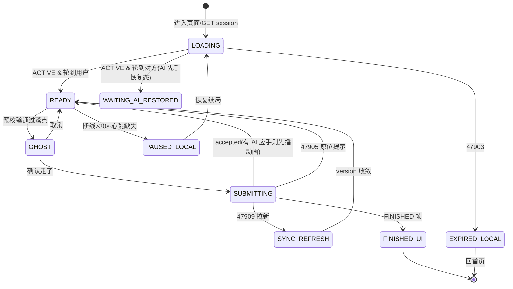

# 客户端-棋类对弈训练页面架构与交互设计 详细设计

- 版本: v1.0
- 日期: 2026-11-22
- 状态: 新增初版
- 错误码: CHS-001~016 客户端符号码(1:1 映射服务端 47900-47915,零新增数字段位)
- 服务端契约: 《服务端-棋类对弈训练引擎-详细设计》v1.0(2026-11-22)

## 1. 概述

### 1.1 模块定位

本文档是棋类对弈训练域(Chess Game Engine, CGE)的客户端呈现层权威设计,兑现服务端引擎契约 R10("客户端页面文档为后续批次:棋类对弈页/残局页/复盘页客户端架构")。覆盖 GOMOKU 五子棋 / XIANGQI 中国象棋 / GO 围棋(9/13 路)三棋种、PLAY 人机对弈 / PUZZLE 残局死活题 / REVIEW AI 复盘三模式在 Flutter 客户端的页面架构、交互流程、状态镜像与降级策略。

经全目录关键词扫描(2026-11-22)确认:服务端《棋类对弈训练引擎》就绪(批次三十五),客户端页面层零覆盖(仅《客户端-思维训练与益智游戏页面架构与交互设计》在边界处引用本域),本文补齐。

### 1.2 设计原则

1. **零裁决**:客户端只做格式级预校验(坐标越界/落点已有子),着法合法性(送将/照面/打劫/禁入/禁手)、胜负、提子、数子全部归服务端规则引擎,客户端不内置任何规则判定代码(对齐服务端 G5/G9 与 puzzle 客户端"零判分"同族红线)。
2. **局面只读渲染**:CGE-FEN 局面 JSON 由服务端唯一权威下发,客户端解析渲染,永不本地推演局面演化(残局模式的"本地推演"仅指记录用户着法序列,不做合法性裁决,见 §4.6)。
3. **提交不可取消 + 幂等重放**:走子提交进入 SUBMITTING 态后不可取消,重试复用同一 clientRequestId,命中服务端幂等回放(G11)原样渲染。
4. **乐观表现、权威收敛**:提交后在目标交叉点渲染半透明"幽灵子",服务端 accepted 后转实子;拒绝(47905)则原位提示原因并移除幽灵子,不处罚、不记错。
5. **防沉迷 fail-closed 呈现**:日限/时段管控以服务端 47907(200* 业务帧)为准,客户端禁本地时间自行裁决,禁提供重试绕过按钮。

### 1.3 职责边界(客户端不做)

| 不做的事 | 权威归属 |
| --- | --- |
| 着法合法性/胜负/提子/打劫/禁手/数子判定 | 服务端规则引擎(R1,LLM 亦禁入) |
| AI 对手着法生成与等级评估 | 服务端 AI 引擎(客户端无"AI 预测走子"功能,G6) |
| rating 计算与棋力标签裁决 | 服务端画像服务(内部等级标签仅展示,不挂钩考级) |
| 残局正解判定与同义解复算 | 服务端残局题服务(正解数据永不下发,G7) |
| 积分/成就发放 | 用户学习激励中心(服务端事件外发,客户端不预发) |
| 娱乐时长裁决 | 时长对账引擎(客户端仅展示服务端下发的 dailyRemain) |
| 全服排行榜/百分位 | 本模块不存在任何排行数据接口(R8),客户端零组件 |

## 2. 信息架构与页面地图

### 2.1 路由表

| 路由 | 页面 | 入口 | 权限 |
| --- | --- | --- | --- |
| `/chess` | 棋类首页(棋种选择/AI 等级/今日余量) | 学习工作台"思维训练"分组卡片、深链接 | 学生,登录 |
| `/chess/play/:sessionNo` | 对弈棋盘页(PLAY 模式通用框架) | 首页开局、历史对局重放(只读态)、推送/续局提醒 | 学生,本人会话 |
| `/chess/puzzle` | 残局题列表 | 首页"残局挑战"入口 | 学生,登录 |
| `/chess/puzzle/:problemNo` | 残局题作答页 | 残局列表 | 学生,登录 |
| `/chess/review/:sessionNo` | AI 复盘页(讲解卡片+棋谱回放) | 对局结果页按钮、历史对局 | 学生,本人 FINISHED 会话 |
| `/chess/profile` | 棋力画像页 | 首页头像区、对局结果页 | 学生,登录 |
| `/chess/records` | 历史对局页 | 首页、画像页 | 学生,登录 |
| `/parent/chess` | 家长端棋类管理页 | 家长中心-娱乐管控分组 | 家长角色 |

路由注册进统一路由体系;`/chess/*` 与 `/puzzle/*` 命名空间隔离(服务端 R3),深链接解析失败一律回退 `/chess` 首页,不白屏。

### 2.2 页面地图

```text
/chess 首页
 ├─ 开局 → POST sessions → /chess/play/:sessionNo (ACTIVE)
 ├─ 残局挑战 → /chess/puzzle → /chess/puzzle/:problemNo → 结果弹层(留在列表刷新)
 ├─ 棋力画像 → /chess/profile → /chess/records → 对局详情(只读回放态棋盘)
 └─ 家长管控(角色切换)→ /parent/chess

/chess/play/:sessionNo 对局页
 ├─ 终局 → 结果弹层 → [再来一局] / [AI 复盘] → /chess/review/:sessionNo
 ├─ 断线恢复 → 服务端 PAUSED → 续局覆盖层 → 刷新局面续走
 └─ 过期(47903)→ 中性提示 → /chess
```

### 2.3 页面状态规范

遵循《客户端页面状态模式与骨架屏加载空态错误态设计规范》:

| 态 | 棋盘页呈现 |
| --- | --- |
| loading | 棋盘骨架(占位网格,禁用触摸) |
| empty | 历史对局/残局列表空:插画+"还没有对局,来一局吧" |
| error | 网络错误:整页错误态+重试;对局中网络错误用 §8.2 D2 专线处理,不替换整页 |
| content | 正常棋盘 |

## 3. 数据模型与 API 契约

### 3.1 Dart 数据模型(与服务端响应 1:1)

```dart
enum ChessGameType { gomoku, xiangqi, go }
enum ChessMode { play, puzzle }
enum ChessSessionStatus { created, active, paused, finished, expired }
enum ChessResult { win, lose, draw }
enum ChessColor { red, black, white } // 象棋 red/black;五子棋/围棋 black/white

enum ChessEndReason {
  fiveInRow, forbidden, checkmate, stalemate, timeout,
  resign, score, drawAgreement, goalReached, goalFailed,
}

class ChessMove {
  final int r; // 零基行
  final int c; // 零基列
  const ChessMove(this.r, this.c);
  Map<String, int> toJson() => {'r': r, 'c': c};
  factory ChessMove.fromJson(Map<String, dynamic> j) =>
      ChessMove(j['r'] as int, j['c'] as int);
}

/// CGE-FEN 局面(只读渲染,服务端唯一权威)
sealed class ChessPosition {
  int get version; // position.v,即走子提交所需 version
  ChessColor get next;
  int get moveCount;
}

class GomokuPosition extends ChessPosition {
  @override final int version;
  final int board; // 15
  final String grid; // board*board 字符:.=空 B=黑 W=白
  @override final ChessColor next;
  @override final int moveCount;
  final ChessMove? lastMove;
  final bool forbiddenOn; // 禁手开关(展示用,判定归服务端)
  GomokuPosition({required this.version, required this.board, required this.grid,
      required this.next, required this.moveCount, this.lastMove, required this.forbiddenOn});
}

class XiangqiPosition extends ChessPosition {
  @override final int version;
  final List<String?> sq; // 90 格,行0=黑方底线;小写黑方大写红方,rnbakabnr/k/…
  @override final ChessColor next;
  @override final int moveCount;
  final Map<String, List<String>> captured; // {"RED":["p"],"BLACK":[]}
  XiangqiPosition({required this.version, required this.sq, required this.next,
      required this.moveCount, required this.captured});
}

class GoPosition extends ChessPosition {
  @override final int version;
  final int size; // 9 或 13
  final Map<String, List<String>> stones; // {"B":["D4"],"W":["D16"]} 坐标串
  @override final ChessColor next; // B→black W→white
  final double komi;
  final int passChain; // 连续虚着数,>=2 时客户端开放"终局结算"入口
  @override final int moveCount;
  final Map<String, int> captured; // {"B":0,"W":0}
  GoPosition({required this.version, required this.size, required this.stones,
      required this.next, required this.komi, required this.passChain,
      required this.moveCount, required this.captured});
}

class ChessDailyRemain {
  final int games; // 今日剩余对局数(-1 表示不限,由服务端语义帧决定)
  final int minutes; // 今日剩余娱乐分钟
  ChessDailyRemain({required this.games, required this.minutes});
}

class ChessSession {
  final String sessionNo;
  final ChessMode mode;
  final ChessSessionStatus status;
  final ChessGameType gameType;
  final int aiLevel; // PLAY 模式
  final ChessColor yourColor;
  final ChessPosition position;
  final List<ChessMove> moves; // 最近 200 手
  final ChessResult? result;
  final ChessEndReason? endReason;
  final int? ratingDelta;
  final int? newRating;
  final ChessDailyRemain? dailyRemain;
  ChessSession({required this.sessionNo, required this.mode, required this.status,
      required this.gameType, required this.aiLevel, required this.yourColor,
      required this.position, required this.moves, this.result, this.endReason,
      this.ratingDelta, this.newRating, this.dailyRemain});
}

class ChessPuzzleProblem {
  final String problemNo;
  final ChessGameType gameType;
  final int difficulty; // 1-5
  final String goal; // VCF_WIN / RED_WIN / DRAW_GOAL / KILL / LIVE / SEME(仅目标描述)
  final String goalText; // 人话目标:"黑先连五"/"红先胜"/"杀棋"
  final ChessPosition position; // 题面(不含任何正解字段)
  final bool locked; // 47911 时服务端不下发,列表项带 unlockHint
  final String? unlockHint;
  ChessPuzzleProblem({required this.problemNo, required this.gameType,
      required this.difficulty, required this.goal, required this.goalText,
      required this.position, required this.locked, this.unlockHint});
}

class ChessPuzzleAttemptResult {
  final bool passed;
  final bool passedWithAlternate; // 同义正解旁证通过(展示为"好棋",不展示技术词)
  final int attemptSeq;
  ChessPuzzleAttemptResult({required this.passed, required this.passedWithAlternate,
      required this.attemptSeq});
}

class ChessProfile {
  final ChessGameType gameType;
  final int rating;
  final List<int> ratingHistory; // 近 30 局 rating 序列(服务端截断下发)
  final int games; final int wins; final int losses; final int draws;
  final String bandLabel; // 启蒙/进阶/挑战/大师(内部标签,仅成长徽章语义)
  ChessProfile({required this.gameType, required this.rating, required this.ratingHistory,
      required this.games, required this.wins, required this.losses, required this.draws,
      required this.bandLabel});
}
```

### 3.2 Repository 层

```dart
abstract class ChessRepository {
  Future<ChessSession> createSession({required ChessGameType gameType,
      required int aiLevel, required ChessColor? userColor, required String clientRequestId});
  Future<ChessSession> getSession(String sessionNo); // 局面+最近 200 手
  Future<ChessMoveResult> submitMove(String sessionNo, ChessMove move,
      {required String clientRequestId, required int version});
  Future<ChessMoveResult> pass(String sessionNo, {required String clientRequestId, required int version});
  Future<ChessMoveResult> finish(String sessionNo, List<String> deadStones,
      {required String clientRequestId, required int version});
  Future<void> resign(String sessionNo, {required String clientRequestId, required int version});
  Future<Paged<ChessSession>> listSessions({String? cursor});
  Future<Paged<ChessPuzzleProblem>> listPuzzles({ChessGameType? gameType, int? difficulty, String? cursor});
  Future<ChessPuzzleProblem> getPuzzle(String problemNo);
  Future<ChessPuzzleAttemptResult> submitAttempt(String problemNo, List<ChessMove> moves,
      {required String clientRequestId});
  Future<ChessProfile> getProfile();
  Future<void> requestReview(String sessionNo, {required String clientRequestId});
  Future<ChessReview?> getReview(String sessionNo); // 轮询复盘就绪状态,null=未就绪
}
```

网络层委托《客户端网络请求治理与弱网适配方案》;响应封装遵循《API网关统一接口规范》;写操作统一携带 `X-Client-Request-Id`。

### 3.3 幂等键与版本管理策略

| 项 | 策略 |
| --- | --- |
| clientRequestId | UUID v4,**每个逻辑操作一个**,该操作的超时重试复用同一键(命中服务端 G11 幂等回放);新一次用户点击生成新键 |
| version | 取最近一次的 `position.v`;提交走子/pass/finish/resign 必须携带;收到 47909 后先 GET 刷新,再由用户确认重走,**禁止自动重放旧着法**(可能已非用户意图,G4) |
| 提交在途 | SUBMITTING 态棋盘输入全禁;同键重试仅在传输层失败(无响应)时发起 |
| 残局 attempts | 整串着法一次提交,clientRequestId 幂等;本地不保存正解与判分结果以外的题目状态 |

## 4. 页面详细设计

### 4.1 棋类首页 `/chess`

**布局**:顶部用户棋力摘要条(最近对弈棋种+rating 数字+bandLabel 徽章)→ 三棋种卡片(五子棋/中国象棋/围棋,适龄区间外置灰并标"即将开放",由分龄配置下发)→ 开局面板(棋种选中态;AI 等级 L1-L5 选择器,超出家长收紧区间的档位置灰;执子选择:黑/白/随机;围棋路数 9/13 选择)→ 今日余量条(`dailyRemain`:剩余对局/分钟,低于 20% 变色)→ 残局挑战入口卡 → 棋力画像/历史对局入口。

**关键交互**:

| 场景 | 行为 |
| --- | --- |
| 创建对局成功 | 携带完整初始局面跳 `/chess/play/:sessionNo` |
| 47901(200* 适龄/难度不可达) | 选项置灰不可点为主;深链接强闯收到帧时弹成长型话术("这个对手对你来说还有点强,先试试 L3 吧"),**不出现任何充值/会员引导**(合规 C1) |
| 47907(200* 日限到顶) | 全屏中性弹层:"今天的对弈时间用完啦,明天再来挑战吧"+ 一张明日提醒卡;**无重试按钮**;若存在进行中的对局,提供"完成进行中的对局"入口(服务端 G7:进行中的对局可正常终局) |
| 配置快照失效(>24h,D1) | fail-closed:开局面板整体禁用+提示,不上送请求 |
| 防误触 | 开局为两次确认(幼儿段为一次,参数见 §5.2) |

### 4.2 对弈棋盘页 `/chess/play/:sessionNo`(通用框架)

**框架组成**(自上而下):信息条(对方=AI 等级徽章,不显示任何昵称,C2/C7)→ 娱乐时长小字提示(合规 C4:"娱乐时间 7/20 分钟",仅服务端 dailyRemain 渲染)→ 捕获子托盘(象棋/围棋显示被吃子,五子棋隐藏)→ 棋盘区(§4.3 渲染器)→ 操作栏(认输/求和不可见(本期无和棋协议)/设置(音效/坐标)/围棋模式替换为 虚着+终局结算 双按钮)→ 走子确认浮层。

**走子流程**(以五子棋为例):

1. 用户点交叉点 → 格式预校验(越界/已有子 → 原地抖动反馈,不发请求,G5);
2. 通过预校验 → 该点渲染 60% 透明度幽灵子 + 落子确认浮层(确认/取消;幼儿段免确认,§5.2);
3. 确认 → SUBMITTING(棋盘锁定,顶部细进度条),请求 `POST moves {move, clientRequestId, version}`;
4. accepted → 幽灵子转实子 + 音效,若响应含 `aiMove` 则依次动画 AI 应手;`position` 整体替换并更新 version;`status=FINISHED` 时走终局分支;
5. 47905 → 幽灵子移除,棋盘原位 toast 显示原因(原因映射见 §8.1 CHS-006 附表),无惩罚话术;
6. 47909 → 自动 GET 刷新局面,toast"局面已更新,请重新走子",由用户重新操作;
7. 无响应/超时 → 保持 SUBMITTING 不可取消,90s 未决时展示"正在确认你的走子…"并后台继续等对账,应用回前台时 GET session 收敛(G4/D2)。

**AI 思考表现**:提交后至响应返回期间显示"思考中"呼吸点(不显示思考进度/评估值,服务端禁下发,G6+G9);AI 应手动画 250ms(分龄参数),`aiFromBook` 不下发客户端(内部字段,忽略)。

**终局分支**:响应 `status=FINISHED` → 终局弹层:结果大字(你赢了/你输了/平局)+ endReason 中文映射(连五/禁手判负/将杀/困毙/超时/认输/数子)+ ratingDelta(增长显"+18",下降显"继续加油"弱化数字,分龄参数控制是否展示数字)→ 操作:[再来一局](同棋种同等级直接创建)/[AI 复盘](FINISHED 且 mode=PLAY 可见)/[查看棋谱]。

**认输**:两次确认("认输后本局结束,确定要认输吗?");确认后 `POST resign`,进入终局弹层(result=LOSE, endReason=resign)。

### 4.3 三棋种棋盘渲染器

委托模式:统一 `ChessBoardRenderer` 接口 + 注册表分发,与科学页 StageRendererRegistry、puzzle 页 PuzzleRendererRegistry 同模式。

```dart
abstract class ChessBoardRenderer {
  ChessGameType get gameType;
  /// 触摸命中→逻辑坐标(交叉点制);返回 null 表示空白区点击
  ChessMove? hitTest(Offset local, BoardMetrics m);
  /// 渲染局面+幽灵子+最近一手高亮+选中态
  void paint(Canvas canvas, ChessPosition pos, BoardLayer layer);
  /// 仅格式预校验(越界/占用);规则合法性一律不下发判定(G5)
  bool formatCheck(ChessPosition pos, ChessMove mv);
}
```

| 渲染器 | 棋盘 | 关键呈现 | 预校验范围(仅此) |
| --- | --- | --- | --- |
| GomokuBoardRenderer | 15 路交叉点制 | 黑白子圆棋、最后一手红框、连五胜利五子高亮(由服务端终局后 position 渲染,不本地连线判定) | 越界/占用 |
| XiangqiBoardRenderer | 9×10 线,九宫/楚河汉界 | 汉字棋子 SVG(授权素材包),被吃子入托盘,将军提示仅在服务端 position.next 变化后由终局/提示帧驱动——**客户端不检测"将军"状态** | 越界/占用/己方子格(格式级) |
| GoBoardRenderer | 9/13 路,坐标字母+数字 | 黑白子+星位,提子动画(以服务端新 position 为准),passChain 指示点(双虚着预警) | 越界/占用 |

棋盘绘制用 CustomPainter + `RepaintBoundary` 缓存静态层(网格/坐标),动态层(棋子)按手数增量重绘;目标 60fps 拖拽跟手,低端机降阴影(§11)。

### 4.4 围棋专属交互(虚着/死子标记/结算申诉)

**虚着**:操作栏"虚着"按钮 → 确认弹层;当 `passChain==1` 时确认文案强提示:"对方刚虚着,你再虚着就将进入终局结算";`POST pass` 成功后棋盘置"虚着"标记,AI 应手照常返回(AI 也可能虚着)。

**终局结算(双 PASS 后)**:

1. `passChain>=2` 时"终局结算"按钮点亮(客户端 UX 闸,服务端 G8 才权威,前提不满足收到 47913 则提示"继续对局");
2. 进入死子标记模式:棋盘可点选,点一颗子/一串同颜色连通子切换"死/活"标记(半透明叉=死子);提供"自动猜测"辅助按钮——**点击仅请求服务端启发式建议**(L1-L2 启发式,D7),建议以高亮形式呈现,用户逐一确认后方可提交;
3. 确认提交 `POST finish {deadStones, version}` → 结算帧:`score{black,white,komi,margin}` + `appealWindowSec:60`;
4. 结算面板展示比分("黑 47 : 白 44.5,黑胜 2.5 目"),申诉窗 60s 内提供一次"重新数子"按钮(G8:仅一次),超时后面板锁定。

### 4.5 残局题列表 `/chess/puzzle`

筛选项:棋种 / 难度(1-5 星)。列表项:题号+棋种徽标+难度星+目标短文案+通过率区间("通过率高/中/低",不下发精确百分比,防推理);未解锁项置灰展示 `unlockHint`(如"通过 5 道一星题后解锁")。下拉刷新+分页游标;47910(题目下线)→ 静默刷新列表。

### 4.6 残局题作答页 `/chess/puzzle/:problemNo`

**布局**:目标横幅(目标文案+棋种)→ 棋盘区(复用 PLAY 渲染器,仅记录模式)→ 已走着法序列条(可单步撤回,**撤回仅移除本地记录**,不上送)→ 提交按钮(≥1 着手可用)。

**作答流程**:

1. 进入创建题会话(服务端 mode=PUZZLE 会话)→ 题面渲染;
2. 用户逐手点棋:每手做格式预校验后加入本地 `moves` 列表并渲染到棋盘(本地"推演"=记录+重放,无合法性裁决;非法着法一样要等服务端 47905 反馈——残局模式下 47905 仅提示"此着不符合规则",不剧透正解);
3. 提交 `POST attempts {moves, clientRequestId}` → 结果弹层:
   - passed:庆祝动效(委托成就组件),"太棒了,这就是正解思路"+ `passedWithAlternate` 时统一话术"好棋!你的解法也很漂亮"(不展示"同义解"技术词);
   - 未通过:中性话术"还差一点,再想想第一步该落在哪",**不展示首着命中/正解树任何信息**(G7);
4. 通过事件由服务端外发激励,客户端不预发、不展示"赢积分"(C1)。

**频控**:提交失败(网络)可重试同键;通过后本题进入"已通过"角标(本地列表缓存,服务端为准)。

### 4.7 AI 复盘页 `/chess/review/:sessionNo`

**入口**:对局结果页/历史对局;仅限本人 FINISHED 会话;申请 `POST review-request`。

**就绪等待**:申请成功后进入等待态(棋子loading+文案"AI 正在复盘这局棋");**双通道就绪**:推送事件 `chess.review.completed` 唤醒(委托推送调度引擎)+ 本地退避轮询(5s→10s→20s,上限 90s,D9/SSE 不可用兜底);轮询与推送同达按 reviewRef 去重。

**内容渲染**:讲解卡片列表(分步点评/妙手/失误温和表述),Markdown 委托《客户端-AI对话消息Markdown流式渲染与学科公式排版引擎》渲染;**棋谱回放区(本地只读)**:用 GET session 的 moves 序列驱动棋盘逐手回放(前进/后退/自动播放),回放为纯呈现,不参与讲解生成。

**红线渲染**:讲解卡片若与服务端规则结论(胜负/endReason)冲突,以规则结论为准展示,卡片照常显示但冲突句不突出(服务端 R9 已约束生成,客户端不二次改写文本,C9);47912(200* 复盘不可用)→ 隐藏讲解区,仅保留棋谱回放+中性文案。

**分享**:分享海报委托《客户端-学习报告卡片生成与社交分享图片渲染引擎》;分享前若用户为未成年人,触发家长门(47915 → 拉起家长授权);海报内容隐去 sessionNo 与对局标识,仅含棋种/结果/日期/AI 等级徽章(C7)。

### 4.8 棋力画像页 `/chess/profile`

三棋种 Tab;内容:rating 数字+bandLabel 成长徽章(启蒙/进阶/挑战/大师,**不出现"考级/认证/段位证书"字样**,C6)、rating 走势折线(近 30 局,委托《客户端学习数据可视化与图表渲染引擎》)、对局统计(总局/胜/负/和+本级胜率);**无全服排行、无百分位、无好友对比组件**(C3)。小学及以下默认隐藏 rating 绝对数字,仅显示走势与徽章(分龄参数 §5.2,授权归《分龄UI适配与交互设计规范》)。

### 4.9 历史对局页 `/chess/records`

分页游标列表:棋种徽标+结果徽标(胜/负/和)+日期+手数+时长;点击进入该局的只读回放态棋盘(§4.7 回放区同组件);进行中的对局置顶并标"进行中",点击续局(走 §6.2 恢复流程)。

### 4.10 家长端棋类管理页 `/parent/chess`

入口:家长中心-娱乐管控分组。内容:棋类功能总开关(关闭=学生端入口隐藏,服务端门控权威)、每日娱乐时长上限(仅可**收紧**不可放宽,展示"平台默认 20 分钟"基准线,C8)、AI 等级上限(收紧)、今日娱乐时长消耗条( category=CHESS 独立计数,与学习时长分卡展示,C4)、说明条:"棋类对弈为娱乐品类,不计入有效学习时长;无真人对弈与聊天功能"。设置变更委托《家长端使用管控与权限配置服务》上送,客户端不本地生效。

## 5. 棋盘渲染引擎与分龄交互参数

### 5.1 渲染器注册表(委托模式)

```dart
class ChessRendererRegistry {
  static final Map<ChessGameType, ChessBoardRenderer> _map = {
    ChessGameType.gomoku: GomokuBoardRenderer(),
    ChessGameType.xiangqi: XiangqiBoardRenderer(),
    ChessGameType.go: GoBoardRenderer(),
  };
  static ChessBoardRenderer of(ChessGameType t) => _map[t]!;
}
```

注册表只装渲染器,不装规则;新增棋种(如 19 路围棋)仅需新增渲染器+服务端枚举,页面框架零改动。

### 5.2 分龄交互参数矩阵(呈现层,数值权威归《分龄UI适配与交互设计规范》)

| 参数 | 学前 | 小学低 | 小学高+ | 说明 |
| --- | --- | --- | --- | --- |
| 落子确认 | 免确认 | 一次确认 | 一次确认 | 确认浮层开关 |
| AI 应手动画 ms | 400 | 300 | 250 | 动效时长 |
| 坐标标签默认开 | 关 | 开 | 开 | 棋盘坐标辅助 |
| rating 数字展示 | 隐藏 | 隐藏 | 显示 | 仅走势+徽章 |
| 音效 | 全开 | 全开 | 可关 | 设置项默认值 |
| 幽灵子透明度 | 0.5 | 0.6 | 0.6 | 提交反馈 |
| 棋盘单元 dp | 22 | 20 | 18 | 适配屏幕宽 |
| 认输二次确认文案 | 图文版 | 文字版 | 文字版 | 防误触 |

## 6. 客户端镜像状态机与守卫

### 6.1 对局页镜像状态机



**SUBMITTING 不可取消**:与 puzzle 客户端对局控制器同约定(提交后放弃/重开必须等服务端结论),断网按 D2 收敛。

### 6.2 前后台与中断策略

| 事件 | 行为 |
| --- | --- |
| 退后台 | 挂起心跳;服务端 30s 无心跳转 PAUSED;客户端回前台不立即告警 |
| 回前台 | GET session:PAUSED→续局覆盖层("棋局已暂停,点击继续")刷新局面续走;EXPIRED(>24h)→中性提示回首页(47903),不入统计不扣 rating 的文案说明 |
| 进程被杀 | 本地无对局状态持久化(镜像零落盘),重启后经历史对局"进行中"入口恢复 |
| 心跳 | 对局中每 15s 轻量 ping(委托网络层),仅维持 PAUSED 阈值判定,不携带局面数据 |

### 6.3 守卫规则

| 守卫 | 规则 | 违反处理 |
| --- | --- | --- |
| G1 深链接闸 | `/chess/play/:sessionNo` 深进入必须 GET 成功且为本人会话;404/410/他人会话 → 回首页 | 拦截 |
| G2 单活跃对局 | 本机存在未终局 PLAY 会话时,再开新局弹"继续对局/放弃旧局"二选一;放弃仅停止本地跟踪,服务端会话仍按规则过期 | 拦截+选择 |
| G3 提交防重 | SUBMITTING 期间棋盘输入全禁;同逻辑操作重试复用 clientRequestId | 输入丢弃 |
| G4 版本收敛 | version 永远取最新 position.v;47909 后只自动拉新,重走由用户触发 | 自动刷新 |
| G5 零规则裁决 | 客户端仅越界/占用/己方子格格式预校验;送将/照面/打劫/禁入/禁手/连五/数子零判定、零提示预测 | CI 静态检查禁词(见下) |
| G6 零 AI 推演 | 不预测/不预渲染 AI 应手;思考指示器为纯表现 | 代码评审 |
| G7 正解零驻留 | PUZZLE 响应不得含 solution/eval_cp;客户端模型无对应字段;尝试结果不落本地缓存 | 契约断言 |
| G8 终局一次性 | FINISHED 弹层只展示一次;重复点击 finish 按钮由服务端 G12 原样回放,客户端按钮即禁 | 按钮禁用 |
| G9 防沉迷呈现 | 47907 仅中性话术+明日提醒,无重试/无倒计时绕过;进行中对局不弹阻断 | UI 走查 |
| G10 管控快照 | 分龄/管控配置本地快照有效期 5min,>24h fail-closed 禁开新局(对齐服务端 D1) | 面板禁用 |
| G11 镜像零落盘 | 对局镜像状态仅存内存;进程死亡不留残局数据 | 代码评审 |
| G12 零排行组件 | 本模块任何页面不得引入排行/百分位组件 | UI 走查+CI 依赖检查 |

CI 静态禁词(规则判定词不得出现在本模块客户端代码):`checkmate|isLegal|ko|suicide|forbiddenMove|evalCp|solutionTree`——渲染器/控制器命名与注释一律用"格式预校验 formatCheck"表述。

### 6.4 关键竞态裁决

| 竞态 | 客户端裁决 |
| --- | --- |
| 双击同格提交 | GHOST+SUBMITTING 输入锁拦截;若两请求同键发出,响应同帧幂等,只渲染一次 |
| 提交中退后台再回前台 | 回前台先 GET session 收敛;若服务端已落子则丢弃本地幽灵子按权威局面渲染 |
| 认输与走子在途并发 | 认输确认即禁棋盘;若走子响应先到且终局,认输请求收到 47906 → 直接进终局弹层(服务端 G12 原样回放一致) |
| 恢复续局与过期清理并发 | 过期以服务端 47903 为准;本地不预判过期 |
| 复盘推送与轮询同达 | reviewRef 去重,先达者渲染,后到者丢弃 |
| AI 应手动画中用户点棋 | 动画播完才解锁输入(动画期=对方回合,服务端 47904 兜底) |

## 7. 关键代码示例

### 7.1 ChessPlayController(会话生命周期+提交通道+版本 CAS)

```dart
class ChessPlayController extends ChangeNotifier {
  final ChessRepository repo;
  ChessSession? session;
  ChessMove? ghost;
  bool submitting = false;
  String? _lastClientReqId;

  ChessColor? get nextToMove => session?.position.next;

  Future<void> load(String sessionNo) async {
    session = await repo.getSession(sessionNo);
    notifyListeners();
  }

  void tapCell(ChessMove mv) {
    final s = session;
    if (s == null || submitting || s.status != ChessSessionStatus.active) return;
    final renderer = ChessRendererRegistry.of(s.gameType);
    if (!renderer.formatCheck(s.position, mv)) {
      BoardFeedback.shake(mv); // 越界/占用:本地抖动,零请求
      return;
    }
    if (s.position.next != s.yourColor) return; // 对方回合,静默(G6)
    ghost = mv;
    notifyListeners();
  }

  Future<void> confirmMove() async {
    final s = session; final mv = ghost;
    if (s == null || mv == null || submitting) return;
    submitting = true;
    _lastClientReqId = const Uuid().v4(); // 逻辑操作一次一键,重试复用
    notifyListeners();
    try {
      final r = await repo.submitMove(s.sessionNo, mv,
          clientRequestId: _lastClientReqId!, version: s.position.version);
      session = r.session; // 服务端权威局面整体替换,version 随之更新
      ghost = null;
      if (r.session.status == ChessSessionStatus.finished) {
        RouteManager.toChessResult(r.session); // 终局一次性 G8
      }
    } on BusinessException catch (e) {
      switch (e.symbol) {
        case 'CHS-006': // 47905 着法非法:移除幽灵子,原位原因提示,不处罚
          ghost = null;
          BoardFeedback.illegalHint(mv, reasonKey: e.extra?['reason']);
        case 'CHS-010': // 47909 版本冲突:拉新后由用户重走
          ghost = null;
          await load(s.sessionNo);
          Toast.show('局面已更新,请重新走子');
        case 'CHS-007': // 47906 已终局:直接结果页
          await load(s.sessionNo);
          RouteManager.toChessResult(session!);
        default:
          rethrow;
      }
    } finally {
      submitting = false;
      notifyListeners();
    }
  }
}
```

### 7.2 围棋死子标记与结算提交流程

```dart
class GoSettleController extends ChangeNotifier {
  final Set<String> deadMarked = {}; // 坐标串,如 "P3"
  bool markingMode = false;

  void enterMarking(GoPosition pos) { markingMode = true; notifyListeners(); }

  void toggleDead(String coord) {
    if (!markingMode) return;
    deadMarked.contains(coord) ? deadMarked.remove(coord) : deadMarked.add(coord);
    notifyListeners();
  }

  /// "自动猜测"=请求服务端启发式建议(D7),建议仅高亮,用户确认后才入集合
  Future<void> suggestDead(String sessionNo) async {
    final hinted = await repo.suggestDeadStones(sessionNo); // 管理/内部能力,学生端仅 L1-L2
    BoardFeedback.highlightHint(hinted); // 高亮呈现,不自动写入 deadMarked
  }

  Future<void> submitSettle(String sessionNo, int version) async {
    final r = await repo.finish(sessionNo, deadMarked.toList(),
        clientRequestId: const Uuid().v4(), version: version);
    markingMode = false;
    RouteManager.toGoScorePanel(r.session, appealWindowSec: r.appealWindowSec ?? 60);
  }
}
```

### 7.3 残局本地推演(记录模式)与提交载荷组装

```dart
class PuzzlePlayController extends ChangeNotifier {
  final List<ChessMove> localMoves = [];
  ChessPosition? current; // 仅重放渲染用,由题面+localMoves 派生
  ChessPosition? problemPosition; // 题面快照(不含正解,G7)

  void tap(ChessMove mv) {
    final p = problemPosition;
    if (p == null) return;
    if (!ChessRendererRegistry.of(_type).formatCheck(_rendered, mv)) {
      BoardFeedback.shake(mv);
      return;
    }
    localMoves.add(mv); // 记录;合法性/正解判定全部归服务端
    notifyListeners();
  }

  void undoLast() { if (localMoves.isNotEmpty) { localMoves.removeLast(); notifyListeners(); } }

  Future<void> submit(String problemNo) async {
    final result = await repo.submitAttempt(problemNo, List.unmodifiable(localMoves),
        clientRequestId: const Uuid().v4());
    PuzzleResultSheet.show(result); // passed/passedWithAlternate 话术分发,零技术词
  }
}
```

### 7.4 路由守卫(深链接/适龄/过期三闸)

```dart
class ChessPlayGuard extends RouteGuard {
  @override
  Future<RouteDecision> canNavigate(RouteContext ctx) async {
    if (!AuthService.isStudent) return deny('/login');
    final sessionNo = ctx.param('sessionNo')!;
    try {
      final s = await ChessRepositoryImpl().getSession(sessionNo);
      if (s.status == ChessSessionStatus.expired) {
        Toast.show('这局棋已经过期啦'); // 47903 中性话术
        return redirect('/chess');
      }
      ctx.inject(s); // 首帧免二次拉取
      return allow();
    } on BusinessException catch (e) {
      if (e.symbol == 'CHS-003' || e.symbol == 'CHS-004') return redirect('/chess');
      rethrow;
    }
  }
}
```

## 8. 错误处理与降级

### 8.1 错误码映射(服务端 479xx → 客户端 CHS-xxx 符号码,零新增数字段位)

| 符号码 | 服务端码 | 场景 | 客户端处理 |
| --- | --- | --- | --- |
| CHS-001 | 47900 | 参数非法 | 表单内联提示,不上报用户可见弹层 |
| CHS-002 | 47901 | 适龄/难度不可达(200*) | 选项置灰为主;强闯弹成长型话术,禁充值引导(C1) |
| CHS-003 | 47902 | 会话/题不存在 | 通用空态→回首页 |
| CHS-004 | 47903 | 会话已过期(410) | 中性提示"这局棋已经过期啦"→回首页可开新局 |
| CHS-005 | 47904 | 非己方轮次 | 静默 GET 刷新同步 |
| CHS-006 | 47905 | 着法非法(422) | 幽灵子移除,棋盘原位 toast,原因映射:KO→"这里在打劫,不能马上回提"/SUICIDE→"这里的棋子没有气"/CHECK→"这样走会被将军哦"/FORBIDDEN→"禁手点不能落子";未知 reason→"这一步不符合规则"。零处罚话术 |
| CHS-007 | 47906 | 对局已终局(409) | 跳终局弹层(G8 一次性) |
| CHS-008 | 47907 | 日限到顶(200*) | 中性弹层+明日提醒,无重试按钮 |
| CHS-009 | 47908 | AI 算力占满(429) | 仅复盘/查询触发:指数退避重试×3,仍败转 D5 |
| CHS-010 | 47909 | 版本冲突(409) | 拉新后用户重走,不自动重放 |
| CHS-011 | 47910 | 题目下线(404) | 列表静默刷新 |
| CHS-012 | 47911 | 难度未解锁(403) | 列表项展示 unlockHint |
| CHS-013 | 47912 | 复盘不可用(200*) | 仅棋谱回放,中性文案 |
| CHS-014 | 47913 | 结算前提不满足(409) | 提示"继续对局",引导回棋盘 |
| CHS-015 | 47914 | 分龄配置缺失(500) | 自动重试×2,仍败上报告警页 |
| CHS-016 | 47915 | 需家长门(200*) | 拉起家长授权面板,授权成功续走原操作 |
| CHS-500 | — | 网络/未知 | 按页面态规范:对局内走 D2,其余整页错误态 |

通用码(40103 未登录/40001 参数)归口全局,不重复占用。

### 8.2 客户端降级矩阵

| # | 场景 | 降级行为 | 红线 |
| --- | --- | --- | --- |
| D1 | 配置中心不可达 | 本地快照 5min 有效;>24h 开局面板 fail-closed 禁用(G10) | 禁放宽任何管控默认值 |
| D2 | 走子请求无响应 | SUBMITTING 保持不可取消;90s 提示"正在确认";回前台 GET 收敛 | 禁本地假设走子失败/成功而改局面 |
| D3 | 47908 AI 忙 | 复盘退避×3;对弈不受影响(服务端内部降级 G10) | 不对用户暴露"AI 故障"话术 |
| D4 | 断线 | PAUSED 续局 ≤24h;超期 47903 中性回首页 | 不本地判过期 |
| D5 | 复盘生成失败 | 47912 仅棋谱回放 | 禁客户端伪造"AI 点评" |
| D6 | 推送不可达 | 复盘就绪改轮询+进入页面拉取(服务端 D9) | — |
| D7 | 棋子素材/音效缺失 | 静态矢量棋子降级,无音效不影响对局 | — |
| D8 | 埋点失败 | 本地队列重传 | 不阻断任何交互 |
| D9 | 死子自动猜测不可用 | 纯手动标记模式 | 服务端亦不得无提示自动收单官归属 |
| D10 | —总红线— | 规则判定零本地化的 G5/正解零驻留的 G7/防沉迷 fail-closed 呈现 G9,任何场景不降级 | — |

## 9. 合规红线(客户端侧)

| # | 红线 |
| --- | --- |
| C1 | 零博弈商业化话术:全模块禁"赢积分/押注/奖励对局"类文案;激励承接只由成就组件被动展示,棋类页面不主动宣传 |
| C2 | 无 PvP 入口、无对局内聊天/表情组件;对手一律呈现为"AI 等级徽章",无昵称 |
| C3 | 零排行榜/百分位组件(G12),画像页仅个人纵向数据 |
| C4 | 娱乐时长显形:对局页小字展示 CHESS 类目消耗,与学习时长彻底分账展示 |
| C5 | 47907 呈现不可带重试/绕过;时段禁用仅允许完成进行中对局 |
| C6 | bandLabel 仅成长徽章语义,全模块禁"考级/认证/段位证书"表述 |
| C7 | 分享海报隐去 sessionNo/对手标识,仅棋种+结果+日期+AI 等级 |
| C8 | 家长端展示口径与学生端一致,管控项仅可收紧 |
| C9 | 复盘讲解文本客户端不二次改写;与规则结论冲突时以规则结论呈现 |
| C10 | 未成年人复盘分享前必须过家长门(47915),失败不降级为直接分享 |

## 10. 埋点事件

module=chess,统一委托埋点体系;**只带结果元数据,零局面/零着法/零题面内容/零评分特征**:

| 事件 | 触发 | 关键属性 |
| --- | --- | --- |
| chess_hub_view | 首页曝光 | game_type_card 展示清单 |
| chess_session_create | 创建对局 | game_type, ai_level, result(成功/47901/47907) |
| chess_game_finish_view | 终局弹层曝光 | game_type, result, end_reason, move_count, duration_sec |
| chess_move_reject | 47905 提示 | game_type, reason 类别(不含坐标) |
| chess_pause_resume | 续局 | resumed_after_sec 分桶 |
| chess_puzzle_list_view | 残局列表曝光 | game_type, difficulty |
| chess_puzzle_attempt | 残局提交 | game_type, difficulty, passed, attempt_seq |
| chess_review_request / chess_review_view | 复盘申请/查看 | game_type, card_count, latency_sec |
| chess_profile_view | 画像页曝光 | game_type |
| parent_chess_setting_change | 家长端变更 | 开关/时长档位/等级上限(仅档位枚举) |

## 11. 性能设计

1. **棋盘双层绘制**:静态层(网格/坐标/星位)离屏缓存,动态层(棋子/幽灵子/高亮)增量重绘;一手只重绘落子点+提子点,整盘重绘仅限进入/恢复;
2. **素材**:棋子 SVG/位图在对局页构建前于首页预加载(委托统一图片加载缓存框架);象棋汉字棋子共 14 枚复用实例;
3. **内存**:单局面字符串 ≤2KB,会话镜像+最近 200 手 <100KB;退出页面即释放;镜像零落盘(G11);
4. **低端机**:降阴影/降动画帧率(30fps 动画),棋盘单元 dp 下限 16;
5. **请求**:心跳 15s 轻量帧;复盘轮询退避上限 90s;列表分页游标不复用旧游标;
6. **启动**:首页首帧不预取对局数据(开局时才创建),画像走势图进入画像页再请求。

## 12. 契约对齐

| # | 契约 |
| --- | --- |
| R1 | 服务端《棋类对弈训练引擎》R10 兑现:本文即其"棋类对弈页/残局页/复盘页客户端架构"后续批次 |
| R2 | 零裁决:G5 格式预校验为唯一本地校验;规则词 CI 禁词表落地 |
| R3 | 走子提交载荷(坐标+version+clientRequestId)与响应(accepted/aiMove/position/result)与服务端 §7.1 示例 1:1;attempts 响应 passed/passedWithAlternate/attemptSeq 为呈现契约,若服务端后续细化字段以服务端为准再对齐 |
| R4 | 围棋死子"自动猜测"为学生端建议型辅助(服务端 D7 L1-L2 启发式),不落子权归用户确认 |
| R5 | 复盘双通道就绪(推送+轮询)对应服务端 D9;reviewRef 去重 |
| R6 | 与 puzzle 客户端文档命名空间/组件零共享(路由族隔离,服务端 R3) |
| R7 | 激励/时长/复习全部服务端外发,客户端零预发、零本地口径 |
| R8 | 家长端管控项仅可收紧,基准线文案与平台默认一致 |
| R9 | 渲染器注册表/委托模式与科学页、puzzle 页同构,便于统一走查 |
| R10 | 错误码 CHS-001~016+CHS-500 符号码体系,服务端 479xx 数字段零新增占用;通用码归口全局 |
| R11 | 分龄交互参数仅呈现层,数值权威归《分龄UI适配与交互设计规范》,冲突以规范为准 |
| R12 | 对局中镜像状态内存级(G11),进程死亡经服务端 PAUSED/EXPIRED 语义恢复,与《客户端-断点续学与学习上下文恢复》边界一致(本域不持久化对局中间态) |

## 13. 验收场景

| # | 场景 | 预期 |
| --- | --- | --- |
| AC01 | 首页创建五子棋 L3 对局 | 进入棋盘页空盘 ACTIVE,首着确认后 AI 500ms 内应手动画 |
| AC02 | 越界/占用点点击 | 本地抖动,零网络请求 |
| AC03 | 服务端判非法着法(47905) | 幽灵子移除+原位原因 toast,无处罚文案,再操作可继续 |
| AC04 | version 冲突(47909) | 自动拉新+提示,旧着法不自动重放,用户重走后成功 |
| AC05 | 双击同格 | 仅一次提交动画与落子,幂等回放渲染一致 |
| AC06 | 提交中退后台 2min 回前台 | SUBMITTING 不丢,回前台收敛为服务端权威局面 |
| AC07 | 断线 10min 后恢复 | PAUSED 续局覆盖层,续走成功;25h 后恢复提示过期回首页 |
| AC08 | 日限到顶(47907) | 中性弹层无重试;进行中对局可正常终局 |
| AC09 | 围棋双 PASS | 死子标记模式可切换,自动猜测仅高亮,结算比分+申诉窗 60s 一次 |
| AC10 | 结算前提不足(47913) | 提示继续对局,回棋盘 |
| AC11 | 残局提交通过与同义解 | 庆祝话术统一,不出现"同义解"技术词;不展示首着命中信息 |
| AC12 | 残局正不外泄 | 抓包+本地缓存扫描,任何存储无 solution/eval 字段(G7) |
| AC13 | 复盘生成失败(47912) | 仅棋谱回放可用,讲解区中性降级 |
| AC14 | 未成年人分享复盘海报 | 47915 家长门拦截,授权通过后海报不含 sessionNo/对手标识 |
| AC15 | CI 禁词扫描 | 本模块代码零 checkmate/isLegal/ko/suicide/evalCp/solutionTree |
| AC16 | 义务教育学段画像页 | 无 rating 绝对数字、无排行/百分位,bandLabel 无考级表述 |

## 14. 关联文档

- 《服务端-棋类对弈训练引擎-详细设计》(服务端契约权威,本文兑现其 R10)
- 《客户端-思维训练与益智游戏页面架构与交互设计》(姊妹域 puzzle 客户端,路由命名空间隔离 R3/R6)
- 《分龄UI适配与交互设计规范》(分龄交互参数数值权威)
- 《客户端-AI对话消息Markdown流式渲染与学科公式排版引擎》(复盘卡片渲染委托)
- 《客户端学习数据可视化与图表渲染引擎》(rating 走势图委托)
- 《客户端-学习报告卡片生成与社交分享图片渲染引擎》(复盘分享海报委托)
- 《客户端网络请求治理与弱网适配方案》《API网关统一接口规范》(网络层与响应封装)
- 《客户端页面状态模式与骨架屏加载空态错误态设计规范》《客户端通用列表组件与分页加载引擎》(列表与状态态)
- 《客户端-断点续学与学习上下文恢复》(中断恢复边界 R12)
- 《家长端使用管控与权限配置服务》(家长端管控上送)

## 15. 维护记录

- v1.0(2026-11-22)新增初版:兑现服务端《棋类对弈训练引擎》(批次三十五)契约 R10 的"客户端页面后续批次"缺口。经全目录关键词扫描确认棋类客户端页面层零覆盖。确立 `/chess/*` 页面族(7 学生端路由+1 家长端路由)与三棋种渲染器注册表委托模式;Dart 模型与服务端 CGE-FEN/REST 响应 1:1;客户端镜像状态机+守卫 G1-G12(零规则裁决 G5/正解零驻留 G7/防沉迷呈现 G9 为核心,CI 规则词禁词表落地);关键代码四段(对局控制器含版本 CAS 三分支/围棋死子标记与结算/残局记录式推演/路由三闸守卫);错误码 CHS-001~016+CHS-500 符号码与 47900-47915 全项映射(零新增数字段位,47901/47907/47912/47915 按 200* 业务帧处理);降级 D1-D10(D10 总红线三项);合规 C1-C10(零博弈商业化话术/无 PvP/零排行/娱乐时长分账/无考级表述);埋点 10 事件零局面内容;契约 R1-R12;验收 AC01-AC16。附交核验脚本 _verify_chess_client.js。
