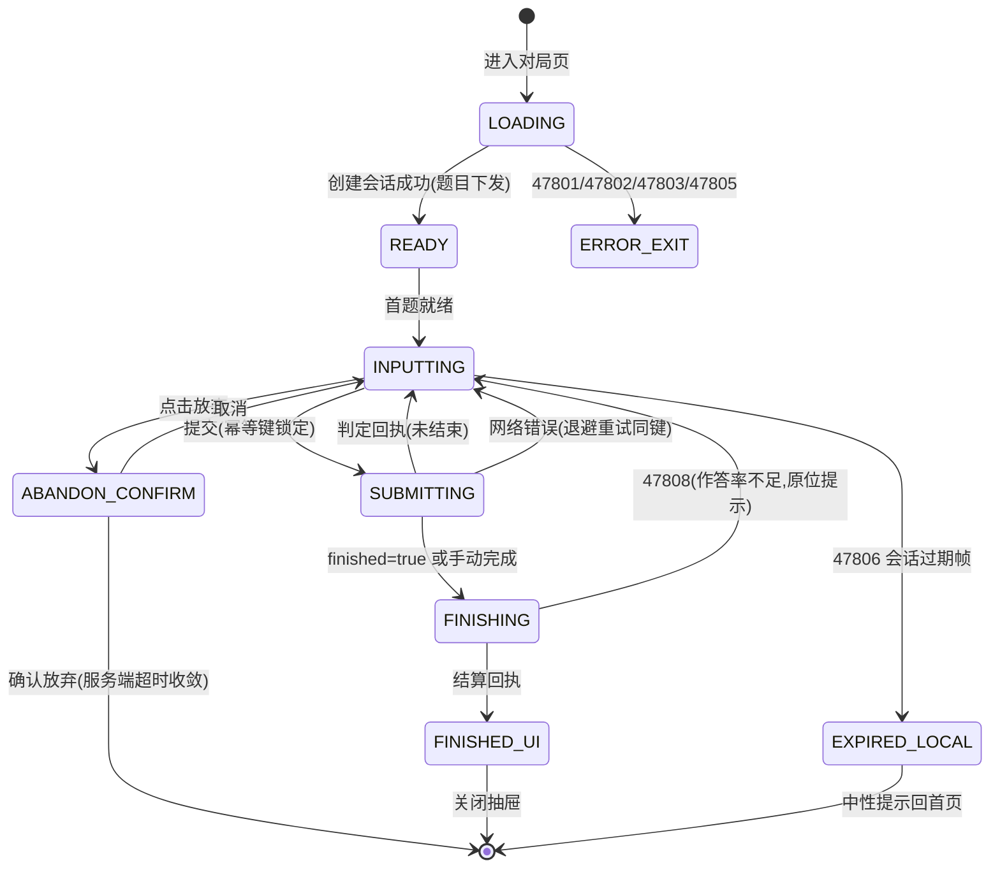

# 客户端-珠心算训练页面架构与交互设计 详细设计

- 版本: v1.0
- 日期: 2026-11-22
- 状态: 新增初版
- 错误码: ZAN-001~014 客户端符号码(1:1 映射服务端 47800-47813,零新增数字段位)
- 服务端契约: 《服务端-珠心算训练引擎-详细设计》v1.0(2026-11-22,47800-47899 段)

## 1. 概述

### 1.1 模块定位

本文档是珠心算训练域(Zhuxinsuan Engine, ZHE)的客户端呈现层权威设计,兑现服务端引擎契约 R10("客户端珠心算页面为后续批次:复用统一卡片/骨架屏/错误态规范;算盘交互组件渲染归客户端")与 R11("段位证书展示复用成就勋章组件")。覆盖 L0 算盘认知 / L1 珠算基本功 / L2 珠算进阶 / L3 看心算 / L4 听心算 / L5 段位测评六层链路在 Flutter 客户端的页面架构、交互流程、状态镜像与降级策略。

经全目录关键词扫描(2026-11-22)确认:服务端《珠心算训练引擎》就绪(批次三十六),客户端页面层零覆盖(算盘交互组件/听心算播放/段位测评作答页均无设计),本文补齐。

### 1.2 设计原则

1. **零裁决**:客户端只做格式级预校验(键盘输入为整数/拨珠位置物理约束),判题、错因分类、速度评分、段位晋级全部归服务端(G4 判题零 LLM 的对端红线,客户端同族)。
2. **答案键零驻留**:题目下发只有题干与算式,客户端任何模型/缓存/日志/埋点不得出现标准答案字段(G3)。
3. **提交不可取消 + 幂等重放**:作答提交进入 SUBMITTING 态后不可取消,重试复用同一 clientRequestId,命中服务端幂等回放(47811 为 200 语义)原样渲染。
4. **乐观表现、权威收敛**:拨珠/键盘输入先本地呈现,提交后等待服务端判定;服务端返回前不做任何对错表现(与棋类"幽灵子"不同,珠心算无中间局面,反馈完全以服务端响应为准)。
5. **防沉迷 fail-closed 呈现**:日限/时段管控以服务端 47803 为准,客户端禁本地时间自行裁决,禁提供重试绕过按钮。
6. **速度只与自己比**:速度基线为个人 EMA,报告与对局页禁出现同龄排名/百分位(防焦虑红线 G8)。
7. **听心算音频零留存**:TTS 本地合成即时销毁,不复读录音、不留音频文件、波形不截图(C2)。

### 1.3 职责边界(客户端不做)

| 不做的事 | 权威归属 |
| --- | --- |
| 判题/错因分类/速度评分/段位晋级判定 | 服务端判题器与测评服务(R1) |
| 出题(算式/数列/珠面配置) | 服务端出题器(R2);L0 认珠题珠面配置内嵌题干 JSON,客户端解析渲染禁自生成(见 R9) |
| 积分/成就/段位证书发放 | 用户学习激励中心(服务端事件外发,客户端不预发) |
| 额度裁决(免费 2 会话/日) | 用户额度管控引擎(客户端只读展示) |
| 防沉迷时段/日限裁决 | 统一家长门+防沉迷体系(客户端只呈现) |
| 听心算数字序列生成 | 服务端 /aural-sequences(客户端禁凭预取序列自行组题反复刷,对齐服务端 G6) |
| 排行榜/百分位 | 本模块不存在任何排行接口与组件 |
| 复习调度 | 间隔重复引擎(客户端零入口) |

## 2. 信息架构与页面地图

### 2.1 路由表

| 路由 | 页面 | 入口 | 权限 |
| --- | --- | --- | --- |
| `/zan` | 珠心算首页(段位卡/阶段进度/今日进度/推荐关卡/测评入口) | 学习工作台"计算训练"分组卡片、深链接 | 学生,登录,适龄闸 |
| `/zan/play/:sessionId` | 训练对局页(按 carrier 分发输入区) | 首页推荐关卡、关卡列表 | 学生,本人会话 |
| `/zan/exam` | 段位测评列表页(段位链/冷却状态/晋级标准) | 首页段位卡"去挑战" | 学生,适龄闸 |
| `/zan/exam/:examId` | 测评作答页(答题卡/倒计时/交卷) | 测评列表报名成功 | 学生,本人测评 |
| `/zan/exam/:examId/result` | 测评结果页(双达标呈现/证书展示) | 交卷响应、推送召回 | 学生,本人测评 |
| `/zan/report` | 训练报告页(热力/速度趋势/错因分布/段位历程) | 首页、结果页 | 学生 |
| `/parent/zan` | 家长端珠心算管理页 | 家长中心-学习管控分组 | 家长角色 |

路由注册进统一路由体系;`/zan/*` 与 `/puzzle/*`、`/chess/*`、`/pge/*` 命名空间隔离;深链接解析失败一律回退 `/zan` 首页,不白屏。

### 2.2 页面地图

```text
/zan 首页
 ├─ 推荐关卡 → POST /sessions → /zan/play/:sessionId (ACTIVE)
 ├─ 段位挑战 → /zan/exam → 报名(47807 冷却中性提示)→ /zan/exam/:examId
 │    → 交卷 → /zan/exam/:examId/result → [继续训练] / [查看报告]
 ├─ 训练报告 → /zan/report
 └─ 家长管控(角色切换)→ /parent/zan

/zan/play/:sessionId 对局页
 ├─ 全部题目完成或主动结束 → POST finish → 结算抽屉(弱项成长话术+rewardHint 仅展示)
 ├─ 47808(作答率<80%)→ 原位提示"还有几道题没做完哦",留在对局页
 ├─ 47803(防沉迷)→ 休息引导页,禁重试按钮
 └─ 47806(会话过期)→ 中性提示 → /zan
```

### 2.3 页面状态规范

遵循《客户端页面状态模式与骨架屏加载空态错误态设计规范》:

| 态 | 呈现 |
| --- | --- |
| loading | 算盘骨架(占位档位线,禁用触摸) |
| empty | 报告无数据:插画+"还没有训练记录,来拨一次算盘吧" |
| error | 网络错误:整页错误态+重试;对局中网络错误用 §8.2 D2 专线处理,不替换整页 |
| content | 正常训练界面 |

## 3. 数据模型与 API 契约

### 3.1 Dart 数据模型(与服务端响应 1:1)

```dart
enum ZanStage { l0, l1, l2, l3, l4, l5 }

enum ZanItemType {
  abacusRecognize, // L0 认读算珠表示的数(唯一 L0 判分题)
  fixedAdd, fixedSub, // 定数连加/连减
  directAddSub, // 直加减
  makeFive, // 凑五/破五
  carryAdd, borrowSub, // 进位加/退位减
  multiply, divide, // 珠算乘除
  mentalVisual, // 看心算(脑像)
  mentalAural, // 听心算
}

enum ZanCarrier { abacus, keypad, voice }

enum ZanSessionStatus { created, active, finished, abandoned, expired }

enum ZanExamStatus { registered, inProgress, graded, passed, failed, expired }

enum ZanErrorCause {
  none, carryMistake, borrowMistake, makeFiveMistake,
  timesTable, misheard, slow,
}

/// 听心算播报参数(服务端下发,播报执行归客户端 R7)
class ZanAuralParam {
  final int digit; final int count; final int paceMs; final int repeat;
  ZanAuralParam({required this.digit, required this.count,
      required this.paceMs, required this.repeat});
  factory ZanAuralParam.fromJson(Map<String, dynamic> j) => ZanAuralParam(
      digit: j['digit'], count: j['count'],
      paceMs: j['paceMs'], repeat: j['repeat']);
}

/// 题目项:只有题干,无答案键(服务端 G7)
class ZanItem {
  final int seq; // 题序 1..N
  final String? prompt; // 算式文本,如 "3 + 4 = ?";听心算题为 null
  final ZanAuralParam? aural; // 听心算参数;L0 认珠题时 prompt 内嵌珠面配置 JSON(R9)
  ZanItem({required this.seq, this.prompt, this.aural});
  factory ZanItem.fromJson(Map<String, dynamic> j) => ZanItem(
      seq: j['seq'],
      prompt: j['prompt'],
      aural: j['aural'] == null ? null : ZanAuralParam.fromJson(j['aural']));
}

/// 单题判定结果(服务端权威,客户端只读渲染)
class ZanItemOutcome {
  final bool correct;
  final ZanErrorCause errorCause;
  final int nextSeq;
  final bool finished;
  ZanItemOutcome({required this.correct, required this.errorCause,
      required this.nextSeq, required this.finished});
}

/// 会话镜像(仅内存,零落盘 G6)
class ZanSessionMirror {
  final String sessionId;
  final ZanSessionStatus status;
  final String unitCode;
  final ZanItemType itemType;
  final ZanCarrier carrier;
  final int? timeLimitSec;
  final List<ZanItem> items;
  final DateTime serverTime; // 服务端时钟快照(G11)
  final Map<int, ZanItemOutcome> outcomes; // 已答题序→判定
  int get answeredCount => outcomes.length;
  ZanSessionMirror({required this.sessionId, required this.status,
      required this.unitCode, required this.itemType, required this.carrier,
      this.timeLimitSec, required this.items, required this.serverTime,
      required this.outcomes});
}

class ZanWeakCause {
  final ZanErrorCause cause;
  final int count;
  ZanWeakCause({required this.cause, required this.count});
}

/// 结算结果;rewardHint 仅展示,实际发放以服务端 Outbox 消费为准(客户端不预发 G9)
class ZanFinishResult {
  final ZanSessionStatus status;
  final double accuracy;
  final int avgSpeedMs;
  final List<ZanWeakCause> weakCauses;
  final Map<String, dynamic>? rewardHint; // {xp, badge}
  ZanFinishResult({required this.status, required this.accuracy,
      required this.avgSpeedMs, required this.weakCauses, this.rewardHint});
}

class ZanAuralSequence {
  final String sequenceId;
  final int paceMs; final int repeat;
  final List<int> numbers;
  final int expectedItems;
  ZanAuralSequence({required this.sequenceId, required this.paceMs,
      required this.repeat, required this.numbers, required this.expectedItems});
}

class ZanRecommendedUnit {
  final String unitCode; final String unitName;
  final ZanItemType itemType; final ZanCarrier carrier;
  ZanRecommendedUnit({required this.unitCode, required this.unitName,
      required this.itemType, required this.carrier});
}

class ZanExamEligible {
  final String levelCode; final String levelName;
  final int itemCount; final int timeLimitSec;
  ZanExamEligible({required this.levelCode, required this.levelName,
      required this.itemCount, required this.timeLimitSec});
}

class ZanOverview {
  final String currentLevel; final String currentLevelName;
  final Map<String, double> stageProgress; // {"L1":0.35,...}
  final int todayTrainedItems; final int todayLimitItems;
  final List<ZanRecommendedUnit> recommendedUnits;
  final List<ZanExamEligible> examEligible;
  final int streakDays;
  ZanOverview({required this.currentLevel, required this.currentLevelName,
      required this.stageProgress, required this.todayTrainedItems,
      required this.todayLimitItems, required this.recommendedUnits,
      required this.examEligible, required this.streakDays});
}

class ZanExam {
  final String examId; final String levelCode;
  final ZanExamStatus status;
  final DateTime deadlineAt;
  final DateTime? startedAt;
  ZanExam({required this.examId, required this.levelCode,
      required this.status, required this.deadlineAt, this.startedAt});
}

class ZanExamResult {
  final ZanExamStatus status;
  final double accuracy;
  final double avgSpeedSec;
  final String? newLevel;
  ZanExamResult({required this.status, required this.accuracy,
      required this.avgSpeedSec, this.newLevel});
}
```

### 3.2 Repository 层

```dart
class ZanRepository {
  /// 首页聚合(缓存 60s,下拉强制刷新)
  Future<ZanOverview> overview({bool force = false});
  /// 创建训练会话;X-Client-Request-Id 幂等键(UUID v7,会话级)
  Future<ZanSessionMirror> createSession(String unitCode, String clientRequestId);
  /// 逐题提交;幂等键 (sessionId, seq, clientRequestId) 复用重试
  Future<ZanItemOutcome> submitAnswer(String sessionId, int seq,
      String userAnswer, int elapsedMs, String clientRequestId);
  /// 结束结算
  Future<ZanFinishResult> finish(String sessionId);
  /// L4 听心算序列预取(内存暂存,禁持久化;绑定 sessionId 使用,禁跨会话复用)
  Future<ZanAuralSequence> prefetchAural(String unitCode);
  /// 段位测评报名/试卷/交卷/结果
  Future<ZanExam> registerExam(String levelCode, String clientRequestId);
  Future<ZanExamResult> submitExam(String examId,
      List<Map<String, dynamic>> answers, String clientRequestId);
  /// 训练报告(BFF 聚合,渲染归客户端)
  Future<ZanReportData> report();
}
```

### 3.3 幂等键与版本管理策略

| 操作 | 幂等键 | 重试策略 |
| --- | --- | --- |
| 创建会话 | X-Client-Request-Id(会话级 UUID v7,进内存镜像) | 超时重发同键;命中服务端 uk 返回原会话(47804 语义为复用,客户端透明处理) |
| 逐题提交 | clientRequestId = `{sessionId}:{seq}:{uuid}` | 超时/5xx 指数退避 3 次,同键重发;47811 幂等重放按 200 渲染首次结果 |
| 结束结算 | finish 无独立键,依赖会话状态 + 作答率门槛 | 47808 时留在对局页,禁自动重试(用户继续作答后再次手动触发) |
| 测评报名 | X-Client-Request-Id | 47807 冷却不视为可重试,中性提示 |
| 测评交卷 | clientRequestId(整卷一次) | 同键重发;超时走 §6.4 交卷竞态裁决 |

时钟策略:所有倒计时以 `serverTime` 偏移校正(G11),本地时钟只作插值;偏移超 ±5s 时暂停倒计时显示"时间同步中"。

## 4. 页面详细设计

### 4.1 珠心算首页 `/zan`

信息分区(自上而下):

1. **段位卡**:当前段位名称(如"普通十级")+ 段位徽章插画 + 连续训练天数(streakDays)+ "去挑战"按钮 → `/zan/exam`。段位徽章仅展示,等级裁决归服务端。
2. **阶段进度条**:L0-L4 五段横向进度(stageProgress 渲染),L5 测评不占进度条;未开启阶段置灰"还没解锁"。
3. **今日进度**:`todayTrainedItems/todayLimitItems` 进度环;达限(或接近 90%)时提示文案由服务端字段驱动,客户端禁本地计算;47803 已在创建会话时拦截,首页不预演"已用完"结论。
4. **推荐关卡卡列表**:recommendedUnits 渲染,卡面含关卡名/题型图标/作答载体徽标(算盘/键盘/语音);点击创建会话(按钮 loading 防连点)→ 成功跳 `/zan/play/:sessionId`。
5. **测评资格区**:examEligible 列表(段位名/题量/限时),冷却中段位由测评列表页呈现,首页只列可报名项。

### 4.2 训练对局页 `/zan/play/:sessionId`

页面骨架:

```text
┌─────────────────────────────┐
│ 关卡名        进度 3/10  ⏱ 04:32 │
├─────────────────────────────┤
│                             │
│      题干区(prompt/aural)    │
│                             │
├─────────────────────────────┤
│                             │
│   输入区(按 carrier 分发)    │
│                             │
├─────────────────────────────┤
│  [放弃]      [完成 (≥80%)]   │
└─────────────────────────────┘
```

- **题干区**:prompt 文本居中(大号等宽数字字体,学科字体注册引擎);听心算题显示播放按钮(见 §4.3);L0 认珠题题干为珠面配置 JSON,由算盘渲染器以"示题模式"呈现(禁交互,见 R9)。
- **输入区按 carrier 分发**:
  - `KEYPAD`:数字键盘(0-9、退格、正负号按学段显隐、确认键);输入格式预校验仅"整数字符串",超长度(12 位)截断;禁本地计算结果预填。
  - `ABACUS`:交互算盘组件(见 §5),学生拨珠后组件读出当前珠值作为 userAnswer;物理约束:上珠二下珠五、梁位边界,仅约束拨珠动画不约束数值对错。
  - `VOICE`:按住说话( ASR 复用发音陪练通道),识别结果文本入草稿可改,确认后提交;识别失败中性提示可重试,不计错(对齐服务端 L4 降级约定)。
- **进度与计时**:已答数来自镜像 outcomes(服务端判定回执驱动,禁本地计数预演);倒计时由 timeLimitSec + serverTime 偏移驱动。
- **判定反馈**:每题回执渲染——正确:绿色珠落动画;错误:中性橙色提示 + errorCause 成长型话术映射表(零技术词):

| errorCause | 客户端话术 |
| --- | --- |
| CARRY_MISTAKE | "进位的时候再仔细看看,慢慢来" |
| BORROW_MISTAKE | "退位这一步可以再想一想" |
| MAKE_FIVE_MISTAKE | "凑五的小口诀记得吗?再试一题" |
| TIMES_TABLE | "口诀表多读两遍就更顺啦" |
| MISHEARD | "刚才没听清?点一下再听一遍" |
| SLOW | "做对啦,再快一点点就更棒" |
| NONE | "真棒,继续" |

- **底部操作**:放弃(二次确认弹窗,确认后调 abandon 语义/直接退出,会话由服务端超时收敛);"完成"按钮始终可见,点击调 finish;47808 返回时原位提示话术并停留在当前题,禁自动重试。
- **结算抽屉**:accuracy(分龄露分,preschool 三档星级)+ 平均用时(仅与"自己上次"对比,首次训练无对比文案)+ weakCauses 成长话术列表 + rewardHint 仅展示(xp 动画到账提示但标注"奖励稍后到账",badge 为 null 不渲染占位)。

### 4.3 听心算播放(L4,MENTAL_AURAL)

- 进入 L4 对局页时预取 `POST /aural-sequences`(返回 paceMs/repeat/numbers),序列仅存内存并与 sessionId 绑定;禁跨会话复用(对齐服务端 G6,47809 由服务端裁决,客户端禁出现该请求的自主重放)。
- 播放控制:逐数字 TTS 播报,间隔 paceMs;播完一遍后显示"再听一遍"按钮,最多 repeat 次;repeat 用尽后按钮置灰并提示"用心算记住它"。
- 音频零留存(G10):TTS 走系统/语音服务通道即时合成即时释放;不录音、不缓存音频文件、不生成波形截图;退后台/退出页面时 playback controller 强制 stop + dispose。
- 作答:播完后 keypad 输入序列之和提交,判定与话术同 §4.2;MISHEARD 话术专属"再听一遍"入口(repeat 内)。

### 4.4 段位测评页 `/zan/exam` 与作答页 `/zan/exam/:examId`

**测评列表页**:

- 段位链自上而下 G10→G1→M1→M3;每段卡片:段位名/题量/限时/晋级标准(正确率阈值+平均单题用时上限,服务端下发,客户端照显)+ 状态徽标:
  - 当前段位:"可挑战"(examEligible 内);
  - 前置未过:"先通过前面的等级哦"(47812 前置说明,禁点击);
  - 冷却中:"再练几天,三天后再来挑战"(47807,禁倒计时本地预演);
  - 未解锁/高配段位置灰。
- 报名:二次确认弹窗(展示标准)→ POST /exams → 成功进入作答页。

**作答页**:

- 顶栏:段位名 + 剩余时间(以 deadlineAt 与服务端时钟驱动;本地倒计时归零但未收到服务端超时帧时,显示"正在交卷校验..."中性加载,禁自行判超时)。
- 题区:逐题渲染(载体分发同训练页;测评无听心算时亦同);答题卡宫格导航(点击跳题回补,服务端允许顺序不强制)。
- 交卷:按钮常驻 + 未答提醒("还有 N 题没做,确定交卷吗?");确认后 POST submit(整卷一次幂等键)。
- **结果页** `/zan/exam/:examId/result`:
  - PASSED:双达标明细(准确率/平均用时,数值照显)+ newLevel 证书展示(委托成就勋章组件 R11,数据经激励中心回传;客户端禁直连 ZHE 渲染证书);
  - FAILED:中性话术("差一点点,再练几天再来")+ 弱项成长建议(服务端 weakCauses 或 failed 事件载荷,成长话术白名单);
  - 均无排名、无百分位、无"未达标/不合格"字样。

### 4.5 训练报告页 `/zan/report`

- 近 30 天训练热力图(委托学习数据可视化与图表渲染引擎,禁自绘);
- 速度趋势线:个人平均用时/题 vs 个人 EMA 基线(双线图),零同龄对比;
- 错因分布环图(ZanErrorCause 中文标签);
- 段位历程时间轴(G10→当前,晋级的日期与成绩);
- 数据为空态:插画引导"来拨一次算盘吧"。

### 4.6 家长端管理页 `/parent/zan`

- 今日训练概览(题量/时长,时长分账 category=CALC 显形标注"计算训练");
- 训练限额配置(仅可收紧不可放宽,提交走统一家长门);防沉迷时段配置入口(委托家长管控页);
- 段位历程只读列表(无成绩单明细分数外的内容);
- "音频零留存"说明条常驻(听心算与语音作答不留存音频);
- 多孩子切换(委托家庭账户管理组件)。

## 5. 算盘交互组件与分龄参数

### 5.1 算盘渲染器(委托模式)

```dart
/// 算盘渲染器:L0 认知示题 + ABACUS 载体作答共用一套渲染,模式二分
class AbacusBoard extends StatefulWidget {
  final AbacusMode mode; // demo(示题,禁交互) | input(作答)
  final AbacusFaceConfig face; // 档数/珠面配置(示题模式来自题干 JSON,R9)
  final ValueChanged<BigInt>? onValueChange; // 仅 input 模式
}

/// 珠面配置(题干内嵌 JSON 的反序列化;客户端禁自行生成)
class AbacusFaceConfig {
  final int rods; // 档位(常见 9/11/13)
  final List<RodBeads> rodsState; // 每档:上珠拨下数(0-2) + 下珠拨上数(0-5)
}
```

渲染与交互约束:

- 档位线/梁/珠为 CustomPainter 绘制,单帧构建 <8ms,拨珠动画 120ms 弹性曲线;
- 示题模式(demo):纯渲染,触摸禁用(IgnorePointer),用于 L0 认珠题;
- 作答模式(input):拇指区托珠、食指区拨珠手势分区(分龄手势参数),珠位物理约束(上珠不过梁、下珠不触底);读出值为当前珠面表示的十进制数,作为 userAnswer;
- 客户端对珠值读取只做格式呈现,**零数值判定**(对错归服务端)。

### 5.2 分龄交互参数矩阵(呈现层,数值权威归《分龄UI适配与交互设计规范》)

| 参数 | 幼儿大班 | 小学 1-2 年级 | 小学 3-4 年级 |
| --- | --- | --- | --- |
| 默认档位 | 9 档 | 11 档 | 13 档(服务端关卡下发为准) |
| 珠径(触达) | 44dp | 36dp | 32dp |
| 键盘键高 | 64dp | 56dp | 48dp |
| 题干字号 | 40sp | 34sp | 30sp |
| 免确认提交 | 直接提交 | 直接提交 | 拨珠后需点"确认" |
| 语音作答提示 | 长按说话(常显气泡引导) | 长按说话 | 收进二级入口 |

## 6. 客户端镜像状态机与守卫

### 6.1 对局页镜像状态机



测评作答页镜像:LOADING → READY → INPUTTING → SUBMITTING(整卷,不可取消)→ RESULT_UI/EXPIRED(47810 中性提示重新报名)。

### 6.2 守卫规则

| 守卫 | 规则 |
| --- | --- |
| G1 | 深链接+适龄闸:非本人会话/学段不适龄(幼儿园大班-4年级)/会话不存在,一律拦截至 `/zan`,fail-closed |
| G2 | 零判分:客户端任何路径不得计算对错;CI 禁词表扫描 `isCorrect(`/`judge(`/`checkAnswer`/`answerKey`(代码+资源文件) |
| G3 | 答案键零驻留:Dart 模型无答案字段;CI 扫描模型定义与 JSON 序列化代码禁 `answer`/`standardAnswer`/`expected` 字段名 |
| G4 | 提交防重:SUBMITTING 态禁重复点击;重试复用同一 clientRequestId |
| G5 | 单活跃会话:同端同时只允许一个 ACTIVE 训练对局页(路由守卫拦截第二个 push) |
| G6 | 镜像零落盘:ZanSessionMirror/听心算序列仅存内存;进程被杀恢复后重新拉取服务端状态,禁本地续答残留 |
| G7 | 防沉迷呈现 fail-closed:47803 渲染休息引导,零重试按钮;管控配置缓存 24h 过期 fail-closed |
| G8 | 零排行组件:本模块零排行榜/百分位/同龄对比组件;CI 白名单校验本目录无 rank/percentile 组件引用 |
| G9 | 奖励不预发:rewardHint 仅展示;禁本地加积分/弹勋章到账(勋章到账只认激励中心回传事件) |
| G10 | 听心算/语音作答音频零留存:不录音不留文件;playback controller dispose 必经 stop;CI 扫描无录音权限申请(麦克风仅 VOICE 作答按需申请) |
| G11 | 服务端时钟权威:倒计时偏移校正;偏移 >±5s 暂停显示"时间同步中" |
| G12 | 弱项话术白名单:errorCause 只允许映射 §4.2 话术表,禁"错误/失败/扣分"等负面词 |

### 6.3 关键竞态裁决

| 竞态 | 裁决 |
| --- | --- |
| 双击提交同题 | 首次点击进入 SUBMITTING 并锁定;第二次点击忽略;网络重试复用同 clientRequestId,47811 幂等重放按首次结果渲染 |
| finish 与最后一题提交并发 | 提交回执先到再触发 finish;若 finish 返回 47808,说明服务端计数不足,原位提示继续作答(以服务端作答率为准,禁本地争辩) |
| 测评本地倒计时归零 vs 服务端超时 | 客户端只显示"正在交卷校验...";最终以服务端 47810 或结果帧为准,禁本地判超时丢弃 |
| 听心算预取序列与会话绑定 | 序列内存暂存与 sessionId 配对;切关卡/重建会话旧序列即弃;禁跨会话复用(服务端 47809 兜底) |
| 放弃与在途提交 | 提交进行中放弃按钮禁用;放弃确认仅在 INPUTTING 态可达 |
| 交卷请求超时 | 同 clientRequestId 重发;响应丢失时以结果页拉取(经推送召回或手动刷新)裁决,禁重复交卷 |

## 7. 关键代码示例

### 7.1 ZanPlayController(会话生命周期 + 提交通道)

```dart
class ZanPlayController extends ChangeNotifier {
  final ZanRepository _repo;
  ZanSessionMirror? _mirror;
  PlayViewState _state = PlayViewState.loading;
  String? _pendingClientReqId;

  PlayViewState get state => _state;
  ZanSessionMirror? get mirror => _mirror;

  Future<void> start(String unitCode) async {
    _state = PlayViewState.loading; notifyListeners();
    try {
      final reqId = const Uuid().v7();
      _mirror = await _repo.createSession(unitCode, reqId);
      _state = PlayViewState.inputting; notifyListeners();
    } on ZanBusinessException catch (e) {
      // 47803/47801/47802: 各话术由 ErrorMessageFactory 映射,禁本地裁决语义
      _state = PlayViewState.blocked; notifyListeners();
      rethrow;
    }
  }

  Future<void> submit(int seq, String userAnswer, int elapsedMs) async {
    final m = _mirror;
    if (m == null || _state == PlayViewState.submitting) return; // G4
    _state = PlayViewState.submitting; notifyListeners();
    final reqId = '${m.sessionId}:$seq:${const Uuid().v7()}';
    _pendingClientReqId = reqId;
    try {
      final outcome = await _repo.submitAnswer(
          m.sessionId, seq, userAnswer, elapsedMs, reqId);
      _mirror = ZanSessionMirror(
        sessionId: m.sessionId, status: m.status, unitCode: m.unitCode,
        itemType: m.itemType, carrier: m.carrier,
        timeLimitSec: m.timeLimitSec, items: m.items,
        serverTime: m.serverTime,
        outcomes: {...m.outcomes, seq: outcome},
      );
      _state = outcome.finished
          ? PlayViewState.finishing
          : PlayViewState.inputting;
      notifyListeners();
    } on NetworkException {
      _state = PlayViewState.inputting; notifyListeners();
      rethrow; // 上层按 D2 退避重试,同 reqId
    }
  }

  Future<void> finish() async {
    final m = _mirror;
    if (m == null || _state == PlayViewState.finishing) return;
    _state = PlayViewState.finishing; notifyListeners();
    try {
      final result = await _repo.finish(m.sessionId);
      _state = PlayViewState.finished; notifyListeners();
    } on ZanBusinessException catch (e) {
      if (e.code == 47808) {
        _state = PlayViewState.inputting; notifyListeners(); // G5 原位续答
      }
      rethrow;
    }
  }
}
```

### 7.2 AbacusInputController(拨珠输入,零数值判定)

```dart
class AbacusInputController extends ChangeNotifier {
  final int rods;
  final List<RodBeads> _state;
  AbacusInputController({required AbacusFaceConfig face})
      : rods = face.rods, _state = face.rodsState.map((r) => r.copy()).toList();

  /// 物理约束拨珠:仅约束珠位,不约束数值对错(G2)
  void moveUpper(int rod, int count) {
    if (rod < 0 || rod >= rods) return;
    final cur = _state[rod];
    final next = (cur.upperDown + count).clamp(0, 2); // 上珠二
    _state[rod] = cur.copyWith(upperDown: next);
    notifyListeners();
  }

  void moveLower(int rod, int count) {
    if (rod < 0 || rod >= rods) return;
    final cur = _state[rod];
    final next = (cur.lowerUp + count).clamp(0, 5); // 下珠五
    _state[rod] = cur.copyWith(lowerUp: next);
    notifyListeners();
  }

  /// 读出当前珠值(格式呈现,供提交;判定归服务端)
  BigInt readValue() => AbacusCodec.decode(_state, rods: rods);

  void reset() {
    for (var i = 0; i < rods; i++) { _state[i] = RodBeads.zero(); }
    notifyListeners();
  }
}
```

### 7.3 AuralPlaybackController(听心算播报,音频零留存)

```dart
class AuralPlaybackController extends ChangeNotifier {
  final TtsEngine _tts; // 委托语音服务 TTS 通道
  final List<int> numbers;
  final int paceMs;
  final int maxRepeat;
  int _repeatLeft;
  bool _playing = false;

  AuralPlaybackController({required this.numbers, required this.paceMs,
      required this.maxRepeat, required TtsEngine tts})
      : _tts = tts, _repeatLeft = maxRepeat;

  bool get canReplay => _repeatLeft > 0 && !_playing;

  Future<void> play() async {
    if (_playing || _repeatLeft <= 0) return;
    _playing = true; _repeatLeft--; notifyListeners();
    try {
      for (final n in numbers) {
        await _tts.speak('$n'); // 即时合成即时释放,禁落盘(G10)
        await Future.delayed(Duration(milliseconds: paceMs));
      }
    } finally {
      _playing = false; notifyListeners();
    }
  }

  @override
  void dispose() {
    _tts.stop(); // 退后台/退出页必经
    super.dispose();
  }
}
```

### 7.4 ZanRouteGuard(深链接/适龄/会话三闸)

```dart
class ZanRouteGuard {
  static Future<String?> redirect(RouteSettings settings) async {
    final path = settings.name ?? '';
    if (!path.startsWith('/zan') && path != '/parent/zan') return null;
    // 闸 1: 登录与学生角色(委托统一认证)
    if (!AuthContext.isStudent && !path.startsWith('/parent')) return '/login';
    // 闸 2: 适龄 fail-closed(幼儿园大班-4年级;学段档案由客户端学科上下文提供,只读)
    if (!path.startsWith('/parent') &&
        !AgeGate.allows(FeatureDomain.zan, GradeContext.current())) {
      return '/zan/age-block'; // 拦截页,不回显任何内容字段
    }
    // 闸 3: 深链接会话归属
    final m = RegExp(r'^/zan/play/([a-zA-Z0-9-]+)$').firstMatch(path);
    if (m != null) {
      final ok = await ZanSessionOwnership.check(m.group(1)!);
      if (!ok) return '/zan'; // 非本人会话或不不存在
    }
    return null;
  }
}
```

## 8. 错误处理与降级

### 8.1 错误码映射(服务端 478xx → 客户端 ZAN-xxx 符号码,零新增数字段位)

| 服务端码 | 客户端码 | 话术(成长型,零技术词) | 呈现 |
| --- | --- | --- | --- |
| 47800 | ZAN-000 | 成功 | — |
| 47801 | ZAN-001 | "这个练习还没准备好,先看看别的吧" | 原位 toast,回首页 |
| 47802 | ZAN-002 | "先完成前面的练习就能解锁啦" | 关卡卡原位 |
| 47803 | ZAN-003 | "今天的小算盘练习时间到了,明天再来" | 休息引导页,无重试按钮 |
| 47804 | ZAN-004 | (透明复用原会话,无用户可见话术) | 客户端内部重试复用 |
| 47805 | ZAN-005 | 通用错误 | 错误态+重试 |
| 47806 | ZAN-006 | "这次练习已经结束了" | 中性弹窗 → /zan |
| 47807 | ZAN-007 | "再练几天,三天后再来挑战" | 测评卡原位 |
| 47808 | ZAN-008 | "还有几道题没做完哦" | 对局页原位,禁自动重试 |
| 47809 | ZAN-009 | 通用错误 | 内部记录+通用错误 |
| 47810 | ZAN-010 | "这次挑战超时了,重新报名吧" | 结果页中性态 |
| 47811 | ZAN-011 | (幂等重放,按首次结果渲染) | 200 语义 |
| 47812 | ZAN-012 | "先通过前面的等级哦" | 测评卡原位 |
| 47813 | ZAN-013 | 内部码 | 不透传用户 |
| 其他/网络 | ZAN-500 | 通用错误+重试 | 错误态 |

通用码归口全局(40001/40103/42901),本模块不新占。

### 8.2 客户端降级矩阵

| 级别 | 场景 | 降级策略 |
| --- | --- | --- |
| D1 | 首页聚合接口失败 | 错误态+重试;禁展示缓存的旧"今日进度"冒充实时 |
| D2 | 提交网络超时 | SUBMITTING 保持,同 clientRequestId 退避重试×3;不可取消态,禁重复新键 |
| D3 | TTS 通道不可用 | 听心算单元降级为看心算呈现(题干数字串显形,中性提示),对齐服务端 D4;不计训练违约 |
| D4 | ASR 不可用 | VOICE 作答临时隐藏,提示用键盘作答 |
| D5 | 结算/测评结果推送丢失 | 结果页拉取兜底(手动刷新+推送召回双通道) |
| D6 | 报告聚合超时 | 骨架屏延长,禁展示陈旧数据冒充当日 |
| D7 | 算盘组件低端机掉帧 | 档位线静态渲染+拨珠即时跳变(去动画),数值呈现不受影响 |
| D8 | 时钟偏移 >±5s | 倒计时暂停显示"时间同步中",禁本地硬走 |
| D9 | 音效资源缺失 | 静音降级,禁用系统刺耳提示音替代 |
| D10 | **总红线** | 零判分(G2)、答案键零驻留(G3)、防沉迷 fail-closed(G7)、音频零留存(G10)任何场景不可降级 |

## 9. 合规红线(客户端侧)

1. C1 零社交零排行:无好友/分享对战/排行榜/百分位组件(激励分享海报除外,海报脱敏)。
2. C2 音频零留存:听心算 TTS 与语音作答不留存音频;禁申请常驻麦克风权限(仅 VOICE 作答时按次申请)。
3. C3 防沉迷 fail-closed:47803 无绕过;家长可收紧不可放宽的呈现与统一家长门一致。
4. C4 营销禁入:本域页面零商品推荐位/零开通会员引导(额度不足提示仅中性话术,跳转购买按钮归功能门控引擎统一裁决,本模块不自渲染)。
5. C5 话术白名单:全模块禁"错误/失败/笨/慢死了/未达标"等负面词,结算与测评话术走 G12 白名单。
6. C6 段位证书为虚拟荣誉:展示文案禁"考级/考证/加分"表述(CI 文案扫描)。
7. C7 数据最小化:埋点禁采作答内容/音频/珠面截图。
8. C8 注销清理:订阅 account.deleted,本地镜像/缓存/报告快照全清(对齐服务端 G10 客户端侧)。

## 10. 埋点事件(module=zan,字段白名单)

| 事件 | 触发 | 字段(白名单) |
| --- | --- | --- |
| zan_home_view | 首页曝光 | current_level, streak_days |
| zan_session_create | 创建会话成功 | unit_code, item_type, carrier |
| zan_item_submit | 判定回执 | seq, correct, error_cause, elapsed_ms(零题干零答案) |
| zan_aural_play | 听心算播放 | pace_ms, repeat_left(零数字序列内容) |
| zan_finish_view | 结算曝光 | accuracy 分档, weak_cause 种类计数 |
| zan_exam_register | 报名成功 | level_code |
| zan_exam_submit | 交卷回执 | status, accuracy 分档 |
| zan_report_view | 报告曝光 | has_data |
| zan_parent_view | 家长页曝光 | child_count |
| zan_abandon | 放弃会话 | answered_ratio 分档 |

## 11. 性能设计

| 项 | 预算 |
| --- | --- |
| 对局页首帧 | ≤100ms(题目本地就绪前提下) |
| 算盘拨珠动画 | 60fps(低端 ≥45fps,D7 降级路径) |
| 提交往返渲染延迟 | 判定回执→反馈动画 ≤50ms |
| TTS 首音 | ≤300ms(超时按 D3 降级) |
| 首页聚合 | 接口 P95 ≤300ms,骨架屏先行 |
| 内存 | 会话镜像+序列 ≤2MB;退出即释放 |

## 12. 契约对齐

| # | 契约 |
| --- | --- |
| R1 | 判题/错因/速度评分权威归服务端,客户端零本地裁决(含 CI 禁词 G2) |
| R2 | 答案键零驻留:模型/缓存/日志/埋点全链路无答案字段(CI G3) |
| R3 | 防沉迷呈现 fail-closed,禁重试绕过(G7);额度门控(免费 2 会话/日)只读展示,裁决归额度引擎 |
| R4 | TTS 播报委托语音服务(ASR/TTS)通道,音频即时销毁(服务端 R7 对端) |
| R5 | 段位证书/勋章展示委托成就勋章组件,数据经激励中心回传(服务端 R11);禁客户端直连 ZHE 渲染证书 |
| R6 | 报告图表委托学习数据可视化与图表渲染引擎,禁自绘 |
| R7 | 路由命名空间 `/zan/*` 与 /puzzle /chess /pge 隔离;骨架屏/空态/错误态遵循统一页面状态规范(服务端 R10) |
| R8 | 家长门拉起走统一流程(服务端 R11 同族);管控配置 24h 缓存过期 fail-closed |
| R9 | L0 认珠题珠面配置内嵌题干 JSON(prompt 字段),客户端 AbacusBoard demo 模式解析渲染,禁自行生成珠面、禁交互 |
| R10 | 服务端时钟权威:倒计时偏移校正,>±5s 暂停(D8) |
| R11 | 听心算序列一次性绑定 sessionId,禁跨会话复用与自主组题(服务端 G6 对端) |
| R12 | 与断点续学边界:珠心算对局不支持跨端续答(镜像零落盘 G6),进程恢复重拉服务端状态;学习时长上报委托时长统计引擎(category=CALC) |
| R13 | 弱项成长话术白名单为客户端呈现权威,服务端只下发 errorCause 枚举 |
| R14 | 注销级联:account.deleted 后本地缓存/镜像/快照全清(C8) |

## 13. 验收场景

1. AC01 创建会话幂等:同 X-Client-Request-Id 重放返回同 sessionId,题目一致。
2. AC02 答案键不下发:创建/详情响应 JSON 递归扫描无 answer 字段(G3 集成断言)。
3. AC03 凑五题反馈:3+4 判定回执渲染"真棒,继续",3+5 渲染 MAKE_FIVE_MISTAKE 话术零技术词。
4. AC04 47808 呈现:作答率 75% 点完成,原位话术停留,无自动重试。
5. AC05 47803 呈现:达日限创建,休息引导页无重试按钮,杀进程重进仍拦截。
6. AC06 听心算音频零留存:播放/作答全程不产生音频文件;退后台 30s 后目录扫描为空(G10)。
7. AC07 听心算降级:D3 触发时数字串显形,中性提示,无"故障"字样。
8. AC08 双击打提交:仅一次请求发出(SUBMITTING 锁定),重试同 clientRequestId。
9. AC09 时钟权威:本地时钟拨快 10 分钟,倒计时仍按服务端偏移运行(D8 暂停态正确)。
10. AC10 测评通过:结果页证书展示经激励中心回传,断网重开证书不凭空出现(G9)。
11. AC11 测评冷却:47807 卡面话术正确,无倒计时本地预演。
12. AC12 深链接:他人 sessionId 直达 /zan/play/:id 被闸 3 拦回首页。
13. AC13 适龄闸:5 年级学生深链接 /zan 被拦截页拦下(fail-closed)。
14. AC14 零排行:页面源码与组件树无任何排行/百分位引用(G8 CI)。
15. AC15 CI 禁词扫描:代码库无 `isCorrect(`/`judge(`/`checkAnswer`/`answerKey`(G2)。
16. AC16 镜像零落盘:杀进程后内存镜像清空,重进对局页重新拉取服务端状态(G6)。

## 14. 关联文档

- 服务端-珠心算训练引擎-详细设计.md(服务端契约,47800-47899 段)
- 客户端-题目展示与答题交互组件库(键盘/答题卡宫格委托)
- 客户端-音频播放器与录制引擎及听力练习交互组件(TTS 通道委托)
- 客户端-学习数据可视化与图表渲染引擎(报告图表委托)
- 客户端-成就勋章与奖励展示组件(证书/勋章委托)
- 客户端-页面状态模式与骨架屏加载空态错误态设计规范
- 客户端-分龄UI适配与交互设计规范(分龄参数数值权威)
- 发音陪练服务(VOICE 作答 ASR 复用)
- 服务端-统一家长门与监护人授权核验引擎(家长门拉起)
- 服务端-用户学习激励中心与行为奖励统一规则引擎(rewardHint 不预发 G9)

## 15. 维护记录

- v1.0 (2026-11-22): 新增初版。补齐"珠心算"客户端页面层零覆盖缺口(服务端引擎批次三十六就绪,契约 R10/R11 声明客户端后续批次);/zan 页面族 6 学生端路由+1 家长端路由;ZAN-001~014 符号码与 47800-47813 全项 1:1 映射(零新增数字段位);守卫 G1-G12/降级 D1-D10/合规 C1-C8/契约 R1-R14/验收 AC01-AC16,对齐棋类(批次四十)/飞花令(批次四十一)客户端同族规范。
