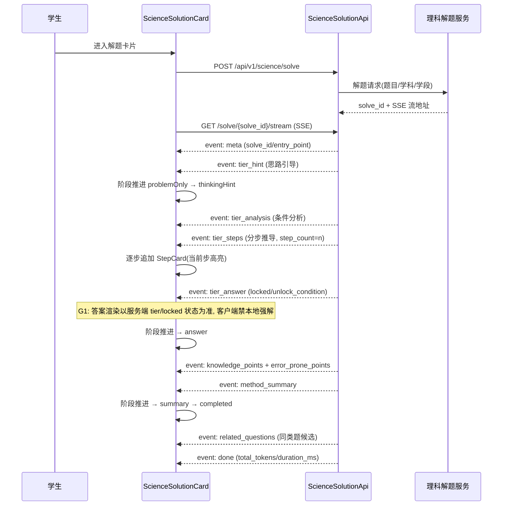
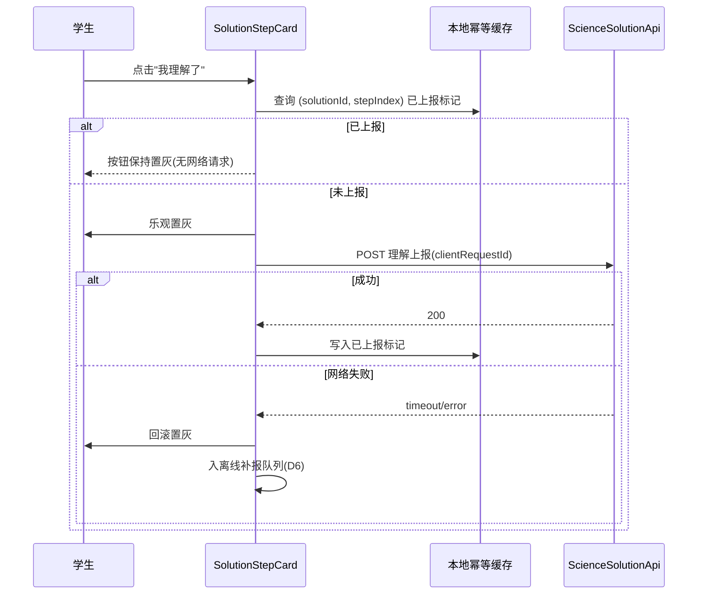
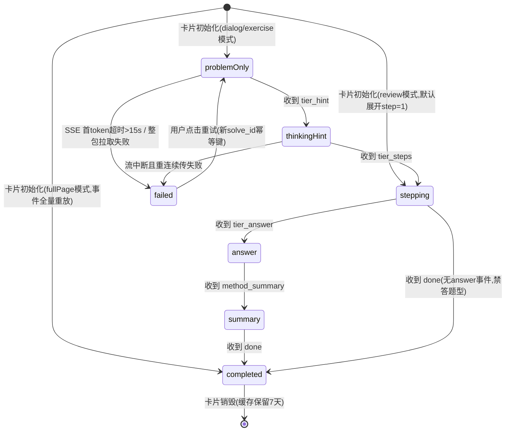

# 客户端 - 理科解题页面架构与交互设计

> **版本**: v1.2  
> **创建日期**: 2026-05-28  
> **更新日期**: 2026-11-04(补全 v1.2:原 v1.1 完成 §4.3 后于 §6 幂等约定句中段二次截断,尾部残留孤行 `child`,§7 状态机/守卫/§8 错误码/§9 降级/§10 埋点/§11 性能/§12 合规/§13 契约/§14 验收全缺。本次补齐并修复 §5.1 SSE 事件名与 E2E 协议不一致缺陷 F1)  
> **关联模块**: 理科解题引擎、AI智能辅导、拍照搜题、同步课堂、错题复习  
> **优先级**: P1（初中、高中核心场景）  
> **所属端**: 客户端（Flutter）  
> **前置依赖**: 客户端-AI对话页面交互、客户端-题目展示与答题交互组件库、富文本与学科内容渲染引擎、数学公式与学科符号输入系统

---

## 1. 概述

### 1.1 背景

理科解题（数学、物理、化学、生物）是初中和高中学生使用 PrimeTop 的高频场景。与文科问答不同，理科解题具有以下特征：

1. **公式密集**：大量使用数学公式、化学方程式、物理符号
2. **图形辅助**：几何图形、函数图像、力学分析图、电路图等
3. **步骤严谨**：解题过程有严格的逻辑链条，跳步会严重影响理解
4. **方法模型化**：同类题目对应固定解题模型（如运动学方程、受力分析、化学平衡计算）
5. **易错点多**：单位换算、符号正负、条件遗漏等常见错误

理科解题页面不是独立的一级页面，而是作为**嵌入式场景页面**，在以下入口激活：

| 入口场景 | 触发方式 | 页面形态 |
| --- | --- | --- |
| AI 对话 → 检测到理科问题 | 用户文字/语音提问，系统识别为理科学科 | AI对话页内嵌解题卡片 |
| 拍照搜题 → 理科题目 | 拍照识别结果为数学/物理/化学/生物 | 拍题解析页解题卡片 |
| 同步课堂 → 章节练习 | 章节练习中遇到理科题 | 练习答题页内嵌解题展示 |
| 错题本 → 错题解析 | 查看错题的详细解析 | 错题详情页解题卡片 |
| 考点梳理 → 专题训练 | 专题训练中的理科题 | 练习页内嵌解题展示 |

### 1.2 设计目标

1. **步骤清晰**：每一步推导独立展示，标注公式来源和定理依据
2. **渐进展示**：先给思路提示 → 逐步展开步骤 → 完整答案 → 方法总结
3. **公式可读**：数学公式、化学方程式渲染清晰，支持长公式横向滚动
4. **图形交互**：几何图支持缩放、标注；函数图像支持交互式查看
5. **分龄适配**：初中信息密度适中，高中高密度展示
6. **离线可用**：解题卡片本地渲染，不依赖实时网络
7. **可操作性**：支持"再讲一遍""换种方法""生成同类题""加入错题本"

---

## 2. 页面结构与导航

### 2.1 理科解题卡片组件层级

理科解题不使用独立全屏页面，而是以 **ScienceSolutionCard** 组件形式嵌入宿主页面。组件层级如下：

```
ScienceSolutionCard (顶层容器)
├── ProblemHeader            // 题目头部：题号、来源、难度标签
├── ProblemStatement         // 题目陈述区：题干、图片、公式
├── SolutionProgressStepper  // 解题进度条（步骤导航）
├── HintRevealZone           // 提示渐进展示区
│   ├── ThinkingHint         // "思路引导"卡片
│   ├── StepCard[]           // 解题步骤卡片数组
│   │   ├── StepHeader       // 步骤标题、来源标注
│   │   ├── StepContent      // 步骤内容（富文本+公式+图形）
│   │   ├── KeyFormulaTag    // 关键公式标签（可点击查看来源）
│   │   ├── PitfallWarning   // 易错点警告气泡
│   │   └── StepCheckButton  // "我理解了"确认按钮
│   └── FinalAnswer          // 最终答案卡片
├── MethodSummary            // 方法总结区
│   ├── MethodTemplate       // 解题模型/方法模板
│   └── SimilarStrategy      // 同类题通用策略
├── ActionToolbar            // 底部操作栏
│   ├── ExplainAgainButton   // "换种讲法"
│   ├── AnotherMethodButton  // "其他方法"
│   ├── SimilarQuestionButton// "练一道同类题"
│   └── AddMistakeButton     // "加入错题本"
└── InteractiveFigureLayer   // 图形交互浮层（可选）
```

### 2.2 宿主页面嵌入方式

```dart
/// 理科解题卡片嵌入宿主页面的方式
/// 
/// 在 AI 对话页：
/// ChatMessage(
///   type: MessageType.scienceSolution,
///   child: ScienceSolutionCard(
///     solutionData: solution,
///     displayMode: SolutionDisplayMode.dialog,  // 对话模式
///   ),
/// )
///
/// 在拍题解析页：
/// SliverToBoxAdapter(
///   child: ScienceSolutionCard(
///     solutionData: solution,
///     displayMode: SolutionDisplayMode.fullPage, // 全屏模式
///   ),
/// )
///
/// 在错题详情页：
/// ScienceSolutionCard(
///   solutionData: solution,
///   displayMode: SolutionDisplayMode.review,     // 复习模式
///   showMistakeHighlight: true,                   // 高亮错误
/// )
```

### 2.3 展示模式枚举

```dart
/// 解题卡片展示模式
enum SolutionDisplayMode {
  /// 对话模式 - 嵌入 AI 对话流中，默认折叠步骤
  dialog,
  /// 全屏模式 - 拍题解析等场景，默认展开全部
  fullPage,
  /// 复习模式 - 错题复习场景，高亮错因，默认折叠
  review,
  /// 练习模式 - 章节练习后查看解析，默认折叠
  exercise,
}
```

---

## 3. 核心数据模型

### 3.1 理科解题数据结构

```dart
/// 理科解题完整数据模型
class ScienceSolutionData {
  /// 唯一标识
  final String solutionId;
  
  /// 学科
  final ScienceSubject subject;
  
  /// 题目结构化数据
  final StructuredProblem problem;
  
  /// 思路引导提示（渐进展示第一层）
  final ThinkingHint? thinkingHint;
  
  /// 解题步骤列表
  final List<SolutionStep> steps;
  
  /// 最终答案
  final FinalAnswer finalAnswer;
  
  /// 方法总结
  final MethodSummary? methodSummary;
  
  /// 相关图形资源列表
  final List<FigureResource> figures;
  
  /// 关联知识点ID列表
  final List<String> knowledgePointIds;
  
  /// 难度标签
  final DifficultyLevel difficulty;
  
  /// 解题耗时（服务端生成耗时，用于展示）
  final int generationTimeMs;
  
  /// 创建时间
  final DateTime createdAt;
}

/// 理科学科枚举
enum ScienceSubject {
  math('数学', 'math'),
  physics('物理', 'physics'),
  chemistry('化学', 'chemistry'),
  biology('生物', 'biology');
  
  const ScienceSubject(this.label, this.code);
  final String label;
  final String code;
}

/// 思路引导提示
class ThinkingHint {
  /// 提示文本
  final String text;
  
  /// 提示类型
  final HintType type;
  
  /// 关联的解题模型名称
  final String? modelName;
  
  /// 关键条件提示（引导用户关注哪些条件）
  final List<String> keyConditionHints;
}

enum HintType {
  model,     // "这是一道XX模型题"
  condition, // "注意题目中的XX条件"
  strategy,  // "可以考虑使用XX方法"
  trap,      // "注意题目中的陷阱"
}

/// 解题步骤
class SolutionStep {
  /// 步骤序号（1-based）
  final int stepIndex;
  
  /// 步骤标题（如"建立坐标系""受力分析""列方程"）
  final String title;
  
  /// 步骤内容（富文本块列表）
  final List<ContentBlock> contentBlocks;
  
  /// 关键公式列表（本步骤使用的公式/定理）
  final List<FormulaReference> formulas;
  
  /// 易错点提示（可选）
  final PitfallWarning? pitfallWarning;
  
  /// 关联图形ID（如果有图形说明）
  final String? figureId;
  
  /// 步骤依据说明（"根据牛顿第二定律"等）
  final String? basisText;
}

/// 最终答案
class FinalAnswer {
  /// 答案文本（可能包含公式）
  final String answerText;
  
  /// 答案类型
  final AnswerType type;
  
  /// 数值答案（如果是纯数值）
  final double? numericValue;
  
  /// 单位
  final String? unit;
  
  /// 答案精度说明（如"保留两位小数"）
  final String? precisionNote;
}

enum AnswerType {
  numeric,        // 数值型
  expression,     // 表达式型
  text,           // 文字描述型
  multipleValues, // 多值型（如多解）
  range,          // 范围型（如 a > 3）
}

/// 方法总结
class MethodSummary {
  /// 解题方法名称
  final String methodName;
  
  /// 方法描述
  final String description;
  
  /// 适用条件
  final String applicableConditions;
  
  /// 通用步骤模板
  final List<String> generalSteps;
  
  /// 同类题识别要点
  final List<String> similarQuestionPatterns;
}

/// 公式引用
class FormulaReference {
  /// 公式 LaTeX 源码
  final String latex;
  
  /// 公式名称（如"勾股定理""牛顿第二定律"）
  final String name;
  
  /// 公式来源（教材章节、知识点ID）
  final String? sourceKnowledgeId;
  
  /// 是否可点击查看详细解释
  final bool isClickable;
}

/// 易错点警告
class PitfallWarning {
  /// 警告标题
  final String title;
  
  /// 警告内容
  final String content;
  
  /// 错误类型
  final PitfallType type;
  
  /// 常见错误示例
  final String? wrongExample;
}

enum PitfallType {
  unitError,         // 单位换算错误
  signError,         // 正负号错误
  missingCondition,  // 遗漏条件
  formulaMisuse,     // 公式误用
  calculationError,  // 计算失误
  conceptualError,   // 概念混淆
  diagramError,      // 图形判断错误
}

/// 图形资源
class FigureResource {
  /// 图形ID
  final String figureId;
  
  /// 图形类型
  final FigureType type;
  
  /// 图形数据（JSON/SVG/自定义格式）
  final String data;
  
  /// 图形描述（无障碍用）
  final String description;
  
  /// 是否支持交互
  final bool isInteractive;
}

enum FigureType {
  geometry,       // 几何图形
  functionGraph,  // 函数图像
  freeBody,       // 受力分析图
  circuit,        // 电路图
  chemicalBond,   // 化学结构式
  coordinate,     // 坐标系图
  experiment,     // 实验装置图
  table,          // 数据表格
}
```

### 3.2 渐进展示状态模型

```dart
/// 解题卡片展示状态
class SolutionDisplayState {
  /// 当前展示阶段
  SolutionPhase currentPhase;
  
  /// 已展开的步骤索引集合
  final Set<int> revealedSteps;
  
  /// 是否已展示最终答案
  bool answerRevealed;
  
  /// 是否已展示方法总结
  bool summaryRevealed;
  
  /// 用户已确认"理解"的步骤集合
  final Set<int> understoodSteps;
  
  /// 当前激活的图形ID
  String? activeFigureId;
  
  /// 公式详情弹窗状态
  FormulaDetailPopup? formulaPopup;
}

/// 展示阶段枚举（渐进推进）
enum SolutionPhase {
  /// 初始态：仅显示题目和"查看解题思路"按钮
  problemOnly,
  /// 思路提示阶段：显示思路引导
  thinkingHint,
  /// 逐步解题阶段：逐步展开步骤
  stepping,
  /// 答案阶段：展示最终答案
  answer,
  /// 总结阶段：展示方法总结
  summary,
  /// 完成态：全部内容已展示
  completed,
}
```

---

## 4. 核心组件设计

### 4.1 ScienceSolutionCard 顶层组件

```dart
/// 理科解题卡片主组件
class ScienceSolutionCard extends StatefulWidget {
  final ScienceSolutionData solutionData;
  final SolutionDisplayMode displayMode;
  final bool showMistakeHighlight;
  final VoidCallback? onAddToMistakeBook;
  final VoidCallback? onRequestSimilarQuestion;
  final VoidCallback? onRequestAnotherMethod;
  final ValueChanged<String>? onFollowUpQuestion;
  
  const ScienceSolutionCard({
    super.key,
    required this.solutionData,
    this.displayMode = SolutionDisplayMode.dialog,
    this.showMistakeHighlight = false,
    this.onAddToMistakeBook,
    this.onRequestSimilarQuestion,
    this.onRequestAnotherMethod,
    this.onFollowUpQuestion,
  });
  
  @override
  State<ScienceSolutionCard> createState() => _ScienceSolutionCardState();
}

class _ScienceSolutionCardState extends State<ScienceSolutionCard> {
  late SolutionDisplayState _displayState;
  
  @override
  void initState() {
    super.initState();
    _displayState = _initDisplayState(widget.displayMode);
  }
  
  /// 根据展示模式初始化状态
  SolutionDisplayState _initDisplayState(SolutionDisplayMode mode) {
    switch (mode) {
      case SolutionDisplayMode.dialog:
        return SolutionDisplayState(
          currentPhase: SolutionPhase.problemOnly,
          revealedSteps: {},
          answerRevealed: false,
          summaryRevealed: false,
          understoodSteps: {},
        );
      case SolutionDisplayMode.fullPage:
        // 全屏模式默认展开全部
        return SolutionDisplayState(
          currentPhase: SolutionPhase.completed,
          revealedSteps: Set.from(
            List.generate(widget.solutionData.steps.length, (i) => i),
          ),
          answerRevealed: true,
          summaryRevealed: true,
          understoodSteps: {},
        );
      case SolutionDisplayMode.review:
        return SolutionDisplayState(
          currentPhase: SolutionPhase.stepping,
          revealedSteps: {0}, // 复习模式默认展开第一步
          answerRevealed: false,
          summaryRevealed: false,
          understoodSteps: {},
        );
      case SolutionDisplayMode.exercise:
        return SolutionDisplayState(
          currentPhase: SolutionPhase.problemOnly,
          revealedSteps: {},
          answerRevealed: false,
          summaryRevealed: false,
          understoodSteps: {},
        );
    }
  }
  
  @override
  Widget build(BuildContext context) {
    return Container(
      decoration: BoxDecoration(
        color: Theme.of(context).colorScheme.surface,
        borderRadius: BorderRadius.circular(16),
        border: Border.all(
          color: _getSubjectColor().withOpacity(0.2),
          width: 1,
        ),
      ),
      child: Column(
        crossAxisAlignment: CrossAxisAlignment.stretch,
        children: [
          // 学科标签头部
          _buildProblemHeader(context),
          // 题目陈述
          _buildProblemStatement(context),
          // 分割线
          const Divider(height: 1),
          // 解题内容区
          _buildSolutionContent(context),
          // 操作栏
          if (_displayState.currentPhase == SolutionPhase.completed)
            _buildActionToolbar(context),
        ],
      ),
    );
  }
  
  /// 获取学科对应的主题色
  Color _getSubjectColor() {
    switch (widget.solutionData.subject) {
      case ScienceSubject.math:
        return const Color(0xFF4F6BF6); // 蓝色
      case ScienceSubject.physics:
        return const Color(0xFF00BFA5); // 青色
      case ScienceSubject.chemistry:
        return const Color(0xFFFF6D00); // 橙色
      case ScienceSubject.biology:
        return const Color(0xFF66BB6A); // 绿色
    }
  }
  
  Widget _buildProblemHeader(BuildContext context) {
    final subject = widget.solutionData.subject;
    return Container(
      padding: const EdgeInsets.fromLTRB(16, 12, 16, 8),
      child: Row(
        children: [
          // 学科图标
          Container(
            width: 28,
            height: 28,
            decoration: BoxDecoration(
              color: _getSubjectColor().withOpacity(0.12),
              borderRadius: BorderRadius.circular(8),
            ),
            child: Center(
              child: Text(
                _getSubjectEmoji(subject),
                style: const TextStyle(fontSize: 16),
              ),
            ),
          ),
          const SizedBox(width: 8),
          // 学科名称
          Text(
            subject.label,
            style: TextStyle(
              fontSize: 14,
              fontWeight: FontWeight.w600,
              color: _getSubjectColor(),
            ),
          ),
          const SizedBox(width: 8),
          // 难度标签
          _buildDifficultyBadge(widget.solutionData.difficulty),
          const Spacer(),
          // 生成耗时
          Text(
            '${(widget.solutionData.generationTimeMs / 1000).toStringAsFixed(1)}s',
            style: TextStyle(
              fontSize: 12,
              color: Theme.of(context).colorScheme.outline,
            ),
          ),
        ],
      ),
    );
  }
}
```

### 4.2 题目陈述区组件

```dart
/// 题目陈述渲染区
class ProblemStatementWidget extends StatelessWidget {
  final StructuredProblem problem;
  final ScienceSubject subject;
  final bool showMistakeHighlight;
  
  const ProblemStatementWidget({
    super.key,
    required this.problem,
    required this.subject,
    this.showMistakeHighlight = false,
  });
  
  @override
  Widget build(BuildContext context) {
    return Container(
      padding: const EdgeInsets.symmetric(horizontal: 16, vertical: 12),
      child: Column(
        crossAxisAlignment: CrossAxisAlignment.start,
        children: [
          // 题干文本（富文本渲染）
          RichContentRenderer(
            contentBlocks: problem.contentBlocks,
            textStyle: _getProblemTextStyle(),
            formulaScale: _getFormulaScale(),
            // 错题复习模式下高亮关键条件
            highlightRanges: showMistakeHighlight 
                ? problem.keyConditionRanges 
                : null,
            highlightColor: Colors.yellow.withOpacity(0.3),
          ),
          
          // 题目配图（如有）
          if (problem.figures.isNotEmpty) ...[
            const SizedBox(height: 12),
            _buildProblemFigures(context),
          ],
          
          // 选项（如果是选择题）
          if (problem.options != null) ...[
            const SizedBox(height: 12),
            _buildOptions(context),
          ],
        ],
      ),
    );
  }
  
  /// 分龄题目文本样式
  TextStyle _getProblemTextStyle() {
    // 初中：稍大字号，宽松行距
    // 高中：正常字号，紧凑行距
    return const TextStyle(
      fontSize: 16,
      height: 1.8,
      fontWeight: FontWeight.w400,
    );
  }
  
  /// 公式缩放比例
  double _getFormulaScale() {
    return 1.1; // 公式比正文略大，便于阅读
  }
  
  Widget _buildProblemFigures(BuildContext context) {
    return SizedBox(
      height: 180,
      child: ListView.separated(
        scrollDirection: Axis.horizontal,
        itemCount: problem.figures.length,
        separatorBuilder: (_, __) => const SizedBox(width: 8),
        itemBuilder: (context, index) {
          final figure = problem.figures[index];
          return GestureDetector(
            onTap: () => _showFigureFullscreen(context, figure),
            child: ClipRRect(
              borderRadius: BorderRadius.circular(8),
              child: FigureRenderer(
                figure: figure,
                width: 240,
                height: 180,
                fit: BoxFit.contain,
              ),
            ),
          );
        },
      ),
    );
  }
  
  Widget _buildOptions(BuildContext context) {
    return Column(
      children: problem.options!.map((option) {
        return Container(
          margin: const EdgeInsets.only(bottom: 8),
          padding: const EdgeInsets.all(12),
          decoration: BoxDecoration(
            border: Border.all(
              color: Theme.of(context).colorScheme.outlineVariant,
            ),
            borderRadius: BorderRadius.circular(8),
          ),
          child: Row(
            crossAxisAlignment: CrossAxisAlignment.start,
            children: [
              Text(
                '${option.label}.',
                style: const TextStyle(fontWeight: FontWeight.w600),
              ),
              const SizedBox(width: 8),
              Expanded(
                child: RichContentRenderer(
                  contentBlocks: option.contentBlocks,
                  textStyle: const TextStyle(fontSize: 15),
                ),
              ),
            ],
          ),
        );
      }).toList(),
    );
  }
  
  void _showFigureFullscreen(BuildContext context, FigureResource figure) {
    Navigator.of(context).push(
      PageRouteBuilder(
        opaque: false,
        pageBuilder: (_, __, ___) => FigureFullscreenViewer(
          figure: figure,
          subject: subject,
        ),
      ),
    );
  }
}
```

### 4.3 解题步骤卡片组件

```dart
/// 单个解题步骤卡片
class SolutionStepCard extends StatefulWidget {
  final SolutionStep step;
  final ScienceSubject subject;
  final bool isRevealed;
  final bool isPitfallExpanded;
  final ValueChanged<bool>? onUnderstoodChanged;
  final VoidCallback? onFormulaTap;
  
  const SolutionStepCard({
    super.key,
    required this.step,
    required this.subject,
    this.isRevealed = false,
    this.isPitfallExpanded = false,
    this.onUnderstoodChanged,
    this.onFormulaTap,
  });
  
  @override
  State<SolutionStepCard> createState() => _SolutionStepCardState();
}

class _SolutionStepCardState extends State<SolutionStepCard>
    with TickerProviderStateMixin {
  late AnimationController _expandController;
  late Animation<double> _expandAnimation;
  bool _isUnderstood = false;
  bool _isPitfallExpanded = false;
  
  @override
  void initState() {
    super.initState();
    _expandController = AnimationController(
      duration: const Duration(milliseconds: 300),
      vsync: this,
    );
    _expandAnimation = CurvedAnimation(
      parent: _expandController,
      curve: Curves.easeInOutCubic,
    );
    if (widget.isRevealed) {
      _expandController.value = 1.0;
    }
  }
  
  @override
  void didUpdateWidget(SolutionStepCard oldWidget) {
    super.didUpdateWidget(oldWidget);
    if (widget.isRevealed != oldWidget.isRevealed) {
      if (widget.isRevealed) {
        _expandController.forward();
      } else {
        _expandController.reverse();
      }
    }
  }
  
  @override
  Widget build(BuildContext context) {
    final stepIndex = widget.step.stepIndex;
    final subjectColor = _getSubjectColor();
    
    return AnimatedBuilder(
      animation: _expandAnimation,
      builder: (context, child) {
        return ClipRect(
          child: Align(
            alignment: Alignment.topCenter,
            heightFactor: _expandAnimation.value,
            child: child,
          ),
        );
      },
      child: Container(
        margin: const EdgeInsets.symmetric(horizontal: 16, vertical: 4),
        decoration: BoxDecoration(
          color: Theme.of(context).colorScheme.surfaceContainerLow,
          borderRadius: BorderRadius.circular(12),
          border: Border.all(
            color: subjectColor.withOpacity(0.15),
          ),
        ),
        child: Column(
          crossAxisAlignment: CrossAxisAlignment.start,
          children: [
            // 步骤头部
            _buildStepHeader(context, stepIndex, subjectColor),
            // 步骤内容
            Padding(
              padding: const EdgeInsets.fromLTRB(16, 4, 16, 12),
              child: Column(
                crossAxisAlignment: CrossAxisAlignment.start,
                children: [
                  // 步骤内容块
                  ...widget.step.contentBlocks.map(
                    (block) => _buildContentBlock(context, block),
                  ),
                  
                  // 步骤依据说明
                  if (widget.step.basisText != null) ...[
                    const SizedBox(height: 8),
                    _buildBasisBadge(context),
                  ],
                  
                  // 关键公式标签
                  if (widget.step.formulas.isNotEmpty) ...[
                    const SizedBox(height: 8),
                    _buildFormulaTags(context),
                  ],
                  
                  // 易错点警告
                  if (widget.step.pitfallWarning != null) ...[
                    const SizedBox(height: 8),
                    _buildPitfallWarning(context),
                  ],
                  
                  // "我理解了"确认按钮
                  const SizedBox(height: 8),
                  _buildUnderstoodButton(context),
                ],
              ),
            ),
          ],
        ),
      ),
    );
  }
  
  Widget _buildStepHeader(BuildContext context, int stepIndex, Color color) {
    return Container(
      padding: const EdgeInsets.fromLTRB(16, 10, 16, 6),
      decoration: BoxDecoration(
        color: color.withOpacity(0.06),
        borderRadius: const BorderRadius.vertical(top: Radius.circular(12)),
      ),
      child: Row(
        children: [
          // 步骤序号圆圈
          Container(
            width: 24,
            height: 24,
            decoration: BoxDecoration(
              color: color,
              shape: BoxShape.circle,
            ),
            child: Center(
              child: Text(
                '$stepIndex',
                style: const TextStyle(
                  color: Colors.white,
                  fontSize: 13,
                  fontWeight: FontWeight.w700,
                ),
              ),
            ),
          ),
          const SizedBox(width: 8),
          // 步骤标题
          Expanded(
            child: Text(
              widget.step.title,
              style: TextStyle(
                fontSize: 15,
                fontWeight: FontWeight.w600,
                color: color,
              ),
            ),
          ),
        ],
      ),
    );
  }
  
  /// 公式标签组
  Widget _buildFormulaTags(BuildContext context) {
    return Wrap(
      spacing: 6,
      runSpacing: 6,
      children: widget.step.formulas.map((formula) {
        return ActionChip(
          avatar: Icon(Icons.functions, size: 16, color: _getSubjectColor()),
          label: Text(
            formula.name,
            style: const TextStyle(fontSize: 13),
          ),
          onPressed: () => _showFormulaDetail(context, formula),
        );
      }).toList(),
    );
  }
  
  /// 公式详情弹窗
  void _showFormulaDetail(BuildContext context, FormulaReference formula) {
    showModalBottomSheet(
      context: context,
      isScrollControlled: true,
      shape: const RoundedRectangleBorder(
        borderRadius: BorderRadius.vertical(top: Radius.circular(20)),
      ),
      builder: (context) => DraggableScrollableSheet(
        initialChildSize: 0.5,
        minChildSize: 0.3,
        maxChildSize: 0.8,
        expand: false,
        builder: (context, scrollController) {
          return SingleChildScrollView(
            controller: scrollController,
            child: Padding(
              padding: const EdgeInsets.all(20),
              child: Column(
                crossAxisAlignment: CrossAxisAlignment.start,
                children: [
                  // 拖拽指示条
                  Center(
                    child: Container(
                      width: 40,
                      height: 4,
                      decoration: BoxDecoration(
                        color: Colors.grey[300],
                        borderRadius: BorderRadius.circular(2),
                      ),
                    ),
                  ),
                  const SizedBox(height: 16),
                  // 公式名称
                  Text(
                    formula.name,
                    style: const TextStyle(
                      fontSize: 18,
                      fontWeight: FontWeight.w700,
                    ),
                  ),
                  const SizedBox(height: 16),
                  // 公式渲染
                  Container(
                    width: double.infinity,
                    padding: const EdgeInsets.all(16),
                    decoration: BoxDecoration(
                      color: Theme.of(context).colorScheme.surfaceContainerHighest,
                      borderRadius: BorderRadius.circular(12),
                    ),
                    child: MathFormulaView(
                      latex: formula.latex,
                      fontSize: 18,
                      // 长公式允许横向滚动，不强制换行破坏 LaTeX 结构
                      scrollable: true,
                      subject: widget.subject,
                    ),
                  ),
                  const SizedBox(height: 16),
                  // 公式来源（教材章节/知识点）
                  if (formula.sourceKnowledgeId != null) ...[
                    _buildFormulaMetaRow(
                      Icons.menu_book_outlined,
                      '来源',
                      '教材知识点 · 点击查看讲解',
                      onTap: () => _openKnowledgePoint(
                        context,
                        formula.sourceKnowledgeId!,
                      ),
                    ),
                    const SizedBox(height: 8),
                  ],
                  // 提示：公式在解题步骤中的使用位置
                  Text(
                    '该公式用于第 ${widget.step.stepIndex} 步「${widget.step.title}」',
                    style: TextStyle(
                      fontSize: 12,
                      color: Theme.of(context).colorScheme.onSurfaceVariant,
                    ),
                  ),
                ],
              ),
            );
          },
        );
      },
    );
  }

  /// 公式元信息行（来源/适用条件等）
  Widget _buildFormulaMetaRow(
    IconData icon,
    String label,
    String value, {
    VoidCallback? onTap,
  }) {
    final theme = Theme.of(context);
    return InkWell(
      onTap: onTap,
      borderRadius: BorderRadius.circular(8),
      child: Padding(
        padding: const EdgeInsets.symmetric(vertical: 4),
        child: Row(
          children: [
            Icon(icon, size: 16, color: theme.colorScheme.primary),
            const SizedBox(width: 6),
            Text(
              '$label：',
              style: TextStyle(
                fontSize: 13,
                color: theme.colorScheme.onSurfaceVariant,
              ),
            ),
            Expanded(
              child: Text(
                value,
                style: TextStyle(
                  fontSize: 13,
                  color: onTap != null
                      ? theme.colorScheme.primary
                      : theme.colorScheme.onSurface,
                ),
              ),
            ),
            if (onTap != null)
              Icon(
                Icons.chevron_right,
                size: 16,
                color: theme.colorScheme.onSurfaceVariant,
              ),
          ],
        ),
      ),
    );
  }

  /// 跳转知识点讲解页（经统一路由，权威归路由与深链接系统）
  void _openKnowledgePoint(BuildContext context, String knowledgeId) {
    Navigator.of(context).pop(); // 先关公式弹层
    context.push('/knowledge/$knowledgeId?from=science_solution');
  }

  /// 步骤内容块分发渲染
  Widget _buildContentBlock(BuildContext context, ContentBlock block) {
    switch (block.type) {
      case ContentBlockType.text:
        return Padding(
          padding: const EdgeInsets.only(bottom: 6),
          child: Text(
            block.text,
            style: const TextStyle(fontSize: 15, height: 1.7),
          ),
        );
      case ContentBlockType.formula:
        // 行内/独立公式统一走学科渲染引擎（契约 R4）
        return Padding(
          padding: const EdgeInsets.symmetric(vertical: 6),
          child: MathFormulaView(
            latex: block.latex,
            displayMode: true,
            subject: widget.subject,
          ),
        );
      case ContentBlockType.figure:
        // 步骤内嵌图形：只读展示，交互入口在图形浮层（§4.4）
        return Padding(
          padding: const EdgeInsets.symmetric(vertical: 8),
          child: FigureRenderer(
            figure: block.figure,
            height: 160,
            fit: BoxFit.contain,
            enableInteraction: false,
          ),
        );
      case ContentBlockType.highlight:
        return Container(
          width: double.infinity,
          margin: const EdgeInsets.only(bottom: 6),
          padding: const EdgeInsets.all(10),
          decoration: BoxDecoration(
            color: _getSubjectColor().withOpacity(0.08),
            borderRadius: BorderRadius.circular(8),
            border: Border.all(
              color: _getSubjectColor().withOpacity(0.25),
            ),
          ),
          child: Text(
            block.text,
            style: TextStyle(
              fontSize: 14,
              height: 1.6,
              color: _getSubjectColor(),
            ),
          ),
        );
    }
  }

  /// 步骤依据徽标（"根据牛顿第二定律 F=ma"）
  Widget _buildBasisBadge(BuildContext context) {
    final theme = Theme.of(context);
    return Container(
      padding: const EdgeInsets.symmetric(horizontal: 10, vertical: 6),
      decoration: BoxDecoration(
        color: theme.colorScheme.tertiaryContainer.withOpacity(0.5),
        borderRadius: BorderRadius.circular(6),
      ),
      child: Row(
        mainAxisSize: MainAxisSize.min,
        children: [
          Icon(Icons.gavel_outlined, size: 14, color: theme.colorScheme.tertiary),
          const SizedBox(width: 6),
          Flexible(
            child: Text(
              '依据：${widget.step.basisText}',
              style: TextStyle(
                fontSize: 12,
                color: theme.colorScheme.onTertiaryContainer,
              ),
            ),
          ),
        ],
      ),
    );
  }

  /// 易错点警告（默认折叠，点击展开）
  Widget _buildPitfallWarning(BuildContext context) {
    final theme = Theme.of(context);
    final pitfall = widget.step.pitfallWarning!;
    final color = theme.colorScheme.error;
    return Column(
      crossAxisAlignment: CrossAxisAlignment.start,
      children: [
        InkWell(
          onTap: () => setState(() => _isPitfallExpanded = !_isPitfallExpanded),
          borderRadius: BorderRadius.circular(8),
          child: Container(
            width: double.infinity,
            padding: const EdgeInsets.symmetric(horizontal: 10, vertical: 8),
            decoration: BoxDecoration(
              color: color.withOpacity(0.06),
              borderRadius: BorderRadius.circular(8),
              border: Border.all(color: color.withOpacity(0.3)),
            ),
            child: Row(
              children: [
                Icon(Icons.warning_amber_rounded, size: 16, color: color),
                const SizedBox(width: 6),
                Expanded(
                  child: Text(
                    '易错点：${pitfall.title}',
                    style: TextStyle(
                      fontSize: 13,
                      fontWeight: FontWeight.w600,
                      color: color,
                    ),
                  ),
                ),
                Icon(
                  _isPitfallExpanded
                      ? Icons.keyboard_arrow_up
                      : Icons.keyboard_arrow_down,
                  size: 18,
                  color: color,
                ),
              ],
            ),
          ),
        ),
        if (_isPitfallExpanded) ...[
          const SizedBox(height: 6),
          Padding(
            padding: const EdgeInsets.only(left: 4),
            child: Column(
              crossAxisAlignment: CrossAxisAlignment.start,
              children: [
                Text(
                  pitfall.content,
                  style: TextStyle(fontSize: 13, height: 1.6, color: theme.colorScheme.onSurface),
                ),
                if (pitfall.wrongExample != null) ...[
                  const SizedBox(height: 4),
                  Text(
                    '常见错误：${pitfall.wrongExample}',
                    style: TextStyle(
                      fontSize: 12,
                      color: theme.colorScheme.onSurfaceVariant,
                      decoration: TextDecoration.lineThrough,
                    ),
                  ),
                ],
              ],
            ),
          ),
        ],
      ],
    );
  }

  /// "我理解了"确认按钮（幂等上报，重复点击不重复计数）
  Widget _buildUnderstoodButton(BuildContext context) {
    final theme = Theme.of(context);
    final color = _getSubjectColor();
    return Align(
      alignment: Alignment.centerRight,
      child: InkWell(
        // G3：双击防抖 + 本地幂等缓存，点击过即置灰，重启后不重复上报
        onTap: _isUnderstood
            ? null
            : () => _reportUnderstood(context),
        borderRadius: BorderRadius.circular(16),
        child: AnimatedContainer(
          duration: const Duration(milliseconds: 200),
          padding: const EdgeInsets.symmetric(horizontal: 14, vertical: 6),
          decoration: BoxDecoration(
            color: _isUnderstood ? color.withOpacity(0.12) : Colors.transparent,
            borderRadius: BorderRadius.circular(16),
            border: Border.all(
              color: _isUnderstood ? color : theme.colorScheme.outline,
            ),
          ),
          child: Row(
            mainAxisSize: MainAxisSize.min,
            children: [
              Icon(
                _isUnderstood ? Icons.check_circle : Icons.radio_button_unchecked,
                size: 16,
                color: _isUnderstood ? color : theme.colorScheme.outline,
              ),
              const SizedBox(width: 4),
              Text(
                _isUnderstood ? '已理解' : '我理解了',
                style: TextStyle(
                  fontSize: 13,
                  color: _isUnderstood ? color : theme.colorScheme.onSurfaceVariant,
                ),
              ),
            ],
          ),
        ),
      ),
    );
  }

  /// 理解上报：clientRequestId 幂等（solutionId+stepIndex 派生）
  Future<void> _reportUnderstood(BuildContext context) async {
    final solutionId = widget.solutionData.solutionId;
    final stepIndex = widget.step.stepIndex;
    final requestId = ScienceSolutionIdem.understood(solutionId, stepIndex);

    // 乐观置灰：用户感知优先，失败回滚
    setState(() => _isUnderstood = true);
    widget.onUnderstoodChanged?.call(true);

    try {
      await ScienceSolutionApi.reportStepUnderstood(
        solutionId: solutionId,
        stepIndex: stepIndex,
        clientRequestId: requestId,
      );
      // 本地持久化幂等标记（防重启重复上报）
      await ScienceSolutionLocalCache.markUnderstood(solutionId, stepIndex);
    } on QuotaExceededException {
      // 理解上报不消耗额度；此处仅防御性捕获
      rethrow;
    } catch (e) {
      // D6：上报失败回滚 UI 并进入本地补报队列
      if (mounted) setState(() => _isUnderstood = false);
      widget.onUnderstoodChanged?.call(false);
      await OfflineReportQueue.enqueue(
        type: OfflineReportType.stepUnderstood,
        payload: {
          'solution_id': solutionId,
          'step_index': stepIndex,
          'client_request_id': requestId,
        },
      );
    }
  }

  /// 学科主题色（分龄主题引擎统一供给，本文不自定义色值）
  Color _getSubjectColor() {
    return SubjectTheme.of(context).colorFor(widget.subject);
  }
}
```

**实现要点说明**：

| 设计点 | 说明 |
| --- | --- |
| 展开动画 | 300ms `easeInOutCubic`，`ClipRect + Align(heightFactor)` 实现高度展开，低端机降级为无动画直接呈现（§9 D4） |
| 公式弹层 | `DraggableScrollableSheet` 半屏弹层，公式 LaTeX 渲染委托学科渲染引擎（契约 R4），长公式横向滚动不强制换行 |
| 知识点跳转 | 公式来源经统一路由 `/knowledge/{id}` 跳转，权威归路由与深链接系统，本组件不内嵌知识点内容 |
| 易错点折叠 | 默认折叠避免信息轰炸，标题常驻保持警觉性；`wrongExample` 用删除线呈现错误写法 |
| 理解上报 | 乐观置灰 + 失败回滚 + 本地幂等标记 + 离线补报队列四重保障（守卫 G3，§9 D6） |

### 4.4 图形交互浮层组件

理科题目大量依赖图形（几何图、函数图像、受力图、电路图）。图形交互采用**浮层模式**：题目与步骤内只展示只读缩略图，点击后进入全屏交互浮层，避免内嵌交互图形拖垮列表滚动性能（性能红线见 §11）。

```dart
/// 图形交互浮层入口（步骤内嵌图形与题目图共用）
class InteractiveFigureLayer extends StatelessWidget {
  final FigureResource figure;
  final ScienceSubject subject;

  const InteractiveFigureLayer({
    super.key,
    required this.figure,
    required this.subject,
  });

  @override
  Widget build(BuildContext context) {
    // G6：批注层与题目原图分层渲染，任何交互不得修改原始 figure.data
    return FigureFullscreenViewer(
      figure: figure,
      subject: subject,
      // 交互能力按图形类型分发
      interactiveChild: switch (figure.type) {
        FigureType.geometry => GeometryInteractiveView(figure: figure),
        FigureType.functionGraph => FunctionGraphTraceView(figure: figure),
        // 受力图/电路图等：只支持缩放与标注，不做仿真（仿真归实验组件）
        FigureType.freeBody ||
        FigureType.circuit ||
        FigureType.chemicalBond => AnnotatableFigureView(figure: figure),
        // 其余类型：纯缩放查看
        _ => ZoomableFigureView(figure: figure),
      },
    );
  }
}

/// 几何图形交互视图：缩放 + 关键点坐标读取
class GeometryInteractiveView extends StatefulWidget {
  final FigureResource figure;
  const GeometryInteractiveView({super.key, required this.figure});

  @override
  State<GeometryInteractiveView> createState() => _GeometryInteractiveViewState();
}

class _GeometryInteractiveViewState extends State<GeometryInteractiveView> {
  final TransformationController _transformController =
      TransformationController();
  Offset? _tappedPoint;
  GeoPointInfo? _pointInfo;

  @override
  void dispose() {
    _transformController.dispose();
    super.dispose();
  }

  @override
  Widget build(BuildContext context) {
    return Stack(
      children: [
        // 双指缩放 + 平移（InteractiveViewer 契约归图形组件库）
        InteractiveViewer(
          transformationController: _transformController,
          minScale: 0.5,
          maxScale: 4.0,
          onTapDown: _onTapDown,
          child: FigureRenderer(
            figure: widget.figure,
            enableInteraction: false, // 渲染层只读
          ),
        ),
        // 点坐标读数浮层
        if (_pointInfo != null)
          Positioned(
            left: 16,
            bottom: 16,
            child: _PointInfoCard(info: _pointInfo!),
          ),
        // 缩放复位按钮
        Positioned(
          right: 16,
          bottom: 16,
          child: FloatingActionButton.small(
            heroTag: 'geo_reset',
            onPressed: () => _transformController.value = Matrix4.identity(),
            child: const Icon(Icons.fit_screen),
          ),
        ),
      ],
    );
  }

  /// 点选读取坐标/几何性质（端侧解析 figure.data，不发起网络请求）
  void _onTapDown(TapDownDetails details) {
    // 屏幕坐标 → 图形逻辑坐标换算由 GeometryCoordinateMapper 完成
    final geoPoint = GeometryCoordinateMapper.screenToLogical(
      figure: widget.figure,
      screenOffset: details.localPosition,
      transform: _transformController.value,
      viewportSize: context.size!,
    );
    if (geoPoint == null) return; // 命中空白区域
    setState(() {
      _tappedPoint = details.localPosition;
      _pointInfo = geoPoint;
    });
    ScienceTrack.figureInteract(
      figureId: widget.figure.figureId,
      action: 'point_query',
      subject: widget.figure.type.name,
    );
  }
}

/// 函数图像追踪视图：沿曲线滑动读取 x→y
class FunctionGraphTraceView extends StatefulWidget {
  final FigureResource figure;
  const FunctionGraphTraceView({super.key, required this.figure});

  @override
  State<FunctionGraphTraceView> createState() => _FunctionGraphTraceViewState();
}

class _FunctionGraphTraceViewState extends State<FunctionGraphTraceView> {
  double? _traceX;

  @override
  Widget build(BuildContext context) {
    return GestureDetector(
      // 横向滑动追踪曲线
      onHorizontalDragUpdate: (d) => setState(() => _traceX = d.localPosition.dx),
      onHorizontalDragEnd: (_) => setState(() => _traceX = null),
      child: Stack(
        children: [
          FigureRenderer(figure: widget.figure, enableInteraction: false),
          if (_traceX != null)
            TraceReadoutOverlay(
              figure: widget.figure,
              traceX: _traceX!,
              onValue: (x, y) => ScienceTrack.figureInteract(
                figureId: widget.figure.figureId,
                action: 'trace',
                subject: widget.figure.type.name,
              ),
            ),
        ],
      ),
    );
  }
}
```

**交互能力边界**：

| 图形类型 | 交互能力 | 明确禁止 |
| --- | --- | --- |
| 几何图形 | 缩放、平移、点选读坐标/性质 | 禁止端侧改动图形结构（辅助线添加归服务端图形讲解生成） |
| 函数图像 | 缩放、追踪读数 | 禁止端侧重绘曲线（渲染数据来自服务端，保证与解析一致） |
| 受力/电路/结构式 | 缩放、批注涂鸦 | 禁止仿真计算（物理/化学仿真归学科实验组件，契约 R3） |
| 其余类型 | 缩放查看 | 无 |

### 4.5 方法总结区组件

方法总结在 `SolutionPhase.summary` 阶段展示，包含方法模板与同类题识别要点，支持一键收藏到笔记系统。

```dart
/// 方法总结卡片
class MethodSummaryCard extends StatelessWidget {
  final MethodSummary summary;
  final ScienceSubject subject;
  final VoidCallback? onCollectToNotes;

  const MethodSummaryCard({
    super.key,
    required this.summary,
    required this.subject,
    this.onCollectToNotes,
  });

  @override
  Widget build(BuildContext context) {
    final theme = Theme.of(context);
    final color = SubjectTheme.of(context).colorFor(subject);

    return Container(
      margin: const EdgeInsets.all(16),
      padding: const EdgeInsets.all(16),
      decoration: BoxDecoration(
        // 方法总结使用学科主题色弱背景，与步骤卡区分层级
        color: color.withOpacity(0.05),
        borderRadius: BorderRadius.circular(12),
        border: Border.all(color: color.withOpacity(0.2)),
      ),
      child: Column(
        crossAxisAlignment: CrossAxisAlignment.start,
        children: [
          // 方法名称 + 收藏按钮
          Row(
            children: [
              Icon(Icons.lightbulb_outline, size: 18, color: color),
              const SizedBox(width: 6),
              Expanded(
                child: Text(
                  summary.methodName,
                  style: TextStyle(
                    fontSize: 16,
                    fontWeight: FontWeight.w700,
                    color: color,
                  ),
                ),
              ),
              IconButton(
                icon: const Icon(Icons.bookmark_border, size: 20),
                tooltip: '收藏到笔记',
                onPressed: onCollectToNotes,
              ),
            ],
          ),
          const SizedBox(height: 8),
          Text(summary.description,
              style: const TextStyle(fontSize: 14, height: 1.7)),
          const SizedBox(height: 10),
          // 适用条件
          _buildSection(
            context,
            title: '适用条件',
            child: Text(summary.applicableConditions,
                style: const TextStyle(fontSize: 13, height: 1.6)),
          ),
          // 通用步骤模板
          _buildSection(
            context,
            title: '通用步骤',
            child: Column(
              children: summary.generalSteps.asMap().entries.map((e) {
                return Padding(
                  padding: const EdgeInsets.only(bottom: 4),
                  child: Row(
                    crossAxisAlignment: CrossAxisAlignment.start,
                    children: [
                      Text('${e.key + 1}. ',
                          style: TextStyle(
                              fontSize: 13,
                              fontWeight: FontWeight.w600,
                              color: color)),
                      Expanded(
                        child: Text(e.value,
                            style: const TextStyle(fontSize: 13, height: 1.6)),
                      ),
                    ],
                  ),
                );
              }).toList(),
            ),
          ),
          // 同类题识别要点
          _buildSection(
            context,
            title: '看到什么特征想到这个方法',
            child: Wrap(
              spacing: 6,
              runSpacing: 6,
              children: summary.similarQuestionPatterns.map((p) {
                return Chip(
                  label: Text(p, style: const TextStyle(fontSize: 12)),
                  visualDensity: VisualDensity.compact,
                  side: BorderSide(color: theme.colorScheme.outlineVariant),
                );
              }).toList(),
            ),
          ),
        ],
      ),
    );
  }

  Widget _buildSection(BuildContext context,
      {required String title, required Widget child}) {
    return Padding(
      padding: const EdgeInsets.only(top: 10),
      child: Column(
        crossAxisAlignment: CrossAxisAlignment.start,
        children: [
          Text(title,
              style: TextStyle(
                fontSize: 13,
                fontWeight: FontWeight.w600,
                color: Theme.of(context).colorScheme.onSurfaceVariant,
              )),
          const SizedBox(height: 6),
          child,
        ],
      ),
    );
  }
}
```

收藏到笔记携带结构化载荷（方法名/步骤模板/来源 solutionId），笔记系统回显时保留学科样式；收藏动作幂等（同 solutionId 重复收藏提示"已收藏"，不产生重复笔记，幂等权威归笔记系统，本文只发起请求）。

### 4.6 底部操作工具栏

操作工具栏固定于卡片底部，四个操作均涉及服务端调用与额度消耗，统一做**额度预检 + 双击防抖**。

```dart
/// 操作工具栏
class SolutionActionToolbar extends StatelessWidget {
  final ScienceSolutionData solutionData;
  final SolutionPhase currentPhase;
  final ScienceQuotaState quota;

  const SolutionActionToolbar({
    super.key,
    required this.solutionData,
    required this.currentPhase,
    required this.quota,
  });

  @override
  Widget build(BuildContext context) {
    // G12：答案未解锁阶段不展示"同类题"（防未理解就刷题）
    final answerReady =
        currentPhase.index >= SolutionPhase.answer.index;

    return SafeArea(
      child: Container(
        padding: const EdgeInsets.symmetric(horizontal: 12, vertical: 8),
        decoration: BoxDecoration(
          color: Theme.of(context).colorScheme.surface,
          border: Border(
            top: BorderSide(
              color: Theme.of(context).colorScheme.outlineVariant,
            ),
          ),
        ),
        child: Row(
          children: [
            _ToolbarButton(
              icon: Icons.refresh,
              label: '换种讲法',
              // 额度不足置灰并标注（G11）
              enabled: quota.retryExplain > 0,
              badge: quota.retryExplain <= 0 ? '次数用完' : null,
              onTap: () => _dispatch(context, ToolbarAction.retryExplain),
            ),
            _ToolbarButton(
              icon: Icons.alt_route,
              label: '其他方法',
              enabled: quota.retryExplain > 0,
              onTap: () => _dispatch(context, ToolbarAction.anotherMethod),
            ),
            _ToolbarButton(
              icon: Icons.edit_note,
              label: '练同类题',
              enabled: answerReady && quota.similar > 0,
              badge: !answerReady
                  ? '先看完解答'
                  : (quota.similar <= 0 ? '次数用完' : null),
              onTap: () => _dispatch(context, ToolbarAction.similarQuestion),
            ),
            _ToolbarButton(
              icon: Icons.playlist_add_check,
              label: '加入错题本',
              // 收藏态由父组件按 solutionData.isInMistakeBook 供给
              enabled: true,
              onTap: () => _dispatch(context, ToolbarAction.addMistake),
            ),
          ],
        ),
      ),
    );
  }

  /// 动作分发：统一防抖 500ms + 埋点
  void _dispatch(BuildContext context, ToolbarAction action) {
    // Debouncer 单例按 solutionId+action 维度防抖，防止双击触发两次扣额
    if (!ToolbarDebouncer.canFire(solutionData.solutionId, action)) return;
    ScienceTrack.toolbarActionClick(
      solutionId: solutionData.solutionId,
      action: action.name,
      phase: currentPhase.name,
    );
    context.read<SolutionActionsCubit>().dispatch(action);
  }
}

enum ToolbarAction { retryExplain, anotherMethod, similarQuestion, addMistake }
```

**额度语义**（额度数值与判定权威归《服务端-用户额度管控与功能门控引擎》，客户端仅消费快照）：

| 动作 | 额度项 | 额度为 0 时的呈现 |
| --- | --- | --- |
| 换种讲法 | `science_solve ×0.5`（对齐 E2E §6 计费表） | 按钮置灰 + "次数用完"角标 + 点击弹出权益引导（引导样式归会员中心，禁焦虑式文案，合规 C2） |
| 其他方法 | 同换种讲法，共享额度池 | 同上 |
| 练同类题 | `similar_problem ×1` | 未解锁答案时置灰提示"先看完解答"；额度用完置灰 |
| 加入错题本 | 免费 | 幂等防重：已收录时变为"已在错题本"且不可点击 |

---

## 5. 核心交互流程

### 5.1 渐进展示主链路

解题内容以 SSE 流式下发（服务端权威，客户端按事件推进展示阶段）：



### 5.2 "我理解了"上报链路



### 5.3 加入错题本链路

点击"加入错题本"→ 防重检查（本地标记 + 服务端状态）→ `POST /api/v1/science/solve/{solve_id}/save-mistake` → 成功后按钮变为"已在错题本"（终态，不可再点击）。重复点击/多端并发以服务端幂等键裁决，客户端不自行判定冲突（守卫 G7）。

---

## 6. API 对接与事件契约

客户端消费的服务端接口（路径与计费权威归《端到端流程设计-理科解题完整链路》，本文仅登记调用点）：

| 接口 | 调用点 | 客户端要点 |
| --- | --- | --- |
| `POST /api/v1/science/solve` | 卡片初始化 | 携带 solutionId 幂等键（重进卡片复用同一 solve_id） |
| `GET /api/v1/science/solve/{id}/stream` | SSE 流接收 | 首 token 5s 超时提示"正在换一种方式思考..."；断线按 G9 重连续传 |
| `GET /api/v1/science/solve/{id}/steps` | SSE 断线补拉 / 整包模式 | 按已收最大 stepIndex 增量拉取 |
| `POST /api/v1/science/solve/{id}/unlock` | 用户点击"查看完整解答" | 响应层级为答案展示唯一权威（G1） |
| `POST /api/v1/science/similar` | "练同类题" | 成功后跳转练习答题页，本卡片销毁 |
| `POST /api/v1/science/retry-explain` | "换种讲法"/"其他方法" | 响应复用本卡片数据结构重新渲染，保留 understood 标记 |
| `POST /api/v1/science/figure-explain` | 图形"AI 讲解此图" | 结果以 AI 对话消息形态注入宿主会话 |
| `POST /api/v1/science/solve/{id}/feedback` | 卡片底部反馈入口 | 点赞/点踩 + 可选文本 |
| `POST /api/v1/science/solve/{id}/save-mistake` | "加入错题本" | 幂等，重复请求返回已收录态 |

**幂等约定**：

1. 写操作（unlock/feedback/save-mistake/理解上报）一律携带 `clientRequestId`（UUID v5：namespace=solutionId + 动作 + 业务维度）。
2. SSE 重连携带 `Last-Event-ID`，服务端从最近 checkpoint 重放（断线 30s 内不重放已完成步骤）。
3. 重进卡片：优先恢复本地缓存的 `solve_id` 与已收步骤，仅当服务端返回 `solve_status=expired` 时才重新发起 solve。

> **缺陷修复 F1（v1.2）**：原 §5.1 时序图事件名 `thinking_hint`/`step`/`validation_passed`/`answer` 为 v1.0 自拟，与服务端权威协议不一致。SSE 事件名权威归《端到端流程设计-理科解题完整链路》§4（`meta`/`delta`/`tier_hint`/`tier_analysis`/`tier_steps`/`tier_answer`/`knowledge_points`/`error_prone_points`/`method_summary`/`related_questions`/`done`），本文已全部修正；客户端事件分发器按此白名单解析，未知事件按 G2 丢弃并埋点。

---

## 7. 状态机与守卫

### 7.1 SolutionPhase 展示阶段状态机

客户端展示阶段为**读时派生状态**：由已接收的 SSE 事件集合推导，不单独落库，多端不一致时以服务端 solve 状态与已收事件为准重放。



**状态推进规则**：

| 规则 | 说明 |
| --- | --- |
| 单调前进 | 阶段只允许前进不允许回退（重试换种讲法除外，见下） |
| 跳级允许 | `tier_hint` 缺失时（服务端降级直出步骤）允许 problemOnly→stepping 跳级 |
| 事件乱序 | 晚到事件若所属阶段 ≤ 当前阶段则幂等丢弃（G2） |
| 换种讲法 | `retry-explain` 成功后重置为新 solve 会话，阶段回到 thinkingHint，但 `understoodSteps` 按 (solutionId 派生键, stepIndex) 保留 |
| 终态 | `completed`/`failed` 为终态，终态后到达的事件一律丢弃 |

### 7.2 守卫总表 G1-G14

| 编号 | 守卫 | 说明 | 违反后果 |
| --- | --- | --- | --- |
| G1 | 答案渲染服务端权威 | `tier_answer` 的 `locked`/`unlock_condition` 为答案展示唯一依据，客户端禁本地缓存答案、禁拼装、禁猜测解锁 | 视为严重缺陷，阻断发版；考试态违规直接 fail-closed 隐藏整个卡片 |
| G2 | SSE 事件白名单与顺序 | 只解析 §6 登记的事件名；乱序/未知事件丢弃并埋点 `science_sse_unknown_event` | 异常事件不阻塞主链路 |
| G3 | 理解上报幂等 | 乐观置灰 + 本地 Hive 幂等标记 + `clientRequestId` 服务端幂等 + 失败回滚入离线补报队列 | 重复点击不重复计数，重启后不重复上报 |
| G4 | 学段门控 | 理科解题仅初中学段（gradeTier ≥ junior）进入，幼儿/小学端侧硬拦截，入口不渲染（C1） | 拦截并埋点，静默跳转适龄内容 |
| G5 | 公式渲染委托 | 全部 LaTeX 渲染经学科渲染引擎（契约 R4），本文不自研渲染器；渲染失败降级纯文本源码展示（D5） | 渲染异常不白屏 |
| G6 | 图形只读 | 批注/坐标读取在独立图层进行，任何交互不得改写 `figure.data`；退出浮层丢弃批注（不入库不上报） | 防止端侧图形与服务端解析不一致 |
| G7 | 错题收录幂等 | 重复点击/多端并发以服务端幂等键裁决，客户端收到 200 已收录态即置终态按钮，不自行判冲突 | 不产生重复错题记录 |
| G8 | SSE 断线重连 | 携带 `Last-Event-ID` 重连 ≤3 次，指数退避 1s/2s/4s；30s 内断线不重放已完成步骤 | 重连失败降级整包拉取（D3） |
| G9 | 本地缓存隔离 | 解题缓存按 `solve_id` 隔离，Hive Box `science_solution` 加密存储，账号切换/注销全量清除（G10 联动） | 防止跨账号泄题 |
| G10 | 账号清理 | 退出登录/切换账号/注销：清除 understood 标记、解题缓存、离线补报队列中该账号载荷 | 隐私红线 |
| G11 | 额度预检 | 工具栏按钮按额度快照预置灰；快照过期竞态命中 42901 统一弹权益引导（禁焦虑文案 C2） | 禁点击后才报额度不足 |
| G12 | 同类题前置条件 | `tier_answer` 到达且解锁后才可点击"练同类题"；未解锁置灰提示"先看完解答" | 防未理解就刷题 |
| G13 | 考试态图形管制 | 宿主处于考试/测评进行态时，图形浮层仅允许缩放查看，禁坐标读取/批注/AI 讲解此图（防作弊边界，权威归考试域） | 考试态交互项隐藏 |
| G14 | 埋点最小化 | 埋点只携带结构化元数据（solve_id/stepIndex/动作/耗时），禁采集题目原文、公式源码、用户输入文本（C4） | 违规事件直接丢弃 |

---

## 8. 错误处理

### 8.1 错误码映射

客户端不新占数字段位：服务端 `SCI_SOL_*` 码经统一响应封装映射为基础段码展示，本地异常用符号化 `SCI_xxx` 码仅入埋点与日志。

| 客户端码 | 来源 | 触发场景 | 客户端处理 | 用户提示 |
| --- | --- | --- | --- | --- |
| `40001` | 通用参数错误（SCI_SOL_001~004 映射） | 学科参数缺失/学段不支持/题目为空 | 卡片降级为普通 AI 对话消息，不解题 | "这道题暂时不支持分步讲解，已为你转 AI 解答" |
| `42901` | 全库共用额度码（SCI_SOL 额度不足/AI_RATE_LIMITED 竞态） | 额度用尽或快照过期 | 工具栏置灰逻辑见 G11；触发动作取消并弹权益引导 | "今日解题次数已用完"（禁倒计时/禁焦虑话术） |
| `50001` | 通用服务异常（SCI_SOL_500/501/303 映射） | 服务内部错误/熔断 | 展示重试按钮（保留 solve 上下文） | "服务开小差了，点击重试" |
| `408` 超时 | 网关超时（SCI_SOL_301 映射） | AI 首 token 超时 | D1：挂起提示 + 后台续收 | "正在换一种方式思考…" |
| `SCI_001` | 本地 | SSE 事件流校验失败（G2） | 丢弃事件，埋点 | 无感知 |
| `SCI_002` | 本地 | 本地缓存解密失败（Hive 损坏） | 丢弃缓存重新拉取 | 无感知 |
| `SCI_003` | 本地 | 公式渲染引擎加载失败 | D5 降级纯文本 | 无感知 |
| `SCI_004` | 本地 | 图形资源解码失败 | D7 占位图 | "图形加载失败，点击重试" |
| `SCI_005` | 本地 | 离线补报队列积压 >100 条 | 触发节流丢弃最旧非关键载荷，保留 understood/feedback | 无感知 |

### 8.2 SSE 异常帧处理

服务端流内异常以 `event: error` 帧下发（对齐 SSE 引擎规范），客户端按下表处理：

| error 帧 code | 语义 | 客户端行为 |
| --- | --- | --- |
| `CONTENT_FILTERED` | 输出被安全过滤（SOSF 拦截） | 停止渲染，整卡替换为统一安全提示文案（文案归安全域，禁回显拦截原文），埋点 science_content_blocked |
| `QUOTA_EXCEEDED` | 流内额度耗尽 | 已渲染内容保留，操作栏置灰，弹额度引导 |
| `UPSTREAM_TIMEOUT` | 上游模型超时 | 已渲染内容保留 + "内容可能不完整"横幅 + 重试入口 |
| `VALIDATION_FAILED` | 验算未过，多模型复核中 | 已渲染内容保留，步骤区显示"正在复核验算…"占位，复核结果以新一轮 tier_steps 增量到达 |

---

## 9. 降级矩阵

| 编号 | 故障场景 | 降级动作 | 恢复策略 |
| --- | --- | --- | --- |
| D1 | SSE 首 token > 5s | 卡片显示思考态文案"正在换一种方式思考…"（同 E2E 文案），不转圈超时失败，15s 未到达才转 failed | 首 token 到达即恢复正常渲染 |
| D2 | SSE 中途断线 | G8 自动重连续传 | 重连成功按 Last-Event-ID 增量续播 |
| D3 | 重连 3 次失败 | 降级整包拉取 `GET /solve/{id}/steps`，从已收最大进度续渲染 | 整包到达后恢复，事件消费幂等 |
| D4 | 低端机/资源压力（订阅资源压力引擎信号） | 关闭步骤展开动画（直接呈现）、公式降位图缓存、图形缩略图降分辨率 | 压力解除自动恢复（禁用户手动干预） |
| D5 | 公式渲染引擎异常 | 该公式降级为等宽字体 LaTeX 源码展示（滚动查看），其余内容正常 | 引擎热修复后下一张卡片恢复 |
| D6 | 理解上报网络失败 | 乐观置灰回滚 + 入离线补报队列（48h 窗口，mutationId 幂等） | 前台网络恢复自动 flush，过期丢弃 |
| D7 | 图形资源加载失败 | 占位图 + 点击重试；禁白屏禁整卡失败 | 重试成功替换 |
| D8 | 额度快照过期竞态（42901） | 动作取消，按 G11 弹权益引导 | 下次进入刷新快照 |
| D9 | solve 状态查询返回 expired | 以新 `clientRequestId` 重新发起 solve，旧缓存标记失效 | 新流到达正常渲染 |
| D10 | 答案管控链路故障（tier_answer 未到达/locked 语义缺失） | **总红线 fail-closed**：答案区与"练同类题"永不渲染，已渲染步骤保留，提示"完整解答暂未生成"；客户端任何故障路径不得本地拼答案 | 服务端恢复后重新拉流 |

---

## 10. 埋点设计

模块名 `science`，事件注册归埋点平台，事件载荷遵守 G14 最小化原则。

| 事件名 | 触发时机 | 关键参数 |
| --- | --- | --- |
| science_card_view | 卡片首帧渲染 | solve_id, subject, display_mode, entry_point, grade_tier |
| science_sse_first_token | 首 delta/tier 事件到达 | solve_id, wait_ms, degraded(D1 是否触发) |
| science_step_reveal | 步骤卡片展开 | solve_id, step_index, reveal_source(stream/replay/manual) |
| science_step_understood | 理解上报成功 | solve_id, step_index, offline(是否补报) |
| science_formula_click | 公式标签点击 | solve_id, step_index, formula_name(禁 latex 源码) |
| science_figure_open / science_figure_interact | 图形浮层打开/交互 | figure_type, action(point_query/trace/annotate/zoom) |
| science_unlock_click | "查看完整解答"点击 | solve_id, unlock_condition, tier(服务端返回值) |
| science_toolbar_action | 工具栏四动作点击 | action, quota_snapshot, enabled |
| science_mistake_saved | 错题收录成功 | solve_id, duplicate(是否幂等重放) |
| science_feedback | 点赞/点踩 | solve_id, rating, has_text |
| science_sse_reconnect | 断线重连 | solve_id, attempt, recovered |

**核心指标**（看板归埋点平台）：首 token P90 ≤5s 达成率、步骤展开率（completed 卡片人均展开步骤数/总步数）、理解上报成功率 ≥99%、SSE 重连恢复率 ≥95%、错题转化率（卡片→错题收录）≥8%。

---

## 11. 性能设计

| 项 | 指标 | 保障手段 |
| --- | --- | --- |
| 卡片首帧 | 本地缓存命中 ≤300ms；冷启动 ≤800ms | Hive 缓存直出 + 骨架屏 |
| SSE 首 token | 5s 内到达率 ≥95% | D1 挂起态，指标看板监控 |
| 列表滚动 | 60fps（对话流内嵌卡片场景） | 图形只读缩略图（≤240×180），交互一律浮层（§4.4 红线） |
| 公式渲染 | 单公式构建 ≤8ms，解析 ≤2ms | 委托渲染引擎缓存（L2 公式位图，契约 R4） |
| 单卡片内存 | ≤20MB（含图形位图） | 浮层销毁即释放；位图 LRU 30MB 全局上限 |
| 低端机 | 动画关闭、分辨率降级 | D4 自动降级，禁用户配置项 |
| 离线补报 | 队列 ≤100 条，flush 不阻塞 UI | SCI_005 节流 |

---

## 12. 合规要点 C1-C10

1. **C1 学段门控**：理科解题仅初中学段及以上可用，端侧硬拦截（G4）。
2. **C2 营销红线**：额度用尽引导仅中性文案 + 权益说明，禁倒计时、禁"别人都在学"式焦虑话术。
3. **C3 答案管控**：渐进解锁与考试态全锁定为 fail-closed，客户端无绕过路径（G1/G13/D10）。
4. **C4 埋点最小化**：不采集题目原文、公式源码、用户输入（G14）。
5. **C5 分享脱敏**：分享解题卡片走统一分享渲染引擎（水印+个人信息抹除），本文不自绘分享图。
6. **C6 本地数据安全**：Hive 缓存加密存储，退出/切换账号清除（G9/G10）。
7. **C7 防沉迷联动**：卡片停留时长计入学习时长统一口径（归时长对账引擎），禁静默计时绕过。
8. **C8 家长可见度**：理解进度仅聚合维度对家长端可见，步骤级明细不出学生端报告之外。
9. **C9 错题权限**：错题收录后遵循错题域权限模型，跨用户不可见。
10. **C10 危机让位**：心理危机信号激活时，解题激励/推送类交互静默让位（权威归心理危机引擎）。

---

## 13. 契约对齐

| 编号 | 契约 | 内容 |
| --- | --- | --- |
| R1 | 答案管控 SSOT | 层级/锁定/解锁条件权威归答案管控引擎与理科解题 E2E，客户端只渲染（G1/D10） |
| R2 | SSE 协议权威 | 事件名与载荷归《端到端流程设计-理科解题完整链路》§4，本文 v1.2 已修正 F1；SSE 重连/断线补拉语义归 SSE 引擎规范 |
| R3 | 仿真实验边界 | 受力/电路图禁端侧仿真，归学科实验组件（物理/化学实验交互组件） |
| R4 | 公式渲染 | 归服务端 LaTeX 统一解析管线与客户端学科渲染引擎，渲染缓存策略以渲染引擎文档为准 |
| R5 | 额度 SSOT | 额度数值/扣减/恢复归《用户额度与API调用管控系统》，客户端只消费快照（G11） |
| R6 | 计费口径 | science_solve ×0.5、similar_problem ×1 等归 E2E §6 计费表，客户端不做计费判定 |
| R7 | 答题组件复用 | "练同类题"跳转练习答题页，复用题目展示与答题交互组件库，不自建答题 UI |
| R8 | 掌握度单写者 | 理解上报为弱信号，不直接写掌握度（归多渠道融合引擎），客户端无画像写入口 |
| R9 | 图形数据只读 | `figure.data` 服务端生成、客户端只读（G6） |
| R10 | 埋点注册 | 事件与参数名归埋点事件体系，module=science |
| R11 | 本地缓存 | Hive Box `science_solution`（AES），TTL 7 天，容量上限 50 条 LRU 淘汰 |
| R12 | 错题幂等 | 收录幂等权威归错题服务（G7），重复请求返回已收录态为成功语义 |
| R13 | 主题色 | 学科色归分龄主题引擎供给（`SubjectTheme`），本文色值仅注释参考 |
| R14 | 宿主契约 | 卡片不自持导航栈/不在 dispose 后发事件；宿主销毁即全量释放，跨页跳转由宿主编排 |

---

## 14. 验收场景

| 编号 | 场景 | 预期 |
| --- | --- | --- |
| AC01 | dialog 模式进入卡片 | 仅展示题目+"查看解题思路"，阶段 problemOnly |
| AC02 | fullPage 模式进入 | 全量展开，阶段 completed，操作栏可见 |
| AC03 | review 模式进入 | 展开 step1，答案锁定，错因高亮开启 |
| AC04 | SSE 按序到达 tier 事件 | 阶段单调推进至 completed，步骤按序展开 |
| AC05 | tier_hint 缺失直出 tier_steps | 允许跳级 stepping，不报错 |
| AC06 | tier_answer locked=true | 答案区渲染锁定占位，解锁条件可见，"练同类题"置灰（G12） |
| AC07 | unlock 后 tier_answer 重放 unlocked | 答案渲染，同类题可点（G1） |
| AC08 | 未收到 tier_answer（禁答题型） | 直达 completed，无答案区，无 D10 误触发 |
| AC09 | 断线 10s 内重连 | Last-Event-ID 增量续播，无重复步骤（G8） |
| AC10 | 断线重连 3 次失败 | 降级整包拉取，进度无丢失（D3） |
| AC11 | 双击"我理解了" | 仅一次上报，按钮即时置灰，重启后仍置灰（G3） |
| AC12 | 理解上报断网 | 回滚置灰并入队，网络恢复自动补报（D6） |
| AC13 | 重复点击"加入错题本"/多端并发 | 单一收录，按钮终态"已在错题本"（G7） |
| AC14 | 额度用尽点击"换种讲法" | 预置灰+引导弹层，无焦虑文案（G11/C2） |
| AC15 | 小学学段进入入口 | 入口不渲染，埋点 G4 拦截（C1） |
| AC16 | 考试态打开图形浮层 | 仅缩放可用，坐标读取/批注/AI 讲解隐藏（G13） |
| AC17 | 图形批注后退出 | 原 figure.data 不变，批注不残留（G6） |
| AC18 | 账号切换 | 本地缓存/understood 标记全清（G9/G10） |
| AC19 | 公式引擎加载失败 | 源码降级展示，其余内容完整（D5） |
| AC20 | 切换账号后旧 solve 缓存 | 不可解密访问，重新请求（G9） |

---

## 15. 关联文档

- 《端到端流程设计-理科解题完整链路-详细设计》（SSE 协议/计费/答案管控权威）
- 《理科解题-详细设计》（模块级总览）
- 《服务端-理科解题步骤推导与模型匹配解析服务-详细设计》（SCI_SOL_* 错误码权威）
- 《客户端-题目展示与答题交互组件库》（同类题答题复用，R7）
- 《富文本与学科内容渲染引擎》（公式/内容块渲染，R4）
- 《答案管控与渐进式提示引擎》（层级管控，R1）
- 《服务端-用户额度管控与功能门控引擎》（额度快照，R5）
- 《SSE流式响应与AI增量渲染引擎》（断线重连/事件协议，R2）
- 《客户端-物理实验模拟与力学分析交互组件》《客户端-化学实验模拟与化学反应方程式交互组件》（仿真边界，R3）

## 16. 维护记录

| 版本 | 日期 | 说明 |
| --- | --- | --- |
| v1.0 | 2026-05-28 | 初版，§4.3 `_showFormulaDetail` 处截断 |
| v1.1 | 2026-11-03 | 补全 §4.3 及 §4.4-§6（图形浮层/方法总结/工具栏/交互流程/API 契约） |
| v1.2 | 2026-11-04 | 补全 v1.1 二次截断尾部（§6 后孤行 `child`）：新增 §7 状态机+守卫 G1-G14、§8 错误码映射与 SSE 异常帧、§9 降级 D1-D10（含 D10 fail-closed 总红线）、§10 埋点 11 事件、§11 性能、§12 合规 C1-C10、§13 契约 R1-R14、§14 验收 AC01-AC20、§15 关联文档；修复 F1：§5.1 SSE 事件名与 E2E 协议不一致（thinking_hint/step/answer → tier_* 白名单） |