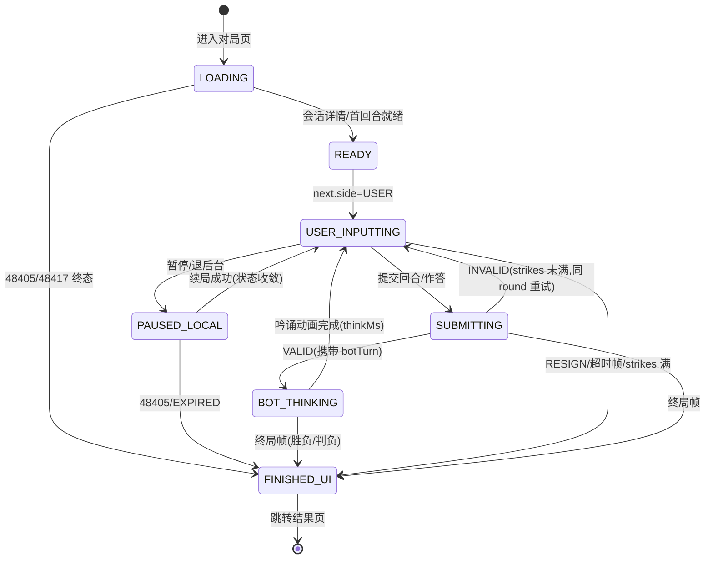

# 客户端-诗词飞花令与诗词竞技页面架构与交互设计 详细设计

- 版本: v1.0
- 日期: 2026-11-22
- 状态: 新增初版
- 错误码: PGE-xxx 客户端符号码(与服务端 48400-48420 全项 1:1 映射,零新增数字段位;通用码 40001/40103/42901 归口全局)

## 1. 概述

### 1.1 模块定位

本文档是诗词飞花令与诗词竞技域(Poetry Game Engine, PGE)的**客户端呈现层权威**,承接服务端《服务端-诗词飞花令与诗词竞技引擎》v1.0(2026-11-22)契约 R10 声明的"客户端对局页面/动画为后续批次"缺口。服务端已就绪(四玩法回合协议/语料快照裁判/PoetryBot 四档对手/48400-48420 错误码段),客户端页面层经全目录关键词扫描确认零覆盖,本次兑现。

覆盖四类玩法的呈现与交互:

| 玩法 | 页面形态 | 交互核心 |
| --- | --- | --- |
| FEIHUA 飞花令 | 回合制对局页 | 关键字令牌+引句输入+回合倒计时+Bot 吟诵动画 |
| JIELONG 诗词接龙 | 回合制对局页 | 链式诗句流+接龙锚点高亮(上句末字)→ 输入下句 |
| FILL_BLANK 填句闯关 | 关卡制答题页 | 给定上/下句作答缺失句(4 选 1 或输入式) |
| GRID_RESCUE 宫格寻句 | 关卡制答题页 | 3×3/4×4 字格按序点选组句 |

### 1.2 设计原则

1. **服务端裁判唯一权威**:客户端只做格式级预校验(空串/长度),一切"这句算不算数"的裁决以服务端 verdict 为准;客户端预校验只做体验提示(对齐服务端 R9 归一化映射表提示语义),禁本地判定胜负/禁本地判引句有效。
2. **答案键零驻留**(对齐服务端 G5):客户端内存/磁盘/日志永不保存 target_line_id、关键字索引、未揭晓关卡答案;宫格字格为可见信息可渲染,但其归属判定不可推断缓存。
3. **倒计时服务端权威**:回合 deadlineAt + serverTime 时钟偏移校准驱动,客户端本地时钟禁直接渲染。
4. **Bot 动画纯表现**:Bot"思考/吟诵"动画时长由响应 thinkMs 驱动,禁客户端自行推算 Bot 水平或提前泄露 Bot 动作。
5. **成长型话术**:INVALID 反馈只给方向性提示(不含语料库/归一化/裁判等技术词),零贬义、零"段位/考级"表述。
6. **零博弈商业化呈现**:页面内无任何付费道具入口、无充值引导、无胜负与会员权益挂钩的视觉暗示。

### 1.3 职责边界(客户端不做)

| 边界 | 裁决 |
| --- | --- |
| 引句裁判/胜负判定 | 服务端 VerdictEngine 唯一权威(服务端 R1),客户端零裁决,含 CI 静态禁词扫描(§13 AC15) |
| AI 选句/Bot 策略 | 服务端 PoetryBot;客户端禁本地实现 Bot 应答、禁预生成 Bot 台词 |
| 赛后赏析正文 | 复用 AI 对话管线(服务端 R7),客户端 Markdown/公式排版引擎承接渲染,禁自实现 LLM 调用 |
| 激励发放 | 服务端 pge_outbox → 激励中心(服务端 R5);客户端禁预发积分/徽章,只读消费激励事件刷新展示 |
| 时长归因 | category=POETRY 服务端权威(服务端 R6);客户端埋点只上报娱乐时长标记,不累计学习时长 |
| 全服排行 | 本模块无任何排行组件;rating 不展示、不跨人比较(服务端 C2) |
| 语料管理 | poem 表 SSOT 归古诗文专项学习系统(服务端 R2);客户端禁内嵌诗句库 |

## 2. 信息架构与页面地图

### 2.1 路由表

| 路由 | 页面 | 登录 | 学段闸 | 家长门 |
| --- | --- | --- | --- | --- |
| `/pge` | 诗词竞技首页 | 是 | ≥小学 3 年级 | 否 |
| `/pge/play/:sessionNo` | 对局/闯关页(四玩法分发) | 是 | ≥小学 3 年级 | 否 |
| `/pge/result/:sessionNo` | 对局结果页(含赏析入口) | 是 | ≥小学 3 年级 | 否 |
| `/pge/profile` | 诗词竞技画像页 | 是 | ≥小学 3 年级 | 否 |
| `/pge/records` | 历史对局页 | 是 | ≥小学 3 年级 | 否 |
| `/parent/pge` | 家长端诗词竞技管理页 | 家长 | — | 家长身份 |

- 路由统一注册路由体系(归《客户端路由与深链接系统》),`sessionNo` 为路径参数,深链接进入前先过三闸(§7.4)。
- 首页/画像/历史为同底导航下的平级页;对局页与结果页为压栈页,结果页关闭后回首页并刷新当日余量。

### 2.2 页面地图

```text
/pge 首页
 ├── 玩法卡 ×4(适龄显隐/维护态)
 │    ├── FEIHUA/JIELONG → 对手选择(L1-L3,不可高于档案默认档)→ 建局 → /pge/play/:sessionNo
 │    └── FILL_BLANK/GRID_RESCUE → 难度说明弹窗 → 建局 → /pge/play/:sessionNo
 ├── 今日余量卡(48412 日上限镜像)
 ├── 档案速览卡(四玩法准确率/累计命中句数,无 rating 数值外露给低龄档)
 └── 入口:画像 / 历史 / 家长端报告(仅家长账号可见入口)
/pge/play/:sessionNo(通用框架)
 ├── FEIHUA/JIELONG:回合制面板(诗句流+输入区+回合倒计时+失误计数+暂停)
 └── FILL_BLANK/GRID_RESCUE:关卡制面板(进度 x/N+题面区+作答区+本题倒计时)
/pge/result/:sessionNo:胜负横幅+回合摘要+新弱项关键字+赏析卡(异步)+再来一局/返回
```

### 2.3 页面状态规范

对齐《客户端页面状态模式与骨架屏加载空态错误态设计规范》:

- 对局页进入即 `Loading`(拉取会话详情);无本地缓存直出(答案键零驻留 G2,对局状态禁磁盘缓存)。
- 弱网错误态提供"重试";48405/48417(会话不存在/已终局)终态页提供"返回首页"单按钮,禁原地重试。
- 维护态(48406/48411)玩法卡置灰,角标"维护中",禁点击穿透。

## 3. 数据模型与 API 契约

### 3.1 Dart 数据模型(与服务端响应 1:1)

```dart
enum PgeGameMode { feihua, jielong, fillBlank, gridRescue }

enum PgeSide { user, bot }

enum PgeVerdict { valid, invalid, timeout, notATurn }

enum PgeFinishReason { win, lose, draw, quit, timeout, expired, antiAddiction }

/// 建局响应(POST /api/v1/pge/sessions)
class PgeSessionMirror {
  final int sessionId;
  final String sessionNo;
  final PgeGameMode mode;
  final String status;            // CREATED/ACTIVE/PAUSED/FINISHED/EXPIRED —— 镜像,权威在服务端
  final String? keyword;          // 飞花令关键字,其余玩法为 null
  final String corpusVersion;     // 仅展示于调试面板(默认隐藏),不作业务判断
  final PgeConfigMirror config;   // timeLimitSec/maxRounds/maxStrikes 快照
  final PgeSide firstTurn;
  final DateTime serverTime;      // 时钟校准基准
  const PgeSessionMirror({...});
}

class PgeConfigMirror {
  final int timeLimitSec;
  final int maxRounds;
  final int maxStrikes;
}

/// 回合提交响应(POST /api/v1/pge/sessions/{id}/turns)
class PgeTurnResult {
  final PgeVerdict verdict;
  final String? invalidReason;    // NOT_IN_CORPUS/NO_KEYWORD/DUPLICATED/RULE_VIOLATION
  final int userStrikes;
  final String? matchedText;      // 服务端回显的归一后命中句,可直接渲染
  final PgeBotTurn? botTurn;      // VALID 后同步携带
  final PgeNextTurn next;
}

class PgeBotTurn {
  final int roundNo;
  final PgeSide side;             // 恒 bot
  final String text;              // Bot 吟诵句(快照内,可渲染)
  final int thinkMs;              // 动画时长驱动,禁业务推断
}

class PgeNextTurn {
  final int roundNo;
  final PgeSide side;
  final DateTime deadlineAt;      // 服务端权威截止时间(仅 user 回合有意义)
}

/// 宫格题面(GET /api/v1/pge/sessions/{id}/rounds/{roundNo})——注意:无答案字段
class PgeGridRound {
  final int roundNo;
  final int gridSize;             // 3 或 4
  final List<PgeGridCell> cells;  // 服务端乱序下发,客户端禁二次乱序
  final int timeLimitSec;
}

class PgeGridCell {
  final int idx;                  // 服务端索引,点选序列按 idx 回传
  final String char;
}

/// 填句题面(同接口 FILL_BLANK 分支;字段为按服务端 §4.4 协议推导的消费期望,
/// 解析采用防御式容错——缺字段按题型兜底渲染,不以客户端推断替代服务端权威)
class PgeFillRound {
  final int roundNo;
  final String promptText;        // 给定句(上句或下句)
  final bool promptIsUpper;       // true=给出上句答下句
  final PgeFillAnswerType answerType; // option/input
  final List<PgeFillOption>? options; // 服务端乱序,4 选 1;input 式为 null
  final int timeLimitSec;
}

enum PgeFillAnswerType { option, input }

class PgeFillOption {
  final String optionId;
  final String text;
}

/// 终局结果(GET /api/v1/pge/sessions/{id}/result)
class PgeSessionResult {
  final int sessionId;
  final String status;
  final PgeFinishReason finishReason;
  final int rounds;
  final PgeSummary summary;
  final String appreciateUrl;
}

class PgeSummary {
  final int userValidQuotes;
  final int userStrikes;
  final int botValidQuotes;
  final bool botTimeout;
  final List<int> hitLineIds;       // 仅用于"本局温习"列表展示,禁落盘
  final List<String> newWeakKeywords;
  final int ratingDelta;            // 仅高中档展示数值;低龄档仅展示"进步/保持"
}

/// 档案(GET /api/v1/pge/profile)——无任何排名字段
class PgeProfile {
  final int rating;                 // 仅服务端匹配用;客户端仅用于对手档位默认展示(本人可见)
  final double feihuaAccuracy;
  final double jielongAccuracy;
  final double fillAccuracy;
  final double gridAccuracy;
  final int masteredLines;
  final List<String> weakKeywords;
}
```

### 3.2 Repository 层

```dart
class PgeRepository {
  /// 建局;[idempotencyKey] = clientRequestId(UUID v7)
  Future<PgeSessionMirror> createSession({
    required PgeGameMode mode,
    String? botLevel,
    required String gradeBand,
    required String clientRequestId,
  });

  /// 回合提交(飞花令/接龙);重试复用同一 idempotencyKey
  Future<PgeTurnResult> submitTurn({
    required int sessionId,
    required int roundNo,
    required String action,       // QUOTE_LINE/PASS/RESIGN
    required Map<String, dynamic> payload,
    required int clientElapsedMs,
    required String idempotencyKey,
  });

  /// 关卡题面(FILL_BLANK/GRID_RESCUE);重复 GET 返回同题(服务端 G8)
  Future<PgeGridRound> getGridRound(int sessionId, int roundNo);
  Future<PgeFillRound> getFillRound(int sessionId, int roundNo);

  /// 关卡作答
  Future<PgeTurnResult> submitRoundAnswer({
    required int sessionId,
    required int roundNo,
    required String action,       // TAP_GRID/PICK_OPTION/INPUT_LINE
    required Map<String, dynamic> payload,
    required int clientElapsedMs,
    required String idempotencyKey,
  });

  Future<void> pause(int sessionId);
  Future<void> resume(int sessionId);
  Future<PgeSessionResult> getResult(int sessionId);
  Future<PgeProfile> getProfile();
  Future<PgeAppreciate> getAppreciate(String url); // 48415 生成中/48416 降级
}
```

### 3.3 幂等键与版本管理策略

| 操作 | 幂等键 | 策略 |
| --- | --- | --- |
| 建局 | `clientRequestId`(UUID v7,一局一个) | 请求前生成并随镜像内存持有;重试/重发复用同键;撞 48407 刷新后重新走首页 |
| 回合提交 | `(sessionId, roundNo, action)` 派生键 | 同一 round 重试复用同键,服务端锁+uk 回放首次判定(服务端 D8);换 round 换新键 |
| 关卡作答 | `(sessionId, roundNo)` 派生键 | 同上 |
| 暂停/续局 | 无幂等键 | 乐观调用;CAS 失败按服务端实际状态收敛镜像 |
| 结果/档案/题面 | 只读 | GET 可安全重试 |

- 会话镜像(题目/回合状态)**仅内存持有**(Hive/磁盘零落盘,守卫 G2),进程被杀后由服务端状态重建(重进对局页拉取服务端权威状态,不存在"本地续局"概念,对齐答案键零驻留)。
- serverTime 校准复用全局 ServerClockNotifier(归《客户端-学生班级与作业提交页面架构与交互设计》F4 模式),进入对局页时以建局/最近响应 serverTime 刷新偏移。

## 4. 页面详细设计

### 4.1 诗词竞技首页 `/pge`

布局(自上而下):

1. **顶部栏**:标题"诗词竞技"+ 适龄说明入口(?图标,弹层说明"小学三年级以上开放,诗词内容来自课标与经典篇目")。
2. **玩法卡 2×2 网格**:
   - 飞花令(令牌图标)/诗词接龙(链环图标)/填句闯关(书页图标)/宫格寻句(九宫格图标)。
   - 卡面展示一句话玩法说明(≤16 字)与建议学段带;**幼儿/一二年级账号整卡不渲染**(服务端 48401 兜底前的客户端闸,G1 双保险)。
   - 维护态(48406/48411 命中任一)对应卡置灰+"维护中"角标。
3. **今日余量卡**:镜像 `pge:daily` 口径的对局余量(服务端建局响应不直出余量时,以 48412 命中为准展示"今日次数已用完");余量耗尽置灰全部建局入口,话术"今日对战次数已用完,明天再来"(成长型,禁"限制/禁止")。
4. **档案速览卡**:四玩法准确率(环形微图)+累计命中诗句数("你已温习 N 句诗");**不展示 rating 数值**(低龄档),高中档可展示"对战水平:稳步提升"等定性文案。
5. **底部入口**:我的画像 / 对局记录。

交互:

- 点击 FEIHUA/JIELONG → 对手档位 bottomSheet:展示可选档(L1-L3,默认档由档案 rating 映射,**高一档不可选**,置灰+"赢几场解锁"),选定后建局。
- 点击 FILL_BLANK/GRID_RESCUE → 玩法说明弹窗(规则三句话+本题时限说明)→ 确认建局。
- 建局请求中按钮 loading 且禁重复点击;48408(同玩法单开一局)→ 弹窗"有一局还没结束"→ 跳转该进行中对局(服务端返回会话标识时)。

### 4.2 对局页(回合制:飞花令/接龙) `/pge/play/:sessionNo`

**整体框架**:顶部状态条 + 中央诗句流 + 底部输入区。

1. **顶部状态条**:
   - 左:回合指示("第 5 回合 · 到你出句" / "小诗童思考中..."Bot 回合)。
   - 中:关键字令牌(飞花令:大字"月"圆形令牌,命中句中关键字位置以高亮同步展示;接龙:上句末字锚点字牌)。
   - 右:失误计数(❋ 1/3,strikes 达 max-1 时变橙,禁红色恐吓)。
2. **诗句流**(可滚动,新句底部插入并自动滚动):
   - 用户句:右对齐卡片,展示原文(服务端 matchedText 回显)。
   - Bot 句:左对齐卡片,头像(诗词伙伴形象,委托 AI 学习伙伴虚拟形象组件),卡片内逐字"吟诵"动效(时长 thinkMs,纯表现)。
   - INVALID 反馈行:居中浅色提示条(成长型话术映射表,§8.1),不插入诗句流,2.8s 自动消隐。
   - 每回合 Bot 句下方展示链式锚点(接龙:首字高亮并标注"接上'霜'";飞花令:关键字高亮)。
3. **底部输入区**(仅 user 回合可编辑):
   - 多行输入框(占位文案:"想出一句含'月'的诗..." / "接'霜'字的诗句..."),上限 64 字(客户端格式预校验,超出禁提交)。
   - 提交按钮(纸飞机图标);**提交后进入 SUBMITTING 态:输入锁定、按钮 loading、禁放弃**(对齐"提交不可取消"模式——服务端回合锁内处理)。
   - PASS(本回合认输)与 RESIGN(整局认输)收纳进"⋯"菜单:PASS 二次确认("这回合算失误,确定跳过?");RESIGN 二次确认("认输后本局结束,确定?")。
4. **回合倒计时**:输入区上方细进度条(deadlineAt 驱动,最后 5s 变橙+轻震动一次);超时由服务端判 TIMEOUT,客户端不做本地超时裁决,仅做"即将超时"视觉提示。
5. **暂停**:顶栏暂停按钮(仅 FEIHUA/JIELONG)→ 确认弹窗 → 调 :pause;暂停页覆盖层显示"已暂停,30 分钟内可继续"与"继续/认输"双按钮;退后台自动调 :pause(失败容忍,回前台以服务端状态收敛)。

### 4.3 闯关页(填句/宫格) `/pge/play/:sessionNo`

关卡制通用框架:顶部进度("第 3/10 关"+本题倒计时条)+ 题面区 + 作答区。

**填句(FILL_BLANK)**:

- 题面区:大字展示给定句(上句给全、下句留白横线,或反之,依 promptIsUpper);墨色卡片式排版(委托主题引擎语文皮肤)。
- 作答区两态:
  - 选择式:2×2 选项卡(服务端乱序,客户端禁二次乱序),点选即高亮,再点提交按钮;提交后锁定等待判定。
  - 输入式:同回合制输入框(无关键字锚点),字数上限 32。
- 判定反馈:正确→选项绿框+轻粒子(≤80 粒,委托手势动画系统)+ 播放正确音效(可关);错误→橙框+正确答案**本关揭晓**(服务端推送判定后展示,属已发生事实的呈现,非答案键预获取)。

**宫格(GRID_RESCUE)**:

- 题面区:提示语"点字成诗"(不提示目标句任何信息)。
- 作答区:`gridSize×gridSize` 字格矩阵(按钮网格,字格字号 28sp 起,触达区 ≥56dp):
  - 点选:按点击顺序进入上方"组句槽"(一字一槽,可点槽中字撤销该字及其后全部);再点已选字格=撤销到该字。
  - 字格选中态:底纹高亮;已撤销字格恢复默认。
  - 提交:组句槽填满后提交按钮可用;TAP_GRID 提交 `{seq:[idx...]}`。
  - 干扰字呈现:全部字格同字形样式(干扰字与目标字视觉不可区分,G2 呈现层配合——客户端不得实现"干扰字灰显提示"类暗示)。
- 判定反馈:正确→组句槽翻牌展示完整句+出处(篇名,作者);错误→抖动动画+橙框提示"再试一次"(次数语义以服务端 strikes 为准,客户端不本地限次)。

### 4.4 对局结果页 `/pge/result/:sessionNo`

1. **胜负横幅**:WIN 金色调("你赢了!")/ LOSE 中性蓝调("惜败,再来一局?")/ DRAW("旗鼓相当!")/ QUIT/TIMEOUT/ANTI_ADDICTION 一律中性文案("本局已结束"),**禁红色失败页**; Celebration 动效委托成就弹窗队列播放器,防沉迷中断(ANTI_ADDICTION)无任何庆祝。
2. **回合摘要**:双方有效引句数、回合数、失误数;宫格/填句展示通过率。
3. **本局温习**:hitLineIds 对应诗句列表(拉取展示即弃,禁落盘);每条提供"去赏析"入口(跳转 AI 对话并注入该句 contextPack,复用服务端 R7)。
4. **新弱项关键字**:newWeakKeywords 以令牌样式展示("以后多留意'霜'字句")——成长型包装,禁"薄弱/差"字样。
5. **赏析卡**:异步拉取 appreciateUrl(48415→生成中转圈;48416→卡内降级"赏析生成中,稍后可在对局记录查看",战绩区不受影响);赏析正文 Markdown 委托《客户端-AI对话消息Markdown流式渲染与学科公式排版引擎》渲染,AIGC 徽标常驻(合规 C4)。
6. **底部操作**:"再来一局"(同玩法直接建局)/"返回首页"。

### 4.5 诗词竞技画像页 `/pge/profile`

- 四玩法准确率雷达图(委托学习数据可视化引擎,客户端零自绘)。
- 累计命中诗句数 masteredLines(大数字+趋势)。
- 弱项关键字 TOP20 令牌云(点击查看"含'霜'的诗句温习"→ 跳转古诗文专项学习系统对应筛选页,跨模块跳转经路由体系)。
- **无全服百分位、无排名、无对比条**(合规 C2 双保险);高中档可展示 rating 定性区间("对战水平:同阶之上"),禁精确数值横向比较。

### 4.6 历史对局页 `/pge/records`

- 分页列表(分页加载委托《客户端通用列表组件与分页加载引擎》):每行=玩法+终局横幅缩略+回合数+时间;EXPIRED/QUIT 行标注"未计入战绩"(服务端 G9 语义呈现)。
- 点击行进结果页(复用 4.4);进行中的对局置顶"继续对局"。
- 列表零诗句原文预览(隐私呈现,合规 C5)。

### 4.7 家长端管理页 `/parent/pge`

- 娱乐时长分卡:诗词竞技今日/本周时长(服务端权威),与"学习时长"分账展示,标注"对战属于娱乐时长,不计入学习时长"(服务端 R6 呈现)。
- 对局统计:局数/胜率(仅自家孩子)/四玩法准确率;**无榜单、无他人数据**。
- 管控入口:仅可收紧(每日局数上限/开放时段),复用家长端使用管控委托;放宽次日生效(对齐服务端家长管控语义)。
- 弱项关键字可见(家长可见度分级对齐;C5:画像仅家长与孩子本人可见)。

## 5. 分龄交互适配参数矩阵(呈现层,数值权威归《分龄UI适配与交互设计规范》)

| 参数 | P3_4 | P5_6 | JUNIOR | SENIOR |
| --- | --- | --- | --- | --- |
| 字格字号/触达 | 30sp/64dp | 28sp/60dp | 26sp/56dp | 24sp/52dp |
| 输入占位提示长度 | ≤10 字+拼音注音 | ≤14 字 | ≤18 字 | 完整规则句 |
| Bot 吟诵逐字速度 | 220ms/字 | 180ms/字 | 140ms/字 | thinkMs/字数线性 |
| 倒计时条最后警示 | 8s 橙+语音"快点哦" | 5s 橙 | 5s 橙 | 3s 橙 |
| INVALID 提示时长 | 3.5s(朗读播报) | 3s | 2.5s | 2s |
| 选项卡字号 | 22sp | 20sp | 18sp | 17sp |
| 结果页庆祝动效 | 全开(≤2s) | 全开 | 简版(≤1s) | 仅横幅 |
| rating 数值展示 | 禁 | 禁 | 定性 | 定性 |

- 低龄档(L1)Bot"卡壳"发生时:UI 呈现"小诗童卡住了,你赢啦!"并配困惑表情动画(10% 概率事件的服务端语义,客户端只呈现 botTimeout)。

## 6. 状态机

### 6.1 对局页客户端镜像状态机(内存镜像,权威在服务端)



### 6.2 轮询与倒计时

- 倒计时:Timer.periodic(100ms) 以 `deadlineAt - (now - serverOffset)` 渲染;页面 dispose 必 cancel(守卫 G6)。
- 无轮询设计:回合制为请求-响应模型;**仅赏析**为异步轮询(1.5s 起 1.5x 退避封顶 5s×20 次,超时按 48416 降级),对齐"推送召回优先、轮询兜底"全局模式。

### 6.3 守卫规则(G1-G12)

| 编号 | 守卫 | 违规处理 |
| --- | --- | --- |
| G1 | 学段闸 fail-closed:深链接进对局页先校验学生档案 grade,低于 3 年级整页拦截(成长型话术) | 拦截页禁回显会话任何字段 |
| G2 | 答案键零驻留:target_line_id/关键字索引/组句正确归属禁入内存模型字段、禁落盘、禁日志;matchedLineId/hitLineIds 仅过程展示即弃 | CI 扫描 Pge* 模型禁出现 targetLineId 字段 |
| G3 | 单活跃对局:同模式进行中的会话禁重复建局(48408 前客户端预检首页入口) | 预检命中直接跳进行中对局 |
| G4 | 提交防重:SUBMITTING 态禁一切重复提交(双击/回车连发) | 幂等键复用,服务端回放兜底 |
| G5 | 零本地裁判:客户端禁实现"引句是否含关键字/是否接龙"的判定逻辑,仅允许空串/超长格式预校验 | CI 禁词表:keywordIndex/corpus/normMatch/isValidQuote 等(§13 AC15) |
| G6 | 时钟服务端权威:倒计时禁本地 DateTime.now 直渲染;serverOffset 未就绪前显示"准备中"不出计时 | — |
| G7 | 终局一次性:finishReason 渲染后页面进入终态,禁"再来一局"复用旧会话任何状态 | 再来一局=新建局新镜像 |
| G8 | Bot 呈现纯消费 thinkMs:禁本地随机 Bot 时长、禁预生成 Bot 台词 | — |
| G9 | 防沉迷呈现 fail-closed:48404 命中展示休息引导页(与全局防沉迷文案一致),禁"稍后重试绕过"入口 | — |
| G10 | 弱项呈现成长型:newWeakKeywords 禁与"差/弱/扣分"等词同屏 | 文案白名单校验 |
| G11 | 镜像零落盘:会话/题面/回合状态禁写 Hive/SQLite;进程恢复=重拉服务端 | — |
| G12 | 零排行组件:本模块任何页面禁渲染排名/榜/超越百分比组件 | CI 组件白名单扫描 |

### 6.4 关键竞态裁决

| 竞态 | 裁决 |
| --- | --- |
| 双击提交同回合 | 客户端 SUBMITTING 门控拦截第二击;漏网由服务端回合锁回放首次判定(G4) |
| INVALID 后立刻改句重交 | 同 roundNo 同幂等键重试=服务端回放首次判定;**合法路径**为等待服务端 next(同 round 重试语义由服务端在响应 next 给出),客户端按 next.roundNo 推进后换新键 |
| 倒计时归零与服务端 TIMEOUT 帧先后 | 客户端到点仅置灰输入并等待服务端帧;服务端帧为唯一终态依据(禁本地判负) |
| 退后台自动暂停失败 | 回前台拉取服务端状态收敛:ACTIVE→续走;PAUSED→展示暂停页;FINISHED/EXPIRED→终态页 |
| RESIGN 与 Bot 回合在途 | RESIGN 响应终局帧为唯一权威;Bot 动画未完成即收终态帧时丢弃动画直渲染终态 |
| 宫格重复 GET 题面 | 服务端 G8 同题;客户端题面内存单例,重复 GET 结果丢弃(防 cells 顺序抖动) |
| 建局成功但响应丢失(客户端超时) | 以幂等键重放建局请求取回首次结果;重放亦失败→首页提示"可能有进行中的对局",入口预检收敛 |

## 7. 关键代码示例

### 7.1 对局控制器(回合制提交通道+镜像收敛)

```dart
class PgePlayController extends Notifier<PgePlayState> {
  static const _maxQuoteLen = 64;

  Future<void> submitQuote(String raw) async {
    final s = state;
    if (s is! PgeUserInputting) return;
    final text = raw.trim();
    if (text.isEmpty || text.length > _maxQuoteLen) return; // G5: 仅格式预校验
    state = PgeSubmitting(quote: text, mirror: s.mirror);

    final started = Stopwatch()..start();
    try {
      final result = await ref.read(pgeRepositoryProvider).submitTurn(
        sessionId: s.mirror.sessionId,
        roundNo: s.mirror.nextRoundNo,
        action: 'QUOTE_LINE',
        payload: {'text': text},
        clientElapsedMs: started.elapsedMilliseconds,
        idempotencyKey: s.mirror.turnKeyFor(s.mirror.nextRoundNo),
      );
      await _applyVerdict(result);
    } on PgeApiException catch (e) {
      await _applyErrorFrame(e); // 48417 终态 / 网络错回 USER_INPUTTING 可重试
    }
  }

  Future<void> _applyVerdict(PgeTurnResult r) async {
    switch (r.verdict) {
      case PgeVerdict.valid:
        // Bot 回合动画完成后进入下一 user 回合(G8: thinkMs 纯表现)
        state = PgeBotThinking(botTurn: r.botTurn!, next: r.next);
        await _playRecite(r.botTurn!);
        state = PgeUserInputting(mirror: state.mirror.advance(r.next));
      case PgeVerdict.invalid:
        // 同 round 重试语义:next.side 仍为 USER 则回输入态并展示成长型提示
        state = PgeUserInputting(mirror: state.mirror.withStrikes(r.userStrikes));
        _showGrowthHint(r.invalidReason);
      case PgeVerdict.timeout:
      case PgeVerdict.notATurn:
        await _resyncFromServer(); // 禁本地裁决,重拉权威状态
    }
  }
}
```

### 7.2 宫格组句交互(点选序列管理)

```dart
class GridComposeController extends Notifier<GridComposeState> {
  void tapCell(int idx) {
    final s = state;
    if (s.selected.contains(idx)) {
      // 点已选字=撤销到该字(含其后全部)
      final cut = s.selected.indexOf(idx);
      state = s.copyWith(selected: s.selected.sublist(0, cut));
    } else if (s.selected.length < s.grid.cellCount) {
      state = s.copyWith(selected: [...s.selected, idx]);
    }
  }

  Future<void> submit() async {
    final s = state;
    if (s.selected.length != s.grid.cellCount) return;
    state = s.copyWith(locked: true); // G4: 提交后锁定
    try {
      final result = await ref.read(pgeRepositoryProvider).submitRoundAnswer(
        sessionId: s.sessionId,
        roundNo: s.grid.roundNo,
        action: 'TAP_GRID',
        payload: {'seq': s.selected},
        clientElapsedMs: s.elapsedMs,
        idempotencyKey: s.answerKey,
      );
      // 判定呈现:正确翻牌/错误抖动;不缓存任何答案归属(G2)
      await _renderVerdict(result);
    } on PgeApiException catch (e) {
      await _renderError(e); // 网络错解锁可重试;终态帧进 FINISHED_UI
    }
  }
}
```

### 7.3 倒计时渲染(服务端时钟权威)

```dart
class TurnCountdownBar extends ConsumerWidget {
  @override
  Widget build(BuildContext context, WidgetRef ref) {
    final offset = ref.watch(serverClockOffsetProvider); // G6
    final deadline = ref.watch(currentDeadlineProvider);
    return TweenAnimationBuilder<double>(
      tween: Tween(begin: 1, end: 0),
      duration: deadline.difference(DateTime.now().add(offset)),
      builder: (context, v, _) => LinearProgressIndicator(value: v.clamp(0, 1)),
    );
  }
}
```

### 7.4 路由守卫(深链接三闸)

```dart
class PgeRouteGuard extends RouteGuard {
  @override
  Future<String?> canNavigate(BuildContext context, RouteMatch match) async {
    // 闸1 登录态(全局认证拦截,复用路由体系)
    // 闸2 学段闸 G1:学生档案 grade>=3,否则拦截页
    final profile = await ref.read(studentProfileProvider.future);
    if (profile.gradeLevel < 3) return '/pge/age-gate';
    // 闸3 防沉迷呈现闸:命中 48404 时由对局页渲染休息引导(G9),
    //    守卫层不做时长裁决(权威在服务端),仅预检全局防沉迷缓存 fail-closed
    if (await ref.read(antiAddictionCacheProvider.notifier).isBlocked()) {
      return '/rest-guide?scene=poetry_game';
    }
    return null;
  }
}
```

## 8. 错误处理与降级

### 8.1 错误码映射(服务端 484xx → 客户端 PGE-xxx 符号码,零新增数字段位)

| 服务端码 | HTTP | 客户端符号码 | 客户端处理 | 用户话术(成长型) |
| --- | --- | --- | --- | --- |
| 48400 | 400 | PGE-001 | 表单重置待重填 | 请刷新后重试 |
| 48401 | 403 | PGE-002 | 学段闸拦截页 | 该玩法小学三年级开放,先去诗词天地逛逛 |
| 48402 | 403 | PGE-003 | 拉起家长门流程 | 请家长确认后使用 |
| 48403 | 403 | PGE-004 | 功能门控提示页 | 当前账号暂不能使用该玩法 |
| 48404 | 403 | PGE-005 | 休息引导页(G9 终态) | 休息一下吧,明天再来 |
| 48405 | 404 | PGE-006 | 终态页单按钮返回 | 对局已结束 |
| 48406 | 404 | PGE-007 | 玩法卡维护态 | 该功能维护中 |
| 48407 | 409 | PGE-008 | 刷新幂等键重走建局 | 请求冲突,请刷新 |
| 48408 | 409 | PGE-009 | 跳进行中对局 | 先完成当前对局 |
| 48409 | 409 | PGE-010 | 防抖提示,禁连击 | 操作太快了 |
| 48410 | 422 | PGE-011 | INVALID 反馈行(细分 reason 映射下表) | (按 invalidReason) |
| 48411 | 500 | PGE-012 | 全玩法维护态 | 功能准备中,请稍后再试 |
| 48412 | 429 | PGE-013 | 余量卡置灰 | 今日对战次数已用完 |
| 48413 | 429 | PGE-014 | 输入区冷却 3s | 慢慢想,不着急 |
| 48414 | 200 | PGE-201* | Bot 卡壳业务帧:渲染"小诗童卡住了" | — |
| 48415 | 200 | PGE-202* | 赏析生成中(轮询继续) | — |
| 48416 | 200 | PGE-203* | 赏析降级(战绩不受影响) | — |
| 48417 | 410 | PGE-015 | 终态页 | 本局已结束 |
| 48418 | 403 | PGE-016 | 登出并提示 | — |
| 48419 | 500 | PGE-017 | 可重试错误条 | 网络开小差了,请重试 |
| 48420 | 200 | PGE-204* | Bot 降级业务帧(动画简化) | — |

\* PGE-2xx 为 200 语义业务帧,按服务端响应正常渲染,非异常路径。

INVALID 细分话术(48410,禁技术词):

| invalidReason | 提示文案 |
| --- | --- |
| NOT_IN_CORPUS | 这句不在课本诗词里,再想想学过的句子 |
| NO_KEYWORD | 这句里没有"月"字哦 |
| DUPLICATED | 这句刚才用过了,换一句 |
| RULE_VIOLATION | 要接上上句的最后一个字(同音也可以) |
| TIMEOUT | 时间到了,这回合算失误 |

### 8.2 客户端降级矩阵 D1-D10

| 编号 | 故障 | 降级策略 |
| --- | --- | --- |
| D1 | 网络超时(回合提交未知态) | 幂等键退避重试×3(1s/2s/4s);仍未知→错误条"网络不稳定,正在确认结果"并拉取服务端状态收敛,禁盲目重发新回合 |
| D2 | Bot 吟诵动画资源缺失 | 静态卡片直出全文(动效零依赖),thinkMs 语义保留 |
| D3 | 赏析服务不可用 | 48416 降级卡,战绩区完整呈现 |
| D4 | 音效/语音播报不可用 | 视觉反馈完整,播报静默跳过 |
| D5 | 字格字体资源未就绪 | 系统字体兜底(禁阻塞进入对局),后台继续加载 |
| D6 | 雷达图/趋势图组件异常 | 降级数字列表呈现(准确率+ masteredLines) |
| D7 | 家长端统计接口失败 | 错误重试态,禁本地编造时长 |
| D8 | 激励事件延迟 | 结果页不出现积分动画(激励中心消费后由全局通知中心补达),禁客户端预发(G 边界) |
| D9 | 首页玩法配置接口失败 | 上次缓存的玩法卡可见性兜底(维护态信息可陈旧,建局时服务端终裁),超 24h 缓存失效 |
| D10 | **总红线** | 学段闸(G1)/答案键零驻留(G2)/零本地裁判(G5)/防沉迷呈现(G9)无任何降级路径 |

## 9. 合规红线(客户端侧)

| 编号 | 红线 |
| --- | --- |
| C1 | 页面零付费入口:无充值/会员引导/道具购买组件(零博弈商业化呈现) |
| C2 | 零排行组件:无榜/排名/超越百分比(服务端 C2 双保险,CI 白名单扫描 G12) |
| C3 | 防沉迷 fail-closed 呈现:48404/ANTI_ADDICTION 休息引导不可关闭、不可绕过 |
| C4 | 赏析卡 AIGC 徽标常驻不可关闭;赏析正文禁二次编辑入口 |
| C5 | 用户引句不公开展示:无分享引句原文入口;历史列表零原文预览;画像与弱项仅本人与家长可见 |
| C6 | 埋点不采引句原文/作答内容(§10 白名单);日志禁打印 payload.text |
| C7 | 时长分账显形:娱乐时长标识常驻家长端与对局页角标 |
| C8 | 无考级/段位/证书话术;Bot 命名禁用"大师/宗师"等社会头衔(L4 命名"小诗童·高手"类中性词) |

## 10. 埋点事件(module=poetry_game,权威归《客户端埋点事件体系与数据采集规范》)

| 事件 | 触发 | 关键属性(白名单) |
| --- | --- | --- |
| pge_home_view | 首页曝光 | grade_band |
| pge_mode_click | 点击玩法卡 | mode |
| pge_create_result | 建局结果 | mode, bot_level, result(ok/错误码) |
| pge_turn_submit | 回合提交 | mode, round_no(禁 payload/text) |
| pge_turn_invalid | INVALID 反馈 | mode, invalid_reason(枚举非原文) |
| pge_finish_view | 结果页曝光 | mode, finish_reason, rounds |
| pge_appreciate_view | 赏析卡曝光 | mode, status(ready/degraded) |
| pge_profile_view | 画像页曝光 | — |
| pge_parent_view | 家长端页曝光 | — |
| pge_quota_exhausted | 余量耗尽曝光 | mode |

- 漏斗指标:首页→玩法点击→建局成功→首回合提交→终局→赏析查看(6 步);监控交由埋点平台聚合。

## 11. 性能设计

- 对局页首帧 ≤300ms(镜像内存直出);诗句流插入动画 16ms/帧,单屏渲染回合上限 40 条(超出顶部虚拟化回收)。
- Bot 吟诵动画 Ticker 单实例,dispose 必停;倒计时 Timer 100ms tick,页面销毁必 cancel(G6)。
- 宫格字格矩阵 RepaintBoundary 单格隔离,点选重绘范围 ≤2 格;3×3/4×4 首帧构建 ≤16ms。
- 低端设备(资源压力引擎 Tier C):禁粒子/禁模糊背景/吟诵动画降静态卡,计数条降分辨率渲染。
- 包体积:本模块零内嵌诗句库/零字体打包(字体归《客户端-字体资源注册与动态加载引擎》按需加载)。

## 12. 契约对齐

| 编号 | 契约 |
| --- | --- |
| R1 | 服务端引擎 R10 兑现:本文即其"客户端对局页面/动画"后续批次;SSE/REST 契约 1:1 引用服务端 §4,零发明 |
| R2 | 零裁判:G5 落地,CI 禁词扫描(§13 AC15);预校验仅限格式级(空串/超长) |
| R3 | 答案键零驻留:G2 落地,模型无 targetLineId 字段;hitLineIds 仅展示即弃不落盘 |
| R4 | 归一化提示:客户端禁实现归一化匹配逻辑;若做"疑似标点全角"输入提醒,仅引用服务端下发的映射表版本做 UI 提示,提示文案禁含"归一化"术语 |
| R5 | 激励不预发:D8 落地;积分/徽章仅消费激励中心事件,本模块无奖励预演动画 |
| R6 | 时长分账:C7 落地,埋点无 learn_duration 字段 |
| R7 | 赏析渲染:正文走 Markdown/公式排版引擎,AIGC 徽标常驻;赏析 contextPack 注入走 AI 对话管线,本模块禁自调 LLM |
| R8 | 跨模块跳转:温习/弱项关键字跳转古诗文专项学习系统,经路由体系深链接,参数白名单(关键字/学段) |
| R9 | 对手档位:botLevel 可选集合与默认档由档案 rating 映射,高一档置灰,与服务端 §5.4 一致;禁客户端解锁逻辑 |
| R10 | 家长门:48402 拉起统一家长门流程,禁自实现 PIN 核验 |
| R11 | 命名空间:路由 /pge/* 与 puzzle /puzzle/*、棋类 /chess/* 隔离,埋点 module=poetry_game 独立注册 |
| R12 | 注销清理:会话镜像内存零落盘天然合规;本地仅埋点事件(走全局埋点清理),无需本模块级联清理任务 |

## 13. 验收场景

| 编号 | 场景 | 预期 |
| --- | --- | --- |
| AC01 | 三年级学生深链接 /pge/play/:sessionNo | 过闸进入对局页;二年级深链接→G1 拦截页,零会话字段回显 |
| AC02 | 飞花令输入"床前明月光,疑是地上霜"提交 | SUBMITTING 锁定→VALID→Bot 吟诵动画(thinkMs)→下一回合输入态 |
| AC03 | INVALID(DUPLICATED)反馈 | 成长型提示条"这句刚才用过了",strikes 1/3 更新,同 round 可重试 |
| AC04 | 连续点击提交按钮 | 仅首击生效,G4 门控,服务端回放兜底无双回合 |
| AC05 | 倒计时最后一秒提交在途 | 不本地判负,等待服务端帧;TIMEOUT 帧→终态 LOSE 呈现 |
| AC06 | 退后台 3 分钟回前台 | 自动暂停成功→暂停页;续局→状态收敛继续 |
| AC07 | 暂停 31 分钟后续局 | 48405/EXPIRED 终态页单按钮返回 |
| AC08 | 宫格按序点选并填满提交 | TAP_GRID seq 正确提交;正确→翻牌展示全句与出处;干扰字全程视觉同质 |
| AC09 | 宫格重复 GET 题面 | 题面单例不抖动,cells 顺序稳定 |
| AC10 | 填句选择式作答 | 选项服务端乱序不二次乱序;提交后锁定;判后揭晓答案 |
| AC11 | RESIGN 二次确认 | 确认后终局 QUIT;结果页中性文案,无庆祝 |
| AC12 | 防沉迷时段建局 | 48404→休息引导页(G9),禁重试绕过入口 |
| AC13 | 赏析生成中/失败 | 48415 转圈→就绪渲染(徽标常驻);48416 降级卡,战绩完整 |
| AC14 | 结果页"再来一局" | 新建局新镜像(G7),旧会话状态零残留 |
| AC15 | CI 静态扫描本模块代码 | 禁词表(keywordIndex/corpus/normMatch/isValidQuote/targetLineId/rankList 等)零命中 |
| AC16 | 家长端查看 | 娱乐/学习时长分卡;弱项关键字可见;零他人数据、零榜单 |

## 14. 关联文档

- 《服务端-诗词飞花令与诗词竞技引擎-详细设计》(服务端契约权威,R10 兑现对象)
- 《客户端-棋类对弈训练页面架构与交互设计》(对弈域客户端同构参考:守卫/竞态/降级模式)
- 《客户端-思维训练与益智游戏页面架构与交互设计》(关卡制客户端同构参考)
- 《客户端-AI对话消息Markdown流式渲染与学科公式排版引擎》(赏析正文渲染委托)
- 《客户端-成就勋章与奖励展示组件》(结果页庆祝动效委托,激励不预发边界)
- 《客户端-统一对话框与模态弹出层调度管理系统》(确认弹窗统一入口)
- 《分龄UI适配与交互设计规范》(分龄参数数值权威)
- 《客户端埋点事件体系与数据采集规范》(埋点白名单与 module 注册)

## 15. 维护记录

- v1.0 (2026-11-22): 新增初版。兑现服务端《诗词飞花令与诗词竞技引擎》v1.0(2026-11-22)契约 R10"客户端对局页面/动画为后续批次"缺口——经全目录关键词扫描确认飞花令/诗词接龙/宫格寻句客户端页面层零覆盖(服务端已就绪)。覆盖 `/pge/*` 路由族七页面单元(首页/对局页(回合制+关卡制双形态)/结果页含赏析/画像页/历史对局页+家长端管理页);Dart 模型与服务端 §4 REST 契约 1:1(四玩法枚举/回合提交/宫格与填句题面/终局摘要/档案,字段级答案键零驻留 G2);对局镜像状态机 LOADING/READY/USER_INPUTTING/SUBMITTING/BOT_THINKING/PAUSED_LOCAL/FINISHED_UI(mermaid)+守卫 G1-G12(学段闸 fail-closed/答案键零驻留/单活跃对局/提交防重/零本地裁判含 CI 禁词/服务端时钟权威/终局一次性/Bot 呈现纯消费 thinkMs/防沉迷呈现 fail-closed/弱项成长型呈现/镜像零落盘/零排行组件)+竞态裁决 7 类;关键代码四段(回合提交通道含 VALID/INVALID/超时三分支/宫格组句点选撤销/服务端时钟倒计时/路由三闸);PGE-001~017+PGE-201~204 符号码与 48400-48420 全项 1:1 映射(零新增数字段位,200 语义四帧按业务成功渲染);降级 D1-D10(D10 总红线四项无降级路径);合规 C1-C8(零付费入口/零排行/AIGC 徽标常驻/引句不公开展示/埋点零原文/时长分账/无考级话术);埋点 10 事件 module=poetry_game 白名单;契约 R1-R12(含激励不预发 R5/时长分账 R6/命名空间隔离 R11);验收 AC01-AC16(含 CI 禁词扫描 AC15)。
