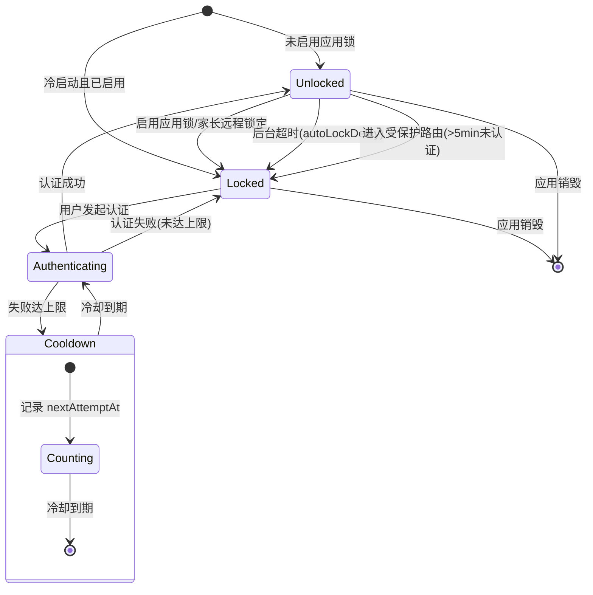

# 客户端应用锁与生物识别认证系统 - 详细设计

> **模块定位**：本模块为 PrimeTop 客户端提供应用级访问保护能力，包括 PIN 码锁、生物识别认证（指纹/Face ID）、后台切换模糊保护、截图防护、锁定策略管理以及家长强制锁定控制。面向全学段学生用户，重点保障低龄用户的学习数据隐私和设备共用场景下的信息安全。

> **与现有文档的边界**：
> - **客户端安全防护体系**：侧重代码防护、SSL Pinning、反调试等运行时安全，本文档侧重应用级访问控制与隐私界面保护
> - **防沉迷与未成年人保护机制**：侧重使用时长限制与内容管控，本文档侧重设备级的物理访问防护
> - **数据安全与隐私合规体系**：侧重服务端数据加密与合规，本文档侧重客户端本地数据访问控制
> - **客户端系统权限管理与运行时授权框架**：侧重系统权限申请流程，本文档使用其能力但聚焦认证逻辑

## 1. 概述

### 1.1 背景与需求

PrimeTop 作为全学段 AI 辅助学习应用，用户群体涵盖幼儿至高中学生。在实际使用场景中：

1. **设备共用**：家庭设备常由多人共用，学生不希望兄弟姐妹查看自己的学习记录和错题本
2. **隐私保护**：学习数据（错题、成绩、学情分析）属于敏感个人信息，需要本地访问控制
3. **家长管控**：家长需要能强制设置应用锁，防止孩子绕过保护机制
4. **防窥保护**：应用切到后台时，任务切换器中不应暴露学习内容
5. **合规要求**：《儿童个人信息网络保护规定》要求对儿童个人信息实施更严格的保护措施

### 1.2 设计目标

| 目标 | 说明 |
|------|------|
| **多因子认证** | 支持 PIN 码、指纹、Face ID 等多种认证方式 |
| **家长优先** | 家长可强制启用应用锁，孩子不可自行关闭 |
| **低龄友好** | 低学段用户无需输入复杂密码，优先生物识别 |
| **性能无损** | 认证流程 < 500ms，不影响应用启动体验 |
| **平台适配** | Android/iOS 双端统一体验，适配不同硬件能力 |

### 1.3 锁定场景矩阵

| 场景 | 触发条件 | 锁定方式 | 适用学段 |
|------|----------|----------|----------|
| 冷启动 | 应用进程不存在 | 完整认证 | 全学段 |
| 热恢复 | 后台返回前台超过阈值 | 快速认证 | 全学段 |
| 敏感页面 | 进入特定页面（学情报告等） | 页面级认证 | 小学以上 |
| 家长强制 | 家长中心设定 | 不可绕过 | 全学段 |
| 连续失败 | 多次认证失败 | 延时锁定 | 全学段 |

---

## 2. 数据结构设计

### 2.1 Dart 数据模型

```dart
/// 应用锁配置
class AppLockConfig {
  /// 是否启用应用锁
  final bool enabled;

  /// 认证方式列表（按优先级排序）
  final List<AuthMethod> authMethods;

  /// 自动锁定延迟（秒）：后台多久后需要重新认证
  /// 0 = 立即锁定
  /// -1 = 从不自动锁定（仅在冷启动时认证）
  final int autoLockDelaySeconds;

  /// 是否启用后台模糊保护
  final bool blurOnBackground;

  /// 是否启用截图保护
  final bool screenshotProtection;

  /// 是否由家长强制设置（不可由学生关闭）
  final bool parentEnforced;

  /// 敏感页面列表（需要页面级认证）
  final List<String> protectedRoutes;

  /// 最大尝试次数
  final int maxAttempts;

  /// 锁定冷却时间（秒）
  final int lockoutDurationSeconds;

  const AppLockConfig({
    this.enabled = false,
    this.authMethods = const [AuthMethod.biometric, AuthMethod.pin],
    this.autoLockDelaySeconds = 0,
    this.blurOnBackground = true,
    this.screenshotProtection = true,
    this.parentEnforced = false,
    this.protectedRoutes = const [],
    this.maxAttempts = 5,
    this.lockoutDurationSeconds = 30,
  });
}

/// 认证方式枚举
enum AuthMethod {
  /// 生物识别（指纹 / Face ID）
  biometric,

  /// PIN 码（4-6位数字）
  pin,

  /// 图案锁（Android 专属）
  pattern,
}

/// 认证结果
class AuthResult {
  final bool success;
  final AuthMethod? method;
  final String? error;
  final Duration? elapsed;

  const AuthResult.success({this.method, this.elapsed})
      : success = true,
        error = null;

  const AuthResult.failure({this.error, this.elapsed})
      : success = false,
        method = null;
}

/// 锁定状态
class LockState {
  /// 当前是否锁定
  final bool isLocked;

  /// 锁定原因
  final LockReason? reason;

  /// 锁定开始时间
  final DateTime? lockedAt;

  /// 失败次数（本次锁定周期内）
  final int failedAttempts;

  /// 下次可尝试时间（失败锁定时）
  final DateTime? nextAttemptAt;

  /// 上次成功认证时间
  final DateTime? lastAuthenticatedAt;

  const LockState({
    this.isLocked = false,
    this.reason,
    this.lockedAt,
    this.failedAttempts = 0,
    this.nextAttemptAt,
    this.lastAuthenticatedAt,
  });

  LockState copyWith({
    bool? isLocked,
    LockReason? reason,
    DateTime? lockedAt,
    int? failedAttempts,
    DateTime? nextAttemptAt,
    DateTime? lastAuthenticatedAt,
  }) {
    return LockState(
      isLocked: isLocked ?? this.isLocked,
      reason: reason ?? this.reason,
      lockedAt: lockedAt ?? this.lockedAt,
      failedAttempts: failedAttempts ?? this.failedAttempts,
      nextAttemptAt: nextAttemptAt ?? this.nextAttemptAt,
      lastAuthenticatedAt: lastAuthenticatedAt ?? this.lastAuthenticatedAt,
    );
  }
}

/// 锁定原因
enum LockReason {
  /// 应用启动
  coldStart,

  /// 后台超时
  backgroundTimeout,

  /// 敏感页面访问
  sensitivePage,

  /// 认证失败锁定
  tooManyFailures,

  /// 家长远程锁定
  parentRemoteLock,
}

/// 生物识别能力描述
class BiometricCapability {
  /// 平台是否支持生物识别
  final bool isAvailable;

  /// 支持的生物识别类型
  final BiometricType type;

  /// 设备是否已录入生物识别
  final bool hasEnrolledCredentials;

  const BiometricCapability({
    required this.isAvailable,
    required this.type,
    required this.hasEnrolledCredentials,
  });
}

/// 生物识别类型
enum BiometricType {
  /// 指纹识别
  fingerprint,

  /// 面部识别（Face ID / Android Face Unlock）
  face,

  /// 虹膜识别（部分 Android 设备）
  iris,

  /// 不确定（无法区分具体类型）
  unknown,
}
```

### 2.2 本地存储结构

```dart
/// 使用 flutter_secure_storage 存储敏感数据
/// 存储键定义
class AppLockStorageKeys {
  static const String config = 'app_lock_config';
  static const String pinHash = 'app_lock_pin_hash';        // PIN 码的 SHA-256 哈希
  static const String pinSalt = 'app_lock_pin_salt';         // 随机盐值
  static const String lockState = 'app_lock_state';
  static const String parentPinHash = 'app_lock_parent_pin'; // 家长 PIN 哈希
  static const String lastAuthTime = 'app_lock_last_auth';
}
```

### 2.3 服务端同步数据结构

应用锁配置需要在多设备间同步（尤其在家长控制场景下），以下为同步到服务端的数据：

```json
{
  "appLockSync": {
    "enabled": true,
    "parentEnforced": true,
    "authMethods": ["biometric", "pin"],
    "autoLockDelaySeconds": 0,
    "blurOnBackground": true,
    "screenshotProtection": true,
    "protectedRoutes": [
      "/profile/academic-report",
      "/profile/weak-points",
      "/mistake-book"
    ],
    "updatedAt": "2026-05-26T13:00:00Z",
    "updatedBy": "parent_user_id_123"
  }
}
```

### 2.4 服务端数据表

```sql
-- 应用锁配置同步表
CREATE TABLE user_app_lock_config (
    id              BIGINT PRIMARY KEY AUTO_INCREMENT,
    user_id         BIGINT NOT NULL COMMENT '学生用户ID',
    enabled         TINYINT(1) NOT NULL DEFAULT 0 COMMENT '是否启用',
    auth_methods    JSON COMMENT '认证方式列表',
    auto_lock_delay INT NOT NULL DEFAULT 0 COMMENT '自动锁定延迟(秒)',
    blur_on_bg      TINYINT(1) NOT NULL DEFAULT 1 COMMENT '后台模糊保护',
    screenshot_prot TINYINT(1) NOT NULL DEFAULT 1 COMMENT '截图保护',
    parent_enforced TINYINT(1) NOT NULL DEFAULT 0 COMMENT '家长强制',
    protected_routes JSON COMMENT '受保护路由列表',
    max_attempts    INT NOT NULL DEFAULT 5 COMMENT '最大尝试次数',
    lockout_seconds INT NOT NULL DEFAULT 30 COMMENT '锁定时长(秒)',
    updated_by      BIGINT COMMENT '最后修改者用户ID',
    updated_at      DATETIME NOT NULL DEFAULT CURRENT_TIMESTAMP ON UPDATE CURRENT_TIMESTAMP,
    created_at      DATETIME NOT NULL DEFAULT CURRENT_TIMESTAMP,
    UNIQUE KEY uk_user (user_id),
    INDEX idx_updated (updated_at)
) ENGINE=InnoDB DEFAULT CHARSET=utf8mb4 COMMENT='应用锁配置同步';
```

---

## 3. 核心流程设计

### 3.1 认证流程总体状态机

```text
                         ┌─────────────────────┐
                         │     App 启动/恢复     │
                         └──────────┬──────────┘
                                    │
                         ┌──────────▼──────────┐
                         │  检查应用锁是否启用    │
                         └──────────┬──────────┘
                                    │
                    ┌───────────────┼───────────────┐
                    │ 未启用                        │ 已启用
                    ▼                               ▼
            ┌──────────────┐            ┌─────────────────────┐
            │ 正常进入应用  │            │ 检查是否在冷却期     │
            └──────────────┘            └──────────┬──────────┘
                                                   │
                                      ┌────────────┼────────────┐
                                      │ 冷却中                  │ 可认证
                                      ▼                         ▼
                              ┌──────────────┐      ┌──────────────────┐
                              │ 显示冷却倒计时 │      │ 展示认证界面      │
                              └──────────────┘      └────────┬─────────┘
                                                             │
                                                   ┌─────────▼─────────┐
                                                   │ 尝试认证（生物/PIN）│
                                                   └─────────┬─────────┘
                                                             │
                                              ┌──────────────┼──────────────┐
                                              │ 成功                        │ 失败
                                              ▼                             ▼
                                      ┌──────────────┐          ┌──────────────────┐
                                      │ 记录认证时间  │          │ 失败次数 +1       │
                                      │ 进入应用      │          └────────┬─────────┘
                                      └──────────────┘                   │
                                                          ┌──────────────┼──────────────┐
                                                          │ 未达上限                  │ 达到上限
                                                          ▼                          ▼
                                                  ┌──────────────┐        ┌──────────────┐
                                                  │ 允许重试      │        │ 进入冷却期    │
                                                  └──────────────┘        │ 记录锁定事件  │
                                                                          └──────────────┘
```

### 3.2 冷启动认证流程

```dart
/// 应用锁认证控制器
class AppLockController extends StateNotifier<LockState> {
  final AppLockConfigRepository _configRepo;
  final BiometricAuthRepository _biometricRepo;
  final PinAuthRepository _pinRepo;
  final AppLockEventLogger _eventLogger;

  AppLockController(this._configRepo, this._biometricRepo, this._pinRepo, this._eventLogger)
      : super(const LockState());

  /// 初始化：检查锁定状态
  Future<void> initialize() async {
    final config = await _configRepo.getConfig();

    if (!config.enabled) {
      state = const LockState(isLocked: false);
      return;
    }

    // 检查上次认证时间
    final lastAuth = await _configRepo.getLastAuthTime();
    final now = DateTime.now();

    if (lastAuth != null) {
      final elapsed = now.difference(lastAuth);
      // 冷启动（进程被杀死后重新启动）始终需要认证
      // 此处检查进程是否存活由 AppStateDetector 处理
    }

    state = const LockState(isLocked: true, reason: LockReason.coldStart);
  }

  /// 尝试生物识别认证
  Future<AuthResult> authenticateWithBiometric() async {
    final stopwatch = Stopwatch()..start();

    try {
      final capability = await _biometricRepo.getCapability();
      if (!capability.isAvailable || !capability.hasEnrolledCredentials) {
        return AuthResult.failure(
          error: 'biometric_not_available',
          elapsed: stopwatch.elapsed,
        );
      }

      final success = await _biometricRepo.authenticate(
        reason: '请验证身份以进入启硕',
      );

      stopwatch.stop();

      if (success) {
        await _onAuthSuccess(AuthMethod.biometric, stopwatch.elapsed);
        return AuthResult.success(
          method: AuthMethod.biometric,
          elapsed: stopwatch.elapsed,
        );
      } else {
        await _onAuthFailure();
        return AuthResult.failure(
          error: 'biometric_failed',
          elapsed: stopwatch.elapsed,
        );
      }
    } catch (e) {
      stopwatch.stop();
      await _onAuthFailure();
      return AuthResult.failure(
        error: e.toString(),
        elapsed: stopwatch.elapsed,
      );
    }
  }

  /// 尝试 PIN 码认证
  Future<AuthResult> authenticateWithPin(String pin) async {
    final stopwatch = Stopwatch()..start();

    try {
      final config = await _configRepo.getConfig();
      final isValid = await _pinRepo.verifyPin(pin);

      stopwatch.stop();

      if (isValid) {
        await _onAuthSuccess(AuthMethod.pin, stopwatch.elapsed);
        return AuthResult.success(
          method: AuthMethod.pin,
          elapsed: stopwatch.elapsed,
        );
      } else {
        await _onAuthFailure();
        return AuthResult.failure(
          error: 'invalid_pin',
          elapsed: stopwatch.elapsed,
        );
      }
    } catch (e) {
      stopwatch.stop();
      return AuthResult.failure(error: e.toString(), elapsed: stopwatch.elapsed);
    }
  }

  /// 认证成功处理
  Future<void> _onAuthSuccess(AuthMethod method, Duration elapsed) async {
    state = state.copyWith(
      isLocked: false,
      failedAttempts: 0,
      lastAuthenticatedAt: DateTime.now(),
    );
    await _configRepo.setLastAuthTime(DateTime.now());
    await _eventLogger.logAuthEvent(
      event: 'auth_success',
      method: method.name,
      elapsedMs: elapsed.inMilliseconds,
    );
  }

  /// 认证失败处理
  Future<void> _onAuthFailure() async {
    final config = await _configRepo.getConfig();
    final newAttempts = state.failedAttempts + 1;

    if (newAttempts >= config.maxAttempts) {
      // 达到上限，进入冷却期
      final lockoutEnd = DateTime.now().add(
        Duration(seconds: config.lockoutDurationSeconds),
      );
      state = state.copyWith(
        failedAttempts: newAttempts,
        isLocked: true,
        reason: LockReason.tooManyFailures,
        lockedAt: DateTime.now(),
        nextAttemptAt: lockoutEnd,
      );
      await _eventLogger.logAuthEvent(
        event: 'auth_locked_out',
        failedAttempts: newAttempts,
      );
    } else {
      state = state.copyWith(failedAttempts: newAttempts);
      await _eventLogger.logAuthEvent(
        event: 'auth_failed',
        failedAttempts: newAttempts,
      );
    }
  }
}
```

### 3.3 后台恢复认证流程

```dart
/// 应用前后台切换监听器
class AppLifecycleGuard extends WidgetsBindingObserver {
  final AppLockController _lockController;
  final AppLockConfigRepository _configRepo;
  DateTime? _backgroundedAt;

  AppLifecycleGuard(this._lockController, this._configRepo);

  @override
  void didChangeAppLifecycleState(AppLifecycleState lifecycleState) async {
    final config = await _configRepo.getConfig();
    if (!config.enabled) return;

    switch (lifecycleState) {
      case AppLifecycleState.paused:
        // 进入后台，记录时间
        _backgroundedAt = DateTime.now();
        // 启用后台模糊保护
        _lockController.setBlurActive(true);
        break;

      case AppLifecycleState.resumed:
        if (_backgroundedAt != null) {
          final elapsed = DateTime.now().difference(_backgroundedAt!);

          if (config.autoLockDelaySeconds == 0) {
            // 立即锁定：任何后台返回都需要认证
            _lockController.lock(reason: LockReason.backgroundTimeout);
          } else if (config.autoLockDelaySeconds > 0 &&
              elapsed.inSeconds >= config.autoLockDelaySeconds) {
            // 超时锁定：超过阈值才需要认证
            _lockController.lock(reason: LockReason.backgroundTimeout);
          }
          // autoLockDelaySeconds == -1 时不锁定
        }
        _lockController.setBlurActive(false);
        _backgroundedAt = null;
        break;

      case AppLifecycleState.detached:
      case AppLifecycleState.inactive:
      case AppLifecycleState.hidden:
        break;
    }
  }
}
```

### 3.4 敏感页面路由守卫

```dart
/// 路由守卫中间件
class ProtectedRouteGuard extends Middleware {
  final AppLockController _lockController;
  final AppLockConfigRepository _configRepo;

  ProtectedRouteGuard(this._lockController, this._configRepo);

  @override
  Future<String?> redirect(GoRouterState state) async {
    final config = await _configRepo.getConfig();
    if (!config.enabled) return null;

    final currentPath = state.matchedLocation;

    // 检查当前路由是否在受保护列表中
    final isProtected = config.protectedRoutes.any(
      (route) => currentPath.startsWith(route),
    );

    if (!isProtected) return null;

    // 检查最近是否已认证（5分钟内免重复认证）
    final lastAuth = _lockController.state.lastAuthenticatedAt;
    if (lastAuth != null &&
        DateTime.now().difference(lastAuth).inMinutes < 5) {
      return null; // 最近已认证，放行
    }

    // 需要页面级认证
    _lockController.lock(reason: LockReason.sensitivePage);
    return '/auth/page-lock?redirect=${Uri.encodeComponent(currentPath)}';
  }
}

/// 默认受保护路由（可由配置覆盖）
class DefaultProtectedRoutes {
  static const List<String> routes = [
    // 学情报告（含成绩和排名）
    '/profile/academic-report',
    // 薄弱知识点详情
    '/profile/weak-points',
    // 错题本（含错误记录）
    '/mistake-book',
    // 学习规划详情
    '/study-plan/detail',
    // 支付与会员信息
    '/profile/membership',
    // 家长中心入口
    '/parent-center',
    // 学习数据导出
    '/profile/data-export',
  ];
}
```

---

## 4. 后台模糊与截图保护

### 4.1 后台模糊保护

```dart
/// 后台模糊保护管理器
/// 在应用进入后台时，使用隐私屏幕覆盖
class BackgroundBlurManager {
  static const Color _blurColor = Color(0xFF1A73E8); // PrimeTop 主题色
  static const double _blurSigma = 20.0;

  /// 启用后台模糊
  /// 原理：在 app 层级叠加一个 opaque 遮罩层，
  /// 当 app 进入后台时系统截图（任务切换器）只能看到遮罩
  static void enableBlurOverlay(Widget app, {bool enabled = true}) {
    // 使用 PrivacyOverlay 包装整个 MaterialApp
    // 实际实现通过 MethodChannel 与原生层交互
  }
}

// ─── Android 原生实现（MainActivity.kt）───

/// Android 端使用 FLAG_SECURE 实现任务切换器模糊
/// 参考代码（Kotlin）：
///
/// override fun onCreate(savedInstanceState: Bundle?) {
///     super.onCreate(savedInstanceState)
///
///     // 在窗口上设置安全标志，防止任务切换器截屏
///     window.setFlags(
///         WindowManager.LayoutParams.FLAG_SECURE,
///         WindowManager.LayoutParams.FLAG_SECURE
///     )
/// }
///
/// /// 动态控制：仅在需要时启用
/// fun setSecureFlag(enabled: Boolean) {
///     runOnUiThread {
///         if (enabled) {
///             window.addFlags(WindowManager.LayoutParams.FLAG_SECURE)
///         } else {
///             window.clearFlags(WindowManager.LayoutParams.FLAG_SECURE)
///         }
///     }
/// }
```

### 4.2 Flutter Widget 实现

```dart
/// 隐私遮罩 Widget
/// 当应用进入后台或需要隐藏内容时显示
class PrivacyOverlay extends StatefulWidget {
  final Widget child;
  final bool enabled;

  const PrivacyOverlay({
    super.key,
    required this.child,
    this.enabled = true,
  });

  @override
  State<PrivacyOverlay> createState() => _PrivacyOverlayState();
}

class _PrivacyOverlayState extends State<PrivacyOverlay>
    with WidgetsBindingObserver {
  bool _showOverlay = false;

  @override
  void initState() {
    super.initState();
    WidgetsBinding.instance.addObserver(this);
  }

  @override
  void dispose() {
    WidgetsBinding.instance.removeObserver(this);
    super.dispose();
  }

  @override
  void didChangeAppLifecycleState(AppLifecycleState state) {
    if (!widget.enabled) return;

    setState(() {
      _showOverlay = state == AppLifecycleState.paused ||
          state == AppLifecycleState.inactive;
    });
  }

  @override
  Widget build(BuildContext context) {
    return Stack(
      children: [
        widget.child,
        if (_showOverlay)
          Positioned.fill(
            child: Container(
              color: Theme.of(context).scaffoldBackgroundColor,
              child: Center(
                child: Column(
                  mainAxisSize: MainAxisSize.min,
                  children: [
                    Icon(
                      Icons.lock_outline,
                      size: 48,
                      color: Theme.of(context).colorScheme.primary,
                    ),
                    const SizedBox(height: 16),
                    Text(
                      '启硕 PrimeTop',
                      style: Theme.of(context).textTheme.titleLarge,
                    ),
                  ],
                ),
              ),
            ),
          ),
      ],
    );
  }
}
```

### 4.3 截图保护

```dart
/// 截图保护服务
class ScreenshotProtectionService {
  final MethodChannel _channel = const MethodChannel(
    'com.primetop.app/screenshot_protection',
  );

  /// 启用截图保护
  /// Android: 使用 FLAG_SECURE
  /// iOS: 使用 UITextField 的 isSecureTextEntry 技巧
  Future<void> enable() async {
    try {
      await _channel.invokeMethod('enableScreenshotProtection');
    } on PlatformException catch (e) {
      // 部分低端设备可能不支持，静默降级
      debugPrint('截图保护启用失败: ${e.message}');
    }
  }

  /// 禁用截图保护（仅在不需要的页面）
  Future<void> disable() async {
    try {
      await _channel.invokeMethod('disableScreenshotProtection');
    } on PlatformException catch (e) {
      debugPrint('截图保护禁用失败: ${e.message}');
    }
  }

  /// 检测截图事件（仅 iOS 支持，Android 通过 FLAG_SECURE 阻止）
  Stream<void> get onScreenshotDetected {
    return EventChannel('com.primetop.app/screenshot_events')
        .receiveBroadcastStream()
        .map((_) {});
  }
}
```

---

## 5. PIN 码管理

### 5.1 PIN 码设置流程

```dart
/// PIN 码管理器
class PinManager {
  final FlutterSecureStorage _secureStorage;

  static const int _pinLength = 6;
  static const int _minPinLength = 4;

  PinManager(this._secureStorage);

  /// 设置新 PIN 码
  /// 返回是否设置成功
  Future<bool> setPin(String pin) async {
    // 1. 校验长度
    if (pin.length < _minPinLength || pin.length > _pinLength) {
      throw PinValidationError(
        code: 'invalid_length',
        message: 'PIN 码长度需在 $_minPinLength-$_pinLength 位之间',
      );
    }

    // 2. 校验是否全相同数字
    if (pin.split('').toSet().length == 1) {
      throw PinValidationError(
        code: 'all_same_digits',
        message: 'PIN 码不能全部为相同数字',
      );
    }

    // 3. 校验是否连续数字
    if (_isSequential(pin)) {
      throw PinValidationError(
        code: 'sequential_digits',
        message: 'PIN 码不能为连续数字',
      );
    }

    // 4. 生成随机盐并哈希
    final salt = _generateSalt();
    final hash = _hashPin(pin, salt);

    // 5. 安全存储
    await _secureStorage.write(key: AppLockStorageKeys.pinSalt, value: salt);
    await _secureStorage.write(key: AppLockStorageKeys.pinHash, value: hash);

    return true;
  }

  /// 验证 PIN 码
  Future<bool> verifyPin(String pin) async {
    final salt = await _secureStorage.read(key: AppLockStorageKeys.pinSalt);
    final storedHash = await _secureStorage.read(key: AppLockStorageKeys.pinHash);

    if (salt == null || storedHash == null) {
      return false; // PIN 未设置
    }

    final inputHash = _hashPin(pin, salt);
    return _constantTimeEquals(inputHash, storedHash);
  }

  /// 修改 PIN 码（需先验证旧 PIN）
  Future<bool> changePin(String oldPin, String newPin) async {
    final isValid = await verifyPin(oldPin);
    if (!isValid) {
      throw PinValidationError(
        code: 'old_pin_mismatch',
        message: '旧 PIN 码不正确',
      );
    }
    return setPin(newPin);
  }

  /// 检查是否已设置 PIN
  Future<bool> isPinSet() async {
    final hash = await _secureStorage.read(key: AppLockStorageKeys.pinHash);
    return hash != null;
  }

  // ─── 私有方法 ───

  String _generateSalt() {
    final random = Random.secure();
    final saltBytes = List<int>.generate(16, (_) => random.nextInt(256));
    return base64Url.encode(saltBytes);
  }

  /// PIN + 盐 → SHA-256 哈希（迭代 3 次，抗离线暴力破解）
  String _hashPin(String pin, String salt) {
    var digest = utf8.encode('$salt::$pin');
    for (var i = 0; i < 3; i++) {
      digest = sha256.convert(digest).bytes;
    }
    return base64Url.encode(digest);
  }

  /// 常量时间比较，防时序侧信道攻击
  bool _constantTimeEquals(String a, String b) {
    final bytesA = utf8.encode(a);
    final bytesB = utf8.encode(b);
    if (bytesA.length != bytesB.length) return false;
    var result = 0;
    for (var i = 0; i < bytesA.length; i++) {
      result |= bytesA[i] ^ bytesB[i];
    }
    return result == 0;
  }

  /// 连续数字检测（升序 123456 / 降序 654321）
  bool _isSequential(String pin) {
    var ascending = true;
    var descending = true;
    for (var i = 1; i < pin.length; i++) {
      final diff = pin.codeUnitAt(i) - pin.codeUnitAt(i - 1);
      if (diff != 1) ascending = false;
      if (diff != -1) descending = false;
    }
    return ascending || descending;
  }
}

/// PIN 校验异常
class PinValidationError implements Exception {
  final String code;
  final String message;

  PinValidationError({required this.code, required this.message});

  @override
  String toString() => 'PinValidationError($code): $message';
}
```

> **设计要点**：
> - 盐值每次设置重新生成，哈希迭代 3 次，即使 secure storage 被提取也增加离线破解成本
> - 明文 PIN 永不落盘、永不进内存长期持有（verify 后立即由调用方置空）
> - 常量时间比较防时序攻击；连续数字与全同数字在客户端预校验，服务端配置接口二次校验
> - 弱 PIN（如生日、学号等语义弱口令）由服务端配置同步时下发的 `weak_pin_blacklist` 哈希集合二次拦截（G6）

### 5.2 家长 PIN 管理

家长 PIN 与学生 PIN 分离存储，用于：强制解锁、重置学生 PIN、关闭/修改应用锁（家长强制模式下仅家长可操作）。

```dart
/// 家长 PIN 管理器
class ParentPinManager {
  final FlutterSecureStorage _secureStorage;
  final PinManager _pinManager; // 复用哈希/盐逻辑

  ParentPinManager(this._secureStorage, this._pinManager);

  /// 设置家长 PIN（首次绑定家长账号时引导设置）
  Future<bool> setParentPin(String pin) async {
    _validateParentPin(pin);
    final salt = _pinManager.generateSaltInternal();
    final hash = _pinManager.hashPinInternal(pin, salt);
    await _secureStorage.write(
        key: AppLockStorageKeys.parentPinHash, value: '$salt::$hash');
    return true;
  }

  /// 验证家长 PIN
  Future<bool> verifyParentPin(String pin) async {
    final stored =
        await _secureStorage.read(key: AppLockStorageKeys.parentPinHash);
    if (stored == null) return false;
    final idx = stored.indexOf('::');
    final salt = stored.substring(0, idx);
    final hash = stored.substring(idx + 2);
    return _pinManager.constantTimeEqualsInternal(
        _pinManager.hashPinInternal(pin, salt), hash);
  }

  /// 家长强制解锁：绕过学生认证直接进入
  Future<bool> parentOverrideUnlock(String parentPin) async {
    final ok = await verifyParentPin(parentPin);
    if (ok) {
      await _eventLogger.logAuthEvent(
        event: 'parent_override_unlock',
        method: 'parent_pin',
      );
    }
    return ok;
  }

  /// 重置学生 PIN（必须先验证家长 PIN）
  Future<bool> resetStudentPin(String parentPin, String newPin) async {
    final ok = await verifyParentPin(parentPin);
    if (!ok) {
      throw PinValidationError(
          code: 'parent_pin_mismatch', message: '家长 PIN 不正确');
    }
    await _pinManager.setPin(newPin);
    await _eventLogger.logAuthEvent(
      event: 'pin_reset_by_parent',
      method: 'parent_pin',
    );
    return true;
  }

  void _validateParentPin(String pin) {
    if (pin.length < 6 || pin.length > 8) {
      throw PinValidationError(
          code: 'invalid_length',
          message: '家长 PIN 长度需在 6-8 位之间');
    }
    if (_pinManager.isSequentialInternal(pin)) {
      throw PinValidationError(
          code: 'sequential_digits', message: '家长 PIN 不能为连续数字');
    }
  }
}
```

> **约束**：家长 PIN 长度 6-8 位（严于学生 PIN 的 4-6 位），家长强制模式（parentEnforced=true）下学生不可关闭应用锁、不可修改 autoLockDelay 为 -1，服务端配置同步为唯一变更入口（G2/G3）。

### 5.3 PIN 重置流程

```text
┌──────────────┐     ┌──────────────────┐     ┌──────────────────┐
│ 忘记PIN入口   │────▶│ 选择验证方式      │────▶│ 家长PIN验证       │
└──────────────┘     └────────┬─────────┘     └────────┬─────────┘
                              │ 设备支持生物识别        │
                              ▼                        ▼
                       ┌──────────────┐      ┌──────────────────┐
                       │ 生物识别验证  │      │ 输入家长PIN       │
                       └──────┬───────┘      └────────┬─────────┘
                              │ 成功                   │ 成功
                              ▼                        ▼
                       ┌──────────────────────────────────┐
                       │ 设置新PIN（走 §5.1 完整校验）       │
                       └──────────────┬───────────────────┘
                                      │
                       ┌──────────────▼──────────────┐
                       │ 旧PIN哈希删除+新盐新哈希写入   │
                       │ 上报 pin_reset 事件            │
                       └─────────────────────────────┘
```

> **裁决**：未绑定家长账号且无生物识别能力的设备，PIN 重置不可自助完成，引导联系客服并走账号侧身份核验流程（与《账号体系-详细设计》重置流程衔接，R8）；重置成功后旧 PIN 立即失效，多端同步失效信号（G4）。

---

## 6. 生物识别集成

### 6.1 生物识别仓库封装

```dart
import 'package:local_auth/local_auth.dart';

/// 生物识别认证仓库
class BiometricAuthRepository {
  final LocalAuthentication _localAuth = LocalAuthentication();

  /// 获取设备生物识别能力
  Future<BiometricCapability> getCapability() async {
    try {
      final isAvailable = await _localAuth.isDeviceSupported();
      final canCheck = await _localAuth.canCheckBiometrics;
      final enrolled = await _localAuth.getAvailableBiometrics();

      if (!isAvailable || !canCheck) {
        return const BiometricCapability(
          isAvailable: false,
          type: BiometricType.unknown,
          hasEnrolledCredentials: false,
        );
      }

      final BiometricType type;
      if (enrolled.contains(BiometricType.face)) {
        type = BiometricType.face;
      } else if (enrolled.contains(BiometricType.fingerprint)) {
        type = BiometricType.fingerprint;
      } else if (enrolled.contains(BiometricType.iris)) {
        type = BiometricType.iris;
      } else {
        type = BiometricType.unknown;
      }

      return BiometricCapability(
        isAvailable: true,
        type: type,
        hasEnrolledCredentials: enrolled.isNotEmpty,
      );
    } on PlatformException {
      // 设备层异常（如安全芯片不可用），降级为不可用
      return const BiometricCapability(
        isAvailable: false,
        type: BiometricType.unknown,
        hasEnrolledCredentials: false,
      );
    }
  }

  /// 触发生物识别认证
  Future<bool> authenticate({required String reason}) async {
    try {
      return await _localAuth.authenticate(
        localizedReason: reason,
        options: const AuthenticationOptions(
          biometricOnly: false, // 允许设备密码兜底
          stickyAuth: true,     // 切后台后认证不中断
          useErrorDialogs: true,
        ),
      );
    } on PlatformException catch (e) {
      // lockout / permanentlyLockedOut 等错误映射到统一错误码
      throw BiometricAuthException(code: _mapPlatformError(e.code));
    }
  }

  String _mapPlatformError(String code) {
    switch (code) {
      case 'LockedOut':
        return 'biometric_lockout_temporary';
      case 'PermanentlyLockedOut':
        return 'biometric_lockout_permanent';
      case 'NotAvailable':
      case 'NotEnrolled':
        return 'biometric_not_available';
      default:
        return 'biometric_unknown_error';
    }
  }
}

/// 生物识别异常
class BiometricAuthException implements Exception {
  final String code;
  BiometricAuthException({required this.code});

  @override
  String toString() => 'BiometricAuthException($code)';
}
```

### 6.2 认证方式选择策略

```dart
/// 认证方式仲裁器
class AuthMethodArbiter {
  final BiometricAuthRepository _biometricRepo;
  final PinManager _pinManager;

  AuthMethodArbiter(this._biometricRepo, this._pinManager);

  /// 按优先级返回可用认证方式列表
  Future<List<AuthMethod>> resolveAvailableMethods() async {
    final methods = <AuthMethod>[];

    final capability = await _biometricRepo.getCapability();
    if (capability.isAvailable && capability.hasEnrolledCredentials) {
      methods.add(AuthMethod.biometric);
    }

    if (await _pinManager.isPinSet()) {
      methods.add(AuthMethod.pin);
    }

    return methods;
  }

  /// 默认优先方式：生物识别优先（低龄友好），不可用时回退 PIN
  Future<AuthMethod> resolveDefaultMethod() async {
    final methods = await resolveAvailableMethods();
    if (methods.isEmpty) {
      throw StateError('no_auth_method_available');
    }
    return methods.first;
  }
}
```

### 6.3 平台差异与降级矩阵

| 平台/场景 | 生物识别 | PIN | 降级行为 |
|-----------|----------|-----|----------|
| iOS Face ID 可用 | ✅ | ✅ | 默认 Face ID |
| iOS 仅 Touch ID | ✅ | ✅ | 默认指纹 |
| Android API 28+（BiometricPrompt） | ✅ | ✅ | 默认指纹/人脸 |
| Android API 23-27（FingerprintManager 废弃 API） | ✅ | ✅ | local_auth 内部降级，需兼容性测试 |
| Android 无生物识别硬件 | ❌ | ✅ | 强制 PIN（界面隐藏生物入口） |
| 生物识别 lockout_temporary | ❌(冷却中) | ✅ | 提示冷却时间，提供 PIN 入口 |
| 生物识别 lockout_permanent | ❌ | ✅ | 提示去系统设置重新录入，仅 PIN 可用 |
| 幼儿学段（<7 岁） | ✅ | ✅ | 家长代管默认关锁；开锁由家长完成，不设学生 PIN |

> **红线**：生物识别全部不可用时必须有 PIN 兜底；两者皆不可用且家长强制模式开启时，fail-closed——启动即停留锁定页并提供「联系客服」出口（D10 总红线）。

---

## 7. 状态机与守卫

### 7.1 认证会话状态机



### 7.2 状态迁移守卫表

| 守卫 | 规则 | 违反后果 | 场景 |
|------|------|----------|------|
| G1 | 认证成功必须原子重置 failedAttempts 并记录 lastAuthenticatedAt | 失败计数残留导致误锁定 | _onAuthSuccess |
| G2 | parentEnforced=true 时学生侧一切关闭/放宽操作必须弹家长 PIN 验证 | 直接拒绝并提示「需家长验证」 | 设置页开关 |
| G3 | 冷却期内 Authenticating 请求一律拒绝，UI 展示倒计时 | 静默吞掉并刷新倒计时 | Cooldown 态 |
| G4 | PIN 重置/修改成功后旧凭证立即失效并上报事件 | 新旧 PIN 并存导致认证歧义 | resetStudentPin |
| G5 | 生物识别与 PIN 认证不可并发执行（互斥锁） | 后发起者排队或取消 | authenticate 入口 |
| G6 | 弱 PIN 黑名单在设置与验证双端校验 | 仅服务端校验则离线设置可绕过 | setPin/verifyPin |
| G7 | 后台模糊覆盖层在 paused/inactive/hidden 三态均生效 | 任务切换器泄漏界面 | PrivacyOverlay |
| G8 | 受保护路由认证放行后 5 分钟内同路由免重复认证 | 超期或路由变更重新认证 | ProtectedRouteGuard |
| G9 | 锁定页不可通过返回手势/深链接绕过（拦截 WillPopScope 与深链接路由栈重建） | 返回即退出应用而非进入主页 | 锁定页 |
| G10 | 认证事件（成功/失败/锁定/家长解锁）必须本地落盘并后台队列上报 | 审计断链 | _eventLogger |
| G11 | 应用锁配置变更（本地或同步下行）必须版本比对（updatedAt），旧版本覆盖新版本禁止 | 配置回滚导致防护失效 | ConfigSync |
| G12 | 多孩子切换时必须清空当前锁定态并按新 profile 配置重建 | 串号泄露他人学习数据 | ProfileSwitcher |

---

## 8. 幂等与并发场景

| # | 场景 | 竞态描述 | 裁决 |
|---|------|----------|------|
| 1 | 双击设置 PIN | 两次 setPin 并发写 secure storage | 入口防抖 500ms + 设置中状态锁，后者直接吞没（幂等） |
| 2 | 生物识别弹窗中按 Home 再返回 | authenticate 挂起恢复 | stickyAuth=true，SDK 内恢复；App 层不重复发起（G5 互斥） |
| 3 | 修改 PIN 时切后台 | changePin 写一半进程被杀 | 写顺序为先新盐新哈希后删旧值；启动时发现双哈希共存以新 updatedAt 为准（G11） |
| 4 | 多端同步配置下行与本地修改并发 | 家长端修改 autoLockDelay 与学生端本地开关同时发生 | 以服务端 updatedAt 大者胜；本地修改走服务端接口成功后回写，不做本地直改（G11） |
| 5 | 冷却倒计时中进程重启 | nextAttemptAt 未持久化则冷却丢失 | Cooldown 态入盘（lockState 键），启动时恢复（G3） |
| 6 | 认证成功与后台超时锁定同时触发 | resumed 回调与 auth 回调乱序 | 统一进事件队列串行处理：先判定 resumed 是否需锁定，再消费 auth 结果（G1） |
| 7 | 家长远程锁定推送到达时正在使用 | 服务端 parentRemoteLock 事件 | 立即切 Locked(reason=parentRemoteLock) 并清空页面栈（G9 同款拦截） |
| 8 | 路由守卫与全局锁定并发 | 深链接直达受保护路由同时全局锁定中 | 全局锁定优先，页面级认证仅全局解锁后生效（优先级：parentRemoteLock > tooManyFailures > coldStart > sensitivePage） |

---

## 9. 事件与上报

### 9.1 本地审计事件

```dart
/// 应用锁事件记录器
class AppLockEventLogger {
  static const String _queueKey = 'app_lock_event_queue';

  Future<void> logAuthEvent({
    required String event,
    String? method,
    int? elapsedMs,
    int? failedAttempts,
  }) async {
    final record = {
      'event': event,                    // auth_success/auth_failed/auth_locked_out/
                                         // parent_override_unlock/pin_reset_by_parent/
                                         // lock_enabled/lock_disabled/config_synced
      'method': method,
      'elapsedMs': elapsedMs,
      'failedAttempts': failedAttempts,
      'ts': DateTime.now().toIso8601String(),
      'deviceId': await DeviceInfo.deviceId,
    };
    // 1. 本地审计日志（Logback 文件，加密存储目录）
    await AuditLog.append('app_lock', record);
    // 2. 埋点队列（module=app_lock）
    await Analytics.enqueue('app_lock_event', record);
  }
}
```

### 9.2 埋点事件表（module=app_lock）

| 事件 | 触发时机 | 关键参数 | 备注 |
|------|----------|----------|------|
| lock_screen_show | 锁定页展示 | reason | 不含 PIN 输入内容 |
| auth_success | 认证成功 | method、elapsedMs | elapsedMs 用于性能监控 |
| auth_failed | 认证失败 | method、failedAttempts | 连续失败告警数据源 |
| auth_locked_out | 进入冷却 | failedAttempts、lockoutSeconds | |
| parent_override_unlock | 家长强制解锁 | — | 审计敏感事件，保留 180 天 |
| pin_reset_by_parent | 家长重置 PIN | — | 同上 |
| config_changed | 配置变更 | changedFields、updatedBy | 家长强制变更单独标记 |
| screenshot_blocked | 截图被拦截（iOS 检测） | page | 仅计数不上报页面内容 |

> 埋点遵循《客户端埋点事件体系与数据采集规范》：PIN 明文、生物特征数据**永不采集**；认证事件保留 180 天后脱敏归档。

### 9.3 服务端同步接口

| 接口 | 方法 | 说明 |
|------|------|------|
| /api/v1/app-lock/config | GET | 拉取服务端配置（家长强制场景），ETag 304 协商 |
| /api/v1/app-lock/config | PUT | 提交本地变更（走服务端权威，updatedAt 版本裁决，G11） |
| /api/v1/app-lock/audit | POST | 批量上报审计事件（队列补传，X-Idempotency-Key 幂等） |

---

## 10. 错误码

数字段位 46800-46899（全库扫描确认空闲）。客户端错误码仅用于埋点与日志诊断，不向用户直接展示码值。

| 码值 | 符号 | 含义 | 用户提示 | 处理建议 |
|------|------|------|----------|----------|
| 46800 | APP_LOCK_PIN_INVALID_LENGTH | PIN 长度非法 | PIN 需 4-6 位 | 客户端预校验，正常不可达 |
| 46801 | APP_LOCK_PIN_ALL_SAME | 全同数字 | 不能使用相同数字 | 同上 |
| 46802 | APP_LOCK_PIN_SEQUENTIAL | 连续数字 | 不能使用连续数字 | 同上 |
| 46803 | APP_LOCK_PIN_WEAK_BLACKLIST | 命中弱口令黑名单 | 该 PIN 过于简单，请更换 | 服务端哈希集合校验 |
| 46804 | APP_LOCK_PIN_MISMATCH | PIN 验证失败 | PIN 不正确，请重试 | failedAttempts+1 |
| 46805 | APP_LOCK_OLD_PIN_MISMATCH | 旧 PIN 校验失败 | 旧 PIN 不正确 | 修改 PIN 流程 |
| 46806 | APP_LOCK_PARENT_PIN_MISMATCH | 家长 PIN 校验失败 | 家长 PIN 不正确 | 家长验证流程 |
| 46810 | APP_LOCK_BIOMETRIC_UNAVAILABLE | 设备不支持/未录入 | 当前设备不可用生物识别，请使用 PIN | 降级 PIN |
| 46811 | APP_LOCK_BIOMETRIC_LOCKOUT_TEMP | 生物识别临时锁定 | 请稍后重试或使用 PIN | 展示冷却时间 |
| 46812 | APP_LOCK_BIOMETRIC_LOCKOUT_PERM | 生物识别永久锁定 | 请到系统设置重新录入 | 仅 PIN 可用（D10 出口保留） |
| 46813 | APP_LOCK_BIOMETRIC_UNKNOWN | 生物识别未知错误 | 验证失败，请重试 | 可重试，计失败次数 |
| 46820 | APP_LOCK_TOO_MANY_FAILURES | 失败达上限进入冷却 | 尝试次数过多，请 X 秒后再试 | Cooldown 态 |
| 46821 | APP_LOCK_IN_COOLDOWN | 冷却期内发起认证 | 请等待倒计时结束 | 静默吞没+刷新倒计时（G3） |
| 46830 | APP_LOCK_CONFIG_SYNC_CONFLICT | 配置同步版本冲突 | 配置已更新，请重试 | 拉取最新后合并重试（G11） |
| 46831 | APP_LOCK_CONFIG_FETCH_FAILED | 配置拉取失败 | 暂时无法同步设置 | 用本地缓存，下次启动重试 |
| 46840 | APP_LOCK_NO_METHOD_AVAILABLE | 无任何可用认证方式 | 请联系家长或客服 | fail-closed 停留锁定页 |
| 46841 | APP_LOCK_STORAGE_CORRUPTED | 安全存储读取异常 | 验证信息异常，请重新设置 | 引导家长验证后重置 |

---

## 11. 降级策略

| 编号 | 故障场景 | 降级行为 | 恢复策略 |
|------|----------|----------|----------|
| D1 | 生物识别硬件不可用 | 自动回退 PIN，界面隐藏生物入口 | 每次锁定页展示前重新探测能力 |
| D2 | 生物识别 SDK 调用异常 | 捕获后回退 PIN，上报 46813 | 同 D1 |
| D3 | 服务端配置拉取失败 | 使用本地缓存配置，功能全量可用 | 下次冷启动重试；连续 3 次失败横幅提示 |
| D4 | 审计事件上报失败 | 本地队列持久化，前台网络恢复后补传 | 队列上限 200 条，溢出丢弃最旧并计数告警 |
| D5 | 埋点组件初始化失败 | 不影响认证主链路，事件丢弃并计数 | 重启恢复 |
| D6 | secure storage 读写慢（低端机 Keystore 冷启动） | 认证页先渲染 PIN 键盘，后台异步读哈希 | 缓存 isPinSet 结果于内存，变更时失效 |
| D7 | 后台模糊覆盖层渲染异常 | 退化为纯色遮罩（不透明 Container） | 不依赖 Blur，保证任务切换器不泄漏 |
| D8 | 路由守卫配置读取失败 | fail-secure：默认将路由视为受保护，要求认证 | 读缓存重试 |
| D9 | 家长远程锁定推送延迟/丢失 | 服务端配置拉取兜底（每日至少一次 + 家长中心操作即时拉取） | 下次 config GET 收敛 |
| D10 | **总红线**：认证与 PIN 全部不可用 | **fail-closed**：停留锁定页，仅提供「联系客服」出口；**绝不**静默放行或降级为无锁 | 人工客服流程解锁 |

---

## 12. 监控指标

| 编号 | 指标 | 口径 | 告警阈值 |
|------|------|------|----------|
| M1 | 认证成功率 | auth_success / (auth_success + auth_failed)，分 method | 生物识别成功率 <92% 持续 1 天 |
| M2 | 认证平均耗时 | auth_success.elapsedMs P50/P95 | P95 > 800ms 持续 1 天 |
| M3 | 冷却触发率 | auth_locked_out / lock_screen_show | >5% 且绝对值 >100/日（可能攻击或交互问题） |
| M4 | 生物识别降级率 | 46810/46811/46812 触发占比 | >10% 突增告警 |
| M5 | 家长强制解锁次数 | parent_override_unlock 日计数 | 单设备 >3 次/日 提示复核 |
| M6 | 配置同步失败率 | 46830/46831 占比 | >2% 持续 1 天 |
| M7 | 锁定页 ANR/卡顿率 | 锁定页帧率 <50fps 占比 | >1% |
| M8 | 截图拦截计数 | screenshot_blocked 日增量（iOS） | 仅观察，突增 10 倍人工复核 |

---

## 13. 合规要求

| 编号 | 要求 | 落实位置 |
|------|------|----------|
| C1 | 不采集、不传输任何生物特征原始数据（指纹/面部图像），仅使用系统认证结果布尔值 | §6.1 authenticate |
| C2 | PIN 明文与哈希均不出端；服务端同步仅传配置不传凭证 | §2.3/§5 |
| C3 | 认证审计日志保留 180 天，到期脱敏归档；家长强制解锁类敏感事件双人可见 | §9.2 |
| C4 | 家长强制模式下的一切变更留痕（updatedBy），符合《儿童个人信息网络保护规定》监护人可控要求 | §2.4 updated_by |
| C5 | 后台模糊与截图保护默认开启，用户可关但家长强制模式不可关 | §4/G2 |
| C6 | 锁定页不提供任何学习内容预览（防窥语义彻底） | PrivacyOverlay |
| C7 | 幼儿学段默认不启用学生侧应用锁（由家长管控承担），避免低龄用户被锁死 | §6.3 矩阵 |
| C8 | 客服解锁流程须与家长身份核验服务联动，核验留痕 | D10 |
| C9 | 应用锁相关埋点遵循数据最小化，禁采设备传感器辅助猜 PIN 行为 | §9.2 |
| C10 | 注销账号时 secure storage 内全部凭证随本地数据清除流程销毁 | 《学习数据导出与账户注销服务》 |

---

## 14. 契约对齐

| 编号 | 契约/裁决 |
|------|-----------|
| R1 | 应用锁启用与否不改变防沉迷时长统计口径——锁定期间不计学习时长（归《学习时长统计与有效性判定引擎》） |
| R2 | 受保护路由清单默认值的增删以本文 DefaultProtectedRoutes 为客户端权威；服务端可下发覆盖，但仅可收紧不可放宽（未成年人合规） |
| R3 | 家长远程锁定指令通道复用《消息与推送服务》，事件语义以本文 parentRemoteLock 为准 |
| R4 | 配置同步表 user_app_lock_config 为服务端 SSOT；客户端本地 Hive 缓存为读副本，写必经服务端（G11） |
| R5 | 生物识别能力探测复用《客户端系统权限管理与运行时授权框架》的权限申请流程，不重复实现 |
| R6 | 审计事件通道复用《客户端日志采集与远程诊断系统》，模块标识 app_lock |
| R7 | 后台模糊色值取主题引擎 scaffoldBackgroundColor，保证深浅色一致（归《客户端主题引擎与动态外观系统》） |
| R8 | PIN 无法自助重置时的客服流程衔接《账号体系-详细设计》账号找回与身份核验 |
| R9 | 多孩子 profile 隔离复用《客户端-学科上下文与学习环境管理》的 profileId 命名空间约定（G12） |
| R10 | 埋点 module=app_lock 需在埋点平台注册事件字典后方可发布 |
| R11 | 锁定页 UI 组件复用《客户端组件库与设计系统》的 PinInputView/BiometricButton |
| R12 | 深链接在锁定态一律拦截并缓存目标，解锁后再跳转（归《客户端路由与深链接系统》） |
| R13 | secure storage 封装复用《客户端本地持久层与数据管理》的加密存储门面，禁直接散落调用 |
| R14 | 错误码 46800-46899 段位已登记本文档，后续模块不得复用 |

---

## 15. 验收标准

| 编号 | 验收项 |
|------|--------|
| AC01 | 冷启动已启用应用锁时，进入应用前必经认证页，无绕过路径（含返回手势、深链接、通知点击） |
| AC02 | 生物识别成功后 failedAttempts 归零，且 5 分钟内进入受保护路由不重复弹认证 |
| AC03 | 连续失败达 maxAttempts 后进入冷却，倒计时结束方可重试，冷却期间认证请求被吞没（G3） |
| AC04 | parentEnforced=true 时学生侧关闭开关必须弹家长 PIN，验证失败不可关闭 |
| AC05 | 后台停留超过 autoLockDelaySeconds 返回前台触发重新认证；延迟为 -1 时不触发 |
| AC06 | 任务切换器中应用预览为模糊/遮罩画面，无学习内容泄漏（Android FLAG_SECURE + iOS 遮罩双验证） |
| AC07 | 截图保护开启时系统截图为黑屏/空白，iOS 可检测到截图事件并计数 |
| AC08 | PIN 设置拒绝 123456/111111/654321 等弱口令，离线状态弱口令黑名单校验可用 |
| AC09 | 家长 PIN 可强制解锁并重置学生 PIN，两事件均有审计记录且可在服务端查询 |
| AC10 | 认证成功事件包含 elapsedMs，P95 耗时 ≤800ms（中端机实测） |
| AC11 | 生物识别不可用设备自动隐藏生物入口并回退 PIN，无任何死锁路径 |
| AC12 | 双哈希共存（PIN 修改中断电）启动时按 updatedAt 裁决，旧凭证不复活（G11） |
| AC13 | 多孩子切换后锁定态按新 profile 配置重建，不出现串号（G12） |
| AC14 | 审计事件断网可缓存补传，溢出策略生效（D4） |
| AC15 | 错误码 46800-46841 全量埋点可见，用户提示文案与表 §10 一致 |
| AC16 | 注销账号后本地凭证全部清除，重新安装/登录后无残留（C10） |

---

## 16. 关联文档

- 《客户端安全防护体系-详细设计》：代码防护/SSL Pinning/反调试（本文边界声明见文首）
- 《防沉迷与未成年人保护机制-详细设计》：时长管控（R1 口径衔接）
- 《数据安全与隐私合规体系-详细设计》：服务端加密与合规总纲
- 《客户端系统权限管理与运行时授权框架-详细设计》：权限申请（R5）
- 《客户端主题引擎与动态外观系统-详细设计》：遮罩色值（R7）
- 《客户端路由与深链接系统-详细设计》：锁定态深链接拦截（R12）
- 《客户端本地持久层与数据管理-详细设计》：加密存储门面（R13）
- 《客户端日志采集与远程诊断系统-详细设计》：审计通道（R6）
- 《账号体系-详细设计》：客服解锁身份核验（R8）
- 《客户端-学科上下文与学习环境管理-详细设计》：profileId 隔离（R9）
- 《学习数据导出与账户注销服务-详细设计》：注销清理（C10）
- 《消息与推送服务-详细设计》：家长远程锁定通道（R3）

---

## 17. 维护记录

- **v1.0**（2026-08，初版）：§1-§5.1 前半（概述/数据结构/核心流程/后台模糊与截图保护/PIN 码管理主体），于 §5.1 `_generateSalt` 代码处截断（围栏未闭合 @L769），登记于 _cm_bad_tails 修复队列。
- **v1.1**（2026-11-02，补全烂尾）：§5.1 收尾（`_generateSalt`/`_hashPin`/`_constantTimeEquals`/`_isSequential` 完整实现 + `PinValidationError` 定义，闭合围栏）；新增 §5.2 家长 PIN 管理（parentOverrideUnlock/resetStudentPin，与家长账号绑定）、§5.3 PIN 重置流程（忘记 PIN 双验证路径 mermaid + 无自助能力引导客服裁决）；§6 生物识别集成（local_auth 封装/认证方式仲裁器/平台差异降级矩阵，含 Android API 23-27 兼容与 lockout 双态处理）；§7 认证会话状态机（mermaid + 守卫 G1-G12，含 G9 锁定页防绕过/G12 多孩子隔离）；§8 幂等并发八场景（双击防抖/stickyAuth/双哈希共存裁决/冷却态持久化/事件队列串行化）；§9 本地审计事件 + module=app_lock 埋点 8 事件 + 服务端同步 3 接口；§10 错误码 46800-46899 共 21 项（468xx 段位全库扫描确认空闲）；§11 降级 D1-D10（D10 总红线 fail-closed）；§12 监控 M1-M8；§13 合规 C1-C10（生物特征零采集/PIN 不出端/审计 180 天）；§14 契约 R1-R14（错误码段位登记 R14）；§15 验收 AC01-AC16；§16 关联文档 12 篇；§17 维护记录。修复 v1.0 截断缺陷 F1（_generateSalt 未闭合）。
