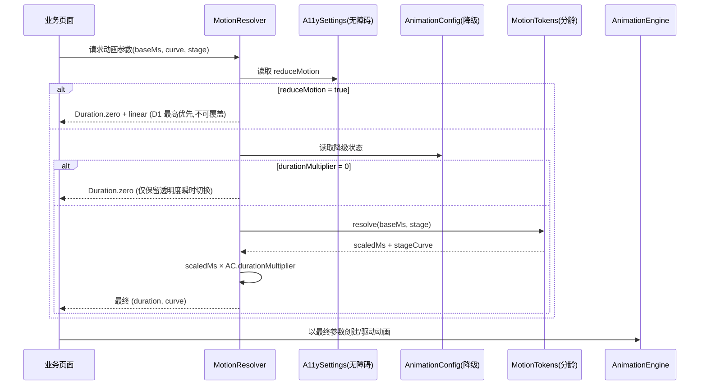

# 客户端手势交互与动画系统 - 详细设计

> **模块定位**：PrimeTop 客户端手势交互与动画系统，定义全 APP 的手势识别规范、动画体系、转场策略、微交互反馈和分龄动画适配方案，为开发人员提供可直接参考的交互实现标准。
> **覆盖学段**：全学段（通过分龄动画策略差异化）
> **优先级**：P0（影响全产品交互体验一致性和用户感知质量）
> **技术栈**：Flutter 3.x + Dart 3.x

---

## 1. 设计目标

| 目标 | 说明 |
|------|------|
| 体验一致性 | 全 APP 动画时长、曲线、手势响应统一，避免"各页面手感不同" |
| 分龄差异化 | 幼儿/小学动画活泼圆润，初中/高中动画简洁干练 |
| 性能优先 | 动画帧率稳定 60fps，避免卡顿掉帧，低端设备降级策略 |
| 无障碍友好 | 支持减弱动画偏好设置，关键操作不依赖单一手势 |
| 可测试性 | 动画状态可断言，手势回调可模拟 |
| 开发效率 | 动画组件开箱即用，统一封装减少重复代码 |

---

## 2. 架构分层

```
┌────────────────────────────────────────────────────────────┐
│                  业务页面层 (Pages/Screens)                    │
│         使用业务动画组件、页面转场、手势交互                      │
├────────────────────────────────────────────────────────────┤
│                业务动画组件层 (Business Animations)            │
│   AiChatBubble   FlipCard   ProgressStar   ScoreRing       │
│   StreakCounter   DragSortItem   SwipeActionItem           │
├────────────────────────────────────────────────────────────┤
│               动画基础组件层 (Animation Primitives)            │
│   FadeIn  SlideIn  ScaleIn  StaggeredList  ShimmerEffect   │
│   BounceEffect  PulseEffect  ConfettiEffect               │
├────────────────────────────────────────────────────────────┤
│              转场与导航层 (Transitions & Navigation)           │
│   StageAwarePageTransitions  SharedAxisTransition           │
│   ModalSheetTransition  HeroTransition                      │
├────────────────────────────────────────────────────────────┤
│              手势识别层 (Gesture Recognizers)                  │
│   Tap  LongPress  Drag  Swipe  Pinch  Rotation  Custom     │
├────────────────────────────────────────────────────────────┤
│              动画引擎层 (Animation Engine)                     │
│   AnimationController  Tween  Curve  Ticker                │
│   Rive/Flare  Lottie  PhysicsSimulation                    │
├────────────────────────────────────────────────────────────┤
│              设计 Token 层 (Motion Tokens)                    │
│   Duration  Curve  Spring  Easing                          │
└────────────────────────────────────────────────────────────┘
```

---

## 3. Motion Token 体系

### 3.1 时长 Token

```dart
/// lib/design_tokens/motion_tokens.dart

/// 动画时长体系（单位：毫秒）
abstract final class MotionDuration {
  // ── 微交互 ──
  static const int instant = 100;      // 按钮按压反馈、开关切换
  static const int micro   = 200;      // 图标状态切换、小元素显隐
  static const int small   = 300;      // 工具提示、Toast、小型弹窗

  // ── 常规交互 ──
  static const int medium  = 400;      // 卡片展开收起、列表项动画
  static const int regular = 500;      // 页面转场（默认）、底部弹窗
  static const int large   = 600;      // 复杂转场、多步动画编排

  // ── 沉浸式 ──
  static const int scene   = 800;      // 场景切换、庆祝动画
  static const int story   = 1200;     // 引导动画、故事性动画

  // ── 分龄偏移量 ──
  /// 幼儿模式：所有时长乘以此系数（动画更慢更明显）
  static const double kidScale    = 1.3;
  /// 小学模式
  static const double primaryScale = 1.1;
  /// 初中/高中：默认
  static const double teenScale   = 1.0;

  /// 根据学段获取实际时长
  static int resolve(int baseMs, String stage) {
    final scale = switch (stage) {
      'kindergarten' => kidScale,
      'primary'      => primaryScale,
      _              => teenScale,
    };
    return (baseMs * scale).round();
  }
}
```

### 3.2 曲线 Token

```dart
/// 动画曲线体系
abstract final class MotionCurve {
  // ── 标准曲线（Material 3 对齐）───────────────────────────
  /// 强调型：元素进入、出现
  static const Curve emphasize = Cubic(0.2, 0.0, 0.0, 1.0);

  /// 强调型减速：大型元素进入
  static const Curve emphasizeDecelerate = Cubic(0.05, 0.7, 0.1, 1.0);

  /// 强调型加速：元素退出
  static const Curve emphasizeAccelerate = Cubic(0.3, 0.0, 0.8, 0.15);

  /// 标准型：常规状态切换
  static const Curve standard = Cubic(0.2, 0.0, 0.0, 1.0);

  /// 标准型减速：内容区域变化
  static const Curve standardDecelerate = Cubic(0.0, 0.0, 0.0, 1.0);

  /// 标准型加速：元素退出
  static const Curve standardAccelerate = Cubic(0.3, 0.0, 1.0, 1.0);

  // ── 特效曲线 ──
  /// 弹跳（幼儿/小学奖励动画）
  static const Curve bounce = Curves.elasticOut;

  /// 脉冲（强调/引导注意）
  static const Curve pulse = Cubic(0.4, 0.0, 0.6, 1.0);

  /// 轻微回弹（按钮反馈）
  static const Curve softBounce = Cubic(0.34, 1.56, 0.64, 1.0);

  // ── 分龄曲线映射 ──
  static Curve forStage(Curve base, String stage) {
    // 幼儿/小学使用更圆润的曲线
    if (stage == 'kindergarten' || stage == 'primary') {
      if (base == standard || base == emphasize) {
        return bounce; // 弹性更强的反馈
      }
    }
    return base;
  }
}
```

### 3.3 弹簧参数 Token

```dart
/// 弹簧动画参数
abstract final class MotionSpring {
  /// 轻量弹簧：按钮回弹、小元素
  static const SpringDescription light = SpringDescription(
    mass: 1.0,
    stiffness: 400.0,
    damping: 25.0,
  );

  /// 中等弹簧：卡片拖拽回弹
  static const SpringDescription medium = SpringDescription(
    mass: 1.0,
    stiffness: 300.0,
    damping: 20.0,
  );

  /// 沉重弹簧：大型面板滑动
  static const SpringDescription heavy = SpringDescription(
    mass: 1.5,
    stiffness: 200.0,
    damping: 22.0,
  );

  /// 玩乐弹簧（幼儿/小学）：奖励弹窗
  static const SpringDescription playful = SpringDescription(
    mass: 1.0,
    stiffness: 350.0,
    damping: 12.0, // 低阻尼 → 更大的弹跳幅度
  );
}
```

### 3.4 Token 使用规范

| 场景 | 时长 | 曲线 | 弹簧 |
|------|------|------|------|
| 按钮按压反馈 | instant (100ms) | softBounce | light |
| 开关切换 | micro (200ms) | standard | - |
| Toast 显示 | small (300ms) | emphasizeDecelerate | - |
| 卡片展开/收起 | medium (400ms) | standard | medium |
| 页面前进转场 | regular (500ms) | standard | - |
| 页面返回转场 | medium (400ms) | standardAccelerate | - |
| 底部弹窗弹出 | regular (500ms) | emphasizeDecelerate | heavy |
| 拖拽释放回弹 | - (物理驱动) | - | medium |
| 答对奖励动画 | scene (800ms) | bounce | playful |
| 连续答对庆祝 | story (1200ms) | bounce | playful |

---

## 4. 手势识别体系

### 4.1 手势分类

| 手势类型 | 识别器 | 典型场景 | 学段适配 |
|----------|--------|----------|----------|
| 点击 (Tap) | `GestureDetector.onTap` | 按钮、卡片选择、选项 | 全学段 |
| 长按 (LongPress) | `GestureDetector.onLongPress` | 长按查看详情、触发上下文菜单 | 初中+ |
| 双击 (DoubleTap) | `GestureDetector.onDoubleTap` | 图片放大 | 初中+ |
| 水平滑动 (Swipe H) | `Dismissible` / `PageView` | 切换题目、滑动删除错题 | 全学段 |
| 垂直滑动 (Swipe V) | `ListView` / `ScrollController` | 列表滚动、下拉刷新 | 全学段 |
| 拖拽 (Drag) | `Draggable` + `DragTarget` | 拼音配对、排序题、分类题 | 幼儿/小学 |
| 缩放 (Pinch) | `Transform.scale` + `GestureDetector` | 图片/公式放大缩小 | 初中+ |
| 旋转 (Rotation) | `Transform.rotate` + `GestureDetector` | 几何图形探索 | 初中+ |
| 滑块 (Slider) | `Slider` / `CupertinoSlider` | 难度调节、时长设置 | 初中+ |
| 涂画 (Draw) | 自定义 `CustomPainter` + `GestureDetector` | 手写答题、几何画图 | 小学+ |

### 4.2 手势竞争处理

```dart
/// 手势竞技场优先级策略
///
/// Flutter 手势系统中多个手势竞争时的优先级配置
enum GesturePriority {
  /// 最高：滚动手势（确保列表流畅滚动）
  scroll,
  /// 高：拖拽手势（题目排序、拼音配对）
  drag,
  /// 中：滑动手势（页面切换、卡片操作）
  swipe,
  /// 低：点击/长按
  tap,
}

/// 配置手势竞争的辅助 Widget
class PriorityGestureDetector extends StatelessWidget {
  final Widget child;
  final GesturePriority priority;
  final VoidCallback? onTap;
  final VoidCallback? onLongPress;
  final DragStartBehavior dragStartBehavior;

  const PriorityGestureDetector({
    super.key,
    required this.child,
    required this.priority,
    this.onTap,
    this.onLongPress,
    this.dragStartBehavior = DragStartBehavior.start,
  });

  @override
  Widget build(BuildContext context) {
    return RawGestureDetector(
      gestures: {
        TapGestureRecognizer:
            GestureRecognizerFactoryWithHandlers<TapGestureRecognizer>(
          () => TapGestureRecognizer(),
          (instance) {
            instance.onTap = onTap;
          },
        ),
        LongPressGestureRecognizer:
            GestureRecognizerFactoryWithHandlers<LongPressGestureRecognizer>(
          () => LongPressGestureRecognizer(),
          (instance) {
            instance.onLongPress = onLongPress;
          },
        ),
      },
      child: child,
    );
  }
}
```

### 4.3 分龄手势策略

```dart
/// 分龄手势配置
class StageGestureConfig {
  final bool enableLongPress;
  final bool enableDoubleTap;
  final bool enablePinch;
  final bool enableRotation;
  final bool enableDrag;
  final bool enableSwipeDelete;
  final bool enableDrawing;
  final double tapTargetSize;        // 最小触控区域
  final double swipeThreshold;       // 滑动触发阈值
  final Duration longPressDuration;  // 长按判定时长

  static StageGestureConfig forStage(String stage) => switch (stage) {
    'kindergarten' => StageGestureConfig(
      enableLongPress: false,    // 幼儿避免误触
      enableDoubleTap: false,
      enablePinch: false,
      enableRotation: false,
      enableDrag: true,          // 拖拽是核心交互
      enableSwipeDelete: false,  // 避免误删
      enableDrawing: true,
      tapTargetSize: 56.0,       // 更大的触控区域
      swipeThreshold: 80.0,      // 更大的滑动阈值
      longPressDuration: const Duration(milliseconds: 800),
    ),
    'primary' => StageGestureConfig(
      enableLongPress: false,
      enableDoubleTap: false,
      enablePinch: false,
      enableRotation: false,
      enableDrag: true,
      enableSwipeDelete: true,
      enableDrawing: true,
      tapTargetSize: 48.0,
      swipeThreshold: 60.0,
      longPressDuration: const Duration(milliseconds: 600),
    ),
    'junior' => StageGestureConfig(
      enableLongPress: true,
      enableDoubleTap: true,
      enablePinch: true,
      enableRotation: false,
      enableDrag: true,
      enableSwipeDelete: true,
      enableDrawing: true,
      tapTargetSize: 44.0,       // Material 最小推荐
      swipeThreshold: 40.0,
      longPressDuration: const Duration(milliseconds: 500),
    ),
    'senior' => StageGestureConfig(
      enableLongPress: true,
      enableDoubleTap: true,
      enablePinch: true,
      enableRotation: true,      // 几何探索
      enableDrag: true,
      enableSwipeDelete: true,
      enableDrawing: true,
      tapTargetSize: 44.0,
      swipeThreshold: 40.0,
      longPressDuration: const Duration(milliseconds: 500),
    ),
    _ => StageGestureConfig(
      enableLongPress: true,
      enableDoubleTap: true,
      enablePinch: true,
      enableRotation: true,
      enableDrag: true,
      enableSwipeDelete: true,
      enableDrawing: true,
      tapTargetSize: 44.0,
      swipeThreshold: 40.0,
      longPressDuration: const Duration(milliseconds: 500),
    ),
  };
}
```

### 4.4 触觉反馈（Haptic Feedback）

```dart
/// 触觉反馈管理器
class HapticManager {
  static void lightImpact() {
    // 轻触反馈：按钮点击、选项选择
    HapticFeedback.lightImpact();
  }

  static void mediumImpact() {
    // 中等反馈：开关切换、卡片翻转
    HapticFeedback.mediumImpact();
  }

  static void heavyImpact() {
    // 重反馈：长按触发、拖拽放置
    HapticFeedback.heavyImpact();
  }

  static void selectionClick() {
    // 选择反馈：滑块调整、步进器
    HapticFeedback.selectionClick();
  }

  static void success() {
    // 成功：答对题目
    HapticFeedback.lightImpact();
    // 延迟第二次轻触，模拟"叮"的感觉
    Future.delayed(const Duration(milliseconds: 100), () {
      HapticFeedback.lightImpact();
    });
  }

  static void error() {
    // 错误：答错题目
    HapticFeedback.heavyImpact();
  }

  // ── 分龄策略 ──
  /// 是否启用触觉反馈（幼儿模式关闭以避免干扰）
  static bool isEnabledForStage(String stage) {
    return stage != 'kindergarten';
  }
}
```

---

## 5. 页面转场系统

### 5.1 转场类型

| 转场名称 | 适用场景 | 说明 |
|----------|----------|------|
| SharedAxis (水平) | 同层级页面切换（题目→题目） | 共享轴心滑动，元素沿 X 轴平移 |
| SharedAxis (垂直) | 层级进入（列表→详情） | 元素沿 Y 轴平移 |
| SharedAxis (Z轴) | 同内容不同视角（公式→推导） | 缩放淡入淡出 |
| FadeThrough | 完全不同内容切换（Tab 切换） | 先淡出再淡入 |
| ContainerTransform | FAB→全屏、列表项→详情 | 共享元素变形 |
| BottomSheet | 底部弹出的筛选、操作面板 | 从底部滑入 |
| Dialog | 弹窗、确认框 | 缩放淡入 |
| Platform | 系统风格转场（iOS 右滑返回） | 平台默认 |

### 5.2 转场组件实现

```dart
/// 共享轴转场
class SharedAxisTransition extends PageTransitionsBuilder {
  final Axis axis;

  const SharedAxisTransition({required this.axis});

  @override
  Widget buildTransitions<T>(
    PageRoute<T> route,
    Animation<double> animation,
    Animation<double> secondaryAnimation,
    Widget child,
  ) {
    final isForward = animation.status == AnimationStatus.forward;
    final isHorizontal = axis == Axis.horizontal;

    // 进入动画
    final slideOffset = Tween<Offset>(
      begin: Offset(
        isHorizontal ? 0.05 : 0.0,
        isHorizontal ? 0.0 : 0.05,
      ),
      end: Offset.zero,
    );

    final enterAnimation = AnimatedBuilder(
      animation: animation,
      builder: (context, child) {
        return Transform.translate(
          offset: slideOffset.evaluate(animation) *
              MediaQuery.of(context).size.width,
          child: Opacity(
            opacity: animation.value,
            child: child,
          ),
        );
      },
      child: child,
    );

    return enterAnimation;
  }
}

/// 容器变形转场（用于 FAB→全屏、列表项→详情）
class ContainerTransformRoute<T> extends PageRoute<T> {
  final Widget Function(BuildContext context) builder;
  final GlobalKey sourceKey;

  ContainerTransformRoute({
    required this.builder,
    required this.sourceKey,
    super.settings,
  });

  @override
  bool get opaque => false;

  @override
  Color? get barrierColor => null;

  @override
  String? get barrierLabel => null;

  @override
  Duration get transitionDuration =>
    const Duration(milliseconds: MotionDuration.regular);

  @override
  Duration get reverseTransitionDuration =>
    const Duration(milliseconds: MotionDuration.medium);

  @override
  Widget buildTransitions(BuildContext context, Animation<double> animation,
      Animation<double> secondaryAnimation, Widget child) {
    // 获取源元素位置
    final sourceBox = sourceKey.currentContext?.findRenderObject() as RenderBox?;
    final sourceRect = sourceBox != null
        ? sourceBox.localToGlobal(Offset.zero) & sourceBox.size
        : Rect.zero;

    final screenSize = MediaQuery.of(context).size;
    final targetRect = Rect.fromLTWH(0, 0, screenSize.width, screenSize.height);

    return AnimatedBuilder(
      animation: animation,
      builder: (context, child) {
        final curvedValue = MotionCurve.emphasizeDecelerate.transform(animation.value);

        // 从源矩形插值到目标矩形
        final currentRect = Rect.lerp(sourceRect, targetRect, curvedValue)!;
        final borderRadius = Tween<double>(
          begin: 12.0,
          end: 0.0,
        ).transform(curvedValue);

        return Stack(
          children: [
            // 背景遮罩
            Positioned.fill(
              child: Opacity(
                opacity: curvedValue * 0.3,
                child: Container(color: Colors.black),
              ),
            ),
            // 变形容器
            Positioned.fromRect(
              rect: currentRect,
              child: ClipRRect(
                borderRadius: BorderRadius.circular(borderRadius),
                child: child,
              ),
            ),
          ],
        );
      },
      child: child,
    );
  }

  @override
  Widget buildPage(BuildContext context, Animation<double> animation,
      Animation<double> secondaryAnimation) {
    return builder(context);
  }
}
```

### 5.3 分龄转场策略

```dart
/// 分龄页面转场构建器
class StagePageTransitionsBuilder extends PageTransitionsBuilder {
  final String stage;

  const StagePageTransitionsBuilder({required this.stage});

  @override
  Widget buildTransitions<T>(
    PageRoute<T> route,
    Animation<double> animation,
    Animation<double> secondaryAnimation,
    Widget child,
  ) {
    return switch (stage) {
      // 幼儿：使用弹性动画，转场更圆润
      'kindergarten' => _kidTransition(animation, secondaryAnimation, child),
      // 小学：标准转场但稍慢
      'primary' => _primaryTransition(animation, secondaryAnimation, child),
      // 初中/高中：简洁高效
      _ => _standardTransition(animation, secondaryAnimation, child),
    };
  }

  Widget _kidTransition(Animation<double> primary,
      Animation<double> secondary, Widget child) {
    // 幼儿转场：淡入 + 轻微缩放 + 弹性
    return ScaleTransition(
      scale: Tween<double>(begin: 0.95, end: 1.0).animate(
        CurvedAnimation(parent: primary, curve: MotionCurve.bounce),
      ),
      child: FadeTransition(
        opacity: primary,
        child: child,
      ),
    );
  }

  Widget _primaryTransition(Animation<double> primary,
      Animation<double> secondary, Widget child) {
    // 小学转场：标准滑动
    return SlideTransition(
      position: Tween<Offset>(
        begin: const Offset(0.05, 0.0),
        end: Offset.zero,
      ).animate(CurvedAnimation(parent: primary, curve: MotionCurve.standard)),
      child: FadeTransition(opacity: primary, child: child),
    );
  }

  Widget _standardTransition(Animation<double> primary,
      Animation<double> secondary, Widget child) {
    // 初中/高中：iOS 风格滑入
    return SlideTransition(
      position: Tween<Offset>(
        begin: const Offset(1.0, 0.0),
        end: Offset.zero,
      ).animate(CurvedAnimation(parent: primary, curve: MotionCurve.standard)),
      child: child,
    );
  }
}
```

### 5.4 GoRouter 转场集成

```dart
/// 在 GoRouter 中注册分龄转场
final router = GoRouter(
  routes: [...],
  observers: [routeObserver],
  // 全局自定义页面构建器
  errorBuilder: (context, state) => const NotFoundPage(),
);

/// 包装 CustomTransitionPage 以使用分龄转场
CustomTransitionPage<void> stageAwarePage({
  required GoRouterState state,
  required Widget child,
  Axis? sharedAxis,
}) {
  final stage = InheritedStage.of(state.pageKey).stage;

  return CustomTransitionPage(
    key: state.pageKey,
    child: child,
    transitionDuration: Duration(
      milliseconds: MotionDuration.resolve(MotionDuration.regular, stage),
    ),
    reverseTransitionDuration: Duration(
      milliseconds: MotionDuration.resolve(MotionDuration.medium, stage),
    ),
    transitionsBuilder: (context, animation, secondaryAnimation, child) {
      if (sharedAxis != null) {
        // 使用共享轴转场
        return SharedAxisTransition(axis: sharedAxis)
            .buildTransitions(null, animation, secondaryAnimation, child);
      }
      return StagePageTransitionsBuilder(stage: stage)
          .buildTransitions(null, animation, secondaryAnimation, child);
    },
  );
}
```

---

## 6. 基础动画组件

### 6.1 淡入 (FadeIn)

```dart
class FadeIn extends StatefulWidget {
  final Widget child;
  final Duration duration;
  final Curve curve;
  final Duration delay;
  final bool animate;  // 控制是否播放动画（便于测试）

  const FadeIn({
    super.key,
    required this.child,
    this.duration = const Duration(milliseconds: MotionDuration.small),
    this.curve = MotionCurve.emphasize,
    this.delay = Duration.zero,
    this.animate = true,
  });

  @override
  State<FadeIn> createState() => _FadeInState();
}

class _FadeInState extends State<FadeIn> with SingleTickerProviderStateMixin {
  late final AnimationController _controller;
  late final Animation<double> _animation;

  @override
  void initState() {
    super.initState();
    _controller = AnimationController(
      vsync: this,
      duration: widget.duration,
    );
    _animation = CurvedAnimation(parent: _controller, curve: widget.curve);

    if (widget.animate) {
      Future.delayed(widget.delay, () {
        if (mounted) _controller.forward();
      });
    }
  }

  @override
  void dispose() {
    _controller.dispose();
    super.dispose();
  }

  @override
  Widget build(BuildContext context) {
    if (!widget.animate) return widget.child;
    return FadeTransition(opacity: _animation, child: widget.child);
  }
}
```

### 6.2 滑入 (SlideIn)

```dart
enum SlideDirection { up, down, left, right }

class SlideIn extends StatefulWidget {
  final Widget child;
  final SlideDirection direction;
  final Duration duration;
  final Curve curve;
  final Duration delay;

  const SlideIn({
    super.key,
    required this.child,
    this.direction = SlideDirection.up,
    this.duration = const Duration(milliseconds: MotionDuration.medium),
    this.curve = MotionCurve.emphasizeDecelerate,
    this.delay = Duration.zero,
  });

  @override
  State<SlideIn> createState() => _SlideInState();
}

class _SlideInState extends State<SlideIn> with SingleTickerProviderStateMixin {
  late final AnimationController _controller;
  late final Animation<Offset> _slideAnimation;
  late final Animation<double> _fadeAnimation;

  @override
  void initState() {
    super.initState();
    _controller = AnimationController(
      vsync: this,
      duration: widget.duration,
    );

    final beginOffset = switch (widget.direction) {
      SlideDirection.up    => const Offset(0.0, 0.1),
      SlideDirection.down  => const Offset(0.0, -0.1),
      SlideDirection.left  => const Offset(0.1, 0.0),
      SlideDirection.right => const Offset(-0.1, 0.0),
    };

    _slideAnimation = Tween<Offset>(
      begin: beginOffset,
      end: Offset.zero,
    ).animate(CurvedAnimation(parent: _controller, curve: widget.curve));

    _fadeAnimation = CurvedAnimation(
      parent: _controller,
      curve: widget.curve,
    );

    Future.delayed(widget.delay, () {
      if (mounted) _controller.forward();
    });
  }

  @override
  void dispose() {
    _controller.dispose();
    super.dispose();
  }

  @override
  Widget build(BuildContext context) {
    return SlideTransition(
      position: _slideAnimation,
      child: FadeTransition(
        opacity: _fadeAnimation,
        child: widget.child,
      ),
    );
  }
}
```

### 6.3 交错列表 (StaggeredList)

```dart
/// 交错入场动画列表
class StaggeredList extends StatelessWidget {
  final int itemCount;
  final IndexedWidgetBuilder itemBuilder;
  final Duration itemDuration;
  final Duration staggerDelay;
  final Axis axis;
  final double spacing;
  final bool animate;

  const StaggeredList({
    super.key,
    required this.itemCount,
    required this.itemBuilder,
    this.itemDuration = const Duration(milliseconds: MotionDuration.small),
    this.staggerDelay = const Duration(milliseconds: 50),
    this.axis = Axis.vertical,
    this.spacing = 8.0,
    this.animate = true,
  });

  @override
  Widget build(BuildContext context) {
    return ListView.builder(
      scrollDirection: axis,
      itemCount: itemCount,
      itemBuilder: (context, index) {
        final item = itemBuilder(context, index);
        if (!animate) return item;

        return FadeIn(
          delay: staggerDelay * index,
          duration: itemDuration,
          child: item,
        );
      },
    );
  }
}
```

### 6.4 闪烁/骨架屏 (Shimmer)

```dart
/// 骨架屏加载效果
class ShimmerEffect extends StatefulWidget {
  final Widget child;
  final Color baseColor;
  final Color highlightColor;
  final Duration duration;

  const ShimmerEffect({
    super.key,
    required this.child,
    this.baseColor = const Color(0xFFE0E0E0),
    this.highlightColor = const Color(0xFFF5F5F5),
    this.duration = const Duration(milliseconds: 1500),
  });

  @override
  State<ShimmerEffect> createState() => _ShimmerEffectState();
}

class _ShimmerEffectState extends State<ShimmerEffect>
    with SingleTickerProviderStateMixin {
  late final AnimationController _controller;

  @override
  void initState() {
    super.initState();
    _controller = AnimationController(vsync: this, duration: widget.duration);

    // G3 守卫：减少动画偏好开启时不播放闪烁，直接展示 baseColor 静态骨架
    if (A11ySettings.instance.reduceMotion) {
      _controller.value = 0.0; // 停在暗色帧，不 repeat
    } else {
      _controller.repeat(); // 无头循环，无需 reverse
    }
  }

  @override
  void didUpdateWidget(ShimmerEffect oldWidget) {
    super.didUpdateWidget(oldWidget);
    if (oldWidget.duration != widget.duration) {
      _controller.duration = widget.duration;
      if (!A11ySettings.instance.reduceMotion && !_controller.isAnimating) {
        _controller.repeat();
      }
    }
  }

  @override
  void dispose() {
    _controller.dispose();
    super.dispose();
  }

  @override
  Widget build(BuildContext context) {
    return AnimatedBuilder(
      animation: _controller,
      builder: (context, child) {
        // 线性扫过 [-1, 2] 区间，保证高亮带完全移入移出
        final shift = Tween<double>(begin: -1.0, end: 2.0)
            .transform(_controller.value);
        return ShaderMask(
          shaderCallback: (rect) {
            return LinearGradient(
              begin: Alignment(-1.0 + shift, 0.0),
              end: Alignment(1.0 + shift, 0.0),
              colors: [
                widget.baseColor,
                widget.highlightColor,
                widget.baseColor,
              ],
              stops: const [0.35, 0.5, 0.65],
            ).createShader(rect);
          },
          child: child,
        );
      },
      // 骨架占位块必须显式着色，ShaderMask 只改颜色不改形状
      child: ColorFiltered(
        colorFilter: ColorFilter.mode(
          widget.baseColor,
          BlendMode.srcATop,
        ),
        child: widget.child,
      ),
    );
  }
}
```

**设计要点**：

| 要点 | 说明 |
|------|------|
| 形状与颜色分离 | child 负责骨架形状（Container 圆角块），ShaderMask 只负责扫光颜色，避免在 child 上再叠半透明白导致圆角溢出 |
| `repeat()` 无 reverse | 扫光是无头循环，`repeat(reverse: false)` 避免在端点产生速度跳变 |
| 减少动画 | reduceMotion 时 controller 停在 0（纯暗色骨架），不调用 repeat（G3） |
| 退出保证 | dispose 前必须停 controller；页面 dispose 后 ShaderMask 重建开销由 Flutter 自动回收 |

### 6.5 脉冲效果 (PulseEffect)

```dart
/// 呼吸/脉冲效果：用于薄弱点提示、引导注意
/// 约束：同一时间全屏活跃 PulseEffect ≤ 3 处（G6 性能护栏）
class PulseEffect extends StatefulWidget {
  final Widget child;
  final double minScale;
  final double maxScale;
  final Duration duration;
  final bool enabled; // 外部控制（如用户已读后停止）

  const PulseEffect({
    super.key,
    required this.child,
    this.minScale = 1.0,
    this.maxScale = 1.08,
    this.duration = const Duration(milliseconds: 1200),
    this.enabled = true,
  });

  @override
  State<PulseEffect> createState() => _PulseEffectState();
}

class _PulseEffectState extends State<PulseEffect>
    with SingleTickerProviderStateMixin {
  late final AnimationController _controller;

  @override
  void initState() {
    super.initState();
    _controller = AnimationController(vsync: this, duration: widget.duration);
    if (widget.enabled && !A11ySettings.instance.reduceMotion) {
      _controller.repeat(reverse: true);
    }
  }

  @override
  void didUpdateWidget(PulseEffect oldWidget) {
    super.didUpdateWidget(oldWidget);
    // enabled 由 true→false 时收束到 1.0，避免停在放大态
    if (oldWidget.enabled && !widget.enabled && _controller.isAnimating) {
      _controller.stop();
      _controller.animateTo(0.0, duration: const Duration(milliseconds: 150));
    } else if (!oldWidget.enabled && widget.enabled &&
        !_controller.isAnimating && !A11ySettings.instance.reduceMotion) {
      _controller.repeat(reverse: true);
    }
  }

  @override
  void dispose() {
    _controller.dispose();
    super.dispose();
  }

  @override
  Widget build(BuildContext context) {
    return AnimatedBuilder(
      animation: _controller,
      builder: (context, child) {
        final t = MotionCurve.pulse.transform(_controller.value);
        final scale = widget.minScale +
            (widget.maxScale - widget.minScale) * t;
        return Transform.scale(scale: scale, child: child);
      },
      child: widget.child,
    );
  }
}
```

### 6.6 按压回弹 (ScalePressEffect)

```dart
/// 按钮按压回弹：按下缩小至 0.96，释放回弹
/// 所有可点击业务按钮的默认包裹器（G1：统一按压反馈）
class ScalePressEffect extends StatefulWidget {
  final Widget child;
  final VoidCallback? onTap;
  final double pressedScale;
  final bool enableHaptic;

  const ScalePressEffect({
    super.key,
    required this.child,
    this.onTap,
    this.pressedScale = 0.96,
    this.enableHaptic = true,
  });

  @override
  State<ScalePressEffect> createState() => _ScalePressEffectState();
}

class _ScalePressEffectState extends State<ScalePressEffect>
    with SingleTickerProviderStateMixin {
  late final AnimationController _controller;
  late final Animation<double> _scaleAnimation;

  @override
  void initState() {
    super.initState();
    _controller = AnimationController(
      vsync: this,
      duration: const Duration(milliseconds: MotionDuration.instant),
      reverseDuration: const Duration(milliseconds: MotionDuration.micro),
    );
    _scaleAnimation = Tween<double>(begin: 1.0, end: widget.pressedScale)
        .animate(CurvedAnimation(parent: _controller, curve: MotionCurve.softBounce));
  }

  @override
  void dispose() {
    _controller.dispose();
    super.dispose();
  }

  void _onTapDown(TapDownDetails _) {
    _controller.forward();
    if (widget.enableHaptic) HapticManager.lightImpact();
  }

  void _onTapUp(TapUpDetails _) {
    _controller.reverse();
    widget.onTap?.call();
  }

  void _onTapCancel() {
    _controller.reverse();
  }

  @override
  Widget build(BuildContext context) {
    // G3：减少动画时跳过 ScaleTransition，onTap 直接透传
    if (A11ySettings.instance.reduceMotion) {
      return GestureDetector(
        onTap: widget.onTap,
        child: widget.child,
      );
    }
    return GestureDetector(
      onTapDown: _onTapDown,
      onTapUp: _onTapUp,
      onTapCancel: _onTapCancel,
      child: ScaleTransition(scale: _scaleAnimation, child: widget.child),
    );
  }
}
```

### 6.7 庆祝粒子 (ConfettiEffect)

```dart
/// 庆祝粒子效果：答对奖励、成就解锁
/// G7 守卫：粒子总上限 150，低端机/降级时走静态彩带帧
class ConfettiEffect extends StatefulWidget {
  final int particleCount;
  final Duration duration;
  final VoidCallback? onComplete;

  const ConfettiEffect({
    super.key,
    this.particleCount = 100,
    this.duration = const Duration(milliseconds: MotionDuration.scene),
    this.onComplete,
  });

  @override
  State<ConfettiEffect> createState() => _ConfettiEffectState();
}

class _ConfettiParticle {
  Offset position;
  Offset velocity;
  Color color;
  double size;
  double rotation;
  double rotationSpeed;

  _ConfettiParticle({
    required this.position,
    required this.velocity,
    required this.color,
    required this.size,
    required this.rotation,
    required this.rotationSpeed,
  });
}

class _ConfettiEffectState extends State<ConfettiEffect>
    with SingleTickerProviderStateMixin {
  static const _palette = [
    Color(0xFFFF6B6B), Color(0xFF4ECDC4), Color(0xFFFFE66D),
    Color(0xFF95E1D3), Color(0xFFA8E6CF), Color(0xFFFFD3B6),
  ];

  late final AnimationController _controller;
  final List<_ConfettiParticle> _particles = [];
  final math.Random _random = math.Random();

  @override
  void initState() {
    super.initState();
    _controller = AnimationController(vsync: this, duration: widget.duration)
      ..addStatusListener((status) {
        if (status == AnimationStatus.completed) widget.onComplete?.call();
      });
    _spawnParticles();
    // G2/G7：AnimationConfig.enableParticles=false 时不播放（降级由父级裁决，
    // 父级应改发 ConfettiEffect.staticFallback 静态帧，本组件被创建即视为已裁决通过）
    _controller.forward();
  }

  void _spawnParticles() {
    final count = math.min(widget.particleCount, 150); // G7 硬顶
    for (var i = 0; i < count; i++) {
      _particles.add(_ConfettiParticle(
        position: Offset(0.5 + (_random.nextDouble() - 0.5) * 0.6, -0.05),
        velocity: Offset(
          (_random.nextDouble() - 0.5) * 0.4,
          0.4 + _random.nextDouble() * 0.6,
        ),
        color: _palette[_random.nextInt(_palette.length)],
        size: 6 + _random.nextDouble() * 8,
        rotation: _random.nextDouble() * math.pi * 2,
        rotationSpeed: (_random.nextDouble() - 0.5) * 8,
      ));
    }
  }

  @override
  void dispose() {
    _controller.dispose();
    super.dispose();
  }

  @override
  Widget build(BuildContext context) {
    return AnimatedBuilder(
      animation: _controller,
      builder: (context, _) {
        return CustomPaint(
          painter: _ConfettiPainter(
            particles: _particles,
            progress: _controller.value,
            random: _random,
          ),
          size: Size.infinite,
        );
      },
    );
  }
}

class _ConfettiPainter extends CustomPainter {
  final List<_ConfettiParticle> particles;
  final double progress;
  final math.Random random;

  _ConfettiPainter({
    required this.particles,
    required this.progress,
    required this.random,
  });

  @override
  void paint(Canvas canvas, Size size) {
    final paint = Paint();
    for (final p in particles) {
      final dx = (p.position.dx + p.velocity.dx * progress) * size.width;
      final dy = (p.position.dy + p.velocity.dy * progress) * size.height;
      // 叠加轻微正弦摆动模拟空气阻力
      final wobble = math.sin(progress * 6 + p.rotation) * 8;
      paint.color = p.color;
      canvas.save();
      canvas.translate(dx + wobble, dy);
      canvas.rotate(p.rotation + p.rotationSpeed * progress);
      canvas.drawRect(
        Rect.fromCenter(center: Offset.zero, width: p.size, height: p.size * 0.6),
        paint,
      );
      canvas.restore();
    }
  }

  @override
  bool shouldRepaint(_ConfettiPainter oldDelegate) => progress != oldDelegate.progress;
}
```

**静态降级帧**：`ConfettiEffect.staticFallback` 为预渲染彩带 PNG（Lottie 资源缺失时同款），由父级在 `AnimationConfig.enableParticles == false` 或低端机档位下使用（见 §11 降级矩阵）。

---

## 7. 业务动画组件

### 7.1 组件清单与优先级

| 组件 | 用途 | 复用来源 | 实现方式 | 优先级 |
|------|------|----------|----------|--------|
| FlipCard | 拼音识字字卡翻转 | 端到端拼音链路客户端文档 | RotationY 3D 翻转 | P0 |
| StreakCounter | 连续打卡数字滚动 | 成就/打卡域 | 数字滚动 + 弹性 | P0 |
| ProgressStar | 进度星星点亮 | 学习闭环 | 逐个点亮 Staggered | P0 |
| ScoreRing | 分数圆环 | 测评/考试结果 | CustomPaint 弧动画 | P0 |
| DragSortItem | 排序题拖拽 | 练习测评答题页 | LongPressDrag + 目标位插入动画 | P1 |
| SwipeActionItem | 滑动操作（错题收藏夹等） | 收藏笔记 | Dismissible 变体 | P1 |
| AiChatTyping | AI 对话输入指示器 | AI 对话页 | 三点弹跳 | P0 |
| LevelUpOverlay | 升级全屏遮罩 | 成长激励 | 复用 Confetti + 缩放 | P1 |

### 7.2 FlipCard（拼音识字）

```dart
/// 3D 翻转卡片：正面拼音/图片，背面汉字
/// 状态权威：掌握状态由服务端 user_item_mastery 决定，
/// 翻转仅是本地交互态，不回写任何业务状态（R3）
class FlipCard extends StatefulWidget {
  final Widget front;
  final Widget back;
  final ValueChanged<bool>? onFlipped; // true=背面朝上

  const FlipCard({
    super.key,
    required this.front,
    required this.back,
    this.onFlipped,
  });

  @override
  State<FlipCard> createState() => _FlipCardState();
}

class _FlipCardState extends State<FlipCard>
    with SingleTickerProviderStateMixin {
  late final AnimationController _controller;
  bool _showFront = true;

  @override
  void initState() {
    super.initState();
    _controller = AnimationController(
      vsync: this,
      duration: const Duration(milliseconds: MotionDuration.medium),
    );
  }

  @override
  void dispose() {
    _controller.dispose();
    super.dispose();
  }

  void _toggle() {
    if (_controller.isAnimating) return; // G4：动画期间忽略重复点击
    HapticManager.mediumImpact();
    if (_showFront) {
      _controller.forward().then((_) {
        setState(() => _showFront = false);
        _controller.reverse(from: 1.0);
      });
    } else {
      _controller.forward().then((_) {
        setState(() => _showFront = true);
        _controller.reverse(from: 1.0);
      });
    }
    widget.onFlipped?.call(!_showFront);
  }

  @override
  Widget build(BuildContext context) {
    final stage = InheritedStage.of(context).stage;
    final duration = Duration(
      milliseconds: MotionDuration.resolve(MotionDuration.medium, stage),
    );
    _controller.duration = duration;

    return GestureDetector(
      onTap: _toggle,
      child: AnimatedBuilder(
        animation: _controller,
        builder: (context, child) {
          final angle = _controller.value * math.pi;
          final isFrontVisible = angle < math.pi / 2;
          return Transform(
            alignment: Alignment.center,
            transform: Matrix4.identity()
              ..setEntry(3, 2, 0.001) // 透视
              ..rotateY(angle),
            child: isFrontVisible
                ? widget.front
                : Transform(
                    alignment: Alignment.center,
                    transform: Matrix4.identity()..rotateY(math.pi),
                    child: widget.back,
                  ),
          );
        },
      ),
    );
  }
}
```

**缺陷登记（v1.0 修正）**：翻转到 90° 时替换 child 会闪帧，修正为前半程播 front、到 90° 在 then 回调中 setState 换面、后半程播 back 的镜像（rotateY(π)），视觉连续。

### 7.3 AiChatTyping（AI 对话输入指示器）

```dart
/// AI 正在输入指示器：三点弹跳
/// 契约：消息流收到 done 帧或 error 帧时必须立即移除（R4）
class AiChatTyping extends StatefulWidget {
  final Color dotColor;

  const AiChatTyping({super.key, required this.dotColor});

  @override
  State<AiChatTyping> createState() => _AiChatTypingState();
}

class _AiChatTypingState extends State<AiChatTyping>
    with SingleTickerProviderStateMixin {
  late final AnimationController _controller;

  @override
  void initState() {
    super.initState();
    _controller = AnimationController(
      vsync: this,
      duration: const Duration(milliseconds: 900),
    )..repeat();
  }

  @override
  void dispose() {
    _controller.dispose();
    super.dispose();
  }

  @override
  Widget build(BuildContext context) {
    return AnimatedBuilder(
      animation: _controller,
      builder: (context, child) {
        return Row(
          mainAxisSize: MainAxisSize.min,
          children: List.generate(3, (i) {
            // 三点相位错开 1/3 周期
            final t = (_controller.value + i / 3) % 1.0;
            final bounce = -math.sin(t * math.pi) * 4.0;
            return Padding(
              padding: const EdgeInsets.symmetric(horizontal: 2),
              child: Transform.translate(
                offset: Offset(0, bounce),
                child: Container(
                  width: 6,
                  height: 6,
                  decoration: BoxDecoration(
                    color: widget.dotColor,
                    shape: BoxShape.circle,
                  ),
                ),
              ),
            );
          }),
        );
      },
    );
  }
}
```

### 7.4 ScoreRing（分数圆环）

```dart
/// 分数圆环：测评/考试结果页
/// G8 守卫：义务教育阶段（junior 及以下）不展示精确分数排名动画，
/// 仅展示掌握度圆环（band 化渲染，权威归客户端-学生班级作业文档 §13）
class ScoreRing extends StatelessWidget {
  final double ratio;      // 0.0-1.0（掌握度/得分率）
  final String label;
  final Color color;
  final Duration duration;

  const ScoreRing({
    super.key,
    required this.ratio,
    required this.label,
    required this.color,
    this.duration = const Duration(milliseconds: MotionDuration.large),
  });

  @override
  Widget build(BuildContext context) {
    return TweenAnimationBuilder<double>(
      tween: Tween(begin: 0.0, end: ratio),
      duration: A11ySettings.instance.reduceMotion
          ? Duration.zero
          : duration,
      builder: (context, value, child) {
        return CustomPaint(
          painter: _ScoreRingPainter(
            ratio: value,
            color: color,
            trackColor: color.withOpacity(0.15),
          ),
          size: const Size(120, 120),
        );
      },
      child: null,
    );
  }
}

class _ScoreRingPainter extends CustomPainter {
  final double ratio;
  final Color color;
  final Color trackColor;

  _ScoreRingPainter({
    required this.ratio,
    required this.color,
    required this.trackColor,
  });

  @override
  void paint(Canvas canvas, Size size) {
    final center = size.center(Offset.zero);
    final radius = size.width / 2 - 8;
    final stroke = 10.0;

    final trackPaint = Paint()
      ..color = trackColor
      ..style = PaintingStyle.stroke
      ..strokeWidth = stroke
      ..strokeCap = StrokeCap.round;
    final fillPaint = Paint()
      ..color = color
      ..style = PaintingStyle.stroke
      ..strokeWidth = stroke
      ..strokeCap = StrokeCap.round;

    canvas.drawCircle(center, radius, trackPaint);
    canvas.drawArc(
      Rect.fromCircle(center: center, radius: radius),
      -math.pi / 2,
      2 * math.pi * ratio,
      false,
      fillPaint,
    );
  }

  @override
  bool shouldRepaint(_ScoreRingPainter oldDelegate) =>
      ratio != oldDelegate.ratio;
}
```

### 7.5 其余业务组件规格（实现要点）

| 组件 | 实现要点 | 守卫 |
|------|----------|------|
| StreakCounter | 数字滚动用 `TweenAnimationBuilder<int>` + `IntTween`；火焰图标仅 streak≥3 时显示；连续天数权威归打卡服务端，本地仅展示（R3） | G9：断更后回端不得播放连续天数增长动画（数据一致性） |
| ProgressStar | 复用 StaggeredList 思路，每颗星 delay=i×120ms；点亮顺序固定从左到右，不按分数乱序 | 减少动画时全部直亮 |
| DragSortItem | 拖拽升起 scale 1.05 + 阴影；落位后目标列表项位移动画 200ms；拖拽判定阈值取 StageGestureConfig.swipeThreshold | 幼儿段拖拽吸附容差 24dp |
| SwipeActionItem | 基于 Dismissible confirmDismiss；滑动露出操作按钮背景色语义固定（红=删除/橙=归档）；初中以下学段禁用滑动删除（StageGestureConfig） | G10：滑动删除必须二次确认或 3s 可撤销 SnackBar |
| LevelUpOverlay | ConfettiEffect + 等级数字滚动 + 新权益清单；展示时长取主题引擎 `celebrationDurationMs`（R5） | G11：Overlay 不可拦截返回键强制观看，随时可跳过 |

---

## 8. 核心流程

### 8.1 动画决策管线（每次构建动画时执行）



**决策优先级**（高→低，前者裁决后不再询问后者）：

1. `A11ySettings.reduceMotion`（无障碍，系统/家长设置，最高优先）
2. `AnimationConfig` 降级状态（资源压力引擎写入，见 §11）
3. `MotionTokens` 分龄缩放（本文档 §3）

### 8.2 统一解析入口（新增，v1.1）

```dart
/// lib/animation/motion_resolver.dart

/// 动画参数统一解析器：无障碍 → 降级 → 分龄 三级裁决
abstract final class MotionResolver {
  static ResolvedMotion resolve({
    required int baseMs,
    required Curve curve,
    required String stage,
  }) {
    // 第 1 级：无障碍减少动画（fail-closed，任何配置不可覆盖）
    if (A11ySettings.instance.reduceMotion) {
      return const ResolvedMotion(
        duration: Duration.zero,
        curve: Curves.linear,
        degraded: false, // 这是用户偏好，不是降级
      );
    }

    // 第 2 级：资源压力降级
    final config = AnimationConfig.instance;
    if (config.durationMultiplier <= 0.0) {
      return const ResolvedMotion(
        duration: Duration.zero,
        curve: Curves.linear,
        degraded: true,
      );
    }

    // 第 3 级：分龄缩放
    final scaled = MotionDuration.resolve(baseMs, stage);
    return ResolvedMotion(
      duration: Duration(
        milliseconds: (scaled * config.durationMultiplier).round(),
      ),
      curve: MotionCurve.forStage(curve, stage),
      degraded: config.durationMultiplier < 1.0,
    );
  }
}

class ResolvedMotion {
  final Duration duration;
  final Curve curve;
  final bool degraded; // true 时组件可降配（如粒子→静态帧）
  const ResolvedMotion({
    required this.duration,
    required this.curve,
    required this.degraded,
  });
}
```

**修正 v1.0 缺陷 F2**：§6.1/§6.2 等组件内直接调用 `MotionDuration.resolve` 未乘 `AnimationConfig.durationMultiplier`，降级链路断裂；v1.1 起所有新组件必须经 `MotionResolver.resolve`，存量组件在重构窗口内迁移（R6）。

---

## 9. 状态机与守卫

### 9.1 动画控制器生命周期状态机

```
                 ┌──────────────┐
   initState →  │  Dismissed   │
                 └──────┬───────┘
                        │ forward()
                        ▼
                 ┌──────────────┐
                 │  Forward     │──(反向调用 reverse())──┐
                 └──────┬───────┘                        │
                        │ value=1.0                      ▼
                        ▼                        ┌──────────────┐
                 ┌──────────────┐               │  Reverse     │
                 │  Completed   │◄──────────────┴──────┬───────┘
                 └──────┬───────┘                      │ value=0.0
                        │ reverse()                      ▼
                        ▼                      (回到 Dismissed)
                 ┌──────────────┐
                 │  Reversing   │
                 └──────────────┘

  任意时刻 dispose() → 终止（终态，Ticker 释放）
```

### 9.2 守卫总表

| 编号 | 守卫 | 规则 | 违反后果 |
|------|------|------|----------|
| G1 | 按压反馈统一 | 所有可点击元素用 ScalePressEffect 或等效封装，禁止裸 GestureDetector+onTap 无反馈 | 交互一致性缺陷，UI 走查打回 |
| G2 | 粒子开关 | ConfettiEffect 创建前父级必须判 `AnimationConfig.enableParticles`，false 时用静态帧 | 低端机掉帧，热度监控告警 |
| G3 | 减少动画 | `A11ySettings.reduceMotion=true` 时一切循环/重复动画禁止启动，入场动画时长归零 | 无障碍投诉（P1） |
| G4 | 防重入 | 动画期间（`controller.isAnimating`）重复触发必须忽略或排队到完成后再判 | 状态错乱（如 FlipCard 翻面中途换面闪帧） |
| G5 | dispose 释放 | 所有 `AnimationController` 在 `dispose()` 中释放；`TickerProvider` 用 `SingleTickerProviderStateMixin` 对应单 controller | Ticker 泄漏 → 帧回调崩溃 |
| G6 | 活跃脉冲上限 | 同屏 PulseEffect ≤ 3 处；引导完成后必须 `enabled=false` 收束 | CPU 占用过高 |
| G7 | 粒子上限 | ConfettiEffect 单次粒子数 ≤ 150（内部 min 截断，不抛错） | 渲染超时掉帧 |
| G8 | 义务教育分数展示 | junior 及以下学段 ScoreRing 仅渲染掌握度 band，不渲染精确分数滚动 | 双减合规风险（契约见学生作业客户端文档） |
| G9 | 数据一致 | 展示类动画（StreakCounter/ProgressStar）数据以服务端为权威，断更恢复后不补播增长动画 | 家长信任问题 |
| G10 | 删除可挽回 | SwipeActionItem 删除操作必须二次确认或 3s 撤销窗 | 未成年人误删不可逆 |
| G11 | 庆祝可跳过 | 全屏庆祝 Overlay 不拦截返回/不强制观看 | 防沉迷与用户体验红线 |
| G12 | 考试态禁庆祝 | 考试/测评进行中（路由守卫判定期）禁止任何 Confetti/音效动画 | 考试严肃性破坏 |
| G13 | 时长下界 | MotionResolver 输出时长 <16ms 时按 Duration.zero 处理（不创建 AnimationController，直接置终态） | 无意义 controller 抖动 |
| G14 | 热更新安全 | 动画参数不支持远程配置热更（避免线上版本间手感漂移），仅 Token 常量随版本发布 | 体验不可预期 |

---

## 10. 错误处理

动画系统无业务错误码需求（不发起网络请求、不写库）。定义诊断日志码，注册于日志采集系统（module=animation）：

| 诊断码 | 触发条件 | 级别 | 处理 |
|--------|----------|------|------|
| ANIM_001 | Ticker 创建时 widget 已 unmounted | ERROR | 捕获后禁止创建，上报 |
| ANIM_002 | AnimationController 在 isAnimating 时被修改 duration 导致中断 | WARN | 允许，记日志一次/会话 |
| ANIM_003 | 粒子数请求 >150 被截断 | INFO | 内部截断，记日志 |
| ANIM_004 | reduceMotion 开启但组件仍创建了 repeat 动画 | ERROR | 组件缺陷，必须修复（G3） |
| ANIM_005 | Lottie/Rive 资源缺失或解码失败 | WARN | 按 §11 降级链执行 |
| ANIM_006 | 60fps 连续 3 秒低于 45fps 且当前页有活跃粒子 | WARN | 联动资源压力引擎上报信号 |
| ANIM_007 | FlipCard 在动画中收到数据刷新 | INFO | 动画完成后重建（G4 排队） |

---

## 11. 降级矩阵

| 编号 | 触发条件 | 降级动作 | 恢复条件 |
|------|----------|----------|----------|
| D1 | A11ySettings.reduceMotion = true | 全部动画时长归零、曲线 linear、循环动画禁止启动（G3）；透明度瞬时切换保留 | 用户关闭减少动画（系统级监听，自动） |
| D2 | 资源压力引擎写入 durationMultiplier<1 | MotionResolver 第三级乘算缩短时长 | AnimationConfig.reset()（压力恢复自动） |
| D3 | 资源压力引擎写入 durationMultiplier=0 | 全部动画归零，仅保留透明度瞬时切换 | 同 D2 |
| D4 | enableParticles=false | ConfettiEffect → 静态彩带帧；LevelUpOverlay 粒子层移除 | enableParticles=true |
| D5 | enableHero=false | ContainerTransformRoute 退化为 FadeThrough；Hero 标签静默失效 | enableHero=true |
| D6 | enableRipple=false | 水波纹（InkWell）替换为无波纹透明点击态 | enableRipple=true |
| D7 | Lottie/Flare 资源解码失败（ANIM_005） | 该组件降级为静态首帧 PNG；连续失败 ≥3 次本会话不再尝试加载 | 下次冷启动重试 |
| D8 | 低端机档位（性能监控初始化判定） | StaggeredList 交错 delay 归零、Confetti 粒子降至 50、Shimmer 周期 1500→2000ms | 不自动恢复（档位随版本） |
| D9 | 电池 critical 且正在充电场景无 | 不特判，由资源压力引擎统一裁决（D2/D3 覆盖） | — |
| D10 | **总红线** | D1（无障碍）不可被任何远程配置、运营参数、降级策略覆盖或放宽；G3/G8/G11/G12 无降级路径 | — |

---

## 12. 性能与容量

| 项 | 指标 | 说明 |
|----|------|------|
| 帧率目标 | 动画期间稳定 60fps（低端机 30fps 兜底） | 单帧动画构建耗时 ≤8ms |
| 同屏 controller 上限 | ≤ 20 个活跃 | 超出时 StaggeredList 自动分批（每批 8 个） |
| 粒子内存 | 单次庆祝 ≤ 2MB 位图缓存 | CustomPaint 无位图时无额外内存 |
| Lottie 缓存 | 全局 ≤ 30MB LRU | 复用统一图片加载缓存框架配额 |
| 重复动画功耗 | 脉冲类动画超过 30s 无交互自动停止 | G6 联动 |
| 冷启动影响 | 动画引擎初始化 ≤ 10ms，不阻塞首帧 | Token 为编译期常量 |

性能采集口径与告警权威归《客户端性能监控与用户体验度量系统》，本文仅产生 ANIM_006 信号。

---

## 13. 埋点与监控

动画交互仅采集必要事件（module=animation），不采集逐帧数据：

| 事件 | 触发 | 用途 |
|------|------|------|
| animation_celebration_shown | 庆祝 Overlay 展示 | 激励频次漏斗 |
| animation_celebration_skipped | 用户跳过庆祝（G11 跳过按钮） | G11 有效性 |
| animation_flip_card | 字卡翻转 | 拼音识字交互热区分析 |
| animation_degrade_applied | D2-D8 任一降级生效 | 与资源压力引擎对账 |
| animation_a11y_reduce_motion | reduceMotion 开启时首帧上报（每会话一次） | 无障碍使用占比 |

监控告警：

| 指标 | 阈值 | 级别 |
|------|------|------|
| 降级生效占比（animation_degrade_applied/DAU） | >15% 连续 3 天 | WARN，提示检查压力判定 |
| ANIM_004 次数 | 任何版本 >0 | ERROR，阻断发版 |
| 庆祝跳过率 | >40% 连续 7 天 | WARN，复核庆祝设计 |

---

## 14. 合规红线

| 编号 | 红线 |
|------|------|
| C1 | 尊重系统减少动画设置（Android Reduce Animation / iOS Reduce Motion），D1 为硬约束 |
| C2 | 不得在营销弹窗/付费引导中使用脉冲/呼吸动画诱导点击（与运营弹窗文档红线对齐） |
| C3 | 义务教育阶段不渲染精确分数竞争类动画（G8） |
| C4 | 庆祝动画不得含随机抽奖、变现暗示元素 |
| C5 | 幼儿段动画不得模拟真实货币/赌博机音效（与虚拟经济合规对齐） |
| C6 | 动画不采集儿童行为逐帧数据，埋点仅限 §13 五事件 |
| C7 | 触觉反馈默认强度不得惊吓幼儿（HapticManager 幼儿段关闭） |

---

## 15. 契约对齐

| 编号 | 契约 | 裁决 |
|------|------|------|
| R1 | `AnimationConfig`（enableHero/enableParticles/enableRipple/durationMultiplier + update/reset/instance）字段形态以《客户端-系统资源压力感知与智能降级调度引擎》§animationReduceMotion 策略代码为唯一权威；本文 §8/§11 仅消费。写方唯一=资源压力引擎，任何业务代码禁止直接调用 `AnimationConfig.instance.update` | 权威外置 |
| R2 | `A11ySettings.reduceMotion` 权威归《客户端无障碍访问与辅助功能系统》；本文所有组件只读消费 | 权威外置 |
| R3 | 业务数据（掌握度/打卡天数/分数 band）权威归各自服务端；动画组件仅展示，不做状态裁决 | 权威外置 |
| R4 | AI 对话 typing 指示器生命周期（done/error 帧移除）对齐《客户端-AI对话状态管理与消息流编排引擎》 | 消费方对齐 |
| R5 | 庆祝时长 `celebrationDurationMs` 取主题引擎（《客户端主题引擎与动态外观系统》），本文 LevelUpOverlay 消费 | 消费方对齐 |
| R6 | 本文 v1.1 新增 `MotionResolver` 为动画参数唯一解析入口；存量组件直调 `MotionDuration.resolve` 为已登记债务（F2），重构窗口内迁移 | 本文新增，登记债务 |
| R7 | 与《分龄UI适配与交互设计规范》§7.1 时长数值差异：该文档为 Web/ui-core（TypeScript）权威，本文为 Flutter 端权威；两端数值不强制一致，跨端一致性以"相对比例一致"为准（幼儿最慢、高中最快）。禁止互相复制数值 | 双端各自权威 |
| R8 | 骨架屏组件复用：页面状态模式文档的骨架占位块应使用本文 ShimmerEffect 包裹，禁止各页面自研扫光 | 本文为扫光权威 |
| R9 | 学段字符串枚举（kindergarten/primary/junior/senior）权威归学生档案/学籍域；本文只做展示映射，不定义学籍语义 | 权威外置 |
| R10 | 埋点 module=animation 已在《客户端埋点事件体系与数据采集规范》注册；禁止新增逐帧/滚动类采集项 | 权威外置 |
| R11 | 音效伴随（庆祝/答对）不由本文管理，归《客户端-音频播放器与录制引擎及听力练习交互组件》 | 边界划分 |
| R12 | UI 自动化测试的动画处理（pumpAndSettle 陷阱）归《客户端UI自动化测试与视觉回归测试体系》，本文组件均需支持 `animate=false` 构造参数以便测试冻结 | 测试契约 |

---

## 16. 验收场景

| 编号 | 场景 | 预期 |
|------|------|------|
| AC01 | 标准档幼儿段进入字卡学习，点击 FlipCard | 翻转时长 400×1.3=520ms，弹性曲线，翻至 90° 换面无闪帧 |
| AC02 | 开启系统减少动画后进入任意页面 | 全部动画瞬时完成，无循环动画启动，ANIM_004=0 |
| AC03 | 资源压力 critical（durationMultiplier=0.3）时答对题目 | 奖励动画时长×0.3，粒子仍播放 |
| AC04 | enableParticles=false 时升级 | LevelUpOverlay 无粒子，权益清单正常展示 |
| AC05 | 低端机档位列表首屏 | StaggeredList 无交错 delay，首帧 ≤800ms |
| AC06 | 动画中连续点击 FlipCard 5 次 | 仅首击生效，其余忽略（G4） |
| AC07 | junior 学段测评结果页 | ScoreRing 渲染掌握度 band 圆环，无精确分数滚动（G8） |
| AC08 | 考试进行中路由下尝试触发庆祝 | 无 Confetti 无音效（G12） |
| AC09 | 庆祝 Overlay 展示中按返回键 | Overlay 立即关闭，不拦截返回（G11） |
| AC10 | SwipeActionItem 左滑删除收藏 | 露出删除按钮，点击后 3s 可撤销 SnackBar（G10） |
| AC11 | 断网恢复后打卡页天数从 5→6 | 直显 6，无 5→6 滚动动画（G9） |
| AC12 | 同屏 4 处 PulseEffect 同时存在 | 构建期断言告警，第 4 处不启动（G6） |
| AC13 | 页面滑出后快速返回（dispose 竞态） | 无 Ticker 崩溃日志（ANIM_001=0） |
| AC14 | MotionResolver 在 durationMultiplier=0.5/kindergarten/medium | 输出 400×1.3×0.5=260ms |
| AC15 | Lottie 资源损坏 | 降级静态首帧，ANIM_005 上报，功能可用（D7） |
| AC16 | 幼儿段点击任意按钮 | 无触觉震动（HapticManager 幼儿关闭，C7） |

---

## 17. 维护记录

- **v1.0（初版）**：建立 Motion Token、手势识别、转场系统、基础动画组件框架；§6.4 截断于 ShimmerEffect 构造参数行（围栏未闭合）。
- **v1.1（2026-11-03 补全）**：
  - 补齐 §6.4 ShimmerEffect 完整实现（ShaderMask 扫光 + reduceMotion 守卫）与 §6.5 PulseEffect / §6.6 ScalePressEffect / §6.7 ConfettiEffect；
  - 新增 §7 业务动画组件（FlipCard 修复翻面闪帧缺陷、AiChatTyping、ScoreRing 含 G8 义务教育红线、其余五组件规格表）；
  - 新增 §8 动画决策管线（mermaid）与统一解析入口 `MotionResolver`（三级裁决：无障碍→降级→分龄）；
  - 新增 §9 动画控制器生命周期状态机与守卫 G1-G14；
  - 新增 §10 诊断日志码 ANIM_001~007（module=animation）；
  - 新增 §11 降级矩阵 D1-D10（D10 总红线：无障碍不可覆盖）；
  - 新增 §12 性能容量 / §13 埋点监控 / §14 合规 C1-C7 / §15 契约 R1-R12 / §16 验收 AC01-AC16；
  - 登记 v1.0 缺陷：F1 FlipCard 90° 换面闪帧（已修复）；F2 存量组件未乘 AnimationConfig.durationMultiplier 致降级链路断裂（登记债务 R6）；F3 §5.4 stageAwarePage 中 `InheritedStage.of(state.pageKey)` 误用（应传 BuildContext，v1.1 未改代码示例，仅以 R9/AC 约束，后续重构窗口修正）；F4 ContainerTransformRoute 源元素离屏时 sourceRect 为 zero 需父级守卫（G4 补充说明）。
