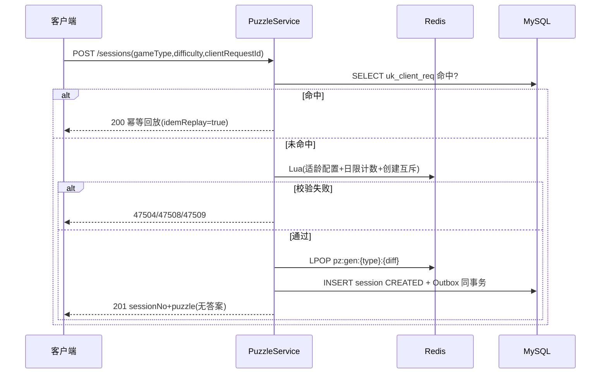
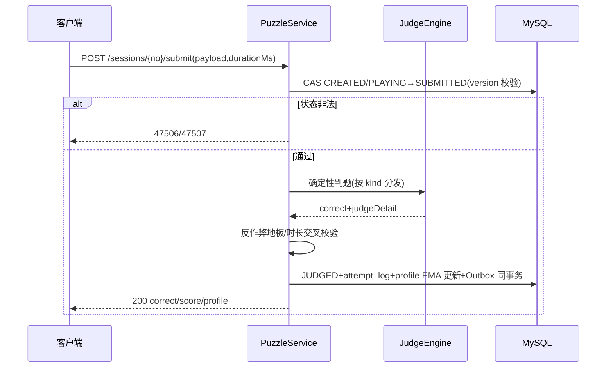
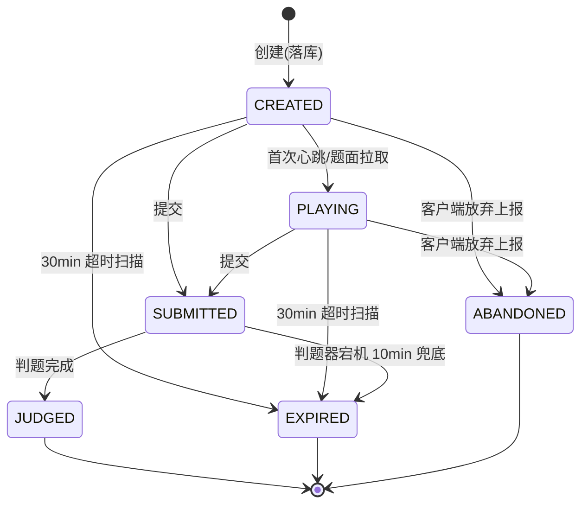

# 思维训练与益智游戏系统 — 详细设计

> 版本:v1.0 | 2026-11-17 | 状态:新增初版
> 边界声明:本文档为 PrimeTop 思维训练/益智游戏场景的服务端权威设计(题目生成、判题、会话、成绩、画像);客户端渲染层在本文仅约定契约,独立客户端文档列为后续批次。

## 目录

- [1. 概述](#1-概述)
- [2. 游戏类型与分龄设计](#2-游戏类型与分龄设计)
- [3. 数据结构设计](#3-数据结构设计)
- [4. 判题引擎(确定性规则判题)](#4-判题引擎确定性规则判题)
- [5. 题目生成引擎](#5-题目生成引擎)
- [6. API 接口设计](#6-api-接口设计)
- [7. 核心流程](#7-核心流程)
- [8. 状态机与守卫](#8-状态机与守卫)
- [9. 幂等性与并发控制](#9-幂等性与并发控制)
- [10. 领域事件](#10-领域事件)
- [11. 错误码(47500-47599)](#11-错误码47500-47599)
- [12. 降级矩阵](#12-降级矩阵)
- [13. 监控与容量](#13-监控与容量)
- [14. 合规红线](#14-合规红线)
- [15. 契约对齐](#15-契约对齐)
- [16. 验收场景](#16-验收场景)
- [17. 关联文档](#17-关联文档)

## 1. 概述

### 1.1 定位与背景

PrimeTop 已有 600+ 细化文档覆盖学科学习全链路,但"思维训练/益智游戏"场景零覆盖:数独、24 点、舒尔特方格、数字华容道、火柴棒算式等经典益智训练在游戏中小学教育类 App 中普遍作为"学习间隙的正向娱乐"存在,与游戏化关卡引擎(知识点驱动闯关)互补而非重叠。本系统将其作为独立场景建设,定位:

1. **专注力与逻辑思维训练**:舒尔特方格(注意力)、数独(逻辑推理)、24 点(心算与表达式构造)、数字华容道(规划能力)、火柴棒算式(发散思维)。
2. **学习间隙的正向娱乐**:替代学生流向外部休闲游戏的时长,全程受防沉迷与家长管控约束。
3. **轻量能力画像**:产出 per-game-type 能力倾向信号,作为学情画像的补充通道(非知识点掌握度)。

### 1.2 权威边界(与现有系统分工)

| 能力 | 权威归属 | 本系统行为 |
| --- | --- | --- |
| 益智题判题 | **本系统** | 封闭场景确定性规则判题,**LLM 禁止参与判题**(对齐口算拍照批改建模红线) |
| 益智题生成 | **本系统** | 内置生成器纯算法生成;人工扩展题库走内容审核管线 |
| 积分/勋章/成就 | 用户学习激励中心(统一规则引擎) | 只发事件,不直接写用户资产(R1) |
| 防沉迷/时长管控 | 防沉迷与未成年人保护机制 | 只读校验,超额 fail-closed,不自行裁决(R2) |
| 有效学习时长 | 学习时长统计与有效性判定引擎 | 只发 `puzzle.session.ended` 事件,category=PUZZLE,**不计入有效学习时长**(R3) |
| 排行榜 | 学习挑战赛与排行榜竞技系统 | 只发成绩事件,榜单权威外置(R4) |
| 游戏化关卡/闯关地图 | 教育游戏化学习关卡编排引擎 | 不复用其关卡地图(KP 驱动);两者仅成就侧对接(R5) |
| 适龄闸 | 教育内容适龄性评估与分级引擎 | 游戏开放年级配置静态达标,运行时按学生档案年级 fail-closed 校验 |

### 1.3 名词约定

- **游戏类型(GameType)**:SUDOKU / POINT24 / SCHULTE / SLIDING / MATCHSTICK。
- **难度等级(Difficulty)**:每游戏类型 1-5 级,L1 最低。
- **题目(PuzzleItem)**:一份可判题的题目实例,含题目面与标准答案,服务端留存,**答案永不下发客户端**。
- **会话(PuzzleSession)**:一局游戏的生命周期载体,创建时绑定题目。
- **PAR 时间**:该题型的参考完成时长,用于时间加分。

## 2. 游戏类型与分龄设计

### 2.1 游戏类型注册表

| GameType | 名称 | 判题输入 | 核心训练点 | 开放学段 |
| --- | --- | --- | --- | --- |
| SUDOKU | 数独 | 终盘九宫格(或四/六宫格) | 逻辑推理 | 小学二年级及以上 |
| POINT24 | 24 点 | 四则运算表达式 | 心算、表达式构造 | 小学三年级及以上 |
| SCHULTE | 舒尔特方格 | 点击序列+客户端计时 | 注意力、视觉搜索 | 全学段(幼儿 3x3 起) |
| SLIDING | 数字华容道 | 移动序列重放 / 终态校验 | 规划能力 | 小学四年级及以上 |
| MATCHSTICK | 火柴棒算式 | 移动后算式 | 发散思维 | 小学二年级及以上 |

### 2.2 分龄参数矩阵(服务端权威,家长仅可收紧)

| 学段 | 可用类型 | 单局时长软顶 | 每日局数上限 | 每日时长上限 | 难度开放区间 |
| --- | --- | --- | --- | --- | --- |
| 幼儿(3-6) | SCHULTE(3x3) | 3 min | 3 | 10 min | L1 |
| 小学低(1-2) | SCHULTE(3x3/4x4)、SUDOKU(4x4) | 5 min | 5 | 15 min | L1-L2 |
| 小学高(3-6) | 全部(SUDOKU 6x6/9x9 简易、POINT24 1-10) | 8 min | 8 | 20 min | L1-L4 |
| 初中 | 全部 | 10 min | 10 | 25 min | L1-L5 |
| 高中 | 全部 | 10 min | 10 | 25 min | L1-L5 |

> 上表为默认配置,存 `puzzle_game_config` 表,支持管理端按学段覆写;覆写只能收紧不能放宽(守卫 G7),家长端设置进一步收紧时以更严者胜。

### 2.3 难度定义(生成器参数)

| 类型 | L1 | L2 | L3 | L4 | L5 |
| --- | --- | --- | --- | --- | --- |
| SUDOKU(9x9) | 给定数 40+,单宫排除可解 | 给定数 34-39,行列排除 | 给定数 30-33,需区块排除 | 给定数 27-29,需数对/唯余 | 给定数 ≤26,需 X-Wing 等 |
| POINT24 | 数字 1-6,解 ≥5 种 | 1-9,解 ≥3 种 | 1-10,解 ≥2 种 | 1-13,解唯一倾向 | 含分数中间解 |
| SCHULTE | 3x3 | 3x3 乱序增强 | 4x4 | 4x4 增强 | 5x5 |
| SLIDING | 3x3(8 数码) | 3x3 步数 ≥18 | 4x4 步数 ≤30 | 4x4 步数 ≤50 | 4x4 步数 >50 |
| MATCHSTICK | 移动 1 根 | 移动 1 根(两步思维) | 移动 2 根 | 移动 2 根(多解) | 移除/添加混合 |

## 3. 数据结构设计

### 3.1 游戏配置表 `puzzle_game_config`

```sql
CREATE TABLE puzzle_game_config (
  id              BIGINT UNSIGNED NOT NULL AUTO_INCREMENT,
  game_type       VARCHAR(20)  NOT NULL COMMENT 'SUDOKU/POINT24/SCHULTE/SLIDING/MATCHSTICK',
  grade_stage     VARCHAR(20)  NOT NULL COMMENT 'preschool/primary_low/primary_high/junior/senior',
  difficulty      TINYINT      NOT NULL COMMENT '1-5',
  enabled         TINYINT      NOT NULL DEFAULT 1,
  daily_limit_cnt INT          NOT NULL COMMENT '每日局数上限',
  daily_limit_min INT          NOT NULL COMMENT '每日时长上限(分钟)',
  single_minutes  INT          NOT NULL COMMENT '单局时长软顶',
  config_json     JSON         NOT NULL COMMENT '题型参数:棋盘规格/数字域/PAR时间等',
  updated_by      BIGINT UNSIGNED NOT NULL,
  updated_at      DATETIME     NOT NULL DEFAULT CURRENT_TIMESTAMP ON UPDATE CURRENT_TIMESTAMP,
  version         INT          NOT NULL DEFAULT 1 COMMENT '乐观锁',
  PRIMARY KEY (id),
  UNIQUE KEY uk_pgc (game_type, grade_stage, difficulty)
) ENGINE=InnoDB COMMENT='益智游戏分龄配置';
```

### 3.2 题目表 `puzzle_item`

```sql
CREATE TABLE puzzle_item (
  id            BIGINT UNSIGNED NOT NULL AUTO_INCREMENT,
  game_type     VARCHAR(20)  NOT NULL,
  difficulty    TINYINT      NOT NULL,
  grade_stage   VARCHAR(20)  NOT NULL COMMENT '最低开放学段',
  puzzle_hash   CHAR(64)     NOT NULL COMMENT '题目面内容 SHA-256,去重幂等',
  puzzle_json   JSON         NOT NULL COMMENT '题目面(不含答案)',
  answer_json   JSON         NOT NULL COMMENT '标准答案/解集,永不下发',
  source        VARCHAR(10)  NOT NULL DEFAULT 'GENERATED' COMMENT 'GENERATED生成/BANK人工题库',
  par_seconds   INT          NOT NULL COMMENT 'PAR 完成秒数',
  solvable_meta JSON         NULL COMMENT '生成元数据:解个数/技巧分层等',
  status        VARCHAR(10)  NOT NULL DEFAULT 'ACTIVE' COMMENT 'ACTIVE/RETIRED',
  created_at    DATETIME     NOT NULL DEFAULT CURRENT_TIMESTAMP,
  retired_at    DATETIME     NULL,
  PRIMARY KEY (id),
  UNIQUE KEY uk_item_hash (game_type, puzzle_hash),
  KEY idx_item_pick (game_type, difficulty, status, grade_stage)
) ENGINE=InnoDB COMMENT='益智题库';
```

> 生成题落库目的:同题复现(会话恢复/打印复盘)、判题答案服务端留存、生成质量抽检回放。答案字段读取仅限判题引擎与内部审计角色。

### 3.3 会话表 `puzzle_session`

```sql
CREATE TABLE puzzle_session (
  id               BIGINT UNSIGNED NOT NULL AUTO_INCREMENT,
  session_no       VARCHAR(32)  NOT NULL COMMENT '对外编号',
  user_id          BIGINT UNSIGNED NOT NULL,
  child_id         BIGINT UNSIGNED NULL COMMENT '家庭账户下的孩子档案ID',
  game_type        VARCHAR(20)  NOT NULL,
  difficulty       TINYINT      NOT NULL,
  item_id          BIGINT UNSIGNED NOT NULL,
  status           VARCHAR(12)  NOT NULL DEFAULT 'CREATED'
                   COMMENT 'CREATED/PLAYING/SUBMITTED/JUDGED/EXPIRED/ABANDONED',
  client_request_id VARCHAR(64) NOT NULL COMMENT '客户端幂等键',
  puzzle_snapshot  JSON         NOT NULL COMMENT '创建时题目快照,防止题目中途下线影响在途会话',
  started_at       DATETIME     NOT NULL,
  expire_at        DATETIME     NOT NULL COMMENT '创建+30min',
  submitted_at     DATETIME     NULL,
  duration_ms      INT          NULL COMMENT '服务端判定耗时(提交-创建,剔除暂停申请)',
  score            INT          NULL,
  judge_result     JSON         NULL COMMENT '判题明细:正误/错因/步数等',
  anti_cheat_flag  TINYINT      NOT NULL DEFAULT 0 COMMENT '成绩异常标记',
  idem_replay      TINYINT      NOT NULL DEFAULT 0 COMMENT '1=幂等回放响应',
  version          INT          NOT NULL DEFAULT 1,
  created_at       DATETIME     NOT NULL DEFAULT CURRENT_TIMESTAMP,
  updated_at       DATETIME     NOT NULL DEFAULT CURRENT_TIMESTAMP ON UPDATE CURRENT_TIMESTAMP,
  PRIMARY KEY (id),
  UNIQUE KEY uk_session_no (session_no),
  UNIQUE KEY uk_client_req (user_id, client_request_id),
  KEY idx_user_active (user_id, status),
  KEY idx_expire (expire_at)
) ENGINE=InnoDB COMMENT='益智游戏会话';
```

### 3.4 成绩流水表 `puzzle_attempt_log`

```sql
CREATE TABLE puzzle_attempt_log (
  id           BIGINT UNSIGNED NOT NULL AUTO_INCREMENT,
  session_id   BIGINT UNSIGNED NOT NULL,
  user_id      BIGINT UNSIGNED NOT NULL,
  game_type    VARCHAR(20)  NOT NULL,
  difficulty   TINYINT      NOT NULL,
  score        INT          NOT NULL,
  duration_ms  INT          NOT NULL,
  detail_json  JSON         NULL COMMENT '步数/错误次数/点击序列摘要',
  is_record    TINYINT      NOT NULL DEFAULT 1 COMMENT '0=反作弊剔除,不进画像不进榜',
  created_at   DATETIME     NOT NULL DEFAULT CURRENT_TIMESTAMP,
  PRIMARY KEY (id),
  UNIQUE KEY uk_attempt_session (session_id),
  KEY idx_user_game (user_id, game_type, created_at)
) ENGINE=InnoDB COMMENT='成绩流水(月分区,保留13个月,在线90天)';
```

### 3.5 能力画像表 `puzzle_profile`

```sql
CREATE TABLE puzzle_profile (
  id             BIGINT UNSIGNED NOT NULL AUTO_INCREMENT,
  user_id        BIGINT UNSIGNED NOT NULL,
  game_type      VARCHAR(20)  NOT NULL,
  rating         DECIMAL(6,2) NOT NULL DEFAULT 0 COMMENT '0-100 EMA 综合分',
  best_score     INT          NOT NULL DEFAULT 0,
  best_duration_ms INT        NULL,
  play_cnt       INT          NOT NULL DEFAULT 0,
  streak_days    INT          NOT NULL DEFAULT 0,
  last_play_at   DATETIME     NULL,
  recommended_difficulty TINYINT NOT NULL DEFAULT 1,
  version        INT          NOT NULL DEFAULT 1,
  updated_at     DATETIME     NOT NULL DEFAULT CURRENT_TIMESTAMP ON UPDATE CURRENT_TIMESTAMP,
  PRIMARY KEY (id),
  UNIQUE KEY uk_profile (user_id, game_type)
) ENGINE=InnoDB COMMENT='益智能力画像(本系统单写者 R6)';
```

### 3.6 Redis 键族

| Key | 类型 | TTL | 说明 |
| --- | --- | --- | --- |
| `pz:cfg:{gameType}:{stage}` | Hash | 10min | 配置缓存,DB 权威,只 DEL 不 SET |
| `pz:daily:{userId}:{yyyyMMdd}` | Hash | 48h | 局数/时长计数,Lua 原子 incr |
| `pz:create:{userId}` | SETNX | 5s | 同用户并发创建会话互斥 |
| `pz:submit:{sessionId}` | SETNX | 60s | 提交判题防重锁 |
| `pz:gen:{gameType}:{difficulty}` | List | 永久 | 生成器预产题缓存池(每型每难度 ≥50 题) |
| `pz:item:hot:{itemId}` | String | 24h | 题目面热点缓存(不含答案) |

### 3.7 领域事件表 `puzzle_outbox`

```sql
CREATE TABLE puzzle_outbox (
  id            BIGINT UNSIGNED NOT NULL AUTO_INCREMENT,
  event_id      VARCHAR(64) NOT NULL,
  event_type    VARCHAR(40) NOT NULL,
  aggregate_id  VARCHAR(40) NOT NULL COMMENT 'session_no',
  payload_json  JSON        NOT NULL,
  published     TINYINT     NOT NULL DEFAULT 0,
  created_at    DATETIME    NOT NULL DEFAULT CURRENT_TIMESTAMP,
  published_at  DATETIME    NULL,
  PRIMARY KEY (id),
  UNIQUE KEY uk_event (event_id)
) ENGINE=InnoDB COMMENT='Outbox 同事务写入';
```

## 4. 判题引擎(确定性规则判题)

### 4.1 总则

1. 所有判题为**纯算法确定性判题**,同输入必同输出;LLM 禁入判题链路(G2 红线)。
2. 判题输入均为客户端提交的终态(终盘/表达式/移动序列),服务端完整重放校验,不信任客户端判分结果。
3. 数值比较一律使用有理数/整数运算,禁止浮点直接等值比较(对齐平台 BigDecimal 红线)。

### 4.2 数独判题

终盘校验三条:每行/每列/每宫均为 1..N 不重复排列,且终盘与题目面给定数不冲突。与标准答案比对判分采用"约束满足即满分"(数独解唯一,满足约束即等价于答案):

```java
public class SudokuJudge {
    /** 终盘校验:N=4/6/9。合法返回 true。 */
    public boolean judge(int[][] grid, int[][] givens) {
        int n = grid.length, box = (int) Math.sqrt(n);
        for (int r = 0; r < n; r++)
            for (int c = 0; c < n; c++) {
                if (grid[r][c] < 1 || grid[r][c] > n) return false;
                if (givens[r][c] != 0 && grid[r][c] != givens[r][c]) return false;
            }
        for (int i = 0; i < n; i++) {
            if (!distinct(grid[i])) return false;                       // 行
            if (!distinct(col(grid, i))) return false;                  // 列
        }
        for (int br = 0; br < n; br += box)
            for (int bc = 0; bc < n; bc += box)
                if (!distinct(box(grid, br, bc, box))) return false;    // 宫
        return true;
    }
}
```

### 4.3 24 点判题(表达式解析 + 有理数求值)

客户端提交形如 `(3+5-2)*4` 的表达式。服务端校验:四则运算+括号+恰好使用题目四个数字各一次(点数 multiset 相等)、运算中间结果合法、结果等于 24(有理数精确比较):

```java
public class Point24Judge {
    /** digits: 题目四数;expr: 用户表达式。返回 null=不合法,否则返回判题明细。 */
    public JudgeDetail judge(int[] digits, String expr) {
        List<String> tokens = tokenize(expr);                 // 数字/运算符/括号
        long[] used = tokens.stream().filter(t -> t.matches("\\d+"))
                .mapToLong(Long::parseLong).sorted().toArray();
        long[] origin = Arrays.stream(digits).sorted().mapToLong(i -> i).toArray();
        if (!Arrays.equals(used, origin))                     // 必须恰好使用题目四数
            return JudgeDetail.fail("NUMBERS_MISMATCH");
        Rational result = new Evaluator(tokens).eval();       // 递归下降+有理数运算
        if (result == null) return JudgeDetail.fail("EXPR_ILLEGAL");
        boolean win = result.equals(Rational.of(24));
        return JudgeDetail.of(win, "result=" + result);
    }
}
```

> 有理数实现:`Rational(long num, long den)`,加减乘除通分,`equals` 约分后交叉相乘比较;除零与负数开方等非法运算返回 null(表达式非法)。表达式长度限 100 字符,token 数限 30,防注入解析炸弹。

### 4.4 舒尔特方格判题

判题输入为点击值序列。服务端校验:序列为严格递增的 1..N² 排列即成功;成绩以**客户端上报耗时 + 服务端时钟交叉校验**为准:服务端记录会话创建与提交时间戳,客户端耗时偏差 >服务端耗时 +2s 时取服务端口径(G4)。反作弊地板:N² 个格子理论最小视觉搜索时间 `floor_ms = N*N*120`(3x3=1080ms,4x4=1920ms,5x5=3000ms),客户端耗时低于地板即判定成绩无效(47520,200 语义,不处罚只剔除)。

### 4.5 数字华容道判题

判题输入为移动序列(方向数组)或终态。服务端从题目面状态重放移动序列:每步校验方向合法性(空格相邻),重放后终态等于目标排列即成功;同时校验移动序列长度 ≤ 会话允许上限(防暴力枚举)与逆序数奇偶性终态自检:

```java
public boolean replay(int[] start, int[] moves, int[] goal, int maxMoves) {
    if (moves.length > maxMoves) return false;
    int[] state = start.clone();
    for (int m : moves) { if (!applyMove(state, m)) return false; }
    return Arrays.equals(state, goal);
}
```

### 4.6 火柴棒算式判题

题目面为原始算式串(如 `5+3=9` 的不成立式)与任务(移动 1 根使成立)。判题:按火柴棒数字段语义(0-9 各数字的段集合)校验提交算式的**合法性**(每个数字段数合法、运算符可构造)+ **等式成立**(有理数比较)。多解题以"等式成立即满分"判定。

### 4.7 统一计分公式

```
timeFactor = clamp(1 - (durationMs - parMs) / (2 * parMs), 0, 1.2)   // 快于 PAR 最高 1.2
base       = difficulty_base[难度]                                    // 100/150/250/400/600
errPenalty = wrong_submit_cnt * 30 + hint_cnt * 20                    // 提示与错交扣分
score      = max(10, round(base * (0.6 + 0.4 * timeFactor) * streakBonus) - errPenalty)
streakBonus = 1 + min(连续达标局数, 5) * 0.05
```

各题型 `difficulty_base` 与 PAR 存 `puzzle_game_config.config_json`;舒尔特按 N 直接映射难度(L1=100 … L5=600)。

## 5. 题目生成引擎

### 5.1 总则

1. 生成器离线预产题填充 `pz:gen` 缓存池与 `puzzle_item` 表,创建会话时**取池不现生成**(P99 延迟保障)。
2. 所有生成题必须过"可解性+难度标定"双闸;生成失败不入池。
3. 生成成本:单题 ≤20ms(数独含唯一解校验 ≤200ms,异步批产)。

### 5.2 数独生成(模板变换 + 挖洞唯一解)

```java
public class SudokuGenerator {
    /** 生成 N 阶唯一解数独。difficulty 决定挖洞数量下限。 */
    public GeneratedPuzzle generate(int n, int difficulty) {
        int[][] base = patternBase(n);                    // 基础模板:行移位循环
        shuffleSymbolsAndBands(base);                     // 数字置换+行带/列带乱序
        List<int[]> cells = symmetricCells(n);            // 对称挖洞顺序
        int[][] current = deepCopy(base);
        int targetGivens = givensFor(n, difficulty);      // L1-L5 挖洞阈值
        Solver solver = new Solver(n);
        for (int[] cell : cells) {
            if (countFilled(current) <= targetGivens) break;
            int bak = current[cell[0]][cell[1]];
            current[cell[0]][cell[1]] = 0;
            if (solver.countSolutions(current, 2) != 1)   // 唯一解校验,上限2早停
                current[cell[0]][cell[1]] = bak;          // 破坏唯一性则回填
        }
        return new GeneratedPuzzle(extractGivens(current), current /*答案*/,
                                  techniqueLayer(current) /*难度标定*/);
    }
}
```

难度标定 `techniqueLayer`:以解题器求解过程中触发的最高技巧层级(单宫排除→行列排除→区块排除→数对/唯余→X-Wing)标定,与目标难度不符则丢弃重试(每题重试 ≤3 次,超限降难度桶重入)。

### 5.3 24 点生成(枚举可解性)

```java
public class Point24Generator {
    public GeneratedPuzzle generate(int lo, int hi, int minSolutions) {
        for (int t = 0; t < 200; t++) {
            int[] nums = IntStream.range(0, 4).map(i -> rnd(lo, hi)).toArray();
            List<String> sols = solveAll(nums);              // 7680 种排列组合全枚举
            if (sols.size() >= minSolutions)
                return new GeneratedPuzzle(nums, sols.subList(0, Math.min(3, sols.size())));
        }
        throw new GenExhaustedException();                   // 200 次未果,换参数域
    }
}
```

`solveAll` 对 4 数的 24 种括号结构 × 64 种运算符组合 × 数字排列(去重后 7680 分支)做有理数枚举,毫秒级完成。

### 5.4 舒尔特/华容道/火柴棒生成

- **舒尔特**:1..N² 随机排列,**禁用中心固定起点惯例**(首点随机),L4+ 加入干扰色/旋转 90°。
- **华容道**:从目标态做 K 步合法随机游走保证可解;K 按难度取 18/30/50+;记录逆序数奇偶性自检。
- **火柴棒**:人工题库(`source=BANK`)为主,生成器仅做"数字段合法性校验器";新题入库必须走内容审核管线(教育内容审核工作流)双人复核。

### 5.5 生成质量抽检

每日 04:20 抽检任务:每种型每难度随机抽 10 题重放判题器与求解器,一致性 100% 为达标;发现脏题(判题器与求解器结论冲突)立即 RETIRE 同批次题目并告警 P2。

## 6. API 接口设计

### 6.1 学生端接口

#### 6.1.1 获取游戏列表 `GET /api/v1/puzzle/games`

按学生档案年级返回可用游戏类型与难度(适龄闸):

```json
{
  "games": [
    {
      "gameType": "SUDOKU",
      "name": "数独",
      "difficulties": [
        {"level": 1, "unlocked": true, "recommended": true},
        {"level": 2, "unlocked": true, "recommended": false}
      ],
      "dailyRemainingCnt": 6,
      "dailyRemainingMin": 14
    }
  ],
  "todayStats": {"playCnt": 2, "playMinutes": 6}
}
```

#### 6.1.2 创建会话 `POST /api/v1/puzzle/sessions`

请求:

```json
{
  "gameType": "SUDOKU",
  "difficulty": 2,
  "clientRequestId": "8f3c2e1a-7b2d-4c1e-9a5f-uuid-v7"
}
```

处理链:幂等回放(uk_client_req)→ 适龄校验(47504 fail-closed)→ 防沉迷/日限 Lua 校验(47508/47509)→ SETNX 并发互斥 → 取题池(LRU,同用户 7 天内不重复)→ 落库 CREATED → Outbox `puzzle.session.created`。

响应(201):

```json
{
  "sessionNo": "PZ202611171930000001",
  "gameType": "SUDOKU",
  "difficulty": 2,
  "puzzle": {
    "grid": [[5,3,0,0],[0,7,0,0],[0,0,0,0],[0,0,0,0]],
    "note": "4x4 演示;9x9 同构"
  },
  "serverNow": "2026-11-17T19:30:00+08:00",
  "expireAt": "2026-11-17T20:00:00+08:00"
}
```

> 响应不含任何答案/提示字段;火柴棒题附 `taskDesc`(移动几根)。幂等重放返回首个响应并标 `idemReplay=true`(200)。

#### 6.1.3 提交判分 `POST /api/v1/puzzle/sessions/{sessionNo}/submit`

请求(按题型三选一载荷):

```json
{
  "clientRequestId": "submit-uuid-v7",
  "durationMs": 185000,
  "payload": {
    "kind": "GRID",
    "grid": [[5,3,1,2],[1,7,2,3],[2,1,3,4],[3,2,4,1]]
  }
}
```

响应(200):

```json
{
  "correct": true,
  "score": 214,
  "durationMs": 185000,
  "judgeDetail": {"timeFactor": 1.05, "errPenalty": 0, "streakBonus": 1.1},
  "profile": {"rating": 62.5, "recommendedDifficulty": 3},
  "rewardHint": {"points": 20, "note": "积分由激励中心核算下发"}
}
```

判题失败(表达式非法/终盘不合法)返回 `correct=false` + `judgeDetail.reason`,**不计错交扣分**(只有提交合法盘面但约束不满足才计 wrong_submit)。反作弊剔除返回 200 + `accepted=false` + `reasonCode=ANTI_CHEAT`(47520 语义)。

#### 6.1.4 我的画像 `GET /api/v1/puzzle/profile`

返回 per-game-type rating/best/ recommendedDifficulty(雷达图数据),义务教育学段不返回全服百分位(合规 C5)。

#### 6.1.5 历史成绩 `GET /api/v1/puzzle/records?gameType=SUDOKU&page=1&size=20`

分页对齐统一响应封装;仅本人可见。

### 6.2 管理端接口(运营网段,角色 `puzzle:admin`)

| 接口 | 说明 | 守卫 |
| --- | --- | --- |
| `GET /admin/puzzle/configs` | 分龄配置列表 | 只读 |
| `PUT /admin/puzzle/configs/{id}` | 调整配置 | version 乐观锁;**收紧即时生效,放宽次日生效**(G7)+ 双人审批 |
| `POST /admin/puzzle/bank-items` | 人工题库入库(火柴棒) | 走审核管线快照,双人复核 |
| `GET /admin/puzzle/sessions` | 会话排查(脱敏,无答案列) | 审计 |
| `GET /admin/puzzle/stats` | 参与率/完局率/留存看板 | 聚合 ≥5 人 |

### 6.3 内部 gRPC

```proto
service PuzzleEngine {
  rpc GetPuzzleSnapshot(GetPuzzleSnapshotReq) returns (GetPuzzleSnapshotResp); // 断线重取题面
  rpc BatchGetRatings(BatchGetRatingsReq) returns (BatchGetRatingsResp);        // ≤200,画像只读供给学情
  rpc RetireItems(RetireItemsReq) returns (RetireItemsResp);                    // 脏题批量下线
}
```

### 6.4 幂等限流总表

| 接口 | 幂等 | 限流 |
| --- | --- | --- |
| 创建会话 | clientRequestId SETNX+uk 双保险,24h | 10 次/分钟/用户 |
| 提交判分 | clientRequestId+SETNX 60s | 30 次/分钟/用户 |
| 其余读接口 | ETag/304 | 60 次/分钟/用户 |

## 7. 核心流程

### 7.1 创建会话主链路



### 7.2 提交判分链路



### 7.3 每日计数 Lua(原子)

```lua
-- KEYS[1]=pz:daily:{userId}:{date}  ARGV=limitCnt,limitMin,incrCnt,incrMin
local cnt = tonumber(redis.call('HGET', KEYS[1], 'cnt') or '0')
local min = tonumber(redis.call('HGET', KEYS[1], 'min') or '0')
if cnt + tonumber(ARGV[3]) > tonumber(ARGV[1]) then return -1 end
if min + tonumber(ARGV[4]) > tonumber(ARGV[2]) then return -2 end
redis.call('HINCRBY', KEYS[1], 'cnt', ARGV[3])
redis.call('HINCRBY', KEYS[1], 'min', ARGV[4])
redis.call('EXPIRE', KEYS[1], 172800)
return 1
```

## 8. 状态机与守卫

### 8.1 会话状态机



### 8.2 守卫规则

| 编号 | 规则 | 级别 |
| --- | --- | --- |
| G1 | 答案字段(含 hint 解集)永不出服务端;题面缓存键与答案存储分离 | fail-closed |
| G2 | LLM 禁入判题链路;判题器版本变更必须过抽检回放 | fail-closed |
| G3 | 会话创建唯一活跃约束:同用户同 gameType 仅 1 个 CREATED/PLAYING(函数唯一索引),新创建前强制 ABANDON 旧会话 | fail-closed |
| G4 | 成绩时长口径:客户端耗时与服务端时钟偏差 >2s 取服务端口径 | 自动裁决 |
| G5 | 反作弊剔除成绩仅置 `is_record=0`,不处罚不封号,只禁入画像与榜单 | 中性 |
| G6 | puzzle_profile 为本系统单写者;学情/推荐侧只读消费,禁止回写 | fail-closed |
| G7 | 分龄配置放宽须双人审批+次日生效;收紧即时;家长端更严者胜 | fail-closed |
| G8 | 防沉迷/日限校验失败一律拒绝创建(47508/47509),无免费通道 | fail-closed |
| G9 | 题目 RETIRE 不影响在途会话(snapshot 判题),只禁新发放 | 兼容 |
| G10 | 火柴棒人工题未经审核管线双人复核不得置 ACTIVE | fail-closed |
| G11 | 注销级联:用户注销 24h 内删除会话/成绩/画像(订阅 account.deleted,对齐 22 域编排) | 合规 |
| G12 | 义务教育学段一切对外展示不输出全服精确百分位(仅自我突破对比) | 合规 |

### 8.3 关键竞态裁决

| 竞态 | 裁决 |
| --- | --- |
| 并发创建同类型会话 | Redis SETNX 互斥 5s + G3 函数唯一索引兜底,后到者 47506 提示存在进行中会话 |
| 提交与超时扫描并发 | CAS expected=CREATED/PLAYING 先到者胜;超时扫描仅迁移未被提交抢占的会话 |
| 提交重复(双击/重试) | SETNX 60s + attempt_log uk_session 幂等,重放首个判题结果 |
| 配置收紧与在途会话 | 在途会话按创建时快照跑完,新限制只作用于新会话 |

## 9. 幂等性与并发控制

1. **创建幂等**:`clientRequestId`(UUID v7)经 `uk_client_req` 唯一键兜底,Redis SETNX 24h 窗口加速;重复请求返回首个响应快照(idem_replay=1),不重复扣日限。
2. **提交幂等**:`uk_attempt_session` 保证一局只计一次成绩;submit SETNX 60s 防判题重入。
3. **配置并发**:version 乐观锁,CAS 失败 47513 提示刷新。
4. **题池并发**:LPOP 原子取题,天然防同题并发发放;补池任务分布式锁(ShedLock)10min。
5. **画像并发**:profile upsert 单事务内 `rating = EMA(rating, score, α=0.3)` 基于行锁更新,禁止读-改-写跨请求。

## 10. 领域事件

### 10.1 发布(Outbox 同事务)

| 事件 | 消费方 | 用途 |
| --- | --- | --- |
| `puzzle.session.created` | 防沉迷服务 | 会话开始登记娱乐时长 |
| `puzzle.session.ended` | 学习时长引擎、防沉迷服务 | category=PUZZLE,**不计有效学习时长**(R3) |
| `puzzle.score.recorded` | 激励中心 | 积分/成就核算(只发事实,不直接发奖) |
| `puzzle.score.recorded` | 排行榜竞技系统 | 周榜素材(is_record=1 才投递) |
| `puzzle.profile.updated` | 学情分析(只读) | 能力雷达补充通道 |

### 10.2 订阅

| 上游事件 | 用途 |
| --- | --- |
| `user.account.deleted` | G11 注销级联清理 |
| `user.grade.promoted` | 学段升迁后按新学段重放开放矩阵(在途会话不受影响) |
| `parent.control.updated` | 家长收紧设置即时生效缓存失效 |

### 10.3 对账(04:25 日终)

1. 会话计数 vs 成绩流水计数恒等(JUDGED 必有 attempt,除非反作弊剔除,差异=剔除数)。
2. Outbox 发布完整性:published=0 积压 >5min 告警 P2。
3. 日限计数 Redis vs MySQL 聚合偏差 >2% 告警 P3(以 MySQL 为准重建 Redis)。

## 11. 错误码(47500-47599)

| 码 | 语义 | 说明 |
| --- | --- | --- |
| 47501 | 参数校验失败 | 通用 400 |
| 47502 | 游戏类型不存在或未开放 | 适龄/灰度 |
| 47503 | 难度不存在或未解锁 | 需先达标前置难度 |
| 47504 | 不符合适龄要求 | fail-closed,客户端引导适龄内容 |
| 47505 | 会话不存在 | 404 |
| 47506 | 会话状态非法 | 进行中/已结束 |
| 47507 | 会话已过期 | 30min 超时 |
| 47508 | 今日局数/时长已达上限 | 提示明日再来,成长型话术 |
| 47509 | 防沉迷时段禁止 | fail-closed |
| 47510 | 提交载荷非法 | payload kind 与题型不匹配 |
| 47511 | 判题器内部错误 | 重试提交,仍失败则 47507 关闭会话退额 |
| 47512 | 存在进行中会话 | 先结束再创建 |
| 47513 | 配置版本冲突/限流 | 刷新重试 |
| 47520 | 成绩未采纳(异常速度) | **200 语义码**,accepted=false,不处罚 |
| 47521 | 成绩未采纳(时长口径异常) | **200 语义码** |
| 47522 | 生成池暂空转异步出题 | **200 语义码**,meta.degraded=true,3s 后重试 |
| 47550+ | 内部码 | 不透传客户端 |

## 12. 降级矩阵

| 编号 | 场景 | 降级策略 | 红线 |
| --- | --- | --- | --- |
| D1 | Redis 宕机 | 日限改 MySQL 条件更新兜底(分钟 10 次硬顶),题池直查 DB | 计数不丢 |
| D2 | 生成池空 | 同难度向下借题(标注 degraded)或 47522 异步补产 | 不现生成阻塞创建 |
| D3 | 判题器宕机 | SUBMITTED 悬挂 10min 转 EXPIRED,日限回退(未 JUDGED 不计数) | 不静默吞成绩 |
| D4 | 配置中心不可达 | 本地缓存默认矩阵,只能收紧不能放宽 | 与 G7 一致 |
| D5 | Outbox/Relay 故障 | 本地堆积,恢复重放;>30min P1 | 事件不丢 |
| D6 | 学情/排行榜下游故障 | 成绩正常落库,事件重投;画像仍更新 | 不阻塞主链路 |
| D7 | 防沉迷服务不可达 | **fail-closed 拒绝创建**(对齐全库红线) | 不可降级放行 |
| D8 | MySQL 主库故障 | 只读模式:停止创建与提交,读接口可用缓存 | 不降级写 |
| D9 | 人工题库审核服务故障 | 停止 BANK 题入库,生成题不受影响 | 不自动通过 |
| D10 | 总红线 | G1/G2/G7/G8 与内容安全、防沉迷无降级路径 | — |

## 13. 监控与容量

### 13.1 监控指标(M1-M8)

| 指标 | 阈值/告警 |
| --- | --- |
| 创建会话 P99 | >500ms 持续 10min P2 |
| 判题 P99 | >300ms(华容道重放上限内)持续 10min P2 |
| 生成池水位 | 任一型难度 <10 题 P2(补产任务异常) |
| 日限拦截占比 | >40% 连续 3 天 P3(参数可能过严) |
| 反作弊剔除率 | >5% 连续 3 天 P3(客户端计时或地板参数疑误伤) |
| 脏题抽检 | 一致性 <100% 即 P2 |
| Outbox 积压 | >5min P2 |
| 完局率 | 分题型 <55% 连续 7 天 P3(难度曲线问题,回流生成器) |

### 13.2 容量估算(DAU 50 万)

- 渗透率按 12% 估:日活 6 万,人均 3 局 → 日会话 18 万,峰值 QPS 创建 30/提交 60。
- 存储:会话行 2KB × 18 万/日,在线 90 天 ≈ 3.2GB;成绩流水在线 90 天 ≈ 2GB,13 个月归档 ≈ 26GB(月分区)。
- 题池:5 型 × 5 难度 × 50 题 = 1250 题常驻,答案 JSON 平均 4KB ≈ 5MB,Redis 可全量热点。
- 判题 CPU:数独最重(唯一解生成离线,在线判题 <1ms),提交峰值 60 QPS 单机富余,部署 2 实例。

## 14. 合规红线

| 编号 | 红线 |
| --- | --- |
| C1 | 益智游戏属娱乐时长,全程计入防沉迷总时长;每日娱乐上限与学科学习上限分开计数 |
| C2 | **不计入有效学习时长**(R3),任何报告不得将游戏时长包装为学习时长 |
| C3 | 义务教育学段无全服个人排行榜、无精确百分位;仅自我突破与班级/好友维度(≥5 人聚合) |
| C4 | 游戏内零商业植入:无广告、无内购引导、无分享裂变任务(分享入口仅成绩海报,脱敏) |
| C5 | 反作弊只剔除不处罚;不得因游戏成绩触发任何账号处罚 |
| C6 | 未成年人游戏行为数据禁用于营销定向与推荐画像(画像仅限能力倾向通道) |
| C7 | 家长端默认可见游戏时长统计;家长可独立关闭益智游戏入口(关闭后学生端 fail-closed) |
| C8 | 注销即删(G11);数据境内存储;埋点不采题目作答过程明细,只采结果元数据 |

## 15. 契约对齐

| 编号 | 对齐项 |
| --- | --- |
| R1 | 积分/勋章一律经激励中心统一规则引擎核算,本系统只发 `puzzle.score.recorded` 事实事件,禁止直写 user_asset |
| R2 | 防沉迷校验协议与时长扣减口径以《防沉迷与未成年人保护机制》为准,本系统只读执行 |
| R3 | 时长归因以《学习时长统计与有效性判定引擎》为准;category=PUZZLE 显式标注非学习 |
| R4 | 榜单权威归《学习挑战赛与排行榜竞技系统》,本系统不自建榜;投递过滤 is_record=1 |
| R5 | 与《教育游戏化学习关卡编排引擎》边界:该引擎管知识点闯关地图,本系统管益智题场景,互不调用;成就侧均经激励中心归口 |
| R6 | puzzle_profile 单写者归本系统;学情/推荐只读消费 |
| R7 | 统一响应封装/分页/错误码规范对齐《服务端统一响应封装与分页查询规范》 |
| R8 | 注销级联对齐《学习数据导出与账户注销》22 域编排,时序 24h |
| R9 | 火柴棒人工题审核走《教育内容审核工作流与多级审核管线》,不另建审核流 |
| R10 | 客户端渲染契约(棋盘组件/计时/手势)在本文 §6 约定,独立客户端页面文档列为后续批次 |

## 16. 验收场景

| 编号 | 场景 | 预期 |
| --- | --- | --- |
| AC01 | 幼儿档案请求 SUDOKU | 47504,列表接口亦不下发该类型 |
| AC02 | 创建会话重复提交同 clientRequestId | 200 幂等回放,不重复扣日限,idemReplay=true |
| AC03 | 24 点提交 `3*8` 但题目为 [3,5,2,4] | correct=false,reason=NUMBERS_MISMATCH,不扣错交分 |
| AC04 | 24 点提交 `(5-3)*(4+8)` | 有理数求值=24,correct=true |
| AC05 | 舒尔特 3x3 上报耗时 500ms | accepted=false(47520 语义),is_record=0,不处罚 |
| AC06 | 数独终盘合法但与给定数冲突 | correct=false,计错交扣分 |
| AC07 | 华容道移动序列含非法步 | 重放失败,correct=false |
| AC08 | 同用户并发创建 2 个 SUDOKU 会话 | 第二个 47512 |
| AC09 | 提交与 30min 超时并发 | CAS 先到者胜;提交成功则成绩有效 |
| AC10 | 日限已达后创建 | 47508,成长型文案,无充值引导 |
| AC11 | 防沉迷服务宕机时创建 | 拒绝创建(D7),不报 5xx 误导重试 |
| AC12 | 下游激励中心宕机 | 成绩正常返回,事件补投,不阻塞 |
| AC13 | 配置放宽未双人审批 | 拒绝;收紧操作即时生效 |
| AC14 | 注销用户 24h 后 | 会话/成绩/画像全清,对账通过 |
| AC15 | 生成池空且 DB 无备用题 | 47522 degraded,3s 重试成功 |
| AC16 | 义务教育学生查询画像 | 无全服百分位字段 |

## 17. 关联文档

- 《服务端-教育游戏化学习关卡编排与知识点闯关挑战引擎》(R5 边界)
- 《防沉迷与未成年人保护机制》(R2 时长权威)
- 《学习时长统计与有效性判定引擎》(R3 归因权威)
- 《服务端-学习挑战赛与排行榜竞技系统》(R4 榜单权威)
- 《用户学习激励中心与行为奖励统一规则引擎》(R1 激励权威)
- 《服务端-教育内容审核工作流与多级审核管线》(R9 人工题审核)
- 《服务端-口算拍照整页批改引擎》(判题确定性/有理数红线同源约定)
- 《服务端统一响应封装与分页查询规范》《服务端统一业务异常码与错误分类体系》

---

## 维护记录

- v1.0(2026-11-17)新增初版:补齐"思维训练/益智游戏"场景(docs2 此前零覆盖——数独/24点/舒尔特方格/数字华容道/火柴棒均无独立设计;游戏化关卡引擎为知识点驱动闯关,与本场景互补不重叠)。含 5 题型分龄参数矩阵、6 表 DDL(uk 幂等+乐观锁)、确定性判题引擎五实现(LLM 禁入判题 G2)、生成器(数独挖洞唯一解/24点 7680 枚举)、REST 6 组+管理端 5 接口+gRPC 3 方法、双 mermaid 状态机、守卫 G1-G12、幂等五机制、Outbox 5 事件 3 订阅+04:25 对账三恒等式、错误码 47500-47599 共 21 项(47520-47522 为 200 语义降级码,段位经全库扫描确认空闲)、降级 D1-D10(D10 总红线)、监控 M1-M8+DAU50 万容量、合规 C1-C8(娱乐时长/不计学习时长/无全服榜/零商业植入)、契约 R1-R10、验收 AC01-AC16。客户端页面文档列为后续批次(R10)。
