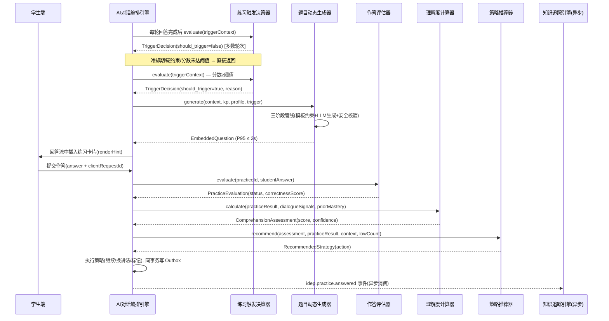

# 服务端-AI辅导对话嵌入式即时练习与实时理解度检测引擎-详细设计

## 1. 概述

### 1.1 功能定位

AI辅导对话嵌入式即时练习与实时理解度检测引擎（In-Dialogue Embedded Practice & Real-time Comprehension Detection Engine，简称 IDEPRCDE）是 PrimeTop 教育平台 AI 辅导子系统的核心增强组件。

传统的 AI 辅导对话遵循"学生提问→AI讲解→学生追问"的单向知识传递模式。本引擎在此模式上引入**对话内嵌入式即时练习**（In-Dialogue Embedded Practice，简称 IDEP）机制，使 AI 能在讲解过程中：

1. **动态生成微练习**：根据当前对话上下文，实时生成1-2道针对性检测题
2. **即时评估理解度**：学生对嵌入式练习的作答表现作为理解度的直接证据
3. **自适应调整辅导策略**：基于理解度信号决定继续深入、换种讲法、切换主题或标记掌握
4. **学习行为数据闭环**：嵌入式练习结果回写知识点掌握度系统，消除"听了≠会了"的认知幻觉

**与现有模块的区分：**
| 现有模块 | 定位 | 与本引擎的区别 |
| --- | --- | --- |
| 互动练习与即时反馈引擎 | 独立练习模块中的答题与反馈 | 本引擎练习嵌入在AI对话流中，非独立模块 |
| 练习测评会话服务 | 结构化测评会话管理 | 本引擎的"微测验"是对话内碎片化的，不走完整会话流程 |
| AI辅导对话教育成效评估 | 对话结束后的整体效果评估 | 本引擎是**对话过程中实时检测**，非事后评估 |
| AI辅导对话知识点掌握度更新 | 基于对话内容推断掌握度变化 | 本引擎提供**直接的行为证据**，提升掌握度推断可信度 |
| 题目智能推荐与个性化练习编排 | 独立练习模块的题目推荐 | 本引擎的题目由AI实时生成，不依赖题库检索 |

### 1.2 核心目标

| 目标 | 说明 | 衡量指标 |
| --- | --- | --- |
| 检测精度 | 嵌入式练习结果准确反映学生对当前知识点的理解程度 | 练习正确率与后续正式测评结果的相关系数 ≥ 0.75 |
| 无缝体验 | 练习嵌入对话自然流畅，不产生割裂感 | 学生对话中断率 ≤ 5%，练习完成率 ≥ 90% |
| 低延迟 | 动态题目生成+渲染的端到端延迟可接受 | 题目出现延迟 ≤ 2秒（P95） |
| 策略优化 | 练习触发时机和难度精准匹配学生状态 | 触发后学生"换种讲法"请求率下降 ≥ 15% |
| 数据质量 | 练习结果有效回写掌握度系统 | 掌握度更新置信度提升 ≥ 20% |

### 1.3 适用范围

- **学段**：小学三年级至高中三年级（幼儿及小学低年级因键盘输入能力限制，仅支持语音/选择类练习）
- **学科**：全学科覆盖，理科侧重计算/推导类微练习，文科侧重理解/判断类微练习
- **触发场景**：AI讲解完一个知识点/解题步骤后、学生表示"懂了"后验证、对话持续较长时间后的理解度抽检
- **集成方式**：作为 AI 辅导服务的子组件，通过事件驱动方式与对话编排引擎协作

---

## 2. 系统架构

### 2.1 架构总览

```
┌─────────────────────────────────────────────────────────────────────┐
│                        AI 辅导对话编排引擎                            │
│                                                                     │
│  ┌─────────────┐  ┌──────────────────────┐  ┌───────────────────┐  │
│  │ 对话上下文   │  │ IDEPRCDE 嵌入式练习   │  │ 回答生成与渲染    │  │
│  │ 管理器      │◄─┤ 引擎 (本模块)        )├─┤ 引擎             │  │
│  └──────┬──────┘  └──────────┬───────────┘  └───────────────────┘  │
│         │                    │                                       │
│         ▼                    ▼                                       │
│  ┌─────────────┐  ┌──────────────────────┐  ┌───────────────────┐  │
│  │ Prompt 编排  │  │ 理解度评估模型        │  │ 掌握度增量更新    │  │
│  │ 引擎        │  │                      │  │ 服务              │  │
│  └─────────────┘  └──────────────────────┘  └───────────────────┘  │
└─────────────────────────────────────────────────────────────────────┘
```

### 2.2 核心组件

| 组件 | 职责 | 技术选型 |
| --- | --- | --- |
| 练习触发决策器 (Trigger Decider) | 判断当前对话轮次是否需要插入微练习 | 规则引擎 + 机器学习模型 |
| 题目动态生成器 (Question Generator) | 基于上下文实时生成微练习题 | 大模型 Few-shot + 模板约束 |
| 作答评估器 (Answer Evaluator) | 评估学生对嵌入式练习的作答 | 精确匹配 + 语义相似度 + AI 判定 |
| 理解度计算器 (Comprehension Calculator) | 综合多维度信号计算实时理解度 | 贝叶斯估计模型 |
| 策略推荐器 (Strategy Recommender) | 基于理解度结果推荐后续对话策略 | 决策树 + 优先级队列 |
| 练习历史管理器 (Practice History) | 管理对话内所有嵌入式练习的记录 | Redis + MySQL 持久化 |

### 2.3 与外部系统的交互

```
                    ┌──────────────────┐
                    │  学生画像特征服务  │
                    └────────┬─────────┘
                             │ 学生认知特征
                             ▼
┌──────────┐     ┌──────────────────────┐     ┌──────────────────┐
│ AI辅导   │────►│   IDEPRCDE 引擎      │────►│ 知识追踪模型引擎  │
│ 对话编排  │     │                      │     │ (掌握度更新)     │
│ 引擎     │◄────│                      │◄────│                  │
└──────────┘     └──────────┬───────────┘     └──────────────────┘
                            │
                    ┌───────┴────────┐
                    │                │
                    ▼                ▼
            ┌──────────────┐ ┌──────────────┐
            │ 知识点体系    │ │ 学习行为事件  │
            │ 服务         │ │ 总线         │
            └──────────────┘ └──────────────┘
```

---

## 3. 数据结构定义

### 3.1 核心数据模型

#### 3.1.1 嵌入式练习记录表 `dialogue_embedded_practice`

```sql
CREATE TABLE dialogue_embedded_practice (
    id              BIGINT PRIMARY KEY AUTO_INCREMENT COMMENT '主键ID',
    practice_id     VARCHAR(36) NOT NULL COMMENT '练习唯一标识(UUID)',
    conversation_id VARCHAR(36) NOT NULL COMMENT '所属AI对话会话ID',
    turn_id         VARCHAR(36) NOT NULL COMMENT '触发时的对话轮次ID',
    student_id      BIGINT NOT NULL COMMENT '学生用户ID',
    knowledge_point_id BIGINT NOT NULL COMMENT '关联知识点ID',
    subject         VARCHAR(20) NOT NULL COMMENT '学科',
    grade_id        INT NOT NULL COMMENT '学生年级',

    -- 练习内容
    question_type   VARCHAR(20) NOT NULL COMMENT '题型: CHOICE/FILL/SHORT_ANSWER/JUDGE/CALCULATE',
    question_content JSON NOT NULL COMMENT '题目内容(结构化JSON)',
    correct_answer  JSON NOT NULL COMMENT '正确答案',
    answer_analysis TEXT COMMENT '答案解析',
    difficulty_level DECIMAL(3,2) DEFAULT 0.50 COMMENT '难度系数0-1',

    -- 触发上下文
    trigger_reason  VARCHAR(30) NOT NULL COMMENT '触发原因: POST_EXPLANATION/CLAIM_UNDERSTOOD/PERIODIC_CHECK/TOPIC_TRANSITION',
    trigger_context JSON COMMENT '触发时上下文快照',

    -- 作答信息
    student_answer  JSON NULL COMMENT '学生作答内容',
    answer_status   VARCHAR(15) NULL COMMENT '作答状态: PENDING/CORRECT/PARTIAL/INCORRECT/SKIPPED/TIMEOUT',
    answer_time_ms  INT NULL COMMENT '作答耗时(毫秒)',
    answered_at     DATETIME(3) NULL COMMENT '作答时间',

    -- 理解度评估
    comprehension_score DECIMAL(4,3) NULL COMMENT '本次练习理解度得分0-1',
    confidence_level    DECIMAL(4,3) NULL COMMENT '评估置信度0-1',

    -- 后续策略
    recommended_strategy VARCHAR(30) NULL COMMENT '推荐后续策略',
    strategy_executed    BOOLEAN DEFAULT FALSE COMMENT '策略是否被执行',

    -- 元数据
    created_at      DATETIME(3) NOT NULL DEFAULT CURRENT_TIMESTAMP(3),
    updated_at      DATETIME(3) NOT NULL DEFAULT CURRENT_TIMESTAMP(3) ON UPDATE CURRENT_TIMESTAMP(3),

    INDEX idx_conversation (conversation_id),
    INDEX idx_student_kp (student_id, knowledge_point_id),
    INDEX idx_turn (turn_id),
    INDEX idx_created (created_at)
) ENGINE=InnoDB DEFAULT CHARSET=utf8mb4 COMMENT='AI对话嵌入式即时练习记录';
```

#### 3.1.2 理解度评估历史表 `dialogue_comprehension_log`

```sql
CREATE TABLE dialogue_comprehension_log (
    id              BIGINT PRIMARY KEY AUTO_INCREMENT,
    conversation_id VARCHAR(36) NOT NULL COMMENT '对话会话ID',
    student_id      BIGINT NOT NULL,
    knowledge_point_id BIGINT NOT NULL,
    comprehension_score DECIMAL(4,3) NOT NULL COMMENT '理解度得分0-1',
    score_source    VARCHAR(20) NOT NULL COMMENT '来源: EMBEDDED_PRACTICE/DIALOGUE_SIGNAL/BEHAVIORAL_CUE/COMBINED',
    evidence_count  INT NOT NULL DEFAULT 1 COMMENT '支撑证据数量',
    confidence      DECIMAL(4,3) NOT NULL COMMENT '置信度0-1',
    evidence_detail JSON COMMENT '证据明细',
    created_at      DATETIME(3) NOT NULL DEFAULT CURRENT_TIMESTAMP(3),

    INDEX idx_conversation_kp (conversation_id, knowledge_point_id),
    INDEX idx_student_kp_time (student_id, knowledge_point_id, created_at)
) ENGINE=InnoDB DEFAULT CHARSET=utf8mb4 COMMENT='对话理解度评估历史';
```

#### 3.1.3 练习触发规则配置表 `embedded_practice_rules`

```sql
CREATE TABLE embedded_practice_rules (
    id              INT PRIMARY KEY AUTO_INCREMENT,
    rule_name       VARCHAR(100) NOT NULL COMMENT '规则名称',
    rule_code       VARCHAR(50) NOT NULL UNIQUE COMMENT '规则编码',
    rule_type       VARCHAR(30) NOT NULL COMMENT 'TRIGGER_CONDITION/QUESTION_GENERATION/STRATEGY_SELECTION',
    priority        INT NOT NULL DEFAULT 100 COMMENT '优先级(越小越高)',
    condition_expr  TEXT NOT NULL COMMENT '条件表达式(DSL)',
    action_config   JSON NOT NULL COMMENT '执行动作配置',
    enabled         BOOLEAN DEFAULT TRUE,
    effective_grade_range VARCHAR(20) COMMENT '适用年级范围, 如: 3-12',
    effective_subjects VARCHAR(200) COMMENT '适用学科, 逗号分隔',
    created_at      DATETIME(3) NOT NULL DEFAULT CURRENT_TIMESTAMP(3),
    updated_at      DATETIME(3) NOT NULL DEFAULT CURRENT_TIMESTAMP(3) ON UPDATE CURRENT_TIMESTAMP(3)
) ENGINE=InnoDB DEFAULT CHARSET=utf8mb4 COMMENT='嵌入式练习触发规则配置';
```

### 3.2 核心数据结构 (Java/TypeScript 表达)

#### 3.2.1 嵌入式练习请求

```typescript
interface EmbeddedPracticeTrigger {
    conversationId: string;          // 对话会话ID
    turnId: string;                  // 当前轮次ID
    studentId: number;               // 学生ID
    knowledgePointId: number;        // 当前讨论的知识点ID
    subject: Subject;                // 学科
    gradeId: number;                 // 年级
    triggerReason: TriggerReason;    // 触发原因
    dialogueContext: DialogueContext; // 对话上下文快照
    studentProfile: StudentCognitiveProfile; // 学生认知特征
}

enum TriggerReason {
    POST_EXPLANATION = 'POST_EXPLANATION',      // 讲解完成后
    CLAIM_UNDERSTOOD = 'CLAIM_UNDERSTOOD',       // 学生声称"懂了"
    PERIODIC_CHECK = 'PERIODIC_CHECK',           // 定期检测
    TOPIC_TRANSITION = 'TOPIC_TRANSITION',       // 话题转换前
    ERROR_CORRECTION = 'ERROR_CORRECTION',       // AI纠正错误后
    DEEP_DIVE_COMPLETE = 'DEEP_DIVE_COMPLETE'    // 深入讲解完成
}
```

#### 3.2.2 动态生成的练习

```typescript
interface EmbeddedQuestion {
    practiceId: string;              // 练习唯一ID
    questionType: EmbeddedQuestionType;
    content: EmbeddedQuestionContent;
    metadata: {
        estimatedDifficulty: number; // 预估难度 0-1
        estimatedTimeSec: number;    // 预估作答时间(秒)
        knowledgePointIds: number[]; // 考查知识点
        cognitiveLevel: CognitiveLevel; // 认知层级
        sourceType: 'AI_GENERATED' | 'BANK_RETRIEVED' | 'TEMPLATE_BASED';
    };
    renderHint: RenderHint;          // 客户端渲染提示
}

enum EmbeddedQuestionType {
    MULTIPLE_CHOICE = 'MULTIPLE_CHOICE',     // 选择题
    FILL_IN_BLANK = 'FILL_IN_BLANK',         // 填空题
    TRUE_FALSE = 'TRUE_FALSE',               // 判断题
    SHORT_ANSWER = 'SHORT_ANSWER',           // 简答题
    CALCULATE = 'CALCULATE',                 // 计算题
    SORT_ORDER = 'SORT_ORDER',               // 排序题
    SELECT_ALL = 'SELECT_ALL'                // 多选题
}

enum CognitiveLevel {
    REMEMBER = 'REMEMBER',       // 记忆
    UNDERSTAND = 'UNDERSTAND',   // 理解
    APPLY = 'APPLY',             // 应用
    ANALYZE = 'ANALYZE',         // 分析
    EVALUATE = 'EVALUATE',       // 评价
    CREATE = 'CREATE'            // 创造
}

interface EmbeddedQuestionContent {
    stem: string;                    // 题干(支持Markdown + LaTeX)
    stemImageUrl?: string;           // 题干配图URL
    options?: QuestionOption[];      // 选项(选择题)
    blanks?: BlankInfo[];            // 填空信息(填空题)
    hint?: string;                   // 提示语
    renderType: 'CARD' | 'INLINE' | 'POPOVER'; // 渲染形态
}

interface RenderHint {
    uiComponent: 'choice_card' | 'fill_blank_inline' | 'judge_toggle'
                | 'text_input' | 'formula_input' | 'sort_list';
    layout: 'INLINE' | 'CARD' | 'BOTTOM_SHEET';
    animationType: 'SLIDE_UP' | 'FADE_IN' | 'EXPAND';
    dismissible: boolean;            // 学生是否可跳过
    showSkipButton: boolean;
    skipButtonText: string;
}
```

#### 3.2.3 作答评估结果

```typescript
interface PracticeEvaluation {
    practiceId: string;
    studentAnswer: StudentAnswer;
    status: AnswerStatus;
    correctnessScore: number;        // 正确性得分 0-1
    partialCreditDetails?: PartialCreditDetail[];
    misconceptionDetected?: MisconceptionInfo;
    responseTimeMs: number;
    understandingScore: number;      // 理解度得分 0-1
    confidence: number;              // 评估置信度 0-1
    feedbackMessage: string;         // 给学生的反馈消息
    recommendedNextAction: NextAction;
}

enum AnswerStatus {
    CORRECT = 'CORRECT',
    PARTIAL = 'PARTIAL',
    INCORRECT = 'INCORRECT',
    SKIPPED = 'SKIPPED',
    TIMEOUT = 'TIMEOUT'
}

interface NextAction {
    type: NextActionType;
    reason: string;
    payload?: Record<string, unknown>;
}

enum NextActionType {
    CONTINUE_CURRENT_TOPIC = 'CONTINUE_CURRENT_TOPIC',   // 继续当前话题
    RE_EXPLAIN_DIFFERENTLY = 'RE_EXPLAIN_DIFFERENTLY',   // 换种方式重新讲解
    PROVIDE_SIMPLER_EXAMPLE = 'PROVIDE_SIMPLER_EXAMPLE', // 提供更简单示例
    MOVE_TO_NEXT_TOPIC = 'MOVE_TO_NEXT_TOPIC',           // 进入下一话题
    GENERATE_HARDER_QUESTION = 'GENERATE_HARDER_QUESTION', // 生成更难题目
    FLAG_FOR_REVIEW = 'FLAG_FOR_REVIEW',                  // 标记需复习
    SUGGEST_OFFLINE_PRACTICE = 'SUGGEST_OFFLINE_PRACTICE', // 建议课后练习
    ESCALATE_TO_TEACHER = 'ESCALATE_TO_TEACHER'           // 升级给教师
}
```

---

## 4. 核心算法设计

### 4.1 练习触发决策算法

练习触发决策器使用**多信号融合 + 规则约束**的方式判断是否在当前对话轮次插入微练习。

#### 4.1.1 触发信号权重模型

```python
class TriggerDecider:
    """
    嵌入式练习触发决策器
    基于 LRU (Linear Regression Utility) 模型计算触发分数
    """

    SIGNAL_WEIGHTS = {
        'explanation_length': 0.20,      # 讲解长度信号
        'concept_complexity': 0.15,      # 概念复杂度信号
        'student_claim_understanding': 0.25, # 学生声称理解
        'turns_since_last_practice': 0.15,   # 距上次练习轮次数
        'knowledge_point_importance': 0.10,  # 知识点重要性
        'student_overconfidence_risk': 0.10, # 学生过度自信风险
        'topic_transition_imminent': 0.05,  # 即将切换话题
    }

    TRIGGER_THRESHOLD = 0.65  # 触发阈值

    def decide(self, context: DialogueContext, profile: StudentProfile) -> TriggerDecision:
        """
        决策流程:
        1. 检查冷却期 → 冷却期内不触发
        2. 检查硬约束（最大练习次数、学生疲劳度等）
        3. 计算各信号分数
        4. 加权融合得到触发分数
        5. 与阈值比较，输出决策
        """
        # Step 1: 冷却期检查
        if self._in_cooldown(context):
            return TriggerDecision(should_trigger=False, reason='IN_COOLDOWN')

        # Step 2: 硬约束检查
        if not self._check_hard_constraints(context, profile):
            return TriggerDecision(should_trigger=False, reason='CONSTRAINT_VIOLATED')

        # Step 3: 计算信号分数
        signals = {
            'explanation_length': self._eval_explanation_length(context),
            'concept_complexity': self._eval_concept_complexity(context),
            'student_claim_understanding': self._eval_claim_understanding(context),
            'turns_since_last_practice': self._eval_turns_gap(context),
            'knowledge_point_importance': self._eval_kp_importance(context),
            'student_overconfidence_risk': self._eval_overconfidence(context, profile),
            'topic_transition_imminent': self._eval_topic_transition(context),
        }

        # Step 4: 加权融合
        trigger_score = sum(
            self.SIGNAL_WEIGHTS[k] * v for k, v in signals.items()
        )

        # Step 5: 输出决策
        should_trigger = trigger_score >= self.TRIGGER_THRESHOLD

        return TriggerDecision(
            should_trigger=should_trigger,
            score=trigger_score,
            signals=signals,
            trigger_reason=self._determine_trigger_reason(signals),
            cooldown_seconds=self._calculate_cooldown(profile)
        )

    def _eval_explanation_length(self, context: DialogueContext) -> float:
        """讲解长度信号: 讲解越长，越需要检测理解"""
        word_count = context.current_response_word_count
        if word_count < 50:
            return 0.2
        elif word_count < 150:
            return 0.5
        elif word_count < 300:
            return 0.8
        else:
            return 1.0

    def _eval_claim_understanding(self, context: DialogueContext) -> float:
        """学生声称理解信号: 学生说"懂了/明白了"时高触发"""
        if context.student_signals.get('claims_understanding'):
            return 1.0
        return 0.0

    def _eval_overconfidence(self, context: DialogueContext, profile: StudentProfile) -> float:
        """
        过度自信风险: 根据学生历史"声称理解→实际错误"比率评估
        高过度自信学生应更频繁触发练习验证
        """
        overconfidence_ratio = profile.historical_overconfidence_ratio  # 0-1
        return min(1.0, overconfidence_ratio * 1.5)

    def _eval_turns_gap(self, context: DialogueContext) -> float:
        """距上次练习轮次: 越久没检测越需要检测"""
        gap = context.turns_since_last_practice
        if gap <= 1:
            return 0.0
        elif gap <= 3:
            return 0.3
        elif gap <= 6:
            return 0.6
        elif gap <= 10:
            return 0.85
        else:
            return 1.0
```

#### 4.1.2 触发约束条件

| 约束 | 规则 | 说明 |
| --- | --- | --- |
| 单次对话最大练习数 | ≤ 5 次 | 避免对话变成考试 |
| 连续触发冷却 | ≥ 2 轮 | 两次练习间至少间隔2个对话轮次 |
| 学生疲劳度 | 疲劳指数 < 0.7 | 通过滑动窗口检测学生近5轮的疲劳信号 |
| 学段限制 | grade ≥ 3 | 小学三年级以下不触发（改用语音问答形式） |
| 情绪检测 | 情绪 ≠ FRUSTRATED | 学生明显沮丧时暂停触发 |
| 上次结果 | 上次练习 ≠ TIMEOUT/SKIPPED | 上次跳过或超时，本次降低触发概率 |

### 4.2 题目动态生成算法

#### 4.2.1 基于对话上下文的题目生成策略

```python
class EmbeddedQuestionGenerator:
    """
    嵌入式练习题目动态生成器
    采用"模板约束 + 大模型生成 + 安全校验"三阶段管线
    """

    def generate(
        self,
        context: DialogueContext,
        knowledge_point: KnowledgePoint,
        student_profile: StudentProfile,
        trigger: TriggerDecision
    ) -> EmbeddedQuestion:
        """
        生成流程:
        1. 确定题型和认知层级
        2. 选择生成策略 (AI生成/模板/题库检索)
        3. 构建生成Prompt
        4. 调用大模型生成
        5. 安全校验与质量控制
        6. 包装为客户端可渲染的结构
        """

        # Step 1: 确定题型和认知层级
        question_spec = self._determine_question_spec(
            knowledge_point, student_profile, trigger
        )

        # Step 2: 选择生成策略
        strategy = self._select_generation_strategy(question_spec, knowledge_point)

        # Step 3: 执行生成
        if strategy == 'AI_GENERATED':
            question = self._generate_via_llm(context, question_spec, student_profile)
        elif strategy == 'TEMPLATE_BASED':
            question = self._generate_via_template(context, question_spec, knowledge_point)
        elif strategy == 'BANK_RETRIEVED':
            question = self._retrieve_from_bank(knowledge_point, question_spec)
        else:
            question = self._generate_via_llm(context, question_spec, student_profile)

        # Step 4: 质量校验
        question = self._quality_check(question, knowledge_point)

        return question

    def _determine_question_spec(
        self,
        kp: KnowledgePoint,
        profile: StudentProfile,
        trigger: TriggerDecision
    ) -> QuestionSpec:
        """
        根据知识点类型和学生特征确定题型
        """
        spec = QuestionSpec()

        # 难度设定: 基于学生当前掌握度 + 最近发展区
        current_mastery = profile.get_mastery(kp.id)  # 0-1
        # 目标难度 = 当前掌握度 + 0.15 (略高于当前水平)
        spec.target_difficulty = min(0.95, current_mastery + 0.15)

        # 题型选择: 根据知识点类型
        if kp.kp_type == 'CONCEPT':
            spec.question_type = EmbeddedQuestionType.MULTIPLE_CHOICE
            spec.cognitive_level = CognitiveLevel.UNDERSTAND
        elif kp.kp_type == 'FORMULA':
            spec.question_type = EmbeddedQuestionType.CALCULATE
            spec.cognitive_level = CognitiveLevel.APPLY
        elif kp.kp_type == 'PROCESS':
            spec.question_type = EmbeddedQuestionType.SORT_ORDER
            spec.cognitive_level = CognitiveLevel.UNDERSTAND
        elif kp.kp_type == 'JUDGMENT':
            spec.question_type = EmbeddedQuestionType.TRUE_FALSE
            spec.cognitive_level = CognitiveLevel.ANALYZE
        else:
            spec.question_type = EmbeddedQuestionType.FILL_IN_BLANK
            spec.cognitive_level = CognitiveLevel.UNDERSTAND

        # 触发原因覆盖
        if trigger.trigger_reason == 'CLAIM_UNDERSTOOD':
            # 学生声称理解时，用稍高难度验证
            spec.target_difficulty = min(0.95, spec.target_difficulty + 0.1)
            spec.cognitive_level = CognitiveLevel.APPLY

        return spec

    def _generate_via_llm(
        self,
        context: DialogueContext,
        spec: QuestionSpec,
        profile: StudentProfile
    ) -> EmbeddedQuestion:
        """
        使用大模型生成练习题
        采用约束Prompt确保生成质量
        """
        prompt = self._build_generation_prompt(context, spec, profile)

        # 使用快速模型生成 (优先低延迟模型)
        response = await self.llm_client.generate(
            model=self.FAST_MODEL_ID,  # 如 GPT-4o-mini / Claude Haiku
            messages=prompt,
            temperature=0.7,
            max_tokens=500,
            response_format={'type': 'json_object'}
        )

        raw_question = json.loads(response.content)

        return self._wrap_as_embedded_question(raw_question, spec)

    def _build_generation_prompt(
        self,
        context: DialogueContext,
        spec: QuestionSpec,
        profile: StudentProfile
    ) -> list[dict]:
        """
        构建题目生成Prompt
        关键约束:
        1. 题目必须与当前讨论的知识点直接相关
        2. 题目难度匹配学生当前水平
        3. 题目简洁，适合在对话流中展示
        4. 避免需要复杂输入(公式/图形)
        5. 答案明确，无歧义
        """
        system_prompt = f"""你是一位{profile.grade_name}{profile.subject_name}教师。
你需要根据AI辅导对话的上下文，快速生成一道嵌入式检测练习。

## 题目要求
- 题型: {spec.question_type.value}
- 认知层级: {spec.cognitive_level.value}
- 目标难度: {spec.target_difficulty:.2f} (0=最易, 1=最难)
- 估计作答时间: ≤60秒
- 题干字数: ≤100字
- 选项数: 4个(A/B/C/D)
- 仅考查当前正在讨论的知识点，不跨知识点
- 避免需要输入复杂数学公式或图形的题目

## 输出格式
严格输出以下JSON格式:
```json
{{
  "stem": "题干内容(支持LaTeX: $...$)",
  "options": ["选项A", "选项B", "选项C", "选项D"],
  "correct_answer": "正确选项字母",
  "explanation": "简短解析(≤50字)",
  "difficulty_estimate": 0.0到1.0,
  "misconception_traps": ["常见错误理解1", "常见错误理解2"]
}}
```
"""

        user_prompt = f"""## 当前对话上下文
学生年级: {profile.grade_name}
学科: {profile.subject_name}
正在讲解的知识点: {context.current_knowledge_point_name}
知识点描述: {context.current_kp_description}

## AI最近讲解内容摘要
{context.recent_explanation_summary}

## 对话历史(最近3轮)
{self._format_dialogue_history(context.recent_turns)}

请根据以上上下文，生成一道检测学生理解程度的练习题。
"""

        return [
            {"role": "system", "content": system_prompt},
            {"role": "user", "content": user_prompt}
        ]
```

#### 4.2.2 题目质量控制管线

```python
class QuestionQualityPipeline:
    """
    生成的题目必须通过以下质量校验:
    """

    def validate(self, question: EmbeddedQuestion, kp: KnowledgePoint) -> ValidationResult:
        checks = [
            self._check_answer_correctness,    # 答案正确性校验
            self._check_knowledge_alignment,    # 知识点对齐校验
            self._check_difficulty_alignment,   # 难度匹配校验
            self._check_content_safety,         # 内容安全校验
            self._check_no_ambiguity,           # 无歧义性校验
            self._check_language_appropriateness,# 适龄语言校验
        ]

        for check in checks:
            result = check(question, kp)
            if not result.passed:
                return result  # 快速失败

        return ValidationResult(passed=True)

    async def _check_answer_correctness(
        self, question: EmbeddedQuestion, kp: KnowledgePoint
    ) -> ValidationResult:
        """
        使用第二个大模型独立验算答案正确性
        双模型交叉校验
        """
        verification_prompt = self._build_verification_prompt(question, kp)
        result = await self.llm_client.generate(
            model=self.VERIFICATION_MODEL_ID,
            messages=verification_prompt,
            temperature=0.0  # 确定性输出
        )

        verification = json.loads(result.content)
        if not verification['is_correct']:
            return ValidationResult(
                passed=False,
                reason='ANSWER_INCORRECT',
                detail=verification['explanation']
            )

        return ValidationResult(passed=True)
```

### 4.3 实时理解度评估算法

#### 4.3.1 贝叶斯理解度估计模型

```python
class ComprehensionCalculator:
    """
    实时理解度计算器
    使用贝叶斯更新模型，将嵌入式练习结果与对话行为信号融合
    """

    def calculate(
        self,
        practice_result: PracticeEvaluation,
        dialogue_signals: list[DialogueSignal],
        prior_mastery: float,
        student_profile: StudentProfile
    ) -> ComprehensionAssessment:
        """
        贝叶斯理解度估计

        P(understands | evidence) = P(evidence | understands) * P(understands)
                                     / P(evidence)

        简化为 Beta 分布共轭先验更新:
        - 先验: Beta(α, β)，其中 α/(α+β) = prior_mastery
        - 练习正确: α += w_practice
        - 练习错误: β += w_practice
        - 对话信号: 根据信号方向微调 α/β (正向信号加 α, 负向信号加 β)

        置信度由证据数量与证据一致性共同决定:
        - 证据越多、越一致 → 置信度越高
        - 练习结果与对话信号矛盾 → 置信度下降, 得分向先验回缩
        """

    # 先验强度: 等效样本量, 防止单次练习大幅翻转评估
    PRIOR_STRENGTH = 8.0
    # 各证据权重 (经验标定, 可通过实验平台回归调整)
    PRACTICE_WEIGHT_CORRECT = 3.0
    PRACTICE_WEIGHT_PARTIAL = 1.0
    PRACTICE_WEIGHT_INCORRECT = 2.5
    PRACTICE_WEIGHT_SKIPPED = 0.0   # 跳过不提供证据 (红线 G2)
    DIALOGUE_SIGNAL_WEIGHT_MAX = 1.5
    # 证据矛盾时向先验回缩的比例
    CONTRADICTION_SHRINK = 0.5

    def calculate(
        self,
        practice_result: PracticeEvaluation,
        dialogue_signals: list[DialogueSignal],
        prior_mastery: float,
        student_profile: StudentProfile
    ) -> ComprehensionAssessment:
        # 初始化 Beta 先验 (共轭先验 α,β ≥ 1)
        alpha = prior_mastery * self.PRIOR_STRENGTH + 1.0
        beta = (1.0 - prior_mastery) * self.PRIOR_STRENGTH + 1.0

        evidence_count = 0
        evidence_directions: list[int] = []  # +1 正向 / -1 负向 / 0 中性

        # ── 证据 1: 嵌入式练习结果 (权重最高) ──
        w_practice = self._practice_weight(practice_result.status)
        if w_practice > 0:
            evidence_count += 1
            if practice_result.status == AnswerStatus.CORRECT:
                alpha += w_practice
                evidence_directions.append(+1)
            elif practice_result.status == AnswerStatus.PARTIAL:
                alpha += self.PRACTICE_WEIGHT_PARTIAL
                beta += self.PRACTICE_WEIGHT_PARTIAL
                evidence_directions.append(0)
            elif practice_result.status == AnswerStatus.INCORRECT:
                beta += w_practice
                evidence_directions.append(-1)
            # SKIPPED / TIMEOUT: 不加证据 (G2 红线)

        # ── 证据 2: 对话行为信号 (多信号融合) ──
        signal_alpha, signal_beta, signal_count, signal_dirs = \
            self._fuse_dialogue_signals(dialogue_signals)
        alpha += signal_alpha
        beta += signal_beta
        evidence_count += signal_count
        evidence_directions.extend(signal_dirs)

        # 后验均值
        score = alpha / (alpha + beta)

        # 证据矛盾检测: 方向既有 +1 又有 -1 时向先验回缩
        if +1 in evidence_directions and -1 in evidence_directions:
            score = prior_mastery + (score - prior_mastery) * self.CONTRADICTION_SHRINK

        confidence = self._calc_confidence(
            evidence_count=evidence_count,
            directions=evidence_directions,
            practice_status=practice_result.status
        )

        return ComprehensionAssessment(
            score=round(min(1.0, max(0.0, score)), 3),
            confidence=round(confidence, 3),
            evidence_count=evidence_count,
            prior_mastery=prior_mastery,
            evidence_summary={
                'practice_status': practice_result.status.value,
                'signal_count': signal_count,
                'contradiction_detected': (+1 in evidence_directions and -1 in evidence_directions),
            }
        )

    def _practice_weight(self, status: AnswerStatus) -> float:
        return {
            AnswerStatus.CORRECT: self.PRACTICE_WEIGHT_CORRECT,
            AnswerStatus.PARTIAL: self.PRACTICE_WEIGHT_PARTIAL,
            AnswerStatus.INCORRECT: self.PRACTICE_WEIGHT_INCORRECT,
            AnswerStatus.SKIPPED: self.PRACTICE_WEIGHT_SKIPPED,
            AnswerStatus.TIMEOUT: self.PRACTICE_WEIGHT_SKIPPED,
        }[status]

    def _fuse_dialogue_signals(
        self, signals: list[DialogueSignal]
    ) -> tuple[float, float, int, list[int]]:
        """对话行为信号融合, 总权重封顶 DIALOGUE_SIGNAL_WEIGHT_MAX"""
        alpha_add, beta_add, count, dirs = 0.0, 0.0, 0, []
        total_w = 0.0
        for sig in sorted(signals, key=lambda s: -abs(s.weight)):
            if total_w >= self.DIALOGUE_SIGNAL_WEIGHT_MAX:
                break
            w = min(abs(sig.weight), self.DIALOGUE_SIGNAL_WEIGHT_MAX - total_w)
            total_w += w
            count += 1
            if sig.direction > 0:
                alpha_add += w
                dirs.append(+1)
            elif sig.direction < 0:
                beta_add += w
                dirs.append(-1)
            else:
                alpha_add += w / 2
                beta_add += w / 2
                dirs.append(0)
        return alpha_add, beta_add, count, dirs

    def _calc_confidence(
        self,
        evidence_count: int,
        directions: list[int],
        practice_status: AnswerStatus
    ) -> float:
        """
        置信度规则:
        - 基础值 0.5, 每增加一条证据 +0.1 (上限 +0.3)
        - 有练习直接证据额外 +0.15
        - 证据矛盾 -0.25
        - 跳过/超时无证据时置信度 = 0 (不产出评估, 由调用方丢弃)
        """
        if evidence_count == 0:
            return 0.0
        conf = 0.5 + min(0.3, evidence_count * 0.1)
        if practice_status in (AnswerStatus.CORRECT, AnswerStatus.PARTIAL, AnswerStatus.INCORRECT):
            conf += 0.15
        if +1 in directions and -1 in directions:
            conf -= 0.25
        return min(1.0, max(0.1, conf))
```

#### 4.3.2 对话行为信号定义与权重

| 信号编码 | 信号含义 | 判定方式 | 方向 | 权重 |
| --- | --- | --- | --- | --- |
| FOLLOW_UP_RELEVANT | 学生追问与当前知识点高相关 | 意图分类器 (委托 NLP 管线) | +1 | 0.6 |
| FOLLOW_UP_IRRELEVANT | 学生追问与当前知识点无关 | 意图分类器 | -1 | 0.5 |
| SPONTANEOUS_RESTATEMENT | 学生自发复述/举例应用 | 对话内容分析 | +1 | 0.8 |
| CONFIRMATORY_STATEMENT | 确认性表述("原来如此"/"明白了") | 词典+分类器 | +1 | 0.3 |
| HESITATION_MARKER | 犹豫表述("不太懂"/"有点懵") | 词典+分类器 | -1 | 0.8 |
| FAST_CORRECT_ANSWER | 作答耗时显著低于预估 (≤50%) | 作答日志 | +1 | 0.4 |
| SLOW_ANSWER | 作答耗时显著高于预估 (≥300%) | 作答日志 | -1 | 0.3 |
| EMOTION_FRUSTRATED | 情感感知引擎判定沮丧 | 只读订阅 (权威归情感引擎) | -1 | 0.9 |

信号提取红线:
- **G-信号只读**: 情感信号以订阅方式从情感感知引擎获取, 本引擎不自行做情感分析, 避免双写者冲突 (契约 R4)。
- **词典时效**: 犹豫/确认词典每季度由教研复核, 防止网络用语漂移导致误判。

### 4.4 辅导策略推荐器

策略推荐器将理解度评估结果映射为后续对话策略, 输出给对话编排引擎执行。

#### 4.4.1 策略决策表

| 理解度得分 | 置信度 | 练习状态 | 推荐策略 | 说明 |
| --- | --- | --- | --- | --- |
| ≥ 0.85 | ≥ 0.7 | CORRECT | MOVE_TO_NEXT_TOPIC | 理解良好, 可推进 |
| ≥ 0.85 | ≥ 0.7 | CORRECT (连续第2次) | GENERATE_HARDER_QUESTION | 挑战更高难度巩固 |
| 0.60 - 0.85 | ≥ 0.6 | 任意有效作答 | CONTINUE_CURRENT_TOPIC | 基本理解, 继续深化 |
| 0.35 - 0.60 | ≥ 0.6 | 任意有效作答 | RE_EXPLAIN_DIFFERENTLY | 部分理解, 换种讲法 |
| < 0.35 | ≥ 0.6 | INCORRECT | PROVIDE_SIMPLER_EXAMPLE + 前置知识检测 | 理解薄弱, 先补前置 |
| 任意 | ≥ 0.6 | INCORRECT (同KP连续第2次) | FLAG_FOR_REVIEW | 标记顽固薄弱点, 进入复习调度 |
| 任意 | < 0.6 | 任意 | CONTINUE_CURRENT_TOPIC | 低置信不动作, 避免误判 (红线 G2) |
| — | — | SKIPPED / TIMEOUT | 不推断, 仅记录 | 跳过/超时不是理解力证据 |

```python
class StrategyRecommender:
    """辅导策略推荐器: 基于理解度评估结果推荐后续对话策略"""

    def recommend(
        self,
        assessment: ComprehensionAssessment,
        practice_result: PracticeEvaluation,
        context: DialogueContext,
        consecutive_low_count: int   # 同知识点连续低分次数
    ) -> RecommendedStrategy:

        score, conf = assessment.score, assessment.confidence
        status = practice_result.status

        # 跳过/超时: 不作推断
        if status in (AnswerStatus.SKIPPED, AnswerStatus.TIMEOUT):
            return RecommendedStrategy(
                action=NextActionType.CONTINUE_CURRENT_TOPIC,
                reason='SKIPPED_NO_INFERENCE',
                degrade_trigger_cooldown=True   # 跳过则本次对话内降频
            )

        # 低置信: 不动作
        if conf < 0.6:
            return RecommendedStrategy(
                action=NextActionType.CONTINUE_CURRENT_TOPIC,
                reason='LOW_CONFIDENCE_NO_ACTION'
            )

        # 连续低分: 顽固薄弱点标记
        if consecutive_low_count >= 2 and status == AnswerStatus.INCORRECT:
            return RecommendedStrategy(
                action=NextActionType.FLAG_FOR_REVIEW,
                reason='PERSISTENT_LOW_PERFORMANCE',
                payload={'knowledge_point_id': context.knowledge_point_id}
            )

        if score >= 0.85:
            if context.consecutive_correct_count >= 2:
                return RecommendedStrategy(
                    action=NextActionType.GENERATE_HARDER_QUESTION,
                    reason='HIGH_COMPREHENSION_CHALLENGE'
                )
            return RecommendedStrategy(
                action=NextActionType.MOVE_TO_NEXT_TOPIC,
                reason='HIGH_COMPREHENSION'
            )
        elif score >= 0.60:
            return RecommendedStrategy(
                action=NextActionType.CONTINUE_CURRENT_TOPIC,
                reason='MODERATE_COMPREHENSION'
            )
        elif score >= 0.35:
            return RecommendedStrategy(
                action=NextActionType.RE_EXPLAIN_DIFFERENTLY,
                reason='PARTIAL_COMPREHENSION',
                payload={'explain_style': 'analogy'}   # 默认类比讲法
            )
        else:
            return RecommendedStrategy(
                action=NextActionType.PROVIDE_SIMPLER_EXAMPLE,
                reason='LOW_COMPREHENSION',
                payload={'check_prerequisites': True}   # 触发前置知识检测
            )
```

#### 4.4.2 连续低分计数与顽固薄弱点

- 计数口径: 同一 `knowledge_point_id` 在自然日内的嵌入式练习 INCORRECT 次数, Redis 计数器 `idep:lowcnt:{student_id}:{kp_id}` TTL 至当日 24:00。
- `FLAG_FOR_REVIEW` 策略执行时, 向复习调度引擎发送 `kp.review.flagged` 事件, 由复习调度引擎决定进入间隔重复队列, 本引擎不直接操作复习计划 (契约 R10)。
- 顽固薄弱点**不自动进入错题本**: 嵌入式练习为碎片化检测, 题目由 AI 临时生成, 与正式测评错题性质不同, 避免错题本污染 (契约 R6)。

---

## 5. 核心流程

### 5.1 主链路时序



### 5.2 延迟预算

| 阶段 | 预算 | 说明 |
| --- | --- | --- |
| 触发决策 | ≤ 10ms | 纯规则计算 + Redis 冷却查询 |
| 题目生成 (LLM) | ≤ 1500ms P95 | 快速模型, JSON 模式, max_tokens=500 |
| 答案交叉验算 | ≤ 400ms P95 | 与生成并行不可行(依赖生成结果), 但可与渲染并行 |
| 练习卡片渲染下发 | ≤ 100ms | 由编排引擎合入 SSE 流 |
| 作答评估 | ≤ 800ms P95 | 客观题本地匹配 ≤ 50ms, 主观题语义判定走 LLM |
| 理解度计算+策略推荐 | ≤ 25ms | 纯计算 |
| **端到端 (生成→卡片出现)** | **≤ 2000ms P95** | 预算主指标 |

超时处理: 题目生成超过 2500ms 仍未返回 → 放弃本次触发 (标记 `GENERATION_TIMEOUT`), 对话继续, 不阻塞主链路 (红线 G1)。

### 5.3 DDL 增补

#### 5.3.1 事件 Outbox 表 `idep_outbox`

```sql
CREATE TABLE idep_outbox (
    id              BIGINT PRIMARY KEY AUTO_INCREMENT,
    event_id        VARCHAR(64) NOT NULL COMMENT '事件唯一ID(UUID)',
    event_type      VARCHAR(60) NOT NULL COMMENT '事件类型',
    aggregate_id    VARCHAR(36) NOT NULL COMMENT '聚合ID(practice_id)',
    conversation_id VARCHAR(36) NOT NULL,
    student_id      BIGINT NOT NULL,
    payload         JSON NOT NULL COMMENT '事件负载',
    occurred_at     DATETIME(3) NOT NULL COMMENT '业务发生时间',
    published_at    DATETIME(3) NULL COMMENT '发布成功时间',
    retry_count     INT NOT NULL DEFAULT 0,
    next_retry_at   DATETIME(3) NULL,
    status          VARCHAR(15) NOT NULL DEFAULT 'PENDING' COMMENT 'PENDING/PUBLISHED/FAILED',

    UNIQUE KEY uk_event_id (event_id),
    INDEX idx_status_retry (status, next_retry_at),
    INDEX idx_conversation (conversation_id)
) ENGINE=InnoDB DEFAULT CHARSET=utf8mb4 COMMENT='嵌入式练习域事件Outbox';
```

#### 5.3.2 Redis 键设计

| 键模式 | 类型 | TTL | 用途 |
| --- | --- | --- | --- |
| `idep:cooldown:{conversation_id}` | String | 2 轮对话生命周期(≤30min) | 触发冷却标记 |
| `idep:genlock:{turn_id}:{reason}` | String(SETNX) | 30s | 同轮次同原因生成去重 |
| `idep:lowcnt:{student_id}:{kp_id}` | Counter | 至当日 24:00 | 连续低分计数 |
| `idep:answer:{practice_id}` | String | 10min | 作答提交幂等窗口 |
| `idep:strat:{practice_id}` | String | 1h | 策略已下发防重 |

---

## 6. 状态机与守卫

### 6.1 练习记录状态机

```
                 ┌──────────────┐
   生成成功 ───► │   PENDING    │ ◄── 练习卡片已下发, 等待作答
                 └──────┬───────┘
        ┌───────────────┼───────────────────────┐
        ▼               ▼                       ▼
  ┌───────────┐   ┌────────────┐        ┌────────────┐
  │ ANSWERED  │   │  SKIPPED   │        │  TIMEOUT   │
  │(CORRECT/  │   │ (学生跳过)  │        │ (90s未作答) │
  │ PARTIAL/  │   └─────┬──────┘        └─────┬──────┘
  │ INCORRECT)│         │                     │
  └─────┬─────┘         ▼                     ▼
        ▼        ┌────────────┐        ┌────────────┐
  ┌───────────┐  │   CLOSED   │        │   CLOSED   │
  │ EVALUATED │  │ (无评估产出) │        │ (无评估产出) │
  │(理解度已算)│  └────────────┘        └────────────┘
  └─────┬─────┘
        ▼
  ┌──────────────┐      会话归档时未作答的 PENDING 记录
  │   CLOSED     │ ───► 批量流转为 EXPIRED (对账兜底)
  │(策略已下发)   │
  └──────────────┘
```

状态流转守卫:

| 守卫 | 规则 | 违反后果 |
| --- | --- | --- |
| G1 | 状态迁移一律 CAS (`UPDATE ... WHERE answer_status='PENDING'`), 并发作答/跳过仅一条成功 | 失败方返回 51805 ALREADY_ANSWERED, 客户端幂等吞掉 |
| G2 | SKIPPED/TIMEOUT 后续禁止产出理解度评分, 禁止负向掌握度推断 | 评估器直接短路返回 |
| G3 | 仅 EVALUATED → CLOSED 允许携带策略字段更新 | 其他路径更新 strategy 字段抛异常 |
| G4 | 会话归档 Job 仅能将 PENDING → EXPIRED, 不得触碰其他状态 | 审计日志记录 |

### 6.2 触发状态机 (对话级)

| 状态 | 含义 | 进入条件 |
| --- | --- | --- |
| IDLE | 本轮不触发 | 分数<阈值或冷却中 |
| GENERATING | 正在生成题目 | SETNX 生成锁成功 |
| RENDERED | 卡片已下发 | 题目通过校验并入流 |
| AWAITING_ANSWER | 等待作答 | 卡片送达 (客户端 ACK) |
| CONSUMED | 本轮练习闭环完成 | 评估+策略执行完成 |
| ABANDONED | 生成失败/超时放弃 | 生成异常或超时, 不计触发次数 |

守卫:
- **G5**: ABANDONED 不计入"单对话最大 5 次"配额 (仅成功下发的练习计数)。
- **G6**: GENERATING 状态 Redis 锁 30s 未释放自动过期, 防死锁; 同轮次同原因重复触发直接复用结果。

### 6.3 全局守卫总表

| 编号 | 守卫 |
| --- | --- |
| G1 | **对话主链路永不阻塞**: 本引擎任何失败(生成/验算/评估)一律降级或放弃, 不得中断 AI 回答主流 (fail-open) |
| G2 | **跳过/超时不是负面证据**: SKIPPED/TIMEOUT 不作"不理解"推断, 不降低任何画像分数 |
| G3 | **掌握度写操作唯一权威=知识追踪引擎**: 本引擎只发事件, 不直接写掌握度表 |
| G4 | **单对话练习 ≤5 次为硬约束**: 规则配置不可突破, 管理端修改需双人审批 |
| G5 | 生成失败不计配额 |
| G6 | 生成锁防死锁 |
| G7 | Outbox 与业务表同事务写入, 禁止事后补写 |
| G8 | **学生端不展示理解度数值与标签** (如"你的理解度 62%"), 仅呈现策略动作(换种讲法/继续), 防标签化焦虑 |
| G9 | 情绪 FRUSTRATED 时禁止触发练习 (fail-closed 仅对触发器生效) |
| G10 | 低置信评估(conf<0.6)不产生策略变更, 仅记录日志 |

---

## 7. 幂等与并发

| 场景 | 幂等机制 | 竞态裁决 |
| --- | --- | --- |
| 学生重复提交作答 | `idep:answer:{practice_id}` SETNX 10min 窗口 + 表级 CAS (PENDING→终态) | 首个成功, 其余返回已存结果 (200 语义) |
| 客户端重试携带 clientRequestId | 请求日志表 uk(client_request_id), 重放返回原响应 | — |
| 同轮次同原因重复触发 | `idep:genlock:{turn_id}:{reason}` SETNX | 后者复用前者结果, 不二次调用 LLM |
| 生成回调与超时放弃竞态 | 超时放弃先写 ABANDONED, 生成成功后到达时校验状态, 已 ABANDONED 则丢弃结果 | 放弃优先, 结果丢弃 |
| 评估与跳过并发 | CAS 抢状态, 仅一成功 | 先到先得 |
| 事件重发 | Outbox uk(event_id) + 消费方业务幂等键 | 消费方去重 |
| 连续低分计数并发 | Redis INCR 原子 | 天然原子 |
| 会话归档与作答补交 | 归档仅处理 PENDING→EXPIRED; 补交到达时状态已 EXPIRED → 拒绝并提示对话已结束 (51806) | 归档优先, 补交拒绝 |

---

## 8. 事件设计

### 8.1 Outbox 事件 (idep.domain.events)

| 事件 | 触发时机 | 关键负载 | 消费方 |
| --- | --- | --- | --- |
| `idep.practice.created` | 练习卡片成功下发 | practice_id, kp_id, question_type, difficulty | 埋点平台, 监控 |
| `idep.practice.answered` | 作答评估完成 | practice_id, status, correctness_score, answer_time_ms | **知识追踪引擎(掌握度增量)**, 学情分析, 对话编排(上下文) |
| `idep.comprehension.assessed` | 理解度评估产出 | practice_id, score, confidence, evidence_summary | 知识追踪引擎, 学情报告, 学习干预编排 |
| `idep.strategy.executed` | 策略执行完成 | practice_id, action, reason | 对话编排, 埋点 |
| `kp.review.flagged` | FLAG_FOR_REVIEW | kp_id, consecutive_low_count | 复习调度引擎 |

### 8.2 上游订阅

| 事件 | 用途 |
| --- | --- |
| `conversation.started` | 初始化对话级触发状态/冷却 |
| `conversation.ended` | 归档清理 PENDING 记录 → EXPIRED, 释放 Redis 键 |
| `user.account.deleted` | 按账号删除本域数据 (关联合规 C6) |

### 8.3 消费契约

- 知识追踪引擎消费 `idep.practice.answered` 时按 "证据权重 0.6 (弱于正式测评 1.0)" 计入掌握度增量, 具体融合公式权威归知识追踪引擎 (契约 R3), 本事件仅提供原始证据。
- 所有事件携带 `occurred_at` 与 `event_id`, 消费方按 event_id 幂等。

---

## 9. 错误码

本域错误码段位 **51800-51899** (全库扫描确认空闲)。均为内部码, 不透传客户端; 客户端仅感知"练习插入失败→无卡片"或通用重试提示。

| 错误码 | 名称 | 处置 |
| --- | --- | --- |
| 51801 | IDEPE_GENERATION_FAILED | LLM 生成失败, 重试 1 次后 ABANDONED |
| 51802 | IDEPE_QUALITY_CHECK_FAILED | 质量校验未过, 重试 1 次后 ABANDONED |
| 51803 | IDEPE_VERIFICATION_UNAVAILABLE | 交叉验算模型不可用, 单模型结果标记低置信降权使用 |
| 51804 | IDEPE_PRACTICE_NOT_FOUND | 查询不到练习记录 |
| 51805 | IDEPE_ALREADY_ANSWERED | 重复作答, 幂等返回原结果 |
| 51806 | IDEPE_CONVERSATION_NOT_ACTIVE | 会话已结束/归档, 拒绝补交 |
| 51807 | IDEPE_STRATEGY_DISPATCH_FAILED | 策略下发编排失败, 事件重试, 不阻塞对话 |
| 51808 | IDEPE_COMPREHENSION_CALC_FAILED | 理解度计算异常, 降级仅使用练习正确性, 标记低置信 |
| 51809 | IDEPE_RULE_EVAL_FAILED | 规则引擎求值异常, 默认不触发 (fail-closed 对触发) |
| 51810 | IDEPE_BANK_RETRIEVE_FAILED | 题库检索兜底失败, 转 LLM 生成 |
| 51811 | IDEPE_KP_CONTEXT_MISSING | 当前对话无明确知识点, 不触发练习 |
| 51812 | IDEPE_RATE_LIMITED | LLM 生成限流, 放弃本次触发 |
| 51813 | IDEPE_CONTENT_SAFETY_REJECTED | 生成内容安全校验拒绝, 丢弃不计配额 |

---

## 10. 降级矩阵

| 编号 | 故障场景 | 降级策略 | 恢复 |
| --- | --- | --- | --- |
| D1 | LLM 生成超时/失败 | 重试 1 次 → 模板题兜底 → 题库检索兜底 → 放弃 (51801/51812) | 熔断半开探测 |
| D2 | 质量交叉验算不可用 | 单模型生成结果直接过基础校验, confidence 上限 0.5 (51803) | 探测恢复 |
| D3 | 内容安全服务不可用 | **fail-closed: 未过安全校验的题目一律不下发**, 宁可不触发 (51813) | 服务恢复 |
| D4 | 理解度计算异常 | 降级为仅按练习正确性二值判断, 策略推荐退化为规则表 (51808) | 自动 |
| D5 | 规则引擎不可用 | 默认不触发练习, 对话主链路不受影响 (51809) | 自动 |
| D6 | Redis 不可用 | 冷却/计数降级为本地内存 (单实例语义弱化, 可接受) + DB 唯一约束兜底 | 自动 |
| D7 | Outbox 发布失败 | 本地重试 3 次指数退避, 仍失败进死信表人工处理, 业务不受影响 | 人工+自动 |
| D8 | 学生画像服务超时 | 使用默认难度 0.5 生成, 评估先验用全局年级均值 | 自动 |
| D9 | 事件总线不可用 | Outbox 积压, 恢复后按 occurred_at 顺序补发 | 自动 |
| D10 | **总红线** | 任何降级不得阻塞 AI 对话主链路、不得向学生暴露引擎内部故障细节、不得降低内容安全标准 | — |

---

## 11. 监控指标与容量

### 11.1 核心指标 (M1-M10)

| 编号 | 指标 | 口径 | 告警阈值 |
| --- | --- | --- | --- |
| M1 | 端到端生成延迟 | 触发→卡片出现 P95 | > 2s 持续 10min |
| M2 | 练习完成率 | 有效作答 / 已下发 | < 70% 持续 1h |
| M3 | 练习跳过率 | SKIPPED / 已下发 | > 30% 持续 1h (说明触发时机差) |
| M4 | 生成失败率 | ABANDONED / 触发次数 | > 10% 持续 30min P2 |
| M5 | 理解度-测评相关系数 | 每周离线计算 (核心目标 ≥0.75) | < 0.6 触发教研复核 |
| M6 | 单对话平均练习数 | 全量均值 | > 4 说明规则过激进 |
| M7 | Outbox 积压量 | PENDING 超 5min 事件数 | > 1000 P2 |
| M8 | 安全拒绝率 | 51813 / 生成次数 | 突增 3 倍告警 (Prompt 被污染信号) |
| M9 | LLM 生成成本 | 元/千次触发 | 超预算 120% |
| M10 | 策略执行成功率 | executed / recommended | < 95% |

### 11.2 容量估算 (DAU 50 万, 日活对话 150 万轮)

| 项 | 估算 |
| --- | --- |
| 触发评估 QPS | 峰值 ≈ 300 (每轮回答后 1 次) |
| 实际生成量 | 按 20% 触发率 ≈ 30 万次/日 |
| LLM 调用 | 生成 30 万 + 验算 30 万 = 60 万次/日 (快速模型) |
| MySQL | practice 表 30 万行/日, 热数据 3 个月 ≈ 2700 万行, 按 student_id 月分区 |
| Redis | 冷却+计数键 ≈ 50MB |
| Outbox | 4 事件 × 30 万 ≈ 120 万行/日, T+7 归档 |

---

## 12. 合规红线 (C1-C10)

| 编号 | 红线 |
| --- | --- |
| C1 | 嵌入式练习为辅助检测, **不得作为任何考试/排名/奖惩依据**, 产品文案不得出现"测验/考试"字样 |
| C2 | 学生端不展示理解度数值与能力标签 (守卫 G8), 防标签化与焦虑 |
| C3 | 练习可跳过且跳过零惩罚, 跳过入口不得隐藏或诱导关闭 |
| C4 | 题目内容过内容安全校验 (D3 fail-closed), 适龄语言校验每季度复核 |
| C5 | 嵌入式练习错误**不自动进入错题本**, 不推送给家长作为负面通报素材 |
| C6 | 账号注销后本域数据 (practice/comprehension/outbox) 随注销流程删除, 最长延迟 180 天 |
| C7 | 对话内容用于信号分析仅限本域, 不出域, 不脱敏前不入数仓 |
| C8 | 单对话练习频次硬上限 (≤5) 为未成年人保护约束, 不可配置突破 |
| C9 | AI 危机信号 (自伤/欺凌等) 权威归安全审计链路, 本引擎检测到时仅透传, 不自行处置 (契约 R11) |
| C10 | 生成内容遵守 AIGC 标识规范, 题目与解析在服务端留痕可溯源 |

---

## 13. 契约对齐 (R1-R12)

| 编号 | 契约 |
| --- | --- |
| R1 | Prompt 拼装权威归 AI 编排系统, 本引擎仅提供生成用的子 Prompt, 不拼接最终对话 Prompt |
| R2 | 客观题结构化判题复用统一判题引擎的匹配组件; 主观题语义判定在本域内完成 (微练习轻量场景, 不走完整判题会话) |
| R3 | 掌握度画像单写者=知识追踪引擎, 本引擎经 `idep.practice.answered` 事件供证据, 证据权重由知识追踪引擎裁决 |
| R4 | 情感信号只读订阅情感感知引擎输出, 本引擎不做情感分析 (避免双写者) |
| R5 | 防沉迷/使用时长约束权威归防沉迷体系, 本引擎触发频次不与之冲突且受其钳制 |
| R6 | 错题收录权威归错题服务, 本域练习错误不自动收录 (合规 C5) |
| R7 | 内容安全校验权威归教育场景内容安全引擎, 本域仅调用不做自有词库 |
| R8 | 家长侧可见性: 嵌入式练习结果仅聚合进学情报告, 不逐题推送家长 |
| R9 | 埋点经统一埋点平台, 本域埋点事件命名 `idep_*` |
| R10 | 复习调度权威归间隔重复复习调度引擎, FLAG_FOR_REVIEW 仅发事件 |
| R11 | 危机信号权威归 AI 对话安全审计与危机干预链路, 本域仅透传 |
| R12 | 知识点上下文 (当前讲解 KP) 由对话编排引擎注入, 本域不自行从对话推断 KP (避免与知识点标注系统双写者) |

---

## 14. 验收场景 (AC01-AC16)

| 编号 | 场景 | 预期 |
| --- | --- | --- |
| AC01 | 讲解后触发分数达标 | 2s 内卡片插入对话流, 题型与 KP 类型匹配 |
| AC02 | 冷却期内重复触发 | 不触发, 返回 IN_COOLDOWN |
| AC03 | 单对话第 6 次触发尝试 | 拒绝, 硬约束 G4 |
| AC04 | 学生说"懂了" | CLAIM_UNDERSTOOD 触发, 难度 +0.1 |
| AC05 | 学生跳过练习 | 记录 SKIPPED, 不产理解度, 画像无变化 (G2) |
| AC06 | 作答超时 90s | TIMEOUT→CLOSED, 不产理解度 (G2) |
| AC07 | 重复提交作答 | 首个生效, 其余幂等返回原结果 (51805) |
| AC08 | 生成内容安全校验拒绝 | 丢弃, 不下发, 不计配额 (G5/D3) |
| AC09 | LLM 生成超时 2.5s | ABANDONED, 对话继续无感知 (G1) |
| AC10 | 验算模型宕机 | 单模型结果降权使用, confidence≤0.5 (51803) |
| AC11 | 答错且同 KP 当日第 2 次 | FLAG_FOR_REVIEW, kp.review.flagged 事件发出 |
| AC12 | 理解度 0.85 连续 2 次正确 | 推荐 GENERATE_HARDER_QUESTION |
| AC13 | 低置信评估 (conf<0.6) | 不产生策略变更 (G10) |
| AC14 | 学生情绪沮丧 | 不触发练习 (G9) |
| AC15 | 会话归档时存在 PENDING | 批量 EXPIRED, 补交被拒 (51806) |
| AC16 | 账号注销 | 本域数据随注销删除 (C6) |

---

## 15. 关联文档与维护记录

### 15.1 关联文档

- 《AI辅导对话教育成效评估与学习增值量化引擎》— 事后成效评估 (本引擎为事中检测)
- 《服务端-AI辅导对话知识点掌握度实时更新与能力维度同步引擎》— 掌握度写回契约 (R3)
- 《服务端-AI辅导对话情感感知与自适应回应策略引擎》— 情感信号订阅源 (R4)
- 《AI输入安全与教育对话护栏引擎》/《教育场景敏感词多层次过滤与内容安全规则引擎》— 内容安全校验 (R7)
- 《间隔重复算法与遗忘曲线复习调度引擎》— FLAG_FOR_REVIEW 消费方 (R10)
- 《多题型统一判题引擎与答案评估策略框架》— 客观题判题组件复用 (R2)

### 15.2 维护记录

- **v1.0 (2026-08-06)**: 初版。完成概述/架构/数据结构 (§1-§3)、触发决策与题目生成 (§4.1-§4.2)、作答评估管线 (§4.2.2 尾部)、理解度评估开头 (§4.3.1 前半)。
- **v1.1 (2026-10-20)**: 补全烂尾文档。原文件 702 行截断于 §4.3.1 `ComprehensionCalculator.calculate` 文档字符串中段 (围栏未闭合), §4.3.1 后半及全部后续章节缺失。本次补齐:
  - 补齐 §4.3.1: 贝叶斯更新完整实现 (Beta 共轭先验/练习证据权重/对话信号融合/证据矛盾回缩/置信度计算), 围栏闭合;
  - 新增 §4.3.2: 8 类对话行为信号定义表 + 提取红线 (情感信号只读 R4);
  - 新增 §4.4: 策略推荐器 (决策表 + 完整实现 + 连续低分计数口径 + 不自动进错题本裁决 R6);
  - 新增 §5: 核心流程 (mermaid 主链路时序/延迟预算表含端到端 ≤2s P95/idep_outbox DDL 增补 + 5 类 Redis 键);
  - 新增 §6: 练习记录六态状态机 + 对话级触发六态状态机 + 守卫 G1-G10 (G1 主链路永不阻塞/G2 跳过非负面证据/G3 掌握度单写者/G8 不展示数值标签);
  - 新增 §7: 幂等并发八场景 (作答重复提交/生成锁/放弃与回调竞态/归档与补交);
  - 新增 §8: idep.domain.events 五事件消费方矩阵 + 三上游订阅 + 消费契约 (证据权重 0.6 弱于正式测评);
  - 新增 §9: 错误码 51800-51899 共 13 项 (段位全库扫描确认空闲, 内部码不透传客户端);
  - 新增 §10: 降级 D1-D10 (D3 内容安全 fail-closed/D10 总红线);
  - 新增 §11: 监控 M1-M10 + DAU50 万容量估算;
  - 新增 §12: 合规 C1-C10 (不考试不排名/跳过零惩罚/不自动进错题本/注销即删);
  - 新增 §13: 契约 R1-R12 (Prompt 拼装归编排/判题复用统一引擎/掌握度单写者/情感只读/KP 由编排注入不自行推断);
  - 新增 §14: 验收场景 AC01-AC16;
  - 新增 §15: 关联文档与维护记录。
  - 核验: 全文围栏 BALANCED, UTF-8 无 BOM, 零 TODO 占位。