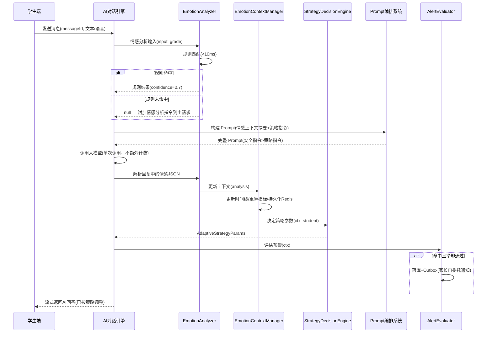

# 服务端 - AI 辅导对话情感感知与自适应回应策略引擎 详细设计

## 1. 概述

### 1.1 文档目的

本文档详细设计 AI 辅导对话中的**情感感知与自适应回应策略引擎**，负责在学生与 AI 进行学习对话时，实时分析学生的情绪状态（困惑、沮丧、无聊、兴奋、专注等），并动态调整 AI 的回应策略（语气、难度推进节奏、鼓励频率、解释方式等），以提升学习体验和教学效果。

### 1.2 背景

原始设计文档指出，AI 辅导应"优先引导学生理解思路"并"根据学生年级调整讲解深度"，但缺少对**学生情感状态**的实时感知和自适应处理。在实际学习场景中：

- 学生遇到困难时若持续得不到有效引导，容易产生挫败感而放弃
- 低龄学生需要更多的鼓励和趣味性，否则容易失去兴趣
- 学生表现出兴奋和投入时，可以适当增加挑战
- 持续的负面情绪需要触发家长提醒

### 1.3 设计目标

| 目标 | 说明 |
|------|------|
| 实时情感识别 | 在每次对话轮次中对学生的文字/语音输入进行情感分析，延迟 < 200ms |
| 多维度情感建模 | 覆盖 7 种核心学习情感状态 + 强度等级 |
| 自适应回应策略 | 基于情感状态自动调整 AI 回应的语气、节奏、鼓励方式和教学策略 |
| 情感趋势追踪 | 维护对话级别的情感变化轨迹，检测异常模式 |
| 家长预警联动 | 检测到持续负面情绪时触发家长通知 |
| 低成本实现 | 复用现有 AI 模型调用链路，不额外引入独立的情感分析模型 |

### 1.4 与其他模块的关系

| 关联模块 | 交互方式 |
|----------|----------|
| AI 对话引擎 | 注入情感上下文到 Prompt 模板，调整生成策略 |
| Prompt 编排系统 | 选择情感适配的 Prompt 模板变体 |
| 语音服务 (ASR/TTS) | 接收语音情感特征，调整 TTS 语速和语气 |
| 家长中心 | 触发情感预警通知 |
| 学习动力量化引擎 | 提供情感维度数据用于倦怠检测 |
| 用户学习画像 | 更新学生的情感偏好和学习风格标签 |
| 埋点系统 | 输出情感分析事件用于数据分析和模型优化 |

---

## 2. 核心概念定义

### 2.1 学习情感状态枚举

```typescript
/**
 * 学习场景中的核心情感状态
 */
enum LearningEmotion {
  /** 困惑 - 不理解当前内容，表达出疑问 */
  CONFUSED = 'CONFUSED',
  /** 沮丧 - 反复出错或无法理解，产生挫败感 */
  FRUSTRATED = 'FRUSTRATED',
  /** 无聊 - 对当前内容缺乏兴趣 */
  BORED = 'BORED',
  /** 专注 - 认真投入学习中 */
  ENGAGED = 'ENGAGED',
  /** 兴奋 - 产生兴趣，表现积极 */
  EXCITED = 'EXCITED',
  /** 焦虑 - 担心学不好、考试压力等 */
  ANXIOUS = 'ANXIOUS',
  /** 中性 - 无明显情感倾向 */
  NEUTRAL = 'NEUTRAL',
}

/**
 * 情感强度等级 (1-5)
 */
enum EmotionIntensity {
  VERY_LOW = 1,   // 微弱暗示
  LOW = 2,        // 轻度表达
  MODERATE = 3,   // 明确表达
  HIGH = 4,       // 强烈表达
  VERY_HIGH = 5,  // 极度强烈
}
```

### 2.2 情感上下文数据结构

```typescript
/**
 * 单轮对话的情感分析结果
 */
interface EmotionAnalysisResult {
  /** 唯一标识 */
  id: string;
  /** 关联的对话消息 ID */
  messageId: string;
  /** 关联的会话 ID */
  sessionId: string;
  /** 用户 ID */
  userId: string;

  /** 主要情感状态 */
  primaryEmotion: LearningEmotion;
  /** 主要情感强度 */
  primaryIntensity: EmotionIntensity;

  /** 次要情感状态（可选） */
  secondaryEmotion: LearningEmotion | null;
  /** 次要情感强度 */
  secondaryIntensity: EmotionIntensity | null;

  /** 情感置信度 0.0-1.0 */
  confidence: number;

  /** 触发关键词/短语 */
  triggerPhrases: string[];

  /** 分析来源 */
  source: 'TEXT' | 'VOICE' | 'COMBINED';

  /** 分析时间戳 */
  analyzedAt: string; // ISO 8601
}

/**
 * 对话级别的情感上下文（随对话进行动态更新）
 */
interface ConversationEmotionContext {
  /** 会话 ID */
  sessionId: string;
  /** 用户 ID */
  userId: string;

  /** 当前情感状态 */
  currentEmotion: LearningEmotion;
  /** 当前情感强度 */
  currentIntensity: EmotionIntensity;

  /** 情感变化轨迹（最近 N 轮） */
  emotionTimeline: EmotionTimelineEntry[];

  /** 对话内情绪指标 */
  metrics: ConversationEmotionMetrics;

  /** 自适应策略参数 */
  strategyParams: AdaptiveStrategyParams;

  /** 是否需要触发预警 */
  alertTriggered: boolean;
  /** 预警类型 */
  alertType: EmotionAlertType | null;

  /** 最后更新时间 */
  updatedAt: string;
}

interface EmotionTimelineEntry {
  /** 轮次序号 */
  turnIndex: number;
  /** 情感状态 */
  emotion: LearningEmotion;
  /** 强度 */
  intensity: EmotionIntensity;
  /** 时间戳 */
  timestamp: string;
}

interface ConversationEmotionMetrics {
  /** 对话总轮次 */
  totalTurns: number;
  /** 连续困惑/沮丧轮次 */
  consecutiveNegativeTurns: number;
  /** 负面情绪占比 */
  negativeRatio: number;
  /** 情绪波动次数（状态切换次数） */
  fluctuationCount: number;
  /** 平均置信度 */
  avgConfidence: number;
  /** 正向情绪峰值强度 */
  positivePeakIntensity: number;
  /** 负向情绪峰值强度 */
  negativePeakIntensity: number;
}

/**
 * 自适应策略参数 - 传递给 Prompt 编排系统
 */
interface AdaptiveStrategyParams {
  /** 鼓励频率：每 N 轮至少包含一次鼓励 */
  encouragementFrequency: number;
  /** 是否切换为更简单的解释方式 */
  useSimplifiedExplanation: boolean;
  /** 是否增加步骤拆分 */
  increaseStepBreakdown: boolean;
  /** 是否需要主动提供帮助提示 */
  proactiveHintsEnabled: boolean;
  /** 回应语气风格 */
  toneStyle: 'ENCOURAGING' | 'NEUTRAL' | 'CHALLENGING' | 'PLAYFUL' | 'CALM';
  /** 是否降低当前问题难度 */
  reduceDifficulty: boolean;
  /** 是否建议休息 */
  suggestBreak: boolean;
  /** 额外 Prompt 指令片段 */
  promptInstructionOverride: string | null;
}
```

### 2.3 预警类型

```typescript
enum EmotionAlertType {
  /** 持续沮丧 - 连续多轮处于沮丧状态 */
  PERSISTENT_FRUSTRATION = 'PERSISTENT_FRUSTRATION',
  /** 学习焦虑 - 检测到高强度焦虑情绪 */
  STUDY_ANXIETY = 'STUDY_ANXIETY',
  /** 可能放弃 - 多种负面指标叠加 */
  LIKELY_ABANDON = 'LIKELY_ABANDON',
  /** 情绪异常波动 - 短时间内频繁切换状态 */
  EMOTIONAL_INSTABILITY = 'EMOTIONAL_INSTABILITY',
}
```

---

## 3. 系统架构

### 3.1 整体流程

```
学生输入 (文字/语音)
    │
    ▼
┌─────────────────────────┐
│  文本预处理与关键词提取   │
└───────────┬─────────────┘
            │
            ▼
┌─────────────────────────┐
│  情感分析引擎            │  ← 复用大模型（低成本方式）
│  - 文本情感推断          │
│  - 语音情感特征（可选）   │
│  - 上下文关联分析        │
└───────────┬─────────────┘
            │
            ▼
┌─────────────────────────┐
│  情感上下文管理器        │
│  - 更新情感时间线        │
│  - 计算情感指标          │
│  - 检测预警条件          │
└───────────┬─────────────┘
            │
    ┌───────┴───────┐
    ▼               ▼
┌─────────┐  ┌──────────────┐
│ 策略决策 │  │  预警触发器   │
│ 引擎    │  │ (异步通知)   │
└────┬────┘  └──────────────┘
     │
     ▼
┌─────────────────────────┐
│  Prompt 上下文注入       │  → 传递给 AI 对话引擎
│  - 语气指令             │
│  - 鼓励指令             │
│  - 难度调整指令         │
└─────────────────────────┘
```

### 3.2 模块划分

| 模块 | 职责 |
|------|------|
| EmotionAnalyzer | 对单条输入进行情感分析 |
| EmotionContextManager | 维护对话级别的情感上下文和趋势 |
| StrategyDecisionEngine | 基于情感上下文决定自适应策略参数 |
| AlertEvaluator | 评估是否需要触发情感预警 |
| PromptContextInjector | 将策略参数转化为 Prompt 注入指令 |
| EmotionEventPublisher | 发布情感分析事件到事件总线 |

### 3.3 服务位置

情感感知引擎作为 AI 对话服务的内部组件实现，不独立部署为微服务。理由：

1. 情感分析与对话生成是紧耦合的流水线环节
2. 减少网络调用开销，保证低延迟
3. 情感上下文是会话级数据，适合与对话上下文共存在同一进程中

---

## 4. 详细设计

### 4.1 EmotionAnalyzer - 情感分析器

#### 4.1.1 分析策略

采用**轻量级规则 + 大模型辅助**的混合方案：

**第一阶段（规则匹配，< 10ms）：**

```java
public class RuleBasedEmotionDetector {

    // 情感关键词库（按学段维护不同版本）
    private final Map<LearningEmotion, EmotionKeywordSet> keywordSets;

    /**
     * 基于规则的快速情感初判
     * @return 情感检测结果，可能为 null（规则未匹配时）
     */
    public EmotionDetectionResult detect(String input, StudentGrade grade) {
        EmotionKeywordSet keywords = keywordSets.get(grade.getPhase());

        // 1. 检查显式情感表达
        for (EmotionPattern pattern : keywords.getPatterns()) {
            if (pattern.matches(input)) {
                return new EmotionDetectionResult(
                    pattern.getEmotion(),
                    pattern.estimateIntensity(input),
                    0.7, // 规则匹配置信度
                    pattern.getMatchedPhrases()
                );
            }
        }

        // 2. 检查隐式情感信号（重复提问、短回答、语气词等）
        ImplicitSignal signal = detectImplicitSignals(input);
        if (signal != null) {
            return new EmotionDetectionResult(
                signal.getEmotion(),
                signal.getIntensity(),
                0.5, // 隐式信号置信度较低
                signal.getPhrases()
            );
        }

        return null; // 规则未匹配，交给模型分析
    }
}
```

**关键词库示例（小学阶段）：**

```json
{
  "FRUSTRATED": {
    "exact": ["我不会", "太难了", "不想做了", "做不来", "算了吧"],
    "pattern": ["还是.{0,4}不懂", "怎么.{0,4}不对", "又.{0,4}错了", "第.{1,3}次.{0,4}错"],
    "implicit": ["...", "？？" ,"？？？？", "唉", "啊", "呃"]
  },
  "CONFUSED": {
    "exact": ["不太明白", "没看懂", "什么意思", "不懂", "为什么", "怎么回事"],
    "pattern": ["为什么.{0,10}是", "怎么.{0,4}理解", "能再.{0,4}讲"],
    "implicit": ["嗯？", "啊？"]
  },
  "BORED": {
    "exact": ["好无聊", "没意思", "太简单了", "都会了", "能不能跳过"],
    "pattern": ["还有.{0,4}吗", "什么时候.{0,4}完"]
  },
  "EXCITED": {
    "exact": ["太好了", "我懂了", "明白了", "原来如此", "厉害", "好棒"],
    "pattern": ["终于.{0,4}会了", "我想.{0,4}更多", "还有.{0,4}题吗"]
  },
  "ANXIOUS": {
    "exact": ["考试怎么办", "来不及了", "肯定考不好", "跟不上", "别人都"],
    "pattern": ["如果.{0,4}考不好", "还有.{0,4}天"]
  }
}
```

**第二阶段（大模型辅助，按需调用）：**

当规则匹配失败或置信度过低时，将情感分析任务附加到主对话请求中，不额外发起一次模型调用：

```java
/**
 * 将情感分析指令附加到对话 Prompt 中
 * 这样做的好处：不增加额外的模型调用成本
 */
public class EmotionAwarePromptBuilder {

    private static final String EMOTION_ANALYSIS_INSTRUCTION = """
        [系统内部指令 - 不要在回答中体现]
        分析学生最后一条消息的情感状态，仅返回 JSON：
        {"emotion":"CONFUSED|FRUSTRATED|BORED|ENGAGED|EXCITED|ANXIOUS|NEUTRAL","intensity":1-5,"confidence":0.0-1.0,"triggers":["关键词"]}
        如果无法判断，返回 {"emotion":"NEUTRAL","intensity":1,"confidence":0.3,"triggers":[]}
        [/系统内部指令]
        """;

    /**
     * 将情感分析指令附加到用户 Prompt 中
     */
    public String buildEmotionAwarePrompt(String originalPrompt,
                                          ConversationEmotionContext context) {
        StringBuilder sb = new StringBuilder();

        // 注入情感上下文摘要
        if (context != null && context.getEmotionTimeline().size() > 0) {
            sb.append("[学生当前情感状态：")
              .append(context.getCurrentEmotion())
              .append("，强度：").append(context.getCurrentIntensity())
              .append("，连续困惑/沮丧轮次：")
              .append(context.getMetrics().getConsecutiveNegativeTurns())
              .append("]\n\n");
        }

        // 附加情感分析指令
        sb.append(EMOTION_ANALYSIS_INSTRUCTION).append("\n\n");

        sb.append(originalPrompt);
        return sb.toString();
    }
}
```

#### 4.1.2 情感结果解析

```java
public class EmotionResultParser {

    private static final Pattern JSON_PATTERN = Pattern.compile(
        "\\{\\s*\"emotion\"\\s*:\\s*\"(\\w+)\"\\s*,\\s*" +
        "\"intensity\"\\s*:\\s*(\\d)\\s*,\\s*" +
        "\"confidence\"\\s*:\\s*([\\d.]+)\\s*,\\s*" +
        "\"triggers\"\\s*:\\s*\\[([^\\]]*)\\]\\s*\\}"
    );

    /**
     * 从 AI 回复中提取情感分析结果
     * AI 回复格式：<情感JSON>\n---\n实际回答内容
     */
    public EmotionAnalysisResult parse(String aiResponse,
                                       String messageId,
                                       String sessionId,
                                       String userId) {
        // 尝试提取 JSON 块
        String[] parts = aiResponse.split("\\n---\\n", 2);

        if (parts.length == 2) {
            try {
                Matcher matcher = JSON_PATTERN.matcher(parts[0].trim());
                if (matcher.find()) {
                    return EmotionAnalysisResult.builder()
                        .id(UUID.randomUUID().toString())
                        .messageId(messageId)
                        .sessionId(sessionId)
                        .userId(userId)
                        .primaryEmotion(LearningEmotion.valueOf(matcher.group(1)))
                        .primaryIntensity(EmotionIntensity.values()[Integer.parseInt(matcher.group(2)) - 1])
                        .confidence(Double.parseDouble(matcher.group(3)))
                        .triggerPhrases(parseTriggers(matcher.group(4)))
                        .source(EmotionSource.COMBINED)
                        .analyzedAt(Instant.now().toString())
                        .build();
                }
            } catch (Exception e) {
                log.warn("情感分析结果解析失败, sessionId={}: {}", sessionId, e.getMessage());
            }
        }

        // 解析失败时返回中性结果
        return EmotionAnalysisResult.neutral(messageId, sessionId, userId);
    }
}
```

### 4.2 EmotionContextManager - 情感上下文管理器

#### 4.2.1 存储设计

**Redis 存储结构（会话级，对话结束后归档到 DB）：**

```
Key: emotion:ctx:{sessionId}
Type: Hash
TTL: 2h（与对话会话 TTL 同步）

Fields:
  currentEmotion    -> "FRUSTRATED"
  currentIntensity  -> "4"
  totalTurns        -> "12"
  consecutiveNeg    -> "3"
  negativeRatio     -> "0.42"
  fluctuationCount  -> "2"
  avgConfidence     -> "0.78"
  positivePeak      -> "4"
  negativePeak      -> "5"
  alertTriggered    -> "false"
  alertType         -> null
  updatedAt         -> "2026-06-06T06:00:00Z"
```

```
Key: emotion:timeline:{sessionId}
Type: List (最多保留最近 30 轮)
Value: JSON 序列化的 EmotionTimelineEntry
TTL: 2h
```

#### 4.2.2 上下文更新逻辑

```java
@Service
public class EmotionContextManager {

    private final RedisTemplate<String, String> redisTemplate;
    private final EmotionEventPublisher eventPublisher;

    private static final int MAX_TIMELINE_SIZE = 30;

    /**
     * 更新情感上下文
     */
    public ConversationEmotionContext updateContext(String sessionId,
                                                    String userId,
                                                    EmotionAnalysisResult analysis) {
        // 1. 获取当前上下文
        ConversationEmotionContext ctx = loadContext(sessionId);
        if (ctx == null) {
            ctx = createInitialContext(sessionId, userId);
        }

        // 2. 添加时间线条目
        EmotionTimelineEntry entry = new EmotionTimelineEntry(
            ctx.getMetrics().getTotalTurns() + 1,
            analysis.getPrimaryEmotion(),
            analysis.getPrimaryIntensity(),
            Instant.now().toString()
        );
        ctx.getEmotionTimeline().add(entry);

        // 保持时间线不超过最大长度
        if (ctx.getEmotionTimeline().size() > MAX_TIMELINE_SIZE) {
            ctx.getEmotionTimeline().remove(0);
        }

        // 3. 更新当前状态
        ctx.setCurrentEmotion(analysis.getPrimaryEmotion());
        ctx.setCurrentIntensity(analysis.getPrimaryIntensity());

        // 4. 重新计算指标
        recalculateMetrics(ctx);

        // 5. 持久化
        saveContext(ctx);

        // 6. 发布事件
        eventPublisher.publishEmotionEvent(analysis, ctx);

        return ctx;
    }

    /**
     * 重新计算情感指标
     */
    private void recalculateMetrics(ConversationEmotionContext ctx) {
        List<EmotionTimelineEntry> timeline = ctx.getEmotionTimeline();
        ConversationEmotionMetrics metrics = ctx.getMetrics();

        // 总轮次
        metrics.setTotalTurns(metrics.getTotalTurns() + 1);

        // 连续负面轮次
        if (isNegativeEmotion(ctx.getCurrentEmotion())) {
            metrics.setConsecutiveNegativeTurns(
                metrics.getConsecutiveNegativeTurns() + 1
            );
        } else {
            metrics.setConsecutiveNegativeTurns(0);
        }

        // 负面情绪占比
        long negativeCount = timeline.stream()
            .filter(e -> isNegativeEmotion(e.getEmotion()))
            .count();
        metrics.setNegativeRatio((double) negativeCount / timeline.size());

        // 情绪波动次数
        int fluctuations = 0;
        for (int i = 1; i < timeline.size(); i++) {
            if (timeline.get(i).getEmotion() != timeline.get(i - 1).getEmotion()) {
                fluctuations++;
            }
        }
        metrics.setFluctuationCount(fluctuations);

        // 峰值更新
        if (isPositiveEmotion(ctx.getCurrentEmotion())) {
            metrics.setPositivePeakIntensity(
                Math.max(metrics.getPositivePeakIntensity(),
                         ctx.getCurrentIntensity().getValue())
            );
        }
        if (isNegativeEmotion(ctx.getCurrentEmotion())) {
            metrics.setNegativePeakIntensity(
                Math.max(metrics.getNegativePeakIntensity(),
                         ctx.getCurrentIntensity().getValue())
            );
        }
    }

    private boolean isNegativeEmotion(LearningEmotion e) {
        return e == LearningEmotion.FRUSTRATED
            || e == LearningEmotion.CONFUSED
            || e == LearningEmotion.ANXIOUS;
    }

    private boolean isPositiveEmotion(LearningEmotion e) {
        return e == LearningEmotion.EXCITED
            || e == LearningEmotion.ENGAGED;
    }
}
```

### 4.3 StrategyDecisionEngine - 策略决策引擎

#### 4.3.1 策略决策表

基于情感状态和强度的策略映射：

```java
@Service
public class StrategyDecisionEngine {

    /**
     * 基于情感上下文决定自适应策略参数
     */
    public AdaptiveStrategyParams decide(ConversationEmotionContext ctx,
                                         StudentProfile student) {
        AdaptiveStrategyParams params = new AdaptiveStrategyParams();

        LearningEmotion emotion = ctx.getCurrentEmotion();
        int intensity = ctx.getCurrentIntensity().getValue();
        int consecutiveNeg = ctx.getMetrics().getConsecutiveNegativeTurns();

        // 基础策略（按情感状态分派）
        switch (emotion) {
            case CONFUSED -> applyConfusedStrategy(params, intensity, consecutiveNeg, student);
            case FRUSTRATED -> applyFrustratedStrategy(params, intensity, consecutiveNeg, student);
            case BORED -> applyBoredStrategy(params, intensity, student);
            case ENGAGED -> applyEngagedStrategy(params, intensity, student);
            case EXCITED -> applyExcitedStrategy(params, intensity, student);
            case ANXIOUS -> applyAnxiousStrategy(params, intensity, student);
            default -> applyNeutralStrategy(params, student);
        }

        // 叠加连续负面轮次的额外调整
        if (consecutiveNeg >= 3) {
            params.setSuggestBreak(true);
            params.setEncouragementFrequency(1); // 每轮都鼓励
            params.setPromptInstructionOverride(
                "学生已经连续多轮遇到困难，请先用简短温暖的话语安抚，" +
                "然后用最简单的方式重新解释，必要时换一个完全不同的角度或生活例子。"
            );
        }

        if (consecutiveNeg >= 5) {
            params.setReduceDifficulty(true);
            params.setPromptInstructionOverride(
                "学生遇到很大困难，请暂时降低难度，给出一个简单的引导性问题，" +
                "让学生能成功回答以重建信心。不要继续推进新内容。"
            );
        }

        return params;
    }

    private void applyConfusedStrategy(AdaptiveStrategyParams params,
                                        int intensity,
                                        int consecutiveNeg,
                                        StudentProfile student) {
        params.setToneStyle(ToneStyle.CALM);
        params.setIncreaseStepBreakdown(true);
        params.setProactiveHintsEnabled(true);

        if (intensity >= 3) {
            params.setUseSimplifiedExplanation(true);
            params.setEncouragementFrequency(2); // 每 2 轮鼓励一次
            params.setPromptInstructionOverride(
                "学生表示不太明白。请用更简单的语言、更小的步骤重新解释，" +
                "先确认学生卡在哪一步，再针对性讲解。可以举生活化的例子。"
            );
        }

        // 幼儿段额外降低认知负荷
        if (student.isEarlyChildhood()) {
            params.setEncouragementFrequency(1);
            params.setToneStyle(ToneStyle.PLAYFUL);
        }
    }

    private void applyFrustratedStrategy(AdaptiveStrategyParams params,
                                          int intensity,
                                          int consecutiveNeg,
                                          StudentProfile student) {
        params.setToneStyle(ToneStyle.ENCOURAGING);
        params.setEncouragementFrequency(1); // 每轮都鼓励
        params.setIncreaseStepBreakdown(true);
        params.setProactiveHintsEnabled(true);

        if (intensity >= 3) {
            params.setUseSimplifiedExplanation(true);
            params.setPromptInstructionOverride(
                "学生明显感到挫败。请先给予真诚、具体的肯定（指出已经做对的部分），" +
                "然后把当前问题拆成更小的步骤，先让学生完成一个能成功的小步骤，" +
                "重建信心后再继续。绝对不要说『这很简单』之类的话。"
            );
        }

        if (intensity >= 4 && consecutiveNeg >= 2) {
            params.setReduceDifficulty(true);
        }
    }

    private void applyBoredStrategy(AdaptiveStrategyParams params,
                                     int intensity,
                                     StudentProfile student) {
        // 无聊分两种：内容太简单 / 内容无趣，分别处理
        if (intensity >= 3) {
            params.setToneStyle(ToneStyle.PLAYFUL);
            params.setPromptInstructionOverride(
                "学生显得无聊或觉得内容太简单。可以适当提高挑战难度，" +
                "或用一个有趣的实际应用场景重新引入当前知识点，保持学习动力。"
            );
        } else {
            params.setToneStyle(ToneStyle.PLAYFUL);
            params.setEncouragementFrequency(3);
        }
    }

    private void applyEngagedStrategy(AdaptiveStrategyParams params,
                                       int intensity,
                                       StudentProfile student) {
        // 专注是理想状态：不打扰，保持当前节奏
        params.setToneStyle(ToneStyle.NEUTRAL);
        params.setEncouragementFrequency(4); // 少打扰
    }

    private void applyExcitedStrategy(AdaptiveStrategyParams params,
                                       int intensity,
                                       StudentProfile student) {
        params.setToneStyle(ToneStyle.CHALLENGING);
        params.setEncouragementFrequency(3);

        if (intensity >= 4) {
            params.setPromptInstructionOverride(
                "学生兴致很高。可以在当前知识点基础上给一个稍有挑战性的拓展问题，" +
                "趁热打铁加深理解，但注意难度跳跃不要过大。"
            );
        }
    }

    private void applyAnxiousStrategy(AdaptiveStrategyParams params,
                                       int intensity,
                                       StudentProfile student) {
        params.setToneStyle(ToneStyle.CALM);
        params.setEncouragementFrequency(2);
        params.setProactiveHintsEnabled(true);

        if (intensity >= 3) {
            params.setPromptInstructionOverride(
                "学生表现出焦虑情绪。请用平静、安抚的语气回应，把大目标拆成小目标，" +
                "强调『按自己的节奏来』，避免制造比较和紧迫感。" +
                "如果焦虑与考试相关，可以引导学生聚焦当下能做的一小步。"
            );
        }
    }

    private void applyNeutralStrategy(AdaptiveStrategyParams params,
                                       StudentProfile student) {
        params.setToneStyle(ToneStyle.NEUTRAL);
        params.setEncouragementFrequency(3);
        // 其余参数保持默认：不调整难度、不强制简化
    }
}
```

#### 4.3.2 策略参数决策速查表

| 情感 | 强度 | toneStyle | 鼓励频率 | 简化解释 | 步骤拆分 | 主动提示 | 降难度 | 建议休息 |
|------|------|-----------|----------|----------|----------|----------|--------|----------|
| CONFUSED | 1-2 | CALM | 3 | 否 | 是 | 是 | 否 | 否 |
| CONFUSED | 3-5 | CALM | 2 | 是 | 是 | 是 | 否 | 否 |
| FRUSTRATED | 1-2 | ENCOURAGING | 1 | 否 | 是 | 是 | 否 | 否 |
| FRUSTRATED | 3-5 | ENCOURAGING | 1 | 是 | 是 | 是 | 强度≥4 连续≥2 | 连续≥3 |
| BORED | 1-2 | PLAYFUL | 3 | 否 | 否 | 否 | 否 | 否 |
| BORED | 3-5 | PLAYFUL | 3 | 否 | 否 | 否 | 反向提难 | 否 |
| ENGAGED | 任意 | NEUTRAL | 4 | 否 | 否 | 否 | 否 | 否 |
| EXCITED | 1-3 | CHALLENGING | 3 | 否 | 否 | 否 | 否 | 否 |
| EXCITED | 4-5 | CHALLENGING | 3 | 否 | 否 | 否 | 反向提难 | 否 |
| ANXIOUS | 1-2 | CALM | 2 | 否 | 否 | 是 | 否 | 否 |
| ANXIOUS | 3-5 | CALM | 2 | 是 | 否 | 是 | 否 | 否 |
| NEUTRAL | 任意 | NEUTRAL | 3 | 否 | 否 | 否 | 否 | 否 |
| **叠加规则** | — | — | — | — | — | — | — | — |
| 连续负面 ≥3 轮 | — | — | 强制 1 | 是 | 是 | 是 | 否 | **是** |
| 连续负面 ≥5 轮 | — | — | 强制 1 | 是 | 是 | 是 | **是** | **是** |

> **G2 红线**：`suggestBreak=true` 仅影响 AI 话术建议（如「要不要先休息一下」），**不构成防沉迷强制休息指令**；强制休息的唯一权威是防沉迷引擎（见 §13-R6）。

### 4.4 AlertEvaluator - 预警评估引擎

#### 4.4.1 预警触发规则

```java
@Service
public class AlertEvaluator {

    /**
     * 预警规则表（按优先级从高到低匹配，命中即评估，可叠加）
     * 每条规则独立冷却，防止同一预警反复触发骚扰家长。
     */
    private static final List<AlertRule> RULES = List.of(
        // R1: 持续高强度沮丧（最高优先级）
        new AlertRule(
            EmotionAlertType.PERSISTENT_FRUSTRATION,
            /*条件*/ ctx ->
                ctx.getCurrentEmotion() == LearningEmotion.FRUSTRATED
                && ctx.getCurrentIntensity().getValue() >= 4
                && ctx.getMetrics().getConsecutiveNegativeTurns() >= 3,
            /*冷却*/ Duration.ofHours(24),
            /*家长通知级别*/ AlertSeverity.HIGH
        ),
        // R2: 学习焦虑
        new AlertRule(
            EmotionAlertType.STUDY_ANXIETY,
            ctx ->
                ctx.getCurrentEmotion() == LearningEmotion.ANXIOUS
                && ctx.getCurrentIntensity().getValue() >= 4,
            Duration.ofHours(24),
            AlertSeverity.MEDIUM
        ),
        // R3: 可能放弃（多指标叠加）
        new AlertRule(
            EmotionAlertType.LIKELY_ABANDON,
            ctx ->
                ctx.getMetrics().getNegativeRatio() >= 0.6
                && ctx.getMetrics().getTotalTurns() >= 5
                && ctx.getCurrentEmotion() != LearningEmotion.ENGAGED
                && ctx.getCurrentEmotion() != LearningEmotion.EXCITED,
            Duration.ofHours(12),
            AlertSeverity.HIGH
        ),
        // R4: 情绪异常波动（频繁切换，可能外部干扰或设备共用）
        new AlertRule(
            EmotionAlertType.EMOTIONAL_INSTABILITY,
            ctx ->
                ctx.getMetrics().getFluctuationCount() >= 6
                && ctx.getMetrics().getTotalTurns() >= 8,
            Duration.ofHours(6),
            AlertSeverity.LOW // 低级别仅记录，不通知家长
        )
    );

    /**
     * 评估是否触发预警（幂等：冷却期内同一规则不重复触发）
     */
    public List<EmotionAlert> evaluate(ConversationEmotionContext ctx) {
        List<EmotionAlert> triggered = new ArrayList<>();

        for (AlertRule rule : RULES) {
            if (!rule.getCondition().test(ctx)) continue;

            String cooldownKey = "emotion:alert:cd:" + ctx.getUserId()
                + ":" + rule.getAlertType();

            // SETNX + TTL 实现冷却窗口（并发安全）
            Boolean acquired = redisTemplate.opsForValue()
                .setIfAbsent(cooldownKey, "1", rule.getCooldown());

            if (Boolean.TRUE.equals(acquired)) {
                triggered.add(EmotionAlert.builder()
                    .id(UUID.randomUUID().toString())
                    .userId(ctx.getUserId())
                    .sessionId(ctx.getSessionId())
                    .alertType(rule.getAlertType())
                    .severity(rule.getSeverity())
                    .metricsSnapshot(ctx.getMetrics())
                    .build());
            }
        }
        return triggered;
    }
}
```

#### 4.4.2 预警后续处理

| 级别 | 处理动作 |
|------|----------|
| HIGH | 同事务写 `emotion_alert` 表 + Outbox 事件 `emotion.alert.triggered`，通知服务经**家长门**委托推送家长端摘要（不含对话原文，见 §12-C3） |
| MEDIUM | 同上，通知级别降为「建议关注」 |
| LOW | 仅落库 + 事件，不通知家长，供学情分析聚合 |

> **G3 红线**：本引擎仅识别**学习情绪**（困惑/沮丧/无聊/焦虑）。涉及自伤、他伤、心理危机的文本信号，权威归 AI 对话安全审计与心理危机引擎（0302-0701 快速通道），本引擎**不得**承接、不得降级、不得静默，发现疑似信号时原样透传上游安全链路（见 §13-R2）。

### 4.5 PromptContextInjector - Prompt 上下文注入器

#### 4.5.1 注入格式

将 `AdaptiveStrategyParams` 翻译为 Prompt 指令片段，由 Prompt 编排系统按既定槽位拼装：

```java
@Component
public class PromptContextInjector {

    /**
     * 生成情感策略指令片段
     * 约束：
     * 1. 片段只影响教学策略与语气，绝不包含/覆盖任何安全指令（安全指令由护栏引擎注入，优先级最高，见 §13-R1）
     * 2. 单片段长度 ≤ 300 字符，避免挤占上下文窗口
     * 3. promptInstructionOverride 非空时优先于其他参数翻译
     */
    public String inject(AdaptiveStrategyParams params) {
        if (params.getPromptInstructionOverride() != null) {
            return "[教学策略调整] " + params.getPromptInstructionOverride();
        }

        StringBuilder sb = new StringBuilder("[教学策略] ");
        sb.append("语气：").append(toneHint(params.getToneStyle())).append("。");
        sb.append("每 ").append(params.getEncouragementFrequency())
          .append(" 轮至少给予一次具体、真诚的鼓励。");

        if (params.getUseSimplifiedExplanation()) {
            sb.append("请使用更简单的语言和生活化例子解释。");
        }
        if (params.getIncreaseStepBreakdown()) {
            sb.append("请将讲解拆分为更小的步骤，每步确认理解后再继续。");
        }
        if (params.getProactiveHintsEnabled()) {
            sb.append("学生未主动提问时也可主动给出提示。");
        }
        if (params.getReduceDifficulty()) {
            sb.append("请降低当前问题难度，先让学生获得成功体验。");
        }
        if (params.getSuggestBreak()) {
            sb.append("可温和地建议学生休息一下再继续。");
        }
        return sb.toString();
    }

    private String toneHint(ToneStyle tone) {
        return switch (tone) {
            case ENCOURAGING -> "多鼓励、具体肯定学生做对的每一步";
            case PLAYFUL -> "轻松有趣、可适当幽默";
            case CHALLENGING -> "有挑战性、激发思考";
            case CALM -> "平静、安抚、不急不躁";
            default -> "自然、专业";
        };
    }
}
```

#### 4.5.2 注入示例

```
[系统级安全指令（护栏引擎注入，最高优先级，不可覆盖）] ...
[教学策略] 语气：多鼓励、具体肯定学生做对的每一步。每 1 轮至少给予一次具体、真诚的鼓励。
请使用更简单的语言和生活化例子解释。请将讲解拆分为更小的步骤，每步确认理解后再继续。...
[对话历史] ...
[学生消息] 我还是不懂，为什么这里要除以2？
```

### 4.6 EmotionEventPublisher - 事件发布

```java
@Component
public class EmotionEventPublisher {

    private final OutboxRepository outboxRepository; // 同事务 Outbox，Relay 异步投递

    @Transactional
    public void publishEmotionEvent(EmotionAnalysisResult analysis,
                                    ConversationEmotionContext ctx) {
        // 1. emotion.detected 每轮必发（学习动力量化/画像/数据分析消费）
        outboxRepository.insert(OutboxEvent.of(
            "emotion.domain.events",
            "emotion.detected",
            analysis.getUserId(),
            Map.of(
                "analysisId", analysis.getId(),
                "sessionId", analysis.getSessionId(),
                "messageId", analysis.getMessageId(),
                "emotion", analysis.getPrimaryEmotion().name(),
                "intensity", analysis.getPrimaryIntensity().getValue(),
                "confidence", analysis.getConfidence(),
                "consecutiveNegativeTurns", ctx.getMetrics().getConsecutiveNegativeTurns()
            )
        ));

        // 2. 预警事件由 AlertEvaluator 命中后单独发布（见 §4.4.2）
    }
}
```

---

## 5. 核心流程

### 5.1 单轮对话情感处理主链路



### 5.2 延迟预算

| 环节 | 预算 | 说明 |
|------|------|------|
| 规则情感检测 | ≤10ms | 本地正则/关键词匹配 |
| 情感上下文读写 | ≤5ms | Redis Hash + Lua 原子更新 |
| 策略决策 | ≤2ms | 内存规则表 |
| Prompt 注入 | ≤1ms | 字符串拼装 |
| 情感结果解析 | ≤5ms | 正则提取 |
| **合计（同步路径）** | **≤25ms** | 不含大模型调用本身，对对话首 Token 延迟贡献可忽略 |

### 5.3 会话结束归档

```
对话结束(session.end / TTL 到期)
    → 从 Redis 读取 emotion:ctx:{sessionId} + emotion:timeline:{sessionId}
    → 聚合为会话级情感摘要(negRatio/peak/fluctuation/avgConfidence)
    → 写 emotion_session_summary 表(MySQL, 保留 180 天)
    → 发布 emotion.session.closed 事件(画像/学情分析消费)
    → 删除 Redis Key
```

---

## 6. 状态机与守卫

### 6.1 情感上下文生命周期

```
ACTIVE ──(对话结束/TTL 2h)──> ARCHIVED ──(180 天)──> PURGED
   │                              │
   └──(Redis 淘汰重建)──> REBUILT  └──(注销请求/合规删除)──> DELETED(立即)
```

| 守卫 | 规则 |
|------|------|
| G1 | 情感上下文与会话共存亡；会话不存在时禁止创建孤立上下文 |
| G4 | Redis 重建（淘汰后回源）时以 `emotion_session_summary` 已归档数据为准，禁止凭空重建历史时间线 |
| G5 | REBUILT 状态的上下文标记 `rebuilt=true`，其时间线不参与波动率指标计算（避免假数据污染） |

### 6.2 预警状态机

```
TRIGGERED ──> NOTIFIED ──> ACKNOWLEDGED ──> RESOLVED
     │             │
     └──(通知失败)──> RETRYING(≤3 次)──(仍失败)──> NOTIFIED_FAILED(人工兜底队列)
```

| 守卫 | 规则 |
|------|------|
| G6 | 预警落库与 Outbox 事件必须同事务，禁止先发事件后落库 |
| G7 | RETRYING 采用指数退避（5min/30min/2h），3 次失败转人工兜底，**禁止静默丢弃 HIGH 级预警** |
| G8 | 同一 (userId, alertType) 在冷却期内不产生第二条预警（§4.4.1 SETNX 幂等） |

---

## 7. 幂等与并发

| 场景 | 机制 |
|------|------|
| 同一消息重复分析（客户端重试/网络重放） | `emotion_analysis` 表 `uk_message_id` 唯一索引，重复插入捕获 DuplicateKey 返回已有结果 |
| 并发更新情感上下文（多端同时对话，罕见） | Redis Lua 脚本原子更新 Hash 计数器 + 时间线 PUSH；冲突以先到者胜，后者分析结果仍落库但不改上下文 |
| 预警并发触发 | 冷却键 SETNX（§4.4.1） |
| 会话归档并发（结束回调与 TTL 扫描同时触发） | 归档任务携带 `expectedStatus=ACTIVE` CAS，已归档会话幂等跳过；归档前先删 Redis Key，重复执行读到空即退出 |
| 事件重复投递 | 消费方按 `analysisId`/`alertId` 幂等处理（标准 Outbox Relay 语义） |

---

## 8. 事件 Outbox

### 8.1 emotion.domain.events

| 事件 | 触发时机 | 关键字段 | 消费方 |
|------|----------|----------|--------|
| emotion.detected | 每轮分析完成 | analysisId, emotion, intensity, confidence, consecutiveNegativeTurns | 学习动力量化引擎(倦怠检测)、用户学习画像(情感维度标签)、数据分析平台 |
| emotion.alert.triggered | 预警命中且冷却通过 | alertId, alertType, severity, metricsSnapshot | 通知服务(经家长门)、家长中心、学习风险评估引擎 |
| emotion.session.closed | 会话归档 | sessionSummary(negRatio/peaks/fluctuation) | 用户学习画像、学情分析、学习动力量化引擎 |
| emotion.context.archived | 归档完成 | sessionId, summaryId | 数据仓库（审计/分析） |

### 8.2 上游订阅

| 订阅事件 | 用途 |
|----------|------|
| session.started | 初始化情感上下文（创建空时间线） |
| session.ended | 触发 §5.3 归档流程 |
| user.account.deleted | 级联删除该用户全部情感数据（含 summary/alert），180 天保留规则让位于立即删除（合规删除优先） |

---

## 9. 错误码（51700-51799）

本组件作为 AI 对话服务内部引擎，错误码**不向客户端透传**，仅在内部日志/监控与 gRPC 内部调用边界使用；对话链路对外错误语义归 AI 对话引擎统一封装。

| 码 | 名称 | 说明 | 处理 |
|----|------|------|------|
| 51700 | EMOTION_ANALYZE_FAILED | 情感分析解析失败 | 返回中性结果，不阻断对话 |
| 51701 | EMOTION_CONTEXT_LOAD_FAILED | Redis 上下文读取失败 | 重建空上下文，标记 rebuilt=true |
| 51702 | EMOTION_CONTEXT_SAVE_FAILED | Redis 写入失败 | 降级为线程内上下文，会话结束时不归档（G4） |
| 51710 | EMOTION_KEYWORD_LIB_MISSING | 学段关键词库缺失 | 跳过规则层，直接走模型分析 |
| 51720 | EMOTION_ALERT_PERSIST_FAILED | 预警落库失败 | 同事务回滚 Outbox，重试一次后告警 |
| 51730 | EMOTION_ARCHIVE_FAILED | 会话归档失败 | 保留 Redis 数据并告警，次日扫描重试 |
| 51740 | EMOTION_EVENT_PUBLISH_FAILED | Outbox 插入失败 | 随主事务回滚，禁止半提交 |

---

## 10. 降级矩阵（D1-D10）

| 编号 | 故障场景 | 降级行为 | 红线 |
|------|----------|----------|------|
| D1 | Redis 不可用 | 情感上下文降级为进程内缓存（单节点亲和会话），指标计算继续 | 必须保证对话主链路零阻断 |
| D2 | 规则关键词库加载失败 | 跳过规则层，全部走模型分析通道 | 不得返回硬编码情绪 |
| D3 | 情感 JSON 解析失败 | 返回 NEUTRAL，置信度 0.3 | 不得用失败结果更新上下文指标 |
| D4 | 预警落库失败 | 内存队列暂存，恢复后补写 | HIGH 级预警禁止丢弃（G7） |
| D5 | 归档任务堆积 | 限流归档（每秒 500 会话），超龄数据优先 | 不得删除未归档的活跃上下文 |
| D6 | 事件总线不可用 | Outbox 积压，Relay 恢复后追平 | 禁止绕过 Outbox 直发 Kafka |
| D7 | 模型未返回情感 JSON | 回退规则层结果；规则层也无结果则按 NEUTRAL 处理 | 同 D3 |
| D8 | 策略决策异常 | 使用 NEUTRAL 默认策略参数 | 不得注入半截/畸形指令片段 |
| D9 | 语音情感特征服务不可用 | 仅文本分析，source 标记 TEXT | 不得伪造 VOICE 来源 |
| D10 | **总红线** | 任何降级不得影响对话安全链路（护栏/审计/危机检测），不得向学生暴露情感分析过程（「系统正在分析你的情绪」类提示禁止出现） | — |

---

## 11. 监控指标与容量

### 11.1 监控指标（M1-M10）

| 指标 | 类型 | 告警阈值 |
|------|------|----------|
| M1 规则层命中率 | Gauge | <20% 或 >90% 持续 1h（关键词库漂移） |
| M2 情感分析平均置信度 | Gauge | <0.5 持续 1h |
| M3 上下文更新 P99 延迟 | Histogram | >20ms 持续 10min |
| M4 预警触发量（按类型） | Counter | 突增 5 倍于基线（可能上游异常或真实舆情事件） |
| M5 负面情绪占比（全站均值） | Gauge | >45% 持续 2h（内容/模型问题信号） |
| M6 解析失败率（51700） | Counter/Ratio | >2% 持续 30min |
| M7 归档成功率 | Gauge | <99.5% 日维度 |
| M8 Outbox 积压量 | Gauge | >10 万条持续 15min |
| M9 家长预警通知送达率 | Gauge | <98%（经家长门回执统计） |
| M10 情感策略指令注入后回答负反馈率（用户点踩） | Gauge | 高于无注入基线 2 倍持续 1 天 |

### 11.2 容量估算（DAU 50 万）

| 项 | 估算 |
|----|------|
| 日均对话轮次 | 人均 8 轮 × 50 万 = 400 万轮 |
| 情感上下文 Redis 内存 | 峰值并发会话 3 万 × 2KB ≈ 60MB |
| emotion_analysis 表 | 400 万行/日，MySQL 保留 30 天热数据，CH 保留 13 个月 |
| emotion_session_summary | 约 80 万会话/日 × 1KB ≈ 800MB/月，MySQL 180 天 ≈ 4.8GB |
| 额外模型成本 | **0**（情感分析复用主对话调用，不额外发起请求） |

---

## 12. 合规要求（C1-C10）

| # | 要求 |
|---|------|
| C1 | 情感分析数据属未成年人敏感行为数据，遵循平台数据隐私合规体系最小化采集原则 |
| C2 | 情感时间线原始数据 Redis TTL 2h，归档摘要仅保留统计指标，**不保留学生原话** |
| C3 | 家长预警通知只含情绪类别与统计摘要，**不含对话原文、不含触发短语原文** |
| C4 | 情感数据不出售、不用于广告定向；画像消费仅限学习体验优化 |
| C5 | 学生端任何界面不得展示「情绪标签」（防自我暗示与标签化） |
| C6 | 情感摘要数据保留 180 天；账号注销时立即删除（§8.2 让位规则） |
| C7 | 家长可在家长中心查看/关闭情感预警通知开关；关闭后预警仍落库仅不通知 |
| C8 | 情感分析结果不作为任何惩罚、限制功能的依据 |
| C9 | 跨境/第三方共享：禁止；模型供应商处情感指令随对话上下文走既有数据协议 |
| C10 | 危机信号让位原则：任何情感分析不得延迟/拦截危机检测链路的执行 |

---

## 13. 契约对齐（R1-R14）

| # | 契约 | 说明 |
|---|------|------|
| R1 | 护栏引擎指令优先级最高 | 安全/护栏指令由 AI 输入护栏引擎注入，情感策略指令处于 Prompt 层级中的教学策略槽位，两者冲突时安全指令绝对优先 |
| R2 | 危机检测权威不归本引擎 | 自伤/危机文本信号由 SOSF→安全审计→心理危机引擎链路处理（0302-0701 快速通道），本引擎仅透传不处置（G3） |
| R3 | 答案管控权威归 ACPH | 情感策略不得影响答案可见性/渐进式提示的门控结果 |
| R4 | 与 Prompt 编排系统边界 | 本引擎输出 `AdaptiveStrategyParams` + 指令片段，最终 Prompt 拼装与模板选择权威归 Prompt 编排系统 |
| R5 | 与 AI 对话引擎边界 | 情感 JSON 由对话引擎在响应解析阶段回调提取，本引擎不直接持有流式连接 |
| R6 | 防沉迷权威 | suggestBreak 仅为话术建议；强制休息指令唯一权威归防沉迷引擎（G2） |
| R7 | 掌握度/画像单写者 | 本引擎通过 `emotion.detected`/`emotion.session.closed` 事件供画像与动力量化引擎消费，**不直接写入**用户画像表 |
| R8 | 家长通知委托 | 预警通知经统一家长门与通知服务投递，本引擎不直接调用推送通道 |
| R9 | TTS 语速联动 | 语音场景下 toneStyle 可映射为 TTS 参数（CALM→慢速），映射表权威归语音服务，本引擎仅传递 toneStyle 枚举 |
| R10 | 埋点边界 | 情感分析结果不作为独立埋点上报客户端；服务端事件为唯一数据出口 |
| R11 | 多模型调度 | 情感分析指令附加不改变请求的路由/模型选择逻辑，路由权威归多模型调度引擎 |
| R12 | 学段关键词库运营 | 关键词库版本化维护（内容运营后台编辑），运行时热加载，本引擎提供加载 SPI |
| R13 | 情绪枚举扩展 | 新增 LearningEmotion 枚举值需同步 Prompt 编排/客户端埋点/画像消费方，走契约评审 |
| R14 | 测试环境隔离 | 情感事件 topic 按环境隔离（emotion.domain.events.{env}），禁止测试数据混入生产画像 |

---

## 14. 验收场景（18 条）

1. AC01：学生输入「我不会，太难了」，规则层命中 FRUSTRATED，AI 下一条回答包含鼓励语且拆小步骤。
2. AC02：规则未命中时，模型返回的回复中情感 JSON 被正确解析并从展示内容中剥离。
3. AC03：连续 3 轮负面后，策略参数 suggestBreak=true 且鼓励频率=1。
4. AC04：连续 5 轮负面后，reduceDifficulty=true 且 Prompt 注入降难度指令。
5. AC05：FRUSTRATED 强度 4 连续 3 轮触发 PERSISTENT_FRUSTRATION 预警，24h 内同规则不重复触发。
6. AC06：预警家长通知不含对话原文（字段级断言）。
7. AC07：EMOTIONAL_INSTABILITY 规则命中时不产生家长通知，仅落库。
8. AC08：情感 JSON 解析失败返回 NEUTRAL 且不污染指标（fluctuationCount 不增加）。
9. AC09：Redis 宕机时对话主链路正常，上下文降级进程内并标记 rebuilt。
10. AC10：会话结束后归档生成 summary，Redis Key 被清除，重复归档幂等。
11. AC11：emotion.detected 事件携带正确 analysisId，消费方幂等重复投递不重复计数。
12. AC12：危机关键词文本进入时，本引擎不做情感结论覆盖，安全链路照常执行（透传断言）。
13. AC13：幼儿段学生 CONFUSED 时 toneStyle=PLAYFUL（学段叠加规则生效）。
14. AC14：Prompt 片段长度 ≤300 字符，超长截断并记日志。
15. AC15：家长关闭情感预警开关后，预警落库停止通知（C7）。
16. AC16：账号注销后 30 分钟内情感数据（分析/摘要/预警）全部删除。
17. AC17：情感策略指令与安全指令冲突场景下，生成回答符合安全指令（R1 优先级验证）。
18. AC18：M5 负面情绪占比监控在模拟数据下正确触发告警。

---

## 15. 关联文档与维护记录

- 《AI对话引擎与会话管理-详细设计》（宿主服务，情感引擎为其内部组件）
- 《AI-Prompt编排与场景模板系统-详细设计》（策略指令槽位拼装）
- 《AI输入安全与教育对话护栏引擎-详细设计》（R1 指令优先级）
- 《服务端-大模型流式输出实时安全过滤中间件与动态拦截替换引擎-详细设计》（R2 危机快速通道）
- 《答案管控与渐进式提示引擎-详细设计》（R3）
- 《防沉迷与未成年人保护机制-详细设计》（R6）
- 《学习动力量化与学习倦怠预警引擎-详细设计》（事件消费方）
- 《服务端-用户学习画像与能力维度模型-详细设计》（事件消费方）
- 《语音服务(ASR-TTS)-详细设计》（R9 TTS 映射）

### 维护记录

- **v1.0**（2026-06-06）：初稿，完成概述/核心概念/架构/EmotionAnalyzer/EmotionContextManager/StrategyDecisionEngine 前半。
- **v1.1**（2026-10-20）：补全烂尾文档。原文件 563 行截断于 §4.3.1 `applyConfusedStrategy` 字符串字面量中段（围栏未闭合）。补齐：§4.3.1 收尾（7 种情感策略方法全部实现）+§4.3.2 策略参数决策速查表；新增 §4.4 AlertEvaluator（4 条预警规则+冷却 SETNX 幂等+三级处置表+G3 危机让位红线）、§4.5 PromptContextInjector（注入格式/安全指令优先级约束/注入示例）、§4.6 EmotionEventPublisher（同事务 Outbox）；新增 §5 核心流程（mermaid 主链路时序/延迟预算表/会话归档流程）、§6 双状态机与守卫 G1-G8（上下文生命周期 REBUILT 防污染 G5）、§7 幂等并发五场景、§8 emotion.domain.events 四事件消费方矩阵+三上游订阅、§9 错误码 51700-51799 共 8 项（全库扫描确认 517 段位空闲；内部码不透传客户端）、§10 降级 D1-D10（D10 总红线：降级不阻塞安全链路+不向学生暴露情感分析过程）、§11 监控 M1-M10+DAU50 万容量（额外模型成本为零）、§12 合规 C1-C10（家长通知无原文 C3/不标签化 C5/注销即删 C6）、§13 契约 R1-R14（核心裁决：安全指令优先 R1/危机权威外置 R2/掌握度画像单写者 R7/防沉迷权威 R6）、§14 验收 AC01-AC18、§15 关联文档与维护记录。