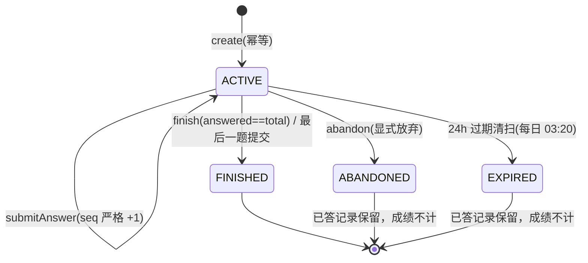

# 服务端-传统语汇文化积累引擎 详细设计

> 版本：v1.0（初版） ｜ 批次：2026-11-23 ｜ 错误码段：`44700-44799`（`_errcode_scan_20261122.js` 全库扫描确认 447xx 百位段空闲）

---

## 1. 概述

### 1.1 定位与背景

歇后语、谚语、俗语、名言警句是中小学语文积累与运用的四类传统语汇，贯穿 1~9 年级课标"日积月累"板块与中考"语言运用"考点。docs2 全库扫描确认该域**零专项覆盖**：

| 子域 | 全库扫描证据 | 缺口 |
| --- | --- | --- |
| 歇后语 | `歇后语` 关键词零命中（`_gap_scan6_20261122.js` 复核） | 引子/后衬两段式语料、谐音双关解析、补全与接龙训练全缺 |
| 谚语 | `谚语` 关键词零命中 | 农谚/气象谚/学习谚等分类语料与补下句训练全缺 |
| 俗语 | `俗语` 仅 4 处蹭词（AI 摘要/溯源文档示例语） | 语料库与"俗语 vs 成语"归属辨析训练全缺 |
| 名言警句 | `名言` 9 处蹭词（作文素材库/查词引擎为消费场景，非训练域）；`警句`/`格言` 零命中 | "名言-作者-出处"配对与语境运用训练全缺 |

相邻模块均不含本域：《语文素养专项训练系统（LIT_*）》权威边界为成语/病句/文学与文化常识/名著导读四子域（其 §6 文化常识枚举传统节日、称谓礼仪、历史典故、纪年计时、官职科举、地理称谓、书法艺术，**不含**歇后语/谚语/俗语/名言）；《作文素材库》是名言素材的**数据消费方**（写作时引用），无训练链路；《通用词典服务》存词语/成语词条，不含四类语料。

本文档定义 **传统语汇文化积累引擎（Folk Phrase Culture Engine，服务名 `folk-phrase-service`）**，为 1~9 年级提供四类语汇的语料管理、出题、判题、讲解、每日积累、接龙游戏与画像闭环。

### 1.2 适用学段与训练梯度

| 学段 | 重点子域 | 会话题量 | 梯度说明 |
| --- | --- | --- | --- |
| 1-2 年级 | 歇后语（常见 100 条）、谚语（生活/气象） | 6 题 | 选项带拼音；歇后语补后衬以二选一/三选一为主；配图卡 |
| 3-4 年级 | 谚语、歇后语全量、俗语入门 | 8 题 | 四选一补全；引入"语境运用判断"；每日一句上线 |
| 5-6 年级 | 俗语辨析（vs 成语归属）、名言警句 | 10 题 | 引入"俗语 vs 成语"分类题；名言-作者配对 |
| 7-9 年级 | 名言警句深度运用、歇后语语体色彩 | 10 题 | 引入"出处-作者-朝代"三连配对；谦敬与语体辨析；接龙挑战 |

内容量规划（编辑预录入为主，AI 扩写为辅且必须走审核管线，见 §5.4）：

| 子域 | 1-2 年级 | 3-4 年级 | 5-6 年级 | 7-9 年级 | 合计 |
| --- | --- | --- | --- | --- | --- |
| 歇后语 XIEHOUYU | 100 | 400 | 500 | 500 | 约 1500 |
| 谚语 YANYU | 80 | 300 | 400 | 400 | 约 1200 |
| 俗语 SUYU | 0 | 150 | 350 | 400 | 约 900 |
| 名言警句 MINGYAN | 0 | 100 | 500 | 1500 | 约 2100 |

### 1.3 权威边界（与已有模块分工）

| 模块 | 其权威 | 本引擎边界 |
| --- | --- | --- |
| 语文素养专项训练系统（LIT_*） | 成语、病句、文学与文化常识、名著导读四子域 | 本引擎四类语汇与 LIT **平级互补**，画像分表存储；LIT 的成语子域不反向覆盖本引擎"俗语 vs 成语"分类题（题目本体归本引擎，成语释义数据投影自词典） |
| 作文素材库 | 名言素材的引用消费场景 | 本引擎**只投影消费**其 `MINGYAN` 语料快照进 `fp_item`，运行期不同步调用 |
| 通用词典与汉字字典查询服务 | 成语/词语词条正文权威 | "俗语 vs 成语"分类题的成语选项数据命题期快照，运行期零调用 |
| 间隔重复算法与遗忘曲线复习调度引擎 | 复习间隔计算**算法权威** | 本引擎只提交复习请求与接收到期队列，不自行实现间隔公式 |
| AI-Prompt 编排与场景模板系统 | Prompt 模板管理 | 本引擎注册的 `FP_EXPLAIN_V1` 归其管理（R6） |
| 教育内容审核工作流与多级审核管线 | AI 生成内容审核权威 | AI 生成语料/题目必须送审，本引擎不内嵌审核判定（R5） |
| 学习提醒与智能通知调度系统 | 每日一句推送通道 | 本引擎产出 `daily_phrase.ready` 事件，触达调度归其（R8） |

### 1.4 名词约定

| 名词 | 含义 |
| --- | --- |
| 语汇项（Item） | 一条歇后语/谚语/俗语/名言的最小内容单元，表 `fp_item` |
| 引子/后衬 | 歇后语两段式结构：`外甥打灯笼——照旧（舅）`，前段为引子，后段为后衬，双关谐音为 `homophone_note` |
| 子域（SubDomain） | 四类语汇枚举划分，见 §3.1 |
| 快照（Snapshot） | 命题时从内容库/素材库复制进 `content_json` 的语料数据，与来源库解耦（G4） |
| 接龙（Chain） | 给定语汇后半末字，要求下一语汇前半首字同音（含声调从宽）的连续补全玩法 |

### 1.5 非目标（明确不做）

1. 不做**成语**训练（归 LIT 语文素养系统）；本引擎仅在"俗语 vs 成语"分类题中作为选项数据投影消费。
2. 不做**古诗文**背诵与飞花令（归古诗文专项与诗词竞技引擎）。
3. 不维护名言素材的原始版权数据（归作文素材库/内容供应商域），本引擎仅消费投影。
4. 不实现间隔重复算法（调用底层引擎）。
5. 不做名言的**英文翻译**训练（归英语专项）。
6. 不做绕口令（归中文朗读能力评估引擎材料域）。

---

## 2. 整体架构

### 2.1 引擎架构图

```
┌──────────────────────────────────────────────────────────────────┐
│              客户端（传统语汇学习页：每日一句/闪卡/练习/接龙）        │
│  每日一句 → 闪卡浏览 → 补全练习 → 运用判断 → 讲解流 → 接龙挑战       │
└─────────────────────┬────────────────────────────────────────────┘
                      │ HTTP / SSE
┌─────────────────────▼────────────────────────────────────────────┐
│                        API 网关 / BFF                             │
└─────────────────────┬────────────────────────────────────────────┘
                      │
┌─────────────────────▼────────────────────────────────────────────┐
│          传统语汇文化积累引擎 (folk-phrase-service)                │
│                                                                  │
│  ┌───────────┐ ┌───────────┐ ┌───────────┐ ┌───────────┐        │
│  │ 会话编排   │ │ 判题引擎   │ │ 讲解管线   │ │ 画像计算   │        │
│  │ Session   │ │ Judger    │ │ Explainer │ │ Profiler  │        │
│  │ Service   │ │ (策略)    │ │ (SSE)     │ │           │        │
│  └─────┬─────┘ └─────┬─────┘ └─────┬─────┘ └─────┬─────┘        │
│        │             │             │             │               │
│  ┌─────▼─────────────▼─────────────▼─────────────▼───────────┐   │
│  │                出题策略层 (Item Strategy)                  │   │
│  │  到期复习优先 → 薄弱项优先 → 新项补充（比例护栏 §4.1）        │   │
│  └─────┬──────────────────────────┬────────────────────────┘   │
│        │                          │                             │
│  ┌─────▼──────────┐         ┌─────▼──────────┐                 │
│  │ 内容存储        │         │ 命题管线        │                 │
│  │ fp_item        │         │ 编辑录入/AI 扩写 │                 │
│  └────────────────┘         │ 送审/发布       │                 │
│                             └────────────────┘                 │
│  ┌───────────┐ ┌───────────┐ ┌───────────┐                     │
│  │ 每日一句   │ │ 接龙引擎   │ │ 通知触发   │                     │
│  │ DailyDraw │ │ ChainEng  │ │ Notifier  │                     │
│  └───────────┘ └───────────┘ └───────────┘                     │
└──────┬──────────────────┬───────────────────┬───────────────────┘
       │ Outbox 事件      │ 调用              │ 调用
       ▼                  ▼                   ▼
  统一事件总线       间隔重复引擎          AI 推理统一适配层
       │                  ▲                   ▲
       ▼                  │                   │
  学情/激励/时长/   到期复习队列           Prompt 编排系统
  家长报告服务
```

### 2.2 上下游依赖

| 依赖 | 方向 | 用途 | 失败降级 |
| --- | --- | --- | --- |
| AI 推理统一适配层 | 运行期调用 | 讲解生成、AI 复核争议项、AI 扩写命题 | 讲解降级为内置静态解析（§11.2 D2）；复核降级为 `recheck_state=UNAVAILABLE` 不改判；AI 命题管线阻塞，存量快照不受影响 |
| 内容安全规则引擎 | 命题期同步 | AI 生成语料先审后发 | 审核不通过不入库（fail-closed G6） |
| 内容审核工作流 | 命题期异步 | AI 生成题/语料多级审核 | 同 G6 |
| 间隔重复引擎 | 运行期调用 | 答错项复习排程 | 本地兜底 `next_review_at=+1d`（D3） |
| 学习提醒与智能通知调度 | 事件下游 | 每日一句触达推送 | 仅应用内卡片展示，推送缺失不阻塞 |
| 统一异步任务进度中心 | 运行期调用 | AI 讲解异步任务状态 | 客户端退避轮询降级 |

---

## 3. 核心数据结构

### 3.1 枚举定义

```java
/** 语汇子域 */
public enum FolkSubDomain {
    XIEHOUYU,   // 歇后语（引子+后衬两段式）
    YANYU,      // 谚语（农谚/气象谚/学习谚/生活谚/修身谚）
    SUYU,       // 俗语（口语化定型短语）
    MINGYAN     // 名言警句（含作者/出处/朝代）
}

/** 练习题型（判题策略路由键） */
public enum FolkQuizType {
    LATTER_SELECT,       // 歇后语：引子 → 4 选 1 后衬
    FORMER_SELECT,       // 歇后语：后衬 → 4 选 1 引子
    HOMOPHONE_EXPLAIN,   // 歇后语：谐音双关解析 4 选 1
    NEXT_HALF_COMPLETE,  // 谚语/名言：给出前半 → 补全后半（选择或输入）
    USAGE_JUDGE,         // 给出句子判断语汇使用是否恰当（是/否）
    SOURCE_MATCH,        // 名言：文本-作者-出处 三连配对
    CATEGORY_CLASSIFY,   // 给定短语判断属"俗语"还是"成语"
    CHAIN_LINK           // 接龙：给定上句末字，选/填首字同音的下一句
}

/** 会话模式 */
public enum FolkSessionMode {
    PRACTICE,    // 常规练习（按出题策略装配）
    FLASHCARD,   // 闪卡浏览（记住了/没记住，不入判分）
    CHAIN,       // 接龙挑战
    DAILY        // 每日一句（单题轻会话）
}

/** 语汇项状态 */
public enum FolkItemStatus {
    DRAFT,       // 草稿（编辑录入中）
    IN_REVIEW,   // 审核中（AI 生成内容强制进入）
    PUBLISHED,   // 已发布（可下发）
    OFFLINE      // 已下线（保留历史答题可追溯）
}

/** 接龙判定结果 */
public enum ChainVerdict {
    EXACT,        // 首字完全相同
    HOMOPHONE,    // 同音不同字（声调从宽：一声/四声互通视为通过，方言音不纳入）
    INVALID       // 不通过
}
```

### 3.2 语汇项主表 `fp_item`

```sql
CREATE TABLE `fp_item` (
  `id`             BIGINT UNSIGNED NOT NULL AUTO_INCREMENT,
  `item_no`        VARCHAR(32)  NOT NULL COMMENT '业务编号 FP-XH-0001 形式，幂等键',
  `sub_domain`     VARCHAR(16)  NOT NULL COMMENT 'XIEHOUYU/YANYU/SUYU/MINGYAN',
  `grade_band`     VARCHAR(8)   NOT NULL COMMENT 'G12/G34/G56/G79 适用学段带，多段逗号分隔',
  `category`       VARCHAR(32)  NOT NULL DEFAULT '' COMMENT '子类：谚语=AGRICULTURE/WEATHER/STUDY/LIFE/MORAL；名言主题标签',
  `head_text`      VARCHAR(128) NOT NULL COMMENT '前半：歇后语引子/谚语前句/俗语全文/名言全文',
  `tail_text`      VARCHAR(128) NOT NULL DEFAULT '' COMMENT '后半：歇后语后衬/谚语后句/名言下句，无则空',
  `pinyin_snapshot` JSON      NOT NULL COMMENT '首尾字拼音快照 {headFirst:{char,pinyin},tailLast:{char,pinyin}}，接龙判定权威',
  `content_json`   JSON         NOT NULL COMMENT '题型载荷结构，见 §3.3',
  `meaning`        VARCHAR(512) NOT NULL DEFAULT '' COMMENT '释义（讲解兜底用）',
  `usage_example`  VARCHAR(512) NOT NULL DEFAULT '' COMMENT '运用例句',
  `source_ref`     VARCHAR(128) NOT NULL DEFAULT '' COMMENT '来源：作文素材库素材号/编辑录入/AI 扩写批次号',
  `status`         VARCHAR(16)  NOT NULL DEFAULT 'DRAFT',
  `ai_generated`   TINYINT(1)   NOT NULL DEFAULT 0 COMMENT 'AI 生成标记，强制 IN_REVIEW',
  `version`        INT          NOT NULL DEFAULT 1 COMMENT '乐观锁 CAS',
  `created_at`     DATETIME(3)  NOT NULL DEFAULT CURRENT_TIMESTAMP(3),
  `updated_at`     DATETIME(3)  NOT NULL DEFAULT CURRENT_TIMESTAMP(3) ON UPDATE CURRENT_TIMESTAMP(3),
  PRIMARY KEY (`id`),
  UNIQUE KEY `uk_item_no` (`item_no`),
  KEY `idx_domain_status_grade` (`sub_domain`, `status`, `grade_band`),
  KEY `idx_tail_pinyin` ((CAST(JSON_EXTRACT(`pinyin_snapshot`, '$.tailLast.pinyin') AS CHAR(16))))
) COMMENT='传统语汇语料主表';
```

**红线 G1**：`pinyin_snapshot` 在发布时由服务端拼音归一化管线统一生成（pypinyin 词组模式 + 多音字词频裁决表），**禁止**客户端/编辑手工指定；接龙判定只读快照，运行期不实时拼音转换。

### 3.3 `content_json` 题型载荷结构

按子域区分四种载荷，判题引擎按 `quiz_type` 取所需字段：

```jsonc
// —— XIEHOUYU 歇后语 ——
{
  "head": "外甥打灯笼",
  "tail": "照旧（舅）",
  "homophone_note": "“旧”与“舅”同音，双关字面义“照着舅舅”与语义“照旧如此”",
  "register": "口语",
  "distractor_tails": [      // LATTER_SELECT 干扰项，命题期生成，长度/语体与正解同质
    {"tail": "白忙一场", "reason": "长度接近但无语义关联"},
    {"tail": "人人有份", "reason": "常见后衬结构"},
    {"tail": "有口难言", "reason": "常见后衬结构"}
  ],
  "distractor_heads": [ ... ]
}

// —— YANYU 谚语 ——
{
  "first_half": "朝霞不出门",
  "second_half": "晚霞行千里",
  "meaning": "早晨出现朝霞预示天气将变坏，傍晚出现晚霞预示天气转好",
  "category": "WEATHER",
  "distractor_seconds": [
    {"text": "暮雨涨满川", "reason": "句式同构"},
    {"text": "日晕三更雨", "reason": "同为气象谚但不可搭配"}
  ]
}

// —— SUYU 俗语 ——
{
  "text": "三天打鱼，两天晒网",
  "meaning": "比喻做事没有恒心，时常中断",
  "register": "口语",
  "similar_idiom": {          // 分类题干扰构造用，投影自词典/LIT，只读快照
    "idiom": "一曝十寒",
    "difference_note": "一曝十寒为成语，偏书面；“三天打鱼，两天晒网”为俗语，偏口语"
  },
  "contrast_options": ["一曝十寒", "锲而不舍", "废寝忘食"]   // CATEGORY_CLASSIFY 成语选项池
}

// —— MINGYAN 名言警句 ——
{
  "text": "学而不思则罔，思而不学则殆",
  "author": "孔子",
  "dynasty": "春秋",
  "source_work": "《论语·为政》",
  "theme_tags": ["学习", "思考"],
  "applicable_scene": "论述学与思关系的议论文引用",
  "distractor_authors": [     // SOURCE_MATCH 作者干扰项
    {"author": "孟子", "dynasty": "战国", "source_work": "《孟子·尽心上》"},
    {"author": "荀子", "dynasty": "战国", "source_work": "《荀子·劝学》"},
    {"author": "朱熹", "dynasty": "南宋", "source_work": "《朱子语类》"}
  ]
}
```

### 3.4 `answer_json` 结构（会话题面下发快照）

```jsonc
{
  "quizType": "LATTER_SELECT",
  "itemNo": "FP-XH-0001",
  "subDomain": "XIEHOUYU",
  "stem": "外甥打灯笼——（　）",
  "options": [                 // 服务端乱序后下发，含正确项；判题只认 optionId
    {"optionId": "opt_a", "text": "照旧（舅）"},
    {"optionId": "opt_b", "text": "白忙一场"},
    {"optionId": "opt_c", "text": "人人有份"},
    {"optionId": "opt_d", "text": "有口难言"}
  ],
  "inputMode": "SELECT",       // SELECT | INPUT（NEXT_HALF_COMPLETE 支持两种）
  "chainContext": null         // CHAIN_LINK 时为上链信息 {prevTailLast:{char,pinyin},chainLen}
}
```

**红线 G2**：题面**不含** `correctOptionId`/`correctText` 字段；判题与讲解在服务端完成，客户端零答案驻留。

### 3.5 会话表 `fp_session`

```sql
CREATE TABLE `fp_session` (
  `id`             BIGINT UNSIGNED NOT NULL AUTO_INCREMENT,
  `session_no`     VARCHAR(40)  NOT NULL COMMENT '幂等业务编号 FP-S + 雪花段',
  `user_id`        BIGINT UNSIGNED NOT NULL,
  `child_id`       BIGINT UNSIGNED NOT NULL COMMENT '家庭多孩场景，学习主体为 child',
  `mode`           VARCHAR(16)  NOT NULL COMMENT 'PRACTICE/FLASHCARD/CHAIN/DAILY',
  `grade_band`     VARCHAR(8)   NOT NULL,
  `quiz_types`     JSON         NOT NULL COMMENT '本次会话题型集合',
  `item_snapshot`  JSON         NOT NULL COMMENT '题面快照数组，创建时一次性装配',
  `total_count`    INT          NOT NULL,
  `answered_count` INT          NOT NULL DEFAULT 0,
  `correct_count`  INT          NOT NULL DEFAULT 0,
  `score`          INT          NOT NULL DEFAULT 0,
  `chain_best`     INT          NOT NULL DEFAULT 0 COMMENT 'CHAIN 模式最高链长',
  `status`         VARCHAR(16)  NOT NULL DEFAULT 'ACTIVE' COMMENT 'ACTIVE/FINISHED/EXPIRED/ABANDONED',
  `idempotency_key` VARCHAR(64) NOT NULL,
  `version`        INT          NOT NULL DEFAULT 1,
  `created_at`     DATETIME(3)  NOT NULL DEFAULT CURRENT_TIMESTAMP(3),
  `finished_at`    DATETIME(3)  NULL,
  `expire_at`      DATETIME(3)  NOT NULL COMMENT '创建+24h，过期清理',
  PRIMARY KEY (`id`),
  UNIQUE KEY `uk_idem` (`user_id`, `idempotency_key`),
  KEY `idx_user_active` (`user_id`, `status`, `created_at`)
) COMMENT='语汇学习会话表';
```

### 3.6 答题记录表 `fp_answer_log`

```sql
CREATE TABLE `fp_answer_log` (
  `id`             BIGINT UNSIGNED NOT NULL AUTO_INCREMENT,
  `session_no`     VARCHAR(40)  NOT NULL,
  `seq`            INT          NOT NULL COMMENT '题序号 1..N',
  `item_no`        VARCHAR(32)  NOT NULL,
  `quiz_type`      VARCHAR(32)  NOT NULL,
  `answer_payload` JSON         NOT NULL COMMENT '{selectedOptionId?:string,inputText?:string,judgement?:boolean}',
  `correct`        TINYINT(1)   NOT NULL,
  `judge_detail`   JSON         NOT NULL COMMENT '判题明细，见 §4.7',
  `ai_recheck`     VARCHAR(16)  NOT NULL DEFAULT 'NONE' COMMENT 'NONE/PENDING/APPLIED/REJECTED/UNAVAILABLE',
  `answer_ms`      INT          NOT NULL DEFAULT 0,
  `created_at`     DATETIME(3)  NOT NULL DEFAULT CURRENT_TIMESTAMP(3),
  PRIMARY KEY (`id`),
  UNIQUE KEY `uk_session_seq` (`session_no`, `seq`),
  KEY `idx_item` (`item_no`, `correct`, `created_at`)
) COMMENT='语汇答题记录表';
```

### 3.7 语汇画像表 `fp_profile`

```sql
CREATE TABLE `fp_profile` (
  `id`             BIGINT UNSIGNED NOT NULL AUTO_INCREMENT,
  `child_id`       BIGINT UNSIGNED NOT NULL,
  `sub_domain`     VARCHAR(16)  NOT NULL,
  `grade_band`     VARCHAR(8)   NOT NULL,
  `item_no`        VARCHAR(32)  NOT NULL COMMENT 'Item 粒度掌握度',
  `mastery`        DECIMAL(4,3) NOT NULL DEFAULT 0 COMMENT 'EMA 掌握度 0..1，见 §4.6',
  `answer_count`   INT          NOT NULL DEFAULT 0,
  `correct_count`  INT          NOT NULL DEFAULT 0,
  `last_answer_at` DATETIME(3)  NULL,
  `next_review_at` DATETIME(3)  NULL COMMENT '复习到期时间（间隔重复引擎回写）',
  `version`        INT          NOT NULL DEFAULT 1,
  `updated_at`     DATETIME(3)  NOT NULL DEFAULT CURRENT_TIMESTAMP(3) ON UPDATE CURRENT_TIMESTAMP(3),
  PRIMARY KEY (`id`),
  UNIQUE KEY `uk_child_domain_item` (`child_id`, `sub_domain`, `item_no`),
  KEY `idx_review_due` (`child_id`, `next_review_at`)
) COMMENT='语汇掌握度画像表（Item 粒度）';
```

### 3.8 Redis 键设计

| 键 | 类型 | TTL | 说明 |
| --- | --- | --- | --- |
| `fp:session:{sessionNo}` | String(JSON) | 24h | 会话热缓存，写穿模式，DB 为准 |
| `fp:idem:{userId}:{idemKey}` | String | 24h | 幂等回放（存 session_no） |
| `fp:daily:{childId}:{yyyyMMdd}` | String | 48h | 每日一句抽签结果缓存，防重复摇签 |
| `fp:chain:lock:{sessionNo}` | String | 5s | 接龙回合走行锁（NX+短 TTL 兜底） |
| `fp:explain:sem:{modelRoute}` | 信号量 | — | 讲解生成并发信号量，防 AI 故障扩散 |
| `fp:item:pub:{subDomain}:{gradeBand}` | Set | 永久 | 已发布 item_no 索引，出题 O(1) 抽样 |
| `fp:quota:ai:{childId}:{yyyyMMdd}` | String | 48h | AI 讲解当日计数 |

### 3.9 领域事件表 `fp_outbox`

```sql
CREATE TABLE `fp_outbox` (
  `id`             BIGINT UNSIGNED NOT NULL AUTO_INCREMENT,
  `event_id`       VARCHAR(40)  NOT NULL,
  `event_type`     VARCHAR(64)  NOT NULL,
  `payload`        JSON         NOT NULL,
  `status`         VARCHAR(16)  NOT NULL DEFAULT 'PENDING' COMMENT 'PENDING/SENT/FAILED',
  `retry_count`    INT          NOT NULL DEFAULT 0,
  `created_at`     DATETIME(3)  NOT NULL DEFAULT CURRENT_TIMESTAMP(3),
  PRIMARY KEY (`id`),
  UNIQUE KEY `uk_event_id` (`event_id`),
  KEY `idx_status` (`status`, `created_at`)
) COMMENT='语汇域 Outbox（同事务写入，relay 异步投递）';
```

---

## 4. 出题与判题引擎

### 4.1 出题策略（会话装配）

**PRACTICE 模式三集合装配护栏**（与 LIT/词语辨析引擎同构，保持全库训练域口径一致）：

```
到期复习集合 R：next_review_at <= now 的画像项，上限占题量 40%
薄弱项集合 W ：mastery < 0.4 且未到期，上限 30%
新项集合 N   ：本学段带未学过（无画像行）的 PUBLISHED 项
装配顺序     ：R → W → N 依次补足 total_count
护栏         ：R 不足时 W/N 顺延补齐，禁止超配额硬塞
```

- **CHAIN 模式**：从 `chain_seed_pool`（尾字拼音覆盖度最高的 200 个种子项）随机起链，连续回合见 §4.5。
- **DAILY 模式**：每日一句从"当日到期复习项（50% 权重）∪ 未学新项（30%）∪ 已掌握巩固项（20%）"加权随机抽取一条，结果写 `fp:daily:{childId}:{yyyyMMdd}`。
- FLASHCARD 模式不出题判分，仅返回语料卡（head_text/tail_text/meaning/usage_example）。

### 4.2 LATTER_SELECT / FORMER_SELECT 判题（歇后语补全）

精确匹配：学生所选 `optionId` 与题面内嵌的 `correctOptionId` 比对（题面下发时剥离答案字段，判题时从 `item_snapshot` 还原，G2）。

```typescript
// LatterSelectJudger.ts
@Injectable()
export class LatterSelectJudger implements FolkJudger {
  readonly quizType = FolkQuizType.LATTER_SELECT;

  judge(question: QuestionSnapshot, answer: AnswerPayload): JudgeResult {
    if (!answer.selectedOptionId) {
      throw new BizException(44740, 'ANSWER_FORMAT_INVALID', 'LATTER_SELECT 缺少 selectedOptionId');
    }
    const correct = question.correctOptionId === answer.selectedOptionId;
    return {
      correct,
      judgeDetail: {
        strategy: 'EXACT_OPTION_MATCH',
        matchedOptionId: answer.selectedOptionId,
        expectedHash: sha256(question.correctOptionId), // 明细只存哈希，答案明文不出服务端内存
      },
      masteryDelta: correct ? +0.2 : -0.15,
    };
  }
}
```

### 4.3 NEXT_HALF_COMPLETE 判题（谚语/名言补下句）

- **SELECT 子模式**：同 §4.2 精确匹配。
- **INPUT 子模式**：严格匹配——归一化后（去标点/全半角统一/空白裁剪）与 `tail_text` 比对；**不通过即判错**，语义等价但字面不同（如"晚霞行千里"答"晚霞晒死人"）由 AI 复核打标（`ai_recheck`），**复核只标注不翻案**（G3，防止 LLM 判分漂移）。

```typescript
// NextHalfCompleteJudger.ts
judge(question: QuestionSnapshot, answer: AnswerPayload): JudgeResult {
  const norm = (s: string) => s.replace(/[，。！？、；：""''（）\s]/g, '')
                              .replace(/[！-～]/g, (c) => String.fromCharCode(c.charCodeAt(0) - 0xFEE0));
  if (answer.inputText && question.inputMode === 'INPUT') {
    const correct = norm(answer.inputText) === norm(question.expectedTail);
    return {
      correct,
      judgeDetail: { strategy: 'STRICT_NORMALIZED_MATCH', normalized: true },
      masteryDelta: correct ? +0.2 : -0.15,
      aiRecheck: correct ? 'NONE' : 'PENDING', // 仅错题进复核队列，T+1 离线执行
    };
  }
  // SELECT 分支略（同 4.2）
}
```

### 4.4 USAGE_JUDGE / CATEGORY_CLASSIFY / SOURCE_MATCH / HOMOPHONE_EXPLAIN 判题

均为**精确匹配**（判断题布尔比对 / 配对逐项比对），要点：

| 题型 | 判题要点 | 特殊规则 |
| --- | --- | --- |
| USAGE_JUDGE | 学生 `judgement` 布尔 vs 题面预判定（编辑录入时人工标注句子中语汇使用恰当与否） | 句子由编辑预录入，AI 生成句子必须审核后入库（G6）；不做 LLM 现场语境裁决（R2） |
| CATEGORY_CLASSIFY | 学生判断 vs 预标注 | 选项成语数据为词典投影快照，题内不存成语释义正文 |
| SOURCE_MATCH | 三项（文本-作者-出处）全对得满分，错一项不得分 | 干扰项与正解同朝代/同流派（同质干扰），避免"跨朝代秒选" |
| HOMOPHONE_EXPLAIN | 4 选 1 精确匹配 | 解析文本走 AI 生成必须审核；小学低龄段不出此题型 |

**统一计分**：单题 10 分，会话 `score = correct_count * 10`。掌握度更新用 §4.6 的 EMA，与得分独立。

### 4.5 CHAIN_LINK 接龙判题

接龙判定为**纯规则引擎**（同音字表 + 拼音快照，零 LLM）：

```
回合 r：客户端提交 next_item（选/填下一句） + 上一句末字 lastChar
判定：
  1. lastChar.pinyin == next.headFirst.pinyin  → EXACT（完全同音同字或同音异字均记 EXACT，
                                                分两层仅用于成就细分，不差别计分）
  2. 声调差异且属于白名单通融对（一声↔四声）    → HOMOPHONE
  3. 其余                                       → INVALID，回合终止
附加校验：
  - next_item 必须在 PUBLISHED 语料库内（防编造名言）；自选 INPUT 模式的自由文本
    走"候选匹配"：归一化后命中语料库前端正配才算合法，否则 INVALID（提示"这句还不在语料库"）
  - 同一 chain 内 item 不得重复（去重集在会话快照内）
得分：chainLen × 10；会话结束落 `chain_best`（个人最佳，仅自比，不上排行榜 R7）
```

**红线 G5**：接龙不开放自由文本无限编造；INPUT 模式也必须命中语料库，保证内容安全可控（未成年人保护）。

### 4.6 掌握度更新（Item 粒度 EMA）

```typescript
// FolkProfiler.ts —— EMA 与词语辨析/LIT 引擎同构，全库训练域统一口径
const ALPHA = 0.3;
newMastery = round3(
  oldMastery * (1 - ALPHA) + (correct ? 1 : 0) * ALPHA
);
// 修正：answer_count < 3 时以 (correctCount/3) 与 EMA 加权，
// 防前期小样本剧烈抖动；answer_count >= 3 后纯 EMA。
```

- 答错立即置 `next_review_at = now + 1d`（间隔重复引擎调用失败时的本地兜底见 D3）。
- `mastery >= 0.8` 且连续 2 次答对 → 标记掌握，停止主动出题，转入 20% 权重的巩固抽样（§4.1 DAILY）。
- FLASHCARD 模式的"没记住"点击按答错同等语义进入 EMA；"记住了"按答对。

### 4.7 错因结构 `judge_detail`

```jsonc
{
  "strategy": "STRICT_NORMALIZED_MATCH",
  "quizType": "NEXT_HALF_COMPLETE",
  "matchedOptionId": null,
  "expectedHash": "sha256:9f2c...",
  "errorTags": ["TAIL_CONFUSED", "HOMOPHONE_IGNORED"],  // 见下表
  "recheckState": "PENDING"
}
```

| errorTag | 语义 | 触发条件 |
| --- | --- | --- |
| `TAIL_CONFUSED` | 后衬/下句记混 | INPUT 归一化后与其他选项 Levenshtein 距离 ≤2 |
| `HOMOPHONE_IGNORED` | 谐音点未掌握 | XIEHOUYU 错题且干扰项为同音后衬 |
| `SOURCE_CONFUSED` | 作者/出处记混 | SOURCE_MATCH 作者对出处错（或反之） |
| `REGISTER_MISMATCH` | 语体色彩误判 | USAGE_JUDGE 语体类错题 |
| `CATEGORY_CONFUSED` | 俗语/成语归属混淆 | CATEGORY_CLASSIFY 错题 |

错因标签随答题记录落库，供学情分析与个性化补练（与 LIT/词语辨析引擎错因标签命名空间隔离 R10）。

### 4.8 命题管线（内容生产）

```
编辑录入 ──→ 校验（两段式结构/pinyin 快照/适龄）──→ DRAFT ──→ 审核（≥1 人）──→ PUBLISHED
AI 扩写 ──→ 内容安全规则引擎同步过滤 ──→ 审核管线（机审+人审）──→ IN_REVIEW ──→ 通过 → PUBLISHED
                                                    └──→ 不通过 → 丢弃留痕
```

- AI 扩写 Prompt 模板码 `FP_GENERATE_V1`（48 条/批，温度 0.7，按子域分批）。
- 谐音歇后语专项：AI 生成后必须经"同音校验器"（pypinyin 复算 `homophone_note` 中声称的同音关系，校验不符即打回），防止幻觉谐音。
- 名言出处：`author`/`dynasty`/`source_work` 三元组必须能在通用词典/素材库交叉命中，未命中转人工核实。

---

## 5. AI 讲解与生成

### 5.1 使用场景与配额

| 场景 | 触发 | 配额 |
| --- | --- | --- |
| 错题讲解 | 答错后学生点"为什么" | 免费用户 5 次/日，会员 50 次/日（`fp:quota:ai` 计数，超限返回 44710 降级静态解析） |
| 每日一句延展讲解 | 每日一句卡片"展开讲解" | 不占配额（预生成静态解析随卡片下发） |
| AI 复核争议项 | 错题 INPUT 判题 T+1 离线 | 内部配额，不对用户可见 |

### 5.2 讲解 Prompt 模板（注册进 Prompt 编排系统，模板码 `FP_EXPLAIN_V1`）

```text
你是小学语文教辅编辑，为 {{grade_band}} 学生讲解一条{{sub_domain_name}}。

语汇：{{head_text}}{{tail_text}}
释义：{{meaning}}
例句：{{usage_example}}
学生的错误答案：{{wrong_answer}}
错因标签：{{error_tags}}

要求：
1. 120 字以内，先共情（"这个很容易记混"），再讲清关键区别点；
2. 歇后语必须点破谐音双关（如"旧/舅"）；
3. 禁止使用"显然""众所周知"等词，禁止延伸课外无关知识；
4. 输出为 JSON：{"plainExplanation": "...", "memoryHook": "...", "followUpTip": "..."}
```

### 5.3 讲解输出 JSON Schema（服务端校验，不合法即重试 1 次后降级）

```json
{
  "type": "object",
  "required": ["plainExplanation", "memoryHook"],
  "properties": {
    "plainExplanation": { "type": "string", "maxLength": 200 },
    "memoryHook":       { "type": "string", "maxLength": 60 },
    "followUpTip":      { "type": "string", "maxLength": 100 }
  },
  "additionalProperties": false
}
```

### 5.4 AI 生成题入库审核管线

AI 生成语料/题目 → 内容安全规则引擎（同步）→ 教育内容审核工作流（异步机审+人审）→ 通过后由本引擎装配为 `fp_item(DRAFT→IN_REVIEW→PUBLISHED)`。**审核权威外置**（R5），本引擎只消费审核结论；`ai_generated=1` 的语料在语料卡展示 AIGC 标识（合规 C4）。

---

## 6. API 接口设计

### 6.1 接口清单

| # | 方法 | 路径 | 说明 | 主要错误码 |
| --- | --- | --- | --- | --- |
| 1 | GET | `/api/v1/folk/daily` | 每日一句（含当日是否已摇签） | 44702 |
| 2 | POST | `/api/v1/folk/daily/draw` | 摇签（手动重抽一次/日） | 44708 |
| 3 | POST | `/api/v1/folk/sessions` | 创建会话（PRACTICE/FLASHCARD/CHAIN） | 44707/44730 |
| 4 | GET | `/api/v1/folk/sessions/{sessionNo}` | 会话详情（题面快照） | 44703 |
| 5 | POST | `/api/v1/folk/sessions/{sessionNo}/answers` | 单题提交 | 44704/44705/44740 |
| 6 | POST | `/api/v1/folk/sessions/{sessionNo}/finish` | 整卷结算 | 44704 |
| 7 | GET | `/api/v1/folk/sessions/{sessionNo}/report` | 会话报告 | 44703 |
| 8 | POST | `/api/v1/folk/explain` | 错题讲解（SSE 或异步） | 44710/44711 |
| 9 | GET | `/api/v1/folk/profile` | 四子域画像与复习到期数 | — |
| 10 | GET | `/api/v1/folk/review-due` | 今日到期复习列表 | — |
| 11 | POST | `/api/v1/folk/sessions/{sessionNo}/abandon` | 放弃会话 | 44704 |

统一约定：请求头 `X-Idempotency-Key`（#3/#5 幂等）；学生身份经统一认证（`child_id` 由家长门会话上下文注入，客户端不可直传任意 child_id，G7）。

### 6.2 创建会话（#3）

```jsonc
// POST /api/v1/folk/sessions
// Request
{
  "mode": "PRACTICE",                // PRACTICE | FLASHCARD | CHAIN | DAILY
  "gradeBand": "G56",                // 与账号学段不一致时服务端以账号为准并纠偏
  "quizTypes": ["LATTER_SELECT", "NEXT_HALF_COMPLETE", "USAGE_JUDGE"],
  "totalCount": 10,
  "idempotencyKey": "cli-uuid-v7"
}

// Response 200
{
  "code": 0,
  "data": {
    "sessionNo": "FP-S20261123001",
    "mode": "PRACTICE",
    "status": "ACTIVE",
    "totalCount": 10,
    "answeredCount": 0,
    "questions": [
      {
        "seq": 1,
        "quizType": "LATTER_SELECT",
        "subDomain": "XIEHOUYU",
        "stem": "外甥打灯笼——（　）",
        "options": [
          {"optionId": "opt_b", "text": "白忙一场"},
          {"optionId": "opt_a", "text": "照旧（舅）"},
          {"optionId": "opt_c", "text": "人人有份"},
          {"optionId": "opt_d", "text": "有口难言"}
        ],
        "inputMode": "SELECT"
      }
    ],
    "expireAt": "2026-11-24T23:30:00+08:00"
  }
}
```

幂等语义：同 `idempotencyKey` 重放返回首次创建结果（`idemReplay=true` 标记），不新建会话（44706 不再作为错误返回，见 §11.1）。

### 6.3 单题提交（#5）

```jsonc
// POST /api/v1/folk/sessions/{sessionNo}/answers
// Request
{ "seq": 1, "answer": {"selectedOptionId": "opt_a"}, "clientElapsedMs": 4200 }

// Response 200（答对）
{
  "code": 0,
  "data": {
    "seq": 1,
    "correct": true,
    "scoreDelta": 10,
    "judgeDetail": {
      "strategy": "EXACT_OPTION_MATCH",
      "errorTags": []
    },
    "mastery": 0.62,
    "aiRecheck": "NONE"
  }
}

// Response 200（答错）
{
  "code": 0,
  "data": {
    "seq": 1,
    "correct": false,
    "scoreDelta": 0,
    "judgeDetail": {
      "strategy": "STRICT_NORMALIZED_MATCH",
      "errorTags": ["TAIL_CONFUSED"],
      "recheckState": "PENDING"
    },
    "mastery": 0.35,
    "explainHint": "可查看讲解"   // 仅提示文案，讲解内容须调 #8 获取
  }
}
```

### 6.4 讲解（#8，SSE）

```text
POST /api/v1/folk/explain
{ "sessionNo": "FP-S20261123001", "seq": 3 }
→ 200 text/event-stream
event: explanation
data: {"plainExplanation":"...","memoryHook":"...","followUpTip":"..."}

event: done
data: {"explainId": "FP-E-8812", "aiGenerated": true}
```

额度耗尽（44710）或 AI 不可用（D2）时降级返回内置静态解析（`meaning` + `errorTags` 模板拼装），HTTP 200，`aiGenerated=false`，客户端诚实展示"简化讲解"。

### 6.5 整卷结算与画像（#6 / #9）

```jsonc
// POST /api/v1/folk/sessions/{sessionNo}/finish → Response
{
  "code": 0,
  "data": {
    "sessionNo": "FP-S20261123001",
    "status": "FINISHED",
    "correctCount": 8,
    "totalCount": 10,
    "score": 80,
    "rewardHint": {"type": "POINTS", "amount": 20},   // 仅提示，激励发放归激励引擎（R4）
    "subDomainBreakdown": [
      {"subDomain": "XIEHOUYU", "correct": 3, "total": 4},
      {"subDomain": "YANYU",    "correct": 3, "total": 4},
      {"subDomain": "SUYU",     "correct": 2, "total": 2}
    ]
  }
}

// GET /api/v1/folk/profile → Response（节选）
{
  "code": 0,
  "data": {
    "childId": 88001,
    "subDomains": [
      {"subDomain": "XIEHOUYU", "learned": 214, "mastered": 96,
       "avgMastery": 0.61, "reviewDueCount": 12, "weakItems": ["FP-XH-0187"]}
    ]
  }
}
```

---

## 7. 关键代码示例

### 7.1 会话编排（TypeScript / NestJS 风格）

```typescript
@Injectable()
export class FolkSessionService {
  constructor(
    private readonly itemRepo: FolkItemRepository,
    private readonly profileRepo: FolkProfileRepository,
    private readonly reviewClient: ReviewScheduleClient,   // 间隔重复引擎 gRPC
    private readonly cache: RedisService,
    @InjectRepository(FolkSession) private readonly sessionRepo: Repository<FolkSession>,
  ) {}

  async create(userId: number, childId: number, dto: CreateSessionDto): Promise<SessionView> {
    // 幂等短路：命中即回放
    const replayKey = `fp:idem:${userId}:${dto.idempotencyKey}`;
    const replay = await this.cache.get(replayKey);
    if (replay) return this.toView(await this.getSession(replay), true);

    await this.antirCheatGuard(childId, 'FOLK');         // 防沉迷闸，fail-closed（44730）
    const band = await this.resolveGradeBand(childId, dto.gradeBand);
    const items = await this.assembleItems(childId, band, dto);   // §4.1 三集合护栏
    if (items.length === 0) throw new BizException(44712, 'POOL_EMPTY');

    const sessionNo = await this.idGen.next('FP-S');
    const snapshot = items.map((it, i) => this.buildQuestion(it, i + 1, dto.mode));
    await this.sessionRepo.manager.transaction(async (tx) => {
      await tx.save(FolkSession, {
        sessionNo, userId, childId, mode: dto.mode, gradeBand: band,
        quizTypes: dto.quizTypes, itemSnapshot: snapshot,
        totalCount: snapshot.length, status: 'ACTIVE',
        idempotencyKey: dto.idempotencyKey,
        expireAt: dayjs().add(24, 'hour').toDate(),
      });
      await tx.save(FolkOutbox, Outbox.of('folk.session.created',
        { sessionNo, childId, mode: dto.mode, totalCount: snapshot.length }));
    });
    await this.cache.set(replayKey, sessionNo, 86400);
    return this.toView(await this.getSession(sessionNo), false);
  }
}
```

### 7.2 判题路由（策略模式）

```typescript
const JUDGERS = new Map<FolkQuizType, FolkJudger>([
  [FolkQuizType.LATTER_SELECT,      new LatterSelectJudger()],
  [FolkQuizType.FORMER_SELECT,      new FormerSelectJudger()],
  [FolkQuizType.HOMOPHONE_EXPLAIN,  new HomophoneExplainJudger()],
  [FolkQuizType.NEXT_HALF_COMPLETE, new NextHalfCompleteJudger()],
  [FolkQuizType.USAGE_JUDGE,        new UsageJudgeJudger()],
  [FolkQuizType.SOURCE_MATCH,       new SourceMatchJudger()],
  [FolkQuizType.CATEGORY_CLASSIFY,  new CategoryClassifyJudger()],
  [FolkQuizType.CHAIN_LINK,         new ChainLinkJudger(chainRules)],
]);

async submitAnswer(userId: number, sessionNo: string, dto: SubmitAnswerDto) {
  const session = await this.lockSession(sessionNo);           // SELECT ... FOR UPDATE
  if (session.status !== 'ACTIVE') throw new BizException(44704, 'SESSION_STATE_INVALID');
  if (dto.seq !== session.answeredCount + 1) throw new BizException(44705, 'SEQ_OUT_OF_ORDER');

  const question = session.itemSnapshot[dto.seq - 1];
  const judger = JUDGERS.get(question.quizType as FolkQuizType);
  if (!judger) throw new BizException(44799, 'UNKNOWN_QUIZ_TYPE');

  const result = judger.judge(question, dto.answer);
  await this.sessionRepo.manager.transaction(async (tx) => {
    await tx.save(FolkAnswerLog, {
      sessionNo, seq: dto.seq, itemNo: question.itemNo,
      quizType: question.quizType, answerPayload: dto.answer,
      correct: result.correct, judgeDetail: result.judgeDetail,
      aiRecheck: result.aiRecheck ?? 'NONE', answerMs: dto.clientElapsedMs,
    });
    await tx.update(FolkSession, { sessionNo }, {
      answeredCount: session.answeredCount + 1,
      correctCount: session.correctCount + (result.correct ? 1 : 0),
      version: session.version + 1,
    });
  });
  await this.profiler.applyEma(session.childId, question.itemNo, result);  // §4.6
  return result;
}
```

### 7.3 接龙判定（规则引擎）

```typescript
@Injectable()
export class ChainRules {
  /** 声调从宽容忍对：一声(1)↔四声(4) 视为 HOMOPHONE；其余声调必须严格相等 */
  private static readonly TONE_TOLERANT: Record<number, number[]> = { 1: [4], 4: [1] };

  verdict(prevTailLast: PinyinUnit, nextHeadFirst: PinyinUnit): ChainVerdict {
    if (prevTailLast.pinyin === nextHeadFirst.pinyin) return ChainVerdict.EXACT;
    const sameSyllable = prevTailLast.pinyin.replace(/\d$/, '') ===
                         nextHeadFirst.pinyin.replace(/\d$/, '');
    if (!sameSyllable) return ChainVerdict.INVALID;
    const t1 = Number(prevTailLast.pinyin.slice(-1));
    const t2 = Number(nextHeadFirst.pinyin.slice(-1));
    if (t1 === t2) return ChainVerdict.EXACT;
    return (ChainRules.TONE_TOLERANT[t1] ?? []).includes(t2)
      ? ChainVerdict.HOMOPHONE
      : ChainVerdict.INVALID;
  }
}
```

### 7.4 SSE 讲解编排

```typescript
@Sse('explain')
async explain(@Body() dto: ExplainDto, @Res() res: Response) {
  const quota = await this.quotaService.consume(dto.childId, 'FOLK_EXPLAIN');
  if (!quota.ok) {                      // 44710 降级：静态解析
    res.write(`event: explanation\ndata: ${JSON.stringify(
      StaticExplainer.render(dto.sessionNo, dto.seq))}\n\n`);
    return res.write('event: done\ndata: {"aiGenerated":false}\n\n');
  }
  const stream = await this.aiGateway.stream('FP_EXPLAIN_V1', dto.context, { signal: res });
  for await (const chunk of stream) {
    // 累计 JSON，边收边校验；不完整则缓冲，完成后做 Schema 校验（§5.3）
    res.write(`event: explanation\ndata: ${JSON.stringify(chunk)}\n\n`);
  }
  res.write(`event: done\ndata: {"aiGenerated":true}\n\n`);
}
```

---

## 8. 状态流转

### 8.1 会话状态机



### 8.2 守卫规则表

| 守卫 | 规则 | 违反后果 |
| --- | --- | --- |
| G1 | pinyin_snapshot 服务端统一生成，禁手工指定 | 发布接口 400 |
| G2 | 题面/响应零答案字段（含哈希替代） | CI 契约扫描拦截 |
| G3 | AI 复核只标注不翻案 | 复核模块无 update correct 权限（代码评审红线） |
| G4 | 命题快照与来源库解耦，运行期零跨服务读 | 违反即 P1 事故 |
| G5 | 接龙自由文本必须命中语料库 | ChainLinkJudger 拒绝并提示 |
| G6 | AI 生成语料必须过审核管线，fail-closed | 未过审状态不可转 PUBLISHED（DB 约束） |
| G7 | child_id 由家长门上下文注入，客户端不可直传 | 越权访问 401，审计日志留痕 |
| G8 | 防沉迷闸 fail-closed：管控服务不可用时禁止开局 | 44730，无重试按钮 |
| G9 | finish 幂等：重复结算返回首次结果 | 重复发奖由激励引擎幂等兜底（R4） |
| G10 | 会话 24h 过期，过期后禁止提交 | 44704 |

### 8.3 单题判定状态

```
PENDING → JUDGED ─→ CORRECT / WRONG ─→ (WRONG 且 INPUT 型) → RECHECK_PENDING
                                                    → RECHECK_DONE(APPLIED/REJECTED/UNAVAILABLE)
```

---

## 9. 幂等与并发

| 场景 | 机制 |
| --- | --- |
| 创建会话重复提交 | `uk_idem(user_id, idempotency_key)` + Redis 24h 回放 |
| 单题重复提交（双击/重试） | `uk_session_seq` 冲突即返回已存判定（`idemReplay=true`），**不重复计分计掌握** |
| 并发挥答（多端） | 会话行乐观锁 `version`；`answered_count` CAS 失败即 44704 要求重拉 |
| 接龙回合并发 | `fp:chain:lock:{sessionNo}` NX 5s 锁；回合数校验拒绝乱序 |
| 结算与放弃并发 | 先取锁后判状态；FINISHED/ABANDONED 终态不可逆 |
| 每日摇签并发 | `fp:daily` SETNX，每日仅一次，重复返回 44708（200 语义） |

---

## 10. 领域事件

### 10.1 发布（`fp_outbox` 同事务写入，relay 投递）

| event_type | 触发 | 消费方 |
| --- | --- | --- |
| `folk.session.created` | 会话创建 | 学习时长归因（category=FOLK，R7） |
| `folk.session.finished` | 结算成功 | 激励引擎（积分发放）、学情聚合 |
| `folk.item.mastered` | 掌握度首达 0.8 | 成就/里程碑服务 |
| `folk.review.registered` | 答错复习排程 | 间隔重复引擎（注册到期队列） |
| `folk.daily_phrase.ready` | 每日一句生成 | 学习提醒与通知调度（R8） |
| `folk.error_tagged` | 错题带 errorTags 落库 | 学情分析（语汇子域薄弱点） |

### 10.2 上游订阅

| 订阅事件 | 用途 |
| --- | --- |
| `account.deleted` | 级联清理：会话/答题/画像/每日缓存（24h 内完成，合规 C6） |
| `minor_protection.changed` | 防沉迷参数热更新（本地缓存 5min TTL 强制失效） |
| `content.copyright_expired` | 来源语料版权到期 → 关联 `fp_item` 强制 OFFLINE（fail-closed） |

---

## 11. 错误处理

### 11.1 业务错误码（`44700-44799` 段，全库扫描确认空闲）

| 码 | 符号 | HTTP | 语义 |
| --- | --- | --- | --- |
| 44700 | ITEM_NOT_FOUND | 404 | 语汇项不存在 |
| 44701 | ITEM_NOT_PUBLISHED | 404 | 语汇项未发布 |
| 44702 | GRADE_BAND_FORBIDDEN | 403 | 学段不适龄 |
| 44703 | SESSION_NOT_FOUND | 404 | 会话不存在/已清理 |
| 44704 | SESSION_STATE_INVALID | 409 | 会话状态非法（终态/过期/乱序） |
| 44705 | SEQ_OUT_OF_ORDER | 409 | 题序号越界或乱序提交 |
| 44706 | IDEM_REPLAY | 200 | 幂等重放（正常语义，body 带 idemReplay） |
| 44707 | DAILY_NEW_LIMIT | 200 | 超出每日新增学习上限，引导复习（引导帧） |
| 44708 | DAILY_ALREADY_DRAWN | 200 | 今日已摇签 |
| 44709 | CHAIN_NO_EXTENSION | 200 | 接龙无可用续链，正常收官 |
| 44710 | AI_QUOTA_EXHAUSTED | 200 | 讲解额度耗尽，降级静态解析 |
| 44711 | EXPLAIN_IN_PROGRESS | 200 | 讲解生成中（异步任务态） |
| 44712 | POOL_EMPTY | 200 | 当前学段语料池为空（上线初期保护） |
| 44720 | REVIEW_REJECTED | 422 | 内容审核未通过 |
| 44721 | COPYRIGHT_RESTRICTED | 403 | 引文版权受限已下线 |
| 44730 | MINOR_PROTECTION_BLOCK | 403 | 防沉迷拦截（fail-closed，无重试） |
| 44731 | PARENT_CONTROL_DISABLED | 403 | 家长管控关闭该功能 |
| 44740 | ANSWER_FORMAT_INVALID | 400 | 提交格式非法 |
| 44750 | INTERNAL_ERROR | 500 | 服务端内部错误（兜底） |
| 44799 | UNKNOWN_QUIZ_TYPE | 500 | 未知题型（灰度配置漂移） |

### 11.2 降级矩阵

| 编号 | 故障 | 降级行为 |
| --- | --- | --- |
| D1 | AI 适配层超时/不可用 | 讲解降级静态解析（44710 帧，`aiGenerated=false`）；AI 命题管线暂停（监控告警） |
| D2 | 静态解析包缺失 | 返回 `meaning` 原文 + 通用鼓励话术（禁编造讲解） |
| D3 | 间隔重复引擎调用失败 | 本地 `next_review_at=+1d` 兜底，恢复后对账补排 |
| D4 | 画像服务读取超时 | 出题退化为纯新项随机（复习/薄弱权重失效，仅本次会话） |
| D5 | 内容安全规则引擎超时（命题期） | fail-closed：该批 AI 生成内容挂起不入库 |
| D6 | 推送通道不可用 | 每日一句仅在应用内展示，不影响生成 |
| D7 | 会话缓存 Redis 失效 | 回源 DB，无功能损失（仅延迟） |
| D8 | 管控服务不可用 | 防沉迷 fail-closed 禁止开局（G8） |
| D9 | 出题语料池不足 totalCount | 按实际可装配数下发并在响应 `poolShortage=true` 显式告知 |
| D10 | — | **总红线**：判题确定性（零 LLM 现场判分）/答案键不下发/防沉迷 fail-closed/审核 fail-closed，四项不可降级 |

### 11.3 边界条件

1. **谚语单句型**（无 second_half，如"饭后百步走，活到九十九"为双句；但"人心齐，泰山移"部分版本仅收单句）：`tail_text` 为空时 NEXT_HALF_COMPLETE 不出该题，仅出 USAGE_JUDGE/HOMOPHONE_EXPLAIN。
2. **歇后语后衬多版本**（"泥菩萨过江——自身难保/自身不保"）：命题时以 `tail_text` 为正解，`distractor_tails` 不得混入其他版本（编辑校验规则，防止多答案争议）。
3. **名言版本异文**（"天才是 1% 的灵感加上 99% 的汗水"多种措辞）：同义异文统一走"正解唯一 + 异文进 distractor 禁选"策略，正解以课标/教材引用版本为准。
4. **零样本画像冷启动**：`answer_count=0` 时 mastery 记 0 但不进薄弱集合（防池枯竭），走新项集合。
5. **跨年升迁**：grade_band 升迁时画像保留，出题按新学段带过滤（旧学段已掌握项不再主动出题）。

---

## 12. 缓存与性能

- 会话热缓存 24h（写穿，DB 为准）；题面快照整包存 `fp:session:{sessionNo}`，单会话 ≤30KB。
- 已发布语料索引 `fp:item:pub:*` 全量预热（约 5.7k 条，Set 成员），发布/下线时增量维护。
- 出题抽样：Redis `SRANDMEMBER` 结合画像过滤，单会话装配 P95 < 150ms；画像批量读取走 `uk_child_domain_item` 批量点查。
- 目标容量：DAU 50 万，语汇功能渗透 4%（2 万日活），日会话 3 万，答题 25 万行/日，`fp_answer_log` 按月分区保留 12 个月。

## 13. 安全与合规

| # | 红线 |
| --- | --- |
| C1 | 内容安全：所有语料（含编辑录入）过敏感词规则引擎；涉政/涉黄/涉暴条目 fail-closed |
| C2 | 防沉迷：会话计时上报时长服务（category=FOLK）；未成年人单日会话数与时段管控 fail-closed（G8） |
| C3 | 零社交：本期不含 UGC 造句/分享接龙成绩；无排行榜，接龙 `chain_best` 仅自比（R7） |
| C4 | AIGC 标识：AI 生成语料卡与讲解常驻"AI 生成"徽标，不可关闭 |
| C5 | 隐私：答题记录不含自由文本原文的哈希化处理仅用于 INPUT 判题，日志禁打印答案明文 |
| C6 | 注销级联：账号删除 24h 内清理会话/答题/画像/缓存（§10.2） |
| C7 | 版权：来源标记 `source_ref` 必填；版权到期事件触发自动 OFFLINE（fail-closed） |
| C8 | 话术零贬义：判题反馈与讲解禁用"太笨了""简单错误"等表述（话术白名单） |

## 14. 监控指标

| 指标 | 告警阈值 | 说明 |
| --- | --- | --- |
| M1 会话创建成功率 | < 99.5%（5min） | 含幂等重放 |
| M2 判题 P99 | > 300ms | 含画像更新 |
| M3 AI 讲解成功率 | < 95%（1h） | 触发 D1 降级率同步观测 |
| M4 AI 命题审核通过率 | < 60%（日） | 异常低说明 Prompt 漂移，冻结该批 |
| M5 接龙 INVALID 率 | > 25%（日） | 过高说明拼音快照质量缺陷，触发语料巡检 |
| M6 Outbox 积压 | > 5000 条（10min） | relay 故障 |
| M7 语料池覆盖率 | 学段带 < 规划量 50% | 上线爬坡期监控 |
| M8 幂等重放占比 | > 10%（日） | 客户端重试风暴排查 |

## 15. 测试要点

1. **判题确定性**：8 题型全矩阵用例（正答/错答/乱序/越界/缺字段）；INPUT 归一化用例覆盖全半角/异体标点/空白。
2. **接龙规则**：同音表边界（多音字"行 xíng/háng"按词组模式取音）、声调从宽对白名单外严格拒绝、重复项拒绝、语料库未命中拒绝。
3. **幂等并发**：双击提交/多端并发/结算放弃竞争/摇签并发，断言零重复计分。
4. **降级注入**：AI 不可用/画像超时/规则引擎超时/管控不可用四路注入，断言 D1-D9 行为与 D10 红线。
5. **审核 fail-closed**：`ai_generated=1` 未经审核直改 PUBLISHED 的 DB 约束拒绝验证。
6. **pinyin 快照权威**：手工指定拼音的发布请求 400；快照与实时拼音不一致时以快照为准的回归用例。

## 16. 与其他文档的关系

| 文档 | 关系 |
| --- | --- |
| 语文素养专项训练系统（LIT_*） | 平级互补：LIT 成语/病句/常识/名著，本引擎歇后语/谚语/俗语/名言；错因标签命名空间隔离（R10） |
| 作文素材库管理与主题素材智能推荐服务 | 名言语料投影来源（消费方→本引擎为训练方） |
| 通用词典与汉字字典查询服务 | 分类题成语选项数据投影来源 |
| 间隔重复算法与遗忘曲线复习调度引擎 | 复习排程算法权威（R3） |
| AI-Prompt 编排与场景模板系统 | `FP_EXPLAIN_V1`/`FP_GENERATE_V1` 模板注册管理（R6） |
| 教育内容审核工作流与多级审核管线 | AI 生成内容审核权威（R5） |
| 学习提醒与智能通知调度系统 | 每日一句触达通道（R8） |
| 客户端-语文词语辨析练习页面架构与交互设计 | 页面形态参照（后续批次：传统语汇客户端页面层零覆盖） |

## 17. 维护记录

- 2026-11-23 v1.0 新增初版：补齐"歇后语/谚语/俗语/名言警句"四类传统语汇全库零覆盖缺口（`_errcode_scan_20261122.js` 复核 447xx 空闲；`_gap_scan6_20261122.js` 关键词扫描零命中）。定义四子域枚举/八题型判题策略/四表+Outbox+Redis 七键/三集合装配护栏/接龙规则引擎（拼音快照权威 G1）/每日一句加权抽签/AI 讲解 SSE 与静态降级/44700-44799 错误码 22 项/G1-G10/C1-C8/R1-R10/AC 测试要点。
