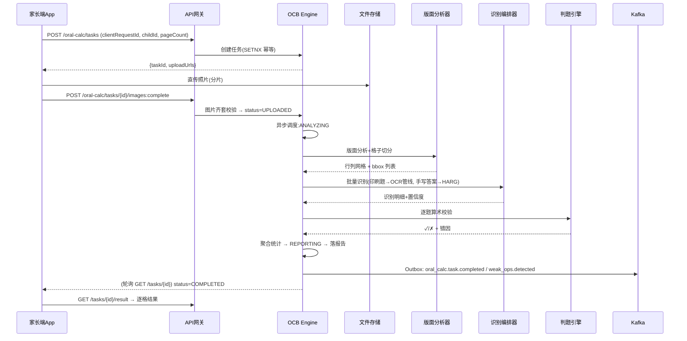

# 服务端-口算拍照整页批改引擎 - 详细设计

## 1. 概述

### 1.1 模块定位

口算拍照整页批改引擎(Oral Calculation Photo Batch-Grading Engine,简称 OCB Engine)是 PrimeTop 平台"纸质口算作业即时批改"场景的服务端编排权威。家长(或学生)用手机对一整页手写口算作业拍照上传,本引擎在秒级内完成版面分析、逐格切分、印刷题目与手写答案识别、逐题算术校验批改、错因归类,并生成可视化批改报告与针对性口算训练建议。

**一句话定位:** 整页口算批改的场景编排者与判题权威;识别能力复用既有引擎,本引擎不自建识别模型。

### 1.2 与已有模块的边界

| 已有模块 | 覆盖范围 | 与本引擎的关系 |
|---------|---------|----------------|
| 图片处理与OCR识别管线 | 印刷体题目识别(拍题搜题) | 印刷题目文本识别权威归其所有,本引擎按格子 bbox 调用其单图识别能力 |
| 服务端-学生手写答案识别与手写体智能批改引擎(HARG) | 手写体/手写公式识别、逐题分步批改 | 手写数字与符号识别权威归 HARG;本引擎不重复实现手写识别模型 |
| 服务端-基础计算能力诊断与口算速算自适应训练引擎 | App 内交互式口算训练与诊断 | 训练编排权威归其所有;本引擎产出 weak_ops 事件供其生成针对性训练 |
| 服务端-多题型统一判题引擎与答案评估策略框架 | 练习/测评域数字化题目判题 | 判题域权威归其所有;口算批改对象为"识别出的印刷题+手写答案",属独立场景判题,不复用其策略框架(见 §14 R3) |
| 服务端-纸质答题卡拍照识别与客观题自动阅卷评分引擎 | 标准答题卡整卷阅卷 | 该引擎面向学校考试标准答题卡;本引擎面向家庭场景任意口算页(练习册/打印页/手抄题) |
| 服务端-拍照搜题请求编排与题目智能匹配路由服务 | 单题拍照搜题 | 单题检索场景;本引擎是"整页批改"场景,两者入口与产物完全不同 |

### 1.3 核心业务场景

| 场景 | 描述 | 输入 | 输出 |
|------|------|------|------|
| 家长批改整页口算 | 家长拍照孩子已完成的一页口算作业 | 1-4 张照片 | 逐格 ✓/✗ 结果 + 错因统计 + 批改报告 |
| 学生自查口算 | 学生自己拍照检查 | 照片 | 同上(结果仅本人与家长可见) |
| 打印题页批改 | 家长用平台打印的口算题页(含隐形定位标记) | 照片 | 高精度网格对齐 + 逐题批改 |
| 错因分析与训练建议 | 批改完成后自动分析错误模式 | 批改明细 | 错因分布 + 针对性训练推荐(事件驱动) |
| 家长改判 | 识别或判题有误时家长手工修正 | 单格改判 | 改判留痕 + 模型质量回流 |

### 1.4 设计目标

| 目标维度 | 指标 |
|---------|------|
| 单页批改端到端延迟(P95) | ≤ 6 秒(40 格以内) |
| 单页批改端到端延迟(P99) | ≤ 12 秒 |
| 手写数字识别准确率 | ≥ 97%(复用 HARG 指标,口算场景数字字符集更小) |
| 印刷口算题识别准确率 | ≥ 99%(四则运算算式为封闭文法) |
| 判题准确率 | 100%(纯算术规则校验,无模型参与判题) |
| 网格切分召回率 | ≥ 98%(印刷格/打印定位标记);≥ 92%(无格手写) |
| 峰值吞吐 | 500 页/分钟(开学季晚高峰) |
| 家长改判率 | ≤ 3%(识别质量目标) |

### 1.5 非目标(明确不做)

1. 不自建手写识别模型 —— 识别权威归 HARG(见 §14 R1)
2. 不做口算训练编排 —— 训练权威归口算速算训练引擎(见 §14 R4)
3. 不支持复杂竖式/脱式/应用题批改 —— 超出四则运算封闭文法的格子标记 `UNSUPPORTED`,交由 HARG/拍照搜题链路
4. 不做班级批量场景 —— 教师端批量阅卷归智能作业批改引擎

## 2. 整体架构

### 2.1 架构图

```
┌──────────────────────────────────────────────────────────────┐
│                      客户端(家长端/学生端)                    │
│   拍照(连拍/相册) → 端侧预处理(去阴影/增强) → 上传           │
└──────────────────────────────┬───────────────────────────────┘
                               │ HTTPS / 分片直传 OSS
                               ▼
┌──────────────────────────────────────────────────────────────┐
│                OCB Engine(本引擎,Java/Spring Boot)            │
│                                                              │
│  ┌────────────┐  ┌──────────────┐  ┌─────────────────────┐  │
│  │ Task服务    │  │ 版面分析器    │  │ 判题引擎(Rule)       │  │
│  │ (任务编排)  │  │ LayoutAnalyzer│  │ ArithmeticVerifier  │  │
│  └─────┬──────┘  └──────┬───────┘  └──────────┬──────────┘  │
│        │                │                     │             │
│  ┌─────▼──────┐  ┌──────▼───────┐  ┌──────────▼──────────┐  │
│  │ 异步任务中心 │  │ 格子切分器    │  │ 错因分析器           │  │
│  │ (DAG编排)   │  │ GridSegmenter│  │ ErrorCauseClassifier│  │
│  └─────┬──────┘  └──────┬───────┘  └──────────┬──────────┘  │
│        │                │                     │             │
│        │         ┌──────▼─────────────────────▼──┐          │
│        │         │ 识别编排器 RecognizeOrchestrator│          │
│        │         │  ├─ 印刷题 → OCR 管线          │          │
│        │         │  └─ 手写答案 → HARG            │          │
│        │         └───────────────────────────────┘          │
│  ┌─────▼──────────────────────────────────────────┐         │
│  │ 报告生成器 ReportGenerator(含 LLM 错因点评,可选) │         │
│  └────────────────────────────────────────────────┘         │
└───────┬───────────────┬───────────────┬────────────────────┘
        │               │               │
        ▼               ▼               ▼
  ┌──────────┐   ┌────────────┐   ┌──────────────────┐
  │ MySQL    │   │ Redis      │   │ 事件 Outbox → Kafka│
  │ (任务/明细)│   │ (锁/配额/缓存)│   │ (weak_ops 等)     │
  └──────────┘   └────────────┘   └──────────────────┘
```

### 2.2 处理管线总览

```
UPLOADED → ANALYZING(版面分析+格子切分) → RECOGNIZING(印刷+手写识别)
         → GRADING(逐题算术校验) → REPORTING(报告+错因) → COMPLETED
```

每个阶段均为异步任务中心中的一个 DAG 节点,支持断点续跑与单阶段重试(见 §7)。

## 3. 核心数据结构

### 3.1 枚举定义

```typescript
// 任务状态
enum OralCalcTaskStatus {
  CREATED = 'CREATED',          // 已创建,等待图片齐套
  UPLOADED = 'UPLOADED',        // 图片齐套,待调度
  ANALYZING = 'ANALYZING',      // 版面分析中
  RECOGNIZING = 'RECOGNIZING',  // 识别中
  GRADING = 'GRADING',          // 判题中
  REPORTING = 'REPORTING',      // 报告生成中
  COMPLETED = 'COMPLETED',      // 终态:完成
  PARTIAL_COMPLETED = 'PARTIAL_COMPLETED', // 终态:部分格子失败,其余可用
  FAILED = 'FAILED',            // 终态:失败(整页不可用)
  CANCELED = 'CANCELED',        // 终态:用户取消
  EXPIRED = 'EXPIRED',          // 终态:超时未处理(图片上传后 24h)
}

// 格子来源
enum ItemSource {
  PRINT = 'PRINT',        // 印刷题目(练习册/打印页)
  HANDWRITE_PROBLEM = 'HANDWRITE_PROBLEM', // 手抄题目(识别题目本身)
}

// 格子状态
enum ItemStatus {
  PENDING = 'PENDING',        // 待识别
  RECOGNIZED = 'RECOGNIZED',  // 已识别待判题
  GRADED = 'GRADED',          // 已判题
  UNSUPPORTED = 'UNSUPPORTED',// 超出口算封闭文法(竖式/应用题等)
  RECOG_FAILED = 'RECOG_FAILED', // 识别失败(低置信度)
}

// 错因类型
enum OralCalcErrorType {
  NONE = 'NONE',
  CARRY_ERROR = 'CARRY_ERROR',       // 进位错误
  BORROW_ERROR = 'BORROW_ERROR',     // 退位错误
  FACT_ERROR = 'FACT_ERROR',         // 乘法口诀/加法事实错误
  OPERATOR_ERROR = 'OPERATOR_ERROR', // 符号看错/写错
  COPY_ERROR = 'COPY_ERROR',         // 抄错数
  BLANK = 'BLANK',                   // 未作答
  WRONG_BUT_VALID = 'WRONG_BUT_VALID', // 结果错误但过程无明确模式
}

// 改判状态
enum ReviewStatus {
  NONE = 'NONE',
  PENDING_REVIEW = 'PENDING_REVIEW', // 低置信度待家长确认
  CONFIRMED = 'CONFIRMED',           // 家长已确认(含改判)
}

// 版面类型
enum LayoutType {
  PRINTED_GRID = 'PRINTED_GRID',   // 印刷方格(练习册)
  PRINTED_MARKER = 'PRINTED_MARKER', // 平台打印页(含定位标记)
  HAND_DRAWN_GRID = 'HAND_DRAWN_GRID', // 手画格
  FREE_FORM = 'FREE_FORM',         // 无格自由排布
}
```

### 3.2 数据库表 DDL

```sql
-- 3.2.1 批改任务表
CREATE TABLE oral_calc_task (
  id                BIGINT UNSIGNED NOT NULL AUTO_INCREMENT COMMENT '任务ID(雪花ID)',
  task_no           VARCHAR(32)  NOT NULL COMMENT '对外任务号(展示用)',
  user_id           BIGINT UNSIGNED NOT NULL COMMENT '发起用户(家长或学生)',
  child_id          BIGINT UNSIGNED NULL COMMENT '学生ID(家长发起时必填,需家长门校验)',
  client_request_id VARCHAR(64)  NOT NULL COMMENT '客户端幂等键',
  page_count        TINYINT      NOT NULL DEFAULT 1 COMMENT '页数(1-4)',
  status            VARCHAR(20)  NOT NULL DEFAULT 'CREATED',
  fail_code         VARCHAR(10)  NULL COMMENT '失败错误码(OCB_*)',
  fail_message      VARCHAR(255) NULL,
  total_items       INT          NOT NULL DEFAULT 0,
  graded_items      INT          NOT NULL DEFAULT 0,
  correct_items     INT          NOT NULL DEFAULT 0,
  accuracy          DECIMAL(5,4) NULL COMMENT '正确率(0-1)',
  weak_ops_json     JSON         NULL COMMENT '薄弱运算维度统计',
  error_stats_json  JSON         NULL COMMENT '错因分布统计',
  report_id         BIGINT UNSIGNED NULL,
  version           INT          NOT NULL DEFAULT 0 COMMENT '乐观锁',
  expire_at         DATETIME     NOT NULL COMMENT '图片上传截止(创建+24h)',
  created_at        DATETIME     NOT NULL DEFAULT CURRENT_TIMESTAMP,
  updated_at        DATETIME     NOT NULL DEFAULT CURRENT_TIMESTAMP ON UPDATE CURRENT_TIMESTAMP,
  finished_at       DATETIME     NULL,
  PRIMARY KEY (id),
  UNIQUE KEY uk_user_client_req (user_id, client_request_id),
  KEY idx_child_created (child_id, created_at),
  KEY idx_status_expire (status, expire_at)
) ENGINE=InnoDB COMMENT='口算拍照批改任务表';

-- 3.2.2 批改页表
CREATE TABLE oral_calc_page (
  id             BIGINT UNSIGNED NOT NULL AUTO_INCREMENT,
  task_id        BIGINT UNSIGNED NOT NULL,
  page_no        TINYINT      NOT NULL COMMENT '页码,从1开始',
  image_url      VARCHAR(512) NOT NULL COMMENT '原图地址(短期留存)',
  image_hash     CHAR(64)     NOT NULL COMMENT 'SHA-256,用于重复图去重',
  layout_type    VARCHAR(20)  NULL COMMENT '版面类型',
  grid_rows      TINYINT      NULL,
  grid_cols      TINYINT      NULL,
  detect_score   DECIMAL(4,3) NULL COMMENT '版面检测置信度',
  detect_status  VARCHAR(20)  NOT NULL DEFAULT 'PENDING',
  created_at     DATETIME     NOT NULL DEFAULT CURRENT_TIMESTAMP,
  PRIMARY KEY (id),
  UNIQUE KEY uk_task_page (task_id, page_no),
  KEY idx_image_hash (image_hash)
) ENGINE=InnoDB COMMENT='口算批改页表';

-- 3.2.3 格子小题表(核心明细)
CREATE TABLE oral_calc_item (
  id                 BIGINT UNSIGNED NOT NULL AUTO_INCREMENT,
  task_id            BIGINT UNSIGNED NOT NULL,
  page_id            BIGINT UNSIGNED NOT NULL,
  row_no             SMALLINT     NOT NULL,
  col_no             SMALLINT     NOT NULL,
  bbox_json          JSON         NOT NULL COMMENT '格子矩形 {x,y,w,h}(千分比坐标)',
  source             VARCHAR(20)  NOT NULL DEFAULT 'PRINT',
  problem_text       VARCHAR(128) NULL COMMENT '识别出的题目文本,如 36+47=',
  problem_latex      VARCHAR(128) NULL,
  problem_confidence DECIMAL(4,3) NULL,
  student_answer     VARCHAR(32)  NULL COMMENT '识别出的手写答案原文',
  answer_value       DECIMAL(18,4) NULL COMMENT '解析出的数值(仅纯数字答案)',
  answer_confidence  DECIMAL(4,3) NULL,
  expected_value     DECIMAL(18,4) NULL COMMENT '标准答案(判题后回填)',
  is_correct         TINYINT(1)   NULL COMMENT '是否正确;NULL=未判/无法判',
  error_type         VARCHAR(20)  NOT NULL DEFAULT 'NONE',
  status             VARCHAR(20)  NOT NULL DEFAULT 'PENDING',
  review_status      VARCHAR(20)  NOT NULL DEFAULT 'NONE',
  reviewed_by        BIGINT UNSIGNED NULL,
  reviewed_at        DATETIME     NULL,
  review_note        VARCHAR(128) NULL,
  misjudgment_flag   TINYINT(1)   NOT NULL DEFAULT 0 COMMENT '家长标记识别/判题有误',
  version            INT          NOT NULL DEFAULT 0,
  created_at         DATETIME     NOT NULL DEFAULT CURRENT_TIMESTAMP,
  updated_at         DATETIME     NOT NULL DEFAULT CURRENT_TIMESTAMP ON UPDATE CURRENT_TIMESTAMP,
  PRIMARY KEY (id),
  UNIQUE KEY uk_page_cell (page_id, row_no, col_no),
  UNIQUE KEY uk_task_cell (task_id, page_id, row_no, col_no),
  KEY idx_task_status (task_id, status),
  KEY idx_child_weak (task_id, is_correct, error_type)
) ENGINE=InnoDB COMMENT='口算批改格子明细表';

-- 3.2.4 批改报告表
CREATE TABLE oral_calc_report (
  id               BIGINT UNSIGNED NOT NULL AUTO_INCREMENT,
  task_id          BIGINT UNSIGNED NOT NULL,
  title            VARCHAR(64)  NOT NULL COMMENT '如 三年级口算批改报告',
  accuracy         DECIMAL(5,4) NOT NULL,
  total_items      INT          NOT NULL,
  correct_items    INT          NOT NULL,
  duration_seconds INT          NULL COMMENT '学生书写用时(家长可选填写)',
  error_stats_json JSON         NOT NULL,
  weak_ops_json    JSON         NOT NULL,
  ai_comment       TEXT         NULL COMMENT 'LLM 生成的鼓励性点评(异步回填)',
  ai_comment_status VARCHAR(20) NOT NULL DEFAULT 'PENDING',
  share_token      VARCHAR(64)  NULL COMMENT '分享短码(脱敏)',
  created_at       DATETIME     NOT NULL DEFAULT CURRENT_TIMESTAMP,
  PRIMARY KEY (id),
  UNIQUE KEY uk_task (task_id),
  UNIQUE KEY uk_share_token (share_token)
) ENGINE=InnoDB COMMENT='口算批改报告表';

-- 3.2.5 Outbox 事件表
CREATE TABLE ocb_domain_outbox (
  id             BIGINT UNSIGNED NOT NULL AUTO_INCREMENT,
  event_id       VARCHAR(64)  NOT NULL,
  event_type     VARCHAR(64)  NOT NULL,
  aggregate_id   BIGINT UNSIGNED NOT NULL COMMENT 'task_id',
  payload_json   JSON         NOT NULL,
  occurred_at    DATETIME     NOT NULL,
  published_at   DATETIME     NULL,
  publish_retry  INT          NOT NULL DEFAULT 0,
  created_at     DATETIME     NOT NULL DEFAULT CURRENT_TIMESTAMP,
  PRIMARY KEY (id),
  UNIQUE KEY uk_event_id (event_id),
  KEY idx_unpublished (published_at, id)
) ENGINE=InnoDB COMMENT='OCB 领域事件 Outbox';
```

### 3.3 Redis 键设计

| 键 | 类型 | TTL | 说明 |
|---|------|-----|------|
| `ocb:idem:{userId}:{clientRequestId}` | String(任务ID) | 24h | 幂等键,SETNX 防重 |
| `ocb:lock:task:{taskId}` | String | 10min | 任务级调度锁,防 DAG 节点重复执行 |
| `ocb:quota:daily:{userId}` | Hash | 24h(当日晚点过期) | 每日批改页数配额,如 `{count: 3, limit: 20}` |
| `ocb:dup:image:{sha256}` | String(任务ID) | 2h | 重复图片秒回(同一用户 2h 内重复拍同一页直接返回旧结果) |
| `ocb:rate:upload:{userId}` | Token bucket | - | 上传限速 10 次/分钟 |
| `ocb:llm:comment:{taskId}` | String | 1h | AI 点评生成分布式锁 |

## 4. 核心流程设计

### 4.1 端到端时序



### 4.2 版面分析与格子切分

**输入:** 单页照片(经客户端预处理:透视矫正、去阴影、增强)。
**输出:** 有序格子列表 `(row_no, col_no, bbox)`。

算法策略按版面类型分三级:

| 版面类型 | 检测策略 | 说明 |
|---------|---------|------|
| PRINTED_MARKER | 定位标记锚定 | 平台打印页四角含 ArUco 标记,单应变换后按模板精确切分(召回≈100%) |
| PRINTED_GRID | 印刷线检测 | OpenCV 形态学提取横竖线,交点聚类重建行列;跨线粘连时按等距插值 |
| HAND_DRAWN_GRID | 手绘线检测 | 线段检测容错版(线宽/抖动容忍),行列数按多数投票 |
| FREE_FORM | 文本行聚类 | 连通域分析→行聚类→行内等宽切分;置信度低于 0.7 时标记人工确认 |

```java
public List<CellBox> segmentPage(PageImage image, LayoutHint hint) {
    // 1. 判定版面类型(分类器:轻量 CNN,或按 hint 直通)
    LayoutType type = layoutClassifier.classify(image, hint);

    // 2. 按类型切分
    List<CellBox> cells = switch (type) {
        case PRINTED_MARKER -> markerBasedSegment(image);   // 模板精确切分
        case PRINTED_GRID   -> lineBasedSegment(image, 0.9f); // 严格阈值
        case HAND_DRAWN_GRID-> lineBasedSegment(image, 0.6f); // 容错阈值
        case FREE_FORM      -> textClusterSegment(image);    // 行聚类
    };

    // 3. 质量门控:格数异常(>120 或 <1)或均分置信度 < 0.7 → 转人工确认清单
    if (cells.size() > MAX_CELLS || avgConfidence(cells) < 0.7f) {
        throw new OcbBizException(OCB_005_LAYOUT_UNRELIABLE);
    }
    return cells;
}
```

**坐标规范:** bbox 使用千分比坐标(0-1000),与 `客户端-拍照图像采集与预处理引擎` 的裁剪坐标系一致,客户端可直接用于结果叠加渲染。

### 4.3 识别编排(复用权威)

```java
public RecognitionResult recognize(ItemCell cell) {
    // 印刷题目识别 —— 权威归 OCR 管线(图片处理与OCR识别管线)
    OcrResult problem = ocrPipeline.recognizeRegion(
        cell.pageImageId(), cell.problemRegion(),
        OcrScene.ARITHMETIC_FORMULA // 封闭文法场景:数字/+-×÷=/( )
    );

    // 超出封闭文法(出现汉字/未知数 x/多行) → UNSUPPORTED,转 HARG 或拍照搜题
    if (!ArithmeticGrammar.isClosedForm(problem.text())) {
        return RecognitionResult.unsupported(problem.text());
    }

    // 手写答案识别 —— 权威归 HARG(学生手写答案识别与手写体智能批改引擎)
    // 口算答案区为受限字符集(数字、小数点、分数斜线),向 HARG 传 hint 提升准确率
    HtrResult answer = hargClient.recognizeRestricted(
        cell.pageImageId(), cell.answerRegion(),
        HtrCharset.DIGITS_AND_FRACTION, HtrHint.ORAL_CALC_ANSWER
    );

    return RecognitionResult.of(problem, answer);
}
```

**契约要点:**
- 向 HARG 传递 `HtrHint.ORAL_CALC_ANSWER` 场景提示,数字字符集受限下 HARG 目标准确率 ≥ 99%(见 §14 R1)
- 识别置信度 < 0.85 的格子进入 `PENDING_REVIEW`,报告中标黄提示家长确认,不计入正确率分母之外的任何统计扭曲(见 §7 G4)

### 4.4 判题引擎(纯规则,无 LLM)

```java
public GradeResult verify(RecognizedItem item) {
    ArithmeticExpression expr = ArithmeticParser.parse(item.problemText());
    BigDecimal expected = expr.evaluate();          // 精确十进制计算,禁止 float
    BigDecimal actual   = item.answerValue();

    boolean correct = expected.compareTo(actual) == 0;
    OralCalcErrorType cause = correct
        ? OralCalcErrorType.NONE
        : errorCauseClassifier.classify(expr, actual); // 见 4.5

    return new GradeResult(correct, expected, cause);
}
```

**判题红线:**
1. 判题必须基于 `BigDecimal` 精确计算,禁止浮点数比较(0.1+0.2 类误差)
2. 除法必须整除校验:题目 `a÷b=` 若 a 不能被 b 整除,判定题目本身异常,标记 `ITEM_ILL_FORMED` 上报内容质量,不判学生错误
3. LLM 不得参与判题结论;LLM 仅可用于报告层的语言化点评(§4.6),且点评不得改变任何判题结果

### 4.5 错因分析(规则 + 位运算诊断)

错因分析为启发式规则引擎,不依赖 LLM(低延迟、可解释):

| 错因 | 判定规则(示例) |
|------|----------------|
| CARRY_ERROR 进位错误 | 个位和 ≥10 且学生个位答案 = 个位和 mod 10(忘了加进位) |
| BORROW_ERROR 退位错误 | 个位被减 < 减数且学生未退位直接小减大 |
| FACT_ERROR 口诀错误 | 乘法个位/结果与任何正确事实表偏差 ≤2(近邻错误模式) |
| OPERATOR_ERROR 符号错误 | 按另一运算符计算恰好等于学生答案 |
| COPY_ERROR 抄错数 | 学生答案的数位与题目数字存在单字符差异且重算正确 |
| BLANK 未作答 | 答案区空白检测(HARG 返回空) |
| WRONG_BUT_VALID | 兜底 |

### 4.6 报告生成与 LLM 点评(可选异步)

- 报告主数据(正确率/错因分布/薄弱运算维度)由引擎确定性生成,同步返回
- AI 鼓励性点评异步生成:`ai_comment_status: PENDING → GENERATING → READY/FAILED`,客户端轮询或推送到达;点评生成失败不阻塞任务完成(降级 D2)
- 点评 prompt 约束红线:只输出鼓励性语言+学习建议,禁止输出成绩对比、禁止负向标签(见 §13 C5)

## 5. API 接口设计

### 5.1 接口总览

| 方法 | 路径 | 说明 | 鉴权 |
|------|------|------|------|
| POST | `/api/v1/oral-calc/tasks` | 创建批改任务 | 家长/学生 |
| POST | `/api/v1/oral-calc/tasks/{taskId}/images:complete` | 声明图片上传完成 | 家长/学生 |
| GET | `/api/v1/oral-calc/tasks/{taskId}` | 查询任务状态(轮询) | 任务相关人 |
| GET | `/api/v1/oral-calc/tasks/{taskId}/result` | 批改结果(分页明细) | 任务相关人 |
| PUT | `/api/v1/oral-calc/items/{itemId}/review` | 家长改判单格 | 家长 |
| POST | `/api/v1/oral-calc/items/{itemId}/misjudgment` | 标记识别/判题有误(质量回流) | 家长/学生 |
| GET | `/api/v1/oral-calc/reports/{reportId}` | 报告详情(含 AI 点评) | 任务相关人 |
| POST | `/api/v1/oral-calc/reports/{reportId}:share` | 生成分享短码(脱敏) | 任务相关人 |
| GET | `/admin/v1/oral-calc/tasks` | 任务列表(管理端) | 运营/客服 |
| POST | `/admin/v1/oral-calc/tasks/{taskId}:reprocess` | 手动重跑(指定阶段起) | 运维 |

### 5.2 创建任务

**请求:**
```http
POST /api/v1/oral-calc/tasks
Authorization: Bearer <token>
X-Client-Request-Id: 8f3a2c7e-9b1d-4c5e
Content-Type: application/json

{
  "childId": 8842103,
  "pageCount": 2,
  "scene": "PARENT_GRADE",
  "imageMeta": [
    { "pageNo": 1, "contentType": "image/jpeg", "sizeBytes": 1834502 },
    { "pageNo": 2, "contentType": "image/jpeg", "sizeBytes": 1590221 }
  ]
}
```

**响应 200:**
```json
{
  "code": 0,
  "data": {
    "taskId": 7821349876501,
    "taskNo": "OCB20261117093012001",
    "status": "CREATED",
    "uploadUrls": [
      { "pageNo": 1, "url": "https://oss.../signed?...", "expireInSec": 600 },
      { "pageNo": 2, "url": "https://oss.../signed?...", "expireInSec": 600 }
    ],
    "dailyQuota": { "used": 3, "limit": 20 }
  }
}
```

**裁决:** 家长代孩子发起必须传 `childId`,服务端经统一家长门校验绑定关系(40302 语义归家长门,见 §14 R7);`scene=PARENT_GRADE` 不计入学生防沉迷时长(§7 G7)。

### 5.3 任务状态查询

**响应 200(处理中):**
```json
{
  "code": 0,
  "data": {
    "taskId": 7821349876501,
    "status": "RECOGNIZING",
    "progress": { "totalItems": 40, "doneItems": 17 },
    "phaseEtaSeconds": 4
  }
}
```

**响应 200(完成):**
```json
{
  "code": 0,
  "data": {
    "taskId": 7821349876501,
    "status": "COMPLETED",
    "summary": { "total": 40, "correct": 36, "accuracy": 0.9000 },
    "reportId": 99120034
  }
}
```

轮询建议:1s 起,1.5 倍退避,封顶 5s;SSE 支持为后续增强,不在本期范围(§14 R9)。

### 5.4 批改结果查询

```http
GET /api/v1/oral-calc/tasks/{taskId}/result?pageNo=1&pageSize=50
```

**响应 200:**
```json
{
  "code": 0,
  "data": {
    "taskId": 7821349876501,
    "pages": [
      {
        "pageId": 52011, "pageNo": 1, "layoutType": "PRINTED_GRID",
        "imageUrl": "https://oss.../result_annotated.webp",
        "grid": { "rows": 5, "cols": 4 }
      }
    ],
    "items": [
      {
        "itemId": 88000012301,
        "pageId": 52011, "rowNo": 1, "colNo": 1,
        "bbox": { "x": 12, "y": 45, "w": 230, "h": 88 },
        "problemText": "36+47=",
        "studentAnswer": "73",
        "expectedValue": "83",
        "isCorrect": false,
        "errorType": "CARRY_ERROR",
        "status": "GRADED",
        "reviewStatus": "NONE",
        "lowConfidence": false
      }
    ],
    "total": 40
  }
}
```

**裁决:** 结果页返回的是服务端叠加标注图(`result_annotated.webp`,红 ✓/蓝 ✗ 由服务端绘制),保证多端渲染一致;同时返回 bbox 明细供客户端交互(点击单格查看详情)。标注图生成失败时降级为客户端按 bbox 自行渲染(§11 D4)。

### 5.5 家长改判

```http
PUT /api/v1/oral-calc/items/{itemId}/review
{ "isCorrect": true, "note": "识别错了,孩子写的是83" }
```

**语义:** 改判只修正 `is_correct`/`review_status` 展示与统计,不改写 `expected_value` 等识别字段;改判结果计入 misjudgment 质量回流(见 5.6 同链路),触发 `oral_calc.item.reviewed` 事件。同一格子仅允许改判一次(G5,version 乐观锁防并发改判)。

### 5.6 误识别上报(质量回流)

```http
POST /api/v1/oral-calc/items/{itemId}/misjudgment
{ "kind": "RECOGNITION", "correctValue": "83" }
```

- `kind=RECOGNITION`:识别错(把 8 认成 3)→ 样本进入 HARG 回流队列(经标注平台,见 §14 R1)
- `kind=GRADING`:判题错(实际极少,理论上纯算术不可能错,此通道主要为防御)→ 触发内容/规则审计告警
- 幂等:同一 item 24h 内仅首次上报有效(uk 约束)

## 6. 关键代码示例

### 6.1 任务创建(幂等 + 配额)

```java
@PostMapping("/tasks")
public ApiResult<CreateTaskResponse> create(@RequestBody @Valid CreateTaskRequest req,
                                            @RequestHeader("X-Client-Request-Id") String clientRequestId) {
    Long userId = currentUser().userId();

    // G1: 幂等 —— 同一用户同一 clientRequestId 直接返回原任务
    String idemKey = "ocb:idem:" + userId + ":" + clientRequestId;
    String existed = redis.opsForValue().get(idemKey);
    if (existed != null) {
        return ApiResult.ok(taskService.getTask(Long.valueOf(existed))); // 47416 语义,但幂等命中返回 200
    }

    // G2: 配额(每日页数,Lua 原子扣减,失败回滚)
    Long remain = quotaService.tryConsume(userId, req.pageCount());
    if (remain < 0) {
        throw new OcbBizException(OCB_011_DAILY_QUOTA_EXCEEDED);
    }

    try {
        return ApiResult.ok(taskService.create(userId, req, clientRequestId));
    } catch (DuplicateKeyException e) {
        // uk_user_client_req 兜底:并发双击时后者读取前者结果
        return ApiResult.ok(taskService.getByClientRequestId(userId, clientRequestId));
    }
}
```

### 6.2 DAG 阶段调度(断点续跑)

```java
public void dispatch(Long taskId) {
    String lockKey = "ocb:lock:task:" + taskId;
    if (!redisLock.tryLock(lockKey, 10, TimeUnit.MINUTES)) {
        return; // 已有节点在执行,跳过(防重复调度)
    }
    try {
        OralCalcTask task = taskMapper.selectForUpdate(taskId);
        switch (task.status()) {
            case UPLOADED   -> runStage(task, Stage.ANALYZE,   this::doAnalyze);
            case ANALYZING  -> resumeOrRetry(task, Stage.ANALYZE);   // 节点崩溃恢复
            case RECOGNIZING-> runBatchRecognize(task);               // 按格子批处理
            case GRADING    -> runBatchGrade(task);
            case REPORTING  -> runReport(task);
            default -> { /* 终态,不处理 */ }
        }
    } finally {
        redisLock.unlock(lockKey);
    }
}

// 阶段推进:CAS 乐观锁,版本冲突说明已被其他调度推进,直接放弃
private void advance(OralCalcTask task, OralCalcTaskStatus next) {
    int rows = taskMapper.casStatus(task.id(), task.status(), next, task.version());
    if (rows == 0) {
        log.info("task {} already advanced to {}, skip", task.id(), next);
    }
    eventBus.publish(new StageAdvancedEvent(task.id(), next));
}
```

### 6.3 批量识别(分批背压)

```java
public void runBatchRecognize(OralCalcTask task) {
    List<OralCalcItem> pending = itemMapper.selectByStatus(task.id(), ItemStatus.PENDING, 200);
    List<List<OralCalcItem>> batches = Lists.partition(pending, 20); // 每批20格,防长尾

    for (List<OralCalcItem> batch : batches) {
        List<RecognitionResult> results = recognizeOrchestrator.recognizeBatch(batch);
        itemMapper.updateBatchRecognized(results);   // 单事务批量 upsert
        progressReporter.incr(task.id(), results.size());
    }
    // 全部格子到达 RECOGNIZED/UNSUPPORTED/RECOG_FAILED 后推进 GRADING
    if (itemMapper.countPending(task.id()) == 0) {
        advance(task, OralCalcTaskStatus.GRADING);
    }
}
```

### 6.4 报告聚合(统计 SQL)

```sql
-- 错因分布(报告 error_stats_json 的权威来源)
SELECT error_type, COUNT(*) AS cnt
FROM oral_calc_item
WHERE task_id = ? AND status = 'GRADED'
  AND (review_status != 'PENDING_REVIEW')          -- 待确认格不计入统计
GROUP BY error_type;

-- 薄弱运算维度:按运算符聚合正确率,低于 0.8 标记为薄弱
SELECT operator, COUNT(*) AS total,
       SUM(is_correct) AS correct,
       SUM(is_correct)/COUNT(*) AS accuracy
FROM (
  SELECT CASE
           WHEN problem_text LIKE '%×%' THEN 'MUL'
           WHEN problem_text LIKE '%÷%' THEN 'DIV'
           WHEN problem_text LIKE '%-%' THEN 'SUB'
           ELSE 'ADD' END AS operator,
         is_correct
  FROM oral_calc_item
  WHERE task_id = ? AND status = 'GRADED' AND is_correct IS NOT NULL
) t
GROUP BY operator;
```

## 7. 状态机与守卫

### 7.1 任务状态机

```
                 ┌──────────┐  图片齐套   ┌───────────┐
   创建任务 ───▶ │ CREATED  │ ─────────▶ │ UPLOADED  │
                 └────┬─────┘            └─────┬─────┘
                      │ 24h未上传               │ 调度
                      ▼                        ▼
                 ┌──────────┐           ┌────────────┐
                 │ EXPIRED  │           │ ANALYZING  │──重试≤2──┐
                 └──────────┘           └─────┬──────┘◀─────────┘
                                              │ 版面OK
                                              ▼
                                       ┌────────────┐
                                       │RECOGNIZING │──重试≤2──┐
                                       └─────┬──────┘◀─────────┘
                                             │ 全部格子终态
                                             ▼
                                       ┌────────────┐
                                       │  GRADING   │──重试≤2──┐
                                       └─────┬──────┘◀─────────┘
                                             │
                     ┌───────────────────────┼───────────────────────┐
                     ▼                       ▼                       ▼
              ┌────────────┐         ┌──────────────┐         ┌──────────┐
              │ REPORTING  │ ──────▶ │  COMPLETED   │   ┌───▶ │  FAILED  │
              └─────┬──────┘         └──────┬───────┘   │     └──────────┘
                    │                       │           │
                    │ AI点评失败            │ 部分格子失败    │ 整页不可用(无可用格子)
                    │ (不阻塞)               │ (≥1格成功)     │
                    ▼                       ▼           │
              ┌────────────┐         ┌──────────────┐   │
              │(同COMPLETED)│        │PARTIAL_COMPLETED│◀──┘
              └────────────┘         └──────────────┘

  任意非终态 ──用户取消──▶ CANCELED
```

### 7.2 守卫规则表

| 编号 | 守卫 | 说明 |
|------|------|------|
| G1 | 幂等创建 | clientRequestId SETNX + DB uk 双保险,重复创建返回原任务 |
| G2 | 配额原子扣减 | Lua 脚本扣减,任务创建失败/取消时返还 |
| G3 | 阶段单向推进 | 状态迁移只允许沿状态机前进,CAS version 乐观锁,禁止回退 |
| G4 | 低置信度不计统计扭曲 | 置信度<0.85 格子进入 PENDING_REVIEW,从正确率分母中剔除并展示"待确认" |
| G5 | 改判一次性 | review 操作 CAS(version),重复改判返回 47413 |
| G6 | 终态不可变 | COMPLETED/FAILED/CANCELED/EXPIRED 不接受任何写操作(管理端重跑开新任务) |
| G7 | 家长发起不计防沉迷 | scene=PARENT_GRADE 不写入学生学习时长;scene=SELF_CHECK 按学生维度计入(复用学习时长引擎权威,见 §14 R8) |
| G8 | 图片生命周期 | 原图 7 天自动删除(报告保留统计,不留存图像),删除由文件存储服务权威执行 |
| G9 | 判题确定性 | 同一份识别输入必须产出同一判题结果,禁止任何随机性 |
| G10 | 未成年人内容安全 | 上传图片先过内容安全检测(含人脸/敏感图文),不通过整任务 47414 |
| G11 | 改判不回写识别 | 家长改判只改展示与统计,不回写 problem/answer 识别字段(保证审计可追溯) |
| G12 | 重复图片去重 | 同用户 2h 内相同 image_hash 直接返回旧任务结果(防连拍重复计费) |

### 7.3 竞态裁决

| 竞态场景 | 裁决 |
|---------|------|
| 用户取消 vs 阶段推进中 | 取消请求先抢任务锁;抢锁失败则等待当前阶段完成后置 CANCELED 前置检查,已入 REPORTING 阶段则拒绝取消返回"批改即将完成" |
| 改判 vs AI 点评生成完成 | 点评文本以改判后统计重算为准;点评已生成则标记 `STALE` 并异步重生成 |
| 重复上传完成回调 | 图片齐套校验为幂等操作,重复回调直接返回当前状态 |
| 配额扣减 vs 任务创建失败 | 创建异常路径必须返还配额(finally 块),日终对账兜底(§8) |

## 8. 幂等、并发与对账

### 8.1 幂等场景总表

| 操作 | 幂等键 | 机制 | 重复时行为 |
|------|--------|------|-----------|
| 创建任务 | (userId, clientRequestId) | Redis SETNX + uk | 返回原任务 |
| 图片完成回调 | taskId + status=CAS | DB 状态机 | 返回当前状态 |
| 批量识别写入 | (pageId,rowNo,colNo) uk | INSERT ... ON DUPLICATE KEY UPDATE | 覆盖更新同一格 |
| 改判 | itemId + version | CAS 乐观锁 | 47413 改判冲突 |
| 误识别上报 | (itemId, 24h窗口) | uk(itemId, date_bucket) | 静默忽略,返回 200 |
| AI 点评生成 | taskId | Redis SETNX 锁 | 跳过生成 |
| 分享短码 | reportId | uk(task_id) | 返回已存在 token |

### 8.2 对账任务(日终)

| 对账项 |  SQL/逻辑 | 告警 |
|--------|----------|------|
| 配额一致性 | Redis `ocb:quota:*` 当日消耗总数 vs `oral_calc_task` 当日成功任务页数总和 | 不一致 >0.1% 触发 P2 |
| 终态完整性 | `status NOT IN (终态)` 且 `updated_at < now()-1h` 的任务 | 积压 >0 触发 P2(卡死任务) |
| Outbox 积压 | `published_at IS NULL` 且 `created_at < now()-5min` | 积压 >100 触发 P2 |
| 图片生命周期 | OSS 上 image_url 对象年龄 >7 天仍存在 | 触发 P3(存储成本) |
| 识别质量 | 近 7 日 misjudgment_flag 率 | >3% 触发 P2(HARG 质量退化预警) |

## 9. 领域事件

### 9.1 发布事件(ocb_domain_outbox)

| 事件 | 触发时机 | 关键 payload | 消费方 |
|------|---------|-------------|--------|
| `oral_calc.task.completed` | 任务到达 COMPLETED/PARTIAL_COMPLETED | taskId, childId, accuracy, totalItems | 消息中心(通知家长)、学情分析 |
| `oral_calc.weak_ops.detected` | 报告中存在 accuracy<0.8 运算维度 | childId, weakOps:[{operator:'MUL', accuracy:0.72, sampleSize:15}] | **口算速算训练引擎**(生成针对性训练)、首页薄弱点提醒 |
| `oral_calc.item.reviewed` | 家长改判 | itemId, childId, originalIsCorrect, reviewedIsCorrect, kind | 质量审计、HARG 样本回流(识别类) |
| `oral_calc.item.misjudgment_reported` | 误识别上报 | itemId, kind, imageUrl(短期) | 标注平台、HARG 训练数据管线 |
| `oral_calc.report.shared` | 分享短码生成 | reportId, channel | 分享裂变系统 |

### 9.2 上游订阅

| 订阅事件 | 用途 |
|---------|------|
| `user.account.deleted` | 注销级联:删除该用户全部任务/明细/报告/Outbox(对接 22 域删除编排,见关联文档) |
| `parent.child.unbound` | 解除绑定时,历史任务保留但 childId 匿名化 |
| `harg.model.upgraded` | HARG 模型升级后,可对近 30 天低置信度任务提供"重新识别"入口(运营开关) |

## 10. 错误码(47400-47499 段,全库扫描确认空闲)

| 错误码 | 内部码 | HTTP | 语义 | 客户端话术 |
|--------|--------|------|------|-----------|
| 47401 | OCB_001 | 400 | 图片上传失败/不完整 | "照片上传失败,请重试" |
| 47402 | OCB_002 | 400 | 图片格式不支持(仅 jpg/png/webp) | "暂不支持该图片格式" |
| 47403 | OCB_003 | 400 | 单图超过 20MB | "照片太大了,请压缩后重试" |
| 47404 | OCB_004 | 200 | 照片模糊/光线不足(降级码,任务进入人工确认清单) | "照片有点模糊,部分题目可能需要您确认" |
| 47405 | OCB_005 | 422 | 未检测到题目区域 | "没有找到口算题,请对准整页拍照" |
| 47406 | OCB_006 | 422 | 版面过于复杂(超出切分能力) | "这页排版有点复杂,试试分行拍或手动框选" |
| 47407 | OCB_007 | 200 | 部分格子识别置信度过低(PARTIAL_COMPLETED 伴随) | "有几道题没看清,请点按确认" |
| 47409 | OCB_009 | 404 | 任务不存在 | "任务不存在或已过期" |
| 47410 | OCB_010 | 410 | 任务已过期(图片 24h 未齐套) | "任务已过期,请重新拍照" |
| 47411 | OCB_011 | 429 | 超出每日批改页数配额 | "今日批改次数已用完,明天再来吧" |
| 47412 | OCB_012 | 429 | 并发任务超限(同用户最多 2 个进行中) | "有批改正在进行中,请稍候" |
| 47413 | OCB_013 | 409 | 改判冲突(已被改判或状态不允许) | "该题已被确认过" |
| 47414 | OCB_014 | 451 | 内容安全拦截(图片含敏感内容) | "图片内容无法处理,请更换照片" |
| 47415 | OCB_015 | 500 | 存储写入失败 | "系统繁忙,请稍后重试" |
| 47416 | OCB_016 | 200 | 幂等命中(重复提交,返回原任务) | (静默,无提示) |
| 47417 | OCB_017 | 403 | 无权限查看该任务(非发起人或未绑定家长) | "无权查看这份批改" |
| 47420 | OCB_020 | 200 | AI 点评生成失败(降级码,报告主数据完整) | (仅客户端隐藏点评模块) |
| 47421 | OCB_021 | 503 | 识别依赖服务(HARG/OCR)不可用 | "识别服务繁忙,请稍后重试" |
| 47422 | OCB_022 | 503 | 判题引擎内部错误 | "批改出了点小问题,请重试" |

**裁决:** 47400-47499 段归本引擎独占;47404/47407/47416/47420 为 200 语义降级码(HTTP 200 + bizCode 标识降级);OCB_* 内部符号码对外统一映射为 474xx 数字码,不透传符号码。

## 11. 降级策略

| 编号 | 触发条件 | 降级行为 | 红线 |
|------|---------|---------|------|
| D1 | HARG 手写识别超时/不可用 | 任务挂起 30s 重试≤3;仍失败则整任务 FAILED(47421) | 不得用"全部判错"充当识别结果 |
| D2 | LLM 点评生成失败/超时 | 报告正常返回,点评模块隐藏(47420) | 点评失败不阻塞任务完成 |
| D3 | 版面分析置信度不足 | 转"人工框选模式":客户端展示原图,家长手动框选题目区域后按框重跑(仅 FREE_FORM) | 不得强行切分低置信度版面 |
| D4 | 标注图渲染失败 | 返回原始图+bbox,客户端本地渲染 | bbox 坐标必须准确(千分比) |
| D5 | 重复图片去重服务异常 | 跳过去重直接处理 | 仅影响成本,不影响正确性 |
| D6 | 配额 Redis 异常 | 降级为 DB 计数(行锁),延迟放宽 | 不得无配额放行 |
| D7 | 单格反复识别失败 | 标记 RECOG_FAILED,任务继续(PARTIAL_COMPLETED) | 单格失败不得拖垮整页 |
| D8 | 分享服务不可用 | 隐藏分享入口 | 报告本身不受影响 |
| D9 | Kafka Outbox 不可用 | 事件落 Outbox 表,后台线程重放 | 事件最终必须送达(至少一次) |
| D10 | **总红线** | — | 内容安全检测(G10)与判题确定性(G9)不可降级;任何降级不得伪造批改结果 |

## 12. 监控与容量

### 12.1 监控指标(M1-M8)

| 编号 | 指标 | 告警阈值 |
|------|------|---------|
| M1 | 单页批改端到端 P95/P99 | P95>6s 持续 10min → P2 |
| M2 | 任务失败率 | >2% 持续 15min → P1 |
| M3 | 误识别上报率(改判率) | 日维度 >3% → P2 |
| M4 | HARG/OCR 依赖调用失败率 | >1% 持续 5min → P1(依赖方故障) |
| M5 | 卡死任务数(非终态超 1h) | >0 → P2 |
| M6 | Outbox 未发布积压 | >100 持续 5min → P2 |
| M7 | 重复图片去重命中率 | 日报观测(成本指标,无告警) |
| M8 | 每日批改页数(配额消耗) | 达日容量 80% → P3 容量预警 |

### 12.2 容量估算(DAU 50 万)

| 项 | 估算 |
|---|------|
| 日活家长/学生拍照用户 | 5 万(10% DAU) |
| 人均日批改页数 | 1.5 页 |
| 日批改页数 | 7.5 万页;峰值(晚 19-21 点)500 页/分钟 |
| 每页格子数 | 均值 40 |
| 识别调用量 | 300 万次/日(印刷+手写各 300 万?否——每格 2 次识别调用:OCR 1 次+HARG 1 次,共 600 万次/日) |
| 存储 | 明细行 300 万行/日,月分区 12 个月;图片 7 天滚动约 3TB |
| QPS 峰值 | 创建 20 QPS;轮询 200 QPS(短窗口) |

## 13. 合规要点

| 编号 | 合规项 |
|------|--------|
| C1 | 照片可能含未成年人手写笔迹及手部影像:原图留存 ≤7 天,报告仅保留统计结果;家长可随时删除历史任务图片 |
| C2 | 注销级联:订阅 `user.account.deleted`,任务/明细/报告/图片全删(对接数据导出与账户注销 E2E 22 域编排) |
| C3 | 图片内容安全检测(人脸/敏感图文)为强制前置(G10),不通过整任务拒绝 |
| C4 | 图片及识别样本默认不用于模型训练;如需进入 HARG 训练管线必须经家长显式授权(opt-in) |
| C5 | AI 点评为鼓励性话术模板约束生成,禁止成绩横向对比、禁止负向人格标签(复用成长型话术红线) |
| C6 | 分享短码链接面向未登录访客:仅展示脱敏统计(正确率/错因分布),不含原图、不含学生身份信息 |
| C7 | 家长查看孩子批改结果需经家长门绑定校验;学生不可见家长的改判操作记录(仅见最终结果) |
| C8 | 全部数据境内存储;图片不留存境外 CDN |

## 14. 契约与关联文档

### 14.1 契约裁决(R1-R10)

| 编号 | 契约 |
|------|------|
| R1 | **手写识别权威归 HARG**:本引擎不自建手写模型;通过 `HtrHint.ORAL_CALC_ANSWER` 场景提示与受限字符集调用;误识别样本经标注平台回流 HARG,不在本引擎闭环 |
| R2 | **印刷识别权威归 OCR 管线**:本引擎仅按其 bbox 调用,不自建印刷 OCR |
| R3 | **判题边界**:多题型统一判题引擎为"数字化练习/测评"判题权威;口算批改判题对象为识别产物,属独立封闭场景,判题规则权威归本引擎,两者不互相调用 |
| R4 | **训练编排权威归口算速算训练引擎**:本引擎仅发布 `oral_calc.weak_ops.detected` 事件,不生成训练计划、不扣训练配额 |
| R5 | **错误码独占**:47400-47499 段归本引擎;OCB_* 符号码仅内部使用,对外映射 474xx |
| R6 | **文件生命周期权威归文件存储服务**:7 天删除由其执行,本引擎只读 URL |
| R7 | **家长门裁决**:家长-子女绑定校验、40302 语义归统一家长门;本引擎不维护绑定关系 |
| R8 | **学习时长权威归学习时长统计引擎**:仅 scene=SELF_CHECK 上报学生时长事件,家长发起不计入(G7) |
| R9 | **通知权威归消息中心**:报告完成通知经 `oral_calc.task.completed` 事件由消息中心投递,本引擎不直接推送 |
| R10 | **防沉迷权威外置**:本引擎不裁决防沉迷,仅按 G7 区分场景上报 |

### 14.2 关联文档

1. 服务端-基础计算能力诊断与口算速算自适应训练引擎-详细设计(weak_ops 事件消费方)
2. 服务端-学生手写答案识别与手写体智能批改引擎-详细设计(识别权威 R1)
3. 图片处理与OCR识别管线-详细设计(印刷识别权威 R2)
4. 服务端-多题型统一判题引擎与答案评估策略框架(判题边界 R3)
5. 客户端-拍照图像采集与预处理引擎-详细设计(端侧预处理与坐标系)
6. 客户端-拍照搜题答疑页面架构与交互设计(相邻场景入口分流)
7. 服务端-统一家长门与监护人授权核验引擎-详细设计(R7)
8. 端到端流程设计-数据导出与账户注销完整链路(C2 级联)
9. 服务端-异步任务DAG编排引擎与复杂工作流调度平台(阶段调度底座)
10. 服务端-统一业务异常码与错误分类体系(错误码体系)

## 15. 验收场景

| 编号 | 场景 | 预期 |
|------|------|------|
| AC01 | 家长拍照 1 页 40 格印刷口算页 | 6s 内返回,36✓4✗,错因含进位错误,报告正确 |
| AC02 | 平台打印页(含定位标记)倾斜 15° 拍摄 | 透视矫正后切分无错位,全部格子正确对齐 |
| AC03 | 手抄口算题(无格)拍照 | 行聚类切分,≥92% 格子成功,失败格标 RECOG_FAILED |
| AC04 | 模糊照片 | 返回 47404,人工确认清单标黄,不计扭曲统计 |
| AC05 | 重复点击创建(同 clientRequestId) | 幂等返回同一任务,仅一条 DB 记录 |
| AC06 | 当日第 21 页(配额 20) | 47411,话术正确,次日 0 点恢复 |
| AC07 | 孩子对 3 道进位加法写错 | 3 格均判 CARRY_ERROR,weak_ops 含 ADD 维度 |
| AC08 | 批改完成后口算训练引擎联动 | 收到 weak_ops 事件并生成针对性训练(消费方验证) |
| AC09 | 家长改判 1 格 | 统计刷新,事件 oral_calc.item.reviewed 发出,识别字段未变 |
| AC10 | 同一格重复改判 | 47413,统计不被二次修改 |
| AC11 | 图片含人脸自拍混入 | G10 拦截,47414,整任务拒绝 |
| AC12 | HARG 服务宕机 | 重试 3 次后 47421,不产出任何伪造批改结果(D1) |
| AC13 | AI 点评生成失败 | 报告正常返回,点评隐藏(47420),任务 COMPLETED |
| AC14 | 注销家长账号 | 全部任务/图片/报告删除,OSS 对象清空(C2) |
| AC15 | 分享报告给未登录访客 | 仅见脱敏统计,无原图无身份信息(C6) |
| AC16 | 学生自查场景(scene=SELF_CHECK) | 结果仅学生与家长可见,时长计入学生维度(G7/R8) |

## 16. 维护记录

| 版本 | 日期 | 说明 |
|------|------|------|
| v1.0 | 2026-11-17 | 新增初版:补齐"口算拍照整页批改"场景(docs2 此前零覆盖——口算速算训练引擎仅 App 内交互训练无拍照链路,HARG 仅逐题手写识别无整页编排)。含数据结构(DDL 5 表含 uk 幂等/乐观锁)/识别编排(印刷→OCR 管线、手写→HARG 双权威复用)/纯规则判题(BigDecimal 红线+错因启发式 6 类)/API×10(请求响应示例)/关键代码四段(幂等创建/DAG 调度 CAS/批量识别背压/聚合 SQL)/任务+格子双状态机与守卫 G1-G12+竞态裁决 4 类/幂等七场景+日终对账五项/Outbox 五事件+三订阅/错误码 47400-47499 共 22 项(全库扫描确认 474xx 段空闲,47404/47407/47416/47420 为 200 语义降级码)/降级 D1-D10(D10 总红线:内容安全与判题确定性不可降级)/监控 M1-M8+DAU50 万容量/合规 C1-C8/契约 R1-R10(识别双权威外置、训练编排外置、判题边界独立)/验收 AC01-AC16。README 索引补登记 |
