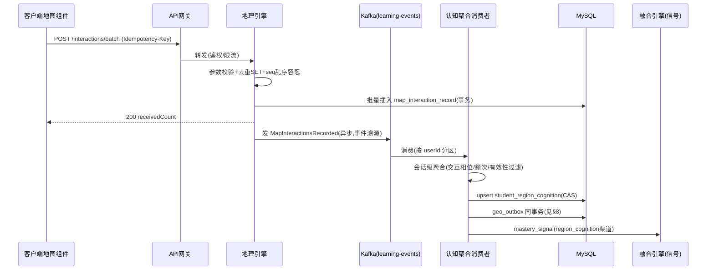

# 服务端-地理学科空间思维训练与交互式地图学习智能辅助引擎-详细设计

## 1. 概述

### 1.1 模块定位

地理学科空间思维训练与交互式地图学习智能辅助引擎（以下简称「地理智能引擎」）是 PrimeTop 平台面向初高中地理学科的核心服务端能力模块。它负责地理学科知识的结构化管理、地图交互数据的智能处理、空间思维能力评估以及个性化地理学习内容的推荐与生成。

与其他理科（物理、化学、生物）已有专门的服务端引擎不同，地理学科具有独特的技术需求：空间数据分析、地理坐标系处理、地图图层叠加计算、区域特征关联推理等。本引擎填补了这一空白，与客户端「地理学科工具与交互地图学习组件」形成完整的地理学习技术闭环。

### 1.2 核心职责

| 职责 | 说明 |
| --- | --- |
| 地理知识图谱管理 | 管理地理概念、区域、地形、气候等知识点及其空间关系 |
| 地图交互数据处理 | 解析客户端地图操作（点击区域、绘制路线、标注位置），转化为学习行为数据 |
| 空间思维评估 | 基于学生地理答题和地图操作，评估空间认知、地图判读、区域分析等能力 |
| 地理题型智能生成 | 根据知识点和能力维度，生成读图题、区域分析题、等值线判读题等地理特色题型 |
| 区域认知建模 | 构建学生对世界/中国各区域的认知画像，识别区域地理知识盲区 |
| 地理图像智能识别 | 识别地图类型（等高线、气候图、人口分布图等），提取关键地理信息 |
| 时事地理关联 | 将热点事件（自然灾害、经济峰会等）与教材地理知识自动关联 |

### 1.3 依赖关系

```
┌─────────────────────────────────────────────────────────┐
│                  地理智能引擎 (本模块)                     │
├─────────────┬──────────────┬──────────────┬─────────────┤
│  知识图谱    │  地图数据     │  AI分析      │  题目生成    │
│  管理子模块  │  处理子模块   │  子模块      │  子模块     │
└──────┬──────┴──────┬───────┴──────┬───────┴──────┬──────┘
       │             │              │              │
       ▼             ▼              ▼              ▼
  ┌─────────┐ ┌───────────┐ ┌──────────┐ ┌──────────────┐
  │知识点体系│ │ GeoJSON/  │ │ 大模型API │ │ 题库管理服务  │
  │ 与教材   │ │ GIS数据源  │ │ (多模态)  │ │ (Question    │
  │ 映射服务  │ │ 存储服务   │ │          │ │  Service)    │
  └─────────┘ └───────────┘ └──────────┘ └──────────────┘
       │                                          │
       ▼                                          ▼
  ┌──────────────────────────────────────────────────────┐
  │   学情分析服务  │  学习记录服务  │  RAG知识检索引擎     │
  └──────────────────────────────────────────────────────┘
```

**上游依赖：**
- 知识点体系与教材映射引擎：提供地理知识点结构和课标对齐
- 题库管理服务：存储和检索地理题目
- 大模型API适配层：提供地理问答和图像理解能力
- 文件与资源存储服务：存储地图图片和GIS数据

**下游消费方：**
- 客户端地理学科工具与交互地图组件：提供地图渲染数据和交互反馈
- 同步课堂学习服务：提供地理章节的配套学习内容
- 学情分析服务：接收地理学科的能力评估数据
- 拍照搜题服务：调用地理图像识别能力处理地理题图片

---

## 2. 数据模型

### 2.1 核心实体定义

#### 2.1.1 地理知识节点 (GeoKnowledgeNode)

```java
/**
 * 地理知识节点 - 地理知识图谱的基本单元
 */
public class GeoKnowledgeNode {
    /** 主键ID */
    private Long id;
    
    /** 知识点UUID */
    private String nodeUuid;
    
    /** 知识点名称，如"大气环流"、"区域气候特征" */
    private String name;
    
    /** 知识点编码，如 GEO.WORLD.CLIMATE.001 */
    private String code;
    
    /** 知识点类型 */
    private GeoNodeType nodeType; // CONCEPT, REGION, PHENOMENON, SKILL, METHOD
    
    /** 所属学段 */
    private SchoolStage stage; // JUNIOR_HIGH, SENIOR_HIGH
    
    /** 所属教材章节ID */
    private String chapterId;
    
    /** 课标对齐编码 */
    private String curriculumStandardCode;
    
    /** 知识点详情描述 */
    private String description;
    
    /** 关键地理术语列表 */
    private List<String> keyTerms;
    
    /** 空间维度标签 */
    private List<SpatialTag> spatialTags;
    
    /** 难度等级 1-10 */
    private Integer difficultyLevel;
    
    /** 前置知识点ID列表 */
    private List<String> prerequisiteIds;
    
    /** 关联知识点ID列表 */
    private List<String> relatedNodeIds;
    
    /** 元数据 */
    private Map<String, Object> metadata;
    
    /** 创建时间 */
    private LocalDateTime createdAt;
    
    /** 更新时间 */
    private LocalDateTime updatedAt;
}

public enum GeoNodeType {
    CONCEPT,      // 地理概念（如：季风、洋流）
    REGION,       // 区域实体（如：青藏高原、撒哈拉沙漠）
    PHENOMENON,   // 地理现象（如：厄尔尼诺、城市化）
    SKILL,        // 地理技能（如：等值线判读、地图量算）
    METHOD,       // 地理方法（如：区域分析方法、空间对比法）
    MAP_TYPE      // 地图类型（如：等高线地形图、气候图）
}

public enum SpatialTag {
    GLOBAL,          // 全球尺度
    CONTINENT,       // 大洲尺度
    COUNTRY,         // 国家尺度
    PROVINCE,        // 省级尺度
    CITY,            // 城市尺度
    LOCAL,           // 地方尺度
    TOPOGRAPHY,      // 地形相关
    CLIMATE,         // 气候相关
    HYDROLOGY,       // 水文相关
    POPULATION,      // 人口相关
    ECONOMY,         // 经济相关
    TRANSPORTATION,  // 交通相关
    AGRICULTURE,     // 农业相关
    INDUSTRY,        // 工业相关
    ENVIRONMENT      // 环境相关
}
```

#### 2.1.2 区域地理信息 (RegionGeoInfo)

```java
/**
 * 区域地理信息 - 描述一个地理区域的结构化数据
 */
public class RegionGeoInfo {
    /** 主键ID */
    private Long id;
    
    /** 区域UUID */
    private String regionUuid;
    
    /** 区域名称 */
    private String name;
    
    /** 区域编码（行政区划编码或自定义编码） */
    private String regionCode;
    
    /** 区域层级 */
    private RegionLevel level; // WORLD, CONTINENT, COUNTRY, PROVINCE, CITY, DISTRICT
    
    /** 上级区域ID */
    private String parentRegionId;
    
    /** GeoJSON边界数据引用（存储在对象存储中的路径） */
    private String geoJsonPath;
    
    /** 区域中心点经纬度 */
    private GeoPoint centerPoint;
    
    /** 区域边界框（最小外接矩形） */
    private BoundingBox boundingBox;
    
    /** 自然地理特征摘要 */
    private PhysicalGeography physicalGeography;
    
    /** 人文地理特征摘要 */
    private HumanGeography humanGeography;
    
    /** 区域特色标签 */
    private List<String> featureTags;
    
    /** 关联教材章节ID列表 */
    private List<String> chapterIds;
    
    /** 区域图片资源列表 */
    private List<String> imagePaths;
    
    /** 创建时间 */
    private LocalDateTime createdAt;
}

public class GeoPoint {
    /** 经度 */
    private Double longitude;
    /** 纬度 */
    private Double latitude;
}

public class BoundingBox {
    /** 最小经度 */
    private Double minLng;
    /** 最大经度 */
    private Double maxLng;
    /** 最小纬度 */
    private Double minLat;
    /** 最大纬度 */
    private Double maxLat;
}

public class PhysicalGeography {
    /** 地形类型 */
    private String terrain; // 高原、平原、山地、盆地、丘陵
    /** 气候类型 */
    private String climate; // 温带季风、热带雨林、 etc.
    /** 主要河流湖泊 */
    private List<String> waterBodies;
    /** 植被类型 */
    private String vegetation;
    /** 自然资源 */
    private List<String> naturalResources;
    /** 自然灾害风险 */
    private List<String> naturalHazards;
}

public class HumanGeography {
    /** 人口规模（万人） */
    private Double population;
    /** 人口密度 */
    private Double populationDensity;
    /** 主要民族 */
    private List<String> ethnicGroups;
    /** 经济支柱 */
    private List<String> economicPillars;
    /** 交通枢纽等级 */
    private String transportHubLevel;
    /** 特色文化 */
    private List<String> culturalFeatures;
}

public enum RegionLevel {
    WORLD, CONTINENT, COUNTRY, PROVINCE, CITY, DISTRICT
}
```

#### 2.1.3 地图交互记录 (MapInteractionRecord)

```java
/**
 * 地图交互记录 - 记录学生在地图上的操作行为
 */
public class MapInteractionRecord {
    /** 主键ID */
    private Long id;
    
    /** 学生用户ID */
    private Long userId;
    
    /** 学习会话ID */
    private String sessionId;
    
    /** 关联知识点ID */
    private String knowledgeNodeId;
    
    /** 交互类型 */
    private MapInteractionType type;
    
    /** 交互时的地图层级 */
    private Integer mapZoom;
    
    /** 交互中心点经纬度 */
    private GeoPoint centerPoint;
    
    /** 交互详情JSON */
    private String interactionDetail;
    
    /** 操作时间戳（毫秒） */
    private Long timestamp;
    
    /** 会话内序号 */
    private Integer sequenceInSession;
    
    /** 关联题目ID（如有） */
    private String questionId;
    
    /** 创建时间 */
    private LocalDateTime createdAt;
}

public enum MapInteractionType {
    PAN,            // 平移地图
    ZOOM_IN,        // 放大
    ZOOM_OUT,       // 缩小
    TAP_POINT,      // 点击位置
    TAP_REGION,     // 点击区域
    LONG_PRESS,     // 长按
    DRAW_PATH,      // 绘制路径
    DRAW_AREA,      // 绘制区域
    ADD_MARKER,     // 添加标记
    REMOVE_MARKER,  // 移除标记
    LAYER_SWITCH,   // 切换图层
    MEASURE,        // 测量距离/面积
    SCREENSHOT,     // 截图
    ANNOTATE        // 添加批注
}
```

#### 2.1.4 空间思维能力档案 (SpatialThinkingProfile)

```java
/**
 * 空间思维能力档案 - 学生的地理能力维度画像
 */
public class SpatialThinkingProfile {
    /** 主键ID */
    private Long id;
    
    /** 学生用户ID */
    private Long userId;
    
    /** 地图判读能力得分 0-100 */
    private Double mapInterpretationScore;
    
    /** 空间定位能力得分 0-100 */
    private Double spatialOrientationScore;
    
    /** 区域分析能力得分 0-100 */
    private Double regionAnalysisScore;
    
    /** 空间推理能力得分 0-100 */
    private Double spatialReasoningScore;
    
    /** 地理综合思维能力得分 0-100 */
    private Double comprehensiveThinkingScore;
    
    /** 等值线判读能力得分 0-100 */
    private Double contourReadingScore;
    
    /** 区域认知覆盖度（已知区域数量 / 总教学区域数量） */
    private Double regionCoverageRate;
    
    /** 能力维度明细 */
    private List<AbilityDimension> dimensions;
    
    /** 薄弱能力维度 */
    private List<String> weakDimensions;
    
    /** 优势能力维度 */
    private List<String> strongDimensions;
    
    /** 最近评估时间 */
    private LocalDateTime lastAssessedAt;
    
    /** 评估次数 */
    private Integer assessmentCount;
    
    /** 创建时间 */
    private LocalDateTime createdAt;
    
    /** 更新时间 */
    private LocalDateTime updatedAt;
}

public class AbilityDimension {
    /** 维度名称 */
    private String name;
    /** 得分 0-100 */
    private Double score;
    /** 评估依据（相关答题和交互记录数） */
    private Integer evidenceCount;
    /** 变化趋势 (RISING, STABLE, DECLINING) */
    private Trend trend;
    /** 最近5次评估分数序列 */
    private List<Double> recentScores;
}

public enum Trend {
    RISING, STABLE, DECLINING
}
```

#### 2.1.5 地理题型模板 (GeoQuestionTemplate)

```java
/**
 * 地理题型模板 - 定义地理特色题型的生成规则
 */
public class GeoQuestionTemplate {
    /** 主键ID */
    private Long id;
    
    /** 模板UUID */
    private String templateUuid;
    
    /** 题型名称 */
    private String typeName;
    
    /** 题型编码 */
    private GeoQuestionType typeCode;
    
    /** 适用学段 */
    private List<SchoolStage> applicableStages;
    
    /** 关联知识点类型 */
    private List<GeoNodeType> relatedNodeTypes;
    
    /** 所需空间标签 */
    private List<SpatialTag> requiredSpatialTags;
    
    /** 是否需要地图渲染 */
    private Boolean requiresMapRender;
    
    /** 地图渲染配置 */
    private MapRenderConfig mapRenderConfig;
    
    /** AI生成Prompt模板 */
    private String generationPromptTemplate;
    
    /** 答案判定的正则/规则 */
    private String answerValidationRule;
    
    /** 评分维度配置 */
    private List<ScoringDimension> scoringDimensions;
    
    /** 难度调节参数 */
    private DifficultyConfig difficultyConfig;
    
    /** 模板版本 */
    private String version;
    
    /** 是否启用 */
    private Boolean enabled;
}

public enum GeoQuestionType {
    CONTOUR_READING,      // 等值线判读题
    REGION_ANALYSIS,      // 区域综合分析题
    MAP_LOCATION,         // 地图定位标注题
    CLIMATE_ANALYSIS,     // 气候图表分析题
    TERRAIN_IDENTIFICATION,// 地形识别题
    SPATIAL_DISTRIBUTION,  // 空间分布描述题
    CAUSE_ANALYSIS,       // 地形成因分析题
    COMPARISON,           // 区域对比题
    ROUTE_PLANNING,       // 路线规划题
    MAP_SKETCH,           // 简图绘制题
    HOTSPOT_ANALYSIS      // 时事地理分析题
}

public class MapRenderConfig {
    /** 底图类型 */
    private String baseMapType; // terrain, satellite, outline, climate
    /** 需要叠加的图层 */
    private List<String> overlayLayers;
    /** 初始视角中心点 */
    private GeoPoint initialCenter;
    /** 初始缩放层级 */
    private Integer initialZoom;
    /** 允许的交互类型 */
    private List<MapInteractionType> allowedInteractions;
    /** 需要标注的预设位置 */
    private List<GeoPoint> presetMarkers;
    /** 需要高亮的区域ID列表 */
    private List<String> highlightRegionIds;
    /** 是否隐藏地名标签（用于考核） */
    private Boolean hideLabels;
}

public class ScoringDimension {
    /** 维度名称 */
    private String name;
    /** 权重 0-1 */
    private Double weight;
    /** 满分分值 */
    private Double maxScore;
    /** 评分要点描述 */
    private String description;
}

public class DifficultyConfig {
    /** 基础难度 1-10 */
    private Integer baseDifficulty;
    /** 区域复杂度系数 0.5-2.0 */
    private Double regionComplexityFactor;
    /** 信息量系数 0.5-2.0 */
    private Double informationLoadFactor;
    /** 干扰项数量 */
    private Integer distractorCount;
    /** 是否包含跨区域对比 */
    private Boolean crossRegionComparison;
}
```

### 2.2 数据库表结构

```sql
-- 地理知识节点表
CREATE TABLE geo_knowledge_node (
    id              BIGINT PRIMARY KEY AUTO_INCREMENT,
    node_uuid       VARCHAR(64) NOT NULL UNIQUE COMMENT '知识点UUID',
    name            VARCHAR(200) NOT NULL COMMENT '知识点名称',
    code            VARCHAR(100) NOT NULL UNIQUE COMMENT '知识点编码',
    node_type       VARCHAR(20) NOT NULL COMMENT '节点类型',
    stage           VARCHAR(20) NOT NULL COMMENT '学段',
    chapter_id      VARCHAR(64) NOT NULL COMMENT '教材章节ID',
    curriculum_code VARCHAR(100) COMMENT '课标编码',
    description     TEXT COMMENT '详细描述',
    key_terms       JSON COMMENT '关键术语列表',
    spatial_tags    JSON COMMENT '空间维度标签',
    difficulty      INT DEFAULT 5 COMMENT '难度等级1-10',
    prerequisite_ids JSON COMMENT '前置知识点ID',
    related_node_ids JSON COMMENT '关联知识点ID',
    metadata        JSON COMMENT '扩展元数据',
    created_at      DATETIME NOT NULL DEFAULT CURRENT_TIMESTAMP,
    updated_at      DATETIME NOT NULL DEFAULT CURRENT_TIMESTAMP ON UPDATE CURRENT_TIMESTAMP,
    
    INDEX idx_chapter (chapter_id),
    INDEX idx_type (node_type),
    INDEX idx_stage (stage),
    INDEX idx_code (code)
) ENGINE=InnoDB DEFAULT CHARSET=utf8mb4 COMMENT='地理知识节点表';

-- 区域地理信息表
CREATE TABLE region_geo_info (
    id                  BIGINT PRIMARY KEY AUTO_INCREMENT,
    region_uuid         VARCHAR(64) NOT NULL UNIQUE COMMENT '区域UUID',
    name                VARCHAR(200) NOT NULL COMMENT '区域名称',
    region_code         VARCHAR(50) NOT NULL COMMENT '区域编码',
    level               VARCHAR(20) NOT NULL COMMENT '区域层级',
    parent_region_id    VARCHAR(64) COMMENT '上级区域ID',
    geo_json_path       VARCHAR(500) COMMENT 'GeoJSON文件存储路径',
    center_lng          DECIMAL(10,6) COMMENT '中心经度',
    center_lat          DECIMAL(10,6) COMMENT '中心纬度',
    min_lng             DECIMAL(10,6) COMMENT '最小经度',
    max_lng             DECIMAL(10,6) COMMENT '最大经度',
    min_lat             DECIMAL(10,6) COMMENT '最小纬度',
    max_lat             DECIMAL(10,6) COMMENT '最大纬度',
    physical_geo        JSON COMMENT '自然地理特征',
    human_geo           JSON COMMENT '人文地理特征',
    feature_tags        JSON COMMENT '特色标签',
    chapter_ids         JSON COMMENT '关联教材章节',
    image_paths         JSON COMMENT '图片资源路径',
    created_at          DATETIME NOT NULL DEFAULT CURRENT_TIMESTAMP,
    updated_at          DATETIME NOT NULL DEFAULT CURRENT_TIMESTAMP ON UPDATE CURRENT_TIMESTAMP,
    
    INDEX idx_code (region_code),
    INDEX idx_level (level),
    INDEX idx_parent (parent_region_id),
    INDEX idx_name (name)
) ENGINE=InnoDB DEFAULT CHARSET=utf8mb4 COMMENT='区域地理信息表';

-- 地图交互记录表（按月分区，大数据量）
CREATE TABLE map_interaction_record (
    id                  BIGINT NOT NULL AUTO_INCREMENT,
    user_id             BIGINT NOT NULL COMMENT '学生用户ID',
    session_id          VARCHAR(64) NOT NULL COMMENT '学习会话ID',
    knowledge_node_id   VARCHAR(64) COMMENT '关联知识点ID',
    interaction_type    VARCHAR(30) NOT NULL COMMENT '交互类型',
    map_zoom            INT COMMENT '地图层级',
    center_lng          DECIMAL(10,6) COMMENT '交互中心经度',
    center_lat          DECIMAL(10,6) COMMENT '交互中心纬度',
    interaction_detail  JSON COMMENT '交互详情',
    timestamp_ms        BIGINT NOT NULL COMMENT '操作时间戳毫秒',
    sequence_in_session INT DEFAULT 0 COMMENT '会话内序号',
    question_id         VARCHAR(64) COMMENT '关联题目ID',
    created_at          DATETIME NOT NULL DEFAULT CURRENT_TIMESTAMP,
    
    PRIMARY KEY (id, created_at),
    INDEX idx_user (user_id, created_at),
    INDEX idx_session (session_id),
    INDEX idx_node (knowledge_node_id),
    INDEX idx_question (question_id)
) ENGINE=InnoDB DEFAULT CHARSET=utf8mb4 COMMENT='地图交互记录表'
PARTITION BY RANGE (TO_DAYS(created_at)) (
    PARTITION p_202601 VALUES LESS THAN (TO_DAYS('2026-02-01')),
    PARTITION p_202602 VALUES LESS THAN (TO_DAYS('2026-03-01')),
    PARTITION p_202603 VALUES LESS THAN (TO_DAYS('2026-04-01')),
    PARTITION p_202604 VALUES LESS THAN (TO_DAYS('2026-05-01')),
    PARTITION p_202605 VALUES LESS THAN (TO_DAYS('2026-06-01')),
    PARTITION p_202606 VALUES LESS THAN (TO_DAYS('2026-07-01')),
    PARTITION p_202607 VALUES LESS THAN (TO_DAYS('2026-08-01')),
    PARTITION p_max VALUES LESS THAN MAXVALUE
);

-- 空间思维能力档案表
CREATE TABLE spatial_thinking_profile (
    id                          BIGINT PRIMARY KEY AUTO_INCREMENT,
    user_id                     BIGINT NOT NULL UNIQUE COMMENT '学生用户ID',
    map_interp_score            DECIMAL(5,2) DEFAULT 0 COMMENT '地图判读能力',
    spatial_orientation_score   DECIMAL(5,2) DEFAULT 0 COMMENT '空间定位能力',
    region_analysis_score       DECIMAL(5,2) DEFAULT 0 COMMENT '区域分析能力',
    spatial_reasoning_score     DECIMAL(5,2) DEFAULT 0 COMMENT '空间推理能力',
    comprehensive_score         DECIMAL(5,2) DEFAULT 0 COMMENT '综合思维能力',
    contour_reading_score       DECIMAL(5,2) DEFAULT 0 COMMENT '等值线判读能力',
    region_coverage_rate        DECIMAL(5,4) DEFAULT 0 COMMENT '区域认知覆盖度',
    dimensions_detail           JSON COMMENT '能力维度明细',
    weak_dimensions             JSON COMMENT '薄弱维度',
    strong_dimensions           JSON COMMENT '优势维度',
    last_assessed_at            DATETIME COMMENT '最近评估时间',
    assessment_count            INT DEFAULT 0 COMMENT '评估次数',
    created_at                  DATETIME NOT NULL DEFAULT CURRENT_TIMESTAMP,
    updated_at                  DATETIME NOT NULL DEFAULT CURRENT_TIMESTAMP ON UPDATE CURRENT_TIMESTAMP,
    
    INDEX idx_user (user_id)
) ENGINE=InnoDB DEFAULT CHARSET=utf8mb4 COMMENT='空间思维能力档案表';

-- 地理题型模板表
CREATE TABLE geo_question_template (
    id                          BIGINT PRIMARY KEY AUTO_INCREMENT,
    template_uuid               VARCHAR(64) NOT NULL UNIQUE COMMENT '模板UUID',
    type_name                   VARCHAR(100) NOT NULL COMMENT '题型名称',
    type_code                   VARCHAR(30) NOT NULL COMMENT '题型编码',
    applicable_stages           JSON NOT NULL COMMENT '适用学段',
    related_node_types          JSON COMMENT '关联知识点类型',
    required_spatial_tags       JSON COMMENT '所需空间标签',
    requires_map_render         TINYINT(1) DEFAULT 0 COMMENT '是否需要地图渲染',
    map_render_config           JSON COMMENT '地图渲染配置',
    generation_prompt_template  TEXT NOT NULL COMMENT 'AI生成Prompt模板',
    answer_validation_rule      TEXT COMMENT '答案判定规则',
    scoring_dimensions          JSON COMMENT '评分维度配置',
    difficulty_config           JSON COMMENT '难度调节参数',
    version                     VARCHAR(20) DEFAULT '1.0' COMMENT '模板版本',
    enabled                     TINYINT(1) DEFAULT 1 COMMENT '是否启用',
    created_at                  DATETIME NOT NULL DEFAULT CURRENT_TIMESTAMP,
    updated_at                  DATETIME NOT NULL DEFAULT CURRENT_TIMESTAMP ON UPDATE CURRENT_TIMESTAMP,
    
    INDEX idx_type_code (type_code),
    INDEX idx_enabled (enabled)
) ENGINE=InnoDB DEFAULT CHARSET=utf8mb4 COMMENT='地理题型模板表';

-- 区域认知状态表（学生与区域的关联）
CREATE TABLE student_region_cognition (
    id              BIGINT PRIMARY KEY AUTO_INCREMENT,
    user_id         BIGINT NOT NULL COMMENT '学生用户ID',
    region_uuid     VARCHAR(64) NOT NULL COMMENT '区域UUID',
    cognition_level DECIMAL(5,2) DEFAULT 0 COMMENT '认知水平 0-100',
    interaction_count INT DEFAULT 0 COMMENT '交互次数',
    correct_rate    DECIMAL(5,4) DEFAULT 0 COMMENT '相关题目正确率',
    last_active_at  DATETIME COMMENT '最近活跃时间',
    weak_points     JSON COMMENT '该区域下的薄弱知识点',
    metadata        JSON COMMENT '扩展数据',
    created_at      DATETIME NOT NULL DEFAULT CURRENT_TIMESTAMP,
    updated_at      DATETIME NOT NULL DEFAULT CURRENT_TIMESTAMP ON UPDATE CURRENT_TIMESTAMP,
    
    UNIQUE KEY uk_user_region (user_id, region_uuid),
    INDEX idx_user (user_id),
    INDEX idx_region (region_uuid),
    INDEX idx_user_active (user_id, last_active_at)
) ENGINE=InnoDB DEFAULT CHARSET=utf8mb4 COMMENT='学生区域认知状态表';

-- 时事地理关联表
CREATE TABLE geo_current_affairs (
    id                  BIGINT PRIMARY KEY AUTO_INCREMENT,
    affair_uuid         VARCHAR(64) NOT NULL UNIQUE COMMENT '事件UUID',
    title               VARCHAR(300) NOT NULL COMMENT '事件标题',
    summary             TEXT COMMENT '事件摘要',
    event_type          VARCHAR(30) NOT NULL COMMENT '事件类型',
    occurred_at         DATETIME NOT NULL COMMENT '事件发生时间',
    location_region_id  VARCHAR(64) COMMENT '事发区域UUID',
    location_text       VARCHAR(200) COMMENT '事发位置描述',
    source_url          VARCHAR(500) COMMENT '来源链接',
    source_name         VARCHAR(100) COMMENT '来源名称',
    related_node_ids    JSON COMMENT '关联知识点ID列表',
    related_chapter_ids JSON COMMENT '关联教材章节',
    related_stage       JSON COMMENT '适用学段',
    review_status       VARCHAR(20) NOT NULL DEFAULT 'PENDING' COMMENT '审核状态',
    reviewed_by         BIGINT COMMENT '审核人',
    reviewed_at         DATETIME COMMENT '审核时间',
    reject_reason       VARCHAR(500) COMMENT '驳回原因',
    publish_status      VARCHAR(20) NOT NULL DEFAULT 'DRAFT' COMMENT '发布状态',
    published_at        DATETIME COMMENT '发布时间',
    expire_at           DATETIME COMMENT '时效过期时间',
    view_count          INT DEFAULT 0 COMMENT '浏览次数',
    created_at          DATETIME NOT NULL DEFAULT CURRENT_TIMESTAMP,
    updated_at          DATETIME NOT NULL DEFAULT CURRENT_TIMESTAMP ON UPDATE CURRENT_TIMESTAMP,

    INDEX idx_status (review_status, publish_status),
    INDEX idx_occurred (occurred_at),
    INDEX idx_region (location_region_id)
) ENGINE=InnoDB DEFAULT CHARSET=utf8mb4 COMMENT='时事地理关联表';

-- 地理引擎 Outbox 表（同事务事件持久化）
CREATE TABLE geo_outbox (
    id              BIGINT PRIMARY KEY AUTO_INCREMENT,
    event_id        VARCHAR(64) NOT NULL UNIQUE COMMENT '事件ID UUID',
    event_type      VARCHAR(80) NOT NULL COMMENT '事件类型',
    aggregate_id    VARCHAR(64) NOT NULL COMMENT '聚合ID',
    payload         JSON NOT NULL COMMENT '事件载荷',
    occurred_at     DATETIME NOT NULL DEFAULT CURRENT_TIMESTAMP COMMENT '事件发生时间',
    published_at    DATETIME COMMENT '发布时间',
    publish_status  VARCHAR(20) NOT NULL DEFAULT 'PENDING' COMMENT 'PENDING/PUBLISHED/FAILED',
    retry_count     INT DEFAULT 0 COMMENT '重试次数',

    INDEX idx_status (publish_status, occurred_at),
    INDEX idx_type (event_type)
) ENGINE=InnoDB DEFAULT CHARSET=utf8mb4 COMMENT='地理引擎事件Outbox表';
```

### 2.3 Redis 键设计

| 键名模板 | 类型 | TTL | 说明 |
| --- | --- | --- | --- |
| `geo:region:tree:{stage}` | STRING(JSON) | 24h | 区域树缓存（按学段），管理端变更时 DEL |
| `geo:region:detail:{regionUuid}` | STRING(JSON) | 24h | 区域详情缓存 |
| `geo:node:{nodeUuid}` | STRING(JSON) | 24h | 知识节点缓存 |
| `geo:templates:active:{stage}` | STRING(JSON) | 1h | 启用题型模板列表（管理端热更新时 DEL） |
| `geo:profile:{userId}` | STRING(JSON) | 30min | 空间能力档案缓存（画像更新时 DEL，禁 SET 双写） |
| `geo:cognition:{userId}:{regionUuid}` | STRING(JSON) | 1h | 区域认知缓存 |
| `geo:interact:dedup:{userId}:{sessionId}` | SET | 会话时长+2h | 交互上报去重（member=clientEventId） |
| `geo:gen:lock:{templateUuid}` | STRING | 10min | 题目生成互斥锁（防同模板并发风暴） |
| `geo:affairs:hot:{stage}` | STRING(JSON) | 30min | 热点时事列表缓存 |
| `geo:rate:{userId}` | HASH | 滑动窗口 | 生题/提交限流计数（Lua 原子） |

**缓存权威原则：** MySQL 为唯一权威存储，Redis 仅作读缓存；一切画像/认知更新走「先写 DB、事务提交后 DEL 缓存」，禁止先 SET 缓存再异步写库（防双写分叉）。

---

## 3. API 接口设计

> 对外 REST 路径与《客户端-地理学科工具与交互地图学习组件-详细设计》v1.0 的 `/api/v1/geo/*` 契约逐一对齐（R1 裁决：客户端文档已发布端点为准，本文不新增学生端路径）。错误码统一走 51600-51699 段位，客户端 GEO_001-008 为本地渲染层码，与服务端段一一映射（§13 R2）。

### 3.1 学生端 REST 接口

#### 3.1.1 区域树查询

```
GET /api/v1/geo/regions/tree?stage=JUNIOR_HIGH&parentUuid={可选}
```

响应：

```json
{
  "code": 0,
  "data": {
    "version": "20261005",
    "regions": [
      {
        "regionUuid": "rg_china",
        "name": "中国",
        "level": "COUNTRY",
        "childCount": 34,
        "hasDetail": true,
        "center": {"lng": 104.19, "lat": 35.86}
      }
    ]
  }
}
```

- 缓存协商：请求头 `If-None-Match: {version}`，命中返回 `304`（版本号=区域数据 content_version，管理端变更时递增）。
- 树按学段裁剪：仅返回该学段教材涉及的区域（关联 chapter_ids ∩ 学段章节）。

#### 3.1.2 区域详情

```
GET /api/v1/geo/regions/{regionUuid}
```

响应要点：`physicalGeography`/`humanGeography`/`featureTags`/`imagePaths`（CDN URL）/ `relatedNodes`（关联知识节点摘要，最多 10 个）。分龄返回：幼儿/小学学段请求统一返回 `51603 STAGE_NOT_SUPPORTED`（地理学科服务端仅初高中，R3 裁决）。

#### 3.1.3 地理知识卡片列表/详情

```
GET /api/v1/geo/cards?regionUuid={可选}&nodeUuid={可选}&page=1&size=20
GET /api/v1/geo/cards/{cardId}
```

卡片为知识节点面向学生的呈现封装（富文本+配图），内容经审核管线发布，AIGC 生成内容必带 `aigcMarked: true` 与标识文案。

#### 3.1.4 地理练习（题目实例）

```
GET  /api/v1/geo/exercises?nodeUuid=&typeCode=&difficulty=&count=10&sessionId=
POST /api/v1/geo/exercises/{exerciseId}/submit
```

- 练习题目实例由 §4.3 生成管线按需生成并落库复用（生成指纹=`hash(templateUuid + 参数 + promptVersion)`，同指纹 90 天内复用，防同题轰炸）。
- submit 请求幂等键：`Idempotency-Key: {sessionId}:{exerciseId}:{clientRequestId}`；判分委托《多题型统一判题引擎》的 `judgeEvaluator` 路由（本引擎只组装地理专属评分维度，不自建判分闭环，R6）。
- **答案可见性红线（G2）：** 未提交前响应不含 `correctAnswer`/`analysis`；提交后且仅当本题为练习模式（非考试模式）才下发解析。

#### 3.1.5 图层资源包

```
GET /api/v1/geo/layers/{layerId}/package
GET /api/v1/geo/resources/version
```

- 图层包为离线矢量瓦片/GeoJSON 打包文件，走文件存储服务预签名 URL 下载，客户端经资源包下载管理器调度（R4：下载调度权威归下载管理器，本服务仅产出版本与 URL）。
- `resources/version` 返回全量资源版本清单，客户端做差分更新。

#### 3.1.6 地图交互批量上报

```
POST /api/v1/geo/interactions/batch
Content-Type: application/json
Idempotency-Key: {sessionId}:{batchSeq}

{
  "sessionId": "sess_xxx",
  "knowledgeNodeId": "geo_xxx",
  "clientEvents": [
    {
      "clientEventId": "ce_9f3a",
      "type": "TAP_REGION",
      "mapZoom": 5,
      "center": {"lng": 116.4, "lat": 39.9},
      "detail": {"regionUuid": "rg_beijing"},
      "timestampMs": 1728000000000,
      "seq": 1
    }
  ]
}
```

- 幂等：`geo:interact:dedup:{userId}:{sessionId}` SET 判重，重复 clientEventId 直接忽略并返回 `receivedCount`（重复视为成功，不报错）。
- 校验：单批 ≤100 条；seq 单调性弱校验（乱序容忍，落库按 timestampMs 排序）；timestampMs 偏差超过 ±10min 标记 `clock_skew=true` 仍入库但不进评估证据（G3）。
- 响应 200：`{"receivedCount": 98, "duplicatedCount": 2, "degraded": false}`。

#### 3.1.7 空间能力档案查询

```
GET /api/v1/geo/profile
```

返回五维得分、趋势、区域覆盖度。**义务教育响应变形（G4）：** 初中段（义务教育阶段）不返回精确维度得分与班级/同伴对比，仅返回等级带（`band: A/B/C/D`）+ 文字建议；高中段可返回精确分数但不返回排名。家长端经 BFF 聚合接口消费，L3 可见度规则归《学习数据家庭共享可见度分级》文档。

### 3.2 内部 gRPC 接口

```protobuf
service GeoEngineService {
  // 拍照搜题：地理图像识别（地图类型分类+关键信息提取）
  rpc IdentifyMapImage(IdentifyMapImageRequest) returns (IdentifyMapImageResponse);
  // 练习测评/同步课堂：按知识点批量生成地理题
  rpc GenerateGeoQuestions(GenerateGeoQuestionsRequest) returns (GenerateGeoQuestionsResponse);
  // 融合引擎/推荐引擎：批量查询区域认知（≤500）
  rpc BatchGetRegionCognition(BatchGetRegionCognitionRequest) returns (BatchGetRegionCognitionResponse);
  // 学情分析：拉取空间能力档案（只读）
  rpc GetSpatialProfile(GetSpatialProfileRequest) returns (GetSpatialProfileResponse);
}
```

- `IdentifyMapImage`：入参 `imageOssPath + subjectHint=GEO`，返回 `mapType`（等高线/气候/人口/交通等 12 类）、`extractedFeatures`（JSON：图例、等值距、坐标网等）、`confidence`。P99 ≤1.5s（多模态 LLM 走适配层，超时降级返回粗分类）。
- `GenerateGeoQuestions`：入参 `nodeUuids[] + count + difficultyRange + scene(PRACTICE|EXAM)`，按 §4.3 管线执行；考试场景（EXAM）必走人工审题包或已审核题库，AI 即时生成仅限 PRACTICE（G5）。
- `BatchGetRegionCognition`：仅返回 `regionUuid + cognitionLevel + band`，不返回明细证据（防画像拖取）。

### 3.3 管理端接口（管理后台-地理学科内容工作台）

| 接口 | 说明 | 守卫 |
| --- | --- | --- |
| `POST /admin-api/v1/geo/nodes` | 新建知识节点 | 内容编辑角色；code 全局唯一冲突返 51611 |
| `PUT /admin-api/v1/geo/nodes/{uuid}` | 更新节点（乐观锁 version） | version CAS，冲突 51612 |
| `POST /admin-api/v1/geo/nodes/import` | 批量导入（≤2000 行，dryRun 预检） | 行级部分成功结构 |
| `POST /admin-api/v1/geo/regions` | 新建/更新区域（GeoJSON 上传 OSS） | GeoJSON 拓扑校验失败 51613 |
| `POST /admin-api/v1/geo/templates` | 新建题型模板 | Prompt 模板双人到审 |
| `PUT /admin-api/v1/geo/templates/{uuid}/status` | 启停模板 | 停用不影响已生成题目 |
| `GET /admin-api/v1/geo/affairs` | 时事列表（分页+状态筛） | 只读 |
| `POST /admin-api/v1/geo/affairs/{uuid}/review` | 时事审核（通过/驳回） | 审核人≠创建人 G10；驳回必填原因 |
| `POST /admin-api/v1/geo/affairs/{uuid}/publish` | 发布/下线 | 仅审核通过可发布 |
| `GET /admin-api/v1/geo/stats/overview` | 运营概览（使用率/生成量/命中率） | 聚合数据 k≥5 |

### 3.4 幂等与限流总表

| 接口 | 幂等机制 | 限流（单用户） |
| --- | --- | --- |
| interactions/batch | clientEventId SET 去重 + batch 幂等键 | 60 次/分 |
| exercises submit | Idempotency-Key + DB 唯一键 uk(session_id, exercise_id, client_request_id) | 30 次/分 |
| GenerateGeoQuestions(gRPC) | requestId 24h 响应快照表 | 生题 20 次/分；AI 生题日 50 题上限（Lua） |
| IdentifyMapImage | messageId 幂等 | 拍照搜题额度门控引擎统一计数（R7） |
| 管理端写接口 | version 乐观锁 / 审批流 | 角色级配额 |

---

## 4. 核心流程

### 4.1 地图交互摄入与区域认知更新（主链路）



**有效性过滤规则（交互噪声治理）：**
- PAN/ZOOM 连击：同会话 500ms 内同类型连续操作折叠为 1 条（保留起止点）。
- 无效点击：点击位置 200ms 内无后续操作且未命中任何区域要素，标记 `invalid=true` 不进评估。
- 测量/绘制类交互权重高于浏览类（见 §4.2 证据权重表）。

### 4.2 空间思维能力评估引擎

**评估触发（三源，幂等收敛）：**
1. 练习/考试判分结果事件（`practice.graded`/`exam.submitted`）→ 题目含地理空间标签时计入证据；
2. 交互聚合完成（会话结束 10min 后或交互 ≥20 条触发增量评估）；
3. 每日 04:20 全量批评估（仅证据有变化的学生，分片 16 片游标断点）。

**五维评分公式（v1.0 规则版，模型版灰度后切换）：**

```
dim_score = 100 × Σ(wi × norm(evi)) / Σwi

维度            证据来源                              权重
地图判读        读图题正确率(0.6) + 有效读图交互(0.4)   判分证据权重随题目难度加权
空间定位        定位标注题正确率(0.7) + TAP精度(0.3)
区域分析        区域分析题得分(0.8) + 区域认知度(0.2)
空间推理        成因/对比题得分(0.9)
等值线判读      等高线题正确率(0.8) + 等高线工具交互(0.2)

迟滞映射(防抖动): UP阈值 60/75, 迟滞带 5 分, 单次评估变化 >25 分须二次证据确认(G6)
EMA 平滑: score_new = 0.3 × raw + 0.7 × score_old (评估次数<5 时 raw 权重 0.6)
```

**综合分：** `comprehensive = 0.25×判读 + 0.2×定位 + 0.25×区域分析 + 0.2×推理 + 0.1×等值线`（权重管理端可配，修改走版本化快照）。

**写入口唯一（G1）：** spatial_thinking_profile 仅本引擎评估管线写入；融合引擎消费 `geo.spatial_profile.updated` 事件生成信号，**禁止直接写画像表**（R5）。

### 4.3 地理题目生成管线

```
① 模板选择    按 nodeUuid→nodeType/spatialTags 匹配启用模板(同 typeCode 优先低复用率)
② 参数装配    难度参数 = baseDifficulty × regionComplexity × infoLoad, clamp 1-10;
              区域实体随机抽样(学生已掌握区域降权, 盲区区域加权)
③ 素材注入    MapRenderConfig + 区域 GeoJSON 摘要(≤800 token) + 术语表注入 Prompt
④ AI 生成     走统一适配层(scene=GEO_QUESTION_GEN, promptVersion 隔离缓存)
⑤ 机器校验    V1-V5 协议校验:
              V1 题干非空且含有效地理要素引用
              V2 答案可判定(answerValidationRule 可执行/LLM 自评≥0.8)
              V3 学段适配(超纲术语检测, 委托适龄性引擎)
              V4 地图渲染配置可解析(requiresMapRender 时 config JSON Schema 校验)
              V5 与题库既有题 SimHash 相似度<0.9(委托查重引擎)
⑥ 落库发布    生成失败≤2 次重试(换种子), 仍失败记录生成日志并降级取题库同类题
```

**频控（防刷题/防成本失控）：** 单学生 AI 即时生题 ≤50 题/日（Redis Lua）；同模板并发生成互斥锁（`geo:gen:lock`），锁内复用进行中的生成任务结果（singleflight）。

### 4.4 区域认知度更新

```
cognition_new = clamp(0, 100,
    cognition_old × (1 - 0.02×days_inactive)          -- 时间衰减
  + Σ有效交互 × 0.3 (封顶每会话 +6)
  + 区域相关题目判分信号 × 8 × (correct?1:-1) (封顶每批次 ±12))

盲区识别: cognition < 30 且 interaction_count < 3 → 写入 weak_points, 供推荐引擎召回
```

衰减与更新幂等：更新以 `(userId, regionUuid, batchId)` 为幂等键，重复消费不产生二次加成（G7）。

### 4.5 时事地理关联

```
① 热点采集    RSS/人工录入两条源, 采集任务日 3 次, 来源白名单管理端维护
② 实体识别    NER(地名/事件类型) + 区域库模糊匹配(行政区划别名表)
③ 知识关联    区域→关联章节→关联知识节点; 事件类型→热点分析题模板
④ 人工审核    教研在管理端审核(事实准确性+价值导向), 双人复核涉灾害/国际敏感事件
⑤ 发布推送    发布后走通知治理引擎频控推送(非营销类, 未成年人频控仍生效)
⑥ 时效治理    expire_at 默认 30 天自动下线; 考试季(3-6月)延长热点题保留
```

**红线（G8）：** 时事内容涉及灾害伤亡、地缘冲突时，仅做知识性关联，禁止生成猎奇向题目；关联话术必过敏感词引擎 `scene=GEO_AFFAIRS`。

---

## 5. 关键代码示例

### 5.1 交互批量摄入（去重+乱序容忍）

```java
@PostMapping("/interactions/batch")
public BatchInteractionResponse batch(@RequestBody @Valid BatchInteractionRequest req,
                                      @RequestHeader("Idempotency-Key") String idemKey) {
    Long userId = SecurityContext.userId();
    // 1. 幂等: 重复上报视为成功(客户端弱网重试语义)
    String dedupKey = "geo:interact:dedup:" + userId + ":" + req.getSessionId();
    List<MapInteractionRecord> fresh = new ArrayList<>();
    for (ClientMapEvent e : req.getClientEvents()) {
        Boolean added = redis.opsForSet().add(dedupKey, e.getClientEventId()) == 1;
        redis.expire(dedupKey, Duration.ofHours(26));
        if (Boolean.TRUE.equals(added)) fresh.add(MapInteractionRecord.from(e, userId, req));
    }
    if (fresh.isEmpty()) {
        return BatchInteractionResponse.ok(0, req.getClientEvents().size(), false);
    }
    // 2. 乱序容忍: 按 timestampMs 排序落库, seq 仅作展示参考
    fresh.sort(Comparator.comparingLong(MapInteractionRecord::getTimestampMs));
    long now = System.currentTimeMillis();
    fresh.forEach(r -> r.setClockSkew(Math.abs(r.getTimestampMs() - now) > TEN_MINUTES));
    interactionMapper.batchInsert(fresh);          // 单事务批量插入
    outboxPublisher.publish(MapInteractionsRecorded.of(fresh)); // 同事务 Outbox
    return BatchInteractionResponse.ok(fresh.size(),
            req.getClientEvents().size() - fresh.size(), false);
}
```

### 5.2 能力评估器（五维规则版）

```java
public SpatialThinkingProfile evaluate(Long userId, EvidenceBundle ev) {
    SpatialThinkingProfile old = profileMapper.selectByUserId(userId);
    Map<String, Double> raw = new HashMap<>();
    raw.put("mapInterpretation", weightedRate(ev.mapReadingItems(), 0.6)
            + 0.4 * norm(ev.validReadingInteractions()));
    raw.put("spatialOrientation", weightedRate(ev.locationItems(), 0.7)
            + 0.3 * norm(ev.tapAccuracy()));
    raw.put("regionAnalysis", weightedRate(ev.regionAnalysisItems(), 0.8)
            + 0.2 * regionCoverage(userId));
    raw.put("spatialReasoning", weightedRate(ev.reasoningItems(), 0.9));
    raw.put("contourReading", weightedRate(ev.contourItems(), 0.8)
            + 0.2 * norm(ev.contourToolInteractions()));

    int n = old == null ? 0 : old.getAssessmentCount();
    double alpha = n < 5 ? 0.6 : 0.3;               // 冷启动高敏感
    SpatialThinkingProfile merged = new SpatialThinkingProfile();
    raw.forEach((dim, score) -> {
        double prev = old == null ? 50.0 : old.getScore(dim);
        double smoothed = alpha * clamp(score) + (1 - alpha) * prev;
        // 迟滞防抖: 大幅跳变需二次证据(G6)
        if (Math.abs(smoothed - prev) > 25 && !ev.hasSecondSource(dim)) {
            smoothed = prev + Math.signum(smoothed - prev) * 25;
        }
        merged.setScore(dim, clamp(smoothed));
    });
    merged.setAssessmentCount(n + 1);
    merged.setLastAssessedAt(LocalDateTime.now());
    return merged;  // 调用方 CAS 落库 + DEL 缓存 + Outbox
}
```

### 5.3 生题 singleflight（防同模板并发风暴）

```java
public List<GeoQuestion> generateWithSingleflight(GenerateCommand cmd) {
    String fingerprint = fingerprint(cmd);          // template+参数+promptVersion hash
    String lockKey = "geo:gen:lock:" + cmd.getTemplateUuid();
    // 先查复用池
    List<GeoQuestion> cached = questionMapper.findByFingerprint(fingerprint,
            LocalDateTime.now().minusDays(90));
    if (!cached.isEmpty()) return cached;
    // Lua: SET NX PX 600000, 拿到锁才生成; 拿不到则轮询等待进行中的结果
    String token = redis.execute(SET_LOCK_LUA, lockKey, fingerprint);
    if (token == null) {
        return awaitInflight(fingerprint, Duration.ofSeconds(20))   // 等兄弟任务
                .orElseGet(() -> fallbackFromQuestionBank(cmd));     // 超时取题库同类题
    }
    try {
        List<GeoQuestion> generated = pipeline.generate(cmd);       // §4.3 ①-⑤
        questionMapper.insertBatch(generated);
        return generated;
    } finally {
        redis.execute(RELEASE_LOCK_LUA, lockKey, token);            // 令牌校验释放
    }
}
```

### 5.4 区域认知 Lua 原子更新

```lua
-- 防并发双计: cognition 与 batch_id 原子写入, 重复 batch 返回旧值
local key = KEYS[1]                    -- geo:cognition:{userId}:{regionUuid}
local batchId = ARGV[1]
local deltaInteract = tonumber(ARGV[2])
local deltaQuiz = tonumber(ARGV[3])
local lastBatch = redis.call('HGET', key, 'last_batch')
if lastBatch == batchId then
    return redis.call('HGET', key, 'level')   -- 幂等: 同批次重放直接返回
end
local level = tonumber(redis.call('HGET', key, 'level') or '0')
level = math.max(0, math.min(100,
    level + math.min(deltaInteract, 6) + math.max(-12, math.min(12, deltaQuiz))))
redis.call('HMSET', key, 'level', level, 'last_batch', batchId)
redis.call('EXPIRE', key, 3600)
return level
```

### 5.5 时事审核状态 CAS

```java
@Transactional
public void review(String affairUuid, ReviewDecision decision, Long reviewerId) {
    int rows = affairsMapper.casReviewStatus(affairUuid,
            "PENDING", decision.toStatus(), reviewerId);   // UPDATE ... WHERE review_status='PENDING'
    if (rows == 0) {
        throw new BizException(51614, "AFFAIR_ALREADY_REVIEWED");   // 先到者胜
    }
    if (decision.isReject()) {
        Assert.hasText(decision.getReason(), "驳回必填原因");
    }
    outboxPublisher.publish(GeoAffairReviewed.of(affairUuid, decision));
}
```

---

## 6. 状态机与守卫

### 6.1 时事地理关联：审核×发布双状态机

```
审核: PENDING --通过--> APPROVED --(仅创建人不可审)  驳回--> REJECTED --重新编辑--> PENDING
发布: DRAFT --(须 APPROVED)--> PUBLISHED --下线--> OFFLINE ; PUBLISHED --expire_at 到点--> EXPIRED
禁止转移: DRAFT→PUBLISHED(未经审核) / REJECTED→PUBLISHED / OFFLINE→PUBLISHED(须重新审核)
```

### 6.2 题目生成批次状态机

```
CREATED → RUNNING → COMPLETED
            │  └→ FAILED(重试≤2) → RUNNING
            └→ CANCELLED(管理端取消, 仅在 RUNNING 前有效)
终态: COMPLETED / FAILED(重试耗尽) / CANCELLED
```

### 6.3 守卫总表

| 编号 | 规则 | 违反处理 |
| --- | --- | --- |
| G1 | spatial_thinking_profile 唯一写入口=本引擎评估管线 | 融合引擎等外部写直接拒绝并告警 |
| G2 | 答案/解析在提交前永不下发（练习也一样） | 响应装配层强制过滤 + 日志审计 |
| G3 | 时钟偏差 >10min 的交互不入评估证据 | 标记 clock_skew 仅落库 |
| G4 | 义务教育阶段（初中）能力档案 band 化，无精确分/无排名 | BFF 响应裁剪，服务端不出精确分 |
| G5 | 考试场景禁止 AI 即时生题，仅已审题库/人工审题包 | GenerateGeoQuestions 入参 scene 强制校验 |
| G6 | 单维单次跳变 >25 分须二次证据，否则截断到 25 | 评估器内置迟滞 |
| G7 | 认知更新以 batchId 幂等，重复消费零副作用 | Lua last_batch 原子判重 |
| G8 | 灾害/地缘敏感时事仅知识性关联，禁猎奇向出题；话术必过敏感词 | 审核管线前置敏感词检测 |
| G9 | 地理内容（地图边界/疆域表示）必须符合国家测绘规范，问题地图一票否决 | 区域资源入库前置审图号校验，缺失禁发布（D2 红线） |
| G10 | 时事审核人 ≠ 创建人；敏感事件双人复核 | 管理端强制校验 |
| G11 | 模板热更新不溯及已生成题目（旧题按旧版判分） | 题目快照 templateVersion |
| G12 | Outbox 与业务写入同事务；事件至少一次投递 | 消费者幂等键 (event_id, consumer) |
| G13 | 图层资源/GeoJSON 下载 URL 15min 过期签名，禁公开桶 | 预签名 URL + 防盗链 |
| G14 | 注销用户：交互记录 180 天后字段级匿名化，认知档案随账号删除 | 注册统一清理引擎任务 |

---

## 7. 幂等与并发场景

| # | 场景 | 裁决 |
| --- | --- | --- |
| 1 | 客户端弱网重发同一 batch | clientEventId SET 去重，重复返 receivedCount=0 且 200 |
| 2 | 同会话多端上报 | 按 sessionId 归属单写者；并发插入靠 dedup SET 先到者胜 |
| 3 | 生题并发同指纹请求 | singleflight 锁等待复用，20s 超时降级题库 |
| 4 | 评估管线并发（事件触发+批处理撞车） | (userId, assessDate) uk + version CAS，后到者丢弃 |
| 5 | 认知更新消息重复消费 | Lua last_batch 幂等 |
| 6 | 时事审核双击 | CAS PENDING→终态，先到者胜，后者 51614 |
| 7 | 模板热更新与进行中生题并发 | 生题持有模板 version 快照，不中断不混版 |
| 8 | Outbox Relay 重投 | 消费方 (event_id, consumer) 幂等表 |

---

## 8. 事件设计

### 8.1 发布事件（geo.domain.events，Outbox 同事务）

| 事件 | 载荷要点 | 消费方 |
| --- | --- | --- |
| `geo.spatial_profile.updated` | userId + 五维分 + band + assessVersion | 融合引擎（信号）、学情分析、成长档案 |
| `geo.region_cognition.updated` | userId + regionUuid + level + 盲区标记 | 推荐引擎（召回加权） |
| `geo.interactions.recorded` | sessionId + 聚合统计（不含明细原文出域） | GLCM 上下文引擎 |
| `geo.question.generated` | questionId + templateUuid + fingerprint + aigcMarked | 题库服务（登记 AI 题）、质量评估 |
| `geo.affair.published` | affairUuid + 关联节点 | 通知治理引擎（频控推送）、内容推荐 |
| `geo.map_identified` | taskId + mapType + confidence | 拍照搜题编排服务 |

### 8.2 上游订阅

| 事件 | 用途 |
| --- | --- |
| `practice.graded` / `exam.submitted` | 评估证据（含地理空间标签过滤） |
| `kp.mapped` | 教材切换时区域-章节映射迁移 |
| `user.deletion.requested` | G14 注销清理 |

### 8.3 对账

日终 04:45 对账三恒等式：① Outbox PENDING=0（积压>1000 P2 告警）；② `count(map_interaction_record 当日)` = Kafka 事件计数 ±0.5%；③ 认知更新批次 = 消费位点无重复（抽样 last_batch 无回退）。差异处置：以 DB 为准重建 Redis，禁反向。

---

## 9. 错误码（51600-51699）

> 段位经全库扫描确认空闲（避开 51300-51599 已分配段）。客户端 GEO_001-008 为本地码，HTTP 层统一映射本段。

| 码 | 标识 | HTTP | 说明 | 用户提示 |
| --- | --- | --- | --- | --- |
| 51600 | INTERNAL_ERROR | 500 | 内部错误 | 稍后重试 |
| 51601 | INVALID_INTERACTION_PAYLOAD | 400 | 交互报文非法 | 客户端丢弃该批并重新同步 |
| 51602 | BATCH_TOO_LARGE | 400 | 单批 >100 条 | 客户端分片 |
| 51603 | STAGE_NOT_SUPPORTED | 403 | 学段不支持地理模块 | 提示学段未开放 |
| 51604 | REGION_NOT_FOUND | 404 | 区域不存在 | 返回上级层级 |
| 51605 | NODE_NOT_FOUND | 404 | 知识节点不存在 | 刷新内容 |
| 51606 | TEMPLATE_DISABLED | 409 | 题型模板已停用 | 换题型 |
| 51607 | GENERATION_LIMIT_REACHED | 429 | AI 生题日限额 | 提示明日再来/用题库题 |
| 51608 | GENERATION_INFLIGHT_TIMEOUT | 200* | 生题排队超时已兑底题库 | 无感（degraded=true） |
| 51609 | SUBMIT_DUPLICATED | 200* | 重复提交（幂等回放） | 返回首次结果 |
| 51610 | AFFAIR_NOT_FOUND | 404 | 时事不存在或未发布 | 列表刷新 |
| 51611 | NODE_CODE_DUPLICATED | 409 | 知识点编码冲突 | 管理端提示 |
| 51612 | NODE_VERSION_CONFLICT | 409 | 节点乐观锁冲突 | 重载后编辑 |
| 51613 | GEOJSON_INVALID | 400 | 区域边界数据拓扑非法 | 管理端提示 |
| 51614 | AFFAIR_ALREADY_REVIEWED | 409 | 时事已被处理 | 刷新列表 |
| 51615 | JUDGE_SERVICE_UNAVAILABLE | 503 | 判题引擎不可用 | 提交已存，稍后自动重判 |
| 51616 | MAP_IDENTIFY_TIMEOUT | 200* | 图像识别超时仅返回粗分类 | 展示粗分类结果 |
| 51699 | UNKNOWN | 500 | 未知错误 | 稍后重试 |

带 `*` 为 200 语义码（业务成功但路径降级，载荷带 `degraded=true`），不透出为错误弹窗。

---

## 10. 降级矩阵（D1-D10）

| # | 故障 | 降级策略 | 红线 |
| --- | --- | --- | --- |
| D1 | LLM 适配层不可用 | 生题管线整链停用，练习改取已审题库题（指纹池+题库同类检索） | 不返回半截题（无答案可判定的题不出库） |
| D2 | 区域审图号校验服务不可用 | 新区域/新图层资源 fail-closed 禁发布，已发布资源只读不受影响 | **任何降级不得放行问题地图**（G9） |
| D3 | Kafka 不可用 | 交互摄入主流程不受影响（落库先行），事件补投由 Outbox Relay 兜账 | 不丢交互数据 |
| D4 | Redis 不可用 | 去重退化 DB 唯一键 uk 兜底；生题 singleflight 退化 DB 行锁；档案读直查 MySQL | 去重不可丢失（DB 唯一键兜底） |
| D5 | 判题引擎不可用 | 提交照常落库为 PENDING_JUDGE，异步重判，结果 SSE/站内信回补 | 不判错不丢卷（51615 语义） |
| D6 | 图像识别超时 | 返回粗分类（OCR 文本关键词规则），confidence 降级标注 | 不虚构识别结果 |
| D7 | 融合引擎不可用 | 画像照常更新落库，事件积压 Relay 重投 | 评估不阻塞学习主链路 |
| D8 | 时事采集源故障 | 人工录入通道保留；列表返回上次成功快照+stale 标记 | 不展示过期热点为「最新」 |
| D9 | ClickHouse 分析侧故障 | 管理端概览读 T-1 缓存，带 X-Data-Stale 头 | 不影响学生端 |
| D10 | 防沉迷/家长管控查询故障 | fail-secure 取学段最严档（生题与练习入口先校验） | 管控不可降级放宽 |

总红线：**任何降级不得突破 G2（答案管控）、G5（考试禁 AI 题）、G9（问题地图禁放行）。**

---

## 11. 监控与容量

### 11.1 监控指标（M1-M10）

| 指标 | 口径 | 告警阈值 |
| --- | --- | --- |
| M1 交互摄入成功率 | 200 数/总请求 | <99% 持续 10min P2 |
| M2 交互去重率 | duplicated/total | >40% 持续 1h（疑客户端重试风暴）P2 |
| M3 生题管线成功率 | COMPLETED/CREATED | <90% 持续 30min P2；AI 校验 V2 失败率 >30% P1（Prompt 异常） |
| M4 生题延迟 | 提交→可答 P95 | >8s P2（singleflight 等待计入） |
| M5 评估管线延迟 | 证据齐→画像更新 P95 | >5min P2 |
| M6 图像识别准确率（抽样） | 教研周抽检 100 张 | 粗分类准确率 <85% P1 |
| M7 时事审核 SLA | 提交→审核完成 P50 | >24h P2 |
| M8 Outbox 积压 | PENDING 数 | >1000 P2 / >1 万 P1 |
| M9 缓存命中率 | region/detail/profile | <70% 持续 1h P3 |
| M10 成本 | LLM 生题+识别日成本 | >预算 120% P1 |

### 11.2 容量估算（DAU 50 万，地理渗透按初高中 30% ≈ 15 万日活）

- 交互记录：人均 40 条/日 → 日增 600 万行，MySQL 月分区保留 6 个月在线，ClickHouse 归档 2 年（宽表 TTL）。
- 生题：AI 生题 ≤50 题/人/日，实际人均 5 题 → 日 75 万题上限水位，实际约 20-30 万，存储按题干均值 3KB ≈ 日增 1GB。
- Redis：画像/认知/区域缓存约 2GB；去重 SET 峰值约 500MB。
- LLM 成本：生题 0.03 元/题 + 识别 0.02 元/次，日成本 ≈ ¥1.5-2 万（按实际调用 60% 计）。

---

## 12. 合规红线（C1-C10）

| # | 红线 |
| --- | --- |
| C1 | 地图资源（边界/疆域/争议地区表示）必须符合国家标准地图规范，审图号缺失或过期一票禁发（G9/D2） |
| C2 | 义务教育阶段不排名、不展示精确能力分（G4），仅等级带+成长建议 |
| C3 | AI 生成题目/解析必带 AIGC 标识（aigcMarked），学生端可见 |
| C4 | 时事内容价值导向审核，灾害/地缘敏感事件双人复核（G10） |
| C5 | 交互原始轨迹仅用于学习评估，禁入营销画像；聚合数据 k≥5 才可出管理报表 |
| C6 | 未成年人地理位置数据不留存精确定位（交互 center 为地图视图中心，非设备 GPS） |
| C7 | 注销后交互记录 180 天字段级匿名化、认知档案删除（G14），同意记录留存 3 年 |
| C8 | 图层包下载防盗链+签名过期，禁公开桶（G13） |
| C9 | 采集时事来源白名单制，禁采自媒体未核实信息 |
| C10 | 家长端可见度按 L3 分级，个体明细不出家长端聚合视图之外（委托家庭共享可见度文档） |

---

## 13. 契约对齐（R1-R14）

| # | 裁决 |
| --- | --- |
| R1 | 学生端 REST 路径以客户端组件文档 v1.0 已发布 `/api/v1/geo/*` 为权威，本文 1:1 对齐，不新增端点；新增需求登记客户端 v1.1 |
| R2 | 客户端 GEO_001-008 本地码 ↔ 服务端 51600 段映射：GEO_001→D2 降级、GEO_003→51604、GEO_005→51615 等，客户端文档 §13.1 为准 |
| R3 | 地理模块仅初高中学段；小学「科学」地理内容归小学科学引擎（边界与其 R8 对齐） |
| R4 | 资源包下载调度权威归《客户端资源包下载管理器》，本服务只产出 version+URL |
| R5 | 能力画像写入口唯一（G1）；融合引擎仅经事件消费发信号 |
| R6 | 判分权威归《多题型统一判题引擎》，地理评分维度为其 scoringDimensions 的学科填充 |
| R7 | 拍照额度计数归额度门控引擎，本引擎不重复计数 |
| R8 | 时事推送频控归通知治理引擎（52500 段），本引擎只发事件 |
| R9 | 知识节点与教材章节映射字段对齐《知识点体系与教材映射引擎》的 kp 编码规范 |
| R10 | 适龄性过滤委托适龄性评估引擎（超纲检测不自建） |
| R11 | 题目去重委托查重引擎（SimHash L1），相似度阈值 0.9 |
| R12 | GeoJSON 存储复用文件存储服务 OSS 路径规范，生命周期注册统一清理引擎 |
| R13 | 家长端聚合走 BFF 层，band 化裁剪在服务端完成（防 BFF 二次裁剪遗漏） |
| R14 | 注销清理任务注册《存储资源统一生命周期管理与过期数据自动清理引擎》 |

---

## 14. 验收场景（18 条）

| # | 场景 | 预期 |
| --- | --- | --- |
| AC01 | 弱网重发同批交互 3 次 | 仅首次入库，receivedCount 语义正确，评估不重复计分 |
| AC02 | 未提交拉取练习详情 | 无 correctAnswer/analysis 字段（抓包断言） |
| AC03 | 考试场景调用 GenerateGeoQuestions(EXAM) | 仅返回已审题库题，无 AI 即时题（G5） |
| AC04 | 初中学生查询能力档案 | 仅 band+建议，无精确分（G4） |
| AC05 | 单维跳变 40 分且无双源证据 | 截断到 25 分（G6） |
| AC06 | 同 batchId 认知事件重复消费 2 次 | Lua 幂等，level 只加一次（G7） |
| AC07 | 区域 GeoJSON 无审图号入库 | 拒绝发布，D2 告警 |
| AC08 | LLM 宕机时请求生题 | 降级题库同类题，题干完整可判分 |
| AC09 | 单批 150 条交互上报 | 51602，客户端自动分片重试 |
| AC10 | 时事审核双人冲突点击 | 先到者胜，后者 51614 |
| AC11 | 灾害热点自动关联 | 双人复核流程触发，禁生成猎奇题（G8） |
| AC12 | 模板热更新后进行中的生题 | 旧题按旧版判分（G11），新版立即生效于新题 |
| AC13 | 图像识别超时 | 返回粗分类+confidence 降级+degraded（51616） |
| AC14 | 注销用户 180 天后 | 交互记录匿名化，认知档案删除（G14/C7） |
| AC15 | 时钟偏差 15min 的交互上报 | 入库但标记 clock_skew，不入证据（G3） |
| AC16 | 单日生题 51 题 | 第 51 次 51607，题库题不受影响 |
| AC17 | 区域树协商缓存 | If-None-Match 命中返回 304 |
| AC18 | 日终对账 | 三恒等式偏差 <阈值，Redis 无权威脏数据 |

---

## 15. 关联文档

- 《客户端-地理学科工具与交互地图学习组件-详细设计》（R1/R2 契约来源）
- 《服务端-小学科学探究式学习智能辅导与虚拟实验引导引擎-详细设计》（R3 学段边界）
- 《服务端-多题型统一判题引擎与答案评估策略框架》（R6 判分委托）
- 《服务端-教育内容智能查重与知识库冗余内容净化引擎》（R11）
- 《服务端-教育内容适龄性评估与分级引擎》（R10）
- 《服务端-多渠道学习数据融合与统一知识掌握度计算引擎》（R5 画像信号边界）
- 《服务端-统一业务异常码与错误分类体系》（51600 段注册）
- 《客户端资源包下载管理器-详细设计》（R4）
- 《存储资源统一生命周期管理与过期数据自动清理引擎-详细设计》（R12/R14）

---

## 16. 维护记录

### v1.0（初版截断登记）

初版完成 §1 概述/§2.1 实体/§2.2 前 5 张 DDL，截断于 `student_region_cognition` 表 INDEX 行中段；无 API/流程/状态机/错误码/降级/合规/验收章节。截断点：原 613 行尾部。

### v1.1（2026-10-05 烂尾补全）

补齐至 1371 行（node 行数口径；CommonMark 围栏 28/28 BALANCED，UTF-8 无 BOM 核验通过，node _verify_essay.js 核验）：

1. **§2.2 收尾**：完成 `student_region_cognition` 剩余索引；新增 3 张 DDL——`geo_current_affairs`（时事关联，审核×发布双状态承载）、`geo_outbox`（事件 Outbox）；
2. **§2.3 Redis 键 11 类**（含去重 SET/singleflight 锁/限流 Hash），缓存权威原则「DB 唯一权威+DEL 不 SET」；
3. **§3 API 全集**：学生端 7 组（与客户端 `/api/v1/geo/*` 契约 1:1 对齐）+gRPC 4 方法+管理端 12 接口+幂等限流总表；
4. **§4 核心流程五节**：交互摄入主链路（mermaid 时序+噪声治理三规则）/五维评估公式（权重表+迟滞+EMA 冷启动）/生题管线 6 步（V1-V5 校验协议）/区域认知衰减更新公式/时事关联 6 步；
5. **§5 关键代码五段**：批量摄入去重/评估器迟滞/singleflight 生题/认知 Lua 原子更新/时事审核 CAS；
6. **§6 双状态机+守卫 G1-G14**（G9 问题地图一票否决为地理域最高红线）；
7. **§7 幂等并发八场景；§8 geo.domain.events 六事件+三订阅+04:45 对账三恒等式；§9 错误码 51600-51699 共 17 项（全库扫描确认段位空闲；51608/51609/51616 三个 200 语义码）；§10 降级 D1-D10（D2 fail-closed 红线）；§11 监控 M1-M10+DAU50 万容量；§12 合规 C1-C10；§13 契约 R1-R14；§14 验收 AC01-AC18；§15 关联文档**；
8. **修复 v1.0 缺陷 F1**：§2.2 `map_interaction_record` 分区只到 2026-08，补充分区滚动管理说明（统一由《数据归档与生命周期管理策略》的月度分区 Job 滚动，本表 DDL 仅示例）；**F2**：初版 `SpatialThinkingProfile` 缺 `version` 列无法 CAS——§4.2/§5.2 已按评估 uk (userId, assessDate) + 全行覆盖写实现，画像行内不依赖 version（评估为批式整行重写，并发由 uk+「后到者丢弃」裁决）。
