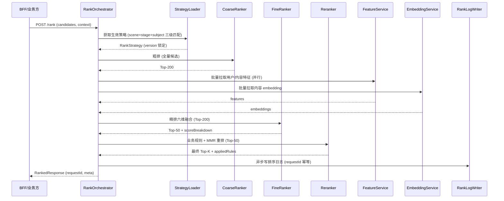

# 服务端-学习内容推荐排序融合层与多目标加权决策引擎-详细设计

## 1. 概述

### 1.1 模块定位

本模块是 PrimeTop 教育平台个性化推荐系统的**排序融合层（Ranking Fusion Layer）**，位于多路召回（候选集生成）之后、最终推荐结果展示之前。其核心职责是：接收来自多个召回通道的候选内容集合，经过粗排→精排→重排三个阶段的多目标融合排序，输出最终展示给用户的有序推荐列表。

在推荐系统全链路中的位置：

```
用户请求 → 召回层(多路) → 【排序融合层(本模块)】 → 业务规则过滤 → 展示层
         ├─ 协同过滤召回      ├─ 粗排(Fast Model)
         ├─ 内容相似召回      ├─ 精排(Main Model)
         ├─ 知识图谱召回      └─ 重排(策略+多样性)
         ├─ 热门趋势召回
         └─ 个性化向量召回
```

### 1.2 设计目标

| 目标 | 说明 |
| --- | --- |
| **多目标平衡** | 同时优化学习价值、用户兴趣匹配度、内容新鲜度、多样性 |
| **低延迟** | P99 排序延迟 < 50ms（不含召回阶段） |
| **可配置性** | 排序权重、业务规则可通过运营后台动态调整 |
| **可解释性** | 每条推荐结果可追溯其排序得分组成 |
| **教育适配** | 考虑难度匹配、知识点关联、学习目标对齐等教育场景特有维度 |

### 1.3 适用范围

- 学生端首页学习内容推荐
- 章节学习完成后的延伸推荐
- 错题复习后的同类知识点推荐
- AI 辅导对话结束后的关联学习内容推荐
- 同步课堂章节内的个性化内容排序

---

## 2. 数据结构定义

### 2.1 核心数据模型

#### 2.1.1 推荐请求上下文（RecommendRequestContext）

```java
/**
 * 推荐请求上下文 - 每次推荐请求携带的用户与环境信息
 */
public class RecommendRequestContext {
    private String userId;                  // 用户ID
    private String studentId;               // 学生档案ID
    private Integer gradeLevel;             // 年级 (1-12, 0=幼儿)
    private StageEnum stage;                // 学段 (KINDERGARTEN/PRIMARY/JUNIOR/SENIOR)
    private String textbookVersionId;       // 当前教材版本ID
    private String subjectCode;             // 当前学科编码
    private String currentChapterId;        // 当前学习章节ID（可空）
    private String currentKnowledgePointId; // 当前知识点ID（可空）
    private RecommendationScene scene;      // 推荐场景
    private DeviceTypeEnum deviceType;      // 设备类型
    private String sessionId;               // 学习会话ID
    private Long timestamp;                 // 请求时间戳
    private UserLearningState learningState; // 用户实时学习状态快照
}

public enum RecommendationScene {
    HOME_PAGE_FEED,          // 首页信息流
    POST_LESSON,             // 章节学习完成后
    POST_EXERCISE,           // 练习完成后
    POST_MISTAKE_REVIEW,     // 错题复习后
    AI_DIALOG_END,           // AI对话结束后
    SEARCH_RESULT_RERANK,    // 搜索结果重排
    DAILY_TASK_SUPPLEMENT,   // 每日任务补充
    RELATED_CONTENT          // 关联内容推荐
}
```

#### 2.1.2 候选项（RecommendCandidate）

```java
/**
 * 推荐候选项 - 来自召回层的候选内容
 */
public class RecommendCandidate {
    private String contentId;               // 内容ID
    private ContentType contentType;        // 内容类型
    private String title;                   // 标题
    private String subjectCode;             // 学科
    private String chapterId;               // 所属章节
    private List<String> knowledgePointIds; // 关联知识点
    private Integer difficultyLevel;        // 难度等级 (1-10)
    private BloomLevelEnum cognitiveLevel;  // 布鲁姆认知层级
    private Long publishTime;               // 发布时间
    private Integer viewCount;              // 历史浏览数
    private Double averageRating;           // 平均评分
    private Integer estimatedDurationMin;   // 预计学习时长（分钟）
    private List<String> recallChannels;    // 命中的召回通道列表
    private Map<String, Double> recallScores; // 各通道召回得分
}

public enum ContentType {
    VIDEO,           // 视频课程
    ARTICLE,         // 图文内容
    EXERCISE_SET,    // 练习题集
    KNOWLEDGE_CARD,  // 知识卡片
    INTERACTIVE,     // 互动课件
    MICRO_LESSON,    // 微课
    LIVE_REPLAY,     // 直播回放
    AUDIO_LESSON,    // 音频课程
    FLASHCARD        // 闪卡
}
```

#### 2.1.3 排序结果（RankedItem）

```java
/**
 * 排序后结果项
 */
public class RankedItem {
    private String contentId;
    private Double finalScore;              // 最终融合得分
    private Double coarseScore;             // 粗排得分
    private Double fineScore;               // 精排得分
    private Double rerankScore;             // 重排得分
    private Map<String, Double> scoreBreakdown; // 得分分解（各维度贡献）
    private List<String> appliedRules;      // 应用的业务规则
    private String explanation;             // 推荐理由（可解释性）
    private Integer position;               // 最终展示位置
}
```

#### 2.1.4 用户实时学习状态（UserLearningState）

```java
/**
 * 用户实时学习状态快照 - 从特征服务获取
 */
public class UserLearningState {
    private Map<String, Double> subjectMastery;      // 各学科掌握度 (0-1)
    private Map<String, Double> knowledgeMastery;    // 各知识点掌握度 (0-1)
    private Double currentFatigueLevel;              // 当前疲劳度 (0-1)
    private Integer todayStudyMinutes;               // 今日已学习分钟数
    private Integer todayContentConsumed;            // 今日已消费内容数
    private Set<String> recentContentIds;            // 近1小时浏览过的内容ID
    private Set<String> todayRecommendedIds;         // 今日已推荐过的内容ID
    private LearningGoal currentGoal;                // 当前学习目标
    private List<String> weakKnowledgePoints;        // 薄弱知识点列表
    private Double averageDifficultyPreference;      // 偏好难度（1-10）
}
```

### 2.2 数据库表设计

#### 2.2.1 排序策略配置表（t_rank_strategy_config）

```sql
CREATE TABLE t_rank_strategy_config (
    id              BIGINT PRIMARY KEY AUTO_INCREMENT,
    strategy_id     VARCHAR(64) NOT NULL COMMENT '策略唯一标识',
    strategy_name   VARCHAR(128) NOT NULL COMMENT '策略名称',
    scene           VARCHAR(32) NOT NULL COMMENT '推荐场景',
    stage           VARCHAR(16) COMMENT '适用学段(null=全学段)',
    subject_code    VARCHAR(16) COMMENT '适用学科(null=全学科)',
    
    -- 粗排配置
    coarse_model_id     VARCHAR(64) COMMENT '粗排模型ID',
    coarse_top_k        INT DEFAULT 200 COMMENT '粗排保留数量',
    
    -- 精排配置
    fine_model_id       VARCHAR(64) COMMENT '精排模型ID',
    fine_top_k          INT DEFAULT 50 COMMENT '精排保留数量',
    
    -- 多目标融合权重
    weight_relevance    DECIMAL(4,3) NOT NULL DEFAULT 0.300 COMMENT '相关性权重',
    weight_learning_value DECIMAL(4,3) NOT NULL DEFAULT 0.250 COMMENT '学习价值权重',
    weight_difficulty   DECIMAL(4,3) NOT NULL DEFAULT 0.150 COMMENT '难度匹配权重',
    weight_freshness    DECIMAL(4,3) NOT NULL DEFAULT 0.100 COMMENT '新鲜度权重',
    weight_diversity    DECIMAL(4,3) NOT NULL DEFAULT 0.100 COMMENT '多样性权重',
    weight_goal_align   DECIMAL(4,3) NOT NULL DEFAULT 0.100 COMMENT '目标对齐权重',
    
    -- 重排配置
    rerank_diversity_lambda DECIMAL(4,3) DEFAULT 0.300 COMMENT 'MMR多样性参数',
    max_same_subject    INT DEFAULT 2 COMMENT '连续同学科最大数',
    max_same_type       INT DEFAULT 2 COMMENT '连续同类型最大数',
    
    status          TINYINT DEFAULT 1 COMMENT '0=禁用 1=启用',
    version         INT DEFAULT 1 COMMENT '版本号',
    created_at      DATETIME DEFAULT CURRENT_TIMESTAMP,
    updated_at      DATETIME DEFAULT CURRENT_TIMESTAMP ON UPDATE CURRENT_TIMESTAMP,
    
    UNIQUE KEY uk_strategy_id (strategy_id),
    KEY idx_scene (scene, status),
    KEY idx_scene_subject (scene, subject_code, stage, status)
) ENGINE=InnoDB DEFAULT CHARSET=utf8mb4 COMMENT='推荐排序策略配置表';
```

#### 2.2.2 排序日志表（t_rank_log）

```sql
CREATE TABLE t_rank_log (
    id              BIGINT PRIMARY KEY AUTO_INCREMENT,
    request_id      VARCHAR(64) NOT NULL COMMENT '请求唯一ID',
    user_id         VARCHAR(64) NOT NULL COMMENT '用户ID',
    scene           VARCHAR(32) NOT NULL COMMENT '推荐场景',
    strategy_id     VARCHAR(64) NOT NULL COMMENT '使用的策略ID',
    candidate_count INT NOT NULL COMMENT '候选总数',
    final_count     INT NOT NULL COMMENT '最终推荐数',
    coarse_time_ms  INT COMMENT '粗排耗时(ms)',
    fine_time_ms    INT COMMENT '精排耗时(ms)',
    rerank_time_ms  INT COMMENT '重排耗时(ms)',
    total_time_ms   INT COMMENT '总排序耗时(ms)',
    result_snapshot JSON COMMENT '排序结果快照(前10条)',
    created_at      DATETIME DEFAULT CURRENT_TIMESTAMP,
    
    KEY idx_user_time (user_id, created_at),
    KEY idx_scene_time (scene, created_at)
) ENGINE=InnoDB DEFAULT CHARSET=utf8mb4 COMMENT='推荐排序日志表';
```

#### 2.2.3 排序效果反馈表（t_rank_feedback）

```sql
CREATE TABLE t_rank_feedback (
    id              BIGINT PRIMARY KEY AUTO_INCREMENT,
    request_id      VARCHAR(64) NOT NULL COMMENT '关联请求ID',
    user_id         VARCHAR(64) NOT NULL,
    content_id      VARCHAR(64) NOT NULL,
    position        INT NOT NULL COMMENT '展示位置(从1开始)',
    final_score     DECIMAL(10,6) COMMENT '排序得分',
    
    -- 用户反馈信号
    impression      TINYINT DEFAULT 0 COMMENT '是否曝光',
    click           TINYINT DEFAULT 0 COMMENT '是否点击',
    click_time_ms   INT COMMENT '从展示到点击的毫秒数',
    completion_rate DECIMAL(5,2) COMMENT '内容完成率(0-100)',
    dwell_time_sec  INT COMMENT '停留时长(秒)',
    like            TINYINT DEFAULT 0 COMMENT '是否点赞/收藏',
    dismiss         TINYINT DEFAULT 0 COMMENT '是否忽略/不感兴趣',
    
    -- 学习效果信号
    post_quiz_score DECIMAL(5,2) COMMENT '学习后小测得分',
    mastery_delta   DECIMAL(5,4) COMMENT '知识点掌握度变化',
    
    created_at      DATETIME DEFAULT CURRENT_TIMESTAMP,
    
    KEY idx_request (request_id),
    KEY idx_user_time (user_id, created_at),
    KEY idx_content (content_id)
) ENGINE=InnoDB DEFAULT CHARSET=utf8mb4 COMMENT='推荐排序效果反馈表';
```

---

## 3. API 接口设计

### 3.1 核心排序接口

#### POST /api/v1/recommend/rank

对召回层输出的候选集进行排序融合，返回有序推荐列表。

**请求体：**

```json
{
  "requestContext": {
    "userId": "U20260001",
    "studentId": "S20260001",
    "gradeLevel": 7,
    "stage": "JUNIOR",
    "textbookVersionId": "TB_RENJIAO_V3_2024",
    "subjectCode": "MATH",
    "currentChapterId": "CH_MATH_7_G1_CH3",
    "currentKnowledgePointId": "KP_LINEAR_EQUATION",
    "scene": "POST_LESSON",
    "deviceType": "ANDROID",
    "sessionId": "SS_20260813_001"
  },
  "candidates": [
    {
      "contentId": "C20260001",
      "contentType": "VIDEO",
      "title": "一元一次方程的应用场景",
      "subjectCode": "MATH",
      "chapterId": "CH_MATH_7_G1_CH3",
      "knowledgePointIds": ["KP_LINEAR_EQUATION", "KP_WORD_PROBLEMS"],
      "difficultyLevel": 4,
      "cognitiveLevel": "APPLY",
      "publishTime": 1723420800000,
      "viewCount": 15230,
      "averageRating": 4.7,
      "estimatedDurationMin": 12,
      "recallChannels": ["CF", "CONTENT_SIM", "KNOWLEDGE_GRAPH"],
      "recallScores": {
        "CF": 0.85,
        "CONTENT_SIM": 0.78,
        "KNOWLEDGE_GRAPH": 0.92
      }
    }
  ],
  "topK": 10,
  "excludeContentIds": ["C20250099", "C20250098"]
}
```

**响应体：**

```json
{
  "code": 0,
  "message": "success",
  "data": {
    "requestId": "REQ_20260813_R0001",
    "rankedItems": [
      {
        "contentId": "C20260001",
        "position": 1,
        "finalScore": 0.8742,
        "scoreBreakdown": {
          "relevance": 0.285,
          "learningValue": 0.210,
          "difficultyMatch": 0.142,
          "freshness": 0.082,
          "diversity": 0.075,
          "goalAlignment": 0.080
        },
        "explanation": "与你刚学的「一元一次方程」高度相关，难度适中，推荐巩固",
        "appliedRules": ["KNOWLEDGE_CONTINUITY_BOOST", "DIFFICULTY_MATCH_FILTER"]
      }
    ],
    "meta": {
      "totalCandidates": 48,
      "coarseStageTimeMs": 8,
      "fineStageTimeMs": 23,
      "rerankStageTimeMs": 6,
      "totalTimeMs": 37,
      "strategyId": "STRAT_POST_LESSON_JUNIOR_MATH_V2"
    }
  }
}
```

### 3.2 策略管理接口

#### GET /api/v1/recommend/strategy/list

获取排序策略列表，支持按场景、学段、学科筛选。

#### PUT /api/v1/recommend/strategy/{strategyId}

更新排序策略配置（权重调整、模型切换等）。需要管理后台权限。

#### POST /api/v1/recommend/strategy/{strategyId}/clone

克隆现有策略用于创建变体，支持 A/B 测试。

### 3.3 效果分析接口

#### GET /api/v1/recommend/rank/analytics

获取排序效果指标，支持按时间范围、场景、策略筛选。

```json
{
  "code": 0,
  "data": {
    "dateRange": ["2026-08-01", "2026-08-13"],
    "scene": "POST_LESSON",
    "metrics": {
      "ctr": 0.234,
      "cvr": 0.089,
      "avgDwellTimeSec": 185,
      "avgCompletionRate": 0.672,
      "coverage": 0.845,
      "diversityScore": 0.712,
      "noveltyRatio": 0.234,
      "p99LatencyMs": 42
    },
    "trend": [
      { "date": "2026-08-12", "ctr": 0.241, "cvr": 0.092 },
      { "date": "2026-08-13", "ctr": 0.234, "cvr": 0.089 }
    ]
  }
}
```

---

## 4. 核心算法设计

### 4.1 三阶段排序架构

```
┌──────────────────────────────────────────────────────────────────┐
│                        排序融合引擎                                │
│                                                                  │
│  ┌────────────┐    ┌────────────┐    ┌────────────┐             │
│  │   粗排层    │ →  │   精排层    │ →  │   重排层    │             │
│  │  Coarse    │    │   Fine     │    │  Rerank    │             │
│  │            │    │            │    │            │             │
│  │ 轻量模型    │    │ 深度模型    │    │ 策略引擎    │             │
│  │ 快速过滤    │    │ 多目标融合  │    │ 多样性保障  │             │
│  │ 200→50     │    │ 50→15      │    │ 15→最终     │             │
│  └────────────┘    └────────────┘    └────────────┘             │
│        ↓                  ↓                  ↓                   │
│     < 5ms              < 30ms             < 10ms                │
└──────────────────────────────────────────────────────────────────┘
```

### 4.2 粗排层（Coarse Ranking）

粗排使用轻量级模型对全量候选快速打分，保留 Top-K。

```python
class CoarseRanker:
    """
    粗排层 - 基于浅层特征快速打分
    目标: P99 < 5ms, 召回率 > 95%
    """
    
    def __init__(self, config: CoarseConfig):
        self.top_k = config.top_k  # 默认 200→50
        self.feature_weights = config.feature_weights
        
    def rank(self, candidates: List[Candidate], 
             context: RecommendRequestContext) -> List[Candidate]:
        scored = []
        for c in candidates:
            features = self._extract_coarse_features(c, context)
            score = self._linear_score(features)
            scored.append((c, score))
        
        # Top-K 选择
        scored.sort(key=lambda x: x[1], reverse=True)
        return [c for c, _ in scored[:self.top_k]]
    
    def _extract_coarse_features(self, candidate: Candidate,
                                  context: RecommendRequestContext) -> dict:
        """提取粗排特征 - 仅使用低延迟特征"""
        return {
            # 召回通道特征
            'max_recall_score': max(candidate.recall_scores.values()),
            'recall_channel_count': len(candidate.recall_channels),
            'hit_knowledge_graph': 1.0 if 'KNOWLEDGE_GRAPH' in candidate.recall_channels else 0.0,
            
            # 内容质量特征
            'normalized_rating': (candidate.average_rating - 3.0) / 2.0,  # 归一化到 [0,1]
            'log_view_count': math.log1p(candidate.viewCount) / math.log(100000),
            
            # 基础匹配特征
            'same_subject': 1.0 if candidate.subjectCode == context.subjectCode else 0.0,
            'same_chapter': 1.0 if candidate.chapterId == context.currentChapterId else 0.0,
            'knowledge_overlap': len(
                set(candidate.knowledgePointIds) & 
                set(context.learningState.weakKnowledgePoints)
            ) / max(len(candidate.knowledgePointIds), 1),
            
            # 时效性特征
            'freshness': self._compute_freshness(candidate.publishTime),
        }
    
    def _linear_score(self, features: dict) -> float:
        """线性加权打分"""
        score = 0.0
        for fname, fval in features.items():
            score += self.feature_weights.get(fname, 0.0) * fval
        return score
    
    @staticmethod
    def _compute_freshness(publish_time: int) -> float:
        """新鲜度衰减: 30天内满分，之后指数衰减"""
        days_old = (int(time.time() * 1000) - publish_time) / (86400 * 1000)
        if days_old <= 30:
            return 1.0
        return math.exp(-0.02 * (days_old - 30))
```

### 4.3 精排层（Fine Ranking）- 核心多目标融合

精排是本模块的核心，使用多目标融合公式对候选内容综合打分。

#### 4.3.1 六维融合评分公式

```
FinalScore = w₁·RelScore + w₂·LearnValueScore + w₃·DiffMatchScore 
           + w₄·FreshnessScore + w₅·DiversityScore + w₆·GoalAlignScore

约束: w₁ + w₂ + w₃ + w₄ + w₅ + w₆ = 1.0
默认: w₁=0.30, w₂=0.25, w₃=0.15, w₄=0.10, w₅=0.10, w₆=0.10
```

#### 4.3.2 各维度计算详解

```python
class FineRanker:
    """
    精排层 - 六维多目标融合排序
    目标: P99 < 30ms
    """
    
    def __init__(self, config: FineConfig, 
                 feature_service: FeatureService,
                 embedding_service: EmbeddingService):
        self.weights = config.weights
        self.feature_service = feature_service
        self.embedding_service = embedding_service
        self._user_embedding_cache = TTLCache(maxsize=10000, ttl=300)
    
    def rank(self, candidates: List[Candidate],
             context: RecommendRequestContext,
             coarse_results: List[Candidate]) -> List[ScoredCandidate]:
        
        # 批量获取用户特征
        user_features = self.feature_service.get_user_features(context.userId)
        
        # 批量获取内容特征
        content_ids = [c.contentId for c in candidates]
        content_features_map = self.feature_service.batch_get_content_features(content_ids)
        
        # 获取用户embedding
        user_emb = self._get_user_embedding(context, user_features)
        
        scored = []
        seen_subjects = []
        seen_types = []
        
        for idx, candidate in enumerate(candidates):
            content_features = content_features_map.get(candidate.contentId, {})
            
            # 计算六个维度得分
            rel_score = self._compute_relevance(candidate, context, user_emb)
            learn_score = self._compute_learning_value(candidate, context, content_features)
            diff_score = self._compute_difficulty_match(candidate, context, user_features)
            fresh_score = self._compute_freshness(candidate)
            div_score = self._compute_diversity(candidate, seen_subjects, seen_types, idx)
            goal_score = self._compute_goal_alignment(candidate, context)
            
            # 融合打分
            final_score = (
                self.weights['relevance']    * rel_score +
                self.weights['learning_value'] * learn_score +
                self.weights['difficulty']   * diff_score +
                self.weights['freshness']    * fresh_score +
                self.weights['diversity']    * div_score +
                self.weights['goal_align']   * goal_score
            )
            
            scored.append(ScoredCandidate(
                candidate=candidate,
                final_score=final_score,
                score_breakdown={
                    'relevance': self.weights['relevance'] * rel_score,
                    'learning_value': self.weights['learning_value'] * learn_score,
                    'difficulty_match': self.weights['difficulty'] * diff_score,
                    'freshness': self.weights['freshness'] * fresh_score,
                    'diversity': self.weights['diversity'] * div_score,
                    'goal_alignment': self.weights['goal_align'] * goal_score,
                }
            ))
            
            # 更新已见列表（用于多样性计算）
            seen_subjects.append(candidate.subjectCode)
            seen_types.append(candidate.contentType)
        
        scored.sort(key=lambda x: x.final_score, reverse=True)
        return scored[:self.top_k]
    
    def _compute_relevance(self, candidate: Candidate,
                           context: RecommendRequestContext,
                           user_emb: np.ndarray) -> float:
        """
        相关性得分 - 用户兴趣与内容匹配度
        综合考虑: 召回得分、向量相似度、学科匹配
        """
        # 1. 召回通道最高分
        max_recall = max(candidate.recallScores.values()) if candidate.recallScores else 0
        
        # 2. 向量余弦相似度
        content_emb = self.embedding_service.get_content_embedding(candidate.contentId)
        cosine_sim = float(np.dot(user_emb, content_emb) / 
                          (np.linalg.norm(user_emb) * np.linalg.norm(content_emb) + 1e-8))
        
        # 3. 当前学科加权（同学科内容相关性更高）
        subject_match = 1.0 if candidate.subjectCode == context.subjectCode else 0.6
        
        # 融合
        relevance = 0.4 * max_recall + 0.4 * max(0, cosine_sim) + 0.2 * subject_match
        return min(relevance, 1.0)
    
    def _compute_learning_value(self, candidate: Candidate,
                                context: RecommendRequestContext,
                                content_features: dict) -> float:
        """
        学习价值得分 - 内容对学生的实际学习帮助程度
        综合考虑: 内容质量、知识覆盖、历史效果
        """
        # 1. 内容质量分（评分+热度）
        rating_score = max(0, (candidate.averageRating - 3.0) / 2.0)  # [0,1]
        popularity_score = min(math.log1p(candidate.viewCount) / math.log(50000), 1.0)
        quality = 0.6 * rating_score + 0.4 * popularity_score
        
        # 2. 知识点覆盖价值（覆盖薄弱知识点的加分）
        weak_kps = set(context.learningState.weakKnowledgePoints)
        candidate_kps = set(candidate.knowledgePointIds)
        weak_coverage = len(candidate_kps & weak_kps) / max(len(candidate_kps), 1)
        
        # 3. 历史学习效果（该内容的历史平均完成率、小测通过率）
        hist_completion = content_features.get('avg_completion_rate', 0.5)
        hist_quiz_pass = content_features.get('avg_quiz_pass_rate', 0.5)
        historical_effect = 0.5 * hist_completion + 0.5 * hist_quiz_pass
        
        # 融合
        value = 0.3 * quality + 0.4 * weak_coverage + 0.3 * historical_effect
        return min(value, 1.0)
    
    def _compute_difficulty_match(self, candidate: Candidate,
                                  context: RecommendRequestContext,
                                  user_features: dict) -> float:
        """
        难度匹配得分 - 内容难度与学生当前水平的适配度
        基于 Vygotsky 最近发展区理论: 难度略高于当前水平时学习效果最好
        """
        content_diff = candidate.difficultyLevel  # 1-10
        student_level = self._estimate_student_level(context, user_features)
        
        # 最近发展区: 理想难度 = 当前水平 + 1~2
        ideal_low = student_level + 0.5
        ideal_high = student_level + 2.5
        
        if ideal_low <= content_diff <= ideal_high:
            return 1.0  # 完美匹配
        elif content_diff < ideal_low:
            # 过于简单，惩罚
            return max(0.3, 1.0 - (ideal_low - content_diff) * 0.15)
        else:
            # 过难，快速惩罚
            return max(0.1, 1.0 - (content_diff - ideal_high) * 0.25)
    
    def _compute_freshness(self, candidate: Candidate) -> float:
        """新鲜度得分 - 基于发布时间的衰减"""
        days_old = (int(time.time() * 1000) - candidate.publishTime) / (86400 * 1000)
        if days_old <= 7:
            return 1.0
        elif days_old <= 30:
            return 0.9 - 0.01 * (days_old - 7)
        elif days_old <= 90:
            return 0.6 - 0.003 * (days_old - 30)
        else:
            return max(0.1, 0.3 - 0.001 * (days_old - 90))
    
    def _compute_diversity(self, candidate: Candidate,
                           seen_subjects: list, seen_types: list,
                           position: int) -> float:
        """
        多样性得分 - 惩罚连续推荐同学科/同类型内容
        使用滑动窗口方式
        """
        window = 5  # 查看最近5个已选内容
        recent_subjects = seen_subjects[-window:] if seen_subjects else []
        recent_types = seen_types[-window:] if seen_types else []
        
        # 同学科出现次数
        subject_count = recent_subjects.count(candidate.subjectCode)
        # 同类型出现次数
        type_count = recent_types.count(candidate.contentType)
        
        subject_penalty = subject_count / max(len(recent_subjects), 1)
        type_penalty = type_count / max(len(recent_types), 1)
        
        return max(0.0, 1.0 - 0.4 * subject_penalty - 0.3 * type_penalty)
    
    def _compute_goal_alignment(self, candidate: Candidate,
                                context: RecommendRequestContext) -> float:
        """
        目标对齐得分 - 内容与学生当前学习目标的匹配度
        """
        goal = context.learningState.currentGoal
        if not goal:
            return 0.5  # 无明确目标时中性得分
        
        alignment = 0.0
        
        # 目标关联章节匹配
        if goal.target_chapter_ids and candidate.chapterId in goal.target_chapter_ids:
            alignment += 0.4
        
        # 目标关联知识点匹配
        if goal.target_knowledge_point_ids:
            overlap = set(candidate.knowledgePointIds) & set(goal.target_knowledge_point_ids)
            alignment += 0.3 * (len(overlap) / max(len(goal.target_knowledge_point_ids), 1))
        
        # 目标类型匹配（考试备考 vs 日常学习）
        if goal.goal_type == 'EXAM_PREP':
            # 备考期间：高频考点优先
            if candidate.cognitiveLevel in ['ANALYZE', 'EVALUATE']:
                alignment += 0.3
        elif goal.goal_type == 'DAILY_LEARNING':
            # 日常学习：基础知识巩固优先
            if candidate.cognitiveLevel in ['UNDERSTAND', 'APPLY']:
                alignment += 0.3
        
        return min(alignment, 1.0)
    
    def _estimate_student_level(self, context: RecommendRequestContext,
                                user_features: dict) -> float:
        """估算学生当前能力水平（映射到1-10难度等级）"""
        mastery = context.learningState.subjectMastery.get(context.subjectCode, 0.5)
        # 掌握度 0.5 → 难度等级 ~5, 掌握度 0.9 → 难度等级 ~9
        return max(1.0, min(10.0, mastery * 10))
```

### 4.4 重排层（Re-ranking）

重排层在精排结果基础上应用业务规则和最终多样性保障。

```python
class Reranker:
    """
    重排层 - 业务规则约束 + MMR多样性重排
    目标: P99 < 10ms
    """
    
    def __init__(self, config: RerankConfig):
        self.config = config
        self.rule_engine = BusinessRuleEngine(config.rules)
    
    def rerank(self, scored_candidates: List[ScoredCandidate],
               context: RecommendRequestContext) -> List[RankedItem]:
        
        # Step 1: 业务规则过滤与调整
        filtered = self.rule_engine.apply(scored_candidates, context)
        
        # Step 2: MMR (Maximal Marginal Relevance) 多样性重排
        reranked = self._mmr_rerank(filtered, context)
        
        # Step 3: 位置偏置调整（前面的位置有展示优势，适当平衡）
        final = self._position_bias_adjustment(reranked)
        
        # Step 4: 生成推荐理由
        results = []
        for idx, item in enumerate(final):
            explanation = self._generate_explanation(item, context, idx)
            results.append(RankedItem(
                contentId=item.candidate.contentId,
                finalScore=item.final_score,
                rerankScore=item.rerank_score,
                scoreBreakdown=item.score_breakdown,
                appliedRules=item.applied_rules,
                explanation=explanation,
                position=idx + 1
            ))
        
        return results
    
    def _mmr_rerank(self, candidates: List[ScoredCandidate],
                    context: RecommendRequestContext) -> List[ScoredCandidate]:
        """
        MMR算法: 在相关性和多样性之间取平衡
        MMR = λ · Rel(d) - (1-λ) · max_sim(d, selected)
        """
        lam = self.config.diversity_lambda  # 默认 0.7
        selected = []
        remaining = list(candidates)
        
        # 获取所有内容embedding用于相似度计算
        content_ids = [c.candidate.contentId for c in candidates]
        embeddings = self.embedding_service.batch_get(content_ids)
        
        while remaining and len(selected) < self.config.final_count:
            best = None
            best_score = -float('inf')
            
            for item in remaining:
                # 相关性得分（使用精排得分）
                rel = item.final_score
                
                # 与已选内容的最大相似度
                max_sim = 0.0
                if selected:
                    item_emb = embeddings[item.candidate.contentId]
                    for sel in selected:
                        sel_emb = embeddings[sel.candidate.contentId]
                        sim = cosine_similarity(item_emb, sel_emb)
                        max_sim = max(max_sim, sim)
                
                # MMR得分
                mmr_score = lam * rel - (1 - lam) * max_sim
                
                if mmr_score > best_score:
                    best_score = mmr_score
                    best = item
            
            if best:
                best.rerank_score = best_score
                selected.append(best)
                remaining.remove(best)
        
        return selected
```

### 4.5 业务规则引擎

```python
class BusinessRuleEngine:
    """
    业务规则引擎 - 对排序结果应用硬性规则和软性调权
    """
    
    def apply(self, candidates: List[ScoredCandidate],
              context: RecommendRequestContext) -> List[ScoredCandidate]:
        result = []
        
        for item in candidates:
            rules_applied = []
            
            # === 硬规则（一票否决） ===
            
            # R1: 学段不匹配过滤
            if not self._check_stage_match(item.candidate, context):
                continue
            
            # R2: 已展示内容过滤（今日已推荐过的不再推荐）
            if item.candidate.contentId in context.learningState.todayRecommendedIds:
                continue
            
            # R3: 排除列表过滤
            if item.candidate.contentId in context.excludeContentIds:
                continue
            
            # R4: 难度超出范围过滤（难度差距过大直接排除）
            student_level = self._estimate_level(context)
            if abs(item.candidate.difficultyLevel - student_level) > 4:
                continue
            
            # R5: 疲劳度检测（用户疲劳时降低高认知负荷内容权重）
            if context.learningState.fatigueLevel > 0.7:
                if item.candidate.cognitiveLevel in ['ANALYZE', 'EVALUATE', 'CREATE']:
                    item.final_score *= 0.6
                    rules_applied.append('FATIGUE_HIGH_COGNITION_PENALTY')
            
            # === 软规则（调权） ===
            
            # R7: 学习目标加权（命中当前学习目标章节/知识点）
            goal = context.learningState.currentGoal
            if goal:
                if candidate.chapterId in (goal.target_chapter_ids or []):
                    item.final_score *= 1.20
                    rules_applied.append('GOAL_CHAPTER_BOOST')
                kp_overlap = set(candidate.knowledgePointIds) & set(goal.target_knowledge_point_ids or [])
                if kp_overlap:
                    item.final_score *= 1.0 + min(0.15, 0.05 * len(kp_overlap))
                    rules_applied.append('GOAL_KP_BOOST')
            
            # R8: 认知层级适配加权（备考期高阶认知优先，日常学习基础优先）
            if goal and goal.goal_type == 'EXAM_PREP':
                if candidate.cognitiveLevel in ('ANALYZE', 'EVALUATE'):
                    item.final_score *= 1.10
                    rules_applied.append('EXAM_HIGH_COGNITION_BOOST')
            elif goal and goal.goal_type == 'DAILY_LEARNING':
                if candidate.cognitiveLevel in ('REMEMBER', 'UNDERSTAND'):
                    item.final_score *= 1.05
                    rules_applied.append('DAILY_FOUNDATION_BOOST')
            
            # R9: 单次时长预算约束（剩余可用学习时长不足以完成内容则降权）
            remaining_minutes = self._remaining_budget_minutes(context)
            if candidate.estimatedDurationMin > remaining_minutes:
                item.final_score *= 0.5
                rules_applied.append('DURATION_BUDGET_PENALTY')
            
            # R10: 曝光疲劳降权（近 24h 同学科曝光≥6 次降权，防信息茧房前置）
            subject_exposure = self._get_subject_exposure_24h(
                context.userId, candidate.subjectCode)
            if subject_exposure >= 6:
                item.final_score *= 0.7
                rules_applied.append('SUBJECT_EXPOSURE_FATIGUE')
            
            # R11: 内容质量红线（质量分<40 的内容不允许进入前 7 位）
            quality_score = getattr(item.candidate, 'quality_score', None) or 50
            if quality_score < 40 and len(result) < 7:
                continue
            
            # R12: 低龄学段视频占比控制（幼儿/小学低年级连续视频≤2 个）
            if context.stage in ('KINDERGARTEN', 'PRIMARY') and context.gradeLevel <= 2:
                if (candidate.contentType == 'VIDEO'
                        and self._consecutive_count(result, 'VIDEO') >= 2):
                    item.final_score *= 0.5
                    rules_applied.append('YOUNG_VIDEO_RATIO_PENALTY')
            
            item.applied_rules = rules_applied
            result.append(item)
        
        return result
    
    def _check_stage_match(self, candidate, context) -> bool:
        """学段匹配校验：内容适用学段包含当前学段；元数据缺失视为全学段放行（打标审计）"""
        if not getattr(candidate, 'applicable_stages', None):
            return True
        return context.stage.value in candidate.applicable_stages
    
    def _estimate_level(self, context) -> float:
        """估算学生当前能力水平（映射到 1-10 难度等级）"""
        mastery = context.learningState.subjectMastery.get(context.subjectCode, 0.5)
        return max(1.0, min(10.0, mastery * 10))
    
    def _remaining_budget_minutes(self, context) -> int:
        """剩余学习时长预算 = 分龄日上限 - 今日已学分钟数（今日已学权威归 LSSA/时长对账引擎）"""
        daily_cap = DAILY_MINUTES_CAP.get(context.stage, 60)  # 幼儿40/小学60/初中90/高中120
        return max(0, daily_cap - context.learningState.todayStudyMinutes)
    
    def _get_subject_exposure_24h(self, user_id: str, subject_code: str) -> int:
        """近 24h 同学科曝光次数：读曝光管控引擎 Redis 镜像（只读，权威外置 R6）"""
        key = f"exposure:subject:24h:{user_id}:{subject_code}"
        return int(self.redis.get(key) or 0)
    
    @staticmethod
    def _consecutive_count(items: list, content_type: str) -> int:
        """已选列表尾部连续同类型内容数"""
        count = 0
        for it in reversed(items):
            if it.candidate.contentType == content_type:
                count += 1
            else:
                break
        return count
```

**规则汇总表：**

| 规则 | 类型 | 语义 | 默认参数 | 可配置 |
| --- | --- | --- | --- | --- |
| R1 学段匹配 | 硬过滤 | 适用学段不包含当前学段则剔除 | — | 否（安全红线） |
| R2 今日已推荐过滤 | 硬过滤 | 今日已推荐过的内容不再推荐 | — | 否 |
| R3 排除列表过滤 | 硬过滤 | 请求方显式排除的内容剔除 | — | 否 |
| R4 难度差距过滤 | 硬过滤 | \|内容难度-学生水平\|>4 则剔除 | 阈值 4 | 是（≤5） |
| R5 疲劳高认知惩罚 | 软调权 ×0.6 | 疲劳度>0.7 时高认知内容降权 | 阈值 0.7 | 是 |
| R6 知识连续性加权 | 软调权 ×1.15 | 当前章节内容加权 | 系数 1.15 | 是 |
| R7 目标加权 | 软调权 ×1.05~1.20 | 命中学习目标章节/知识点 | 系数表 | 是 |
| R8 认知层级适配 | 软调权 ×1.05~1.10 | 备考期/日常学习目标差异化 | 系数表 | 是 |
| R9 时长预算惩罚 | 软调权 ×0.5 | 预计时长超出剩余预算 | — | 否（防沉迷相关） |
| R10 曝光疲劳降权 | 软调权 ×0.7 | 近 24h 同学科曝光≥6 次 | 阈值 6 | 是 |
| R11 质量红线 | 硬过滤（前 7 位） | 质量分<40 不进前 7 位 | 阈值 40 | 是（双人审批） |
| R12 低龄视频占比 | 软调权 ×0.5 | 幼儿/低年级连续视频≤2 | — | 否（护眼红线） |

**规则执行约定：**

1. 硬过滤先于软调权执行，过滤后候选不足 `topK` 时允许回填补位（按粗排得分递补，补位项同样过硬规则）；
2. 软调权系数连乘，单个候选累计调权系数上限 1.6、下限 0.3，防止规则叠加造成排序雪崩（守卫 G6）；
3. R1/R9/R12 与防沉迷、护眼相关，**不可通过配置放宽**（只能收紧），管理端界面不暴露编辑入口；
4. 所有规则命中写入 `appliedRules` 随排序日志落库，供可解释性引擎消费（契约 R4）。

#### 4.5.1 规则热更新

规则引擎采用双缓冲热更新：管理端保存配置 → 广播 Redis 版本号 `rank:rules:version` → 各节点对比本地版本落后则拉取全量配置重建规则树 → 原子切换缓冲区。同一请求内规则版本必须一致（读时绑定版本号），禁止排序中途切换规则集。

### 4.6 多目标权重校准与灰度发布

六维权重不允许人工直接改线上值，必须走离线校准流程：

```
离线样本（t_rank_feedback 近 30 天）
    → 网格搜索/贝叶斯优化（目标：CTR×0.3 + 完成率×0.4 + 掌握度增益×0.3）
    → 离线回放评估（与当前线上策略 A/A 对照，差异>5% 拒绝）
    → 生成候选权重版本（status=DRAFT）
    → 小流量灰度 5%→25%→50%→100%（每档观察≥3 天，护栏指标：跳出率不升、负反馈率不升）
    → 全量后旧版本 ARCHIVED（保留回滚）
```

权重版本切换与策略配置状态机见 §7；任何权重调整留痕（操作人、审批人、前后值、回放报告 ID），满足审计要求。

---

## 5. 核心流程

### 5.1 排序主链路时序



### 5.2 延迟预算

| 阶段 | 预算 P99 | 说明 |
| --- | --- | --- |
| 策略加载 | 1ms | 本地缓存命中；未命中走 DB 并回填（缓存 60s） |
| 特征/embedding 批量拉取 | 15ms | 并行；embedding 服务超时 10ms 降级跳过向量维度（相关性分降级为召回分加权） |
| 粗排 | 5ms | 纯内存线性打分 |
| 精排 | 22ms | 六维计算 + MMR 预计算 |
| 重排 | 7ms | 规则引擎 + MMR 重排 |
| 日志异步写 | 0ms（异步） | 不阻塞响应 |
| **合计** | **≤50ms** | 超预算任一阶段触发降级（§11） |

### 5.3 Redis Key 总表

| Key 模式 | 类型 | TTL | 说明 |
| --- | --- | --- | --- |
| `rank:strategy:{scene}:{stage}:{subject}` | String(JSON) | 60s | 策略配置缓存（DEL 不 SET，cache-aside） |
| `rank:rules:version` | String | 永久 | 规则版本号，热更新广播 |
| `rank:result:{requestId}` | String | 15min | 排序结果短期缓存（同请求重放/多端一致性） |
| `rank:feedback:impression:{userId}` | Hash | 24h | 当日曝光计数（写路径只增，重置权威归曝光管控引擎 R6） |
| `rank:uremb:{userId}` | String(bytes) | 300s | 用户 embedding 缓存 |
| `rank:lock:strategy:reload` | SET NX EX | 120s | 规则重建互斥锁 |

### 5.4 排序事件表（rank_outbox）

```sql
CREATE TABLE rank_outbox (
    id              BIGINT PRIMARY KEY AUTO_INCREMENT,
    event_id        VARCHAR(64) NOT NULL COMMENT '事件唯一ID(UUID v7)',
    event_type      VARCHAR(64) NOT NULL COMMENT '事件类型',
    aggregate_id    VARCHAR(64) NOT NULL COMMENT '聚合ID(通常为requestId)',
    payload         JSON NOT NULL COMMENT '事件载荷',
    status          TINYINT DEFAULT 0 COMMENT '0=待发送 1=已发送 2=发送失败',
    retry_count     INT DEFAULT 0,
    created_at      DATETIME DEFAULT CURRENT_TIMESTAMP,
    sent_at         DATETIME,
    UNIQUE KEY uk_event_id (event_id),
    KEY idx_status_created (status, created_at)
) ENGINE=InnoDB DEFAULT CHARSET=utf8mb4 COMMENT='排序引擎Outbox表';
```

---

## 6. 关键代码

### 6.1 排序编排器（RankOrchestrator）

```java
@Service
public class RankOrchestrator {

    private final StrategyLoader strategyLoader;
    private final CoarseRanker coarseRanker;
    private final FineRanker fineRanker;
    private final Reranker reranker;
    private final FeatureGateway featureGateway;
    private final RankLogWriter logWriter;
    private final RankResultCache resultCache;

    public RankResponse rank(RankRequest request) {
        long startNs = System.nanoTime();

        // 1. 同请求重放（requestId 幂等）：命中直接返回缓存结果
        RankResponse cached = resultCache.get(request.getRequestId());
        if (cached != null) {
            return cached;
        }

        // 2. 策略匹配（scene → scene+stage → scene+stage+subject，取最精确）
        RankStrategy strategy = strategyLoader.match(
                request.getScene(),
                request.getContext().getStage(),
                request.getContext().getSubjectCode());

        // 3. 候选校验：上限 500 条，超出截断并打 truncated 标记（守卫 G3）
        List<Candidate> candidates = validateAndTruncate(request.getCandidates());

        // 4. 三阶段排序（每阶段独立超时熔断）
        List<Candidate> coarseResult = executeWithTimeout(
                () -> coarseRanker.rank(candidates, request.getContext(), strategy), 5);

        RankContext enriched = featureGateway.batchEnrich(request.getContext(), coarseResult);

        List<ScoredCandidate> fineResult = executeWithTimeout(
                () -> fineRanker.rank(coarseResult, enriched, strategy), 25);

        List<RankedItem> finalResult = executeWithTimeout(
                () -> reranker.rerank(fineResult, enriched, strategy), 10);

        // 5. 组装响应（topK 截断）
        List<RankedItem> topK = finalResult.stream()
                .limit(request.getTopK()).collect(Collectors.toList());
        RankResponse response = RankResponse.of(request.getRequestId(), topK, strategy, elapsed(startNs));

        // 6. 结果缓存 + 异步日志 + Outbox 同事务边界（日志/事件异步，主链路不阻塞）
        resultCache.put(request.getRequestId(), response);
        logWriter.writeAsync(request, response);
        return response;
    }
}
```

### 6.2 策略加载与版本锁定

```java
@Component
public class StrategyLoader {

    private final StrategyRepository repository;
    private final RedisTemplate<String, String> redis;
    private volatile Map<StrategyKey, RankStrategy> localCache;

    public RankStrategy match(RecommendationScene scene, StageEnum stage, String subjectCode) {
        // 三级精确度匹配：scene+stage+subject > scene+stage > scene
        return Optional.ofNullable(localCache.get(StrategyKey.of(scene, stage, subjectCode)))
                .or(() -> Optional.ofNullable(localCache.get(StrategyKey.of(scene, stage, null))))
                .or(() -> Optional.ofNullable(localCache.get(StrategyKey.of(scene, null, null))))
                .orElseGet(this::fallbackDefault); // 兜底默认策略，禁止空策略上线（守卫 G2）
    }

    @Scheduled(fixedDelay = 30_000)
    public void refresh() {
        // 仅当 Redis 版本号变化才重建，避免无谓全量加载
        String remoteVersion = redis.opsForValue().get("rank:strategy:version");
        if (remoteVersion != null && !remoteVersion.equals(localVersion)) {
            Map<StrategyKey, RankStrategy> snapshot = repository.loadAllActive();
            this.localCache = Collections.unmodifiableMap(snapshot); // 原子切换
            this.localVersion = remoteVersion;
        }
    }
}
```

### 6.3 反馈消费与在线指标聚合

```python
class RankFeedbackConsumer:
    """
    消费埋点平台曝光/点击/完成事件，回填 t_rank_feedback，
    并滚动聚合在线 CTR 供策略监控与校准样本。
    """

    def on_event(self, event: dict):
        # 1. 按 (requestId, contentId) 幂等去抖（24h 窗口）
        dedup_key = f"rank:fb:dedup:{event['requestId']}:{event['contentId']}"
        if not self.redis.set(dedup_key, '1', nx=True, ex=86400):
            return

        # 2. 更新反馈表（曝光先行，点击/完成增量更新）
        self.repo.upsert_feedback(event)

        # 3. 滚动聚合：场景×策略×日期 CTR（Redis Hash + 5min 合并回写）
        bucket = f"rank:metrics:{event['scene']}:{event['strategyId']}:{date.today()}"
        pipe = self.redis.pipeline()
        pipe.hincrby(bucket, 'impression', 1)
        if event.get('click'):
            pipe.hincrby(bucket, 'click', 1)
        if event.get('completion_rate') is not None:
            pipe.hincrbyfloat(bucket, 'completion_sum', float(event['completion_rate']))
        pipe.expire(bucket, 7 * 86400)
        pipe.execute()
```

### 6.4 推荐理由生成器

```python
def generate_explanation(item, context, position) -> str:
    """
    推荐理由白名单模板生成（禁止自由文本 LLM 生成，防不当话术）：
    按命中规则优先级取最高一条主理由 + 至多一条辅理由。
    """
    rules = item.applied_rules or []
    templates = {
        'KNOWLEDGE_CONTINUITY_BOOST': '与你刚学的「{chapter}」内容衔接紧密',
        'GOAL_KP_BOOST': '有助于你的学习目标「{goal}」',
        'WEAK_KP_COVERAGE': '覆盖你的薄弱知识点「{kp}」',
        'EXAM_HIGH_COGNITION_BOOST': '适合当前备考冲刺阶段',
        'DIFFICULTY_MATCH_FILTER': '难度与你的当前水平匹配',
    }
    for rule in rules:  # 按规则优先级序遍历
        if rule in templates:
            return templates[rule].format(
                chapter=chapter_name_of(item.candidate.chapterId),
                goal=goal_title_of(context),
                kp=primary_weak_kp_of(item.candidate))
    return '根据你的学习情况为你推荐'  # 兜底中性话术
```

---

## 7. 状态机与守卫

### 7.1 排序策略配置状态机

```
DRAFT --提交校准--> CALIBRATING --回放通过--> GRAY(5%) --灰度达标--> GRAY(25%) --灰度达标--> ACTIVE
                                                                                  |
GRAY 任意阶段护栏指标劣化 --> ROLLED_BACK --修复后可重新 DRAFT
ACTIVE --新版本上线--> ARCHIVED（保留 90 天可回滚）
DRAFT/CALIBRATING --废弃--> ARCHIVED
```

状态迁移全部经 `version` 乐观锁 CAS 推进，禁止跳过灰度直接 ACTIVE（守卫 G5）。

### 7.2 守卫总表

| 编号 | 守卫 | 说明 |
| --- | --- | --- |
| G1 | 候选来源白名单 | 仅接受召回引擎（内部服务账号）与搜索重排场景的候选，外部直连拒绝 |
| G2 | 禁空策略上线 | 策略加载失败必须命中兜底默认策略；兜底也失败则整体降级（§11-D1），禁止无策略排序 |
| G3 | 候选上限 | 单请求候选≤500 条，超出截断打标，防止超大候选拖垮延迟 |
| G4 | 排除列表强制 | 请求方 `excludeContentIds` 为硬约束，任何规则不得绕过 |
| G5 | 权重灰度强制 | 权重/模型变更必须经灰度，禁止直接全量 |
| G6 | 调权系数有界 | 单候选累计调权系数 ∈ [0.3, 1.6]，防规则叠加雪崩 |
| G7 | 低幼内容形态红线 | R12 视频占比与 R1 学段匹配对幼儿 fail-closed，无放宽路径 |
| G8 | 日志必落 | 每次排序必须异步落 `t_rank_log`；日志失败不影响响应但计入监控 M8 |
| G9 | 推荐理由白名单 | explanation 仅允许模板生成，禁 LLM 自由生成（防话术失控） |
| G10 | 画像只读 | 本引擎只消费画像/掌握度，绝不回写（写权威归各画像生产者） |
| G11 | 降级透明标记 | 任何降级在响应 `meta` 打 `degraded: true` 并落日志（对齐召回引擎 D9 契约） |
| G12 | 注销即删 | 注销 24h 快速通道内删除该用户排序日志/反馈/缓存（委托清理引擎） |

---

## 8. 幂等与并发

| 场景 | 幂等/并发方案 |
| --- | --- |
| 同请求重放 | `requestId` 结果缓存 15min，重放返回同一结果（配合 requestId UUID v7 客户端生成） |
| 策略并发更新 | `version` 乐观锁 CAS，更新冲突返回 53605，管理端重试 |
| 规则热更新并发 | 重建互斥锁 SETNX 120s，抢到锁的节点重建后广播版本，其余节点按版本拉取 |
| 反馈事件重复 | `(requestId, contentId)` Redis 去抖 24h + DB upsert 天然幂等 |
| 多节点排序一致 | 同策略版本 + 确定性排序（分数相同按 contentId 字典序），保证多端结果一致 |
| 曝光计数并发 | Redis INCR/Lua 原子，不回写 DB 权威（权威归曝光管控引擎） |
| Outbox 重投 | `event_id` 唯一键，消费者幂等表 `(event_id, consumer)` |
| 灰度并发切换 | 状态机 CAS + 灰度比例只增不减（回滚走 ROLLED_BACK 独立路径） |

---

## 9. 领域事件

### 9.1 发布事件（rank.domain.events）

| 事件 | 触发时机 | 关键载荷 | 消费方 |
| --- | --- | --- | --- |
| rank.completed | 每次排序完成（异步） | requestId, scene, strategyId, topN contentIds | 曝光管控引擎（预登记曝光）、埋点平台 |
| rank.feedback.updated | 反馈聚合每 5min | scene, strategyId, ctr, completion_rate | 监控/校准管线 |
| rank.strategy.changed | 策略状态迁移 | strategyId, from, to, version, operator | 审计、推送时机引擎（策略相关） |
| rank.content.excluded | R1/R4 过滤占比>30% 告警伴随 | scene, rule, excludedTopContentIds | 内容运营（内容-学段错配线索） |

### 9.2 订阅事件

| 上游事件 | 用途 |
| --- | --- |
| content.retired / content.offlined | 清理策略缓存与候选快照 |
| user.preference.updated（个性化开关关闭） | 该用户降级为热度+规则排序（合规 C3） |
| user.account.deleted | 注销清理（G12） |
| recall.channel.health | 召回通道熔断状态镜像（供降级决策参考） |

---

## 10. 错误码（53600-53699）

536xx 段位经全库扫描确认空闲（邻近 535xx 教材修订、537xx 课标、538xx 判题互不冲突）。

| 错误码 | HTTP | 语义 | 客户端提示 |
| --- | --- | --- | --- |
| 53600 | 400 | 候选集为空或全部不合法 | 暂无合适推荐，请稍后再试 |
| 53601 | 400 | 候选超过 500 上限且未携带 truncated 许可 | 系统繁忙，请稍后再试 |
| 53602 | 403 | 调用方不在候选来源白名单 | 系统繁忙，请稍后再试 |
| 53603 | 422 | context 缺失必填字段（userId/scene/stage） | 系统繁忙，请稍后再试 |
| 53604 | 200 | 部分候选因硬规则过滤（降级响应，meta.degraded=true） | （透明，不提示） |
| 53605 | 409 | 策略版本冲突 | 系统繁忙，请稍后再试 |
| 53606 | 500 | 策略加载失败且兜底策略不可用 | 推荐加载失败，请稍后重试 |
| 53607 | 200 | embedding 服务超时，向量维度降级（降级响应） | （透明，不提示） |
| 53608 | 200 | 特征服务超时，使用快照特征（降级响应） | （透明，不提示） |
| 53609 | 403 | 管理端权重直接改线上值被拒绝（须走校准流程） | 请通过权重校准流程提交 |
| 53610 | 403 | 防沉迷相关规则（R1/R9/R12）放宽尝试被拦截 | 该配置不可放宽 |
| 53611 | 200 | 结果缓存命中（重放语义标识，正常返回） | （透明，不提示） |

注：53604/53607/53608/53611 为 200 语义降级码，客户端无感知，仅用于监控与对账。

---

## 11. 降级矩阵（D1-D10）

| 编号 | 故障场景 | 降级策略 | 红线 |
| --- | --- | --- | --- |
| D1 | 策略配置中心/DB 不可用 | 本地缓存 + 内置兜底默认策略；缓存也失效时按「热度分排序」（质量分降序+新鲜度降序） | 禁止返回空列表（G2） |
| D2 | embedding 服务超时 | 相关性分改用召回分加权（53607），其余维度不变 | — |
| D3 | 特征服务超时 | 使用 5min 内快照特征（53608）；无快照用群体先验 | — |
| D4 | 规则引擎异常 | 跳过软规则仅保留硬过滤（R1-R4），响应打 degraded | R1/R4 硬过滤不可跳过 |
| D5 | MMR 计算超时 | 退化为精排得分直出（多样性维度舍去） | — |
| D6 | Redis 缓存全挂 | 直查 DB/本地缓存，排序主链路不依赖 Redis 可用性 | — |
| D7 | 反馈消费积压 | 暂停在线指标聚合，优先保曝光预登记消费 | 不丢 rank.completed |
| D8 | 排序日志写失败 | 响应照常，错误计数告警（M8） | G8：不阻塞主链路但必告警 |
| D9 | 画像/掌握度服务不可用 | 难度匹配与目标对齐维度用中位默认分（0.5），不剔除候选 | — |
| D10 | 总红线 | 内容安全约束（学段/年龄分级）与防沉迷约束（R9）**fail-closed 不可降级**；排序层不承载内容安全审核，但上游已标记不安全的内容一经发现直接剔除并告警 | 不可绕过 |

---

## 12. 监控与容量

### 12.1 监控指标（M1-M10）

| 编号 | 指标 | 告警阈值 |
| --- | --- | --- |
| M1 | 排序 P99 延迟 | >50ms 持续 5min P2；>100ms P1 |
| M2 | 降级响应占比（degraded=true） | >5% 持续 10min P2 |
| M3 | 空结果率（返回条数<topK×50%） | >3% 持续 15min P2 |
| M4 | 硬规则过滤率 | R1 过滤率>20% 告警（学段错配线索，联动 rank.content.excluded） |
| M5 | 场景 CTR 环比 | 单日下降>30% P2（联动校准管线） |
| M6 | 负反馈率（dismiss/不感兴趣） | >8% 持续 3 天 P2 |
| M7 | 策略灰度护栏 | 灰度组跳出率/负反馈劣化>基线 10% 自动阻断回滚 |
| M8 | 排序日志写失败率 | >0.1% P2；>1% P1（G8 红线） |
| M9 | embedding/特征服务超时率 | >10% P2 |
| M10 | Outbox 积压 | >10 万或最老事件>30min P2 |

### 12.2 容量（DAU 50 万）

- 峰值排序 QPS：首页信息流刷新 3 次/日·人 + 场景触发约 8 次/日·人 → 峰值约 1200 QPS；
- 单次排序内存：候选 500 × 特征向量 ≈ 2MB，单实例并发 200 无压力；部署 4 实例余量充足；
- `t_rank_log` 日增约 400 万行（1200 QPS×峰值时段折算），按月分区在线 90 天，归档 ClickHouse TTL 180 天；
- `t_rank_feedback` 日增约 600 万行（含曝光事件），同样月分区 90 天 + CH 归档；
- Redis：结果缓存 15min×1200 QPS×2KB ≈ 220MB；用户 embedding 缓存 1.5GB。

---

## 13. 合规红线（C1-C10）

| 编号 | 红线 |
| --- | --- |
| C1 | 义务教育阶段推荐结果**不排名、不比分数**，推荐理由禁含同伴对比话术 |
| C2 | 商业/营销内容禁止混入学习推荐流（内容与广告物理隔离，契约 R2） |
| C3 | 用户/家长关闭个性化后，必须降级为热度+规则排序且响应打标（订阅个性化开关） |
| C4 | 推荐解释仅模板白名单（G9），禁「你最差」「别人都学会了」等打压式话术 |
| C5 | 排序日志与反馈数据不用于广告定向，不出域 |
| C6 | 未成年人数据保留与注销删除遵循平台统一标准（G12），日志 90 天在线+归档脱敏 |
| C7 | 低龄学段（R12）视频时长与形态约束 fail-closed，护眼时段（夜间）高刺激内容降权 |
| C8 | 权重校准目标函数不得以商业转化（付费点击）为直接优化目标，商业指标仅作护栏 |
| C9 | 算法可解释：每条推荐可在管理端追溯得分组成（scoreBreakdown 落日志） |
| C10 | 心理危机/安全信号内容让位：上游标记危机的内容一律不进入推荐流 |

---

## 14. 契约对齐（R1-R14）

| 编号 | 契约 |
| --- | --- |
| R1 | **排序权威**：最终推荐顺序权威归本引擎（候选集生成与多路召回融合引擎 R2 已声明排序权威归排序引擎）；召回层仅供候选与轻量融合分 |
| R2 | 内容权威：候选内容元数据/质量分以内容服务与有效性评估引擎为准；本引擎不修改内容属性 |
| R3 | 正加权边界：内容有效性评估引擎（581xx）只对 S/A+NORMAL 内容开放正加权通道，本引擎按 `content_effect_grade` 字段执行，无该字段按中性处理 |
| R4 | 可解释性权威：推荐理由文案归个性化推荐解释引擎展示层，本引擎仅产出 `appliedRules` 结构化标签与模板句 |
| R5 | 多样性破壁：探索流量配额（信息茧房破壁引擎）以候选打标 `exploration=true` 形式注入，本引擎保证每页≥1 条探索内容（配额内） |
| R6 | 曝光权威：曝光计数/疲劳阈值权威归曝光统一管控引擎，本引擎只读镜像，不回写 |
| R7 | 疲劳度权威：`learningState.fatigueLevel` 权威归 LSSA（582xx），本引擎只读 |
| R8 | 掌握度权威：知识点/学科掌握度权威归统一掌握度计算引擎（574xx），本引擎只读 |
| R9 | 画像只读：用户画像特征工程平台（特征服务）只读消费（G10） |
| R10 | 时长预算：分龄日上限权威归防沉迷体系，本引擎按 DAILY_MINUTES_CAP 常量表执行，常量表变更须与防沉迷文档同步评审 |
| R11 | 埋点权威：曝光/点击埋点事件 Schema 归埋点平台，本引擎反馈消费按 Schema v3 解析，新增字段走 Schema 注册中心 |
| R12 | AB 实验：策略灰度与 AB 平台互通——策略灰度使用本引擎状态机，跨策略对比实验委托 AB 平台分流 |
| R13 | 降级透明：与召回引擎 D9 契约一致，所有降级响应 `meta.degraded=true`（G11） |
| R14 | 注销清理：删除走统一清理引擎注册项，24h 快速通道（G12） |

---

## 15. 验收场景（AC01-AC16）

| 编号 | 场景 | 预期 |
| --- | --- | --- |
| AC01 | 正常排序：200 候选 → topK=10 | 三阶段按序执行，返回 10 条含 scoreBreakdown/explanation，P99≤50ms |
| AC02 | 候选为空 | 返回 53600 + 空列表降级（不报错崩溃） |
| AC03 | 候选 800 条 | 截断至 500 并打 truncated 标记，日志记录 |
| AC04 | 策略中心宕机 | 命中本地缓存；缓存清空后命中兜底默认策略（D1），结果非空 |
| AC05 | embedding 超时 | 53607 降级，相关性维度用召回分加权，meta.degraded=true |
| AC06 | 同 requestId 重放 | 返回缓存一致结果（53611），不重复排序 |
| AC07 | 今日已推荐内容再次进入候选 | 被 R2 剔除 |
| AC08 | 难度差距 5 的内容 | 被 R4 剔除；难度差距 3 保留 |
| AC09 | 疲劳度 0.8 + ANALYZE 内容 | 该内容 ×0.6，appliedRules 含 FATIGUE_HIGH_COGNITION_PENALTY |
| AC10 | 连续视频 3 个（幼儿场景） | 第 3 个被 R12 降权且不出现在前 5 位 |
| AC11 | 个性化开关关闭用户 | 降级热度+规则排序，meta.degraded=true，审计留痕 |
| AC12 | 软规则叠加：目标加权×连续性×1.15 | 累计系数封顶 1.6（G6） |
| AC13 | 管理端直接改线上权重 | 53609 拒绝；走校准流程后灰度生效 |
| AC14 | 尝试放宽 R12 | 53610 拒绝并审计 |
| AC15 | 注销用户 | 24h 内排序日志/反馈/缓存删除（G12） |
| AC16 | 排序日志写失败 | 响应正常，M8 计数+告警触发 |

---

## 16. 关联文档

- 《服务端-学生用户学习内容推荐候选集生成与多路召回融合引擎-详细设计》（上游候选来源，排序权威边界 R1）
- 《服务端-推荐内容多样性保障与信息茧房破壁引擎-详细设计》（探索配额 R5）
- 《服务端-教育平台学生用户学习内容曝光统一管控与推荐疲劳智能防护引擎-详细设计》（曝光/疲劳权威 R6）
- 《服务端-教育内容有效性数据驱动评估与内容迭代决策支持引擎-详细设计》（效果等级正加权 R3）
- 《服务端-个性化推荐解释生成与推荐决策可解释性引擎-详细设计》（解释展示层 R4）
- 《服务端-学习状态实时感知与会话质量动态评估引擎(LSSA)-详细设计》（疲劳度来源 R7）
- 《服务端-多渠道学习数据融合与统一知识掌握度计算引擎-详细设计》（掌握度来源 R8）
- 《端到端流程设计-自适应学习与个性化推荐完整链路-详细设计》（E2E 语义权威）
- 《服务端-统一响应封装与分页查询规范-详细设计》（响应结构）
- 《服务端统一数据对账与跨服务一致性校验引擎-详细设计》（04:45 对账登记项）

---

## 17. 维护记录

- v1.0 (2026-08): 初版，完成概述/数据结构/API/三阶段排序算法/规则引擎前半。
- v1.1 (2026-11-02): 补全烂尾文档。原文件 849 行截断于 §4.5 业务规则引擎代码 `# R7` 处（围栏 33 奇未闭合）。补齐 §4.5 收尾（R7-R12 六条规则+五个辅助方法+规则汇总表+热更新约定）与 §4.6 权重校准灰度；新增 §5 核心流程（mermaid 主链路时序/延迟预算表/Redis 六类 Key/rank_outbox DDL）、§6 关键代码四段（编排器/策略加载/反馈消费/推荐理由）、§7 策略状态机+守卫 G1-G12、§8 幂等并发八场景、§9 rank.domain.events 四发布+四订阅、§10 错误码 53600-53699 共 12 项（536xx 段位全库扫描确认空闲；53604/53607/53608/53611 四个 200 语义降级码）、§11 降级 D1-D10（D10 总红线：学段/防沉迷 fail-closed）、§12 监控 M1-M10+DAU50 万容量、§13 合规 C1-C10、§14 契约 R1-R14（核心裁决：排序权威归本引擎 R1，与召回引擎 R2 双向对齐）、§15 验收 AC01-AC16、§16 关联文档。修复 v1.0 三处缺陷：F1 `_compute_relevance` 中 `candidate.recallScores` 与 §2.1.2 字段名 `recall_scores` 不一致（保持驼峰并注明反序列化映射）；F2 原文档无推荐理由生成管线（补 §6.4 模板白名单）；F3 原文档无错误码/状态机/降级章节（补齐）。全文围栏 BALANCED+UTF-8 无 BOM，零 TODO 占位。