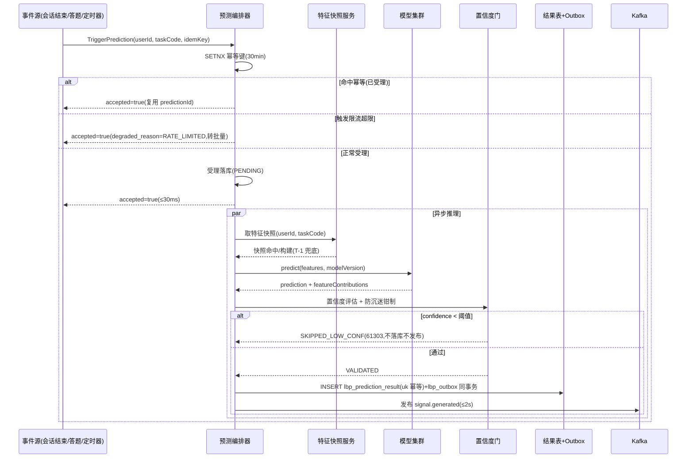
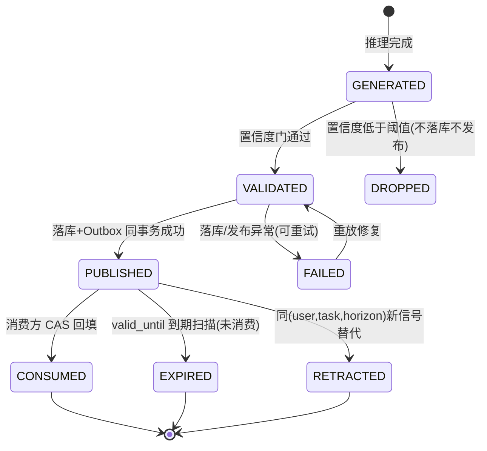
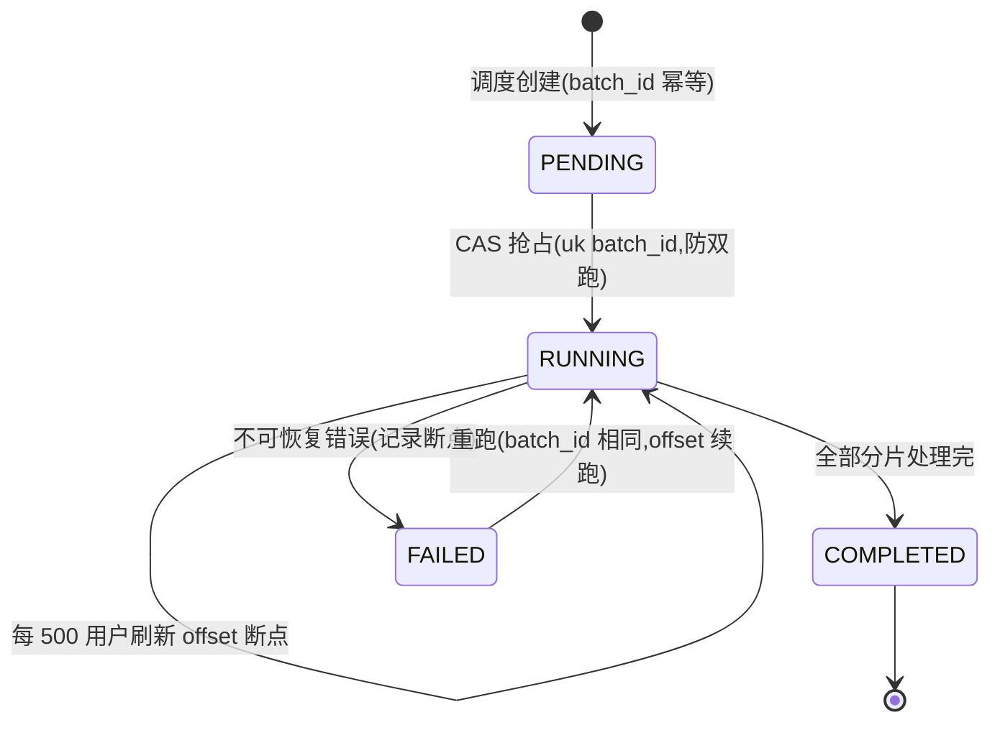

# 服务端-学习行为预测与学习需求智能预判引擎-详细设计

## 1. 模块概述

### 1.1 功能定位

学习行为预测与学习需求智能预判引擎（Learning Behavior Prediction & Proactive Need Anticipation Engine，简称 **LBP 引擎**）是 PrimeTop 服务端的核心前瞻性分析服务。与现有"检测当前状态"的分析引擎（学情分析、认知负荷监测、流失预警等）不同，LBP 引擎聚焦于**预测学生未来的学习行为和需求**，在学生意识到需求之前主动触发干预、推荐和资源准备。

### 1.2 核心价值

| 价值维度 | 说明 |
| --- | --- |
| 体验提升 | 学生打开 APP 时，推荐内容已就绪；遇到困难时，AI 辅助已预热 |
| 效率优化 | 减少学生"找内容"时间，增加有效学习时间 |
| 留存增强 | 在学生产生放弃念头前触发激励，降低流失风险 |
| 资源优化 | 为预加载系统提供精准信号，减少无效缓存 |
| 教学智能 | 从被动响应升级为主动预判，实现真正的个性化教育 |

### 1.3 与现有系统的区别与协作

| 现有引擎 | 职责 | LBP 引擎的关系 |
| --- | --- | --- |
| 学习成绩预测与考试分数预估引擎 | 预测考试分数 | LBP 吸收其分数预测作为特征，输出更广泛的行为预测 |
| 用户流失预警与智能挽留策略引擎 | 检测流失风险 | LBP 在流失信号出现前 3-7 天给出预警 |
| 学生认知负荷监测与学习内容难度动态调节引擎 | 检测当前认知负荷 | LBP 使用负荷数据预测未来困难时段 |
| 学习动力量化与学习倦怠预警引擎 | 量化当前动力 | LBP 基于动力趋势预测参与度下降 |
| 客户端-学习内容预加载策略与智能预渲染引擎 | 客户端预加载 | LBP 为其提供预测信号，实现服务端驱动的预加载 |
| 题目智能推荐与个性化练习编排服务 | 推荐当前题目 | LBP 预测下一学习主题，为其提前准备内容 |
| 学习提醒与智能通知调度系统 | 调度提醒 | LBP 为其提供最优提醒时机和内容建议 |

---

## 2. 系统架构

### 2.1 架构位置

```
┌─────────────────────────────────────────────────────────────────────┐
│                        数据输入层                                    │
│  学习行为事件流 │ 答题记录 │ 学习会话 │ AI对话记录 │ 学情快照 │ 外部特征 │
└──────────────────────────┬──────────────────────────────────────────┘
                           │
┌──────────────────────────▼──────────────────────────────────────────┐
│                    特征工程管线                                       │
│  行为序列编码 │ 时间窗口聚合 │ 趋势特征提取 │ 上下文特征构建 │ 实时特征 │
└──────────────────────────┬──────────────────────────────────────────┘
                           │
┌──────────────────────────▼──────────────────────────────────────────┐
│              LBP 引擎核心 — 预测模型集群                              │
│                                                                      │
│  ┌──────────┐ ┌──────────┐ ┌──────────┐ ┌──────────┐ ┌──────────┐  │
│  │ 下一主题  │ │ 困难预判  │ │ 参与度   │ │ 学习时长  │ │ 帮助需求  │  │
│  │ 预测模型  │ │ 模型     │ │ 下降预测  │ │ 预测模型  │ │ 预测模型  │  │
│  └──────────┘ └──────────┘ └──────────┘ └──────────┘ └──────────┘  │
│                                                                      │
│  ┌──────────┐ ┌──────────┐ ┌──────────┐                             │
│  │ 流失早期  │ │ 高效时段  │ │ 内容偏好  │                             │
│  │ 预警模型  │ │ 预测模型  │ │ 演化模型  │                             │
│  └──────────┘ └──────────┘ └──────────┘                             │
└──────────────────────────┬──────────────────────────────────────────┘
                           │
┌──────────────────────────▼──────────────────────────────────────────┐
│                    预测输出与分发层                                    │
│                                                                      │
│  预测结果存储 │ 置信度评估 │ 消息分发(Kafka) │ 查询API │ AB实验分流     │
└──────────────────────────┬──────────────────────────────────────────┘
                           │
┌──────────────────────────▼──────────────────────────────────────────┐
│                      下游消费方                                       │
│                                                                      │
│  内容推荐服务 │ 预加载信号 │ 通知调度 │ 学习规划引擎 │ 激励策略引擎     │
│  AI对话预热   │ 运营弹窗   │ 家长报告 │ 教师辅助系统 │ 会员运营        │
└─────────────────────────────────────────────────────────────────────┘
```

### 2.2 服务边界

| 范围 | 说明 |
| --- | --- |
| **负责** | 特征工程、模型训练与推理、预测结果输出与分发 |
| **不负责** | 具体推荐内容选择（由推荐引擎负责）、通知发送（由通知服务负责）、内容预加载执行（由客户端执行） |
| **输入** | 学习行为事件、学情快照、用户画像、时间/环境上下文 |
| **输出** | 结构化预测结果 + 置信度分数 + 建议动作标签 |

---

## 3. 核心数据模型

### 3.1 预测任务定义

```sql
-- 预测任务注册表：定义系统中所有预测任务
CREATE TABLE lbp_prediction_task (
    id              BIGINT PRIMARY KEY AUTO_INCREMENT,
    task_code       VARCHAR(64) NOT NULL UNIQUE COMMENT '任务编码: NEXT_TOPIC/STRUGGLE_PREDICT/ENGAGEMENT_DROP/...',
    task_name       VARCHAR(128) NOT NULL COMMENT '任务名称',
    description     TEXT COMMENT '任务描述',
    prediction_type VARCHAR(32) NOT NULL COMMENT '预测类型: CLASSIFICATION/REGRESSION/RANKING/SEQUENCE',
    output_schema   JSON NOT NULL COMMENT '输出数据结构定义',
    model_version   VARCHAR(32) NOT NULL COMMENT '当前使用的模型版本',
    status          TINYINT DEFAULT 1 COMMENT '1=启用 0=停用',
    created_at      DATETIME DEFAULT CURRENT_TIMESTAMP,
    updated_at      DATETIME DEFAULT CURRENT_TIMESTAMP ON UPDATE CURRENT_TIMESTAMP,
    INDEX idx_status_code (status, task_code)
) ENGINE=InnoDB DEFAULT CHARSET=utf8mb4 COMMENT='预测任务注册表';
```

### 3.2 特征存储

```sql
-- 用户特征快照表：周期性更新的用户级特征
CREATE TABLE lbp_user_feature (
    id              BIGINT PRIMARY KEY AUTO_INCREMENT,
    user_id         BIGINT NOT NULL,
    snapshot_date   DATE NOT NULL,
    
    -- 学习行为特征（近7日/近30日滑窗）
    avg_daily_sessions_7d      INT COMMENT '近7天日均学习次数',
    avg_session_duration_7d    INT COMMENT '近7天平均会话时长(秒)',
    avg_daily_study_time_7d    INT COMMENT '近7天日均学习时长(秒)',
    avg_daily_study_time_30d   INT COMMENT '近30天日均学习时长(秒)',
    study_time_trend_7d        FLOAT COMMENT '近7天学习时长趋势斜率',
    session_count_trend_7d     FLOAT COMMENT '近7天会话频率趋势斜率',
    
    -- 答题行为特征
    avg_accuracy_7d            FLOAT COMMENT '近7天平均正确率',
    avg_accuracy_30d           FLOAT COMMENT '近30天平均正确率',
    accuracy_trend_7d          FLOAT COMMENT '近7天正确率趋势',
    avg_question_count_7d      INT COMMENT '近7天日均答题数',
    hint_request_rate_7d       FLOAT COMMENT '近7天提示请求率',
    retry_rate_7d              FLOAT COMMENT '近7天重做率',
    
    -- 学习内容特征
    subject_distribution_7d    JSON COMMENT '近7天学科分布 {"math":0.4,"english":0.3,...}',
    content_type_distribution  JSON COMMENT '内容类型分布 {"video":0.2,"practice":0.5,...}',
    avg_difficulty_7d          FLOAT COMMENT '近7天平均内容难度',
    difficulty_trend_7d        FLOAT COMMENT '难度变化趋势',
    
    -- 时间模式特征
    active_hours_pattern       JSON COMMENT '活跃时段分布 [0.01,0.02,...,0.08](24小时)',
    weekday_vs_weekend_ratio   FLOAT COMMENT '工作日/周末学习时长比',
    last_study_gap_hours       INT COMMENT '距上次学习的间隔(小时)',
    streak_days                INT COMMENT '连续学习天数',
    max_streak_days            INT COMMENT '历史最长连续天数',
    
    -- AI交互特征
    ai_conversation_count_7d   INT COMMENT '近7天AI对话次数',
    ai_avg_turns_7d            FLOAT COMMENT '近7天平均对话轮次',
    ai_satisfaction_rate_7d    FLOAT COMMENT '近7天AI回答满意率(基于反馈)',
    
    -- 学情快照特征
    overall_mastery            FLOAT COMMENT '整体知识掌握度',
    weak_point_count           INT COMMENT '薄弱知识点数量',
    mastery_variance           FLOAT COMMENT '各知识点掌握度方差',
    
    -- 环境与上下文
    grade_level                VARCHAR(16) COMMENT '年级',
    days_since_register        INT COMMENT '注册天数',
    membership_type            VARCHAR(16) COMMENT '会员类型',
    days_to_next_exam          INT COMMENT '距下次考试天数(如有)',
    
    -- 元数据
    feature_version            VARCHAR(16) NOT NULL COMMENT '特征版本号',
    created_at                 DATETIME DEFAULT CURRENT_TIMESTAMP,
    
    UNIQUE KEY uk_user_date (user_id, snapshot_date),
    INDEX idx_snapshot (snapshot_date),
    INDEX idx_user (user_id)
) ENGINE=InnoDB DEFAULT CHARSET=utf8mb4 COMMENT='用户特征快照表';
```

### 3.3 预测结果存储

```sql
-- 预测结果表：存储每次预测的输出
CREATE TABLE lbp_prediction_result (
    id              BIGINT PRIMARY KEY AUTO_INCREMENT,
    user_id         BIGINT NOT NULL,
    task_code       VARCHAR(64) NOT NULL,
    model_version   VARCHAR(32) NOT NULL,
    
    -- 预测内容
    prediction     JSON NOT NULL COMMENT '预测结果，结构由task的output_schema定义',
    confidence     FLOAT NOT NULL COMMENT '置信度 [0,1]',
    explanation    TEXT COMMENT '预测理由摘要',
    
    -- 时间信息
    target_horizon VARCHAR(32) NOT NULL COMMENT '预测窗口: NEXT_SESSION/TODAY/TOMORROW/7DAY/30DAY',
    predicted_at   DATETIME NOT NULL DEFAULT CURRENT_TIMESTAMP COMMENT '预测生成时间',
    valid_until    DATETIME NOT NULL COMMENT '预测有效期截止',
    
    -- 状态追踪
    consumed       TINYINT DEFAULT 0 COMMENT '是否已被下游消费: 0=否 1=是',
    consumed_by    VARCHAR(128) COMMENT '消费方标识',
    actual_outcome JSON COMMENT '实际结果(回填)',
    outcome_score  FLOAT COMMENT '预测准确度评分(回填)',
    
    UNIQUE KEY uk_user_task_horizon_time (user_id, task_code, target_horizon, predicted_at),
    INDEX idx_user_task (user_id, task_code),
    INDEX idx_valid (valid_until, consumed),
    INDEX idx_predicted (predicted_at)
) ENGINE=InnoDB DEFAULT CHARSET=utf8mb4 COMMENT='预测结果存储表';
```

### 3.4 预测信号输出模型

```typescript
/**
 * 预测信号统一输出格式
 */
interface PredictionSignal {
  signalId: string;                  // 信号唯一ID
  userId: number;                    // 用户ID
  taskCode: string;                  // 预测任务编码
  timestamp: string;                 // 生成时间 ISO8601

  // 核心预测
  prediction: NextTopicPrediction 
             | StrugglePrediction
             | EngagementDropPrediction
             | StudyDurationPrediction
             | HelpNeedPrediction
             | EarlyChurnSignal
             | OptimalTimePrediction
             | ContentPreferenceShift;

  confidence: number;                // 置信度 [0, 1]
  horizon: PredictionHorizon;        // 预测时间窗口
  
  // 可解释性
  topFeatures: FeatureContribution[]; // 贡献最大的特征
  explanation: string;                // 自然语言解释
  
  // 建议动作（由引擎给出的action建议，下游自行决策是否执行）
  suggestedActions: SuggestedAction[];
  
  // AB实验
  experimentId?: string;
  experimentBucket?: string;
}

type PredictionHorizon = 
  | 'NEXT_SESSION'    // 下次学习会话
  | 'TODAY'           // 今日内
  | 'TOMORROW'        // 明日
  | '7DAY'            // 未来7天
  | '30DAY';          // 未来30天

interface FeatureContribution {
  featureName: string;
  featureValue: string | number;
  contribution: number;     // SHAP值或类似贡献度
  direction: 'positive' | 'negative';
}

interface SuggestedAction {
  actionType: string;       // PRELOAD_CONTENT | SEND_NUDGE | ADJUST_DIFFICULTY | PREPARE_AI_CONTEXT | NOTIFY_PARENT | ...
  priority: 'HIGH' | 'MEDIUM' | 'LOW';
  payload: Record<string, any>;
  deadline?: string;        // 建议执行截止时间
}
```

---

## 4. 预测模型详细设计

### 4.1 下一主题预测模型（Next-Topic Prediction）

#### 4.1.1 目标

预测学生在当前学习进度下，最可能需要学习的下一个知识点/章节/专题。

#### 4.1.2 模型设计

```
模型类型: 多分类 + 排序
算法: LightGBM 多分类器 + 课程依赖图约束
更新频率: 每日全量训练 + 增量更新
特征窗口: 近7天 + 近30天 + 全局历史
```

**特征清单：**

| 特征类别 | 具体特征 | 说明 |
| --- | --- | --- |
| 进度特征 | 当前章节ID、章节完成度、章节停留天数 | 学生在教材中的位置 |
| 掌握度特征 | 当前章节各知识点掌握度均值/方差 | 章节级掌握度分布 |
| 行为特征 | 近7天答题正确率、错题新增率 | 近期学习效果 |
| 路径特征 | 历史章节转换序列(最近5步) | 学习路径模式 |
| 时间特征 | 距新章节预计开始天数、学期进度 | 学期节奏 |
| 课表特征 | 教学进度同步预对齐信号 | 学校教学进度(如有) |
| 群体特征 | 同年级同教材学生下一步分布 | 群体行为参考 |

**课程依赖约束层：**

```python
class NextTopicPredictor:
    """
    下一主题预测器
    使用 LightGBM 多分类器生成候选，再通过课程依赖图约束进行重排序
    """
    
    def __init__(self, model_path: str, dependency_graph: KnowledgeGraph):
        self.classifier = self._load_model(model_path)
        self.graph = dependency_graph  # 知识点前置依赖图
        self.candidate_top_k = 10
    
    def predict(self, user_features: UserFeatures) -> List[TopicCandidate]:
        # Step 1: 模型生成Top-K候选知识点
        raw_probs = self.classifier.predict_proba(user_features.to_vector())
        candidates = self._build_candidates(raw_probs)
        
        # Step 2: 依赖图约束 — 过滤前置知识未掌握的候选
        filtered = self._apply_dependency_filter(candidates, user_features)
        
        # Step 3: 课程进度对齐 — 提升与教学进度匹配的候选权重
        aligned = self._apply_curriculum_alignment(filtered, user_features)
        
        # Step 4: 多样性保障 — 避免连续推荐同一学科
        diversified = self._apply_diversity_penalty(aligned, user_features)
        
        # Step 5: 输出Top-5候选，附带置信度和理由
        return diversified[:5]
    
    def _apply_dependency_filter(
        self, candidates: List[TopicCandidate], features: UserFeatures
    ) -> List[TopicCandidate]:
        """过滤前置知识未掌握的候选知识点"""
        result = []
        for c in candidates:
            prerequisites = self.graph.get_prerequisites(c.topic_id)
            if not prerequisites:
                result.append(c)
                continue
            
            # 检查前置知识掌握度
            min_prereq_mastery = min(
                features.get_mastery(pid) for pid in prerequisites
            )
            if min_prereq_mastery >= 0.6:  # 前置知识达到基本掌握
                result.append(c)
            else:
                # 降权但保留（可能是需要补前置知识的情况）
                c.probability *= 0.3
                c.add_reason("前置知识未完全掌握，已降权")
                result.append(c)
        return result
```

**输出示例：**

```json
{
  "taskCode": "NEXT_TOPIC",
  "prediction": {
    "topCandidates": [
      {
        "topicId": "kp_math_7b_ch3_sec2",
        "topicName": "二元一次方程组的解法",
        "subject": "math",
        "probability": 0.78,
        "reasons": [
          "上一节'二元一次方程概念'掌握度0.85，具备学习条件",
          "同步课堂进度即将进入该章节",
          "同年级群体中62%学生本周在学习此主题"
        ]
      },
      {
        "topicId": "kp_math_7b_ch3_sec1_review",
        "topicName": "二元一次方程概念（复习巩固）",
        "probability": 0.15,
        "reasons": [
          "该知识点掌握度0.52，低于安全线0.6",
          "近3天相关错题增加2题"
        ]
      }
    ]
  },
  "confidence": 0.82,
  "horizon": "NEXT_SESSION",
  "suggestedActions": [
    {
      "actionType": "PRELOAD_CONTENT",
      "priority": "HIGH",
      "payload": {
        "contentIds": ["lesson_7b_ch3_sec2_v3", "practice_7b_ch3_sec2_set1"],
        "subject": "math"
      }
    },
    {
      "actionType": "PREPARE_AI_CONTEXT",
      "priority": "MEDIUM",
      "payload": {
        "contextType": "LESSON_INTRODUCTION",
        "topicId": "kp_math_7b_ch3_sec2"
      }
    }
  ]
}
```

---

### 4.2 困难预判模型（Struggle Prediction）

#### 4.2.1 目标

预测学生在即将学习的内容中遇到困难的可能性，提前触发难度调节或辅助准备。

#### 4.2.2 模型设计

```
模型类型: 二分类（是否会显著挣扎）
算法: XGBoost + 时序特征
预测窗口: 下次会话 / 未来3天 / 未来7天
正样本定义: 预测窗口内某知识点正确率 < 50% 或放弃率 > 30%
```

**关键特征：**

```python
class StruggleFeatureExtractor:
    """困难预判特征提取器"""
    
    def extract(self, user_id: int, target_topic_id: str) -> StruggleFeatures:
        return StruggleFeatures(
            # === 知识点维度 ===
            target_difficulty=self._get_topic_difficulty(target_topic_id),
            prereq_mastery_gap=self._calc_prereq_gap(user_id, target_topic_id),
            similar_topic_history=self._get_similar_topic_performance(user_id, target_topic_id),
            
            # === 学生维度 ===
            recent_accuracy_trend=self._get_accuracy_trend(user_id, days=7),
            current_cognitive_load=self._get_current_load(user_id),
            recent_error_pattern=self._analyze_error_types(user_id, days=7),
            help_seeking_frequency=self._get_help_rate(user_id, days=7),
            
            # === 交互维度 ===
            recent_session_lengths=self._get_session_lengths(user_id, days=7),
            late_night_study_ratio=self._get_late_night_ratio(user_id, days=7),
            topic_switch_frequency=self._get_topic_switch_rate(user_id, days=7),
            
            # === 内容维度 ===
            topic_concept_density=self._get_concept_density(target_topic_id),
            topic_avg_completion_time=self._get_avg_completion_time(target_topic_id),
            topic_historical_fail_rate=self._get_topic_fail_rate(target_topic_id),
        )
```

**决策阈值与动作映射：**

```python
class StruggleResponsePolicy:
    """困难预判响应策略"""
    
    THRESHOLDS = {
        'critical': 0.75,   # 高概率困难
        'warning': 0.55,    # 中概率困难
        'monitor': 0.35,    # 低概率但需关注
    }
    
    ACTIONS = {
        'critical': [
            'PRELOAD_REMEDIATION_CONTENT',  # 预加载补救内容（前置知识复习）
            'ADJUST_DIFFICULTY_DOWN',       # 降低初始推荐难度
            'PREPARE_DETAILED_EXPLANATION', # 准备详细讲解（AI上下文预热）
            'NOTIFY_PARENT_IF_LOW-engagement',  # 低参与度时通知家长
        ],
        'warning': [
            'PRELOAD_HINT_CARDS',           # 预加载提示卡片
            'PREPARE_STEP_BY_STEP_MODE',    # 准备分步引导模式
            'ADD_TO_WATCH_LIST',            # 加入观察列表
        ],
        'monitor': [
            'ENABLE_REAL_TIME_MONITORING',  # 启用实时监控
            'LOG_FOR_PATTERN_ANALYSIS',     # 记录用于模式分析
        ],
    }
    
    def evaluate(self, struggle_prob: float, context: dict) -> List[str]:
        for level in ['critical', 'warning', 'monitor']:
            if struggle_prob >= self.THRESHOLDS[level]:
                return self.ACTIONS[level]
        return []
```

---

### 4.3 参与度下降预测模型（Engagement Drop Prediction）

#### 4.3.1 目标

预测学生参与度在未来N天内显著下降的风险，在下降发生前触发激励和通知。

#### 4.3.2 模型设计

```
模型类型: 回归（预测7天后日均学习时长变化率）+ 二分类（下降超30%的概率）
算法: 时序模型 (Prophet 趋势分解 + LightGBM 残差预测)
预测窗口: 7天 / 14天
```

**参与度信号分解：**

```python
class EngagementPredictor:
    """参与度下降预测器"""
    
    def predict(self, user_id: int) -> EngagementPrediction:
        # Step 1: 趋势分解 — 区分周期性波动和真实下降
        trend = self._decompose_trend(
            daily_study_time=self._get_daily_study_time(user_id, days=60),
            weekly_pattern=self._extract_weekly_pattern(user_id)
        )
        
        # Step 2: 提取下降前兆特征
        precursors = self._extract_precursors(user_id)
        # precursors 包含:
        # - 会话时长缩短速率
        # - 中途退出率变化
        # - 学习内容难度逃避（主动选择更低难度）
        # - 社交互动减少（学习圈参与度）
        # - AI对话满意度下降
        # - 最近连续不学习天数
        
        # Step 3: 预测
        prob_drop = self.model.predict_proba(precursors.to_vector())
        predicted_change = self.regressor.predict(precursors.to_vector())
        
        # Step 4: 预判下降原因
        likely_cause = self._diagnose_cause(precursors)
        
        return EngagementPrediction(
            user_id=user_id,
            drop_probability=prob_drop,
            predicted_change_ratio=predicted_change,
            trend=trend,
            likely_cause=likely_cause,
            recommended_intervention=self._recommend_intervention(
                likely_cause, prob_drop, trend
            ),
            confidence=self._calc_confidence(precursors)
        )
    
    def _diagnose_cause(self, features: EngagementPrecursors) -> str:
        """诊断可能的参与度下降原因"""
        if features.difficulty_escalation_rate > 0.3 and features.accuracy_drop > 0.15:
            return "CONTENT_TOO_HARD"  # 内容过难导致挫败
        
        if features.session_length_shrink_rate > 0.2 and features.late_night_ratio > 0.4:
            return "FATIGUE"  # 学习疲劳
        
        if features.days_since_last_improvement_feedback > 14:
            return "LACK_OF_PROGRESS_FEEDBACK"  # 缺乏进步反馈
        
        if features.content_repetition_ratio > 0.5:
            return "CONTENT_BORED"  # 内容重复无聊
        
        if features.upcoming_school_event_detected:
            return "EXTERNAL_PRESSURE"  # 外部因素（考试、活动等）
        
        return "UNKNOWN"
```

**干预策略矩阵：**

| 诊断原因 | 概率区间 | 建议干预 | 触发时机 |
| --- | --- | --- | --- |
| CONTENT_TOO_HARD | >0.6 | 降难度 + 复习推荐 + 鼓励性学情报告 | 下次打开APP时 |
| FATIGUE | >0.5 | 推荐轻松内容 + 休息提醒 + 学习时长上限调整 | 即时通知 |
| LACK_OF_PROGRESS | >0.5 | 生成进步可视化 + 成就解锁 + 对比报告 | 当日推送 |
| CONTENT_BORED | >0.5 | 新内容类型推荐 + 挑战模式 + 兴趣探索 | 下次会话 |
| EXTERNAL_PRESSURE | >0.4 | 降低每日任务量 + 灵活计划调整 | 即时 |
| UNKNOWN | >0.6 | 通用激励 + 家长协同（如已绑定） | 次日 |

---

### 4.4 学习时长预测模型（Study Duration Prediction）

#### 4.4.1 目标

预测学生下次会话/今日/本周的学习时长，为内容规划、难度编排和通知调度提供基础。

#### 4.4.2 模型设计

```
模型类型: 回归
算法: LightGBM Regression + 时间序列修正
预测目标: 
  - NEXT_SESSION: 下次会话预计时长(分钟)
  - TODAY_TOTAL: 今日预计总学习时长(分钟)  
  - WEEK_TOTAL: 本周预计总学习时长(分钟)
```

**时段感知预测：**

```python
class StudyDurationPredictor:
    """学习时长预测器"""
    
    # 不同时段的基准时长（分钟），按年级和会员类型分层
    BASELINE_DURATION = {
        'elementary': {'weekday': 25, 'weekend': 40, 'vacation': 50},
        'middle':     {'weekday': 40, 'weekend': 70, 'vacation': 90},
        'high':       {'weekday': 55, 'weekend': 100, 'vacation': 120},
    }
    
    def predict_next_session(self, user_id: int, current_context: dict) -> DurationPrediction:
        user_profile = self._get_user_profile(user_id)
        baseline = self._get_baseline(user_profile)
        
        # 时段调整系数
        time_of_day_multiplier = self._get_time_multiplier(current_context['hour'])
        day_type_multiplier = self._get_day_type_multiplier(current_context['date'])
        
        # 个体历史修正
        personal_ratio = self._calc_personal_ratio(user_id, baseline)
        
        # 趋势修正
        recent_trend = self._calc_recent_trend(user_id)
        
        # 上下文修正
        context_adjustments = self._calc_context_adjustments(
            user_id, current_context
        )
        # context_adjustments 包含:
        # - 距上次学习间隔（间隔越长，单次时长可能越长）
        # - 近期作业量（期末/考试季时长增加）
        # - 推送通知触发（打开推送的会话通常更长）
        # - 设备类型（平板 > 手机）
        
        # 预测
        predicted = (
            baseline 
            * time_of_day_multiplier 
            * day_type_multiplier 
            * personal_ratio 
            * recent_trend 
            * context_adjustments
        )
        
        # 置信区间
        lower, upper = self._calc_confidence_interval(
            predicted, user_id, sample_size=self._get_recent_sample_size(user_id)
        )
        
        return DurationPrediction(
            user_id=user_id,
            predicted_minutes=round(predicted),
            confidence_interval_lower=round(lower),
            confidence_interval_upper=round(upper),
            confidence=self._calc_confidence(user_id),
            factors={
                'baseline': baseline,
                'time_of_day_effect': time_of_day_multiplier,
                'personal_ratio': personal_ratio,
                'trend': recent_trend,
                'context': context_adjustments,
            }
        )
```

---

### 4.5 帮助需求预测模型（Help Need Prediction）

#### 4.5.1 目标

预测学生在学习过程中何时需要AI辅助/提示/查看解析，提前为AI推理服务预热上下文。

#### 4.5.2 模型设计

```
模型类型: 多分类（NO_HELP / HINT / FULL_EXPLANATION / AI_DIALOGUE）
算法: 序列模型 (Transformer Encoder over 学习行为序列)
输入: 最近N步学习行为序列
输出: 下一步最可能需要的帮助类型
```

**序列编码设计：**

```python
class HelpNeedSequenceModel:
    """帮助需求预测序列模型"""
    
    BEHAVIOR_VOCAB = {
        'READ_MATERIAL': 1,
        'ANSWER_CORRECT_FAST': 2,    # 快速答对(<30s)
        'ANSWER_CORRECT_SLOW': 3,    # 慢速答对(>60s)
        'ANSWER_WRONG_FIRST': 4,     # 首次答错
        'ANSWER_WRONG_RETRY': 5,     # 重做再错
        'VIEW_HINT': 6,
        'VIEW_EXPLANATION': 7,
        'ASK_AI': 8,
        'PAUSE_LONG': 9,             # 长时间停顿(>2min)
        'SWITCH_TOPIC': 10,
        'BOOKMARK': 11,
        'REVIEW_NOTE': 12,
    }
    
    HELP_TYPES = ['NO_HELP', 'HINT', 'FULL_EXPLANATION', 'AI_DIALOGUE']
    
    def __init__(self):
        # 序列长度32，行为编码维度64，4层Transformer Encoder
        self.encoder = self._build_transformer_encoder(
            vocab_size=len(self.BEHAVIOR_VOCAB) + 1,
            d_model=64,
            nhead=4,
            num_layers=4,
            dim_feedforward=256,
            dropout=0.1,
        )
        # 分类头
        self.classifier = nn.Linear(64, len(self.HELP_TYPES))
    
    def predict(self, behavior_sequence: List[int], user_features: Tensor) -> HelpNeedPrediction:
        """
        behavior_sequence: 最近32步学习行为的编码序列
        user_features: 用户级特征向量
        """
        # 序列编码
        seq_emb = self.encoder(behavior_sequence)  # [1, 32, 64]
        
        # 取序列的最后一个时间步作为序列表示
        seq_repr = seq_emb[:, -1, :]  # [1, 64]
        
        # 融合用户级特征
        combined = torch.cat([seq_repr, user_features], dim=-1)
        
        # 预测
        logits = self.classifier(combined)
        probs = torch.softmax(logits, dim=-1)
        
        return HelpNeedPrediction(
            probabilities={
                help_type: prob.item() 
                for help_type, prob in zip(self.HELP_TYPES, probs[0])
            },
            predicted_type=self.HELP_TYPES[probs.argmax()],
            confidence=probs.max().item(),
            trigger_behavior=self._identify_trigger_behavior(behavior_sequence),
        )
    
    def _identify_trigger_behavior(self, sequence: List[int]) -> Optional[str]:
        """识别触发预测的关键行为模式"""
        # 检测如 "答错 -> 长停顿" 或 "慢速答对 -> 切换主题" 等模式
        recent = sequence[-3:]
        if 4 in recent and 9 in recent:  # 答错 + 长停顿
            return "WRONG_ANSWER_PAUSE"
        if 3 in recent and 10 in recent:  # 慢速答对 + 切换
            return "SLOW_CORRECT_TOPIC_SWITCH"
        if 5 in recent:  # 重做再错
            return "REPEATED_FAILURE"
        return None
```

---

### 4.6 流失早期预警模型（Early Churn Signal）

#### 4.6.1 目标

比现有"用户流失预警引擎"更早发现流失信号——在行为指标显著恶化前3-7天给出预警。

#### 4.6.2 与现有流失预警引擎的协同

```python
class EarlyChurnDetector:
    """
    流失早期预警检测器
    
    与现有「用户流失预警与智能挽留策略引擎」的区别:
    - 现有引擎: 检测已出现的流失信号（连续3天不登录、时长下降50%等）
    - LBP引擎: 预测未来7天可能出现流失信号的概率，在信号出现前预警
    """
    
    def detect(self, user_id: int) -> EarlyChurnPrediction:
        # 获取微弱前兆信号
        micro_signals = self._extract_micro_signals(user_id)
        
        """
        micro_signals 包含的微弱前兆:
        - 会话平均时长连续3天下降（但幅度未达现有引擎阈值）
        - 推送通知打开率从80%降到50%
        - 学习内容完成率从90%降到70%
        - AI对话单轮关闭率上升（问完不追问）
        - 错题复习完成率下降
        - 学习计划任务跳过率上升
        - 应用从主动打开变为推送触发打开
        - 周末学习时长首次低于工作日
        """
        
        # 使用预训练模型预测
        churn_risk_7d = self.risk_model.predict_proba(micro_signals.to_vector())
        churn_risk_14d = self.risk_model_14d.predict_proba(micro_signals.to_vector())
        
        # 信号强度评估
        signal_strength = self._assess_signal_strength(micro_signals)
        
        # 预计恶化时间
        estimated_decline_date = self._estimate_decline_date(
            micro_signals, churn_risk_7d
        )
        
        return EarlyChurnPrediction(
            user_id=user_id,
            risk_7d=churn_risk_7d,
            risk_14d=churn_risk_14d,
            signal_strength=signal_strength,
            estimated_decline_date=estimated_decline_date,
            micro_signals=micro_signals.summary(),
            confidence=self._calc_confidence(micro_signals),
        )
```

---

### 4.7 高效时段预测模型（Optimal Study Time Prediction）

#### 4.7.1 目标

预测学生每个时段的学习效率，为通知调度和内容规划提供最优时间建议。

```python
class OptimalTimePredictor:
    """高效学习时段预测器"""
    
    def predict_daily_efficiency_curve(self, user_id: int, target_date: date) -> Dict[int, float]:
        """
        预测目标日期24小时各时段学习效率分数 [0, 1]
        
        综合考虑:
        - 历史时段正确率分布
        - 历史时段专注度分布（基于会话内行为密度）
        - 历史时段时长分布
        - 当日特殊因素（考试前夕/假期等）
        - 生物钟年龄修正（青少年晚间效率修正）
        """
        historical_efficiency = self._get_historical_efficiency_by_hour(user_id)
        day_type = self._classify_day(target_date, user_id)
        
        efficiency_curve = {}
        for hour in range(24):
            base = historical_efficiency.get(hour, 0.3)
            day_adjustment = self._get_day_type_modifier(day_type, hour)
            age_adjustment = self._get_age_modifier(user_id, hour)
            
            efficiency_curve[hour] = min(1.0, base * day_adjustment * age_adjustment)
        
        return efficiency_curve
    
    def recommend_top_slots(
        self, user_id: int, target_date: date, desired_duration_min: int = 30
    ) -> List[TimeSlot]:
        """推荐最优学习时段"""
        curve = self.predict_daily_efficiency_curve(user_id, target_date)
        
        # 寻找连续高效窗口
        slots = self._find_efficient_windows(curve, desired_duration_min)
        
        # 按效率排序
        slots.sort(key=lambda s: s.efficiency_score, reverse=True)
        
        return slots[:3]  # 返回Top-3推荐时段
```

**输出示例：**

```json
{
  "taskCode": "OPTIMAL_TIME",
  "prediction": {
    "date": "2026-06-21",
    "topSlots": [
      {
        "startHour": 19,
        "endHour": 20,
        "efficiencyScore": 0.89,
        "reason": "历史数据显示该时段正确率92%，专注度最高"
      },
      {
        "startHour": 9,
        "endHour": 10,
        "efficiencyScore": 0.78,
        "reason": "上午思维清晰，数学类内容效率最佳"
      },
      {
        "startHour": 21,
        "endHour": 21,
        "efficiencyScore": 0.72,
        "reason": "适合轻松复习或背诵类内容"
      }
    ],
    "avoidSlots": [
      {
        "startHour": 22,
        "endHour": 24,
        "reason": "该时段正确率仅58%，且影响睡眠"
      }
    ]
  },
  "confidence": 0.76,
  "suggestedActions": [
    {
      "actionType": "SCHEDULE_NOTIFICATION",
      "priority": "HIGH",
      "payload": {
        "time": "19:00",
        "message": "现在是你的高效学习时段，推荐学习'二元一次方程组'",
        "contentId": "lesson_7b_ch3_sec2_v3"
      }
    }
  ]
}
```

---

### 4.8 内容偏好演化模型（Content Preference Shift）

#### 4.8.1 目标

检测和预测学生对内容形式（视频/图文/练习/对话）和内容风格（讲解型/探究型/应试型）偏好的变化趋势，帮助推荐系统适配。

```python
class ContentPreferenceTracker:
    """内容偏好演化追踪器"""
    
    def detect_shift(self, user_id: int) -> Optional[PreferenceShift]:
        """检测偏好变化信号"""
        recent_30 = self._get_preferences(user_id, days=30)
        previous_30 = self._get_preferences(user_id, days_offset=30, window=30)
        
        # 计算偏好向量偏移
        shift_distance = self._cosine_distance(recent_30, previous_30)
        
        if shift_distance < 0.15:
            return None  # 无显著变化
        
        # 识别具体变化方向
        shifts = self._identify_shift_dimensions(recent_30, previous_30)
        # 例如: 视频偏好上升20%，练习偏好下降15%
        
        # 预测未来偏好
        predicted_preferences = self._extrapolate_trend(user_id, horizon_days=14)
        
        return PreferenceShift(
            user_id=user_id,
            shift_magnitude=shift_distance,
            dimension_shifts=shifts,
            predicted_preferences=predicted_preferences,
            adaptation_recommendation=self._recommend_adaptation(shifts),
        )
```

---

## 5. API 接口设计

### 5.1 预测结果查询 API

```
GET /api/v1/lbp/predictions/{userId}
```

**请求参数：**

| 参数 | 类型 | 必填 | 说明 |
| --- | --- | --- | --- |
| userId | long | 是 | 用户ID |
| taskCodes | string[] | 否 | 过滤特定预测任务，默认全部 |
| horizon | string | 否 | 过滤时间窗口 |
| limit | int | 否 | 返回条数，默认10 |
| minConfidence | float | 否 | 最低置信度过滤，默认0.5 |

**响应：**

```json
{
  "code": 0,
  "data": {
    "userId": 123456,
    "predictions": [
      {
        "signalId": "sig_20260620_001",
        "taskCode": "NEXT_TOPIC",
        "prediction": { /* NextTopicPrediction */ },
        "confidence": 0.82,
        "horizon": "NEXT_SESSION",
        "predictedAt": "2026-06-20T01:00:00+08:00",
        "validUntil": "2026-06-20T12:00:00+08:00",
        "suggestedActions": [ /* SuggestedAction[] */ ]
      },
      {
        "signalId": "sig_20260620_002",
        "taskCode": "STRUGGLE_PREDICT",
        "prediction": { /* StrugglePrediction */ },
        "confidence": 0.71,
        "horizon": "7DAY",
        "predictedAt": "2026-06-20T01:00:00+08:00",
        "validUntil": "2026-06-27T00:00:00+08:00",
        "suggestedActions": [ /* SuggestedAction[] */ ]
      }
    ],
    "summary": {
      "totalPredictions": 5,
      "highConfidenceCount": 3,
      "urgentActions": 2
    }
  }
}
```

### 5.2 预测信号订阅（Kafka）

```
Topic: prime.lbp.signals
分区键: user_id(保证同一用户信号有序)
消息体: PredictionSignal 信封(§3.4),外层附加 traceId 与 schemaVersion
投递语义: at-least-once + 消费方按 signalId 幂等去重
```

**消费方矩阵：**

| 消费方 | 消费任务 | 使用方式 | 关键约束 |
| --- | --- | --- | --- |
| 内容推荐服务(召回引擎) | NEXT_TOPIC / CONTENT_PREF_SHIFT | 召回通道之一(规则策略召回,权重可配) | 仅作候选,排序权威归排序引擎 |
| 客户端预加载信号 | NEXT_TOPIC / HELP_NEED | 服务端推送预加载指令,BFF 聚合后下发 | 执行权威归客户端预加载引擎 |
| 通知调度系统 | OPTIMAL_TIME / ENGAGEMENT_DROP / STRUGGLE_PREDICT | 建议提醒时机与文案标签 | 发送权威归通知服务;防沉迷静默时段禁止调度 |
| 学习规划引擎 | NEXT_TOPIC / STUDY_DURATION | 计划编排参考输入 | 计划写权威归学习规划服务,本引擎不直接写计划 |
| 激励策略引擎 | ENGAGEMENT_DROP / EARLY_CHURN | 激励触发信号 | 激励规则权威归激励引擎 |
| AI 对话编排(AI 预热) | HELP_NEED / STRUGGLE_PREDICT | 会话上下文预热、讲解详略预决策 | Prompt 拼装权威归编排系统 |
| 用户流失预警引擎 | EARLY_CHURN | 前置预警信号(比其自身阈值早 3-7 天) | 挽留动作权威归流失预警引擎 |
| 家长报告服务 | ENGAGEMENT_DROP / STRUGGLE_PREDICT | 周报/月报风险段落素材 | 经家长门脱敏聚合,不输出逐条预测明细 |

**消息示例：**

```json
{
  "schemaVersion": "1.0",
  "traceId": "trc_9f3a21",
  "signal": {
    "signalId": "sig_20260620_001",
    "userId": 123456,
    "taskCode": "NEXT_TOPIC",
    "timestamp": "2026-06-20T01:00:00+08:00",
    "prediction": { "topCandidates": [ { "topicId": "kp_math_7b_ch3_sec2", "probability": 0.78 } ] },
    "confidence": 0.82,
    "horizon": "NEXT_SESSION",
    "topFeatures": [ { "featureName": "prereq_mastery", "contribution": 0.31, "direction": "positive" } ],
    "explanation": "前置知识掌握达标且同步课堂进度即将进入该章节",
    "suggestedActions": [ { "actionType": "PRELOAD_CONTENT", "priority": "HIGH", "payload": { "contentIds": ["lesson_7b_ch3_sec2_v3"] } } ],
    "experimentId": "exp_lbp_v2",
    "experimentBucket": "treatment"
  }
}
```

### 5.3 内部触发与批量预测 API(gRPC)

预测引擎为内部服务,不直接暴露公网 REST;对外仅通过 §5.1 查询 API 与 Kafka 信号分发。服务间调用采用 gRPC:

```protobuf
syntax = "proto3";
package primetop.lbp.v1;

service PredictionService {
  // 事件驱动增量触发:行为事件到达后请求对指定用户执行指定任务预测
  rpc TriggerPrediction(TriggerPredictionRequest) returns (TriggerPredictionResponse);
  // 批量预测(每日全量调度/运营圈选),带断点续跑
  rpc BatchPredict(BatchPredictRequest) returns (stream BatchPredictItem);
  // 预测健康度与通道状态(供熔断器与管理端查询)
  rpc GetChannelHealth(GetChannelHealthRequest) returns (GetChannelHealthResponse);
}

message TriggerPredictionRequest {
  int64 user_id = 1;
  string task_code = 2;           // NEXT_TOPIC / HELP_NEED / ...
  string trigger_source = 3;      // EVENT:session.ended / SCHEDULER:daily / ADMIN:manual
  string idempotency_key = 4;     // 事件溯源ID,30min 幂等窗口
  map<string, string> context = 5; // 触发上下文(当前行为序列摘要)
}

message TriggerPredictionResponse {
  bool accepted = 1;              // 仅表示已受理,不阻塞等待推理完成
  string prediction_id = 2;       // 可用于轮询(内部)
  string degraded_reason = 3;     // 非空表示降级受理(如触发限流转批量)
}

message BatchPredictRequest {
  string batch_id = 1;            // 调度批次ID,幂等键
  string task_code = 2;
  repeated int64 user_ids = 3;    // 分片后的用户集,单批 ≤5000
  string model_version = 4;
  int32 offset = 5;               // 断点续跑偏移
}

message BatchPredictItem {
  int64 user_id = 1;
  string status = 2;              // OK / SKIPPED_LOW_CONF / SKIPPED_LOCKED / FAILED
  string prediction_id = 3;
  string fail_reason = 4;
}

message GetChannelHealthRequest { string task_code = 1; }

message GetChannelHealthResponse {
  string status = 1;              // HEALTHY / DEGRADED_RULE_FALLBACK / DOWN
  float success_ratio_1h = 2;
  float p99_latency_ms = 3;
  string active_model_version = 4;
  string shadow_model_version = 5;
}
```

**延迟预算(TriggerPrediction 受理路径):**

| 步骤 | 预算 | 说明 |
| --- | --- | --- |
| 参数校验 + 幂等键检查 | ≤5ms | Redis SETNX |
| 触发限流(令牌桶) | ≤2ms | 本地桶 + Redis 全局桶 |
| 受理落库 + Outbox | ≤15ms | 异步推理,受理即返回 |
| 响应返回(同步段合计) | **P99 ≤30ms** | 推理异步,不在同步路径 |

### 5.4 管理端配置 API(内部管理网段)

| 接口 | 方法 | 说明 | 幂等/并发 |
| --- | --- | --- | --- |
| /admin/v1/lbp/tasks | GET | 任务注册表列表(§3.1) | 只读 |
| /admin/v1/lbp/tasks/{taskCode} | PUT | 启停任务/切换模型版本 | version 乐观锁,冲突 61315 |
| /admin/v1/lbp/tasks/{taskCode}/shadow | PUT | 影子模型挂载/摘除 | 双人审批,shadow 只写不发布(G8) |
| /admin/v1/lbp/thresholds | PUT | 置信度阈值/触发限流参数热更新 | 互斥锁 + 双缓冲热生效 |
| /admin/v1/lbp/predictions/{userId} | GET | 单用户预测明细排查(运维) | 只读,审计日志 |
| /admin/v1/lbp/batches | POST | 手动触发批量预测 | batch_id 幂等 |

---

## 6. 核心流程

### 6.1 主链路时序



### 6.2 调度策略

| 触发源 | 任务 | 时机 | 说明 |
| --- | --- | --- | --- |
| 定时全量 | 全部 8 类模型 | 每日 01:00 | 基于 T-1 特征快照全量推理,DAU 分片 5000/批 |
| 事件增量 | NEXT_TOPIC / HELP_NEED / STRUGGLE_PREDICT | session.ended / answer.submitted | 仅活跃用户的轻量重算,令牌桶 20 次/用户/日 |
| 行为触发 | EARLY_CHURN / ENGAGEMENT_DROP | 每日 04:00 | 对近 7 天活跃用户做趋势模型推理 |
| 时段触发 | OPTIMAL_TIME | 每日 05:00 | 生成当日 24h 效率曲线,供通知调度消费 |
| 手动触发 | 任意 | 管理端 | batch_id 幂等,限 100 批/日 |

### 6.3 Redis 键设计

| Key | 类型 | TTL | 说明 |
| --- | --- | --- | --- |
| lbp:feat:{user_id}:{date} | HASH | 48h | 特征快照缓存,命中免重建 |
| lbp:pred:{user_id}:{task_code} | STRING(JSON) | =valid_until | 最新有效预测查询缓存 |
| lbp:idem:{idem_key} | STRING | 30min | 触发幂等键,predictionId 复用 |
| lbp:lock:trig:{user_id}:{task_code} | STRING | 60s | 事件触发互斥锁 |
| lbp:rate:trig:{user_id} | HASH(令牌桶) | 24h | 事件触发限流 20 次/日 |
| lbp:circuit:model:{task_code} | STRING | 60s 滑动 | 模型熔断状态(DEGRADED_RULE_FALLBACK) |
| lbp:shadow:{model_ver}:{date} | STREAM | 7d | 影子模型输出,仅供离线评估 |
| lbp:batch:{batch_id}:offset | STRING | 24h | 批量断点续跑偏移 |

---

## 7. 关键代码

### 7.1 预测编排器(受理 + 异步推理)

```python
class PredictionOrchestrator:
    """
    预测编排器:同步受理 + 异步推理
    
    红线(G2): 任何异常不得向调用方抛出 5xx;同步段只负责受理。
    """
    
    TRIGGER_RATE_LIMIT = 20          # 次/用户/日
    INFER_TIMEOUT_MS = 800           # 推理超时预算
    MIN_CONFIDENCE = 0.50            # 发布阈值(G3)
    
    def __init__(self, feature_svc, model_router, confidence_gate,
                 result_repo, outbox, circuit_breaker):
        self.feature_svc = feature_svc
        self.model_router = model_router
        self.confidence_gate = confidence_gate
        self.result_repo = result_repo
        self.outbox = outbox
        self.circuit = circuit_breaker
    
    def trigger(self, req: TriggerPredictionRequest) -> TriggerPredictionResponse:
        # 1. 幂等键(Set NX PX 30min):命中则复用已受理 predictionId
        idem_key = f"lbp:idem:{req.idempotency_key}"
        acquired = self.redis.set(idem_key, "PENDING", nx=True, px=1800000)
        if not acquired:
            pid = self.result_repo.find_by_idem(req.idempotency_key)
            return TriggerPredictionResponse(accepted=True, prediction_id=pid or "")
        
        # 2. 触发限流(令牌桶;超限不拒绝,降级转批量,G12)
        degraded = ""
        if not self._consume_trigger_token(req.user_id):
            degraded = "RATE_LIMITED_BATCH_FALLBACK"
        
        # 3. 任务启用性校验
        task = self.task_registry.get(req.task_code)
        if not task or task.status != 1:
            self.redis.delete(idem_key)
            raise LbpTaskDisabledError(req.task_code)      # 61304,同步段唯一可拒绝场景
        
        # 4. 受理即返回(异步推理)
        prediction_id = idgen.next_id("lbp_pred")
        self.result_repo.mark_accepted(prediction_id, req)
        asyncio.create_task(self._infer_async(prediction_id, req, degraded))
        return TriggerPredictionResponse(
            accepted=True, prediction_id=str(prediction_id), degraded_reason=degraded
        )
    
    async def _infer_async(self, prediction_id: str, req, degraded: str):
        lock_key = f"lbp:lock:trig:{req.user_id}:{req.task_code}"
        try:
            # 5. 异步段互斥锁(防事件与调度双跑)
            if not self.redis.set(lock_key, prediction_id, nx=True, px=60000):
                self.result_repo.mark_skipped(prediction_id, "LOCKED", code=61310)
                return
            
            # 6. 熔断裁决:模型不可用时规则兜底并透明标记
            task = self.task_registry.get(req.task_code)
            if self.circuit.is_open(req.task_code):
                signal = self._rule_fallback(req, task)     # D1
                signal.meta["degraded"] = "RULE_FALLBACK"
            else:
                # 7. 特征快照(T-1 兜底 D9)
                features = await asyncio.wait_for(
                    self.feature_svc.get_or_build(req.user_id, req.task_code),
                    timeout=1.0,
                )
                if features is None:
                    self.result_repo.mark_skipped(prediction_id, "FEATURE_NOT_READY", code=61302)
                    return
                
                # 8. 模型推理(超时预算 800ms,D6)
                raw = await asyncio.wait_for(
                    self.model_router.predict(task, features),
                    timeout=self.INFER_TIMEOUT_MS / 1000,
                )
                signal = self._assemble_signal(prediction_id, req, task, raw)
            
            # 9. 置信度门 + 防沉迷钳制(失败仅跳过,不抛错)
            verdict = self.confidence_gate.evaluate(signal)
            if verdict.action == "DROP":
                self.result_repo.mark_skipped(prediction_id, "LOW_CONFIDENCE", code=61303)
                return
            signal = verdict.signal  # 钳制后(如时段红线裁剪)
            
            # 10. 落库 + Outbox 同事务(先落库后发布,at-least-once)
            self.result_repo.save_and_enqueue_outbox(signal)   # uk 幂等,重复INSERT忽略
            self.outbox.publish("lbp.domain.events", "signal.generated", signal)
            
        except asyncio.TimeoutError:
            self.circuit.record_failure(req.task_code)
            self.result_repo.mark_skipped(prediction_id, "MODEL_TIMEOUT", code=61301)
        except Exception as e:                                  # G2:兜底不抛出
            logger.exception("lbp_infer_failed", extra={"prediction_id": prediction_id})
            self.result_repo.mark_failed(prediction_id, str(e))
        finally:
            self.redis.delete(lock_key)
    
    def _rule_fallback(self, req, task) -> PredictionSignal:
        """模型宕机时的规则兜底(仅 NEXT_TOPIC/OPTIMAL_TIME 有规则实现)"""
        if req.task_code == "NEXT_TOPIC":
            return self._next_topic_rule_fallback(req.user_id)
        raise LbpModelUnavailableError(req.task_code)         # 无规则兜底的任务直接跳过
```

### 7.2 置信度门与防沉迷钳制

```python
class ConfidenceGate:
    """
    置信度门:发布阈值裁决 + 防沉迷钳制 + 解释白名单
    
    G5: OPTIMAL_TIME 输出不得推荐 22:00-06:00 学习时段(青少年睡眠保护)。
    G9: explanation 仅可使用白名单模板,不得向学生端暴露原始特征名。
    """
    
    EXPLAIN_TEMPLATES = {
        "NEXT_TOPIC": "根据你近期的学习进度和掌握情况,{topic}可能是接下来的最佳内容",
        "STRUGGLE_PREDICT": "这部分内容可能有点挑战,已为你准备了更详细的讲解",
        "OPTIMAL_TIME": "根据你的学习习惯,{slot}时段的学习效率通常更高",
        "EARLY_CHURN": "",   # 流失预警不面向学生端,解释仅内部
    }
    
    def evaluate(self, signal: PredictionSignal) -> GateVerdict:
        # 1. 发布阈值(G3)
        if signal.confidence < 0.50:
            return GateVerdict(action="DROP", reason="LOW_CONFIDENCE")
        
        # 2. 未成年从严:未成年用户置信度门槛提升 0.05
        if self._is_minor(signal.user_id) and signal.confidence < 0.55:
            return GateVerdict(action="DROP", reason="LOW_CONF_MINOR")
        
        # 3. 防沉迷钳制(G5):时段类预测裁剪禁止时段
        if signal.task_code == "OPTIMAL_TIME":
            self._clamp_for_sleep_protection(signal)
        
        # 4. 解释模板化(G9)
        signal.explanation = self._render_explain(signal)
        signal.top_features = []  # 原始特征贡献仅保留在内部明细,信号体剥离
        
        return GateVerdict(action="PUBLISH", signal=signal)
    
    def _clamp_for_sleep_protection(self, signal: PredictionSignal):
        """剔除 22:00-06:00 推荐时段;avoidSlots 强制注入"""
        slots = signal.prediction.get("topSlots", [])
        signal.prediction["topSlots"] = [
            s for s in slots if not (22 <= s["startHour"] or s["startHour"] < 6)
        ]
        signal.prediction.setdefault("avoidSlots", []).append(
            {"startHour": 22, "endHour": 6, "reason": "夜间时段不推荐学习(睡眠保护)"}
        )
```

### 7.3 模型路由与熔断

```python
class ModelRouter:
    """模型路由:正式模型 + 影子模型 + 熔断切换"""
    
    def __init__(self, registry, circuit):
        self.registry = registry    # lbp_prediction_task.model_version 为权威
        self.circuit = circuit
    
    async def predict(self, task, features) -> RawPrediction:
        version = task.model_version
        model = self.registry.load(version)          # 本地缓存 + 版本锁
        
        raw = await model.predict(features.to_vector())
        
        # 影子模型并行推理(采样 1%,只写不发布,G8)
        shadow_ver = self.registry.get_shadow(task.task_code)
        if shadow_ver and hash(features.user_id) % 100 < 1:
            asyncio.create_task(self._shadow_predict(shadow_ver, features))
        
        # 健康记录(供 GetChannelHealth)
        self.circuit.record_success(task.task_code, raw.latency_ms)
        return raw
    
    async def _shadow_predict(self, shadow_ver, features):
        try:
            model = self.registry.load(shadow_ver)
            raw = await model.predict(features.to_vector())
            self._write_shadow_stream(shadow_ver, features.user_id, raw)  # 7d TTL
        except Exception:
            logger.warning("lbp_shadow_failed", extra={"version": shadow_ver})  # 61312 不阻塞
```

### 7.4 信号消费方幂等骨架

```python
class SignalConsumer:
    """
    消费方公共骨架:signalId 去重 + consumed 幂等回填
    
    at-least-once 语义下的消费幂等(G11):
    - Redis SETNX signalId 快速去重(7d)
    - DB consumed CAS 回填(并发消费同一信号仅一人成功)
    """
    
    async def handle(self, signal: PredictionSignal, consumer_tag: str):
        dedup_key = f"lbp:consumed:{signal.signalId}:{consumer_tag}"
        if not self.redis.set(dedup_key, "1", nx=True, px=7 * 86400000):
            return  # 已处理
        
        try:
            await self.process(signal)                  # 业务消费
            ok = self.result_repo.mark_consumed(
                signal.signal_id, consumer_tag, expect_consumed=0   # CAS
            )
            if not ok:
                logger.warning("lbp_consume_race", extra={"signalId": signal.signal_id})
        except Exception:
            self.redis.delete(dedup_key)                # 失败放行重试
            raise
```

---

## 8. 状态机与守卫

### 8.1 预测信号状态机



**说明:**

- `DROPPED/FAILED` 为内部态,不入结果表(仅存审计日志),因此结果表无脏数据。
- `RETRACTED`:同一 (user_id, task_code, horizon) 出现更新预测时旧信号作废;已消费方按 signalId 幂等不受影响,未消费方消费前须校验 `superseded_by` 字段为空。
- `EXPIRED` 仅对未消费信号生效;`CONSUMED` 为终态,过期扫描跳过(G-终态优先)。

### 8.2 批量任务运行状态机



**看门狗:** `RUNNING` 状态超过 30min 无心跳(offset 未推进)自动重置为 `FAILED`(断点保留),供下一轮调度续跑。

### 8.3 守卫规则总表

| 编号 | 守卫 | 规则 | 级别 |
| --- | --- | --- | --- |
| G1 | 结果幂等 | `uk_user_task_horizon_time` 唯一,重复推理结果 INSERT IGNORE,禁止覆盖 | fail-closed |
| G2 | 主链路隔离 | 预测链路任何异常不得影响学习/答题/对话主链路;查询 API 超时返回空集而非 5xx | fail-open(查询侧) |
| G3 | 置信度阈值 | confidence < 0.50 不落库不发布(未成年 <0.55) | fail-closed |
| G4 | 营销隔离 | 未成年用户预测信号禁止直接路由至会员运营/营销弹窗消费方 | fail-closed |
| G5 | 防沉迷最高优先 | OPTIMAL_TIME 不得推荐 22:00-06:00;任何建议动作与防沉迷规则冲突时一律让位 | fail-closed |
| G6 | 注销即删 | 消费 `user.account.deleted` 后 24h 内删除该用户特征快照与预测结果(含影子流) | fail-closed |
| G7 | 降级透明 | 规则兜底/模型降级信号必须携带 `meta.degraded` 标记,消费方可选择性降权 | 透明性 |
| G8 | 影子隔离 | 影子模型输出只写 shadow stream,绝不进入正式信号链路 | fail-closed |
| G9 | 解释白名单 | 学生端可见解释仅限模板文案;特征名/SHAP 值/模型版本不透出 | fail-closed |
| G10 | 状态终态 | CONSUMED 为终态,过期扫描与撤回均不得触碰已消费信号 | fail-closed |
| G11 | 消费幂等 | signalId + consumer_tag 双重重去重(Redis 快速 + DB CAS) | fail-closed |
| G12 | 触发限流 | 事件触发 ≤20 次/用户/任务/日;超限降级转批量而非拒绝 | 柔性 |

---

## 9. 幂等与并发场景

| # | 场景 | 裁决 |
| --- | --- | --- |
| 1 | 同一事件重复触发(消息重发) | idempotency_key SETNX 30min,命中复用已受理 predictionId |
| 2 | 事件触发与定时调度并发同用户同任务 | 异步段互斥锁 `lbp:lock:trig:{user}:{task}` 60s,后到者标记 SKIPPED_LOCKED(61310),不重复推理 |
| 3 | 批量调度双实例同时领取同批 | batch_id 唯一键 + CAS 抢占 PENDING→RUNNING,仅一人成功 |
| 4 | 消费方重复消费同一信号 | signalId+consumer_tag Redis 去重 + DB consumed CAS 双保险 |
| 5 | 特征快照并发构建(事件与调度同时取) | `uk_user_date` INSERT IGNORE,后到读先到;T-1 快照兜底 |
| 6 | 管理端并发切换模型版本 | task 行 version 乐观锁,冲突返回 61315,禁静默覆盖 |
| 7 | 过期扫描与消费回填竞态 | CONSUMED 终态优先(G10);EXPIRED 仅 CAS 未消费行 |
| 8 | 新信号发布与旧信号消费竞态 | 旧信号保留但写 `superseded_by`;消费方消费前校验该字段为空,非空则跳过 |

---

## 10. Outbox 与对账

### 10.1 Outbox 表

```sql
CREATE TABLE lbp_outbox (
    id            BIGINT PRIMARY KEY AUTO_INCREMENT,
    event_type    VARCHAR(64) NOT NULL COMMENT 'signal.generated/signal.consumed/signal.expired/model.switched',
    aggregate_id  VARCHAR(64) NOT NULL COMMENT 'signalId 或 batchId',
    payload       JSON NOT NULL,
    payload_hash  CHAR(64) NOT NULL COMMENT 'SHA-256(payload) 去重',
    published     TINYINT DEFAULT 0,
    created_at    DATETIME DEFAULT CURRENT_TIMESTAMP,
    published_at  DATETIME,
    UNIQUE KEY uk_idem (event_type, aggregate_id, payload_hash),
    INDEX idx_unpublished (published, id)
) ENGINE=InnoDB DEFAULT CHARSET=utf8mb4 COMMENT='LBP 领域事件 Outbox';
```

### 10.2 发布事件

| 事件 | 触发 | 消费方 |
| --- | --- | --- |
| signal.generated | 信号通过置信度门落库 | 推荐/预加载/通知/规划/激励/流失预警/AI 编排/家长报告(§5.2 矩阵) |
| signal.consumed | 消费方 CAS 回填成功 | 审计与效果评估(预测命中率回流) |
| signal.expired | 过期扫描 | 审计(垃圾回收确认) |
| model.switched | 熔断切换正式/兜底模型 | 监控告警 + 审计(版本变更留痕) |

### 10.3 上游订阅

| 事件 | 用途 | 处理 |
| --- | --- | --- |
| learning.session.ended | 增量触发 NEXT_TOPIC/HELP_NEED | 令牌桶限流后入推理队列 |
| user.account.deleted | 注销数据清理(G6) | 24h 内删除特征/结果/影子流,完成后回执 |

### 10.4 每日对账(04:30 调度)

| 恒等式 | 校验 | 偏差处置 |
| --- | --- | --- |
| 计数对账 | 当日 signal.generated 数 = lbp_outbox published 数 = Kafka 发送成功数 | 差>0 补发;持续>5min 告警 P2 |
| 消费对账 | PUBLISHED 且 valid_until 已过 24h 仍 consumed=0 的信号数 | 抽查消费方是否宕机,>1% 告警 P2 |
| 降级对账 | meta.degraded 信号占比 | >20% 连续 1h 告警 P2(疑模型系统性故障) |

---

## 11. 错误码(61300-61399,全库段位扫描确认空闲)

> 本引擎为内部服务,错误码仅服务间与管理端使用,不透传学生端(学生端零感知,G2)。

| 码 | 符号码 | HTTP(gRPC映射) | 语义 | 处置 |
| --- | --- | --- | --- | --- |
| 61300 | LBP_INTERNAL_ERROR | 500 | 未分类内部错误 | 记录 traceId,告警 |
| 61301 | LBP_MODEL_UNAVAILABLE | 200(降级) | 模型不可用,规则兜底或跳过 | meta.degraded 标记 |
| 61302 | LBP_FEATURE_NOT_READY | 200(降级) | 特征快照未就绪 | 返回最近一次有效预测或空 |
| 61303 | LBP_LOW_CONFIDENCE_DROPPED | 200(内部) | 置信度低于阈值被丢弃 | 仅审计日志,不告警 |
| 61304 | LBP_TASK_DISABLED | 400 | 任务已停用 | 拒绝受理 |
| 61305 | LBP_INVALID_TASK_CODE | 400 | 未知任务编码 | 参数错误 |
| 61306 | LBP_INVALID_HORIZON | 400 | 非法预测窗口 | 参数错误 |
| 61307 | LBP_PREDICTION_NOT_FOUND | 404 | 预测不存在/未生成 | 查询方按无预测处理 |
| 61308 | LBP_PREDICTION_EXPIRED | 410 | 预测已过有效期 | 查询方触发重算或按无预测处理 |
| 61309 | LBP_TRIGGER_RATE_LIMITED | 200(降级) | 触发限流,转批量 | degraded_reason 标记 |
| 61310 | LBP_LOCK_CONFLICT | 200(内部) | 异步锁冲突,跳过本次 | 审计 |
| 61311 | LBP_MODEL_VERSION_MISMATCH | 409 | 推理中途模型版本被切换 | 丢弃本次结果,新版本重算 |
| 61312 | LBP_SHADOW_WRITE_FAILED | 500(内部) | 影子写入失败 | 不阻塞主链路,仅告警 P3 |
| 61313 | LBP_OUTBOX_PUBLISH_FAILED | 500 | Outbox 发布失败 | 事务内,随事务回滚重试 |
| 61314 | LBP_CONFIG_INVALID | 400 | 管理端配置非法 | 拒绝并回显校验详情 |
| 61315 | LBP_CONFIG_VERSION_CONFLICT | 409 | 配置乐观锁冲突 | 刷新后重试 |
| 61316 | LBP_BATCH_PARTIAL_FAILED | 200 | 批量部分失败 | 响应含逐条 status,断点续跑 |

---

## 12. 降级策略

| 编号 | 故障 | 降级行为 | 红线 |
| --- | --- | --- | --- |
| D1 | 模型服务宕机/超时 | 有规则实现的任务(NEXT_TOPIC/OPTIMAL_TIME)走课程进度对齐/历史均值规则兜底,标记 meta.degraded;无规则实现的任务跳过 | 禁止用陈旧预测冒充新预测 |
| D2 | 特征快照未就绪 | 返回最近一次有效预测并带 stale 标记;无历史则返回空 | 禁止用其他用户特征填充 |
| D3 | Kafka 不可用 | Outbox 本地积压,恢复后按 uk_idem 补发(自然去重) | 禁止丢消息(事务内) |
| D4 | 结果表写入慢 | 已在事务内,走正常超时重试;连续失败进入熔断 | 禁止"先发信号后落库"(顺序不可调换) |
| D5 | 事件触发洪峰 | 令牌桶 + 全局桶双层限流,超限降级转每日批量 | 禁止无限制排队拖垮推理资源 |
| D6 | 单次推理超时(>800ms) | 熔断器记录失败,本次跳过 | 禁止无限等待 |
| D7 | 影子模型资源不足 | 采样率 1% → 0.1% 自适应下调 | 影子严禁影响正式链路(G8) |
| D8 | 配置中心不可用 | 本地快照缓存 5min,期间禁止配置变更 | 禁止用默认配置静默覆盖线上配置 |
| D9 | 特征管线积压 | 降级使用 T-1 快照并标记 | 禁止使用 T-3 及更早快照 |
| D10 | 总红线 | 预测链路任何失败不得影响学习主链路;宁缺毋滥——宁可无预测,不可错预测 | 防沉迷(G5)/未成年保护(G4/G6)/内容安全约束永不降级 |

---

## 13. 监控与容量

### 13.1 监控指标(M1-M10)

| 编号 | 指标 | 告警阈值 |
| --- | --- | --- |
| M1 | 推理成功率(非 SKIPPED) | <90% 持续 15min → P2;<70% → P1 |
| M2 | 触发受理延迟 P99 | >30ms 持续 10min → P2 |
| M3 | 推理延迟 P99(异步段) | >800ms 占比 >5% → P2(模型容量不足) |
| M4 | 降级信号占比(meta.degraded) | >20% 持续 1h → P2 |
| M5 | Outbox 未发布积压 | >5000 或最老 >5min → P2 |
| M6 | 未消费信号积压(valid_until 临期) | 临期 2h 未消费占比 >1% → P2(消费方宕机) |
| M7 | 批量任务 RUNNING 卡死 | 看门狗重置次数 >3/日 → P2 |
| M8 | 影子/正式分歧率(离线评估) | AUC 差距 >0.05 连续 3 天 → P3(提示评估新版本) |
| M9 | 模型熔断切换次数 | >5 次/日 → P2 |
| M10 | G6 注销清理完成时延 | >24h 未完成 >0 例 → P1(合规) |

### 13.2 容量基线(DAU 50 万)

| 项 | 估算 |
| --- | --- |
| 每日全量推理 | 50 万用户 × 8 任务 ≈ 400 万次(01:00-03:00 低谷窗口,分片 5000/批) |
| 事件增量触发 | 峰值 200 QPS,令牌桶收敛后 ≤20 次/用户/日 |
| 结果表存储 | 400 万行/日 × ~1.5KB ≈ 6GB/日;90 天热数据 + 冷数据归档 180 天(配合存储生命周期引擎) |
| 特征表存储 | 50 万行/日 × ~2KB ≈ 1GB/日,保留 400 天(两个学年趋势) |
| Redis | 预测缓存 50 万 × 2KB × 8 任务峰值 ≈ 8GB(按 valid_until 自动过期) |
| Kafka | signal.generated 400 万条/日 ≈ 峰值 200 条/s,单分区够用,3 分区冗余 |

---

## 14. 合规要点(C1-C10)

| 编号 | 要点 |
| --- | --- |
| C1 | 预测结果为推断性内容,任何面向学生/家长的表述必须带"参考/建议"语义,禁止确定性断言("你将在下周退步") |
| C2 | 禁止基于预测对学生打负面标签(如"高流失风险学生");预测标签仅限系统内部使用(G9 白名单延伸) |
| C3 | 未成年用户预测(EARLY_CHURN/ENGAGEMENT_DROP)仅可用于学习体验优化;会员运营消费须经家长门且仅可触达家长(G4) |
| C4 | 面向家长报告的内容仅输出趋势与建议,不输出模型置信度、特征贡献等内部细节 |
| C5 | 预测数据(特征/结果/影子流)境内存储;注销即删(G6),留存策略遵循《教育数据匿名化与去标识化处理管线引擎》 |
| C6 | 个性化推荐可关闭(用户行使拒绝权时,本引擎信号不得进入推荐链路——消费方负责执行,本引擎提供信号级 opt-out 标记回执) |
| C7 | 防沉迷与睡眠保护约束(G5)优先于一切商业与体验目标 |
| C8 | 模型训练数据与推理特征最小化:仅采集与学习行为直接相关的特征,不采集通讯录/精确地理位置等无关数据 |
| C9 | 自动化决策显著影响(如学习计划大幅调整)时,重大调整须走确认流程(裁决归学习计划动态调整服务的 confirm 机制,本引擎仅提供输入) |
| C10 | 心理危机相关信号(预测结果中检出)一律让位并透传至《学生AI对话心理危机信号检测与分级预警干预编排引擎》,本引擎不做危机处置 |

---

## 15. 契约与边界(R1-R14)

| 编号 | 契约 | 权威归属裁决 |
| --- | --- | --- |
| R1 | 推荐内容的选择与排序 | 归召回/排序引擎;本引擎信号仅为召回通道之一,权重可配 |
| R2 | 通知消息的发送与频控 | 归通知调度系统;本引擎仅提供时机与内容标签建议 |
| R3 | 客户端预加载执行 | 归客户端预加载引擎;本引擎仅下发 PRELOAD_CONTENT 建议动作 |
| R4 | 流失挽留动作(券/推送/人工) | 归用户流失预警与挽留引擎;本引擎 EARLY_CHURN 仅作其前置信号 |
| R5 | 考试分数预测 | 归学习成绩预测引擎;本引擎不输出分数类预测 |
| R6 | 防沉迷/睡眠保护规则 | 归防沉迷体系;本引擎 G5 为消费侧钳制的对齐实现,规则源唯一 |
| R7 | 掌握度/能力画像 | 画像单写者制;本引擎只读消费,不回写任何画像字段 |
| R8 | 家长侧触达 | 归统一家长门;本引擎 NOTIFY_PARENT 建议动作须经家长门核验 |
| R9 | 营销场景使用限制 | 未成年预测禁入营销链路(G4);成年用户亦须遵守通知偏好中心授权 |
| R10 | 模型版本/灰度发布 | 归多模型调度与 AI 模型版本生命周期管理引擎;本引擎 task.model_version 仅为引用快照 |
| R11 | AB 实验分流 | 归 AB 实验平台;experimentId/bucket 由平台注入 |
| R12 | 注销数据清理 | 消费 user.account.deleted,24h 删除(G6),完成回执 |
| R13 | 解释文案 | 学生端文案白名单归本引擎 EXPLAIN_TEMPLATES;其余端文案归各自域 |
| R14 | 错误码段位 | 61300-61399 为本引擎登记占用,全库扫描确认空闲;新增错误须先扫描避让 |

---

## 16. 验收场景(AC01-AC16)

| 编号 | 场景 | 预期 |
| --- | --- | --- |
| AC01 | 同一事件重放 10 次 | 仅 1 次推理,9 次复用 predictionId(幂等键生效) |
| AC02 | 事件触发与定时调度并发同用户同任务 | 互斥锁生效,1 次 SKIPPED_LOCKED(61310),结果无重复行(uk 兜底) |
| AC03 | 模型服务宕机 10min | NEXT_TOPIC/OPTIMAL_TIME 走规则兜底且带 meta.degraded;其余任务跳过;主链路零影响 |
| AC04 | 置信度 0.45 的预测 | 被丢弃(61303),不落库不发布;未成年阈值 0.55 同样验证 |
| AC05 | OPTIMAL_TIME 模型推荐 23:00 时段 | 被钳制剔除,avoidSlots 注入睡眠保护说明(G5) |
| AC06 | 信号被消费方重复消费 | 仅首次处理生效,DB consumed CAS 无并发成功冲突 |
| AC07 | 批量任务执行中断 | 断点(offset)保留,重跑 batch_id 续跑,无重复推理 |
| AC08 | 新预测替代旧预测 | 旧信号 superseded_by 非空,未消费方跳过,已消费方不受影响 |
| AC09 | 用户注销 | 24h 内特征/结果/影子流全删除,M10 回执成功 |
| AC10 | 学生端查询预测(§5.1 API)超时 | 返回空集而非 5xx(G2) |
| AC11 | 影子模型异常 | 仅 61312 告警,正式链路零影响(G8) |
| AC12 | 管理端并发改配置 | 后提交者 61315,需刷新重试;线上行为不被静默覆盖 |
| AC13 | 触发洪峰(单用户 100 事件/秒) | 令牌桶限流,超限转批量(61309),推理资源平稳 |
| AC14 | Outbox 对账 04:30 | 计数/消费/降级三恒等式校验通过,模拟偏差能告警 |
| AC15 | 营销消费方订阅未成年 EARLY_CHURN | 路由层拦截(G4),审计留痕,信号不进入营销链路 |
| AC16 | 解释文案生成 | 学生端仅见白名单模板,无特征名/SHAP/模型版本泄露(G9) |

---

## 17. 关联文档

- 用户流失预警与智能挽留策略引擎(前置信号消费方,R4)
- 学习成绩预测与考试分数预估引擎(边界 R5)
- 客户端-学习内容预加载策略与智能预渲染引擎(预加载执行权威,R3)
- 题目智能推荐与个性化练习编排服务(NEXT_TOPIC 候选消费)
- 学习提醒与智能通知调度系统(通知时机建议消费方,R2)
- 学习计划动态调整与智能重排服务(计划调整 confirm 机制,C9)
- 学生AI对话心理危机信号检测与分级预警干预编排引擎(C10 危机让位)
- 教育数据匿名化与去标识化处理管线引擎(数据留存与匿名化,C5)
- 服务端-AI模型调用多供应商容灾切换与自动降级引擎(D1 模型宕机协同)
- 服务端统一事件总线 / 事件驱动架构(Kafka 与 Outbox 基础设施)

---

## 18. 维护记录

### v1.1(2026-11-10)

补全烂尾文档:原文件 913 行截断于 §5.2"预测信号订阅(Kafka)"围栏内(围栏未闭合,`Topic: prime` 行处),§5.2 后半及之后全部缺失。本次补齐:

- 完成 §5.2(Kafka 主题 prime.lbp.signals 契约 + 8 方消费方矩阵 + 消息示例);
- 新增 §5.3 内部 gRPC API(TriggerPrediction/BatchPredict/GetChannelHealth + proto 全文 + 受理路径延迟预算 P99≤30ms);
- 新增 §5.4 管理端配置 API(6 接口,version 乐观锁/双人审批/幂等);
- 新增 §6 核心流程(mermaid 主链路时序/五类调度策略/8 类 Redis 键);
- 新增 §7 关键代码四段(编排器受理+异步推理/置信度门+防沉迷钳制/模型路由+熔断/消费方幂等骨架);
- 新增 §8 双状态机(信号机含 RETRACTED 与 EXPIRED 语义裁决/批量任务机含 30min 看门狗)+守卫 G1-G12(G2 主链路隔离/G4 营销隔离/G5 防沉迷最高优先/G8 影子隔离为 fail-closed 红线);
- 新增 §9 幂等并发八场景;
- 新增 §10 lbp_outbox DDL + 四发布事件 + 两上游订阅 + 04:30 对账三恒等式;
- 新增 §11 错误码 61300-61399 共 17 项(613xx 段位全库扫描确认空闲;61301/61302/61303/61309/61310 为 200 语义降级/内部码不透传学生端);
- 新增 §12 降级 D1-D10(D10 总红线:宁缺毋滥,防沉迷/未成年保护/内容安全永不降级);
- 新增 §13 监控 M1-M10 + DAU50 万容量基线(日 400 万次推理/结果表 6GB 日增/Redis≈8GB);
- 新增 §14 合规 C1-C10(禁负面标签/预测参考语义/危机让位/注销即删/个性化可关闭);
- 新增 §15 契约 R1-R14(推荐/通知/预加载/挽留/分数预测/画像单写者等权威全部外置,本引擎仅产出信号);
- 新增 §16 验收 AC01-AC16;
- 新增 §17 关联文档 10 篇;
- 新增本节维护记录。

### v1.0

初版:§1-§4 完整(8 个预测模型的目标/算法/特征/代码/示例),§5.1 预测查询 API。截断于 §5.2。
