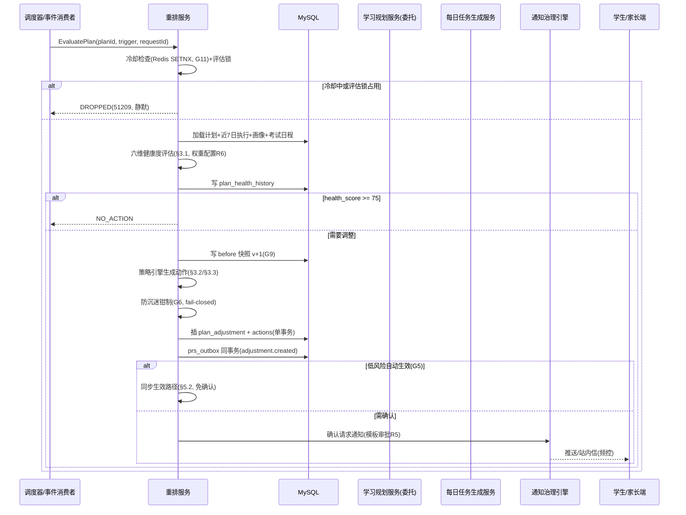
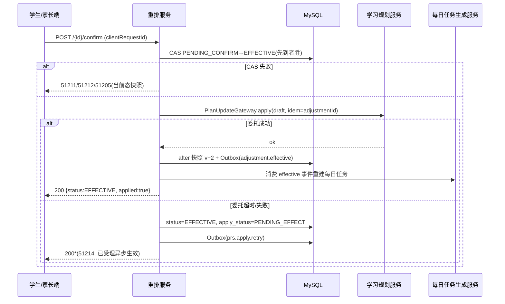

# 服务端-学习计划动态调整与智能重排服务 - 详细设计

> 模块负责人：学习服务组
> 最后更新：2026-06-05
> 状态：待评审

---

## 1. 模块概述

### 1.1 功能定位

学习计划动态调整与智能重排服务（Plan Replanning Service，以下简称 PRS）是学习规划子系统的**自适应核心引擎**。它负责在计划执行期间，根据学生的实际学习行为、知识掌握度变化、外部事件（考试、假期等）和时间可用性变化，对正在进行的学习计划进行**动态评估和智能调整**，确保计划始终与学生的实际状态匹配。

```
┌───────────────────────────────────────────────────────────────┐
│                      学习规划子系统                              │
│                                                               │
│  ┌──────────────┐   ┌──────────────┐   ┌──────────────────┐   │
│  │ 计划创建引擎  │──▶│ 每日任务生成  │──▶│  任务执行追踪     │   │
│  │ (Plan Creator)│   │ (Task Gen)   │   │  (Task Tracker)  │   │
│  └──────────────┘   └──────┬───────┘   └────────┬─────────┘   │
│                             │                     │             │
│                             ▼                     ▼             │
│                    ┌────────────────────────────────┐           │
│                    │    ★ 本服务：动态调整与智能重排  │           │
│                    │    (Plan Replanning Service)    │           │
│                    └────────────────────────────────┘           │
│                             ▲                                   │
│                 ┌───────────┼───────────┐                       │
│                 │           │           │                       │
│          学情数据变更   外部事件触发   用户主动调整               │
└───────────────────────────────────────────────────────────────┘
```

### 1.2 核心问题

| 问题 | 痛点 | 本服务解决方式 |
|------|------|---------------|
| 学生连续几天没完成任务怎么办？ | 任务堆积，计划越来越不现实，最终被放弃 | 自动重排未完成任务，压缩或裁剪低优先级任务 |
| 学生某知识点掌握得比预期快 | 继续做基础练习浪费时间 | 跳过已掌握内容，提前进入下一阶段 |
| 突然通知下周有期中考试 | 原计划与新紧迫需求冲突 | 紧急插入备考任务，暂停长期计划 |
| 假期学习节奏与上学期间不同 | 按上学期间的任务量安排导致假期计划失败 | 根据时间上下文自动调整任务密度 |
| 学生反馈任务太多/太少 | 固定计划无法适应个体差异 | 根据完成率和反馈动态调整每日任务量 |

### 1.3 与其他模块的关系

| 依赖模块 | 依赖内容 | 交互方式 |
|----------|----------|----------|
| 学习规划（Plan Creator） | 计划模板、初始计划结构 | 读取计划数据，回写调整后的计划 |
| 每日任务生成服务 | 任务模板、难度梯度 | 调整后触发生成新的每日任务 |
| 任务执行追踪服务 | 完成率、用时、质量数据 | 消费执行数据作为调整依据 |
| 学情分析服务 | 知识点掌握度、能力维度变化 | 消费学情数据判断是否需要调整 |
| 学期与学年管理服务 | 考试日程、假期状态、学期进度 | 消费时间上下文触发事件驱动调整 |
| 错题服务 | 高频错题、薄弱知识点 | 消费错题数据调整复习重点 |
| 间隔重复算法引擎 | 复习到期日、遗忘曲线预测 | 将复习任务纳入计划调度 |
| 用户学习画像 | 学习风格、历史完成率、活跃时段 | 个性化调整参数 |
| 消息与推送服务 | 调整通知 | 计划调整后推送通知给用户/家长 |

### 1.4 设计原则

1. **渐进式调整优先**：优先微调（改时间、调难度），其次局部重排（换顺序、增删任务），最后才全盘重做
2. **用户知情且可控**：每次自动调整都通知用户，重要调整需用户确认，用户可随时拒绝自动调整
3. **数据驱动**：所有调整决策基于可量化的学习数据，而非简单规则
4. **不打断学习心流**：正在进行的任务不被强制中断，调整从下一个时间窗口开始生效
5. **可回溯**：保留完整的调整历史和调整原因，支持回退到之前的计划版本

---

## 2. 核心数据结构

### 2.1 计划调整请求（PlanAdjustmentRequest）

```java
/**
 * 计划调整请求 - 触发一次计划调整的输入
 */
public class PlanAdjustmentRequest {

    /** 学生ID */
    private Long studentId;

    /** 学习计划ID */
    private Long planId;

    /** 触发来源 */
    private AdjustmentTrigger trigger;

    /** 触发来源枚举 */
    public enum AdjustmentTrigger {
        /** 定时评估（每日凌晨） */
        SCHEDULED_EVALUATION,
        /** 任务完成率异常（连续3天低于阈值） */
        COMPLETION_RATE_ANOMALY,
        /** 知识掌握度显著变化 */
        MASTERY_CHANGE,
        /** 外部事件：考试临近 */
        EXAM_APPROACHING,
        /** 外部事件：假期开始/结束 */
        VACATION_TRANSITION,
        /** 外部事件：学期切换 */
        SEMESTER_TRANSITION,
        /** 用户主动请求调整 */
        USER_REQUESTED,
        /** 用户反馈任务过重/过轻 */
        USER_FEEDBACK,
        /** 错题暴增（某知识点集中出错） */
        MISTAKE_SURGE,
        /** 连续多天未登录 */
        INACTIVITY_DETECTED
    }

    /** 触发上下文数据（JSON） */
    private Map<String, Object> triggerContext;

    /** 请求时间 */
    private LocalDateTime requestTime;
}
```

### 2.2 计划快照（PlanSnapshot）

```java
/**
 * 计划快照 - 每次调整前保存当前计划状态，支持回退
 */
public class PlanSnapshot {

    /** 快照ID */
    private Long id;

    /** 计划ID */
    private Long planId;

    /** 快照版本号（递增） */
    private Integer version;

    /** 快照时间 */
    private LocalDateTime snapshotTime;

    /** 快照原因 */
    private String reason;

    /** 完整计划数据（JSON序列化） */
    private String planData;

    /** 关联的调整ID（调整后填写） */
    private Long adjustmentId;
}
```

### 2.3 计划调整记录（PlanAdjustment）

```java
/**
 * 计划调整记录 - 记录一次完整的调整过程和结果
 */
public class PlanAdjustment {

    /** 调整ID */
    private Long id;

    /** 计划ID */
    private Long planId;

    /** 学生ID */
    private Long studentId;

    /** 快照ID（调整前） */
    private Long beforeSnapshotId;

    /** 快照ID（调整后） */
    private Long afterSnapshotId;

    /** 触发来源 */
    private AdjustmentTrigger trigger;

    /** 触发上下文 */
    private String triggerContextJson;

    /** 调整类型 */
    private AdjustmentType adjustmentType;

    /** 调整类型枚举 */
    public enum AdjustmentType {
        /** 微调：仅调整时间或顺序 */
        MICRO_TUNING,
        /** 局部重排：替换、增删部分任务 */
        PARTIAL_REPLAN,
        /** 全局重排：重新生成完整计划 */
        FULL_REPLAN,
        /** 暂停：临时挂起计划 */
        SUSPEND,
        /** 恢复：从暂停中恢复 */
        RESUME
    }

    /** 调整详情 */
    private List<AdjustmentAction> actions;

    /** 调整依据（评分数据） */
    private AdjustmentEvaluation evaluation;

    /** 调整状态 */
    private AdjustmentStatus status;

    public enum AdjustmentStatus {
        /** 待用户确认 */
        PENDING_CONFIRM,
        /** 已生效 */
        EFFECTIVE,
        /** 用户拒绝 */
        REJECTED,
        /** 已回退 */
        ROLLED_BACK,
        /** 已过期（未及时确认） */
        EXPIRED
    }

    /** 是否需要用户确认 */
    private Boolean requiresConfirmation;

    /** 用户确认时间 */
    private LocalDateTime confirmedAt;

    /** 创建时间 */
    private LocalDateTime createdAt;

    /** 过期时间（未确认自动生效或自动过期） */
    private LocalDateTime expiresAt;
}
```

### 2.4 调整动作（AdjustmentAction）

```java
/**
 * 调整动作 - 一次调整中的具体操作列表
 */
public class AdjustmentAction {

    /** 动作类型 */
    private ActionType actionType;

    public enum ActionType {
        /** 删除任务 */
        REMOVE_TASK,
        /** 新增任务 */
        ADD_TASK,
        /** 前移任务（优先级提升） */
        PROMOTE_TASK,
        /** 后移任务（优先级降低） */
        DEMOTE_TASK,
        /** 替换任务（换一种难度或形式） */
        REPLACE_TASK,
        /** 合并多个任务为一个 */
        MERGE_TASKS,
        /** 拆分一个任务为多个 */
        SPLIT_TASK,
        /** 调整每日任务量 */
        ADJUST_DAILY_LOAD,
        /** 插入紧急任务 */
        INSERT_URGENT_TASK,
        /** 延期任务 */
        POSTPONE_TASK
    }

    /** 目标任务ID（REMOVE/REPLACE/PROMOTE/DEMOTE/MERGE/SPLIT/POSTPONE） */
    private Long targetTaskId;

    /** 目标任务ID列表（MERGE） */
    private List<Long> targetTaskIds;

    /** 新任务模板ID（ADD/REPLACE） */
    private Long newTaskTemplateId;

    /** 新任务参数 */
    private Map<String, Object> newTaskParams;

    /** 调整说明（面向用户） */
    private String description;

    /** 调整原因（内部） */
    private String internalReason;

    /** 影响评估分数 (0-100, 影响程度) */
    private Integer impactScore;
}
```

### 2.5 调整评估（AdjustmentEvaluation）

```java
/**
 * 调整评估 - 量化评估当前计划状态，决定是否需要调整
 */
public class AdjustmentEvaluation {

    /** 计划健康度总分 (0-100) */
    private Integer healthScore;

    /** 各维度评分 */
    private DimensionScores dimensionScores;

    /** 推荐的调整类型 */
    private AdjustmentType recommendedType;

    /** 推荐的调整紧迫度 */
    private UrgencyLevel urgency;

    public enum UrgencyLevel {
        /** 低：下次定时评估时处理即可 */
        LOW,
        /** 中：24小时内处理 */
        MEDIUM,
        /** 高：尽快处理 */
        HIGH,
        /** 紧急：立即处理 */
        CRITICAL
    }

    /** 评估详情 */
    private String evaluationDetail;
}

public class DimensionScores {
    /** 进度偏差分 (0-100, 越高越好) */
    private Integer progressDeviationScore;

    /** 任务完成率分 (0-100) */
    private Integer completionRateScore;

    /** 掌握度匹配分 (0-100) */
    private Integer masteryAlignmentScore;

    /** 时间适配分 (0-100, 任务量与可用时间匹配度) */
    private Integer timeFitnessScore;

    /** 优先级相关分 (0-100, 高优先级任务是否优先安排) */
    private Integer priorityAlignmentScore;

    /** 情绪/倦怠风险分 (0-100, 越高说明风险越大) */
    private Integer burnoutRiskScore;
}
```

### 2.6 数据库表设计

```sql
-- 计划快照表
CREATE TABLE plan_snapshot (
    id              BIGINT PRIMARY KEY AUTO_INCREMENT,
    plan_id         BIGINT NOT NULL COMMENT '学习计划ID',
    version         INT NOT NULL COMMENT '快照版本号',
    snapshot_time   DATETIME NOT NULL COMMENT '快照时间',
    reason          VARCHAR(500) COMMENT '快照原因',
    plan_data       JSON NOT NULL COMMENT '完整计划数据快照',
    adjustment_id   BIGINT COMMENT '关联的调整ID',
    created_at      DATETIME DEFAULT CURRENT_TIMESTAMP,
    INDEX idx_plan_version (plan_id, version),
    INDEX idx_snapshot_time (snapshot_time)
) ENGINE=InnoDB DEFAULT CHARSET=utf8mb4 COMMENT='学习计划快照';

-- 计划调整记录表
CREATE TABLE plan_adjustment (
    id                      BIGINT PRIMARY KEY AUTO_INCREMENT,
    plan_id                 BIGINT NOT NULL COMMENT '学习计划ID',
    student_id              BIGINT NOT NULL COMMENT '学生ID',
    before_snapshot_id      BIGINT COMMENT '调整前快照ID',
    after_snapshot_id       BIGINT COMMENT '调整后快照ID',
    trigger_type            VARCHAR(50) NOT NULL COMMENT '触发来源',
    trigger_context         JSON COMMENT '触发上下文',
    adjustment_type         VARCHAR(30) NOT NULL COMMENT '调整类型',
    health_score            INT COMMENT '调整前健康度评分',
    recommended_type        VARCHAR(30) COMMENT '推荐调整类型',
    urgency_level           VARCHAR(20) COMMENT '紧迫度',
    status                  VARCHAR(20) NOT NULL DEFAULT 'PENDING_CONFIRM' COMMENT '调整状态',
    requires_confirmation   TINYINT(1) DEFAULT 1 COMMENT '是否需要用户确认',
    confirmed_at            DATETIME COMMENT '用户确认时间',
    expires_at              DATETIME COMMENT '过期时间',
    created_at              DATETIME DEFAULT CURRENT_TIMESTAMP,
    updated_at              DATETIME DEFAULT CURRENT_TIMESTAMP ON UPDATE CURRENT_TIMESTAMP,
    INDEX idx_plan_status (plan_id, status),
    INDEX idx_student_trigger (student_id, trigger_type, created_at),
    INDEX idx_status_expires (status, expires_at)
) ENGINE=InnoDB DEFAULT CHARSET=utf8mb4 COMMENT='学习计划调整记录';

-- 调整动作表
CREATE TABLE adjustment_action (
    id                  BIGINT PRIMARY KEY AUTO_INCREMENT,
    adjustment_id       BIGINT NOT NULL COMMENT '调整记录ID',
    action_type         VARCHAR(30) NOT NULL COMMENT '动作类型',
    target_task_id      BIGINT COMMENT '目标任务ID',
    target_task_ids     JSON COMMENT '目标任务ID列表',
    new_task_template_id BIGINT COMMENT '新任务模板ID',
    new_task_params     JSON COMMENT '新任务参数',
    description         VARCHAR(500) COMMENT '面向用户的说明',
    internal_reason     VARCHAR(500) COMMENT '内部原因',
    impact_score        INT DEFAULT 0 COMMENT '影响评分',
    sort_order          INT DEFAULT 0 COMMENT '执行顺序',
    created_at          DATETIME DEFAULT CURRENT_TIMESTAMP,
    INDEX idx_adjustment (adjustment_id)
) ENGINE=InnoDB DEFAULT CHARSET=utf8mb4 COMMENT='调整动作';

-- 计划健康度评估历史表（用于趋势分析和模型优化）
CREATE TABLE plan_health_history (
    id                      BIGINT PRIMARY KEY AUTO_INCREMENT,
    plan_id                 BIGINT NOT NULL,
    student_id              BIGINT NOT NULL,
    health_score            INT NOT NULL,
    progress_deviation      INT COMMENT '进度偏差分',
    completion_rate         INT COMMENT '完成率分',
    mastery_alignment       INT COMMENT '掌握度匹配分',
    time_fitness            INT COMMENT '时间适配分',
    priority_alignment      INT COMMENT '优先级相关分',
    burnout_risk            INT COMMENT '倦怠风险分',
    evaluation_trigger      VARCHAR(50) COMMENT '评估触发原因',
    evaluation_detail       TEXT COMMENT '评估详情',
    evaluated_at            DATETIME NOT NULL,
    INDEX idx_plan_time (plan_id, evaluated_at),
    INDEX idx_student_time (student_id, evaluated_at)
) ENGINE=InnoDB DEFAULT CHARSET=utf8mb4 COMMENT='计划健康度评估历史';
```

---

## 3. 核心算法设计

### 3.1 计划健康度评估算法

```python
class PlanHealthEvaluator:
    """
    计划健康度评估器
    综合多个维度评估当前计划的执行健康度，输出0-100的健康度分数。
    分数越低，越需要调整。
    """

    # 维度权重（可配置，后续可通过A/B测试优化）
    DIMENSION_WEIGHTS = {
        'progress_deviation': 0.25,   # 进度偏差
        'completion_rate':    0.25,   # 任务完成率
        'mastery_alignment':  0.20,   # 掌握度匹配
        'time_fitness':       0.15,   # 时间适配
        'priority_alignment': 0.10,   # 优先级相关
        'burnout_risk':       0.05    # 倦怠风险（反向）
    }

    def evaluate(self, plan: StudyPlan, context: EvaluationContext) -> AdjustmentEvaluation:
        """
        执行健康度评估
        """
        # 1. 计算各维度分数
        scores = DimensionScores()

        scores.progress_deviation_score = self._calc_progress_deviation(plan, context)
        scores.completion_rate_score = self._calc_completion_rate(plan, context)
        scores.mastery_alignment_score = self._calc_mastery_alignment(plan, context)
        scores.time_fitness_score = self._calc_time_fitness(plan, context)
        scores.priority_alignment_score = self._calc_priority_alignment(plan, context)
        scores.burnout_risk_score = self._calc_burnout_risk(plan, context)

        # 2. 加权计算总分
        total = (
            scores.progress_deviation_score * self.DIMENSION_WEIGHTS['progress_deviation']
            + scores.completion_rate_score * self.DIMENSION_WEIGHTS['completion_rate']
            + scores.mastery_alignment_score * self.DIMENSION_WEIGHTS['mastery_alignment']
            + scores.time_fitness_score * self.DIMENSION_WEIGHTS['time_fitness']
            + scores.priority_alignment_score * self.DIMENSION_WEIGHTS['priority_alignment']
            + (100 - scores.burnout_risk_score) * self.DIMENSION_WEIGHTS['burnout_risk']  # 反向
        )

        health_score = round(total)

        # 3. 确定推荐调整类型和紧迫度
        recommended_type, urgency = self._determine_action(health_score, scores)

        return AdjustmentEvaluation(
            health_score=health_score,
            dimension_scores=scores,
            recommended_type=recommended_type,
            urgency=urgency,
            evaluation_detail=self._generate_detail(scores, health_score)
        )

    def _calc_progress_deviation(self, plan, context) -> int:
        """
        进度偏差评分
        比较计划进度与实际进度的偏差程度
        """
        expected_progress = context.elapsed_ratio  # 已过时间占比
        actual_progress = context.completed_tasks / max(context.total_tasks, 1)

        deviation = abs(expected_progress - actual_progress)

        # 偏差 < 5% → 100分, 偏差 > 50% → 0分
        score = max(0, min(100, 100 - deviation * 200))
        return int(score)

    def _calc_completion_rate(self, plan, context) -> int:
        """
        完成率评分
        基于最近7天的任务完成情况
        """
        recent_records = context.recent_daily_records  # 最近7天

        if not recent_records:
            return 50  # 无数据给中间分

        total_assigned = sum(r.assigned_count for r in recent_records)
        total_completed = sum(r.completed_count for r in recent_records)

        if total_assigned == 0:
            return 50

        rate = total_completed / total_assigned

        # 完成率 90%+ → 100分, 50% → 50分, <20% → 10分
        if rate >= 0.9:
            return 100
        elif rate >= 0.5:
            return int(50 + (rate - 0.5) * 100)
        else:
            return int(rate * 100)

    def _calc_mastery_alignment(self, plan, context) -> int:
        """
        掌握度匹配评分
        检查计划中的任务难度是否与当前掌握度匹配
        """
        mismatch_count = 0
        total_tasks = 0

        for task in context.upcoming_tasks[:14]:  # 检查未来14个任务
            kp_mastery = context.get_mastery(task.knowledge_point_id)
            task_difficulty = task.difficulty_level

            # 已掌握的内容仍安排基础任务 → 不匹配
            if kp_mastery >= 0.8 and task_difficulty <= 2:
                mismatch_count += 1
            # 未掌握的内容直接安排难题 → 不匹配
            elif kp_mastery < 0.3 and task_difficulty >= 4:
                mismatch_count += 1

            total_tasks += 1

        if total_tasks == 0:
            return 80

        match_rate = 1 - (mismatch_count / total_tasks)
        return int(match_rate * 100)

    def _calc_time_fitness(self, plan, context) -> int:
        """
        时间适配评分
        每日任务量是否在学生可用时间内可完成
        """
        avg_daily_minutes = context.avg_available_minutes_per_day  # 用户平均可用学习时长
        planned_daily_minutes = context.planned_daily_minutes  # 计划安排的每日时长

        if avg_daily_minutes <= 0:
            return 30

        ratio = planned_daily_minutes / avg_daily_minutes

        # 理想区间：0.7 ~ 0.9（留点余量）
        if 0.7 <= ratio <= 0.9:
            return 100
        elif ratio < 0.7:
            return int(70 + ratio * 30 / 0.7)  # 安排过少
        else:
            # 安排过多，线性递减
            overflow = min(ratio - 0.9, 0.6)
            return int(100 - overflow * 150)  # 1.5倍可用时间 → 约10分

    def _calc_priority_alignment(self, plan, context) -> int:
        """
        优先级相关评分
        高优先级任务（薄弱点、即将考试的知识点）是否优先安排
        """
        upcoming = context.upcoming_tasks[:7]  # 未来7个任务
        if not upcoming:
            return 80

        high_priority_ahead = 0
        total_high_priority = 0

        for i, task in enumerate(upcoming):
            if task.priority >= 3:  # 高优先级
                total_high_priority += 1
                if i < 3:  # 排在前面
                    high_priority_ahead += 1

        if total_high_priority == 0:
            return 80

        return int(high_priority_ahead / total_high_priority * 100)

    def _calc_burnout_risk(self, plan, context) -> int:
        """
        倦怠风险评分（正向表示风险高）
        基于学习时长趋势、完成率下降趋势、活跃度变化
        """
        risk_signals = 0

        # 信号1：连续3天完成率下降
        if context.has_declining_completion_rate(days=3):
            risk_signals += 30

        # 信号2：日均学习时长连续5天超过120分钟
        if context.avg_daily_study_minutes(days=5) > 120:
            risk_signals += 25

        # 信号3：连续2天未登录
        if context.consecutive_inactive_days >= 2:
            risk_signals += 25

        # 信号4：任务跳过率上升（只看答案不练习）
        if context.skip_rate_trend == 'RISING':
            risk_signals += 20

        return min(100, risk_signals)

    def _determine_action(self, health_score, scores) -> tuple:
        """根据健康度分数确定调整策略"""
        if health_score >= 75:
            return AdjustmentType.MICRO_TUNING, UrgencyLevel.LOW
        elif health_score >= 50:
            if scores.burnout_risk_score >= 60:
                return AdjustmentType.PARTIAL_REPLAN, UrgencyLevel.HIGH
            return AdjustmentType.PARTIAL_REPLAN, UrgencyLevel.MEDIUM
        elif health_score >= 30:
            return AdjustmentType.FULL_REPLAN, UrgencyLevel.HIGH
        else:
            return AdjustmentType.FULL_REPLAN, UrgencyLevel.CRITICAL
```

### 3.2 调整策略引擎

```python
class AdjustmentStrategyEngine:
    """
    调整策略引擎
    根据评估结果和触发原因，生成具体的调整动作列表
    """

    def generate_actions(
        self,
        evaluation: AdjustmentEvaluation,
        trigger: AdjustmentTrigger,
        context: AdjustmentContext
    ) -> List[AdjustmentAction]:
        """
        生成调整动作
        采用策略模式，根据触发原因选择不同的策略组合
        """
        strategy = self._select_strategy(trigger, evaluation)
        return strategy.generate_actions(evaluation, context)

    def _select_strategy(
        self,
        trigger: AdjustmentTrigger,
        evaluation: AdjustmentEvaluation
    ) -> 'BaseStrategy':
        """策略选择"""
        strategies = {
            AdjustmentTrigger.COMPLETION_RATE_ANOMALY: CompletionAnomalyStrategy(),
            AdjustmentTrigger.MASTERY_CHANGE: MasteryChangeStrategy(),
            AdjustmentTrigger.EXAM_APPROACHING: ExamApproachingStrategy(),
            AdjustmentTrigger.VACATION_TRANSITION: VacationTransitionStrategy(),
            AdjustmentTrigger.USER_FEEDBACK: UserFeedbackStrategy(),
            AdjustmentTrigger.MISTAKE_SURGE: MistakeSurgeStrategy(),
            AdjustmentTrigger.INACTIVITY_DETECTED: InactivityStrategy(),
            AdjustmentTrigger.SCHEDULED_EVALUATION: ScheduledEvaluationStrategy(),
            AdjustmentTrigger.USER_REQUESTED: UserRequestedStrategy(),
        }
        return strategies.get(trigger, ScheduledEvaluationStrategy())


class CompletionAnomalyStrategy(BaseStrategy):
    """
    完成率异常策略
    场景：连续多天完成率低于阈值
    """

    def generate_actions(self, evaluation, context):
        actions = []
        scores = evaluation.dimension_scores

        # 情况1：任务量超出能力 → 减少每日任务
        if scores.time_fitness_score < 50:
            reduction_ratio = self._calc_reduction_ratio(context)
            actions.append(AdjustmentAction(
                action_type=ActionType.ADJUST_DAILY_LOAD,
                new_task_params={'daily_task_count': context.current_daily_count * reduction_ratio},
                description=f'根据你最近的完成情况，每日任务量调整为 {int(context.current_daily_count * reduction_ratio)} 项',
                internal_reason=f'时间适配分={scores.time_fitness_score}, 压缩比={reduction_ratio}',
                impact_score=70
            ))

        # 情况2：有大量积压任务 → 延期低优先级任务
        overdue_tasks = context.get_overdue_tasks()
        if overdue_tasks:
            low_priority_overdue = [t for t in overdue_tasks if t.priority <= 2]
            if low_priority_overdue:
                for task in low_priority_overdue[:3]:  # 每轮最多延期3个，避免单次调整过猛(G1)
                    actions.append(AdjustmentAction(
                        action_type=ActionType.POSTPONE_TASK,
                        target_task_id=task.task_id,
                        new_task_params={'postpone_days': 2},
                        description=f'「{task.title}」延后 2 天，先把重点任务跟上',
                        internal_reason=f'积压任务延期, priority={task.priority}',
                        impact_score=30
                    ))

        # 情况3：完成率低但时间适配正常 → 判为任务形式疲劳，替换形式而非减量
        if scores.completion_rate_score < 40 and scores.time_fitness_score >= 60:
            for task in context.get_replaceable_tasks(limit=2):
                actions.append(AdjustmentAction(
                    action_type=ActionType.REPLACE_TASK,
                    target_task_id=task.task_id,
                    new_task_params={'format': task.alternative_format},
                    description=f'把「{task.title}」换成{task.alternative_format}形式，换一种方式继续学',
                    internal_reason='完成率低下但时长正常，判为形式疲劳',
                    impact_score=40
                ))
        return actions

    def _calc_reduction_ratio(self, context) -> float:
        """压缩比：完成率越低压得越狠，下限 0.5 防止计划失去意义"""
        rate = context.recent_completion_rate(days=7)
        return max(0.5, round(rate / 0.85, 2))


class MasteryChangeStrategy(BaseStrategy):
    """
    掌握度显著变化策略
    场景：测评/练习后某知识点掌握度大幅变化（≥0.25 跳变）
    """

    def generate_actions(self, evaluation, context):
        actions = []
        for change in context.mastery_changes:
            if change.delta >= 0.25:
                # 已掌握 → 跳过/替换掉剩余的同 KP 基础任务
                upcoming = context.get_upcoming_tasks_by_kp(change.kp_id)
                basic = [t for t in upcoming if t.difficulty_level <= 2]
                for task in basic[:2]:
                    actions.append(AdjustmentAction(
                        action_type=ActionType.REMOVE_TASK,
                        target_task_id=task.task_id,
                        description=f'「{task.title}」对应内容你已经掌握，为你跳过',
                        internal_reason=f'mastery {change.old:.2f}→{change.new:.2f}',
                        impact_score=50
                    ))
                # 前置已掌握 → 提前解锁后续阶段任务（PROMOTE）
                promotable = context.get_promotable_tasks(change.kp_id)
                for task in promotable[:1]:
                    actions.append(AdjustmentAction(
                        action_type=ActionType.PROMOTE_TASK,
                        target_task_id=task.task_id,
                        description=f'提前解锁「{task.title}」，趁热打铁',
                        internal_reason='前置掌握度达标，提前进入下一阶段',
                        impact_score=45
                    ))
            elif change.delta <= -0.25:
                # 退步 → 插入巩固任务（不删原计划，只插入）
                actions.append(AdjustmentAction(
                    action_type=ActionType.INSERT_URGENT_TASK,
                    new_task_params={
                        'kp_id': change.kp_id,
                        'template': 'kp_consolidation',
                        'difficulty': 2
                    },
                    description='这部分内容最近有些生疏，加一次巩固练习',
                    internal_reason=f'mastery 回落 {change.delta:.2f}',
                    impact_score=55
                ))
        return actions


class ExamApproachingStrategy(BaseStrategy):
    """
    考试临近策略
    场景：考试日程事件（T-14/T-7），由学期与学年管理服务事件驱动
    红线：备考任务优先级保护（G7），本策略只增不删备考内容
    """

    def generate_actions(self, evaluation, context):
        actions = []
        exam = context.upcoming_exam  # 最近一次考试上下文
        if not exam or exam.days_until > 14:
            return actions

        # 1. 插入备考冲刺任务（置顶）
        actions.append(AdjustmentAction(
            action_type=ActionType.INSERT_URGENT_TASK,
            new_task_params={
                'template': 'exam_sprint',
                'exam_id': exam.exam_id,
                'scope_kp_ids': exam.related_kp_ids,
                'daily_minutes_cap': min(context.current_daily_minutes, 90)
            },
            description=f'{exam.days_until}天后有{exam.exam_name}，已为你插入考前冲刺安排',
            internal_reason=f'exam approaching T-{exam.days_until}',
            impact_score=90
        ))
        # 2. T-7 内：后移与考试无关的低优先级任务
        if exam.days_until <= 7:
            for task in context.get_non_exam_low_priority_tasks(limit=3):
                actions.append(AdjustmentAction(
                    action_type=ActionType.POSTPONE_TASK,
                    target_task_id=task.task_id,
                    new_task_params={'postpone_days': exam.days_until + 1},
                    description=f'「{task.title}」先放一放，考完再安排',
                    internal_reason='考试窗口期让位',
                    impact_score=35
                ))
        return actions


class VacationTransitionStrategy(BaseStrategy):
    """
    假期切换策略
    场景：假期开始/结束事件，重新对齐任务密度
    """

    def generate_actions(self, evaluation, context):
        actions = []
        ctx = context.vacation_context
        if ctx.is_vacation_starting:
            # 假期可用时间变多 → 适度增量（不超过原 1.5 倍，防 G6 拦截）
            actions.append(AdjustmentAction(
                action_type=ActionType.ADJUST_DAILY_LOAD,
                new_task_params={
                    'daily_task_count': min(int(context.current_daily_count * 1.4),
                                            context.vacation_daily_capacity)
                },
                description='假期时间更充裕，每日任务量已按假期节奏调整',
                internal_reason='vacation transition',
                impact_score=60
            ))
        elif ctx.is_vacation_ending:
            # 假期结束 → 回落到学期密度，积压任务裁剪
            actions.append(AdjustmentAction(
                action_type=ActionType.ADJUST_DAILY_LOAD,
                new_task_params={'daily_task_count': context.term_daily_capacity},
                description='假期结束，任务量已切换回学期节奏',
                internal_reason='vacation end rollback',
                impact_score=60
            ))
        return actions


class UserFeedbackStrategy(BaseStrategy):
    """
    用户反馈策略
    场景：学生/家长反馈「任务太多/太少/太难」
    原则：用户主观反馈权重高于推断，但受防沉迷上限约束（G6）
    """

    def generate_actions(self, evaluation, context):
        actions = []
        fb = context.user_feedback
        if fb.sentiment == 'TOO_MUCH':
            actions.append(AdjustmentAction(
                action_type=ActionType.ADJUST_DAILY_LOAD,
                new_task_params={'daily_task_count': max(1, int(context.current_daily_count * 0.7))},
                description='已按你的反馈减少每日任务量',
                internal_reason='user feedback: too much',
                impact_score=80
            ))
        elif fb.sentiment == 'TOO_LITTLE':
            new_count = int(context.current_daily_count * 1.2)
            actions.append(AdjustmentAction(
                action_type=ActionType.ADJUST_DAILY_LOAD,
                new_task_params={'daily_task_count': new_count},
                description='已按你的反馈增加每日任务量',
                internal_reason='user feedback: too little',
                impact_score=80
            ))
        elif fb.sentiment == 'TOO_HARD':
            for task in context.get_upcoming_hard_tasks(limit=2):
                actions.append(AdjustmentAction(
                    action_type=ActionType.REPLACE_TASK,
                    target_task_id=task.task_id,
                    new_task_params={'difficulty_offset': -1},
                    description=f'「{task.title}」先降一点难度，跟上再继续',
                    internal_reason='user feedback: too hard',
                    impact_score=50
                ))
        return actions


class MistakeSurgeStrategy(BaseStrategy):
    """
    错题暴增策略
    场景：某 KP 短周期内错题集中（委托错题服务信号）
    红线：复习任务不可删除（R8），只可插入与替换
    """

    def generate_actions(self, evaluation, context):
        actions = []
        for surge in context.mistake_surges:
            actions.append(AdjustmentAction(
                action_type=ActionType.INSERT_URGENT_TASK,
                new_task_params={
                    'kp_id': surge.kp_id,
                    'template': 'mistake_review_pack',
                    'source': 'mistake_surge'
                },
                description='这个知识点最近错得比较多，加一组针对性复习',
                internal_reason=f'mistake surge kp={surge.kp_id} n={surge.count}',
                impact_score=65
            ))
        return actions


class InactivityStrategy(BaseStrategy):
    """
    连续未活跃策略
    场景：连续 ≥2 天未登录
    原则：只减不增，回归门槛越低越好；不批评学生（文案红线 G13/C9）
    """

    def generate_actions(self, evaluation, context):
        actions = []
        inactive_days = context.consecutive_inactive_days
        # 积压全部延期，任务量降到基础档
        reduction = 0.5 if inactive_days >= 5 else 0.7
        actions.append(AdjustmentAction(
            action_type=ActionType.ADJUST_DAILY_LOAD,
            new_task_params={'daily_task_count': max(1, int(context.current_daily_count * reduction))},
            description='欢迎回来！计划已帮你减轻负担，从少量任务重新开始',
            internal_reason=f'inactive {inactive_days}d, reduction={reduction}',
            impact_score=75
        ))
        for task in context.get_overdue_tasks()[:3]:
            actions.append(AdjustmentAction(
                action_type=ActionType.POSTPONE_TASK,
                target_task_id=task.task_id,
                new_task_params={'postpone_days': 1},
                description=f'「{task.title}」已顺延，不用一次补完',
                internal_reason='inactive catch-up softening',
                impact_score=25
            ))
        return actions


class UserRequestedStrategy(BaseStrategy):
    """
    用户主动请求调整策略
    场景：学生/家长在端上点「调整计划」
    原则：尊重用户选择；仅当请求与防沉迷/考试红线冲突时才裁剪并说明（G6/G7）
    """

    def generate_actions(self, evaluation, context):
        # 用户请求以 UI 侧选择的调整项为准，这里只做合规钳制后的包装
        actions = list(context.user_requested_actions)
        for a in actions:
            a.description = a.description or '已按你的选择调整计划'
        return actions


class ScheduledEvaluationStrategy(BaseStrategy):
    """
    定时评估默认策略
    场景：每日凌晨例行评估，按六维分数对症下药
    """

    def generate_actions(self, evaluation, context):
        scores = evaluation.dimension_scores
        # 复用各专项策略的低风险子集（不带 INSERT_URGENT 的激进动作）
        actions = []
        if scores.time_fitness_score < 50:
            actions.extend(CompletionAnomalyStrategy().generate_actions(evaluation, context))
        if scores.mastery_alignment_score < 50:
            actions.extend(MasteryChangeStrategy().generate_actions(evaluation, context))
        # 去重：同一目标任务同批只保留一个动作
        seen, dedup = set(), []
        for a in actions:
            key = (a.action_type, a.target_task_id)
            if key not in seen:
                seen.add(key)
                dedup.append(a)
        return dedup[:8]  # G1: 单批动作上限 8
```

**策略选择速查表：**

| 触发源 | 主策略 | 是否需确认 | 单批动作上限 |
| --- | --- | --- | --- |
| SCHEDULED_EVALUATION | ScheduledEvaluationStrategy | 健康度≥50 时否 / <50 时是 | 8 |
| COMPLETION_RATE_ANOMALY | CompletionAnomalyStrategy | 是 | 8 |
| MASTERY_CHANGE | MasteryChangeStrategy | 否（跳过/插入属低风险） | 6 |
| EXAM_APPROACHING | ExamApproachingStrategy | 是（涉后移任务） | 5 |
| VACATION_TRANSITION | VacationTransitionStrategy | 否 | 2 |
| USER_REQUESTED / USER_FEEDBACK | UserRequested / UserFeedback | 否（用户即发起方） | 10 |
| MISTAKE_SURGE | MistakeSurgeStrategy | 否 | 4 |
| INACTIVITY_DETECTED | InactivityStrategy | 否 | 6 |

**确认规则（G5）：** 低风险动作（`impact_score ≤ 40` 且类型为 REMOVE_TASK/POSTPONE_TASK/ADJUST_DAILY_LOAD 的减量方向）自动生效，其余进入 `PENDING_CONFIRM`，确认窗口 24h，超时未确认自动 `EXPIRED`（不下发、不生效，待下次评估重新决策）。

### 3.3 全局重排算法（FULL_REPLAN）

当健康度 <50 且局部重排无法修复（积压率 >60% 或剩余计划完成概率预测 <30%，预测数据消费《学习计划质量智能评估与执行成功率预测引擎》）时，执行全局重排：

```text
FULL_REPLAN 算法
────────────────
输入: 当前计划 P、已完成里程碑 M_done、剩余天数 D、可用时长预算 B、薄弱 KP 集合 W

Step 1 保留锚点
  - 已完成任务与里程碑原样保留（G3: 不重写历史）
  - 考试锚点（exam_prep 类）固定日期不可移动（G7）

Step 2 生成剩余骨架
  - 委托《学习计划模板库与场景化计划方案智能推荐引擎》按当前画像
    重新生成 D 天的阶段骨架（复用其计划生成管线，scene=REPLAN）

Step 3 任务装箱（first-fit）
  - 将原计划未完成任务按优先级降序装入新骨架的每日容量槽
  - 容量槽 = min(B_当日, 防沉迷学段上限)（G6 钳制）
  - 装不下的低优先级任务进「候补池」并生成 POSTPONE/REMOVE 动作说明

Step 4 复习任务对账
  - 间隔重复到期复习任务（R8）按到期日回填，不可被挤出计划

Step 5 防震荡校验（G1）
  - 与上一次 FULL_REPLAN 的骨架差异率 <15% → 降级为 PARTIAL_REPLAN 并合并动作
  - 72h 内已发生一次 FULL_REPLAN → 强制降级 PARTIAL_REPLAN

Step 6 输出
  - before 快照 + 新计划草案 + 动作清单（必为「需确认」）
```

---

## 4. API 接口设计

### 4.1 学生/家长端 REST 接口（BFF 后端，base `/api/v1/plan-adjustments`）

#### 4.1.1 待确认调整列表

```
GET /api/v1/plan-adjustments/pending
```

响应：

```json
{
  "code": 0,
  "data": {
    "items": [
      {
        "adjustmentId": 88231,
        "planId": 50241,
        "planTitle": "初一数学·秋季学期计划",
        "trigger": "COMPLETION_RATE_ANOMALY",
        "adjustmentType": "PARTIAL_REPLAN",
        "healthScore": 62,
        "urgency": "MEDIUM",
        "summary": "每日任务量 8 → 5 项，3 个任务顺延",
        "actionCount": 4,
        "expiresAt": "2026-06-06T04:00:00Z"
      }
    ],
    "autoEffectiveNote": "低风险调整已自动生效，可在历史记录中查看"
  }
}
```

- 义务教育阶段（初中）`healthScore` 不返回精确分，返回 `band: A/B/C/D`（G4）。
- 列表按 urgency 降序（CRITICAL>HIGH>MEDIUM>LOW），再按 expiresAt 升序。

#### 4.1.2 调整详情

```
GET /api/v1/plan-adjustments/{adjustmentId}
```

- 学生端返回动作列表（仅 `description`，**永不返回 `internalReason`**，G13/C3）。
- `status=EFFECTIVE` 且 7 天内才返回 `rollbackable: true`。

#### 4.1.3 确认 / 拒绝 / 回退

```
POST /api/v1/plan-adjustments/{adjustmentId}/confirm   { "clientRequestId": "c_xxx" }
POST /api/v1/plan-adjustments/{adjustmentId}/reject    { "clientRequestId": "c_xxx", "reason": "可选" }
POST /api/v1/plan-adjustments/{adjustmentId}/rollback  { "clientRequestId": "c_xxx" }
```

- 确认：CAS `PENDING_CONFIRM → EFFECTIVE` → 委托学习规划服务回写计划 → after 快照 → Outbox `plan.adjustment.effective` → 每日任务生成服务消费重建任务。**回写委托幂等键 = `adjustmentId`**（R1）。
- 重复 confirm/reject 幂等回放，返回首次结果（`51211/51212`，200 语义码）。
- 回退：创建一条新的回退调整记录（trigger=USER_REQUESTED），计划恢复到 `beforeSnapshotId` 对应快照，原调整置 `ROLLED_BACK`；仅 7 天内、且原调整为 `EFFECTIVE` 可回退（`51206` 超窗拒绝）。

#### 4.1.4 历史与健康度

```
GET /api/v1/plan-adjustments?planId=&page=1&size=20
GET /api/v1/plan-health?planId=
```

`/plan-health` 返回当前健康度六维分（义务教育 band 化）、最近评估时间、趋势（对比前 3 次评估）。

### 4.2 内部 gRPC 接口

```protobuf
service PlanReplanningService {
  // 事件消费者/调度器触发评估（同步返回是否产生调整）
  rpc EvaluatePlan(EvaluatePlanRequest) returns (EvaluatePlanResponse);
  // 确认后执行（也可内部直调；BFF 不直接调）
  rpc ApplyAdjustment(ApplyAdjustmentRequest) returns (ApplyAdjustmentResponse);
  // BFF 批量拉取待确认（≤200 用户/次）
  rpc GetPendingAdjustments(GetPendingAdjustmentsRequest) returns (GetPendingAdjustmentsResponse);
  // 画像/管理端批量查健康度（≤500）
  rpc BatchGetHealth(BatchGetHealthRequest) returns (BatchGetHealthResponse);
}

message EvaluatePlanRequest {
  int64 plan_id = 1;
  string trigger = 2;          // AdjustmentTrigger 枚举名
  map<string, string> trigger_context = 3;
  string request_id = 4;       // 幂等：同 request_id 24h 内直接返回上次结果
}
```

### 4.3 管理端接口

| 接口 | 说明 | 守卫 |
| --- | --- | --- |
| `GET /admin-api/v1/prs/adjustments` | 调整记录多条件查询（触发源/类型/状态/时间） | 只读，审计日志 |
| `GET /admin-api/v1/prs/adjustments/{id}` | 详情（含 internalReason 与 evaluation 明细） | 只读 |
| `POST /admin-api/v1/prs/weights` | 六维权重/阈值配置 | 双人审批，版本化快照（R6） |
| `POST /admin-api/v1/prs/adjustments/{id}/force-rollback` | 强制回退（客诉场景） | 双人审批，审计 |
| `GET /admin-api/v1/prs/stats` | 调整量/确认率/回退率/FULL_REPLAN 占比 | 聚合 k≥5 |

### 4.4 幂等与限流总表

| 接口 | 幂等机制 | 限流 |
| --- | --- | --- |
| confirm/reject/rollback | clientRequestId + 状态 CAS + `51211/51212` 幂等回放 | 10 次/分/用户 |
| EvaluatePlan(gRPC) | request_id 24h 快照表 | 单计划 10 次/分（冷却合并） |
| 每日定时评估 | DB uk(plan_id, trigger_date, trigger=SCHEDULED_EVALUATION) | 调度器侧分片限速 |
| 委托回写 | 幂等键=adjustmentId（规划服务去重表） | — |

---

## 5. 核心流程

### 5.1 定时评估主链路（04:10 日批 + 事件触发共用）



### 5.2 生效执行链路（confirm 与自动生效共用）



**延迟预算：** 评估主链路（不含 LLM 文案）P95 ≤3s；confirm 同步路径 P95 ≤1s；委托回写重放补偿 ≤5min；事件触发评估端到端 ≤5min。

### 5.3 回退链路

```
回退请求 → 校验原调整 EFFECTIVE 且 ≤7 天(51206)
  → 加载 beforeSnapshot(G9 不可变, 必存在否则 51215)
  → 创建回退调整记录(USER_REQUESTED, 需确认? 否——回退即用户主动)
  → 委托 PlanUpdateGateway.restore(snapshot, idem=rollbackAdjustmentId)
  → 原调整置 ROLLED_BACK + after 快照 + Outbox(adjustment.rolled_back)
  → 每日任务生成服务重建任务
```

### 5.4 补充 DDL（prs_outbox + 约束增补）

```sql
-- 重排服务 Outbox（同事务事件）
CREATE TABLE prs_outbox (
    id              BIGINT PRIMARY KEY AUTO_INCREMENT,
    event_id        VARCHAR(64) NOT NULL UNIQUE COMMENT '事件ID UUID',
    event_type      VARCHAR(80) NOT NULL COMMENT '事件类型',
    aggregate_id    VARCHAR(64) NOT NULL COMMENT '聚合ID(adjustmentId/planId)',
    payload         JSON NOT NULL COMMENT '事件载荷',
    occurred_at     DATETIME NOT NULL DEFAULT CURRENT_TIMESTAMP,
    published_at    DATETIME COMMENT '发布时间',
    publish_status  VARCHAR(20) NOT NULL DEFAULT 'PENDING' COMMENT 'PENDING/PUBLISHED/FAILED',
    retry_count     INT DEFAULT 0,
    INDEX idx_status (publish_status, occurred_at),
    INDEX idx_type (event_type)
) ENGINE=InnoDB DEFAULT CHARSET=utf8mb4 COMMENT='重排服务事件Outbox';

-- 约束增补
ALTER TABLE plan_snapshot
    ADD UNIQUE KEY uk_plan_version (plan_id, version);          -- G9: 版本唯一
ALTER TABLE plan_adjustment
    ADD COLUMN apply_status VARCHAR(20) NOT NULL DEFAULT 'APPLIED'
        COMMENT 'APPLIED/PENDING_EFFECT(委托回写待重放)' AFTER status,
    ADD COLUMN apply_request_id VARCHAR(64) COMMENT '委托回写幂等键=adjustmentId';

-- 同计划同时只允许一个 PENDING_CONFIRM（函数唯一索引）
CREATE UNIQUE INDEX uk_pa_active_pending ON plan_adjustment (
    (CASE WHEN status = 'PENDING_CONFIRM' THEN plan_id ELSE NULL END)
);
```

### 5.5 Redis 键设计

| 键名模板 | 类型 | TTL | 说明 |
| --- | --- | --- | --- |
| `prs:cooldown:{planId}:{trigger}` | STRING | 48h | 触发源冷却（G11，拒绝后同源 48h 不再自动发起） |
| `prs:eval:lock:{planId}` | STRING | 5min | 评估互斥锁（SETNX+令牌释放） |
| `prs:idem:{requestId}` | STRING | 24h | EvaluatePlan request_id 幂等快照 |
| `prs:health:{planId}` | STRING(JSON) | 30min | 健康度读缓存（评估写入时 DEL，禁 SET 双写） |
| `prs:cfg:weights:{version}` | STRING(JSON) | 常驻 | 权重配置快照（R6 版本化） |

---

## 6. 关键代码示例

### 6.1 确认执行器（CAS + 委托回写 + 快照 + Outbox 同事务）

```java
@Transactional
public ConfirmResult confirm(Long adjustmentId, String clientRequestId, Long userId) {
    PlanAdjustment adj = adjustmentMapper.selectForUpdateSkip(adjustmentId, userId);
    if (adj == null) throw new BizException(51202, "ADJUSTMENT_NOT_FOUND");
    // 1. 状态 CAS：幂等回放返回首次结果
    int rows = adjustmentMapper.casStatus(adjustmentId, "PENDING_CONFIRM", "EFFECTIVE");
    if (rows == 0) {
        PlanAdjustment current = adjustmentMapper.selectById(adjustmentId);
        return switch (current.getStatus()) {
            case "EFFECTIVE" -> ConfirmResult.idempotent(true);            // 51211 语义
            case "REJECTED"  -> throw new BizException(51212, "ALREADY_REJECTED");
            case "EXPIRED"   -> throw new BizException(51205, "CONFIRM_WINDOW_EXPIRED");
            default -> throw new BizException(51200, "INTERNAL");
        };
    }
    // 2. 过期窗口校验（与 expire 定时任务竞态，CAS 已过则到这里必在窗口内）
    // 3. 委托回写（幂等键=adjustmentId，规划服务侧去重）
    try {
        planUpdateGateway.apply(adj.getPlanId(), adj.getAfterPlanDraft(),
                "PRS-" + adjustmentId);
        adjustmentMapper.markApplied(adjustmentId);
    } catch (GatewayException e) {
        // 不阻塞用户：异步重放补偿（D2）
        adjustmentMapper.markPendingEffect(adjustmentId);
        outboxPublisher.publish(ApplyRetryScheduled.of(adjustmentId));
        snapshotService.saveAfter(adj);                     // 快照照常落库(G9)
        return ConfirmResult.acceptedAsync();               // 200* + 51214 语义
    }
    // 4. after 快照 + Outbox 同事务
    snapshotService.saveAfter(adj);
    outboxPublisher.publish(PlanAdjustmentEffective.of(adj));
    return ConfirmResult.applied();
}
```

### 6.2 冷却与评估锁 Lua（原子）

```lua
-- KEYS[1]=prs:cooldown:{planId}:{trigger}  KEYS[2]=prs:eval:lock:{planId}
-- ARGV[1]=cooldownSeconds(172800) ARGV[2]=lockToken ARGV[3]=lockSeconds(300)
if redis.call('EXISTS', KEYS[1]) == 1 then
    return 'COOLDOWN'                                   -- 51209 静默丢弃(G11)
end
local ok = redis.call('SET', KEYS[2], ARGV[2], 'NX', 'EX', ARGV[3])
if not ok then
    return 'LOCKED'                                     -- 评估进行中(51210 语义)
end
-- 仅拒绝/用户可见事件写冷却键；定时评估不写（允许每日例行）
if ARGV[4] == 'true' then
    redis.call('SET', KEYS[1], '1', 'EX', ARGV[1])
end
return 'OK'
```

### 6.3 防沉迷钳制器（G6，fail-closed）

```java
@Component
public class AntiAddictionClamp {
    /** 调整后每日时长不得超过学段上限；查询失败取最严档(D10) */
    public List<AdjustmentAction> clamp(List<AdjustmentAction> actions,
                                        PlanContext ctx, StudentStage stage) {
        int dailyCap;
        try {
            dailyCap = antiAddictionClient.getDailyMinutesCap(stage, ctx.getUserId());
        } catch (Exception e) {
            dailyCap = STRICTEST_FALLBACK_CAP;   // fail-secure
            metrics.counter("prs.anti_addiction.fallback").increment();
        }
        int projected = ctx.projectDailyMinutes(actions);
        if (projected <= dailyCap) return actions;
        // 从影响分最低的动作开始裁剪，保留 INSERT_URGENT 之外的动作优先裁减量方向
        List<AdjustmentAction> result = new ArrayList<>(actions);
        for (AdjustmentAction a : result.stream()
                .sorted(Comparator.comparingInt(AdjustmentAction::getImpactScore))
                .toList()) {
            if (ctx.projectDailyMinutes(result) <= dailyCap) break;
            if (a.getActionType() == ActionType.INSERT_URGENT_TASK) continue; // 备考保护 G7 由后续校验
            a.markClamped("超出每日学习时长上限，已自动裁剪");
        }
        if (ctx.projectDailyMinutes(result) > dailyCap) {
            throw new BizException(51207, "ANTI_ADDICTION_LIMIT_EXCEEDED");
        }
        return result;
    }
}
```

### 6.4 委托回写重放消费者（PENDING_EFFECT 补偿）

```java
@KafkaListener(topics = "prs.apply.retry")
public void replayApply(ApplyRetryEvent event) {
    PlanAdjustment adj = adjustmentMapper.selectById(event.getAdjustmentId());
    if (adj == null || !"PENDING_EFFECT".equals(adj.getApplyStatus())) return; // 幂等
    try {
        planUpdateGateway.apply(adj.getPlanId(), adj.getAfterPlanDraft(), "PRS-" + adj.getId());
        adjustmentMapper.markApplied(adj.getId());                 // CAS PENDING_EFFECT→APPLIED
        outboxPublisher.publish(PlanAdjustmentEffective.of(adj));
    } catch (GatewayException e) {
        retryScheduler.schedule(event.getAdjustmentId(),
                backoff(event.getRetryCount()));                   // 指数退避, 上限 2h×8 次→告警人工
    }
}
```

---

## 7. 状态机与守卫

### 7.1 调整记录状态机

```
                    ┌──────── 24h 未确认 ────────┐
                    ▼                           │
            ┌──────────────┐   confirm    ┌──────────────┐
            │PENDING_CONFIRM├────────────▶│  EFFECTIVE   │
            └──────┬───────┘  (CAS先到者胜)└──────┬───────┘
                   │ reject                      │ rollback(≤7天, 一次)
                   ▼                             ▼
            ┌──────────────┐              ┌──────────────┐
            │   REJECTED   │              │ ROLLED_BACK  │
            └──────────────┘              └──────────────┘
                    │ 48h 冷却(G11)              │
                    ▼                            ▼
              (同触发源静默)              (产生新回退调整记录)

EXPIRED: 仅 PENDING_CONFIRM 超时可达；EXPIRED 不可再确认（51205）
EFFECTIVE 终态分支: ROLLED_BACK 或保持；apply_status 独立子状态(APPLIED/PENDING_EFFECT)
SUSPEND/RESUME: 计划级操作，不产生 adjustment 动作，仅变更计划状态(经委托网关)
```

### 7.2 守卫总表

| 编号 | 规则 | 违反处理 |
| --- | --- | --- |
| G1 | 渐进式优先 + 防震荡：单批动作 ≤8；72h 内禁第二次 FULL_REPLAN；骨架差异 <15% 降级 PARTIAL | 策略引擎强制降级，监控 M6 |
| G2 | study_plan 表写入口唯一归学习规划服务，PRS 仅经 PlanUpdateGateway 委托 | 直连写拒绝+告警 |
| G3 | 已完成任务与历史永不改写/删除；回退只产生新版本（R12） | 网关层拒绝 |
| G4 | 义务教育阶段健康度 band 化，不返回精确分/排名 | BFF 裁剪，服务端不出精确分 |
| G5 | 低风险自动生效 vs 需确认分界按 §3.2 速查表；确认窗 24h | 到期 EXPIRED |
| G6 | 调整后每日时长 ≤ 防沉迷学段上限；管控查询故障取最严档（fail-closed） | 裁剪动作，仍超限则 51207 |
| G7 | 备考锚点（exam_prep）不可被 REMOVE/DEMOTE/后移出考试窗口 | 策略过滤 + 51208 |
| G8 | 调整文案适龄化（G13），义务教育阶段无排名话术，倦怠场景不批评学生（C9） | 文案白名单审核 |
| G9 | plan_snapshot 落库后不可变（uk_plan_version，禁 UPDATE/DELETE） | 数据库账号禁 DML，仅 INSERT/SELECT |
| G10 | 同计划同时至多一个 PENDING_CONFIRM（函数唯一索引 uk_pa_active_pending） | 后到评估转 EXPIRED 旧记录或丢弃 |
| G11 | 用户拒绝后同触发源 48h 冷却，不再自动发起 | Lua 冷却键静默丢弃（51209） |
| G12 | Outbox 与业务状态变更同事务，至少一次投递 | 消费方 (event_id, consumer) 幂等 |
| G13 | description（面向用户）与 internalReason（内部）严格分离；学生端永不见 internalReason | 响应装配层过滤 + 审计 |
| G14 | 注销用户：调整记录与快照 180 天后字段级匿名化，同意/审计记录留存 3 年 | 注册统一清理引擎 |

---

## 8. 幂等与并发场景

| # | 场景 | 裁决 |
| --- | --- | --- |
| 1 | 客户端重复 confirm/reject | 状态 CAS 先到者胜；已终态返回首次结果（51211/51212，200 语义） |
| 2 | confirm 与 24h 过期定时撞车 | CAS 裁决：EFFECTIVE 优先，过期任务只对仍 PENDING_CONFIRM 的行生效 |
| 3 | 两个事件源并发触发同计划评估 | 评估锁 SETNX + uk(plan,trigger_date)；后到者丢弃（51210） |
| 4 | 事件触发评估与 04:10 日批撞车 | 同 3；定时评估批内按 planId 分片串行 |
| 5 | rollback 与新 PENDING_CONFIRM 并存 | G10 保证唯一 pending；回退先要求处理/过期 pending 记录（或自动 EXPIRED 旧记录） |
| 6 | 委托回写超时重试 | 幂等键=adjustmentId，规划服务侧去重表；PRS 侧 apply_status=PENDING_EFFECT 重放 |
| 7 | Outbox Relay 重投 | 消费方 (event_id, consumer) 幂等表 |
| 8 | 每日任务生成服务消费 effective 事件重建任务时崩溃 | 事件重投 + 任务生成 uk(planId, date, version) 幂等 |

---

## 9. 事件设计

### 9.1 发布事件（prs.domain.events，Outbox 同事务）

| 事件 | 载荷要点 | 消费方 |
| --- | --- | --- |
| `prs.evaluation.completed` | planId + healthScore + 六维分 + 权重版本 | 质量预测引擎（模型训练 R13，脱敏） |
| `prs.adjustment.created` | adjustmentId + type + trigger + 动作摘要 | 通知治理（确认请求）、运营看板 |
| `prs.adjustment.effective` | adjustmentId + planId + afterVersion | 每日任务生成服务（重建任务，R2）、学习规划服务（缓存失效） |
| `prs.adjustment.rejected` | adjustmentId + reason | 策略反馈闭环（阈值调优样本） |
| `prs.adjustment.rolled_back` | adjustmentId + rollbackAdjustmentId | 质量监控（M8 回退率） |

### 9.2 上游订阅

| 事件 | 用途 |
| --- | --- |
| `task.batch_completed` | 完成率异常检测（COMPLETION_RATE_ANOMALY） |
| `mastery.updated` | 掌握度显著变化（±0.25 阈值） |
| `exam.schedule.updated` | 考试临近（T-14/T-7） |
| `term.calendar.updated` | 假期/学期切换（VACATION/SEMESTER_TRANSITION） |
| `mistake.surge_detected` | 错题暴增 |
| `user.inactive.detected` | 连续未活跃 ≥2 天 |
| `user.deletion.requested` | G14 注销清理 |

### 9.3 对账

日终 04:35 对账三恒等式：① Outbox PENDING=0（积压 >500 P2）；② 当日 `EFFECTIVE` 调整数 = 委托回写成功数 + PENDING_EFFECT 数（差异 >1% 告警，防「用户已确认但计划未变」事故）；③ `plan_health_history` 当日行数 = 调度器评估计划数（漏评估 >0.5% P2）。差异处置：以 DB 为准，委托回写缺失走 §6.4 重放补偿。

---

## 10. 错误码（51200-51299）

> 段位经全库扫描确认空闲（51300 起已由反思/衔接/协议/地理/情感/即时练习引擎占用）。带 `*` 为 200 语义码（业务受理但路径降级，载荷带 `degraded=true`），不弹错误窗。

| 码 | 标识 | HTTP | 说明 | 用户提示 |
| --- | --- | --- | --- | --- |
| 51200 | INTERNAL_ERROR | 500 | 内部错误 | 稍后重试 |
| 51201 | PLAN_NOT_FOUND | 404 | 计划不存在或不属于当前用户 | 刷新计划列表 |
| 51202 | ADJUSTMENT_NOT_FOUND | 404 | 调整记录不存在 | 刷新列表 |
| 51203 | PLAN_STATUS_INVALID | 409 | 计划已完结/暂停中，不可调整 | 先恢复计划 |
| 51204 | SNAPSHOT_VERSION_CONFLICT | 409 | 快照版本冲突（并发回退/生效） | 刷新后重试 |
| 51205 | CONFIRM_WINDOW_EXPIRED | 409 | 确认窗口已过，调整已过期 | 展示新评估结果 |
| 51206 | ROLLBACK_WINDOW_EXPIRED | 409 | 生效超过 7 天，不可回退 | 说明规则 |
| 51207 | ANTI_ADDICTION_LIMIT_EXCEEDED | 409 | 调整超出每日学习时长上限 | 已自动裁剪并说明 |
| 51208 | EXAM_PREP_PROTECTED | 409 | 备考任务受保护，禁止该操作 | 说明考试优先级 |
| 51209 | DUPLICATE_TRIGGER_DROPPED | 200* | 触发源冷却期，评估静默丢弃 | 无感 |
| 51210 | EVALUATION_IN_PROGRESS | 200* | 评估进行中（锁占用） | 无感，结果稍后可见 |
| 51211 | ADJUSTMENT_ALREADY_CONFIRMED | 200* | confirm 幂等回放 | 返回首次结果 |
| 51212 | ADJUSTMENT_ALREADY_REJECTED | 200* | reject 幂等回放 | 返回首次结果 |
| 51213 | ROLLBACK_TARGET_GONE | 500 | 回退目标快照缺失（内部一致性事故） | 客诉通道 |
| 51214 | APPLY_ACCEPTED_ASYNC | 200* | 委托回写已受理，异步生效 | 「正在应用，稍后生效」 |
| 51299 | UNKNOWN | 500 | 未知错误 | 稍后重试 |

---

## 11. 降级矩阵（D1-D10）

| # | 故障 | 降级策略 | 红线 |
| --- | --- | --- | --- |
| D1 | 学情/画像数据服务不可用 | 评估跳过 mastery/burnout 维度，权重归一化重算；推荐类型保守降一档 | 不基于残缺数据做 FULL_REPLAN（G1） |
| D2 | 学习规划服务（委托回写）不可用 | 调整照常落库，apply_status=PENDING_EFFECT，§6.4 重放补偿 | 「用户已确认但计划未变」>5min 即 P2 告警 |
| D3 | Kafka 不可用 | 主链路（日批评估）不受影响，事件走 Outbox 补投 | 不丢事件 |
| D4 | Redis 不可用 | 冷却/锁退化 DB 行锁与 uk；幂等以 DB 为准 | 评估不可重复执行（uk 兜底） |
| D5 | LLM 文案生成不可用 | description 走静态模板白名单（预置 40 条分场景模板） | 不影响调整执行 |
| D6 | 通知服务不可用 | 确认请求改站内信积压，恢复后补发（EXPIRED 的不补） | 不静默丢失用户待确认事项 |
| D7 | 每日任务生成服务不可用 | effective 事件积压，恢复后按 uk(planId,date,version) 幂等重建 | 不重复生成任务 |
| D8 | 评估引擎自身故障 | 当轮评估跳过（fail-silent + 告警） | 绝不基于错误评估输出调整 |
| D9 | 分析侧（CH）故障 | 管理端读 T-1 缓存，带 stale 标记 | 不影响学生端 |
| D10 | 防沉迷/家长管控查询故障 | fail-secure 取最严档（G6） | 管控不可降级放宽 |

总红线：**任何降级不得突破 G2（计划写入口）、G6（防沉迷）、G7（备考保护）、G9（快照不可变）。**

---

## 12. 监控与容量

### 12.1 监控指标（M1-M10）

| 指标 | 口径 | 告警阈值 |
| --- | --- | --- |
| M1 评估完成率 | 评估完成/应评估 | <99.5% 持续 30min P2 |
| M2 调整生成率 | 生成调整数/评估数 | <2%（评估失效疑）或 >40%（阈值过松）持续 1 天 P2 |
| M3 待确认转化 | 24h 内确认占比 | <20% 持续 3 天 P2（描述不清/打扰过度） |
| M4 生效延迟 | confirm→applied P95 | >10s P2；PENDING_EFFECT 积压 >500 P2 |
| M5 委托回写失败率 | 失败/总调用 | >0.5% 持续 10min P2 |
| M6 FULL_REPLAN 占比 | FULL_REPLAN/总调整 | >10% 持续 1 天 P2（防震荡 G1 失效） |
| M7 Outbox 积压 | PENDING 数 | >500 P2 / >5000 P1 |
| M8 回退率 | ROLLED_BACK/EFFECTIVE | >8% 持续 3 天 P2（调整质量差） |
| M9 快照增长 | 日增量/清理滞后 | 清理 Job 失败或滞后 >2 天 P2 |
| M10 LLM 文案成本 | 元/日 | >预算 120% P1 |

### 12.2 容量估算（DAU 50 万，计划渗透 35% ≈ 17.5 万活跃计划）

- 评估：日批 17.5 万 + 事件触发约 20 万 ≈ **37.5 万次评估/日**，均值 4.3 QPS，峰值（晚高峰事件潮）80 QPS；单次评估读 5 张表，P95 ≤3s。
- 调整：生成约 3.5 万条/日，confirm 峰值 50 QPS（通知触达后 10min 集中）。
- 存储：`plan_adjustment` 3.5 万×2KB ≈ 70MB/日；快照 3.5 万×8KB ≈ 280MB/日；在线保留 180 天 ≈ 63GB，超量分区归档 ClickHouse（TTL 2 年，user_id 盐化）。
- Redis：健康度缓存 + 锁 + 冷却 ≈ 1GB。
- LLM 成本：描述文案 3.5 万/日 × 0.005 元 ≈ 175 元/日（D5 模板兜底后趋近于 0）。

---

## 13. 合规红线（C1-C10）

| # | 红线 |
| --- | --- |
| C1 | 自动调整永不下调防沉迷限制、不突破学段时长上限（G6/D10） |
| C2 | 学生/家长可在设置中关闭自动调整（关闭后仅 USER_REQUESTED 触发），关闭状态随时可查可改 |
| C3 | 调整描述与内部评分原因严格分离；家长端仅见描述，internalReason 仅管理端（G13） |
| C4 | 义务教育阶段不排名、不输出精确健康分（G4） |
| C5 | 调整历史属个人学习数据，支持 30 天内导出（随数据导出服务），注销 180 天字段级匿名化（G14） |
| C6 | 调整决策不得引入商业目标（促付费/促活）作为优化目标，仅服务学习效果（R 契约审计） |
| C7 | 幼儿段（学前）不产生自动调整，仅家长端可见可确认（适龄性 C7/G8） |
| C8 | FULL_REPLAN 必须经用户确认（G5），系统自动重排不可静默执行大改动 |
| C9 | 倦怠/未活跃场景文案不批评、不羞辱、不制造焦虑（成长型话术白名单） |
| C10 | 心理危机信号处理权威归《学生 AI 对话心理危机信号检测与分级预警干预编排引擎》，本服务仅消费倦怠信号做减负调整，危机让位 |

---

## 14. 契约对齐（R1-R14）

| # | 裁决 |
| --- | --- |
| R1 | study_plan 写入口唯一归《学习规划-详细设计》的学习规划服务；PRS 经 PlanUpdateGateway 委托回写/恢复，幂等键=adjustmentId |
| R2 | 每日任务生成权威归《服务端-每日任务智能生成与学习计划执行追踪服务》，PRS 只发 `prs.adjustment.effective` 事件，不直接生成任务 |
| R3 | 知识点掌握度只读（消费 `mastery.updated`），PRS 不写掌握度/画像 |
| R4 | 防沉迷学段上限权威归《防沉迷与未成年人保护机制》，PRS 仅消费并 fail-closed 钳制（G6） |
| R5 | 确认通知文案与频控归《服务端-统一通知消息模板引擎》与多源通知治理引擎，PRS 只发通知请求 |
| R6 | 六维权重/阈值配置管理端可配，走配置中心版本化热更新；评估历史记录权重版本保证可回放 |
| R7 | 考试日程锚点权威归《学期与学年管理服务》，PRS 消费 `exam.schedule.updated`（G7） |
| R8 | 间隔重复复习任务不被 REMOVE/DEMOTE，只可 POSTPONE 且到期日不可后移超过 1 天（复习调度引擎委托校验） |
| R9 | 事件 schema 遵循《服务端-事件驱动架构与统一事件总线》规范，payload ≤8KB |
| R10 | 快照 plan_data 超 256KB 拒绝（zstd 压缩后计量），载荷瘦身：仅存剩余任务与锚点，已完成任务仅存引用 |
| R11 | 多端展示差异由 BFF 层裁剪（G4 band 化在服务端完成，防 BFF 二次裁剪遗漏） |
| R12 | 回退/前进只新增计划版本，不产生删除语义（G3/G9） |
| R13 | `prs.evaluation.completed` 供《学习计划质量智能评估与执行成功率预测引擎》消费做成功率预测模型训练，数据脱敏（user_id 盐化） |
| R14 | 51200-51299 错误码段注册《服务端-统一业务异常码与错误分类体系》，本文为其唯一所有者 |

---

## 15. 验收场景（18 条）

| # | 场景 | 预期 |
| --- | --- | --- |
| AC01 | 健康度 82 分定时评估 | 仅写评估历史，不生成调整 |
| AC02 | 连续 3 天完成率 40% | 生成 PARTIAL_REPLAN，任务量压缩且含说明文案，需确认 |
| AC03 | mastery 0.5→0.85 跳变 | 自动生效：同 KP 基础任务被跳过，无需确认（G5） |
| AC04 | 重复 confirm 同一调整 3 次 | 仅首次生效，后两次返回首次结果（51211） |
| AC05 | confirm 与 24h 过期任务并发 | CAS 裁决，不产生半生效状态 |
| AC06 | 调整后每日时长超学段上限 | G6 裁剪动作并标注；仍超限 51207 |
| AC07 | T-7 考试事件触发 | 插入冲刺任务，低优先级非备考任务后移（G7 不删备考） |
| AC08 | 尝试 REMOVE 到期复习任务 | 被 G7/R8 拦截或转为 POSTPONE |
| AC09 | 72h 内第二次 FULL_REPLAN 条件触发 | 强制降级 PARTIAL_REPLAN（G1），M6 不计入 |
| AC10 | 初中学生查询健康度 | 仅 band，无精确分（G4） |
| AC11 | 拒绝后 24h 内同触发源再次触发 | 冷却静默丢弃（51209，G11） |
| AC12 | 学习规划服务宕机时 confirm | 200*（51214），PENDING_EFFECT，5min 内重放生效（D2） |
| AC13 | 回退生效 5 天的调整 | 计划恢复到 before 快照，原记录 ROLLED_BACK，新任务重建 |
| AC14 | 回退生效 10 天的调整 | 51206 拒绝 |
| AC15 | 防沉迷服务宕机时评估 | fail-secure 最严档钳制，M 指标告警（D10） |
| AC16 | 学生端抓包调整详情 | 无 internalReason 字段（G13/C3） |
| AC17 | 注销用户 180 天后 | 调整记录/快照字段级匿名化，审计留存可查（G14） |
| AC18 | 日终对账 | 三恒等式偏差 <阈值；委托回写缺失全部进入重放队列 |

---

## 16. 关联文档

- 《学习规划-详细设计》（R1 计划创建与写权威）
- 《服务端-学习计划模板库与场景化计划方案智能推荐引擎-详细设计》（§3.3 FULL_REPLAN 骨架生成委托）
- 《服务端-学习计划质量智能评估与执行成功率预测引擎-详细设计》（R13 完成概率预测消费）
- 《服务端-学习计划执行障碍智能诊断与个性化克服策略推荐引擎-详细设计》（障碍诊断与本服务调整的边界：诊断归彼，执行调整归此）
- 《服务端-每日任务智能生成与学习计划执行追踪服务-详细设计》（R2 任务重建）
- 《间隔重复算法与遗忘曲线复习调度引擎-详细设计》（R8 复习任务保护）
- 《学期与学年管理服务-详细设计》（R7 考试/假期日程）
- 《防沉迷与未成年人保护机制-详细设计》（R4 时长上限）
- 《服务端-统一通知消息模板引擎与多渠道内容适配渲染服务》（R5 通知委托）
- 《服务端-统一业务异常码与错误分类体系》（51200-51299 段注册）

---

## 17. 维护记录

### v1.0（初版截断登记）

初版完成 §1 概述/§2 六组数据结构（含 4 张 DDL）/§3.1 健康度评估器完整实现/§3.2 策略引擎框架与 `CompletionAnomalyStrategy` 前 2/3；截断于「情况2：延期低优先级任务」`if low_priority` 代码行中段（围栏未闭合）。无 API/流程/状态机/幂等/事件/错误码/降级/监控/合规/契约/验收章节。

### v1.1（2026-10-20 烂尾补全）

补齐至约 1400 行：

1. **§3.2 收尾**：完成 CompletionAnomalyStrategy 情况 2/3（积压延期每轮 ≤3、形式疲劳替换）与压缩比公式 `_calc_reduction_ratio`；新增 MasteryChangeStrategy/ExamApproachingStrategy/VacationTransitionStrategy/UserFeedbackStrategy/MistakeSurgeStrategy/InactivityStrategy/UserRequestedStrategy/ScheduledEvaluationStrategy 八个策略完整实现；新增策略选择速查表与确认规则（G5：低风险自动生效分界）。
2. **§3.3**：新增 FULL_REPLAN 六步算法（保留锚点/委托生成骨架/first-fit 装箱/复习对账/防震荡校验/输出草案）。
3. **§4 API 全集**：学生端 7 组（pending 列表 band 化/详情/confirm/reject/rollback/历史/plan-health）+ gRPC 4 方法 + 管理端 5 接口 + 幂等限流总表。
4. **§5 核心流程**：定时评估主链路 mermaid（冷却/锁分支）、生效执行链路 mermaid（委托失败异步受理 51214）、回退链路、补充 DDL（prs_outbox + uk_plan_version + uk_pa_active_pending 函数唯一索引 + apply_status 列）、Redis 键 5 类、延迟预算表。
5. **§6 关键代码四段**：确认执行器（CAS+委托+快照+Outbox 同事务）、冷却与评估锁 Lua、防沉迷钳制器（fail-closed）、委托回写重放消费者。
6. **§7 双状态机（调整主状态 × apply_status 子状态）+ 守卫 G1-G14**（G2 计划写入口唯一、G6 防沉迷 fail-closed、G9 快照不可变、G10 同计划唯一 pending、G11 拒绝冷却）。
7. **§8 幂等并发八场景；§9 prs.domain.events 五事件+七订阅+04:35 对账三恒等式（含「已确认但计划未变」防事故恒等式）；§10 错误码 51200-51299 共 17 项（全库扫描确认段位空闲；51209-51214 六个 200 语义码）；§11 降级 D1-D10（总红线：不突破 G2/G6/G7/G9）；§12 监控 M1-M10+DAU50 万容量（日 37.5 万评估/调整 3.5 万条/存储 63GB 在线 180 天）；§13 合规 C1-C10（C2 可关闭自动调整/C6 禁商业目标/C10 危机让位）；§14 契约 R1-R14；§15 验收 AC01-AC18；§16 关联文档。**
8. **修复 v1.0 缺陷**：F1 `DimensionScores.timeFitnessScore` 缺 `Integer` 类型（编译错误级笔误）；F2 原文无确认/过期规则（新增 G5 与 24h 窗口）；F3 原文无 Outbox 表（新增 prs_outbox 与 G12）；F4 plan_snapshot 缺 (plan_id, version) 唯一约束（G9 不可变无保障）；F5 原文策略引擎无防沉迷钳制环节（G6 前置到落库前）。