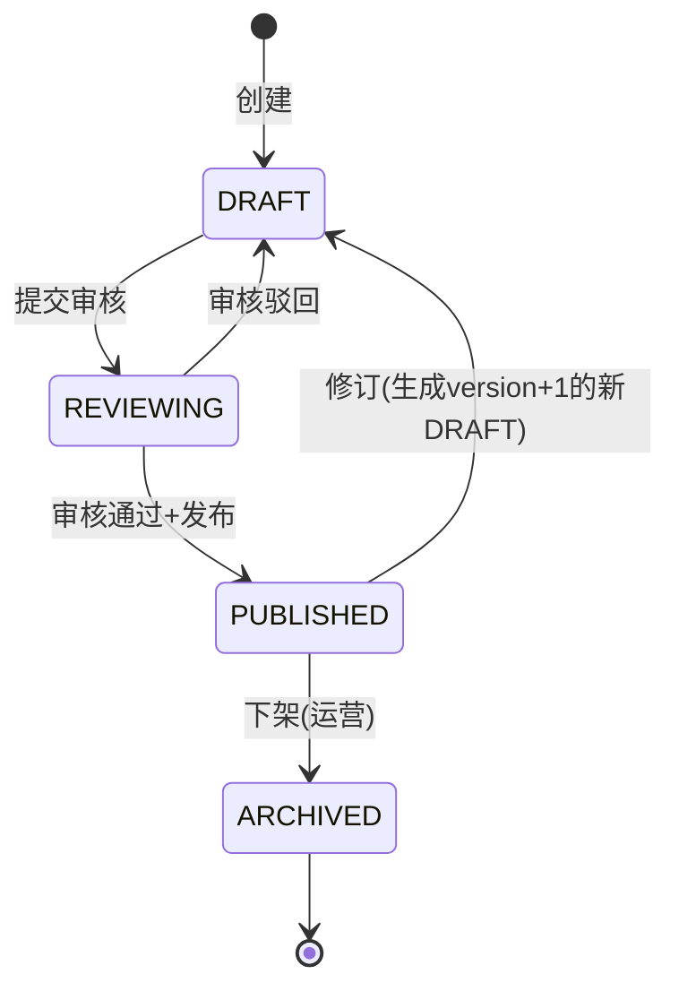
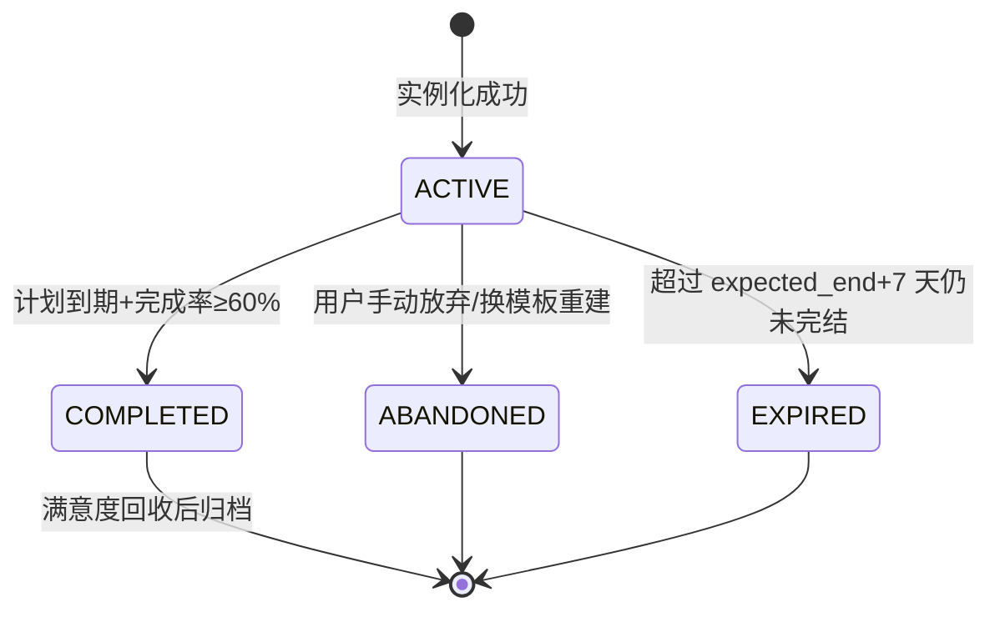

# 学习计划模板库与场景化计划方案智能推荐引擎 - 详细设计

> **文档版本**: v1.1  
> **创建日期**: 2026-06-24  
> **最近更新**: 2026-11-09(补全烂尾:§6.3 实例化引擎 Step 4-6 及子算法全部缺失,补齐至状态机/幂等/事件/错误码/降级/监控/合规/契约/验收;错误码 46100-46199 段全库扫描确认空闲)  
> **模块定位**: 服务端·学习规划子系统  
> **依赖模块**: 学习规划服务、学情分析服务、知识追踪模型、每日任务生成服务、学习计划动态调整服务

---

## 1. 模块概述

### 1.1 背景与问题

PrimeTop 已有学习规划的多个子服务：

| 现有服务 | 职责 |
| --- | --- |
| 学习目标分解与里程碑规划 | 将大目标拆为阶段里程碑 |
| 每日任务智能生成 | 基于计划生成当日任务 |
| 学习计划动态调整与智能重排 | 根据执行情况调整计划 |
| 学习目标达成度评估 | 监控计划偏离度 |

**缺失环节**：学生面对"制定学习计划"时往往不知如何入手——目标分解服务需要学生先提供明确目标与时间线，但很多学生（尤其小学/初中段）缺乏计划制定经验，需要**模板化引导**。

现有流程：
```
学生手动设定目标 → 目标分解 → 里程碑 → 每日任务
```

目标流程：
```
学生选择/系统推荐场景模板 → 模板实例化(结合学情数据) → 生成完整计划 → 每日任务
```

### 1.2 核心价值

1. **降低计划制定门槛**：学生/家长无需从零规划，选择场景模板即可一键生成可执行计划
2. **沉淀优秀计划方法论**：将教研团队验证过的学习计划模式模板化，标准化输出
3. **千人千面**：同一模板根据学生年级、学情、目标分数、可用时间产生不同实例
4. **持续优化**：基于计划完成率数据迭代模板效果，淘汰低效模板

### 1.3 功能边界

| 属于本模块 | 不属于本模块 |
| --- | --- |
| 模板的定义、存储、版本管理 | 每日具体任务生成逻辑 |
| 场景识别与模板推荐排序 | 任务执行与进度追踪 |
| 模板实例化为具体计划 | AI 对话辅导 |
| 模板参数填充与个性化适配 | 知识点掌握度计算 |
| 模板效果统计与优化建议 | 题目推荐与练习编排 |
| 运营后台模板编辑工具支持 | 错题整理与复习调度 |

---

## 2. 整体架构

### 2.1 系统上下文

```
┌─────────────────────────────────────────────────────────────────┐
│                        客户端请求                                 │
│  "帮我制定一个中考冲刺计划" / "暑假想提升数学"                     │
└──────────────────────────┬──────────────────────────────────────┘
                           │
                           ▼
┌─────────────────────────────────────────────────────────────────┐
│                   学习规划 BFF 聚合层                             │
│  (接收请求，协调各子服务)                                         │
└──────┬──────────┬───────────┬──────────────┬────────────────────┘
       │          │           │              │
       ▼          ▼           ▼              ▼
┌──────────┐ ┌──────────┐ ┌──────────┐ ┌──────────────────────┐
│ 学情分析  │ │ 知识追踪  │ │ 目标分解  │ │ ★ 本模块              │
│ 服务     │ │ 模型引擎  │ │ 服务     │ │ 模板库+推荐引擎       │
└──────────┘ └──────────┘ └──────────┘ └──┬───────────────────┘
                                           │
                    ┌──────────────────────┼──────────────────────┐
                    │                      │                      │
                    ▼                      ▼                      ▼
              ┌──────────┐         ┌───────────┐          ┌────────────┐
              │ 模板存储  │         │ 实例化引擎 │          │ 效果分析   │
              │ (DB+缓存) │         │           │          │ 收集器     │
              └──────────┘         └───────────┘          └────────────┘
                                           │
                                           ▼
                                   ┌───────────────┐
                                   │ 完整学习计划    │
                                   │ → 每日任务生成  │
                                   │ → 计划动态调整  │
                                   │ → 达成度追踪   │
                                   └───────────────┘
```

### 2.2 内部架构

```
PlanTemplateEngine (核心引擎)
├── TemplateRepository          // 模板仓储：CRUD + 版本管理
├── ScenarioMatcher             // 场景识别：用户请求 → 场景标签
├── TemplateRecommender         // 模板推荐：场景 + 用户画像 → 排序列表
├── TemplateInstantiator        // 模板实例化：模板 + 用户参数 → 具体计划
│   ├── PhaseExpander           // 阶段展开：模板阶段 → 具体日期范围
│   ├── TaskSlotFiller          // 任务槽填充：科目/知识点分配
│   └── PersonalizationAdjuster // 个性化调节：基于学情微调
├── TemplateEffectAnalyzer      // 效果分析：统计模板实例的完成率
└── TemplateAdminService        // 运营接口：模板编辑/审核/上下架
```

---

## 3. 数据模型设计

### 3.1 核心表结构

#### 3.1.1 `plan_template` — 学习计划模板

```sql
CREATE TABLE plan_template (
    id              BIGINT PRIMARY KEY AUTO_INCREMENT,
    template_code   VARCHAR(64) NOT NULL UNIQUE COMMENT '模板编码，如 ZHONGKAO_SPRINT_30D',
    name            VARCHAR(128) NOT NULL COMMENT '模板名称，如"中考30天冲刺计划"',
    category        VARCHAR(32) NOT NULL COMMENT '大类: EXAM_PREP/HOLIDAY/ROUTINE/WEAKNESS/TRANSITION',
    sub_category    VARCHAR(64) NOT NULL COMMENT '子类: 如 ZHONGKAO/GAOKAO/SHUJIA/SHUQI',
    description     TEXT COMMENT '模板说明，面向用户展示',
    internal_note   TEXT COMMENT '内部教研备注',
    
    -- 适用条件
    min_grade_level TINYINT NOT NULL COMMENT '最低年级编码 (见年级枚举)',
    max_grade_level TINYINT NOT NULL COMMENT '最高年级编码',
    subjects        JSON NOT NULL COMMENT '适用学科 ["MATH","PHYSICS","CHINESE"]',
    tags            JSON COMMENT '场景标签 ["中考","冲刺","30天"]',
    
    -- 时间约束
    duration_days   INT NOT NULL COMMENT '计划总天数',
    min_daily_minutes INT NOT NULL COMMENT '每日最少学习分钟数',
    max_daily_minutes INT NOT NULL COMMENT '每日最多学习分钟数',
    require_weekend BOOLEAN DEFAULT TRUE COMMENT '是否需要周末执行',
    
    -- 模板内容 (核心)
    phases          JSON NOT NULL COMMENT '阶段定义数组，见 3.2',
    rules           JSON NOT NULL COMMENT '实例化规则，见 3.3',
    
    -- 状态
    status          VARCHAR(16) NOT NULL DEFAULT 'DRAFT' COMMENT 'DRAFT/REVIEWING/PUBLISHED/ARCHIVED',
    version         INT NOT NULL DEFAULT 1 COMMENT '版本号',
    
    -- 效果统计 (异步更新)
    instance_count  INT DEFAULT 0 COMMENT '实例化总次数',
    avg_completion_rate DECIMAL(5,2) DEFAULT NULL COMMENT '平均完成率%',
    avg_satisfaction DECIMAL(3,2) DEFAULT NULL COMMENT '平均满意度1-5',
    
    created_by      VARCHAR(64) NOT NULL,
    created_at      DATETIME NOT NULL DEFAULT CURRENT_TIMESTAMP,
    updated_at      DATETIME NOT NULL DEFAULT CURRENT_TIMESTAMP ON UPDATE CURRENT_TIMESTAMP,
    
    INDEX idx_category_status (category, status),
    INDEX idx_grade_range (min_grade_level, max_grade_level),
    INDEX idx_template_code (template_code)
) ENGINE=InnoDB DEFAULT CHARSET=utf8mb4 COMMENT='学习计划模板表';
```

#### 3.1.2 `plan_template_instance` — 模板实例化记录

```sql
CREATE TABLE plan_template_instance (
    id              BIGINT PRIMARY KEY AUTO_INCREMENT,
    instance_code   VARCHAR(64) NOT NULL UNIQUE COMMENT '实例编码',
    template_id     BIGINT NOT NULL COMMENT '来源模板ID',
    template_version INT NOT NULL COMMENT '实例化时的模板版本',
    user_id         BIGINT NOT NULL COMMENT '学生用户ID',
    study_plan_id   BIGINT NOT NULL COMMENT '生成的学习计划ID (指向 study_plan 表)',
    
    -- 实例化参数快照
    params_snapshot JSON NOT NULL COMMENT '实例化时的输入参数',
    
    -- 状态
    status          VARCHAR(16) NOT NULL DEFAULT 'ACTIVE' COMMENT 'ACTIVE/COMPLETED/ABANDONED/EXPIRED',
    started_at      DATE NOT NULL COMMENT '计划开始日期',
    expected_end_at DATE NOT NULL COMMENT '预计结束日期',
    actual_end_at   DATE COMMENT '实际结束日期',
    
    -- 结果
    completion_rate DECIMAL(5,2) COMMENT '最终完成率%',
    satisfaction_score TINYINT COMMENT '满意度1-5，结束后用户评分',
    user_feedback    TEXT COMMENT '用户反馈文本',
    
    created_at      DATETIME NOT NULL DEFAULT CURRENT_TIMESTAMP,
    updated_at      DATETIME NOT NULL DEFAULT CURRENT_TIMESTAMP ON UPDATE CURRENT_TIMESTAMP,
    
    INDEX idx_template_id (template_id),
    INDEX idx_user_id (user_id),
    INDEX idx_status (status),
    INDEX idx_created (created_at)
) ENGINE=InnoDB DEFAULT CHARSET=utf8mb4 COMMENT='模板实例记录表';
```

#### 3.1.3 `plan_template_phase_log` — 阶段执行日志

```sql
CREATE TABLE plan_template_phase_log (
    id              BIGINT PRIMARY KEY AUTO_INCREMENT,
    instance_id     BIGINT NOT NULL COMMENT '实例ID',
    phase_index     INT NOT NULL COMMENT '阶段序号 (0-based)',
    phase_name      VARCHAR(128) NOT NULL COMMENT '阶段名称快照',
    planned_start   DATE NOT NULL,
    planned_end     DATE NOT NULL,
    actual_progress DECIMAL(5,2) DEFAULT 0 COMMENT '该阶段实际完成率%',
    status          VARCHAR(16) DEFAULT 'PENDING' COMMENT 'PENDING/IN_PROGRESS/DONE/SKIPPED',
    
    created_at      DATETIME NOT NULL DEFAULT CURRENT_TIMESTAMP,
    updated_at      DATETIME NOT NULL DEFAULT CURRENT_TIMESTAMP ON UPDATE CURRENT_TIMESTAMP,
    
    INDEX idx_instance_phase (instance_id, phase_index)
) ENGINE=InnoDB DEFAULT CHARSET=utf8mb4 COMMENT='模板阶段执行日志';
```

#### 3.1.4 `plan_template_feedback` — 模板改进反馈

```sql
CREATE TABLE plan_template_feedback (
    id              BIGINT PRIMARY KEY AUTO_INCREMENT,
    template_id     BIGINT NOT NULL,
    instance_id     BIGINT COMMENT '来源实例 (可为空表示通用反馈)',
    feedback_type   VARCHAR(32) NOT NULL COMMENT 'TOO_HARD/TOO_EASY/UNREASONABLE/GREAT/SUGGESTION',
    content         TEXT COMMENT '反馈内容',
    source          VARCHAR(16) NOT NULL DEFAULT 'USER' COMMENT 'USER/TEACHER/SYSTEM',
    
    created_at      DATETIME NOT NULL DEFAULT CURRENT_TIMESTAMP,
    
    INDEX idx_template_id (template_id),
    INDEX idx_feedback_type (feedback_type)
) ENGINE=InnoDB DEFAULT CHARSET=utf8mb4 COMMENT='模板改进反馈表';
```

### 3.2 模板阶段定义结构 (`phases` JSON)

模板由多个阶段（Phase）组成，每个阶段定义学习重点与任务分配：

```json
{
  "phases": [
    {
      "phaseIndex": 0,
      "name": "基础巩固期",
      "description": "系统梳理核心知识点，夯实基础",
      "durationRatio": 0.40,
      "adjustableDuration": true,
      "goals": [
        "完成所有核心知识点的笔记整理",
        "基础题正确率达到85%以上"
      ],
      "dailyTaskSlots": [
        {
          "slotIndex": 0,
          "subject": "AUTO",
          "taskType": "KNOWLEDGE_REVIEW",
          "durationMinutes": 30,
          "difficulty": "BASIC",
          "sourceType": "TEXTBOOK_CHAPTER",
          "knowledgeScope": "WEAK_POINTS"
        },
        {
          "slotIndex": 1,
          "subject": "AUTO",
          "taskType": "PRACTICE",
          "durationMinutes": 25,
          "difficulty": "BASIC_TO_MEDIUM",
          "sourceType": "QUESTION_BANK",
          "knowledgeScope": "WEAK_POINTS"
        },
        {
          "slotIndex": 2,
          "subject": "FIXED",
          "subjectValue": null,
          "taskType": "ERROR_REVIEW",
          "durationMinutes": 15,
          "difficulty": "ADAPTIVE",
          "sourceType": "MISTAKE_BOOK"
        }
      ],
      "weeklyMilestones": [
        {
          "weekOffset": 0,
          "description": "完成数学函数与方程模块复习",
          "checkType": "MASTERY_THRESHOLD",
          "threshold": 0.75
        }
      ],
      "restDayConfig": {
        "restDaysPerWeek": 1,
        "restDayTaskMinutes": 20
      }
    },
    {
      "phaseIndex": 1,
      "name": "专题突破期",
      "description": "针对薄弱专题集中突破",
      "durationRatio": 0.35,
      "adjustableDuration": true,
      "goals": [
        "薄弱专题正确率提升至80%",
        "完成至少5套专题训练"
      ],
      "dailyTaskSlots": [
        {
          "slotIndex": 0,
          "subject": "AUTO",
          "taskType": "TARGETED_PRACTICE",
          "durationMinutes": 35,
          "difficulty": "MEDIUM_TO_HARD",
          "sourceType": "QUESTION_BANK",
          "knowledgeScope": "WEAK_POINTS"
        },
        {
          "slotIndex": 1,
          "subject": "AUTO",
          "taskType": "KNOWLEDGE_REVIEW",
          "durationMinutes": 20,
          "difficulty": "MEDIUM",
          "sourceType": "TEXTBOOK_CHAPTER"
        },
        {
          "slotIndex": 2,
          "subject": "AUTO",
          "taskType": "ERROR_REVIEW",
          "durationMinutes": 15,
          "difficulty": "ADAPTIVE",
          "sourceType": "MISTAKE_BOOK"
        }
      ],
      "weeklyMilestones": []
    },
    {
      "phaseIndex": 2,
      "name": "模拟冲刺期",
      "description": "模拟考试与查漏补缺",
      "durationRatio": 0.25,
      "adjustableDuration": false,
      "goals": [
        "完成3套模拟卷",
        "错题全部过一遍"
      ],
      "dailyTaskSlots": [
        {
          "slotIndex": 0,
          "subject": "AUTO",
          "taskType": "MOCK_EXAM",
          "durationMinutes": 45,
          "difficulty": "EXAM_LEVEL",
          "sourceType": "EXAM_PAPER"
        },
        {
          "slotIndex": 1,
          "subject": "AUTO",
          "taskType": "ERROR_ANALYSIS",
          "durationMinutes": 20,
          "difficulty": "ADAPTIVE",
          "sourceType": "MISTAKE_BOOK"
        }
      ]
    }
  ]
}
```

### 3.3 实例化规则 (`rules` JSON)

```json
{
  "rules": {
    "subjectSelectionStrategy": "WEIGHTED_BY_WEAKNESS",
    "subjectWeights": {
      "description": "按薄弱程度分配科目权重，也可由用户固定",
      "allowUserOverride": true,
      "defaultMode": "AUTO",
      "fixedModeSubjects": []
    },
    "difficultyProgression": "LINEAR_RAMP",
    "difficultyConfig": {
      "startDelta": -1,
      "endDelta": 1,
      "rampCurve": "LINEAR"
    },
    "restDayPolicy": {
      "frequency": "WEEKLY",
      "intervalDays": 7,
      "reducedLoadRatio": 0.3,
      "suggestedDay": "SUNDAY"
    },
    "examAlignment": {
      "adjustForSchoolExams": true,
      "preExamBufferDays": 2,
      "examDayRestMode": true
    },
    "flexibilityConfig": {
      "allowSkipDays": true,
      "maxConsecutiveSkipDays": 2,
      "catchupStrategy": "COMPRESS_NEXT_3_DAYS",
      "allowPhaseExtension": true,
      "maxPhaseExtensionDays": 5
    },
    "adaptiveAdjustment": {
      "enabled": true,
      "checkFrequency": "WEEKLY",
      "triggerCompletionRateBelow": 0.60,
      "action": "SIMPLIFY_AND_EXTEND"
    }
  }
}
```

---

## 4. 枚举定义

### 4.1 模板大类 (`category`)

```java
public enum PlanTemplateCategory {
    EXAM_PREP("考试备考", Arrays.asList("中考", "高考", "期末", "月考")),
    HOLIDAY("假期提升", Arrays.asList("暑假", "寒假", "国庆", "五一")),
    ROUTINE("日常学习", Arrays.asList("同步学习", "课后巩固", "每日打卡")),
    WEAKNESS("薄弱补强", Arrays.asList("偏科", "知识点", "题型")),
    TRANSITION("学段衔接", Arrays.asList("小升初", "初升高", "幼升小"));
    
    private final String displayName;
    private final List<String> commonScenarios;
    // constructor, getters...
}
```

### 4.2 任务槽类型 (`taskType`)

```java
public enum TemplateTaskType {
    KNOWLEDGE_REVIEW("知识点复习"),
    PRACTICE("练习刷题"),
    TARGETED_PRACTICE("薄弱专项练习"),
    ERROR_REVIEW("错题复习"),
    MOCK_EXAM("模拟考试"),
    ERROR_ANALYSIS("错题分析"),
    READING("阅读"),
    RECITATION("背诵"),
    ESSAY("作文练习"),
    LISTENING("听力训练"),
    ORAL_PRACTICE("口语练习"),
    EXPERIMENT("实验复习"),
    FREE_STUDY("自由学习");
    
    private final String displayName;
}
```

### 4.3 难度级别 (`difficulty`)

```java
public enum TemplateDifficulty {
    EASY(-1, "基础"),
    BASIC(0, "基础"),
    BASIC_TO_MEDIUM(1, "基础→中等"),
    MEDIUM(2, "中等"),
    MEDIUM_TO_HARD(3, "中等→困难"),
    HARD(4, "困难"),
    EXAM_LEVEL(5, "考试级"),
    ADAPTIVE(-1, "自适应");
    
    private final int level;
    private final String label;
}
```

---

## 5. 核心 API 设计

### 5.1 推荐模板列表

```
POST /api/v1/plan-templates/recommend
```

**请求体：**

```json
{
  "scenarioHint": "中考冲刺",
  "gradeLevel": 9,
  "subjects": ["MATH", "PHYSICS", "CHINESE", "ENGLISH"],
  "availableDays": 45,
  "dailyAvailableMinutes": 90,
  "targetType": "EXAM",
  "examDate": "2026-06-15",
  "weakSubjects": ["PHYSICS"],
  "preferredIntensity": "MODERATE"
}
```

**响应：**

```json
{
  "code": 0,
  "data": {
    "matchedScenario": "EXAM_PREP_ZHONGKAO",
    "recommendations": [
      {
        "templateId": 1018,
        "templateCode": "ZHONGKAO_SPRINT_45D",
        "name": "中考45天全科冲刺",
        "matchScore": 0.92,
        "matchReasons": [
          "时间匹配：45天与你可用天数一致",
          "年级匹配：初三专属冲刺方案",
          "科目覆盖：包含你的全部考试科目",
          "薄弱关注：物理安排了额外训练时间"
        ],
        "estimatedDailyMinutes": 85,
        "phaseSummary": [
          { "name": "基础巩固期", "days": 18 },
          { "name": "专题突破期", "days": 15 },
          { "name": "模拟冲刺期", "days": 12 }
        ],
        "highlights": [
          "三阶段渐进式冲刺",
          "每周自动模拟检测",
          "薄弱知识点动态加权"
        ]
      },
      {
        "templateId": 1023,
        "templateCode": "ZHONGKAO_BALANCED_45D",
        "name": "中考45天均衡复习计划",
        "matchScore": 0.85,
        "matchReasons": ["时间匹配", "年级匹配"],
        "estimatedDailyMinutes": 75,
        "phaseSummary": [...],
        "highlights": [...]
      }
    ],
    "fallbackMessage": null
  }
}
```

### 5.2 获取模板详情

```
GET /api/v1/plan-templates/{templateId}
```

**响应**包含完整模板定义、阶段结构、适用条件、历史效果数据。

### 5.3 实例化模板（生成计划）

```
POST /api/v1/plan-templates/{templateId}/instantiate
```

**请求体：**

```json
{
  "startDate": "2026-04-01",
  "endDate": "2026-06-14",
  "subjects": ["MATH", "PHYSICS", "CHINESE", "ENGLISH"],
  "dailyAvailableMinutes": 90,
  "weeklyRestDay": "SUNDAY",
  "subjectTimeWeights": {
    "MATH": 1.2,
    "PHYSICS": 1.3,
    "CHINESE": 1.0,
    "ENGLISH": 0.8
  },
  "customization": {
    "skipListeningPractice": false,
    "includeWeekend": true,
    "schoolExamDates": [
      { "date": "2026-05-10", "subject": "MATH", "name": "月考" }
    ]
  },
  "planName": "我的中考冲刺计划"
}
```

**响应：**

```json
{
  "code": 0,
  "data": {
    "instanceCode": "INST_20260401_9a8b7c",
    "studyPlanId": 50241,
    "planName": "我的中考冲刺计划",
    "totalDays": 74,
    "phases": [
      {
        "phaseIndex": 0,
        "name": "基础巩固期",
        "dateRange": "2026-04-01 ~ 2026-04-24",
        "days": 24,
        "dailyTasks": [
          {
            "slotIndex": 0,
            "taskType": "KNOWLEDGE_REVIEW",
            "subject": "PHYSICS",
            "durationMinutes": 30,
            "topic": "力学基础复习",
            "difficulty": "BASIC"
          },
          {
            "slotIndex": 1,
            "taskType": "PRACTICE",
            "subject": "MATH",
            "durationMinutes": 25,
            "topic": "函数与方程",
            "difficulty": "BASIC_TO_MEDIUM"
          },
          {
            "slotIndex": 2,
            "taskType": "ERROR_REVIEW",
            "subject": "AUTO",
            "durationMinutes": 15,
            "topic": "错题本复习",
            "difficulty": "ADAPTIVE"
          },
          {
            "slotIndex": 3,
            "taskType": "KNOWLEDGE_REVIEW",
            "subject": "CHINESE",
            "durationMinutes": 20,
            "topic": "文言文重点篇目",
            "difficulty": "BASIC"
          }
        ]
      }
    ],
    "milestones": [
      {
        "date": "2026-04-07",
        "description": "第一周完成：物理力学模块复习"
      }
    ],
    "restDays": ["2026-04-07", "2026-04-14", "2026-04-21"]
  }
}
```

### 5.4 预览实例化结果（不保存）

```
POST /api/v1/plan-templates/{templateId}/preview
```

与 5.3 请求体相同，但不持久化，仅返回生成结果供用户预览。

### 5.5 提交模板反馈

```
POST /api/v1/plan-templates/instances/{instanceId}/feedback
```

```json
{
  "satisfactionScore": 4,
  "feedbackType": "GREAT",
  "content": "计划安排合理，物理成绩提升了15分"
}
```

### 5.6 运营后台：模板 CRUD

```
POST   /api/admin/v1/plan-templates           // 创建模板
PUT    /api/admin/v1/plan-templates/{id}       // 更新模板 (生成新版本)
POST   /api/admin/v1/plan-templates/{id}/publish  // 发布模板
POST   /api/admin/v1/plan-templates/{id}/archive  // 下架模板
GET    /api/admin/v1/plan-templates/statistics    // 模板效果统计
```

---

## 6. 核心算法设计

### 6.1 场景识别 (`ScenarioMatcher`)

将用户自然语言或结构化参数映射到模板类别。

```java
/**
 * 场景识别器
 * 输入：用户请求参数 + 可选自然语言提示
 * 输出：匹配的场景标签集合
 */
@Service
public class ScenarioMatcher {

    // 关键词 → 场景映射表 (可配置)
    private static final Map<String, ScenarioRule> KEYWORD_RULES = Map.ofEntries(
        Map.entry("中考", new ScenarioRule("EXAM_PREP", "ZHONGKAO", 1.0)),
        Map.entry("中考冲刺", new ScenarioRule("EXAM_PREP", "ZHONGKAO", 1.0)),
        Map.entry("高考", new ScenarioRule("EXAM_PREP", "GAOKAO", 1.0)),
        Map.entry("期末", new ScenarioRule("EXAM_PREP", "FINAL_EXAM", 0.8)),
        Map.entry("月考", new ScenarioRule("EXAM_PREP", "MONTHLY_EXAM", 0.6)),
        Map.entry("暑假", new ScenarioRule("HOLIDAY", "SHUJIA", 1.0)),
        Map.entry("寒假", new ScenarioRule("HOLIDAY", "HANJIA", 1.0)),
        Map.entry("偏科", new ScenarioRule("WEAKNESS", "SUBJECT_IMBALANCE", 0.9)),
        Map.entry("基础差", new ScenarioRule("WEAKNESS", "FOUNDATION_GAP", 0.9)),
        Map.entry("小升初", new ScenarioRule("TRANSITION", "PRIMARY_TO_JUNIOR", 1.0)),
        Map.entry("初升高", new ScenarioRule("TRANSITION", "JUNIOR_TO_SENIOR", 1.0))
    );

    /**
     * 匹配场景
     */
    public ScenarioMatchResult match(RecommendRequest request) {
        Set<ScenarioRule> matched = new LinkedHashSet<>();
        
        // 1. 自然语言提示匹配
        if (StringUtils.hasText(request.getScenarioHint())) {
            String hint = request.getScenarioHint().toLowerCase();
            KEYWORD_RULES.forEach((keyword, rule) -> {
                if (hint.contains(keyword.toLowerCase())) {
                    matched.add(rule);
                }
            });
        }
        
        // 2. 结构化参数推断
        if (request.getTargetType() != null) {
            switch (request.getTargetType()) {
                case "EXAM":
                    if (request.getExamDate() != null) {
                        long daysToExam = ChronoUnit.DAYS.between(
                            LocalDate.now(), request.getExamDate());
                        if (daysToExam <= 60) {
                            matched.add(new ScenarioRule("EXAM_PREP", "SPRINT", 0.7));
                        } else {
                            matched.add(new ScenarioRule("EXAM_PREP", "LONG_TERM", 0.5));
                        }
                    }
                    break;
                case "DAILY":
                    matched.add(new ScenarioRule("ROUTINE", "DAILY_STUDY", 0.6));
                    break;
            }
        }
        
        // 3. 年级推断
        int grade = request.getGradeLevel();
        if (grade == 6) {
            matched.add(new ScenarioRule("TRANSITION", "PRIMARY_TO_JUNIOR", 0.4));
        } else if (grade == 9) {
            matched.add(new ScenarioRule("EXAM_PREP", "ZHONGKAO", 0.3));
        } else if (grade == 12) {
            matched.add(new ScenarioRule("EXAM_PREP", "GAOKAO", 0.3));
        }
        
        // 4. 按权重排序，取 Top-3
        return new ScenarioMatchResult(
            matched.stream()
                .sorted(Comparator.comparing(ScenarioRule::getWeight).reversed())
                .limit(3)
                .collect(Collectors.toList())
        );
    }
}
```

### 6.2 模板推荐排序 (`TemplateRecommender`)

```java
/**
 * 模板推荐排序器
 * 
 * 综合评分 = w1*场景匹配度 + w2*年级匹配度 + w3*时间匹配度 
 *           + w4*科目覆盖度 + w5*历史效果分 + w6*用户偏好分
 */
@Service
public class TemplateRecommender {

    @Value("${plan.template.weights.scenario:0.30}")
    private double wScenario;
    @Value("${plan.template.weights.grade:0.15}")
    private double wGrade;
    @Value("${plan.template.weights.duration:0.20}")
    private double wDuration;
    @Value("${plan.template.weights.subject:0.15}")
    private double wSubject;
    @Value("${plan.template.weights.effect:0.15}")
    private double wEffect;
    @Value("${plan.template.weights.pref:0.05}")
    private double wPref;

    public List<TemplateRecommendation> recommend(
            ScenarioMatchResult scenario,
            RecommendRequest request,
            UserProfile profile) {
        
        // 1. 获取候选模板 (按场景过滤)
        List<PlanTemplate> candidates = templateRepository.findPublishedByCategories(
            scenario.getCategories(), 
            request.getGradeLevel()
        );
        
        if (candidates.isEmpty()) {
            // 降级：返回通用模板
            candidates = templateRepository.findGenericTemplates(request.getGradeLevel());
        }
        
        // 2. 多维度评分
        return candidates.stream()
            .map(tpl -> scoreTemplate(tpl, scenario, request, profile))
            .sorted(Comparator.comparing(TemplateRecommendation::getMatchScore).reversed())
            .limit(5)  // 返回 Top-5
            .collect(Collectors.toList());
    }
    
    private TemplateRecommendation scoreTemplate(
            PlanTemplate tpl, 
            ScenarioMatchResult scenario,
            RecommendRequest request,
            UserProfile profile) {
        
        double scenarioScore = scoreScenario(tpl, scenario);      // 0-1
        double gradeScore = scoreGrade(tpl, request);              // 0-1
        double durationScore = scoreDuration(tpl, request);        // 0-1
        double subjectScore = scoreSubject(tpl, request);          // 0-1
        double effectScore = scoreEffect(tpl);                     // 0-1
        double prefScore = scorePreference(tpl, profile);          // 0-1
        
        double totalScore = wScenario * scenarioScore
                          + wGrade * gradeScore
                          + wDuration * durationScore
                          + wSubject * subjectScore
                          + wEffect * effectScore
                          + wPref * prefScore;
        
        List<String> reasons = buildMatchReasons(
            scenarioScore, gradeScore, durationScore, subjectScore, tpl, request);
        
        return new TemplateRecommendation(
            tpl, Math.round(totalScore * 100.0) / 100.0, reasons,
            estimateDailyMinutes(tpl, request),
            buildPhaseSummary(tpl),
            buildHighlights(tpl)
        );
    }
    
    /**
     * 时间匹配评分：模板天数与用户可用天数的匹配度
     */
    private double scoreDuration(PlanTemplate tpl, RecommendRequest request) {
        if (request.getAvailableDays() == null) return 0.5; // 未指定则中性
        
        int tplDays = tpl.getDurationDays();
        int reqDays = request.getAvailableDays();
        
        // 完全匹配 = 1.0
        // 差异在 ±20% 以内 = 0.8+
        // 差异在 ±50% 以内 = 0.5+
        // 差异超过 50% = 递减
        double ratio = (double) tplDays / reqDays;
        if (ratio > 1.0) ratio = 1.0 / ratio; // 取倒数使 < 1
        
        if (ratio >= 0.9) return 1.0;
        if (ratio >= 0.8) return 0.85;
        if (ratio >= 0.7) return 0.7;
        if (ratio >= 0.5) return 0.5;
        return Math.max(0.1, ratio);
    }
    
    /**
     * 科目覆盖评分：模板支持的科目与用户需求的交集
     */
    private double scoreSubject(PlanTemplate tpl, RecommendRequest request) {
        if (request.getSubjects() == null || request.getSubjects().isEmpty()) {
            return 0.5;
        }
        
        Set<String> tplSubjects = new HashSet<>(tpl.getSubjects());
        Set<String> reqSubjects = new HashSet<>(request.getSubjects());
        
        Set<String> intersection = new HashSet<>(reqSubjects);
        intersection.retainAll(tplSubjects);
        
        return (double) intersection.size() / reqSubjects.size();
    }
    
    /**
     * 历史效果评分
     */
    private double scoreEffect(PlanTemplate tpl) {
        if (tpl.getInstanceCount() < 10) return 0.5; // 样本不足，中性
        
        // 平均完成率映射：80%+ → 1.0, 60% → 0.7, 40% → 0.4
        double completion = tpl.getAvgCompletionRate() != null 
            ? tpl.getAvgCompletionRate().doubleValue() / 100.0 : 0.5;
        double satisfaction = tpl.getAvgSatisfaction() != null
            ? tpl.getAvgSatisfaction().doubleValue() / 5.0 : 0.5;
        
        return completion * 0.6 + satisfaction * 0.4;
    }
}
```

### 6.3 模板实例化引擎 (`TemplateInstantiator`)

这是最核心的组件，将抽象模板转化为具体可执行计划。

```java
@Service
public class TemplateInstantiator {

    /**
     * 模板实例化主流程
     */
    @Transactional
    public InstantiationResult instantiate(
            PlanTemplate template,
            InstantiationRequest request,
            UserProfile profile) {
        
        // Step 1: 校验参数
        validateRequest(template, request);
        
        // Step 2: 计算实际天数与阶段分配
        LocalDate startDate = request.getStartDate();
        LocalDate endDate = request.getEndDate();
        int totalDays = (int) ChronoUnit.DAYS.between(startDate, endDate) + 1;
        
        List<PhaseAllocation> phaseAllocations = allocatePhases(
            template.getPhases(), totalDays, startDate);
        
        // Step 3: 生成每日任务槽
        List<DailyTaskPlan> dailyPlans = new ArrayList<>();
        LocalDate currentDate = startDate;
        
        for (PhaseAllocation phase : phaseAllocations) {
            for (int dayInPhase = 0; dayInPhase < phase.getDays(); dayInPhase++) {
                // 跳过休息日
                if (isRestDay(currentDate, template.getRules(), request)) {
                    dailyPlans.add(createRestDayPlan(currentDate, phase));
                    currentDate = currentDate.plusDays(1);
                    continue;
                }
                
                // 检查是否是学校考试日
                if (isSchoolExamDay(currentDate, request)) {
                    dailyPlans.add(createExamDayPlan(currentDate));
                    currentDate = currentDate.plusDays(1);
                    continue;
                }
                
                // 生成正常学习日任务
                DailyTaskPlan dailyPlan = buildDailyPlan(
                    currentDate, phase, dayInPhase, template, request, profile);
                dailyPlans.add(dailyPlan);
                
                currentDate = currentDate.plusDays(1);
            }
        }
        
        // Step 4: 生成里程碑(按周偏移展开为具体日期)
        List<MilestonePlan> milestones = expandMilestones(
            phaseAllocations, template, startDate);
        
        // Step 5: 持久化(调用学习规划服务,本模块不直接写 study_plan)
        StudyPlanRef planRef = studyPlanGateway.createPlan(new CreatePlanCommand(
            request.getUserId(),
            StringUtils.hasText(request.getPlanName())
                ? request.getPlanName() : template.getName(),
            template.getId(),
            template.getVersion(),
            startDate, endDate,
            phaseAllocations, dailyPlans, milestones
        ));
        
        // Step 6: 记录实例并发布事件(同事务)
        PlanTemplateInstance instance = new PlanTemplateInstance();
        instance.setInstanceCode(genInstanceCode(startDate));
        instance.setTemplateId(template.getId());
        instance.setTemplateVersion(template.getVersion());
        instance.setUserId(request.getUserId());
        instance.setStudyPlanId(planRef.getStudyPlanId());
        instance.setParamsSnapshot(JsonUtils.toJson(request));
        instance.setStatus("ACTIVE");
        instance.setStartedAt(startDate);
        instance.setExpectedEndAt(endDate);
        instanceMapper.insert(instance);
        
        outboxPublisher.publish(new PlanInstantiatedEvent(
            instance.getId(),
            template.getId(),
            template.getVersion(),
            request.getUserId(),
            planRef.getStudyPlanId(),
            startDate, endDate,
            dailyPlans.size()
        ));
        
        // Step 7: 模板使用计数 +1(异步削峰,允许丢失后由对账补偿)
        templateCounterAsync.increment(template.getId());
        
        return InstantiationResult.of(instance, planRef, dailyPlans, milestones);
    }
    
    private String genInstanceCode(LocalDate startDate) {
        return "INST_" + startDate.format(DateTimeFormatter.BASIC_ISO_DATE)
             + "_" + RandomStringUtils.randomAlphanumeric(6).toLowerCase();
    }
}
```

#### 6.3.1 阶段天数分配算法 (`allocatePhases`)

将模板 `durationRatio` 映射为具体天数,处理余数与可调阶段:

```java
/**
 * 阶段分配规则:
 *  1. 总天数 = endDate - startDate + 1(含首尾)
 *  2. 各阶段天数 = floor(totalDays * durationRatio),余数按 ratio 从大到小
 *     分配给 adjustableDuration=true 的阶段;均不可调时分配给末阶段
 *  3. 单阶段最小 3 天,不足时从前序可调阶段借调(每阶段最多借 2 天)
 *  4. 校验: sum(days) 必须 == totalDays,否则抛 TEMPLATE_PHASE_ALLOC_ERROR
 */
List<PhaseAllocation> allocatePhases(
        List<TemplatePhase> phases, int totalDays, LocalDate startDate) {
    List<PhaseAllocation> result = new ArrayList<>();
    int allocated = 0;
    List<int[]> remainders = new ArrayList<>(); // [index, remainder]
    
    for (int i = 0; i < phases.size(); i++) {
        TemplatePhase p = phases.get(i);
        int exact = (int) Math.floor(totalDays * p.getDurationRatio());
        int days = Math.max(3, exact);
        remainders.add(new int[]{i, 
            (int) Math.round(totalDays * p.getDurationRatio() * 100) % 100});
        result.add(new PhaseAllocation(i, p.getName(), days, p));
        allocated += days;
    }
    
    int diff = totalDays - allocated;
    if (diff > 0) {
        // 余数补足:优先 adjustable 阶段,按 remainder 降序
        List<int[]> adjustable = remainders.stream()
            .filter(r -> result.get(r[0]).getPhase().isAdjustableDuration())
            .sorted((a, b) -> Integer.compare(b[1], a[1]))
            .collect(Collectors.toList());
        Iterator<int[]> it = Stream.generate(() -> adjustable)
            .flatMap(List::stream).iterator(); // 循环分配
        while (diff-- > 0 && it.hasNext()) {
            result.get(it.next()[0]).incrementDays();
        }
    } else if (diff < 0) {
        // 超配回收:从末阶段开始减,保底 3 天
        int i = result.size() - 1;
        while (diff < 0 && i >= 0) {
            PhaseAllocation pa = result.get(i);
            int reclaimable = Math.min(pa.getDays() - 3, -diff);
            if (reclaimable > 0) { pa.decrementDays(reclaimable); diff += reclaimable; }
            i--;
        }
        if (diff < 0) throw new BizException("TEMPLATE_PHASE_ALLOC_ERROR",
            "模板阶段配置无法适配总天数 " + totalDays);
    }
    
    // 展开日期范围
    LocalDate cursor = startDate;
    for (PhaseAllocation pa : result) {
        pa.setStartDate(cursor);
        pa.setEndDate(cursor.plusDays(pa.getDays() - 1));
        cursor = pa.getEndDate().plusDays(1);
    }
    return result;
}
```

#### 6.3.2 休息日判定 (`isRestDay`)

```java
boolean isRestDay(LocalDate date, TemplateRules rules, InstantiationRequest req) {
    // 优先级 1: 用户显式指定每周休息日
    if (req.getWeeklyRestDay() != null 
            && date.getDayOfWeek().toString().equals(req.getWeeklyRestDay())) {
        return true;
    }
    // 优先级 2: 模板规则 suggestedDay(用户未指定时)
    RestDayPolicy policy = rules.getRestDayPolicy();
    if (req.getWeeklyRestDay() == null 
            && policy.getSuggestedDay() != null
            && date.getDayOfWeek().toString().equals(policy.getSuggestedDay())) {
        return true;
    }
    // 优先级 3: 按间隔天数(动态模板上使用)
    return policy.getFrequency() == RestFrequency.INTERVAL
        && date.getDayOfYear() % policy.getIntervalDays() == 0;
}
```

#### 6.3.3 每日任务构建 (`buildDailyPlan`)

```java
DailyTaskPlan buildDailyPlan(LocalDate date, PhaseAllocation phase,
        int dayInPhase, PlanTemplate template,
        InstantiationRequest request, UserProfile profile) {
    
    DailyTaskPlan plan = new DailyTaskPlan(date, phase.getPhaseIndex());
    int dailyBudget = request.getDailyAvailableMinutes();
    
    for (TaskSlot slot : phase.getPhase().getDailyTaskSlots()) {
        // 跳过用户自定义排除的任务类型
        if (request.getCustomization() != null
                && request.getCustomization().isSkipListeningPractice()
                && slot.getTaskType() == TemplateTaskType.LISTENING) {
            continue;
        }
        
        // 科目解析: AUTO → 按薄弱度加权轮转
        Subject subject = resolveSubject(slot, request, profile, plan);
        
        // 时长: 槽位基准 × 用户权重 × 预算比例,clamp 到 [10, 60]
        int minutes = clampMinutes(
            slot.getDurationMinutes(),
            request.getSubjectTimeWeights(),
            subject, dailyBudget, slot);
        
        // 难度: 线性爬坡(进度 0→1 映射 startDelta→endDelta)
        Difficulty difficulty = resolveDifficulty(
            slot, template.getRules().getDifficultyConfig(),
            phase.getProgress(dayInPhase));
        
        // 知识点范围: WEAK_POINTS 时从学情服务拉取
        KnowledgeScope scope = resolveScope(slot, profile, subject);
        
        plan.addTask(TaskSpec.of(slot, subject, minutes, difficulty, scope));
    }
    
    // 预算校验: 总时长超预算时等比压缩(PRACTICE 类槽位优先压)
    plan.compressToBudget(dailyBudget);
    return plan;
}

/**
 * AUTO 科目解析: 加权轮转 —— 权重 = subjectTimeWeights × (1 + 薄弱加成)
 * 薄弱加成 = (1 - mastery) × 0.5,已由学情服务算好的 mastery 缓存 15min
 */
Subject resolveSubject(TaskSlot slot, InstantiationRequest request,
        UserProfile profile, DailyTaskPlan alreadyPlanned) {
    if (slot.getSubject() == SubjectMode.FIXED && slot.getSubjectValue() != null) {
        return slot.getSubjectValue(); // FIXED 槽位
    }
    List<Subject> candidates = request.getSubjects().stream()
        .filter(s -> !alreadyPlanned.hasSubject(s)) // 同日去重,保证科目多样性
        .collect(Collectors.toList());
    if (candidates.isEmpty()) candidates = request.getSubjects();
    
    Map<Subject, Double> weights = new HashMap<>();
    for (Subject s : candidates) {
        double base = request.getSubjectTimeWeights() != null
            ? request.getSubjectTimeWeights().getOrDefault(s, 1.0) : 1.0;
        Double mastery = profile.getMastery(s); // null 视为 0.6 中性
        double weaknessBonus = (1 - (mastery != null ? mastery : 0.6)) * 0.5;
        weights.put(s, base * (1 + weaknessBonus));
    }
    return WeightedRandom.pick(weights, ThreadLocalRandom.current());
}
```

#### 6.3.4 里程碑展开 (`expandMilestones`)

```java
List<MilestonePlan> expandMilestones(List<PhaseAllocation> phases,
        PlanTemplate template, LocalDate startDate) {
    List<MilestonePlan> milestones = new ArrayList<>();
    for (PhaseAllocation pa : phases) {
        for (WeeklyMilestone wm : pa.getPhase().getWeeklyMilestones()) {
            // weekOffset 相对阶段首日
            LocalDate date = pa.getStartDate().plusDays(wm.getWeekOffset() * 7L);
            if (date.isAfter(pa.getEndDate())) {
                date = pa.getEndDate(); // clamp,守卫 G4
            }
            milestones.add(new MilestonePlan(date, wm.getDescription(),
                wm.getCheckType(), wm.getThreshold(), pa.getPhaseIndex()));
        }
    }
    return milestones;
}
```

### 6.4 模板效果分析 (`TemplateEffectAnalyzer`)

每日凌晨 02:00 由批处理框架调度,统计近 30 天实例数据:

```java
/**
 * 效果统计批处理(幂等:按 stat_date 唯一键 upsert)
 * 输出三处:
 *  1. plan_template.instance_count / avg_completion_rate / avg_satisfaction(覆盖式)
 *  2. plan_template_daily_stats(时序明细,供后台图表)
 *  3. 低效模板告警(instance_count>=30 且 avg_completion_rate<40 持续 14 天)
 */
@JobHandler(name = "templateEffectDailyJob", cron = "0 0 2 * * ?")
public void analyze(TemplateEffectJobContext ctx) {
    LocalDate statDate = ctx.getBizDate();
    List<TemplateEffectAgg> aggs = instanceMapper.aggregateByTemplate(
        statDate.minusDays(30), statDate);
    
    for (TemplateEffectAgg agg : aggs) {
        // 覆盖式更新主表(乐观锁防并发,实际由调度单实例保证)
        templateMapper.updateEffectStats(agg.getTemplateId(),
            agg.getInstanceCount(), agg.getAvgCompletionRate(), agg.getAvgSatisfaction());
        
        // 时序明细 upsert
        dailyStatsMapper.upsert(TemplateDailyStats.of(statDate,
            agg.getTemplateId(), agg));
        
        // 低效预警(阈值外置配置)
        if (agg.getInstanceCount() >= 30 
                && agg.getAvgCompletionRate().compareTo(new BigDecimal("40")) < 0) {
            lowEfficiencyTracker.record(agg.getTemplateId(), statDate);
            if (lowEfficiencyTracker.consecutiveDays(agg.getTemplateId()) >= 14) {
                alertService.send("TEMPLATE_LOW_EFFICIENCY",
                    Map.of("templateId", agg.getTemplateId(),
                           "avgCompletionRate", agg.getAvgCompletionRate()));
            }
        } else {
            lowEfficiencyTracker.reset(agg.getTemplateId());
        }
    }
}
```

---

## 7. 状态机与守卫

### 7.1 模板生命周期状态机



| 迁移 | 触发方 | 守卫 |
| --- | --- | --- |
| DRAFT→REVIEWING | 教研/运营 | G1: phases 非空且 ratio 之和∈[0.98,1.02];duration_days≥14 |
| REVIEWING→PUBLISHED | 审核人(双人复核) | G2: 审核记录存在且 approver≠creator;试用实例≥3 且试点完成率≥50% |
| PUBLISHED→ARCHIVED | 运营 | G3: 无 ACTIVE 实例或弹窗确认影响告知 |
| PUBLISHED→DRAFT(修订) | 教研 | G4: 新版本不影响存量实例(实例快照 template_version) |

### 7.2 实例状态机



| 守卫 | 规则 |
| --- | --- |
| G5 | 同一 user_id 同 category 仅允许 1 个 ACTIVE 实例,新建前强制走"放弃旧计划"确认(防计划堆积) |
| G6 | 实例状态迁移仅允许服务端经学习规划服务回写,禁止客户端直改;迁移必须 CAS(status=期望旧值) |
| G7 | COMPLETED 判定由计划到期扫描器统一执行,完成率口径=已完成任务时长/计划任务时长(计时服务为准) |
| G8 | ABANDONED 时异步触发 studyPlan 归档,已生成未开始的每日任务软删除,已开始的不回收 |
| G9 | EXPIRED 仅扫描器可置位,用户不可见该状态(客户端仍显示 ACTIVE 并提示"已超期") |
| G10 | 实例的 template_version 快照不可变,模板升版后旧实例按旧版规则继续跑完 |
| G11 | instantiate 与 preview 共用同一生成管线,保证"预览即所得"(差集校验:预览后不保存,参数不变时重算结果一致,单测覆盖) |
| G12 | 开始日期不得早于今天-1(时区 Asia/Shanghai),防止补建历史计划污染统计 |

---

## 8. 幂等与并发设计

| 场景 | 幂等键 | 机制 |
| --- | --- | --- |
| 模板实例化 | Idempotency-Key(客户端 UUID,30min 窗口) | 网关层缓存响应;业务层 (user_id, template_id, start_date) 进行中实例存在则 409 冲突 |
| 预览接口 | 无(只读计算) | 天然幂等;QPS 限流 20/s/用户 防刷算力 |
| 反馈提交 | uk_instance_feedback(instance_id) 每实例仅一条满意度 | INSERT ... ON DUPLICATE KEY UPDATE 覆盖式 |
| 模板创建/更新(运营) | uk_template_code + version 乐观锁 | code 冲突返回 46104;version 不符返回 46108 要求重读 |
| 发布/下架 | status CAS | UPDATE ... SET status='PUBLISHED' WHERE id=? AND status='REVIEWING',影响行数=0 则 46107 |
| 效果统计批处理 | uk_template_stats(template_id, stat_date) | upsert,重跑安全 |
| 实例计数 +1 | 无需强一致 | 异步 incr,日终对账校准 |

并发裁决:
- **同一用户并发实例化两个模板**: G5 守卫 + 实例化事务内 SELECT ... FOR UPDATE 用户计划行,后到请求阻塞 3s 后返回 46106。
- **模板发布与实例化并发**: 实例化只读已 PUBLISHED 模板(快照读),发布事务提交前不可见,无竞态。
- **模板修订(version+1)与进行中实例**: G10 快照机制,无竞态。

---

## 9. 事件设计(Outbox)

| 事件 | Topic | 关键载荷 | 消费者 |
| --- | --- | --- | --- |
| plan.instantiated | plan-template-domain | instanceId, templateId, templateVersion, userId, studyPlanId, startDate, endDate, totalTasks | 每日任务生成服务(预生成首周任务)/家长端通知(新计划开始)/学习激励(制定计划+10 积分) |
| plan.instance.completed | plan-template-domain | instanceId, completionRate | 效果分析器(延迟进入统计)/成就服务(计划完成勋章) |
| plan.instance.abandoned | plan-template-domain | instanceId, reason | 效果分析器(负样本)/用户挽留策略引擎 |
| plan.template.published | plan-template-domain | templateId, version | 推荐引擎(刷新候选缓存)/BFF(失效详情缓存) |
| plan.template.low_efficiency | plan-template-domain | templateId, avgCompletionRate | 运营后台告警/教研迭代任务 |

约定: Outbox 与业务写同事务;relay 至少一次投递,消费者按 eventId 去重(Redis SETNX 24h + 消费日志表 uk)。

---

## 10. 错误码设计(46100-46199 段)

461xx 段经全库扫描确认未被占用。映射基础段: 参数校验失败统一 400;未登录 401;越权 403。

| 错误码 | HTTP | 场景 | 用户提示 |
| --- | --- | --- | --- |
| 46100 | 400 | 实例化参数校验失败(日期倒挂/科目为空/时长越界) | "计划参数有误,请检查日期与科目" |
| 46101 | 404 | 模板不存在或已下架 | "该计划模板已不可用,为你推荐其他方案" |
| 46102 | 400 | 模板未发布(DRAFT/REVIEWING 状态被请求) | 同上,服务端自动走推荐兜底 |
| 46103 | 400 | 年级不在模板适用区间 | "这个计划不适合你的年级,看看这些吧" |
| 46104 | 409 | 运营创建模板 code 重复 | (后台)"模板编码已存在" |
| 46105 | 400 | phases ratio 之和越界 [0.98,1.02] | (后台)"阶段比例之和必须为 100%" |
| 46106 | 409 | 用户已有同 category 进行中计划且未确认放弃 | "你已有一个进行中的计划,确认替换吗?" |
| 46107 | 409 | 状态迁移 CAS 失败(并发操作) | "操作太频繁,请刷新后重试" |
| 46108 | 409 | 模板版本乐观锁冲突 | (后台)"模板已被他人修改,请刷新" |
| 46109 | 422 | 阶段天数无法适配总天数(算法回收失败) | "所选时间范围放不下这个计划,试试延长或换模板" |
| 46110 | 503 | 学情服务不可用导致 mastery 拉取失败 | 降级中性值 0.6 继续生成,不报错(见 D1);仅完全不可生成时提示"暂时无法制定计划,请稍后再试" |
| 46111 | 429 | 预览接口限流 | "操作太快了,休息一下吧" |
| 46112 | 500 | 实例编码生成冲突(随机后缀撞车,重试 3 次仍失败) | "系统繁忙,请稍后再试" |
| 46113 | 400 | feedback 参数非法(分数越界/类型枚举外) | "反馈内容有误" |
| 46114 | 403 | 非模板创建者尝试编辑他人模板(后台) | "无权操作该模板" |
| 46115 | 400 | instantiate 请求 startDate 早于今天-1(G12) | "开始日期不能早于今天" |
| 46116 | 503 | study_plan 创建网关超时 | 客户端轮询实例查询接口,成功则正常返回,避免重复创建(幂等键兜底) |

---

## 11. 降级策略

| 编号 | 触发条件 | 降级行为 | 恢复 |
| --- | --- | --- | --- |
| D1 | 学情 mastery 服务超时/异常 | resolveSubject 权重中的 mastery 用 0.6 中性值;响应头标记 degraded=true,客户端提示"计划基于默认难度生成,可在执行中自动调整" | 服务恢复后下一实例正常 |
| D2 | 学情服务完全不可用(连续 3 次重试失败) | 推荐接口返回纯规则排序(去 effect 分),实例化抛 46110 | 熔断半开后恢复 |
| D3 | 候选模板为空(场景无匹配且通用模板也为空) | 返回 fallbackMessage:"暂时没有合适的现成计划",引导跳转自定义目标分解流程(目标分解服务),链路不中断 | — |
| D4 | study_plan 创建网关超时(46116) | 客户端 5s/15s/30s 轮询 GET /instances/{code},网关幂等键保证重试不重复建计划 | 轮询成功即返回 |
| D5 | 效果统计批处理失败 | 主表 instance_count 由 incr 计数维持(近似值),次日批处理补算;连续 3 天失败 P2 告警 | 重跑补算 |
| D6 | Outbox relay 积压>5min | 每日任务预生成延迟不影响(首周任务生成有 30min 宽限);积压>30min P1 告警 | relay 扩容 |
| D7 | 关键词规则表配置中心读取失败 | 使用本地缓存副本(启动时加载,10min TTL 刷新) | 配置中心恢复 |
| D8 | 总红线 | **任何降级不得跳过 G5(同 category 单实例)与幂等键机制;不得生成日期倒挂或阶段缺失的计划** | — |

---

## 12. 监控指标

| 指标 | 口径 | 告警阈值 |
| --- | --- | --- |
| template_recommend_qps / latency_p99 | 推荐接口 | P99>800ms 持续 5min P3 |
| template_instantiate_success_rate | 实例化成功率(非 4xx) | <98% 持续 15min P2 |
| template_preview_degraded_ratio | D1 降级占比 | >20% 持续 30min P2 |
| instantiate_to_plan_created_latency | instantiate→study_plan 落库时延 | P99>3s P3 |
| active_instances_per_user_dist | 单用户 ACTIVE 实例数分布 | >1 占比>1% P2(守卫泄漏) |
| template_low_efficiency_events | 低效模板告警次数 | 任意发生即 P3(教研跟进) |
| outbox_relay_lag_seconds | relay 积压 | >300s P2 />1800s P1 |
| daily_effect_job_duration | 效果批处理耗时 | >30min P3 |
| feedback_submission_rate | 完结计划满意度回收率 | <15% 连续 7 天 P3(产品跟进) |

---

## 13. 合规与隐私

| 编号 | 规则 |
| --- | --- |
| C1 | params_snapshot 仅存学科/时长/日期等学习计划参数,**不得**存学情原始分数、mastery 明细;个性化所需的 mastery 在执行期由学习规划服务实时拉取 |
| C2 | 面向未成年人的计划推荐不得包含营销话术;matchReasons 文案白名单由教研维护,禁用制造焦虑的表述(如"再不冲刺就来不及了") |
| C3 | 模板效果统计使用聚合数据,样本量<10 的模板不展示 avg_completion_rate(防个体可推断) |
| C4 | 满意度与文本反馈遵循未成年人 UGC 规范,文本先过内容安全引擎再落库 |
| C5 | plan_template_feedback 保留 2 年后匿名化归档;实例表保留至计划结束后 1 年 |
| C6 | 家长端可见孩子计划制定行为(制定/放弃/完成),但不可见推荐排序的内部权重细节 |

---

## 14. 契约对齐(与关联模块的边界裁决)

| 编号 | 契约 |
| --- | --- |
| R1 | 本模块是 study_plan 的**创建方之一**,不自建 study_plan 表;学习计划数据模型权威归《学习规划服务》,本文档仅定义生成指令(CreatePlanCommand) |
| R2 | 每日任务的真正落库与执行追踪归《每日任务智能生成与学习计划执行追踪服务》;本模块仅生成"任务规格(TaskSpec)",不生成具体题目 |
| R3 | mastery 数据权威归《知识追踪模型引擎》,本模块只读缓存 15min,不回写 |
| R4 | 计划执行中的动态调整归《学习计划动态调整与智能重排服务》;模板规则 rules.flexibilityConfig 只是初始参数,运行期以重排服务为准 |
| R5 | 目标达成度评估归《学习目标达成度评估与计划偏离预警服务》;模板 weeklyMilestones 只是预置检查点,与达成度服务里程碑解耦 |
| R6 | 场景关键词表放配置中心(plan-template-scenario-rules),运营可热更新;代码内 KEYWORD_RULES 仅为默认值 |
| R7 | 错误码 461xx 仅本模块使用;跨模块通用语义(400/401/403)走统一错误码框架,不重复定义 |
| R8 | 客户端"计划详情"展示以学习规划服务 API 为准,本模块实例查询接口仅用于制定流程回显与 D4 轮询 |
| R9 | 积分/成就联动仅发事件,不直写激励库;激励规则归《用户学习激励中心与行为奖励统一规则引擎》 |
| R10 | 预览即所得(G11)为本模块内部约束,若与《学习规划服务》后续生成的任务存在差异,以用户确认实例化时刻的快照为准 |

---

## 15. 验收场景

| 编号 | 场景 | 预期 |
| --- | --- | --- |
| AC01 | 初三学生输入"中考冲刺",可用 45 天 | 返回 ZHONGKAO 类模板,Top1 时间匹配分≥0.8,matchReasons 含"时间匹配" |
| AC02 | 无匹配场景(如输入"随便学学") | 走 D3 兜底,引导自定义目标分解,不报错 |
| AC03 | instantiate 后重放同一 Idempotency-Key | 返回同一 instanceCode,不产生重复实例 |
| AC04 | 弱物理(mastery 0.3)学生实例化 | 物理槽位出现频次显著高于语文(权重≥1.35 倍),且响应 degraded=false |
| AC05 | 学情服务宕机时实例化 | D1 降级成功,degraded=true,科目均匀分布;计划可正常执行 |
| AC06 | 总天数 30 天套用三阶段 ratio 0.4/0.35/0.25 | 阶段天数 12/11/7 或等价分配,sum=30,日期连续无空洞 |
| AC07 | 总天数 10 天套用上模板 | 单阶段保底 3 天冲突 → 46109,提示换模板或延长时间 |
| AC08 | 用户已有 ACTIVE 中考计划再实例化另一中考模板 | 46106 + 确认弹窗,确认后旧实例 ABANDONED、新实例 ACTIVE |
| AC09 | 周日休息日设置生效 | 每周日生成 restDayPlan,restDayTaskMinutes= 日常×0.3 |
| AC10 | 学校考试日(5/10 月考) | 当日生成 examDayPlan(轻量复习),考试前 2 天自动降量(preExamBufferDays) |
| AC11 | 模板发布(version 2)时存在 version 1 进行中实例 | 旧实例按 v1 规则跑完,G10 不迁移 |
| AC12 | 预览与实例化结果一致性 | 相同参数 preview 与 instantiate 的 dailyTasks 完全一致(G11 单测) |
| AC13 | 效果批处理重跑同一天 | uk(template_id, stat_date) 不产生重复行,统计值一致 |
| AC14 | 低效模板连续 14 天 avg_completion<40% 且样本≥30 | 产生 TEMPLATE_LOW_EFFICIENCY 告警并出现在运营后台 |
| AC15 | startDate=昨天(G12 边界) | 允许;startDate=前天 → 46115 |
| AC16 | 反馈重复提交 | uk 覆盖式更新,不产生两条满意度记录 |

---

## 16. 关联文档

- 《服务端-学习目标分解与个性化里程碑动态规划服务》(自定义计划路径,本文档 D3 兜底跳转目标)
- 《服务端-每日任务智能生成与学习计划执行追踪服务》(任务落库与执行)
- 《服务端-学习计划动态调整与智能重排服务》(运行期调整)
- 《服务端-学习目标达成度评估与计划偏离预警服务》(里程碑与达成度)
- 《服务端-知识追踪模型引擎》(mastery 数据源)
- 《服务端-教育内容推荐冷启动与新用户内容引导策略引擎》(推荐策略协同)
- 《学习规划-详细设计》《端到端流程设计-学习规划与每日任务完整链路-详细设计》(领域总览)
- 《服务端-统一学习干预编排与智能频控引擎》(计划相关干预触达)

---

## 17. 维护记录

| 版本 | 日期 | 变更 |
| --- | --- | --- |
| v1.0 | 2026-06-24 | 初版:概述/架构/数据模型/枚举/API/场景识别/推荐排序/实例化主流程(Step 1-3) |
| v1.1 | 2026-11-09 | 补全烂尾:§6.3 实例化 Step 4-7(里程碑展开/计划落库/实例记录/事件发布)及 6.3.1-6.3.4 子算法(阶段分配/休息日判定/任务构建含 AUTO 科目加权轮转/里程碑展开);新增 §6.4 效果分析批处理、§7 双状态机+守卫 G1-G12、§8 幂等七场景+并发裁决、§9 Outbox 五事件、§10 错误码 46100-46116 共 17 项(461xx 段全库扫描确认空闲)、§11 降级 D1-D8(D8 总红线)、§12 监控 9 项、§13 合规 C1-C6、§14 契约 R1-R10、§15 验收 AC01-AC16、§16 关联文档、§17 维护记录;版本头升 v1.1 |