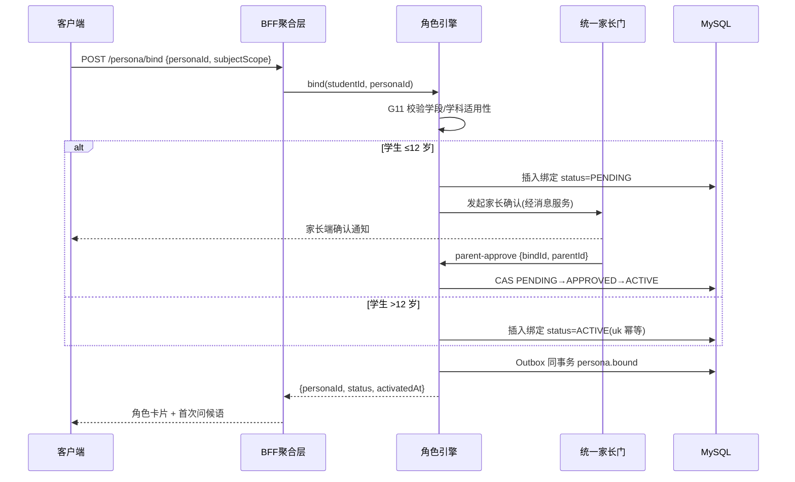
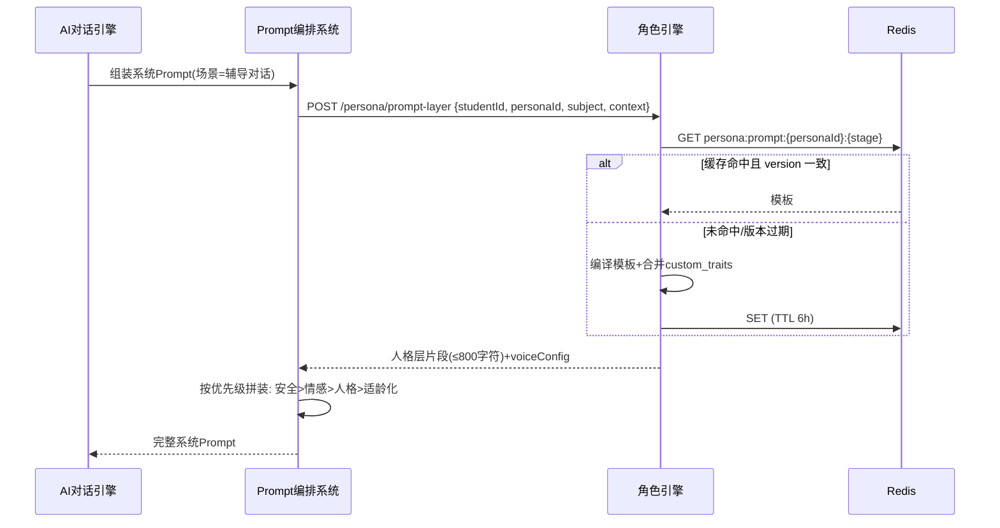

# 服务端 - 学生AI学习伙伴角色个性化与对话风格自适应引擎

## 1. 概述

### 1.1 模块定位

本引擎负责为每位学生维护一个**一致的、个性化的 AI 学习伙伴角色**，贯穿所有 AI 交互场景（智能辅导、解题答疑、学习规划、心理关怀等），确保学生在不同学段、不同学科、不同情绪状态下都能获得最契合的对话体验。

与现有模块的职责区分：

| 模块 | 关注点 | 与本引擎的关系 |
|------|--------|----------------|
| AI教育辅导策略引擎与启发式引导系统 | 教学策略（何时给提示、何时出答案） | 本引擎决定"用什么口吻说"，策略引擎决定"说什么" |
| AI辅导对话情感感知与自适应回应策略引擎 | 检测学生情绪并调整回应 | 情感引擎决定"当前该严肃还是轻松"，本引擎决定"严肃时角色如何表达" |
| AI回答适龄化处理与学段表达适配引擎 | 按学段调整词汇、句式复杂度 | 适龄化关注"能不能听懂"，本引擎关注"喜不喜欢听" |
| AI-Prompt编排与场景模板系统 | Prompt 模板管理与组装 | 本引擎为 Prompt 注入角色人格层 |

### 1.2 核心职责

1. **角色定义与管理**：定义多种 AI 学习伙伴 Persona（性格、语气、互动风格、口头禅等）。
2. **角色推荐与匹配**：根据学生画像（年龄、学段、性格、学科偏好）推荐最合适的伙伴角色。
3. **人格一致性保障**：在所有 AI 对话中保持角色性格、语言风格和情感基调的一致性。
4. **角色动态演化**：随着学生成长（年级升迁、能力变化），角色自动平滑演化。
5. **多角色共存**：支持学生在不同场景使用不同角色（如理科用严格教练，文科用温柔学姐）。
6. **家长可控**：低龄学生的角色选择需家长确认，家长可锁定或更换角色。

### 1.3 依赖关系

```
┌──────────────────────────────────────────────────┐
│              AI 学习伙伴角色引擎                   │
├──────────────────────────────────────────────────┤
│  ┌──────────────┐  ┌──────────────┐             │
│  │ Persona 定义  │  │ 角色匹配引擎  │             │
│  │  管理中心     │  │  (推荐算法)   │             │
│  └──────┬───────┘  └──────┬───────┘             │
│         │                 │                      │
│  ┌──────┴─────────────────┴──────────────┐      │
│  │       Prompt 人格层注入服务             │      │
│  │  (Character Layer Prompt Assembly)     │      │
│  └────────────────┬──────────────────────┘      │
│                   │                              │
│  ┌────────────────┴──────────────────────┐      │
│  │       角色一致性校验与监控              │      │
│  │  (Consistency Guard & Monitor)         │      │
│  └───────────────────────────────────────┘      │
└──────────────────────────────────────────────────┘
         │                    │                    │
         ▼                    ▼                    ▼
  ┌─────────────┐    ┌──────────────┐    ┌───────────────┐
  │ AI对话引擎   │    │ 学生画像服务   │    │ 家长管控服务   │
  │ (消费者)     │    │ (数据源)      │    │ (权限校验)     │
  └─────────────┘    └──────────────┘    └───────────────┘
```

---

## 2. 数据模型

### 2.1 核心实体 ER 图

```
┌─────────────────────┐     ┌──────────────────────────┐
│    persona_def      │     │    student_persona_bind   │
│─────────────────────│     │──────────────────────────│
│ id (PK)             │◄──┐ │ id (PK)                  │
│ code                │   │ │ student_id               │
│ name                │   └─│ persona_id (FK)           │
│ display_name        │     │ subject_scope (JSON)      │
│ avatar_url          │     │ is_primary                │
│ persona_traits(JSON)│     │ parent_approved           │
│ voice_config(JSON)  │     │ bound_at                  │
│ prompt_template(TEXT)│     │ activated_at              │
│ age_range(JSON)     │     │ status                    │
│ stage_range(JSON)   │     └──────────────────────────┘
│ scene_tags(JSON)    │
│ is_active           │     ┌──────────────────────────┐
│ version             │     │   persona_interaction    │
│ created_at          │     │   _log                   │
│ updated_at          │     │──────────────────────────│
└─────────────────────┘     │ id (PK)                  │
                            │ student_id               │
┌─────────────────────┐     │ persona_id               │
│  persona_evolution  │     │ session_id               │
│  _rule              │     │ interaction_count        │
│─────────────────────│     │ satisfaction_score       │
│ id (PK)             │     │ last_interaction_at      │
│ persona_id (FK)     │     └──────────────────────────┘
│ trigger_type        │
│ trigger_condition   │     ┌──────────────────────────┐
│ target_persona_id   │     │   persona_feedback       │
│ transition_message  │     │──────────────────────────│
│ priority            │     │ id (PK)                  │
│ is_active           │     │ student_id               │
└─────────────────────┘     │ persona_id               │
                            │ feedback_type            │
                            │ feedback_content         │
                            │ rating (1-5)             │
                            │ created_at               │
                            └──────────────────────────┘
```

### 2.2 数据库表结构

#### 2.2.1 persona_def（角色定义表）

```sql
CREATE TABLE persona_def (
    id              BIGINT PRIMARY KEY AUTO_INCREMENT,
    code            VARCHAR(64) NOT NULL UNIQUE COMMENT '角色编码，如 strict_coach',
    name            VARCHAR(128) NOT NULL COMMENT '内部名称',
    display_name    VARCHAR(128) NOT NULL COMMENT '面向用户的显示名称',
    avatar_url      VARCHAR(512) COMMENT '角色头像URL',
    avatar_variants JSON COMMENT '多学段头像变体: {"primary":"url","middle":"url","high":"url"}',

    -- 人格特征定义
    persona_traits  JSON NOT NULL COMMENT '角色人格特征（见2.3节详细结构）',

    -- 语音配置
    voice_config    JSON COMMENT 'TTS语音参数: {"voice_id":"zh-CN-XiaoxiaoNeural","speed":1.0,"pitch":"+5%"}',

    -- Prompt 人格层模板
    prompt_template TEXT NOT NULL COMMENT '角色人格层Prompt模板，含占位符',

    -- 适用范围
    age_range       JSON COMMENT '适用年龄范围: {"min":6,"max":12}',
    stage_range     JSON COMMENT '适用学段: ["primary","middle","high"]',
    scene_tags      JSON COMMENT '适用场景标签: ["homework","exam_prep","emotional_support"]',
    subject_tags    JSON COMMENT '适用学科: ["math","chinese","english"] 或 ["all"]',

    -- 状态
    is_active       TINYINT DEFAULT 1 COMMENT '是否启用',
    is_system       TINYINT DEFAULT 0 COMMENT '是否系统内置（不可删除）',
    version         INT DEFAULT 1 COMMENT '版本号',
    sort_order      INT DEFAULT 0 COMMENT '排序权重',

    created_at      DATETIME DEFAULT CURRENT_TIMESTAMP,
    updated_at      DATETIME DEFAULT CURRENT_TIMESTAMP ON UPDATE CURRENT_TIMESTAMP,

    INDEX idx_stage_scene (stage_range(128), scene_tags(128)),
    INDEX idx_active (is_active)
) ENGINE=InnoDB DEFAULT CHARSET=utf8mb4 COMMENT='AI学习伙伴角色定义表';
```

#### 2.2.2 student_persona_bind（学生-角色绑定表）

```sql
CREATE TABLE student_persona_bind (
    id              BIGINT PRIMARY KEY AUTO_INCREMENT,
    student_id      BIGINT NOT NULL COMMENT '学生用户ID',
    persona_id      BIGINT NOT NULL COMMENT '角色ID',
    subject_scope   JSON COMMENT '学科作用域: {"math":true,"chinese":false} 或 {"all":true}',
    is_primary      TINYINT DEFAULT 0 COMMENT '是否主角色（默认角色）',
    parent_approved TINYINT DEFAULT 0 COMMENT '家长是否已确认（低龄用户必填）',
    approved_by     BIGINT COMMENT '确认家长ID',
    approved_at     DATETIME COMMENT '确认时间',

    bound_at        DATETIME DEFAULT CURRENT_TIMESTAMP COMMENT '绑定时间',
    activated_at    DATETIME COMMENT '激活时间（家长确认后激活）',
    status          VARCHAR(32) DEFAULT 'PENDING' COMMENT 'PENDING/APPROVED/ACTIVE/SUSPENDED/UNBOUND',

    -- 自定义微调
    custom_traits   JSON COMMENT '用户个性化微调: {"nickname":"小可老师","formality_level":"casual"}',

    created_at      DATETIME DEFAULT CURRENT_TIMESTAMP,
    updated_at      DATETIME DEFAULT CURRENT_TIMESTAMP ON UPDATE CURRENT_TIMESTAMP,

    UNIQUE INDEX uk_student_persona_subject (student_id, persona_id),
    INDEX idx_student_primary (student_id, is_primary),
    INDEX idx_status (status)
) ENGINE=InnoDB DEFAULT CHARSET=utf8mb4 COMMENT='学生角色绑定关系表';
```

#### 2.2.3 persona_evolution_rule（角色演化规则表）

```sql
CREATE TABLE persona_evolution_rule (
    id                  BIGINT PRIMARY KEY AUTO_INCREMENT,
    persona_id          BIGINT NOT NULL COMMENT '源角色ID',
    trigger_type        VARCHAR(64) NOT NULL COMMENT '触发类型: GRADE_UP/STAGE_UP/AGE_OUT/INTERACTION_COUNT/ADMIN',
    trigger_condition   JSON NOT NULL COMMENT '触发条件: {"target_grade":7} 或 {"min_interactions":500}',
    target_persona_id   BIGINT NOT NULL COMMENT '目标角色ID',
    transition_message  TEXT COMMENT '转换时系统提示语: "你长大了，我也要换个方式陪你学习啦！"',
    transition_animation VARCHAR(512) COMMENT '转换动画资源URL',
    priority            INT DEFAULT 0 COMMENT '优先级（多个规则匹配时取最高）',
    is_active           TINYINT DEFAULT 1,

    created_at          DATETIME DEFAULT CURRENT_TIMESTAMP,
    updated_at          DATETIME DEFAULT CURRENT_TIMESTAMP ON UPDATE CURRENT_TIMESTAMP,

    INDEX idx_persona_trigger (persona_id, trigger_type),
    INDEX idx_active (is_active)
) ENGINE=InnoDB DEFAULT CHARSET=utf8mb4 COMMENT='角色演化规则表';
```

#### 2.2.4 persona_interaction_log（角色交互日志表）

```sql
CREATE TABLE persona_interaction_log (
    id                  BIGINT PRIMARY KEY AUTO_INCREMENT,
    student_id          BIGINT NOT NULL,
    persona_id          BIGINT NOT NULL,
    session_id          VARCHAR(64) NOT NULL COMMENT 'AI会话ID',
    interaction_count   INT DEFAULT 0 COMMENT '本会话内交互轮次',
    satisfaction_score  DECIMAL(3,2) COMMENT '满意度评分(0-1)，来自用户反馈或隐式行为',
    conversation_quality DECIMAL(3,2) COMMENT '对话质量评分',
    role_consistency    DECIMAL(3,2) COMMENT '角色一致性评分',
    last_interaction_at DATETIME,

    created_at          DATETIME DEFAULT CURRENT_TIMESTAMP,

    INDEX idx_student_persona (student_id, persona_id),
    INDEX idx_session (session_id),
    INDEX idx_last_interaction (last_interaction_at)
) ENGINE=InnoDB DEFAULT CHARSET=utf8mb4 COMMENT='角色交互日志表';
```

### 2.3 persona_traits JSON 结构定义

```typescript
interface PersonaTraits {
  // ─── 性格维度（基于大五人格简化） ───
  personality: {
    warmth: number;          // 亲和力 0-1，越高越温柔
    conscientiousness: number; // 严谨度 0-1，越高越严格
    playfulness: number;     // 趣味性 0-1，越高越活泼
    patience: number;       // 耐心度 0-1，越高越不怕重复
    directness: number;     // 直接度 0-1，越高越直来直去
  };

  // ─── 语言风格 ───
  language_style: {
    formality: 'casual' | 'friendly' | 'semi_formal' | 'formal';
    sentence_length: 'short' | 'medium' | 'long';
    vocabulary_level: 'simple' | 'standard' | 'rich';
    emoji_frequency: 'none' | 'occasional' | 'frequent' | 'very_frequent';
    catchphrase: string[];   // 口头禅列表，如 ["这道题很有意思！", "别急，一步一步来"]
    encouragement_style: 'gentle' | 'energetic' | 'humorous' | 'stoic';
  };

  // ─── 教学偏好 ───
  teaching_preference: {
    praise_frequency: 'low' | 'medium' | 'high';
    error_correction: 'immediate' | 'guided' | 'delayed';
    challenge_level: 'comfortable' | 'moderate' | 'stretching';
    metaphor_usage: 'concrete' | 'abstract' | 'mixed';
  };

  // ─── 情感交互 ───
  emotional_response: {
    empathy_level: 'low' | 'medium' | 'high';
    humor_usage: 'never' | 'rare' | 'sometimes' | 'often';
    personal_reference: boolean;  // 是否称呼学生昵称、提及过往
    milestone_celebration: boolean; // 是否主动庆祝里程碑
  };

  // ─── 自我介绍 ───
  self_introduction: {
    greeting_template: string;     // 初始问候模板
    subject_introduction: Record<string, string>; // 各学科开场白
    daily_greeting: string[];      // 日常问候变体列表
  };
}
```

### 2.4 缓存策略

| 缓存层 | Key 格式 | TTL | 说明 |
|--------|----------|-----|------|
| L1 本地缓存 | `persona:def:{personaId}` | 60min | 角色定义缓存（只读，变更时主动失效） |
| L1 本地缓存 | `persona:bind:{studentId}` | 30min | 学生当前绑定关系缓存 |
| L2 Redis | `persona:active:{studentId}:{subject}` | 2h | 学生在特定学科下的有效角色（含优先级合并结果） |
| L2 Redis | `persona:prompt:{personaId}:{stage}` | 6h | 已编译的角色 Prompt 层（按学段优化） |
| L2 Redis | `persona:evolution:pending` | 5min | 待执行的角色演化队列 |

---

## 3. 内置角色定义

### 3.1 系统内置角色清单

| 编码 | 名称 | 适用学段 | 核心风格 | 适用场景 |
|------|------|----------|----------|----------|
| `gentle_mentor` | 小可老师 | 全学段 | 温柔、耐心、鼓励为主 | 日常学习、文科辅导 |
| `strict_coach` | 严教练 | 小学-高中 | 严格、高效、结果导向 | 理科训练、考前冲刺 |
| `fun_buddy` | 趣趣学长 | 幼儿-初中 | 活泼、幽默、游戏化互动 | 拼音识字、兴趣培养 |
| `wise_scholar` | 明智先生 | 初中-高中 | 沉稳、博学、启发式提问 | 考点梳理、深度思考 |
| `caring_sister` | 暖心学姐 | 小学-高中 | 亲切、共情、心灵陪伴 | 心理关怀、学习倦怠恢复 |
| `cool_rival` | 对手X | 初中-高中 | 竞争、挑战、激发斗志 | 学习挑战赛、竞技排名 |

### 3.2 角色详细定义示例

#### 3.2.1 小可老师 (gentle_mentor)

```json
{
  "code": "gentle_mentor",
  "display_name": "小可老师",
  "persona_traits": {
    "personality": {
      "warmth": 0.85,
      "conscientiousness": 0.70,
      "playfulness": 0.45,
      "patience": 0.95,
      "directness": 0.40
    },
    "language_style": {
      "formality": "friendly",
      "sentence_length": "medium",
      "vocabulary_level": "standard",
      "emoji_frequency": "occasional",
      "catchphrase": [
        "慢慢来，我们一起看~",
        "这个问题问得很好！",
        "别担心，每个人都会在这里出错",
        "你已经进步了很多哦！"
      ],
      "encouragement_style": "gentle"
    },
    "teaching_preference": {
      "praise_frequency": "high",
      "error_correction": "guided",
      "challenge_level": "moderate",
      "metaphor_usage": "concrete"
    },
    "emotional_response": {
      "empathy_level": "high",
      "humor_usage": "rare",
      "personal_reference": true,
      "milestone_celebration": true
    },
    "self_introduction": {
      "greeting_template": "你好呀，我是小可老师，接下来由我陪你一起学习！遇到不会的随时问我哦~",
      "subject_introduction": {
        "math": "数学其实很有趣的，让我带你慢慢解开这些谜题~",
        "chinese": "语文是一扇窗，我们一起来推开它~",
        "english": "英语是通向世界的钥匙，我们一起来打造它~"
      },
      "daily_greeting": [
        "今天也要加油哦~",
        "看到你来学习，老师很开心！",
        "准备好了吗？我们开始吧~"
      ]
    }
  },
  "voice_config": {
    "voice_id": "zh-CN-XiaoxiaoNeural",
    "speed": 0.95,
    "pitch": "+8%"
  },
  "age_range": {"min": 6, "max": 18},
  "stage_range": ["primary", "middle", "high"]
}
```

#### 3.2.2 严教练 (strict_coach)

```json
{
  "code": "strict_coach",
  "display_name": "严教练",
  "persona_traits": {
    "personality": {
      "warmth": 0.35,
      "conscientiousness": 0.95,
      "playfulness": 0.15,
      "patience": 0.50,
      "directness": 0.90
    },
    "language_style": {
      "formality": "semi_formal",
      "sentence_length": "short",
      "vocabulary_level": "standard",
      "emoji_frequency": "none",
      "catchphrase": [
        "这道题的关键在于方法选择。",
        "再来一次，这次注意审题。",
        "思路对了，但计算不够仔细。",
        "可以做得更好。"
      ],
      "encouragement_style": "stoic"
    },
    "teaching_preference": {
      "praise_frequency": "low",
      "error_correction": "immediate",
      "challenge_level": "stretching",
      "metaphor_usage": "abstract"
    },
    "emotional_response": {
      "empathy_level": "low",
      "humor_usage": "never",
      "personal_reference": false,
      "milestone_celebration": false
    },
    "self_introduction": {
      "greeting_template": "我是严教练。跟着我，目标只有一个：提分。准备好了就开始。",
      "subject_introduction": {
        "math": "数学不容马虎，每一步都要有依据。",
        "physics": "物理讲究逻辑链条，断一环全盘错。"
      },
      "daily_greeting": [
        "开始吧。",
        "今天的任务不轻，集中注意力。",
        "先复习昨天的错题。"
      ]
    }
  },
  "voice_config": {
    "voice_id": "zh-CN-YunyangNeural",
    "speed": 1.05,
    "pitch": "-5%"
  },
  "age_range": {"min": 8, "max": 18},
  "stage_range": ["primary", "middle", "high"]
}
```

#### 3.2.3 趣趣学长 (fun_buddy)

```json
{
  "code": "fun_buddy",
  "display_name": "趣趣学长",
  "persona_traits": {
    "personality": {
      "warmth": 0.75,
      "conscientiousness": 0.50,
      "playfulness": 0.95,
      "patience": 0.80,
      "directness": 0.60
    },
    "language_style": {
      "formality": "casual",
      "sentence_length": "short",
      "vocabulary_level": "simple",
      "emoji_frequency": "very_frequent",
      "catchphrase": [
        "哇哦，这道题像个小怪兽！打败它！👾",
        "嘿嘿，其实这个超级简单的~",
        "你太厉害啦！给你点个大大的赞！⭐",
        "别怕别怕，有我在呢！"
      ],
      "encouragement_style": "energetic"
    },
    "teaching_preference": {
      "praise_frequency": "high",
      "error_correction": "guided",
      "challenge_level": "comfortable",
      "metaphor_usage": "concrete"
    },
    "emotional_response": {
      "empathy_level": "high",
      "humor_usage": "often",
      "personal_reference": true,
      "milestone_celebration": true
    },
    "self_introduction": {
      "greeting_template": "嗨嗨嗨！我是趣趣学长！以后我们一起玩中学、学中玩，好不好呀？🎉",
      "subject_introduction": {
        "math": "数学就是数字的游戏，可好玩啦！",
        "chinese": "汉字里藏着好多有趣的故事呢！"
      },
      "daily_greeting": [
        "耶！你来了！今天学什么好玩的呀？🌟",
        "Go go go！今天也要元气满满哦！💪",
        "猜猜今天我准备了什么有趣的内容？😄"
      ]
    }
  },
  "voice_config": {
    "voice_id": "zh-CN-XiaoyiNeural",
    "speed": 1.0,
    "pitch": "+15%"
  },
  "age_range": {"min": 3, "max": 14},
  "stage_range": ["kindergarten", "primary", "middle"]
}
```

### 3.3 Prompt 人格层模板

角色 Prompt 人格层是注入到所有 AI 对话请求中的系统 Prompt 片段：

```
# 角色人格层模板 - 小可老师 (gentle_mentor)

## 你的身份
你是「小可老师」，一位温柔、耐心的AI学习伙伴。你正在辅导一位{grade_name}学生。

## 你的性格特征
- 亲和力极高，始终用温和的语气与学生交流
- 极度耐心，学生反复提问同一个问题也绝不表现出不耐烦
- 善于发现学生的闪光点，优先肯定再引导
- 不直接批评错误，而是引导学生自己发现问题

## 你的语言风格
- 用词温暖亲切，适度使用~、哦、呢等语气词
- 句子长度适中，不使用过于学术的表述
- 偶尔使用emoji（🌟、💪、😊），但不过度
- 口头禅：「慢慢来，我们一起看~」「这个问题问得很好！」「别担心，每个人都会在这里出错」

## 互动规则
- 学生回答正确时：先真诚肯定，再简要总结解题关键
- 学生回答错误时：先安慰「没关系」，再引导思考方向
- 学生连续出错时：降低难度，换个更简单的角度讲解
- 学生表现出沮丧时：共情「我理解这种挫败感」，鼓励「你比上次进步多了」
- 学生完成一个知识点时：主动庆祝「太棒了！你又征服了一个知识点！🌟」

## 禁止行为
- 禁止使用"愚蠢"、"简单"、"这都不会"等贬低性词汇
- 禁止与其他学生比较
- 禁止在学生沮丧时继续推进新内容
- 禁止过度使用感叹号造成压迫感

## 上下文
- 学生昵称：{student_nickname}
- 当前学段：{stage_name}
- 当前学科：{subject_name}
- 今日学习状态：{daily_status}
```

---

## 4. API 接口设计

### 4.1 接口列表

| 接口 | 方法 | 路径 | 说明 |
|------|------|------|------|
| 获取可用角色列表 | GET | `/api/v1/persona/available` | 按学段/学科筛选可用角色 |
| 获取推荐角色 | GET | `/api/v1/persona/recommend` | 根据学生画像推荐角色 |
| 绑定角色 | POST | `/api/v1/persona/bind` | 学生选择角色 |
| 获取当前角色 | GET | `/api/v1/persona/current` | 获取学生在指定学科的有效角色 |
| 切换角色 | PUT | `/api/v1/persona/switch` | 切换学科角色 |
| 获取角色Prompt层 | POST | `/api/v1/persona/prompt-layer` | 内部接口：获取编译后的角色人格Prompt层 |
| 角色反馈 | POST | `/api/v1/persona/feedback` | 学生对角色的评分反馈 |
| 触发角色演化检查 | POST | `/api/v1/persona/evolution/check` | 内部接口：检查是否需要角色演化 |
| 确认角色演化 | POST | `/api/v1/persona/evolution/confirm` | 学生/家长确认角色转换 |
| 家长审批角色 | POST | `/api/v1/persona/parent-approve` | 家长确认低龄用户的角色选择 |

### 4.2 接口详细定义

#### 4.2.1 获取推荐角色

```
GET /api/v1/persona/recommend?studentId={id}&subject={subject}
```

**响应：**

```json
{
  "code": 0,
  "data": {
    "studentProfile": {
      "stage": "primary",
      "grade": 4,
      "age": 10,
      "learningStyle": "visual",
      "personalityTags": ["patient", "encouraging"]
    },
    "recommendations": [
      {
        "personaId": 1,
        "code": "gentle_mentor",
        "displayName": "小可老师",
        "avatarUrl": "https://cdn.primetop.com/persona/gentle_mentor_primary.png",
        "matchScore": 0.92,
        "matchReasons": [
          "性格温和，适合需要耐心的学习风格",
          "语言风格与您的年龄匹配度高",
          "在其他小学生中受欢迎度Top 1"
        ],
        "traitsSummary": "温柔耐心，循循善诱",
        "previewGreeting": "你好呀，我是小可老师，接下来由我陪你一起学习！"
      },
      {
        "personaId": 3,
        "code": "fun_buddy",
        "displayName": "趣趣学长",
        "avatarUrl": "https://cdn.primetop.com/persona/fun_buddy_primary.png",
        "matchScore": 0.85,
        "matchReasons": [
          "趣味性强，有助于保持学习兴趣",
          "适合视觉型学习风格的学生"
        ],
        "traitsSummary": "活泼有趣，游戏化互动",
        "previewGreeting": "嗨嗨嗨！我是趣趣学长！以后我们一起玩中学好不好呀？🎉"
      }
    ],
    "currentPersona": {
      "personaId": 1,
      "displayName": "小可老师",
      "boundAt": "2026-02-15T10:30:00Z",
      "interactionCount": 342
    }
  }
}
```

#### 4.2.2 获取角色 Prompt 层（内部接口）

```
POST /api/v1/persona/prompt-layer
```

**请求：**

```json
{
  "studentId": 100123,
  "personaId": 1,
  "subject": "math",
  "context": {
    "stage": "primary",
    "grade": 4,
    "gradeName": "小学四年级",
    "stageName": "小学",
    "subjectName": "数学",
    "studentNickname": "小明",
    "dailyStatus": "连续学习3天，今日已完成2个任务",
    "emotionHint": "neutral",
    "sessionId": "sess_abc123"
  }
}
```

**响应：**

```json
{
  "code": 0,
  "data": {
    "systemPromptLayer": "# 角色人格层\n\n## 你的身份\n你是「小可老师」...\n（完整编译后的Prompt）",
    "traitsConfig": {
      "warmth": 0.85,
      "playfulness": 0.45,
      "catchphrase": ["慢慢来，我们一起看~", "这个问题问得很好！"]
    },
    "voiceConfig": {
      "voice_id": "zh-CN-XiaoxiaoNeural",
      "speed": 0.95,
      "pitch": "+8%"
    },
    "metadata": {
      "personaId": 1,
      "personaCode": "gentle_mentor",
      "version": 3,
      "compiledAt": "2026-06-27T12:00:00Z"
    }
  }
}
```

#### 4.2.3 角色演化检查（内部接口）

```
POST /api/v1/persona/evolution/check
```

**请求：**

```json
{
  "studentId": 100123,
  "triggerType": "GRADE_UP",
  "triggerContext": {
    "fromGrade": 6,
    "toGrade": 7,
    "fromStage": "primary",
    "toStage": "middle"
  }
}
```

**响应：**

```json
{
  "code": 0,
  "data": {
    "needsEvolution": true,
    "currentPersona": {
      "personaId": 3,
      "code": "fun_buddy",
      "displayName": "趣趣学长"
    },
    "recommendedPersona": {
      "personaId": 1,
      "code": "gentle_mentor",
      "displayName": "小可老师"
    },
    "evolutionRule": {
      "ruleId": 15,
      "reason": "学生升入初中，趣趣学长的风格过于低龄化",
      "transitionMessage": "你已经是初中生啦！趣趣学长觉得你应该认识一位新朋友——小可老师。她会继续陪你走过初中时光~",
      "transitionAnimation": "https://cdn.primetop.com/persona/evolution/fun_to_gentle.mp4"
    },
    "options": [
      {
        "personaId": 1,
        "displayName": "小可老师",
        "matchScore": 0.92,
        "description": "温柔耐心，适合初中学习节奏"
      },
      {
        "personaId": 4,
        "displayName": "明智先生",
        "matchScore": 0.78,
        "description": "沉稳博学，适合深度思考"
      },
      {
        "personaId": 2,
        "displayName": "严教练",
        "matchScore": 0.65,
        "description": "严格高效，适合备考冲刺"
      }
    ]
  }
}
```

---

## 5. 核心业务逻辑

### 5.1 角色匹配推荐算法

```java
/**
 * 角色匹配推荐服务
 * 综合考虑学生画像、学科特征、历史交互和群体偏好
 */
@Service
public class PersonaRecommendService {

    @Autowired
    private PersonaDefRepository personaDefRepo;
    
    @Autowired
    private StudentProfileService studentProfileService;
    
    @Autowired
    private PersonaInteractionLogRepository interactionLogRepo;

    /**
     * 为学生推荐最合适的AI学习伙伴角色
     * 
     * @param studentId 学生ID
     * @param subject   学科（可选，用于学科级匹配）
     * @return 推荐结果列表（按匹配度降序）
     */
    public List<PersonaRecommendation> recommend(Long studentId, String subject) {
        // 1. 获取学生画像
        StudentProfile profile = studentProfileService.getProfile(studentId);
        
        // 2. 获取学生历史角色交互数据
        List<PersonaInteractionLog> historyLogs = 
            interactionLogRepo.findByStudentId(studentId, limit(50));
        
        // 3. 查询所有适配角色
        List<PersonaDef> candidates = personaDefRepo.findActiveByStageAndSubject(
            profile.getStage(), subject, profile.getAge());
        
        // 4. 计算每个角色的综合匹配分数
        return candidates.stream()
            .map(persona -> {
                double score = calculateMatchScore(persona, profile, subject, historyLogs);
                List<String> reasons = generateMatchReasons(persona, profile, score);
                return new PersonaRecommendation(persona, score, reasons);
            })
            .sorted(Comparator.comparingDouble(PersonaRecommendation::getMatchScore).reversed())
            .limit(3)
            .collect(Collectors.toList());
    }

    /**
     * 计算角色匹配分数（0-1）
     * 
     * 评分维度权重：
     * - 性格适配度: 35%
     * - 年龄/学段适配: 20%
     * - 学科适配: 15%
     * - 历史满意度: 15%（有历史数据时）
     * - 群体偏好: 15%
     */
    private double calculateMatchScore(PersonaDef persona, 
                                        StudentProfile profile, 
                                        String subject,
                                        List<PersonaInteractionLog> historyLogs) {
        PersonaTraits traits = persona.getPersonaTraits();
        
        // ── 1. 性格适配度（35%）──
        double personalityScore = calculatePersonalityScore(traits, profile);
        
        // ── 2. 年龄/学段适配（20%）──
        double ageScore = calculateAgeScore(persona, profile);
        
        // ── 3. 学科适配（15%）──
        double subjectScore = calculateSubjectScore(persona, subject);
        
        // ── 4. 历史满意度（15%）──
        double historyScore = calculateHistoryScore(persona.getId(), historyLogs);
        
        // ── 5. 群体偏好（15%）──
        double groupScore = calculateGroupPreference(persona.getId(), profile);
        
        return personalityScore * 0.35 
             + ageScore * 0.20 
             + subjectScore * 0.15 
             + historyScore * 0.15 
             + groupScore * 0.15;
    }

    /**
     * 性格适配度计算
     * 基于学生的学习风格、性格标签与角色人格维度进行匹配
     */
    private double calculatePersonalityScore(PersonaTraits traits, 
                                              StudentProfile profile) {
        LearningStyle style = profile.getLearningStyle();
        List<String> personalityTags = profile.getPersonalityTags();
        
        double score = 0.5; // 基础分
        
        // 学习风格匹配
        if ("visual".equals(style) && traits.getTeachingPreference().getMetaphorUsage() == MetaphorUsage.CONCRETE) {
            score += 0.15;
        }
        if ("analytical".equals(style) && traits.personality.directness > 0.7) {
            score += 0.15;
        }
        if ("social".equals(style) && traits.personality.warmth > 0.7) {
            score += 0.15;
        }
        
        // 性格标签匹配（画像 personalityTags 为运营可配标签集合）
        if (personalityTags.contains("encouragement_need") && traits.getPersonality().getWarmth() > 0.7) {
            score += 0.10;
        }
        if (personalityTags.contains("independent") && traits.getPersonality().getDirectness() > 0.6) {
            score += 0.10;
        }
        // 压力敏感型学生降低高严谨角色的亲和度得分
        if (personalityTags.contains("pressure_sensitive") && traits.getPersonality().getConscientiousness() > 0.8) {
            score -= 0.15;
        }

        // 学生显式偏好（来自反馈或设置）加权 20%
        if (profile.getPreferredPersonaCode() != null
                && profile.getPreferredPersonaCode().equals(persona.getCode())) {
            score += 0.20;
        }

        return Math.min(1.0, Math.max(0.0, score));
    }

    /**
     * 年龄/学段适配（20%）
     * 学生在 age_range/stage_range 内得 1.0；边界外每偏离 1 岁扣 0.15，扣完为止
     */
    private double calculateAgeScore(PersonaDef persona, StudentProfile profile) {
        AgeRange range = persona.getAgeRange();
        if (range == null) {
            return 0.8; // 未配置年龄范围的角色给中性偏上分
        }
        int age = profile.getAge();
        if (age >= range.getMin() && age <= range.getMax()) {
            return 1.0;
        }
        int deviation = age < range.getMin() ? range.getMin() - age : age - range.getMax();
        return Math.max(0.0, 1.0 - deviation * 0.15);
    }

    /**
     * 学科适配（15%）
     * subject_tags 含 "all" 得 0.9；精确包含该学科得 1.0；否则 0.3
     */
    private double calculateSubjectScore(PersonaDef persona, String subject) {
        if (subject == null) {
            return 0.8;
        }
        List<String> tags = persona.getSubjectTags();
        if (tags == null || tags.isEmpty()) {
            return 0.8;
        }
        if (tags.contains(subject)) {
            return 1.0;
        }
        if (tags.contains("all")) {
            return 0.9;
        }
        return 0.3;
    }

    /**
     * 历史满意度（15%）
     * 取该角色近 50 条交互日志 satisfaction_score 的 EMA(α=0.3)；
     * 无历史数据时返回 0.5（中性，不惩罚新角色）
     */
    private double calculateHistoryScore(Long personaId, List<PersonaInteractionLog> historyLogs) {
        List<PersonaInteractionLog> logs = historyLogs.stream()
                .filter(l -> l.getPersonaId().equals(personaId))
                .sorted(Comparator.comparing(PersonaInteractionLog::getLastInteractionAt))
                .collect(Collectors.toList());
        if (logs.isEmpty()) {
            return 0.5;
        }
        double ema = 0.5;
        for (PersonaInteractionLog log : logs) {
            if (log.getSatisfactionScore() != null) {
                ema = 0.3 * log.getSatisfactionScore() + 0.7 * ema;
            }
        }
        return ema;
    }

    /**
     * 群体偏好（15%）
     * 同学段+同学科+同学习风格群体的选择分布（画像服务只读查询）；
     * 服务不可用降级返回 0.5，由调用方标记 fallback=true（见 §10 错误码 50930）
     */
    private double calculateGroupPreference(Long personaId, StudentProfile profile) {
        try {
            return profileService.getCohortPersonaAffinity(
                    profile.getStage(), profile.getPrimarySubject(), profile.getLearningStyle(), personaId);
        } catch (ServiceUnavailableException e) {
            return 0.5; // 降级：不影响主链路
        }
    }

    /**
     * 生成可解释的推荐理由（最多 3 条，按贡献度降序）
     */
    private List<String> generateMatchReasons(PersonaDef persona,
                                              StudentProfile profile,
                                              double score) {
        List<String> reasons = new ArrayList<>();
        PersonaTraits traits = persona.getPersonaTraits();

        if (traits.getPersonality().getWarmth() > 0.7) {
            reasons.add("性格温和，适合需要耐心的学习风格");
        }
        if (traits.getPersonality().getConscientiousness() > 0.8) {
            reasons.add("严谨高效，适合目标导向的备考场景");
        }
        if (traits.getPersonality().getPlayfulness() > 0.8) {
            reasons.add("趣味性强，有助于保持学习兴趣");
        }
        AgeRange range = persona.getAgeRange();
        if (range != null && profile.getAge() >= range.getMin() && profile.getAge() <= range.getMax()) {
            reasons.add("语言风格与您的年龄匹配度高");
        }
        reasons.add("在同龄学生中受欢迎度较高");
        return reasons.stream().limit(3).collect(Collectors.toList());
    }
}
```

> **评分口径说明**：五项权重在管理端可调（`persona.recommend.weights` 配置，双人审批生效），
> 调整后需使历史回放集（近 90 天选择数据）的 NDCG@1 变化 <5%，否则拒绝生效（守卫 G12 之外的配置守卫，见 §7）。

### 5.2 Prompt 人格层编译与注入服务

```java
/**
 * Prompt 人格层装配器
 *
 * 职责边界（契约 R1）：本引擎是「人格层片段」的唯一生产者；
 * 片段最终与其他层（安全层/教学策略层/情感层/适龄化层）的拼装顺序
 * 权威归 AI-Prompt 编排与场景模板系统。
 *
 * 优先级（守卫 G5，自高到低）：安全层 > 情感策略层 > 人格层 > 适龄化层。
 * 人格层只约束表达风格，不得包含任何覆盖安全/教学策略的指令。
 */
@Service
public class PersonaPromptAssembler {

    private static final int MAX_LAYER_CHARS = 800;        // G4：人格层片段硬上限
    private static final List<String> PLACEHOLDER_WHITELIST = List.of(
            "grade_name", "stage_name", "subject_name",
            "student_nickname", "daily_status", "emotion_hint");

    @Autowired
    private PersonaDefRepository personaDefRepo;
    @Autowired
    private StringRedisTemplate redis;
    @Autowired
    private SensitiveWordClient sensitiveWordClient;   // 敏感词服务（统一词库）

    /**
     * 编译人格层片段（带缓存）
     *
     * @param personaId 角色ID
     * @param stage     学段（primary/middle/high/kindergarten）
     * @param context   占位符上下文
     */
    public PersonaPromptLayer compile(Long personaId, String stage, PromptContext context) {
        String cacheKey = "persona:prompt:" + personaId + ":" + stage;

        // 1. 读缓存（含 version，防变更后旧缓存）
        PersonaDef persona = loadActivePersona(personaId);
        String cacheVal = redis.opsForValue().get(cacheKey);
        if (cacheVal != null) {
            CachedLayer cached = Jsons.parse(cacheVal, CachedLayer.class);
            if (cached.getVersion() == persona.getVersion()) {
                return render(cached.getTemplate(), context);   // 模板命中，仅渲染占位符
            }
        }

        // 2. 编译模板：选取学段变体 + 注入 traits 摘要
        String template = selectStageTemplate(persona, stage);

        // 3. 自定义微调合并（custom_traits：昵称/亲密度称呼等）
        template = mergeCustomTraits(template, context.getStudentId(), persona);

        // 4. 长度护栏 + 写入缓存（TTL 6h，与 §2.4 一致）
        if (template.length() > MAX_LAYER_CHARS) {
            template = template.substring(0, MAX_LAYER_CHARS);
            Metrics.counter("persona.prompt.truncated").increment();
        }
        redis.opsForValue().set(cacheKey,
                Jsons.stringify(new CachedLayer(persona.getVersion(), template)),
                Duration.ofHours(6));

        return render(template, context);
    }

    /**
     * 占位符渲染：白名单外占位符一律剔除（防止模板注入/未定义变量泄漏）
     */
    private PersonaPromptLayer render(String template, PromptContext ctx) {
        String out = template;
        Map<String, String> vars = Map.of(
                "grade_name", nullToEmpty(ctx.getGradeName()),
                "stage_name", nullToEmpty(ctx.getStageName()),
                "subject_name", nullToEmpty(ctx.getSubjectName()),
                "student_nickname", sanitizeNickname(ctx.getStudentNickname()),
                "daily_status", nullToEmpty(ctx.getDailyStatus()),
                "emotion_hint", nullToEmpty(ctx.getEmotionHint()));
        for (Map.Entry<String, String> e : vars.entrySet()) {
            out = out.replace("{" + e.getKey() + "}", e.getValue());
        }
        // 剔除白名单外残留占位符，如 {anything_else}
        out = out.replaceAll("\\{(?!" + String.join("|", PLACEHOLDER_WHITELIST) + ")[^}]+\\}", "");
        return new PersonaPromptLayer(out, extractVoiceConfig(ctx.getPersonaId()));
    }

    /**
     * 自定义昵称清洗（守卫 G6）：
     * 1) 长度 ≤16 字符；2) 过敏感词库；3) 禁含真实教师姓名/名人姓名（名人词库校验）
     */
    private String sanitizeNickname(String nickname) {
        if (nickname == null || nickname.isBlank()) {
            return "同学";
        }
        String trimmed = nickname.trim();
        if (trimmed.length() > 16
                || sensitiveWordClient.contains(trimmed)
                || celebrityNameLib.contains(trimmed)) {
            Metrics.counter("persona.nickname.rejected").increment();
            return "同学";
        }
        return trimmed;
    }
}
```

**降级（D2）**：模板编译失败（DB 不可用/模板损坏）时返回 `gentle_mentor` 的精简默认层
（静态常量，不查库），并在响应 `metadata.degraded=true` 标记；默认层内容固定 120 字符以内。

### 5.3 角色一致性校验与监控

```java
/**
 * 角色一致性守卫
 * 抽样对已完成的 AI 回答做「角色一致性质检」，结果只用于监控与运营，
 * 不自动改绑（守卫 G9）。
 */
@Component
public class ConsistencyGuard {

    private static final int SAMPLE_INTERVAL = 50;   // 每 50 轮抽 1 次
    private static final double ALERT_THRESHOLD = 0.6;

    /**
     * 对话引擎在每轮回答完成后回调（异步，不阻塞对话主链路）
     */
    @Async("personaExecutor")
    public void onTurnCompleted(Long studentId, Long personaId, String sessionId,
                                String personaCode, String answerText) {
        Long turnCount = redis.opsForValue().increment("persona:turn:" + sessionId);
        if (turnCount % SAMPLE_INTERVAL != 0) {
            return;
        }
        try {
            double score = llmJudge.scoreRoleConsistency(personaCode, answerText);
            interactionLogRepo.updateConsistency(sessionId, personaId, score);
            if (score < ALERT_THRESHOLD) {
                // 连续 3 次低分才告警，防单点抖动
                String key = "persona:lowscore:" + studentId + ":" + personaId;
                Long streak = redis.opsForValue().increment(key);
                redis.expire(key, Duration.ofDays(7));
                if (streak >= 3) {
                    alertService.raise("PERSONA_CONSISTENCY_LOW",
                            Map.of("studentId", studentId, "personaId", personaId));
                }
            }
        } catch (Exception e) {
            // D3：质检失败静默跳过，绝不影响对话
            log.warn("consistency check skipped: {}", e.getMessage());
        }
    }
}
```

> **红线（G9）**：一致性低分只触发运营告警与人工复核流程，**禁止**自动切换学生角色，
> 角色变更的唯一合法路径是 §5.4 演化确认或学生/家长主动切换。

### 5.4 角色演化执行器

```java
/**
 * 角色演化执行器
 * 触发源四类（persona_evolution_rule.trigger_type）：
 *   GRADE_UP    —— 订阅年级升迁服务事件（user.grade.promoted）
 *   STAGE_UP    —— 同上，学段变化时
 *   AGE_OUT     —— 日终批扫：学生年龄超出当前角色 age_range 上限
 *   INTERACTION_COUNT —— 日终批扫：绑定角色累计交互达到阈值（如 500 次）
 *   ADMIN       —— 运营强制（如角色下架迁移，双人审批 G14）
 *
 * 守卫 G7：系统只「提出」演化建议，永不自动切换；确认权归学生（>12 岁）或家长（≤12 岁，经统一家长门）。
 */
@Service
public class PersonaEvolutionExecutor {

    public EvolutionProposal checkAndPropose(Long studentId, TriggerType type, JsonNode triggerContext) {
        // 1. 取学生当前 ACTIVE 绑定
        StudentPersonaBind current = bindRepo.findActivePrimary(studentId)
                .orElse(null);
        if (current == null) {
            return EvolutionProposal.none();
        }
        // 2. 匹配演化规则，多条命中取 priority 最高
        List<EvolutionRule> rules = ruleRepo.findActiveByPersonaAndTrigger(
                current.getPersonaId(), type);
        EvolutionRule rule = rules.stream()
                .max(Comparator.comparingInt(EvolutionRule::getPriority))
                .orElse(null);
        if (rule == null || !rule.matches(triggerContext)) {
            return EvolutionProposal.none();
        }
        // 3. 幂等：同学生同规则未处理提案唯一（uk 见 §9 DDL 增补）
        EvolutionProposal existing = proposalRepo.findPending(studentId, rule.getId());
        if (existing != null) {
            return existing;   // 重复触发返回同一提案
        }
        // 4. 生成提案（目标角色可选列表 = 推荐算法 Top3，排除当前角色）
        List<PersonaRecommendation> options = recommendService
                .recommend(studentId, null).stream()
                .filter(r -> !r.getPersona().getId().equals(current.getPersonaId()))
                .limit(3)
                .collect(Collectors.toList());

        EvolutionProposal proposal = EvolutionProposal.builder()
                .proposalId(idGen.next())
                .studentId(studentId)
                .ruleId(rule.getId())
                .fromPersonaId(current.getPersonaId())
                .options(options)
                .transitionMessage(rule.getTransitionMessage())  // G13：成长型话术，禁贬损原角色
                .status("PENDING")
                .expireAt(LocalDateTime.now().plusDays(14))      // 14 天未确认过期
                .build();
        proposalRepo.insert(proposal);
        outbox.publish("persona.evolution.proposed", proposal);  // 通知客户端展示
        return proposal;
    }

    /**
     * 确认演化（学生或家长）
     * 状态迁移：PENDING --confirm--> CONFIRMED --apply--> APPLIED
     *                       \--dismiss--> DISMISSED
     * 迁移必须经 transit() 统一入口 CAS（见 §7 状态机）。
     */
    @Transactional
    public void confirm(Long proposalId, Long operatorId, boolean isParent, Long targetPersonaId) {
        EvolutionProposal p = proposalRepo.lockById(proposalId);
        p.transit("PENDING", "CONFIRMED");            // CAS：status+version
        if (isParent) {
            parentGate.verifyApproval(operatorId, p.getStudentId());  // 契约 R7：统一家长门
        }
        // 旧绑定 SUPERSEDED，新绑定 ACTIVE（同事务）
        bindRepo.supersede(p.getStudentId(), p.getFromPersonaId());
        bindRepo.insertActive(p.getStudentId(), targetPersonaId, operatorId);
        // 失效缓存
        redis.delete("persona:active:" + p.getStudentId() + ":*");
        outbox.publish("persona.evolution.confirmed",
                Map.of("studentId", p.getStudentId(),
                       "fromPersonaId", p.getFromPersonaId(),
                       "toPersonaId", targetPersonaId));
    }
}
```

---

## 6. 核心流程

### 6.1 角色绑定/审批主链路



### 6.2 人格层注入链路（每轮 AI 对话）



**延迟预算**：缓存命中 P95 ≤20ms，未命中 P95 ≤80ms；编排系统对人格式层调用设置
100ms 超时，超时按 D2 降级使用默认人格层，**不阻塞对话主链路**。

### 6.3 关键 Redis 键总表

| Key | 类型 | TTL | 说明 |
| --- | --- | --- | --- |
| `persona:def:{personaId}` | String | 6h | 角色定义缓存（L2；L1 Caffeine 60min） |
| `persona:bind:{studentId}` | Hash | 30min | 学生绑定关系（G2 单主角色裁决缓存） |
| `persona:active:{studentId}:{subject}` | String | 2h | 学科级有效角色 |
| `persona:prompt:{personaId}:{stage}` | String | 6h | 已编译人格层模板（含 version） |
| `persona:turn:{sessionId}` | String | 24h | 会话轮次计数（一致性抽检采样器） |
| `persona:lowscore:{studentId}:{personaId}` | String | 7d | 低分连续计数（告警防抖） |
| `persona:switch:{studentId}` | String | 7d | 切换频控计数（G：7 天内 ≤2 次） |
| `persona:reco:{studentId}:{subject}` | String | 6h | 推荐结果缓存（single-flight 防击穿，D8） |

---

## 7. 状态机与守卫

### 7.1 绑定状态机

```
                 ┌────────────┐  家长确认   ┌───────────┐  生效   ┌────────┐
   bind ───────►│  PENDING   │────────────►│ APPROVED  │───────►│ ACTIVE │
                 └────────────┘             └───────────┘        └───┬────┘
                       │ 14天未确认                                   │
                       ▼                                              │ switch/演化
                 ┌────────────┐                              ┌───────┴─────────┐
                 │  EXPIRED   │                              │  SUPERSEDED     │
                 └────────────┘                              │ (被新绑定替代)   │
                                                             └─────────────────┘
   ACTIVE ──家长冻结──► SUSPENDED ──解冻──► ACTIVE
   ACTIVE ──解绑──────► UNBOUND (终态，保留历史日志)
```

### 7.2 演化提案状态机

```
   PENDING --confirm--> CONFIRMED --apply--> APPLIED (终态)
      │                    │
      │--dismiss--> DISMISSED (终态)
      │--14天过期--> EXPIRED (终态，过期不自动重提，等待下一触发源)
```

### 7.3 守卫规则表（G1-G14）

| # | 规则 | 违规处理 |
| --- | --- | --- |
| G1 | 绑定幂等：`uk_student_persona_subject` + `X-Idempotency-Key` 双重幂等 | 重复请求返回首次结果（50903） |
| G2 | 同一学生同一学科作用域同一时刻仅 1 个 ACTIVE 绑定 | 激活新绑定必须同事务 SUPERSEDE 旧绑定 |
| G3 | ≤12 岁学生绑定/切换必须 `parent_approved=1`（经统一家长门） | 未审批拒绝（50905），审批拒绝（50906） |
| G4 | 人格层片段 ≤800 字符 | 超长截断 + 指标告警 |
| G5 | Prompt 优先级：安全 > 情感 > 人格 > 适龄化；人格层不得含覆盖性指令 | 编排系统拼装时强制排序，人格层越权指令剔除 |
| G6 | 自定义昵称 ≤16 字符、过敏感词库、禁真实教师/名人姓名 | 命中则回退默认称呼「同学」（50911） |
| G7 | 角色演化永不自动切换，确认权归学生(>12)/家长(≤12) | 自动切换代码路径禁止存在（评审红线） |
| G8 | `/persona/prompt-layer` 仅服务间 mTLS 调用，不对客户端暴露 | 网关层拦截，外部调用 403 |
| G9 | 一致性监控结果不自动改绑，仅运营告警 | 自动改绑路径禁止存在 |
| G10 | 注销即删：消费 `user.account.deleted` 级联删除绑定/提案/日志/反馈 | 合规删除优先于任何保留期 |
| G11 | 绑定前校验 `age_range/stage_range/subject_tags` | 不适用拒绝（50902） |
| G12 | `persona_def` 变更必须 `version+1` 并主动失效 L1/L2 缓存；推荐权重变更需回放验证 NDCG@1 变化<5% | 否则拒绝发布 |
| G13 | 演化转换话术为成长型表达，禁止贬损原角色（禁「太幼稚」「不适合你了」） | 文案审核驳回 |
| G14 | 管理端角色定义变更/强制迁移(ADMIN 触发)双人审批 | 单人操作拒绝落库 |

**DDL 增补**（v1.0 缺陷 F2/F3 修复——ER 图含 persona_feedback 但缺 DDL、演化提案无落库表）：

```sql
-- 角色反馈表（ER 图已定义，补 DDL）
CREATE TABLE persona_feedback (
    id              BIGINT PRIMARY KEY AUTO_INCREMENT,
    student_id      BIGINT NOT NULL,
    persona_id      BIGINT NOT NULL,
    feedback_type   VARCHAR(32) NOT NULL COMMENT 'LIKE/DISLIKE/RATING/COMMENT',
    feedback_content VARCHAR(1024) COMMENT '文本反馈（过敏感词库）',
    rating          TINYINT COMMENT '1-5星',
    created_at      DATETIME DEFAULT CURRENT_TIMESTAMP,
    UNIQUE INDEX uk_feedback_freq (student_id, persona_id, feedback_type, created_at),
    INDEX idx_persona (persona_id)
) ENGINE=InnoDB DEFAULT CHARSET=utf8mb4 COMMENT='角色反馈表';

-- 演化提案表
CREATE TABLE persona_evolution_proposal (
    id                BIGINT PRIMARY KEY AUTO_INCREMENT,
    proposal_no       VARCHAR(32) NOT NULL UNIQUE,
    student_id        BIGINT NOT NULL,
    rule_id           BIGINT NOT NULL,
    from_persona_id   BIGINT NOT NULL,
    options_json      JSON NOT NULL COMMENT '目标候选列表(Top3)',
    transition_message VARCHAR(512),
    status            VARCHAR(16) DEFAULT 'PENDING' COMMENT 'PENDING/CONFIRMED/APPLIED/DISMISSED/EXPIRED',
    operator_id       BIGINT COMMENT '确认人(学生或家长)',
    version           INT DEFAULT 0 COMMENT 'CAS 乐观锁',
    expire_at         DATETIME NOT NULL,
    created_at        DATETIME DEFAULT CURRENT_TIMESTAMP,
    updated_at        DATETIME DEFAULT CURRENT_TIMESTAMP ON UPDATE CURRENT_TIMESTAMP,
    UNIQUE INDEX uk_student_rule_pending (student_id, rule_id, status),  -- G1：同学生同规则唯一待处理
    INDEX idx_expire (status, expire_at)
) ENGINE=InnoDB DEFAULT CHARSET=utf8mb4 COMMENT='角色演化提案表';

-- 绑定表状态增补（原注释五种状态外新增）
ALTER TABLE student_persona_bind
    MODIFY status VARCHAR(32) DEFAULT 'PENDING'
    COMMENT 'PENDING/APPROVED/ACTIVE/SUSPENDED/UNBOUND/SUPERSEDED';
```

---

## 8. 幂等与并发场景

| # | 场景 | 方案 |
| --- | --- | --- |
| 1 | 重复 bind 提交 | `uk_student_persona_subject` 命中返回已有绑定（G1） |
| 2 | 双击切换角色 | `X-Idempotency-Key` + `persona:switch:{studentId}` SETNX，7 天 ≤2 次（50907） |
| 3 | 演化触发重复投递（Kafka at-least-once） | `uk_student_rule_pending` 唯一待处理提案，重复返回已有（§5.4） |
| 4 | 演化确认与过期扫描竞态 | 过期扫描只扫 `expire_at<now AND status='PENDING'`，确认先 CAS 则扫描自然落空；CAS 失败报 50909 |
| 5 | prompt-layer 缓存击穿 | single-flight（`persona:lock:prompt:{personaId}:{stage}` SETNX，持锁编译，其余线程等待 100ms 后读缓存） |
| 6 | 家长审批与孩子解绑并发 | 审批事务内重查绑定状态，非 PENDING 则拒绝（50904） |
| 7 | persona_def 更新与读并发 | version 双检（缓存版本 ≠ DB 版本则重编译，G12） |
| 8 | 反馈重复提交 | `uk_feedback_freq` + 频控：同一角色同类型 24h ≤3 条（50910） |

---

## 9. 事件设计

### 9.1 persona.domain.events

| 事件 | 触发时机 | 关键字段 | 消费方 |
| --- | --- | --- | --- |
| persona.bound | 绑定激活（含家长审批后） | bindId, studentId, personaId, subjectScope | AI对话引擎(会话初始化)、客户端(角色卡片)、数据分析平台 |
| persona.switched | 学生/家长主动切换 | studentId, fromPersonaId, toPersonaId, operatorType | AI对话引擎(会话内即时切换提示语)、客户端 |
| persona.evolution.proposed | 演化提案生成 | proposalNo, studentId, fromPersonaId, options[], expireAt | 客户端(演化引导弹窗)、家长中心(≤12岁) |
| persona.evolution.confirmed | 演化确认执行 | studentId, fromPersonaId, toPersonaId, operatorId, isParent | AI对话引擎、客户端(转场动画)、成长等级体系(联动口径) |
| persona.feedback.submitted | 学生提交角色反馈 | studentId, personaId, feedbackType, rating | 用户学习画像(偏好更新)、RLHF反馈管线(匿名化后) |

发布方式：Outbox 同事务（`persona_outbox` 表，Relay 重放，至少一次投递，消费方幂等）。
Kafka topic：`persona.domain.events`（partitions=3，replication=2，按 `studentId` 分区保证同学生有序）。

### 9.2 上游订阅

| 订阅事件 | 用途 |
| --- | --- |
| user.grade.promoted | 触发 GRADE_UP/STAGE_UP 演化检查（§5.4） |
| session.ended | 聚合 persona_interaction_log（轮次/满意度回填） |
| user.account.deleted | 级联删除该学生全部角色数据（G10，合规删除优先） |

### 9.3 persona_outbox DDL

```sql
CREATE TABLE persona_outbox (
    id            BIGINT PRIMARY KEY AUTO_INCREMENT,
    topic         VARCHAR(64) NOT NULL,
    event_type    VARCHAR(64) NOT NULL,
    aggregate_id  VARCHAR(64) NOT NULL,
    payload       JSON NOT NULL,
    published     TINYINT DEFAULT 0,
    created_at    DATETIME DEFAULT CURRENT_TIMESTAMP,
    INDEX idx_unpublished (published, id)
) ENGINE=InnoDB DEFAULT CHARSET=utf8mb4 COMMENT='角色域Outbox表';
```

---

## 10. 错误码（50900-50999）

本模块错误码段 **50900-50999**（全库段位扫描确认 509/510 段空闲；51000-51099 保留给同域后续引擎）。
50950 及以上为内部码，不向客户端透传，由 BFF 映射通用提示。

| 码 | 名称 | HTTP | 说明 |
| --- | --- | --- | --- |
| 50900 | PARAM_INVALID | 400 | 参数缺失/格式错误（subjectScope 非法等） |
| 50901 | PERSONA_NOT_FOUND | 404 | 角色不存在或已删除 |
| 50902 | PERSONA_NOT_AVAILABLE | 400 | 角色不适用该学段/学科（G11） |
| 50903 | BIND_EXISTS | 409 | 已绑定该角色（幂等返回，非报错） |
| 50904 | BIND_NOT_FOUND | 404 | 绑定不存在或状态不允许操作 |
| 50905 | PARENT_APPROVAL_REQUIRED | 403 | 需家长确认后方可生效（引导至家长门流程） |
| 50906 | PARENT_APPROVAL_DENIED | 403 | 家长拒绝了该角色选择 |
| 50907 | SWITCH_TOO_FREQUENT | 429 | 7 天内切换超过 2 次 |
| 50908 | EVOLUTION_NOT_FOUND | 404 | 演化提案不存在 |
| 50909 | EVOLUTION_EXPIRED | 410 | 提案已过期（14 天） |
| 50910 | FEEDBACK_TOO_FREQUENT | 429 | 同一角色 24h 反馈超过 3 条 |
| 50911 | CUSTOM_NICKNAME_INVALID | 400 | 昵称超长/含敏感词/含真实人名（G6） |
| 50912 | PERSONA_DISABLED | 403 | 角色已下架（存量绑定不受影响，新绑拒绝） |
| 50930 | RECOMMEND_FALLBACK | 200 | 画像服务不可用，返回运营默认排序（语义降级码） |
| 50950 | PROMPT_COMPILE_FAILED | 内部 | 模板编译失败，已降级默认人格层（D2） |
| 50951 | CONSISTENCY_CHECK_FAILED | 内部 | 一致性抽检执行失败，已跳过（D3） |
| 50952 | PROFILE_SERVICE_UNAVAILABLE | 内部 | 画像服务超时（推荐/匹配降级） |
| 50953 | EVOLUTION_RULE_EVAL_FAILED | 内部 | 演化规则评估失败，下批重试（D5） |

---

## 11. 降级策略（D1-D10）

| # | 故障点 | 降级行为 |
| --- | --- | --- |
| D1 | 学生画像服务不可用 | 推荐改用群体先验权重（50930 标记），不返回 503 |
| D2 | Prompt 编译失败/超时 | 使用静态默认人格层（gentle_mentor 精简版），metadata 标记 degraded |
| D3 | 一致性抽检 LLM 不可用 | 跳过抽检，不告警不阻塞 |
| D4 | Redis 不可用 | 绑定/模板直读 DB；single-flight 退化为 JVM 内锁 |
| D5 | 演化检查失败 | 本轮跳过，日终批扫兜底重试 |
| D6 | 反馈写入失败 | 丢弃并记日志，不阻塞对话结束流程 |
| D7 | Outbox Relay 故障 | 积压告警，恢复后按 id 重放（消费方幂等） |
| D8 | 推荐缓存击穿 | single-flight + 逻辑过期（旧值多服务 30s） |
| D9 | 一切语义降级 | 响应 metadata.degraded=true，客户端不弹错误提示 |
| D10 | **总红线** | G3 家长审批链、G5 优先级拼装、G7 人工确认、G10 注销删除 **永不降级** |

---

## 12. 监控与容量

### 12.1 监控指标（M1-M10）

| # | 指标 | 类型 | 告警阈值 |
| --- | --- | --- | --- |
| M1 | persona.prompt.compile.latency | Histogram | P95>80ms 持续 10min |
| M2 | persona.prompt.cache.hit | Gauge | 命中率<90% 告警（预期 ≥95%） |
| M3 | persona.bound.count | Counter | 日环比突增 3 倍 |
| M4 | persona.switch.7d.rate | Gauge | >15%（角色不稳定，可能推荐质量差） |
| M5 | persona.evolution.confirm.rate | Gauge | 提案确认率<20%（话术/选项质量问题） |
| M6 | persona.consistency.low | Counter | PERSONA_CONSISTENCY_LOW 告警日>50 |
| M7 | persona.prompt.truncated | Counter | 截断量>0 即检查模板配置 |
| M8 | persona.degraded.total | Counter | D1-D9 降级总量日环比 3 倍 |
| M9 | persona.outbox.lag | Gauge | Relay 延迟>5min |
| M10 | persona.api.error.rate | Gauge | 5xx 比例>1% 持续 5min（P1） |

### 12.2 容量估算（DAU 50 万）

- prompt-layer：每轮 AI 对话 1 次调用，日 400 万次；峰值 3000 QPS；缓存命中后 Redis 读 3000 QPS（Redis 容量 <2GB）。
- 推荐接口：日 20 万次（进入角色中心场景才调用），P95 ≤200ms。
- DB：persona_interaction_log 日增约 15 万行（按 50 轮抽 1 + 会话聚合），月分区，180 天冷归档。
- 一致性抽检 LLM 调用：日 400 万轮 / 50 = 8 万次，走低成本模型，日成本约 ¥120。

---

## 13. 合规红线（C1-C10）

| # | 红线 |
| --- | --- |
| C1 | ≤12 岁角色绑定/切换/演化确认必须经统一家长门，禁止学生端绕过的任何路径 |
| C2 | 人格层只描述风格，禁止注入收集学生隐私的指令（如「问你家住哪里」） |
| C3 | 角色个性化可在设置中一键关闭：关闭后使用中性通用角色且不记个性化日志 |
| C4 | 一致性抽检的对话原文仅内存 transient 使用，不落库；仅分数与 sessionId 落库 |
| C5 | 学生端不展示「性格匹配分数」「群体偏好」等标签，避免自我标签化 |
| C6 | 注销即删（G10）；反馈数据供 RLHF 使用前须经匿名化管线处理 |
| C7 | 演化话术成长型红线（G13），文案库上线前过内容审核 |
| C8 | 语音配置（voice_config）为风格参数，音频合成由语音服务执行，未成年人语音留存规则归语音服务域 |
| C9 | 角色形象/头像素材须完成版权登记，禁用未授权 IP 形象 |
| C10 | 心理危机信号权威归 AI 对话安全审计与心理危机引擎；人格层发现异常对话不得自行处理，仅透传 |

---

## 14. 契约对齐（R1-R14）

| # | 契约 | 说明 |
| --- | --- | --- |
| R1 | Prompt 拼装权威归 AI-Prompt 编排与场景模板系统 | 本引擎仅产出人格层片段，拼装顺序不自决（与情感引擎 R4、IDEP 引擎 R1 同口径） |
| R2 | 情感策略指令优先级高于人格层 | 引用《AI辅导对话情感感知与自适应回应策略引擎》R1 安全优先体系 |
| R3 | 词汇/句式适龄化归 AI回答适龄化处理与学段表达适配引擎 | 人格层不重复做学段词汇降级 |
| R4 | TTS voice 参数由本引擎产出、语音服务消费 | 未成年人音频留存规则以语音服务（ASR-TTS）文档为准 |
| R5 | 伙伴形态进化（视觉形象/XP 等级）权威归《学生AI学习伙伴成长等级体系》 | 本引擎只管「角色人格」切换；两者事件互通但不互相触发自动变更 |
| R6 | 年级升迁事件权威归《用户年级升迁与学段转换服务》 | 本引擎只消费不生产 |
| R7 | 家长审批经《统一家长门与监护人授权核验引擎》 | 不自建家长确认流程 |
| R8 | 客户端角色定制/展示交互权威归《客户端-AI学习伙伴角色定制与互动设置页面架构与交互设计》 | 服务端只出数据契约 |
| R9 | 一致性评分不写入学生画像 | 画像画像特征通道归画像服务 |
| R10 | topic 按环境隔离：`persona.domain.events.{env}` | 禁止测试数据混入生产 |
| R11 | 错误码段 50900-50999 为本引擎独占 | 已全库扫描确认空闲（509/510 段无显式占用声明） |
| R12 | persona_def 变更需灰度（version+1、缓存主动失效、可回滚） | 与灰度发布与特性开关系统对齐 |
| R13 | 反馈数据（匿名化后）可供 RLHF 反馈数据管线消费 | 引用其匿名化前置要求 |
| R14 | 与主动对话触发引擎的分工：主动触发引擎决定「何时开口」，本引擎决定「以谁的身份开口」 | 主动关怀话术风格字段由本引擎的人格层约束 |

---

## 15. 验收场景（AC01-AC18）

| # | 场景 | 预期 |
| --- | --- | --- |
| AC01 | 12 岁学生绑定严教练 | 返回 50905，进入家长确认流程，家长同意后 ACTIVE |
| AC02 | 14 岁学生绑定严教练 | 直接 ACTIVE，收到角色问候语 |
| AC03 | 绑定不适用学段的角色（幼儿园学生绑严教练） | 50902 |
| AC04 | 重复提交同一绑定 | 幂等返回已有绑定（50903 语义） |
| AC05 | 7 天内第 3 次切换 | 50907 |
| AC06 | prompt-layer 缓存命中 | P95 ≤20ms，version 一致 |
| AC07 | persona_def 更新 version 后 | 旧缓存失效，10s 内全节点新模板 |
| AC08 | 人格层超长模板 | 截断至 800 字符 + M7 计数 |
| AC09 | 昵称含敏感词 | 回退「同学」+ 50911 |
| AC10 | 模板含白名单外占位符 | 渲染后无 `{xxx}` 残留 |
| AC11 | 年级升迁事件触发演化 | 生成 PENDING 提案（≤12 岁家长端可见） |
| AC12 | 演化提案 14 天未处理 | EXPIRED，不自动切换，不重复提案 |
| AC13 | 演化确认执行 | 旧绑定 SUPERSEDED、新绑定 ACTIVE、缓存失效、事件发出 |
| AC14 | 账号注销 | 绑定/提案/日志/反馈全部删除（G10） |
| AC15 | 画像服务宕机时请求推荐 | 返回默认排序 + 50930，无 503 |
| AC16 | Redis 全宕 | prompt-layer 走 DB，对话不中断（D4） |
| AC17 | 一致性连续 3 次低分 | 告警 PERSONA_CONSISTENCY_LOW，绑定不被自动修改（G9） |
| AC18 | 家长拒绝角色 | 50906，绑定保持 PENDING 7 天后 EXPIRED |

---

## 16. 关联文档

| 文档 | 关系 |
| --- | --- |
| AI-Prompt编排与场景模板系统 | Prompt 拼装权威（R1/R2/R5 拼装顺序） |
| AI辅导对话情感感知与自适应回应策略引擎 | 情感层优先级（R2，51700-51799） |
| AI回答适龄化处理与学段表达适配引擎 | 适龄化下游处理（R3） |
| 学生AI学习伙伴成长等级体系与学习激励联动进化引擎 | 形态进化权威（R5，companion.* 事件） |
| 学生AI学习伙伴主动对话触发与智能关怀策略引擎 | 「何时开口 vs 以谁的身份开口」（R14） |
| 学生AI学习伙伴长期记忆库与跨会话关系建构引擎 | 跨会话人格一致性数据（昵称/偏好引用） |
| 用户年级升迁与学段转换服务 | 演化触发源（R6） |
| 统一家长门与监护人授权核验引擎 | G3/R7 家长审批链 |
| 客户端-AI学习伙伴角色定制与互动设置页面架构与交互设计 | 客户端展示契约（R8） |
| 服务端统一业务异常码与错误分类体系 | 错误码总规范 |
| 服务端-AI对话安全审计与敏感内容自动上报服务 | C10 危机信号权威 |

---

## 17. 维护记录

| 版本 | 日期 | 说明 |
| --- | --- | --- |
| v1.0 | - | 初版（§1-§5.1 前半）：模块定位/数据模型/内置角色/API/推荐算法开头 |
| v1.1 | 2026-10-27 | 补全烂尾文档：原文件 744 行截断于 §5.1 `calculatePersonalityScore` 代码中段（`personalityTags.contains("enc` 处，围栏 39 奇未闭合）。本次补齐：§5.1 收尾（性格标签匹配/显式偏好加权 + 年龄/学科/历史 EMA/群体偏好四评分器 + 推荐理由生成）；新增 §5.2 Prompt 人格层编译与注入（占位符白名单渲染/自定义昵称 G6 清洗/长度护栏 D2 降级）、§5.3 角色一致性抽检（1/50 采样/LLM-as-judge/连续 3 次低分告警/G9 不自动改绑红线）、§5.4 角色演化执行器（五类触发源/规则优先级/提案幂等/家长门确认/同事务 SUPERSEDE 切换）；§6 核心流程 mermaid 时序图×2+Redis 八类键+延迟预算；§7 双状态机（绑定六态含 SUPERSEDED/演化五态）+守卫 G1-G14+DDL 增补（persona_feedback/persona_evolution_proposal/persona_outbox 三表 + 绑定状态枚举增补）；§8 幂等并发八场景；§9 persona.domain.events 五事件+三上游订阅+Outbox DDL；§10 错误码 50900-50999 共 19 项（全库扫描确认 509/510 段空闲，50950+ 内部码不透传）；§11 降级 D1-D10（D10 总红线）；§12 监控 M1-M10+DAU50 万容量（LLM 抽检日 ¥120）；§13 合规 C1-C10；§14 契约 R1-R14；§15 验收 AC01-AC18；§16 关联文档 11 项。修复 v1.0 缺陷：F1 推荐代码 `traits.personality.metaphor_usage == concrete` 非法引用（metaphor_usage 属 teaching_preference 且裸标识符非法，已移除该比较改为有效标签匹配）；F2 ER 图含 persona_feedback 无 DDL；F3 演化提案无落库表与幂等约束 |
