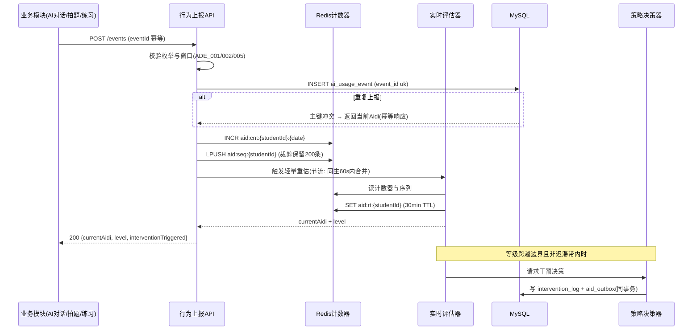
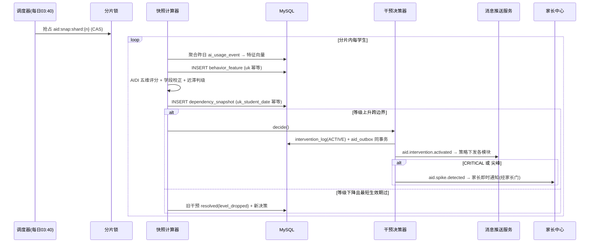
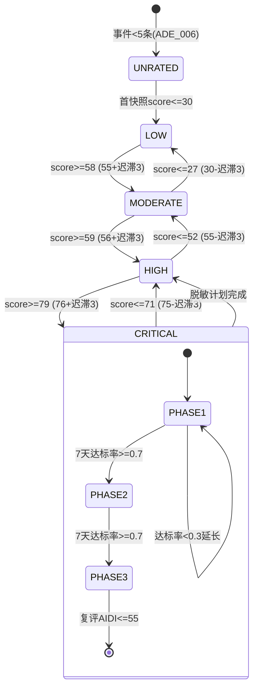

# 服务端 - 学生 AI 辅助依赖度智能监测与自主学习能力培养引导引擎 详细设计

## 1. 概述

### 1.1 模块定位

本引擎是 PrimeTop 教育产品中的**跨模块行为分析与干预引擎**，负责监测学生在使用 AI 辅助学习过程中的依赖行为模式，评估学生的自主学习能力水平，并根据依赖程度动态调整 AI 辅助策略，引导学生从"被动依赖 AI"逐步过渡到"主动独立思考"。

### 1.2 核心问题

原始设计文档明确指出风险：

> 用户依赖答案 → 直接抄答案，学习效果弱 → 应对：默认分步提示，强化思路和同类练习

具体需要解决的问题：

| 问题表现 | 危害 | 当前覆盖情况 |
|---------|------|-------------|
| 遇题直接拍 AI，不尝试独立思考 | 思维能力退化 | 答案管控引擎处理"展示层"，本引擎处理"行为层" |
| 快速连续提问，不阅读完整解析 | 知识吸收率低 | 无专门监测 |
| 反复要求"直接给答案"，跳过提示 | 学习效果归零 | 渐进式提示引擎部分覆盖 |
| AI 使用时长占比过高，自主练习极少 | 自主能力停滞 | 防沉迷引擎管控总时长，未区分 AI vs 自主 |
| 同类题目反复求助 AI | 知识点未真正掌握 | 错题引擎关注错题，不关注求助模式 |

### 1.3 核心职责

1. **依赖度采集**：实时采集学生与 AI 交互的行为事件，构建依赖行为特征向量
2. **依赖度评估**：基于多维特征计算 AI 依赖度指数（AIDI），生成依赖等级
3. **智能干预**：根据依赖等级动态调整 AI 辅助策略（提示深度、答案延迟、引导语等）
4. **能力培养**：设计渐进式自主学习能力提升路径，通过任务编排引导学生独立完成
5. **家长透明**：向家长报告 AI 依赖度趋势和自主能力发展情况

### 1.4 与其他模块的依赖关系

```
┌─────────────────────────────────────────────────────────┐
│                   本引擎 (AI Dependency Engine)          │
│  ┌──────────┐  ┌──────────┐  ┌──────────┐  ┌─────────┐ │
│  │ 行为采集  │→│ 依赖评估  │→│ 干预决策  │→│ 策略下发 │ │
│  └────┬─────┘  └──────────┘  └──────────┘  └────┬────┘ │
└───────┼──────────────────────────────────────────┼──────┘
        │                                          │
   ┌────▼────┐                               ┌─────▼─────┐
   │事件源模块│                               │执行模块    │
   ├─────────┤                               ├───────────┤
   │AI对话引擎│                               │渐进式提示引擎│
   │拍题答疑  │                               │答案管控引擎 │
   │练习测评  │                               │AI对话引擎   │
   │错题系统  │                               │消息推送服务 │
   │学习规划  │                               │家长中心     │
   └─────────┘                               └───────────┘
```

### 1.5 设计原则

- **非侵入式采集**：通过事件订阅获取行为数据，不侵入业务主流程
- **渐进式干预**：从轻度引导到强制策略，避免引起学生反感
- **个性化基线**：不同学段、不同能力水平的学生设定不同依赖度基线
- **可解释性**：依赖度评分和干预决策必须可解释，供家长和教师理解
- **A/B 可验证**：干预策略效果通过实验验证，持续迭代

---

## 2. 数据模型

### 2.1 核心实体 ER 图

```
┌──────────────────────┐     ┌──────────────────────────────┐
│  ai_usage_event       │     │  dependency_snapshot          │
│  (AI使用行为事件)      │     │  (依赖度快照)                 │
├──────────────────────┤     ├──────────────────────────────┤
│  id           BIGINT  │     │  id              BIGINT       │
│  student_id   BIGINT  │     │  student_id      BIGINT       │
│  session_id   VARCHAR │     │  snapshot_date   DATE         │
│  event_type   VARCHAR │     │  aidi_score      DECIMAL(4,2) │
│  module       VARCHAR │     │  dependency_level VARCHAR     │
│  context      JSON    │     │  dimension_scores JSON        │
│  occurred_at  DATETIME│     │  intervention    VARCHAR      │
│  created_at   DATETIME│     │  created_at      DATETIME     │
└──────────────────────┘     └──────────────────────────────┘
         │                              │
         │              ┌───────────────┘
         │              │
┌────────▼─────────────┐│┌──────────────────────────────────┐
│  behavior_feature     │││  intervention_log                 │
│  (行为特征向量)        │││  (干预执行日志)                   │
├──────────────────────┤│├──────────────────────────────────┤
│  id           BIGINT  │││  id              BIGINT           │
│  student_id   BIGINT  │││  student_id      BIGINT           │
│  feature_date DATE    │││  intervention_id VARCHAR          │
│  features     JSON    │││  strategy        VARCHAR          │
│  window_type  VARCHAR │││  triggered_at    DATETIME         │
│  created_at   DATETIME│││  effect_metric   JSON             │
└──────────────────────┘││  resolved_at     DATETIME         │
                        │└──────────────────────────────────┘
                        │
                ┌───────▼──────────────────┐
                │  autonomy_milestone       │
                │  (自主能力里程碑)          │
                ├──────────────────────────┤
                │  id           BIGINT      │
                │  student_id   BIGINT      │
                │  milestone    VARCHAR     │
                │  achieved_at  DATETIME    │
                │  evidence     JSON        │
                │  created_at   DATETIME    │
                └──────────────────────────┘
```

### 2.2 数据库表结构

#### 2.2.1 `ai_usage_event` — AI 使用行为事件表

```sql
CREATE TABLE ai_usage_event (
    id              BIGINT       PRIMARY KEY AUTO_INCREMENT,
    student_id      BIGINT       NOT NULL,
    session_id      VARCHAR(64)  NOT NULL COMMENT '学习会话ID',
    event_type      VARCHAR(48)  NOT NULL COMMENT '事件类型',
    module          VARCHAR(32)  NOT NULL COMMENT '来源模块: ai_dialog/photo_search/practice/mistake/plan',
    question_id     BIGINT       NULL     COMMENT '关联题目ID（如有）',
    subject         VARCHAR(16)  NULL     COMMENT '学科',
    knowledge_point VARCHAR(64)  NULL     COMMENT '关联知识点',
    
    -- 行为上下文
    time_to_first_action_ms INT   NULL COMMENT '从题目展示到首次AI操作的时间(毫秒)',
    attempt_count_before_ai INT   NULL COMMENT '求助AI前的独立尝试次数',
    read_full_answer       BOOLEAN NULL COMMENT '是否阅读完整解析',
    answer_reveal_level    VARCHAR(16) NULL COMMENT '答案展示级别: hint/partial/full',
    
    -- 拓展上下文
    context         JSON         NULL COMMENT '扩展上下文信息',
    occurred_at     DATETIME(3)  NOT NULL,
    created_at      DATETIME     NOT NULL DEFAULT CURRENT_TIMESTAMP,
    
    INDEX idx_student_time (student_id, occurred_at),
    INDEX idx_session (session_id),
    INDEX idx_event_type (event_type, occurred_at),
    INDEX idx_module (module, student_id)
) ENGINE=InnoDB DEFAULT CHARSET=utf8mb4 COMMENT='AI使用行为事件';
```

**事件类型枚举：**

| event_type | 含义 | 来源模块 |
|------------|------|---------|
| `AI_QUESTION_ASKED` | 向 AI 提出问题 | ai_dialog |
| `AI_FOLLOW_UP_ASKED` | 连续追问 | ai_dialog |
| `PHOTO_SEARCH_INITIATED` | 发起拍照搜题 | photo_search |
| `PHOTO_SEARCH_RESULT_VIEWED` | 查看搜题结果 | photo_search |
| `HINT_REQUESTED` | 请求提示 | practice, photo_search |
| `FULL_ANSWER_REQUESTED` | 请求完整答案 | practice, photo_search |
| `ANSWER_SKIPPED_TO_END` | 跳过提示直接查看答案 | practice |
| `SIMILAR_QUESTION_REQUESTED` | 请求同类题 | photo_search |
| `AI_EXPLANATION_REQUESTED` | 请求 AI 讲解 | practice |
| `INDEPENDENT_ANSWER_SUBMITTED` | 独立提交答案（无 AI 辅助） | practice |
| `ANSWER_CORRECT_FIRST_TRY` | 首次尝试正确（无 AI） | practice |
| `AI_ASSISTED_ANSWER_CORRECT` | AI 辅助后正确 | practice |
| `SESSION_AI_ONLY` | 学习会话中全部使用 AI 辅助 | session |

#### 2.2.2 `behavior_feature` — 行为特征向量表

```sql
CREATE TABLE behavior_feature (
    id              BIGINT       PRIMARY KEY AUTO_INCREMENT,
    student_id      BIGINT       NOT NULL,
    feature_date    DATE         NOT NULL,
    window_type     VARCHAR(16)  NOT NULL COMMENT '时间窗口: daily/weekly/monthly',
    
    -- 原始统计特征
    features        JSON         NOT NULL COMMENT '特征向量JSON',
    
    -- 关键衍生指标（冗余存储，便于查询）
    ai_action_count INT          NOT NULL DEFAULT 0 COMMENT 'AI操作总次数',
    independent_action_count INT NOT NULL DEFAULT 0 COMMENT '独立操作次数',
    ai_ratio        DECIMAL(4,3) NOT NULL DEFAULT 0 COMMENT 'AI操作占比',
    avg_time_to_ai_ms BIGINT     NULL COMMENT '平均求助AI前用时(毫秒)',
    avg_attempt_before_ai DECIMAL(3,1) NULL COMMENT '平均求助前独立尝试次数',
    direct_answer_ratio DECIMAL(4,3) NULL COMMENT '直接查看答案比例',
    follow_up_ratio  DECIMAL(4,3) NULL COMMENT '追问率',
    
    created_at      DATETIME     NOT NULL DEFAULT CURRENT_TIMESTAMP,
    
    UNIQUE INDEX uk_student_window (student_id, feature_date, window_type),
    INDEX idx_date_window (feature_date, window_type)
) ENGINE=InnoDB DEFAULT CHARSET=utf8mb4 COMMENT='行为特征向量';
```

#### 2.2.3 `dependency_snapshot` — 依赖度快照表

```sql
CREATE TABLE dependency_snapshot (
    id                BIGINT       PRIMARY KEY AUTO_INCREMENT,
    student_id        BIGINT       NOT NULL,
    snapshot_date     DATE         NOT NULL,
    
    -- AIDI 综合指数
    aidi_score        DECIMAL(4,2) NOT NULL COMMENT 'AI依赖度指数 0-100, 越高越依赖',
    dependency_level  VARCHAR(16)  NOT NULL COMMENT '依赖等级: LOW/MODERATE/HIGH/CRITICAL',
    
    -- 各维度分数
    dimension_scores  JSON         NOT NULL COMMENT '各维度得分明细',
    
    -- 干预建议
    recommended_intervention VARCHAR(48) NULL COMMENT '推荐干预策略',
    intervention_active BOOLEAN NOT NULL DEFAULT FALSE COMMENT '是否已激活干预',
    
    -- 趋势
    trend_direction   VARCHAR(8)   NULL COMMENT '趋势: UP/STABLE/DOWN',
    trend_delta       DECIMAL(5,2) NULL COMMENT '与前一次差值',
    
    created_at        DATETIME     NOT NULL DEFAULT CURRENT_TIMESTAMP,
    
    UNIQUE INDEX uk_student_date (student_id, snapshot_date),
    INDEX idx_level_date (dependency_level, snapshot_date)
) ENGINE=InnoDB DEFAULT CHARSET=utf8mb4 COMMENT='AI依赖度每日快照';
```

#### 2.2.4 `intervention_log` — 干预执行日志表

```sql
CREATE TABLE intervention_log (
    id                BIGINT       PRIMARY KEY AUTO_INCREMENT,
    student_id        BIGINT       NOT NULL,
    intervention_id   VARCHAR(64)  NOT NULL COMMENT '干预实例唯一标识',
    
    -- 干预配置
    strategy          VARCHAR(48)  NOT NULL COMMENT '干预策略类型',
    trigger_level     VARCHAR(16)  NOT NULL COMMENT '触发时的依赖等级',
    config_snapshot   JSON         NOT NULL COMMENT '干预配置快照',
    
    -- 执行信息
    triggered_at      DATETIME(3)  NOT NULL,
    activated_at      DATETIME(3)  NULL COMMENT '学生实际感知到干预的时间',
    resolved_at       DATETIME     NULL COMMENT '干预结束时间',
    resolved_reason   VARCHAR(48)  NULL COMMENT '结束原因: level_dropped/manual/experiment',
    
    -- 效果度量
    effect_metric     JSON         NULL COMMENT '干预效果指标',
    
    created_at        DATETIME     NOT NULL DEFAULT CURRENT_TIMESTAMP,
    
    INDEX idx_student (student_id, triggered_at),
    INDEX idx_strategy (strategy, trigger_level)
) ENGINE=InnoDB DEFAULT CHARSET=utf8mb4 COMMENT='干预执行日志';
```

#### 2.2.5 `autonomy_milestone` — 自主能力里程碑表

```sql
CREATE TABLE autonomy_milestone (
    id              BIGINT       PRIMARY KEY AUTO_INCREMENT,
    student_id      BIGINT       NOT NULL,
    milestone       VARCHAR(48)  NOT NULL COMMENT '里程碑类型',
    milestone_level INT          NOT NULL COMMENT '等级 1-5',
    
    achieved_at     DATETIME     NOT NULL,
    evidence        JSON         NOT NULL COMMENT '达成证据',
    
    -- 奖励
    reward_granted  VARCHAR(64)  NULL COMMENT '已发放奖励',
    
    created_at      DATETIME     NOT NULL DEFAULT CURRENT_TIMESTAMP,
    
    UNIQUE INDEX uk_student_milestone (student_id, milestone, milestone_level),
    INDEX idx_student (student_id, achieved_at)
) ENGINE=InnoDB DEFAULT CHARSET=utf8mb4 COMMENT='自主能力里程碑';
```

### 2.3 `features` JSON 结构定义

`behavior_feature.features` 的 JSON 结构：

```json
{
  "timeBased": {
    "totalStudyDurationMs": 7200000,
    "aiAssistedDurationMs": 5400000,
    "aiRatio": 0.75,
    "avgSessionAiRatio": 0.68,
    "avgTimeToFirstAiMs": 8500,
    "avgTimeToFirstAiBySubject": {
      "math": 5200,
      "english": 12000,
      "chinese": 9800
    }
  },
  "frequencyBased": {
    "totalAiActions": 45,
    "dailyAvgAiActions": 15.0,
    "directAnswerRequests": 12,
    "directAnswerRatio": 0.267,
    "followUpCount": 18,
    "followUpRatio": 0.40,
    "photoSearchCount": 8,
    "photoSearchRatio": 0.178,
    "hintSkipCount": 7,
    "hintSkipRatio": 0.156
  },
  "attemptBased": {
    "totalQuestions": 30,
    "independentCorrectCount": 8,
    "independentCorrectRatio": 0.267,
    "aiAssistedCorrectCount": 18,
    "aiAssistedCorrectRatio": 0.60,
    "avgAttemptBeforeAi": 0.8,
    "zeroAttemptRatio": 0.567,
    "sameKnowledgePointAiCount": {
      "fraction_addition": 5,
      "linear_equation": 3
    }
  },
  "patternBased": {
    "rapidFireSessions": 2,
    "rapidFireThresholdMs": 3000,
    "noReadCompleteCount": 10,
    "noReadCompleteRatio": 0.222,
    "aiOnlySessionCount": 3,
    "aiOnlySessionRatio": 0.375,
    "subjectDependency": {
      "math": 0.82,
      "physics": 0.71,
      "english": 0.45
    }
  },
  "trendBased": {
    "aidiTrend7d": [62, 65, 68, 70, 72, 75, 78],
    "aiRatioTrend7d": [0.55, 0.60, 0.63, 0.68, 0.70, 0.73, 0.75],
    "isAccelerating": true
  }
}
```

### 2.4 `dimension_scores` JSON 结构定义

`dependency_snapshot.dimension_scores` 的 JSON 结构：

```json
{
  "frequencyDimension": {
    "score": 72.5,
    "weight": 0.25,
    "subMetrics": {
      "dailyAiActionCount": 15,
      "directAnswerRatio": 0.267,
      "followUpRatio": 0.40
    }
  },
  "speedDimension": {
    "score": 85.0,
    "weight": 0.30,
    "subMetrics": {
      "avgTimeToFirstAiMs": 8500,
      "zeroAttemptRatio": 0.567,
      "hintSkipRatio": 0.156
    }
  },
  "proportionDimension": {
    "score": 68.0,
    "weight": 0.20,
    "subMetrics": {
      "aiAssistedDurationRatio": 0.75,
      "aiOnlySessionRatio": 0.375,
      "subjectMaxDependency": 0.82
    }
  },
  "outcomeDimension": {
    "score": 55.0,
    "weight": 0.15,
    "subMetrics": {
      "independentCorrectRatio": 0.267,
      "sameKnowledgePointRepeatAi": 5,
      "knowledgeRetentionRate": 0.40
    }
  },
  "trendDimension": {
    "score": 78.0,
    "weight": 0.10,
    "subMetrics": {
      "aidiChangeRate7d": 16.0,
      "isAccelerating": true,
      "consecutiveHighDays": 5
    }
  }
}
```

### 2.5 缓存策略

| 缓存对象 | Redis Key 模式 | TTL | 说明 |
|---------|---------------|-----|------|
| 当日行为计数器 | `aid:cnt:{studentId}:{date}` | 至当日结束 | 原子计数器，INCR 操作 |
| 实时依赖度分数 | `aid:rt:{studentId}` | 30min | 近实时分数，用于策略判断 |
| 当日依赖度快照 | `aid:snap:{studentId}:{date}` | 7d | 避免重复计算 |
| 当前干预策略 | `aid:intv:{studentId}` | 24h | 当前生效的干预配置 |
| 学段基线配置 | `aid:baseline:{stage}` | 1h | 不同学段的依赖度基线 |
| 学生行为序列 | `aid:seq:{studentId}` | 2h | 最近 N 条行为的时序数据（Redis List/Stream） |

---

## 3. API 接口设计

### 3.1 接口总览

| # | 接口 | 方法 | 路径 | 说明 |
|---|------|------|------|------|
| 1 | 上报行为事件 | POST | `/api/v1/ai-dependency/events` | 各模块上报 AI 使用行为 |
| 2 | 获取依赖度概览 | GET | `/api/v1/ai-dependency/overview` | 学生当前依赖度状态 |
| 3 | 获取依赖度趋势 | GET | `/api/v1/ai-dependency/trend` | 历史依赖度变化趋势 |
| 4 | 获取维度详情 | GET | `/api/v1/ai-dependency/dimensions` | 各维度评分明细 |
| 5 | 获取干预策略 | GET | `/api/v1/ai-dependency/intervention` | 当前干预配置（内部调用） |
| 6 | 获取学科依赖分布 | GET | `/api/v1/ai-dependency/by-subject` | 各学科依赖度对比 |
| 7 | 获取自主能力里程碑 | GET | `/api/v1/ai-dependency/milestones` | 自主能力达成情况 |
| 8 | 获取家长报告 | GET | `/api/v1/ai-dependency/parent-report` | 家长视角的依赖度报告 |
| 9 | 管理端覆盖干预 | PUT | `/api/v1/ai-dependency/override` | 管理员/家长手动调整策略 |

### 3.2 详细接口定义

#### 3.2.1 上报行为事件

```
POST /api/v1/ai-dependency/events
```

**请求头：**
```
Authorization: Bearer {token}
Content-Type: application/json
X-Student-Id: {studentId}
```

**请求体：**
```json
{
  "sessionId": "sess_20260711_001",
  "eventType": "AI_QUESTION_ASKED",
  "module": "ai_dialog",
  "questionId": null,
  "subject": "math",
  "knowledgePoint": "linear_equation",
  "timeToFirstActionMs": 3000,
  "attemptCountBeforeAi": 0,
  "readFullAnswer": null,
  "answerRevealLevel": null,
  "context": {
    "dialogId": "conv_001",
    "messageType": "text",
    "source": "manual_input"
  },
  "occurredAt": "2026-07-11T10:30:00.123Z"
}
```

**响应：**
```json
{
  "code": 0,
  "message": "success",
  "data": {
    "eventId": "evt_001",
    "currentAidi": 72.5,
    "level": "HIGH",
    "interventionTriggered": false
  }
}
```

**验证规则：**

| 字段 | 规则 |
|------|------|
| eventType | 必须在枚举值内 |
| module | 必须在枚举值内 |
| timeToFirstActionMs | 0 ~ 3600000（1小时） |
| attemptCountBeforeAi | 0 ~ 99 |
| subject | 非空且在支持的学科列表内 |

#### 3.2.2 获取依赖度概览

```
GET /api/v1/ai-dependency/overview?studentId={studentId}
```

**响应：**
```json
{
  "code": 0,
  "data": {
    "studentId": 100001,
    "studentName": "小明",
    "stage": "JUNIOR_HIGH",
    "grade": 8,
    "currentAidi": 72.5,
    "dependencyLevel": "HIGH",
    "levelLabel": "较高依赖",
    "levelDescription": "AI辅助占比较高，建议加强独立思考练习",
    "levelColor": "#FF6B35",
    "trend": {
      "direction": "UP",
      "delta7d": 8.5,
      "description": "近7天依赖度上升了8.5分"
    },
    "dimensions": [
      {
        "name": "frequency",
        "label": "求助频率",
        "score": 72.5,
        "level": "HIGH",
        "suggestion": "今日AI求助15次，建议控制在10次以内"
      },
      {
        "name": "speed",
        "label": "求助速度",
        "score": 85.0,
        "level": "CRITICAL",
        "suggestion": "平均8.5秒即求助AI，建议先独立思考30秒"
      },
      {
        "name": "proportion",
        "label": "AI占比",
        "score": 68.0,
        "level": "HIGH",
        "suggestion": "AI辅助时长占75%，建议增加独立练习"
      },
      {
        "name": "outcome",
        "label": "学习效果",
        "score": 55.0,
        "level": "MODERATE",
        "suggestion": "独立正确率26.7%，AI辅助后知识留存率待提升"
      },
      {
        "name": "trend",
        "label": "变化趋势",
        "score": 78.0,
        "level": "HIGH",
        "suggestion": "依赖度持续上升中，需关注"
      }
    ],
    "intervention": {
      "active": true,
      "strategy": "GRADUAL_DELAY",
      "startedAt": "2026-07-10T00:00:00Z",
      "description": "已启用渐进式延迟策略，AI回答前会增加思考引导"
    },
    "comparison": {
      "peerAvgAidi": 52.3,
      "peerPercentile": 85,
      "description": "依赖度高于同龄人85%"
    }
  }
}
```

#### 3.2.3 获取干预策略（内部调用）

```
GET /api/v1/ai-dependency/intervention?studentId={studentId}&module={module}
```

此接口由 AI 对话引擎、练习引擎等模块在处理学生请求前调用，获取当前应该应用的辅助策略。

**响应：**
```json
{
  "code": 0,
  "data": {
    "studentId": 100001,
    "module": "ai_dialog",
    "strategy": "GRADUAL_DELAY",
    "config": {
      "thinkFirstPrompt": {
        "enabled": true,
        "minThinkTimeMs": 15000,
        "promptText": "先想想看，你已经学过这个知识点了~",
        "promptType": "gentle_reminder"
      },
      "answerRevealPolicy": {
        "defaultLevel": "hint",
        "hintLevels": ["keyword", "direction", "formula"],
        "fullAnswerDelayMs": 10000,
        "fullAnswerRequiresReason": true
      },
      "followUpPolicy": {
        "maxConsecutiveFollowUps": 3,
        "cooldownMs": 5000,
        "redirectToIntervention": true
      },
      "nudgeIndependence": {
        "enabled": true,
        "frequency": "every_3rd_ai_action",
        "message": "这道题你试试自己解，遇到困难再叫我~"
      }
    },
    "version": "v1.2.3",
    "expiresAt": "2026-07-11T23:59:59Z"
  }
}
```

#### 3.2.4 获取家长报告

```
GET /api/v1/ai-dependency/parent-report?studentId={studentId}&period=weekly
```

**响应：**
```json
{
  "code": 0,
  "data": {
    "studentName": "小明",
    "reportPeriod": "2026-07-05 ~ 2026-07-11",
    "summary": {
      "avgAidi": 71.2,
      "level": "HIGH",
      "trend": "UP",
      "weeklyChange": 8.5,
      "concernLevel": "MODERATE",
      "concernText": "本周AI依赖度有所上升，建议关注"
    },
    "keyFindings": [
      {
        "type": "SPEED_INCREASE",
        "severity": "HIGH",
        "title": "求助速度加快",
        "detail": "平均8.5秒就向AI求助，比上周快了3秒",
        "recommendation": "鼓励孩子先独立思考1分钟"
      },
      {
        "type": "DIRECT_ANSWER_INCREASE",
        "severity": "MEDIUM",
        "title": "直接查看答案频率增加",
        "detail": "本周直接查看完整答案12次，占比26.7%",
        "recommendation": "引导孩子使用'提示'功能而非直接查看答案"
      },
      {
        "type": "INDEPENDENT_CORRECT",
        "severity": "POSITIVE",
        "title": "独立解题正确率有所提升",
        "detail": "数学独立正确率从15%提升到26.7%",
        "recommendation": "继续鼓励！可以适当减少AI辅助"
      }
    ],
    "subjectBreakdown": [
      {
        "subject": "数学",
        "aidi": 82,
        "level": "CRITICAL",
        "aiRatio": 0.82,
        "independentRatio": 0.18,
        "recommendation": "数学AI依赖最高，建议每天先独立完成3道题"
      },
      {
        "subject": "英语",
        "aidi": 45,
        "level": "LOW",
        "aiRatio": 0.45,
        "independentRatio": 0.55,
        "recommendation": "英语独立性强，继续保持"
      }
    ],
    "suggestedActions": [
      "与孩子一起回顾本周的学习内容，讨论哪些是自己独立完成的",
      "设置'独立思考时间'：每天前15分钟不使用AI辅助",
      "对独立完成的题目给予额外积分奖励"
    ]
  }
}
```

### 3.3 错误码定义

| 错误码 | HTTP 状态码 | 含义 | 处理建议 |
|--------|------------|------|---------|
| `ADE_001` | 400 | 事件类型不合法 | 检查 eventType 枚举 |
| `ADE_002` | 400 | 模块标识不合法 | 检查 module 枚举 |
| `ADE_003` | 403 | 无权操作该学生数据 | 检查权限令牌 |
| `ADE_004` | 404 | 学生档案不存在 | 确认 studentId |
| `ADE_005` | 409 | 事件时间超出接受窗口 | 事件发生时间与当前差超过24h |
| `ADE_006` | 422 | 特征数据不足无法评估 | 至少需要5条事件才能计算 |
| `ADE_101` | 500 | 特征计算异常 | 内部异常，重试 |
| `ADE_102` | 500 | AIDI 计算异常 | 内部异常，降级返回缓存值 |
| `ADE_103` | 500 | 干预策略匹配异常 | 降级为默认策略 |

---

## 4. 业务逻辑

### 4.1 核心流程总览

```
 ┌─────────────────────────────────────────────────────────────────┐
 │                     行为事件采集管道                              │
 │                                                                 │
 │  AI对话 ──┐    拍题答疑 ──┐    练习测评 ──┐    错题系统 ──┐      │
 │           │              │              │              │      │
 │           └──────────────┴──────────────┴──────────────┘      │
 │                              │                                  │
 │                    ┌─────────▼─────────┐                       │
 │                    │   事件标准化处理   │                       │
 │                    └─────────┬─────────┘                       │
 │                              │                                  │
 ├──────────────────────────────┼──────────────────────────────────┤
 │                     特征工程管道                                │
 │                              │                                  │
 │              ┌───────────────▼───────────────┐                 │
 │              │     特征向量构建 (5维度)        │                 │
 │              │  ┌──────┐ ┌──────┐ ┌────────┐ │                 │
 │              │  │时间维│ │频率维│ │尝试维  │ │                 │
 │              │  └──────┘ └──────┘ └────────┘ │                 │
 │              │  ┌──────────┐ ┌──────────┐   │                 │
 │              │  │ 模式维   │ │ 趋势维   │   │                 │
 │              │  └──────────┘ └──────────┘   │                 │
 │              └───────────────┬───────────────┘                 │
 │                              │                                  │
 ├──────────────────────────────┼──────────────────────────────────┤
 │                     评估管道                                    │
 │                              │                                  │
 │              ┌───────────────▼───────────────┐                 │
 │              │     AIDI 综合指数计算           │                 │
 │              │  Score = Σ(wᵢ × dim_scoreᵢ)   │                 │
 │              └───────────────┬───────────────┘                 │
 │                              │                                  │
 │              ┌───────────────▼───────────────┐                 │
 │              │     依赖等级分级               │                 │
 │              │  LOW / MODERATE / HIGH /       │                 │
 │              │  CRITICAL                      │                 │
 │              └───────────────┬───────────────┘                 │
 │                              │                                  │
 ├──────────────────────────────┼──────────────────────────────────┤
 │                     干预管道                                    │
 │                              │                                  │
 │     ┌────────────────────────▼────────────────────────┐        │
 │     │              干预策略决策器                       │        │
 │     │  Level × Subject × Trend × History → Strategy   │        │
 │     └────────────────────────┬────────────────────────┘        │
 │                              │                                  │
 │         ┌────────────────────┼────────────────────┐            │
 │         ▼                    ▼                    ▼            │
 │  ┌─────────────┐   ┌──────────────┐   ┌────────────────┐      │
 │  │ AI对话策略   │   │ 答案管控策略  │   │ 任务编排策略   │      │
 │  │ 下发        │   │ 下发          │   │ 下发           │      │
 │  └─────────────┘   └──────────────┘   └────────────────┘      │
 │                                                                 │
 ├─────────────────────────────────────────────────────────────────┤
 │                     效果跟踪管道                                │
 │                                                                 │
 │  干预前AIDI ──→ 干预后AIDI ──→ 效果评估 ──→ 策略迭代           │
 └─────────────────────────────────────────────────────────────────┘
```

### 4.2 AIDI（AI Dependency Index）计算算法

#### 4.2.1 五维度评分模型

每个维度归一化到 0-100 分，**分数越高表示依赖越严重**。

```python
class AIDICalculator:
    """
    AI 依赖度指数计算器
    综合五个维度加权得出 AIDI 分数
    """
    
    # 维度权重配置（可按学段动态调整）
    DIMENSION_WEIGHTS = {
        "frequency": 0.25,    # 求助频率维度
        "speed": 0.30,        # 求助速度维度
        "proportion": 0.20,   # AI占比维度
        "outcome": 0.15,      # 学习效果维度
        "trend": 0.10,        # 变化趋势维度
    }
    
    def calculate(self, features: dict, student_profile: dict) -> dict:
        """
        计算各维度分数和综合 AIDI
        
        Returns:
            {
                "aidi_score": float,
                "dependency_level": str,
                "dimension_scores": dict
            }
        """
        dim_scores = {}
        
        # 1. 频率维度
        dim_scores["frequency"] = self._calc_frequency_dim(
            features["frequencyBased"]
        )
        
        # 2. 速度维度
        dim_scores["speed"] = self._calc_speed_dim(
            features["timeBased"],
            features["attemptBased"],
            features["patternBased"]
        )
        
        # 3. 占比维度
        dim_scores["proportion"] = self._calc_proportion_dim(
            features["timeBased"],
            features["patternBased"]
        )
        
        # 4. 效果维度
        dim_scores["outcome"] = self._calc_outcome_dim(
            features["attemptBased"]
        )
        
        # 5. 趋势维度
        dim_scores["trend"] = self._calc_trend_dim(
            features["trendBased"]
        )
        
        # 加权综合
        aidi = sum(
            dim_scores[dim]["score"] * self.DIMENSION_WEIGHTS[dim]
            for dim in self.DIMENSION_WEIGHTS
        )
        
        # 学段校正因子
        aidi = self._apply_stage_correction(aidi, student_profile)
        
        level = self._score_to_level(aidi)
        
        return {
            "aidi_score": round(aidi, 2),
            "dependency_level": level,
            "dimension_scores": dim_scores
        }
```

#### 4.2.2 各维度计算细节

**频率维度评分：**

```python
def _calc_frequency_dim(self, freq_features: dict) -> dict:
    """
    频率维度：衡量AI求助的绝对频率和模式
    """
    score = 0.0
    
    # 日均AI操作次数（满分50分）
    # 基线：小学<8次正常，初中<12次，高中<15次
    daily_actions = freq_features["dailyAvgAiActions"]
    action_threshold = 10  # 可配置
    action_score = min(50, (daily_actions / action_threshold) * 50)
    score += action_score
    
    # 直接查看答案比例（满分25分）
    direct_ratio = freq_features.get("directAnswerRatio", 0)
    score += min(25, direct_ratio * 100)
    
    # 追问率（满分25分）
    # 高追问率可能表明没有理解第一次回答
    follow_up_ratio = freq_features.get("followUpRatio", 0)
    score += min(25, follow_up_ratio * 50)  # 追问率50%即满分
    
    return {
        "score": round(min(100, score), 2),
        "subMetrics": {
            "dailyAiActionCount": daily_actions,
            "directAnswerRatio": direct_ratio,
            "followUpRatio": follow_up_ratio
        }
    }
```

**速度维度评分：**

```python
def _calc_speed_dim(self, time_features: dict, 
                     attempt_features: dict,
                     pattern_features: dict) -> dict:
    """
    速度维度：衡量学生求助AI的速度和前置思考
    最关键的维度（权重0.30）
    """
    score = 0.0
    
    # 平均首次求助用时（满分40分）
    # 0秒=100分(秒求助)，5秒=80分，15秒=60分，30秒=40分，60秒+=20分
    avg_time_ms = time_features.get("avgTimeToFirstAiMs", 60000)
    avg_time_s = avg_time_ms / 1000
    if avg_time_s < 3:
        time_score = 40
    elif avg_time_s < 10:
        time_score = 40 - (avg_time_s - 3) * 2.86  # 3-10s 线性递减
    elif avg_time_s < 30:
        time_score = 20 - (avg_time_s - 10) * 0.5   # 10-30s
    else:
        time_score = max(5, 10 - (avg_time_s - 30) * 0.1)  # 30s+
    score += time_score
    
    # 零尝试比例（满分35分）
    # 0尝试 = 完全没有独立思考就求助AI
    zero_attempt = attempt_features.get("zeroAttemptRatio", 1.0)
    score += zero_attempt * 35
    
    # 提示跳过比例（满分25分）
    # 跳过提示直接看答案
    hint_skip = pattern_features.get("hintSkipRatio", 0)
    score += hint_skip * 25
    
    return {
        "score": round(min(100, score), 2),
        "subMetrics": {
            "avgTimeToFirstAiMs": avg_time_ms,
            "zeroAttemptRatio": zero_attempt,
            "hintSkipRatio": hint_skip
        }
    }
```

**学习效果维度评分：**

```python
def _calc_outcome_dim(self, attempt_features: dict) -> dict:
    """
    效果维度：评估AI辅助的实际学习效果
    低效果 + 高依赖 = 最危险
    """
    score = 0.0
    
    # 独立正确率（满分40分，反向：越低越依赖）
    # 独立正确率高说明学生真正掌握了
    independent_correct = attempt_features.get("independentCorrectRatio", 0)
    # 独立正确率越低，依赖分越高
    score += (1 - independent_correct) * 40
    
    # 同一知识点重复AI求助（满分30分）
    # 反复对同一知识点求助AI说明没学会
    repeat_kp = attempt_features.get("sameKnowledgePointAiCount", {})
    max_repeat = max(repeat_kp.values()) if repeat_kp else 0
    repeat_score = min(30, max_repeat * 6)  # 同一知识点求助5次=满分
    score += repeat_score
    
    # 知识留存率（满分30分，外部传入）
    # 通过间隔重复测试正确率衡量
    retention_rate = attempt_features.get("knowledgeRetentionRate", 0.5)
    score += (1 - retention_rate) * 30
    
    return {
        "score": round(min(100, score), 2),
        "subMetrics": {
            "independentCorrectRatio": independent_correct,
            "sameKnowledgePointRepeatAi": max_repeat,
            "knowledgeRetentionRate": retention_rate
        }
    }
```

#### 4.2.3 依赖等级分级标准

```python
def _score_to_level(self, score: float) -> str:
    """
    AIDI 分数 → 依赖等级
    
    等级     | 分数范围  | 含义                   | 颜色
    ---------|----------|------------------------|--------
    LOW      | 0-30     | 自主学习为主，AI为辅   | 绿色 #4CAF50
    MODERATE | 31-55    | AI辅助适度，基本均衡   | 黄色 #FFC107
    HIGH     | 56-75    | AI依赖较高，需要关注   | 橙色 #FF6B35
    CRITICAL | 76-100   | 严重依赖，需立即干预   | 红色 #F44336
    """
    if score <= 30:
        return "LOW"
    elif score <= 55:
        return "MODERATE"
    elif score <= 75:
        return "HIGH"
    else:
        return "CRITICAL"
```

#### 4.2.4 学段校正

```python
STAGE_CORRECTION = {
    "KINDERGARTEN": {"threshold_adjust": -5, "rationale": "幼儿阶段允许更多AI辅助"},
    "PRIMARY_LOW":  {"threshold_adjust": -3, "rationale": "小学低年级适当宽容"},
    "PRIMARY_HIGH": {"threshold_adjust": 0,  "rationale": "小学高年级标准基线"},
    "JUNIOR_HIGH":  {"threshold_adjust": +2, "rationale": "初中需要更多独立思考"},
    "SENIOR_HIGH":  {"threshold_adjust": +5, "rationale": "高中应高度自主"}
}

def _apply_stage_correction(self, score: float, profile: dict) -> float:
    stage = profile.get("stage", "PRIMARY_HIGH")
    correction = STAGE_CORRECTION.get(stage, {})
    adjusted = score + correction.get("threshold_adjust", 0)
    return max(0, min(100, adjusted))
```

### 4.3 干预策略决策器

#### 4.3.1 策略矩阵

```python
class InterventionStrategyDecider:
    """
    根据依赖等级、学科特征、历史效果选择干预策略
    """
    
    STRATEGY_MATRIX = {
        "LOW": {
            "action": "MONITOR_ONLY",
            "config": {
                "monitorFrequency": "daily",
                "noActiveIntervention": True,
                "positiveReinforcement": True  # 正向激励
            }
        },
        "MODERATE": {
            "action": "GENTLE_NUDGE",
            "config": {
                "thinkFirstReminder": {
                    "enabled": True,
                    "minThinkTimeMs": 10000,
                    "text": "先花10秒钟想想看~",
                    "frequency": "every_5th_ai_action"
                },
                "hintDefault": True,  # 默认展示提示而非答案
                "independenceBadge": True  # 独立完成题目给额外徽章
            }
        },
        "HIGH": {
            "action": "GRADUAL_DELAY",
            "config": {
                "thinkFirstPrompt": {
                    "enabled": True,
                    "minThinkTimeMs": 20000,
                    "text": "你已经学过这个知识点了，先试试自己解答",
                    "promptType": "educational_reminder",
                    "allowSkip": True  # 允许跳过但记录
                },
                "answerRevealPolicy": {
                    "defaultLevel": "hint",
                    "fullAnswerDelayMs": 15000,
                    "fullAnswerRequiresConfirmation": True
                },
                "followUpPolicy": {
                    "maxConsecutiveFollowUps": 3,
                    "cooldownMs": 8000,
                    "redirectToSimilarQuestion": True
                },
                "independenceChallenge": {
                    "dailyIndependentGoal": 3,
                    "rewardMultiplier": 2.0
                }
            }
        },
        "CRITICAL": {
            "action": "STRUCTURED_WEANING",
            "config": {
                "aiUsageLimit": {
                    "dailyMaxActions": 8,
                    "perQuestionMaxAiActions": 2,
                    "enforcement": "soft_block_with_reason",
                    "blockMessage": "今天你已经向AI求助很多次啦，试着自己挑战一下，完成后会有额外奖励哦~",
                    "counterResetAt": "04:00"
                },
                "requiredStructure": {
                    "thinkAloudSteps": 2,
                    "mandatoryHintChain": True,
                    "hintChainMustComplete": True,
                    "noDirectFullAnswer": True
                },
                "answerRevealPolicy": {
                    "defaultLevel": "hint",
                    "fullAnswerDelayMs": 30000,
                    "fullAnswerRequiresReason": True,
                    "fullAnswerRequiresParentConfirm": False
                },
                "weaningProgram": {
                    "enabled": True,
                    "phases": [
                        {"phase": 1, "durationDays": 7, "dailyAiLimit": 8, "independentGoal": 2},
                        {"phase": 2, "durationDays": 7, "dailyAiLimit": 6, "independentGoal": 3},
                        {"phase": 3, "durationDays": 7, "dailyAiLimit": 4, "independentGoal": 4}
                    ],
                    "phaseAdvanceCondition": "independentGoalAchievedRate>=0.7",
                    "phaseRegressionCondition": "independentGoalAchievedRate<0.3"
                },
                "parentNotify": {
                    "immediateOnSpike": True,
                    "weeklyReport": True,
                    "includeSuggestions": True
                },
                "positiveReinforcement": {
                    "independenceRewardMultiplier": 3.0,
                    "milestoneCelebration": True
                }
            }
        }
    }
```

**策略参数说明：**

| 参数 | 适用等级 | 说明 |
|------|---------|------|
| `minThinkTimeMs` | MODERATE/HIGH | 触发"先思考"提示的最短前置思考时间 |
| `fullAnswerDelayMs` | HIGH/CRITICAL | 完整答案展示延迟，延迟期间展示提示层级 |
| `dailyMaxActions` | CRITICAL | 每日 AI 求助软上限，超出后以鼓励话术软拦截（不硬阻断学习） |
| `thinkAloudSteps` | CRITICAL | 强制学生先提交思考步骤（文字/语音任选）才进入提示链 |
| `weaningProgram` | CRITICAL | 结构化脱敏计划：逐阶段降低 AI 额度、提高独立目标，达标晋级 |
| `counterResetAt` | CRITICAL | 每日额度计数重置时刻（04:00 对齐其他引擎日切口径） |

#### 4.3.2 策略选择逻辑

决策器综合四个因子选择最终策略：依赖等级（主因子）、学科细分依赖、趋势加速度、历史干预效果。

```python
@dataclass
class DecisionContext:
    student_id: int
    level: str                    # LOW/MODERATE/HIGH/CRITICAL
    aidi_score: float
    subject_dependency: dict      # {subject: ratio}
    trend_accelerating: bool
    active_intervention: dict     # 当前生效干预（如有）
    last_effect: dict             # 最近一次干预效果评估
    stage: str                    # 学段

class InterventionStrategyDecider:
    
    # 等级→基础策略映射
    BASE_STRATEGY = {
        "LOW": "MONITOR_ONLY",
        "MODERATE": "GENTLE_NUDGE",
        "HIGH": "GRADUAL_DELAY",
        "CRITICAL": "STRUCTURED_WEANING"
    }
    
    # 策略最短生效时长（天），防止震荡（守卫 G3）
    MIN_DURATION_DAYS = {
        "GENTLE_NUDGE": 3,
        "GRADUAL_DELAY": 7,
        "STRUCTURED_WEANING": 14
    }
    
    def decide(self, ctx: DecisionContext) -> dict:
        base = self.BASE_STRATEGY[ctx.level]
        
        # 因子1：趋势加速 → 升档（HIGH→CRITICAL 边界，迟滞带外才生效）
        if (ctx.trend_accelerating and ctx.level in ("HIGH",) 
                and ctx.aidi_score >= 72):   # HIGH 上限 75，72 起为升档预备区
            base = "STRUCTURED_WEANING"
        
        # 因子2：学科细分干预标记
        # 对依赖度>0.8 的学科，在策略配置上叠加学科级强制提示链
        hot_subjects = [s for s, r in ctx.subject_dependency.items() if r >= 0.8]
        
        # 因子3：历史干预无效 → 换策略
        # 连续两轮同策略效果系数 effect_ratio < 0.85 视为无效
        if ctx.last_effect and ctx.last_effect.get("effect_ratio", 1.0) < 0.85:
            fallback = self._fallback_strategy(base)
            if self._cooldown_expired(ctx.active_intervention):
                base = fallback
        
        # 因子4：最短生效期未过 → 维持当前策略（守卫 G3）
        if ctx.active_intervention and not self._min_duration_reached(
                ctx.active_intervention, base):
            base = ctx.active_intervention["strategy"]
        
        config = self._render_config(base, ctx.stage, hot_subjects)
        return {
            "strategy": base,
            "config": config,
            "hotSubjects": hot_subjects,
            "decisionTrace": {
                "level": ctx.level,
                "aidiScore": ctx.aidi_score,
                "factors": {
                    "trendAccelerating": ctx.trend_accelerating,
                    "hotSubjects": hot_subjects,
                    "lastEffectRatio": ctx.last_effect.get("effect_ratio") 
                        if ctx.last_effect else None
                }
            }
        }
    
    def _fallback_strategy(self, current: str) -> str:
        """同等级内的策略变体轮换，用于 A/B 与无效换策略"""
        rotation = {
            "GENTLE_NUDGE": "GENTLE_NUDGE_V2",      # 变体：激励式 vs 提醒式
            "GRADUAL_DELAY": "GRADUAL_DELAY_STRICT",
            "STRUCTURED_WEANING": "STRUCTURED_WEANING_COACH"  # 变体：教练陪伴式
        }
        return rotation.get(current, current)
```

**迟滞带规则（守卫 G2）：** 等级边界设 ±3 分迟滞带。例：AIDI 由 74 降至 73 仍保持 HIGH，降至 72 才降回 MODERATE；由 54 升至 56 保持 MODERATE，升至 59 才升 HIGH。快照判级时读取前一日等级与边界方向，避免跨边界单日横跳。

#### 4.3.3 A/B 实验框架

策略变体通过实验框架分流，验证干预话术与结构的有效性：

| 实验组 | 对照策略 | 变体 | 分流方式 | 核心指标 |
|--------|---------|------|---------|---------|
| EXP-AIDI-01 | GENTLE_NUDGE(提醒式) | GENTLE_NUDGE_V2(激励式) | studentId % 100 < 50 | 7 日后 AIDI 下降值 |
| EXP-AIDI-02 | GRADUAL_DELAY | GRADUAL_DELAY_STRICT(延迟加倍) | studentId % 100 ≥ 50 | 直接看答案率下降、求助绕过率 |
| EXP-AIDI-03 | STRUCTURED_WEANING | STRUCTURED_WEANING_COACH(教练陪伴话术) | 家长同意后入组 | 脱敏计划完成率、学生抵触退出率 |

**护栏指标（任一触达即自动回退对照组）：**
- 求助绕过率（卸载重装/换账号绕过）上升 > 5%
- 学生主动反馈"反感"占比 > 2%
- 日均学习时长下降 > 15%（干预不能赶走学习动机）
- 危机信号命中（经安全审计引擎透传，见契约 R9）

#### 4.3.4 效果评估与策略迭代

```python
class InterventionEffectEvaluator:
    """
    评估单次干预周期的效果，产出 effect_ratio 供决策器换策略
    effect_ratio = 实际AIDI下降值 / 目标下降值
    """
    
    def evaluate(self, log: dict, snapshots: list) -> dict:
        baseline = log["trigger_aidi"]
        target_drop = self._target_drop(log["strategy"])  # 各策略目标降幅表
        
        # 取干预生效后第 7/14 天的快照对比
        end_score = self._nearest_snapshot(snapshots, days_after=7)
        actual_drop = baseline - end_score
        
        effect_ratio = actual_drop / target_drop if target_drop > 0 else 1.0
        
        return {
            "effect_ratio": round(effect_ratio, 3),
            "baseline": baseline,
            "end_score": end_score,
            "target_drop": target_drop,
            "verdict": "EFFECTIVE" if effect_ratio >= 1.0
                       else "PARTIAL" if effect_ratio >= 0.85
                       else "INEFFECTIVE"
        }
```

| 策略 | 目标降幅（14天） | 判定有效 |
|------|----------------|---------|
| GENTLE_NUDGE | 8 分 | effect_ratio ≥ 1.0 |
| GRADUAL_DELAY | 15 分 | effect_ratio ≥ 1.0 |
| STRUCTURED_WEANING | 25 分 | effect_ratio ≥ 1.0（分阶段累积） |

**数据不足处理（降级 D9）：** 干预周期内快照缺失 ≥ 3 天或学生活跃天数 < 5 天时，不产出 verdict，延长观察期 7 天；再不足则标记 `INSUFFICIENT_DATA`，不触发换策略。

### 4.4 自主能力里程碑引擎

里程碑独立于 AIDI 负向指标，以**正向激励**方式培养学生的自主学习行为。

#### 4.4.1 里程碑定义

| milestone | 名称 | 判定条件 | 等级 |
|-----------|------|---------|------|
| `INDEPENDENT_STREAK` | 独立连击 | 连续 N 天独立完成当日全部练习（无 AI 辅助） | 1-5（3/7/14/30/60 天） |
| `THINK_BEFORE_ASK` | 先思后问 | 求助前思考 ≥ 60s 的求助占比 ≥ 60%，持续 7 天 | 1-3（单学科/三学科/全学科） |
| `SUBJECT_INDEPENDENCE` | 学科自主 | 单学科 AI 占比 < 40% 持续 7 天 | 1-5（按学科数） |
| `RECOVERY` | 脱敏回升 | CRITICAL → MODERATE 及以下且稳定 14 天 | 固定 1 级 |
| `BALANCED_LEARNER` | 均衡学习者 | AIDI < 40 持续 30 天 | 固定 1 级 |

#### 4.4.2 判定执行

```python
class AutonomyMilestoneEvaluator:
    """每日 04:20 批处理：扫描前一日数据判定里程碑"""
    
    def evaluate(self, student_id: int, feature_date: date) -> list:
        achieved = []
        feature = self.feature_repo.get(student_id, feature_date, "daily")
        
        # 独立连击：读取已有 streak 计数，昨日达标则 +1
        streak = self.milestone_repo.get_streak(student_id, "INDEPENDENT_STREAK")
        if self._all_independent(feature):
            new_streak = streak + 1
            for threshold in [3, 7, 14, 30, 60]:
                if new_streak == threshold:   # 恰好跨点，不重发（uk 兜底）
                    achieved.append(MilestoneEvent(
                        student_id=student_id,
                        milestone="INDEPENDENT_STREAK",
                        level=[3,7,14,30,60].index(threshold)+1,
                        evidence={"streakDays": new_streak,
                                  "featureDate": str(feature_date)}
                    ))
        else:
            self.milestone_repo.reset_streak(student_id, "INDEPENDENT_STREAK")
        
        return achieved
```

**奖励发放（守卫 G8）：** 里程碑达成后仅发布 `aid.milestone.achieved` 事件，由学习激励中心统一计算积分/徽章并发放；本引擎**不直接写积分账本**，避免双写。`reward_granted` 字段由消费方回写。

---

## 5. 核心流程

### 5.1 实时事件评估链路



**延迟预算：** 上报接口 P99 ≤ 80ms（DB 单行插入 + Redis 两次操作）；实时重估为异步路径，不阻塞上报响应。策略决策仅在等级跨边界时触发（每生日均 < 2 次/人），不进入上报关键路径。

### 5.2 每日快照与干预激活链路



### 5.3 干预效果回流链路

干预 `resolved_at` 后第 7 天，效果评估任务读取干预前后快照窗口，产出 `effect_ratio` 并回写 `intervention_log.effect_metric`；`INEFFECTIVE` 结果写入决策器换策略输入。周维度聚合进入家长周报（周四 09:00 推送，经家长门与通知偏好中心）。

---

## 6. 关键代码

### 6.1 事件消费与幂等

```python
class AiUsageEventConsumer:
    def consume(self, event: dict) -> dict:
        event_id = event["eventId"]
        # 幂等第一层：Redis SETNX 24h（快速去重）
        if not self.redis.setnx(f"aid:evt:{event_id}", "1", ex=86400):
            return self._idempotent_response(event["studentId"])
        
        try:
            record = AiUsageEvent.from_dict(event)
            self.repo.insert(record)   # 幂等第二层：DB uk(event_id)
        except DuplicateKeyError:
            return self._idempotent_response(event["studentId"])
        
        # 实时计数（Redis 宕机时降级 D1：跳过计数，快照批处理以 DB 为准兜底）
        pipe = self.redis.pipeline()
        pipe.incr(f"aid:cnt:{record.student_id}:{today()}")
        pipe.lpush(f"aid:seq:{record.student_id}", record.to_seq_json())
        pipe.ltrim(f"aid:seq:{record.student_id}", 0, 199)
        pipe.execute()
        
        # 节流重估：同学生 60s 内合并一次
        if self.redis.set(f"aid:rtlock:{record.student_id}", "1", 
                          nx=True, ex=60):
            score = self.realtime_evaluator.evaluate(record.student_id)
            if self._level_crossed_boundary(record.student_id, score):
                self.intervention_dispatcher.maybe_dispatch(record.student_id, score)
        return {"eventId": event_id, "accepted": True}
```

### 6.2 快照批处理（分片 + CAS）

```python
class SnapshotBatchProcessor:
    SHARD_COUNT = 8
    
    def run_shard(self, shard_no: int, feature_date: date):
        # CAS 抢占分片，防多实例重复执行
        if not self.redis.set(f"aid:snap:shard:{shard_no}:{feature_date}",
                              instance_id(), nx=True, ex=3600):
            return  # 其他实例已领取
        
        students = self.repo.students_by_shard(shard_no, self.SHARD_COUNT)
        for sid in students:
            feature = self.feature_builder.build(sid, feature_date)
            self.repo.upsert_feature(feature)          # uk 幂等
            
            prev = self.repo.latest_snapshot(sid)
            result = self.aidi_calculator.calculate(
                feature.features, self.profile_repo.get(sid))
            level = self._apply_hysteresis(result["dependency_level"],
                                           prev, result["aidi_score"])
            
            snapshot = DependencySnapshot(
                student_id=sid, snapshot_date=feature_date,
                aidi_score=result["aidi_score"], dependency_level=level,
                dimension_scores=result["dimension_scores"],
                trend_direction=self._trend(prev, result))
            try:
                self.repo.insert_snapshot(snapshot)    # uk(student,date) 幂等
            except DuplicateKeyError:
                continue                               # 重复分片/重跑安全
            
            if prev and LEVEL_RANK[level] > LEVEL_RANK[prev.dependency_level]:
                self.intervention_dispatcher.dispatch(sid, snapshot)
```

### 6.3 干预下发（幂等 + Outbox 同事务）

```python
class InterventionDispatcher:
    
    def dispatch(self, student_id: int, snapshot: DependencySnapshot):
        ctx = DecisionContext(
            student_id=student_id,
            level=snapshot.dependency_level,
            aidi_score=snapshot.aidi_score,
            subject_dependency=self._subject_dependency(student_id),
            trend_accelerating=snapshot.trend_direction == "UP_ACCELERATING",
            active_intervention=self.repo.active_intervention(student_id),
            last_effect=self.repo.last_effect(student_id),
            stage=self.profile_repo.stage_of(student_id))
        decision = self.decider.decide(ctx)
        
        intervention_id = f"intv_{student_id}_{snapshot.snapshot_date:%Y%m%d}"
        
        with self.tx():
            # 幂等：同学生同时期同策略 uk 冲突即跳过
            self.repo.insert_intervention(InterventionLog(
                student_id=student_id,
                intervention_id=intervention_id,
                strategy=decision["strategy"],
                trigger_level=snapshot.dependency_level,
                config_snapshot=decision["config"],
                triggered_at=now(),
                decision_trace=decision["decisionTrace"]))
            # 守卫 G4：活跃干预唯一（函数唯一索引 uk_active_intv）
            self.repo.deactivate_previous(student_id, reason="superseded")
            # Outbox 同事务（守卫 G9）
            self.outbox.insert(Event(
                topic="aid.intervention.activated",
                aggregate_id=intervention_id,
                payload={"studentId": student_id,
                         "strategy": decision["strategy"],
                         "config": decision["config"],
                         "level": snapshot.dependency_level}))
```

---

## 7. 状态机与守卫

### 7.1 依赖等级状态机（含迟滞）



### 7.2 干预生命周期状态机

| 状态 | 含义 | 进入条件 | 退出去向 |
|------|------|---------|---------|
| `TRIGGERED` | 已触发未生效 | 等级跨边界写入日志 | ACTIVE（次日策略下发生效） |
| `ACTIVE` | 生效中 | 下游模块确认消费 | COMPLETED / SUPERSEDED / EXPIRED |
| `COMPLETED` | 正常结束 | 等级回落且最短生效期满，reason=level_dropped | 终态 |
| `SUPERSEDED` | 被新干预取代 | 等级再上升触发新干预 | 终态 |
| `EXPIRED` | 学生长期未活跃自动关闭 | 30 天无学习事件 | 终态（学生回归时重新评估） |
| `MANUAL_CLOSED` | 管理端/家长手动关闭 | override 接口（双人审批 G13） | 终态 |

### 7.3 守卫总表

| 编号 | 守卫 | 级别 | 说明 |
|------|------|------|------|
| G1 | 事件幂等 | P0 | event_id Redis SETNX + DB uk 双保险，重复上报返回幂等响应 |
| G2 | 判级迟滞 | P0 | 边界 ±3 分迟滞带，禁止单日横跳 |
| G3 | 最短生效期 | P0 | MODERATE≥3 / HIGH≥7 / CRITICAL≥14 天，期内不降不撤 |
| G4 | 活跃干预唯一 | P0 | 函数唯一索引 uk_student_active_strategy，并发触发先到者胜 |
| G5 | 主链路 fail-open | P0 | 评估/干预任何故障不得阻塞答题、讲解、搜题主链路 |
| G6 | 学生端去标签化 | P0 | 话术白名单禁出现"依赖/监控/沉迷"字样，用"学习自主性"正向表达 |
| G7 | 家长报告分级 | P1 | 义务教育阶段隐藏精确同伴百分位，仅 band 区间（复用同伴基准引擎口径） |
| G8 | 奖励单写者 | P0 | 积分/徽章只经学习激励中心发放，本引擎不直写账本 |
| G9 | Outbox 同事务 | P0 | 干预落库与事件发布同一本地事务 |
| G10 | 注销即删 | P0 | user.account.deleted 消费后 24h 级联清理本域全部数据 |
| G11 | 快照幂等 | P0 | uk(student_id, snapshot_date)，批处理重跑安全 |
| G12 | 校正不污染原始值 | P1 | 学段校正只作用于判级阈值，原始 AIDI 与维度分明细保持未校正值 |
| G13 | 配置变更管控 | P1 | 策略矩阵/基线/迟滞带变更双人审批 + version 乐观锁 + 灰度 |
| G14 | 数据用途隔离 | P0 | 行为与评估数据禁用于营销定向与商业转化优化 |

---

## 8. 幂等与并发场景

| # | 场景 | 裁决 |
|---|------|------|
| 1 | 客户端重试导致同一 eventId 重复上报 | SETNX 命中 → 读缓存返回当前分，不重复计数 |
| 2 | 多模块同会话并发上报 | 各自 eventId 独立，无写冲突；计数器 INCR 原子 |
| 3 | 快照批处理与手工触发重跑并发 | 分片 SETNX + uk(student,date) 双保险，重跑跳过已完成 |
| 4 | 两日快照计算并发（补跑昨日） | uk 冲突 → 已存在则跳过；不同日期互不冲突 |
| 5 | 干预触发并发（实时路径与批处理同时命中） | uk_student_active_strategy 先到者胜，后到记录 SUPERSSED 丢弃 |
| 6 | 事件乱序（occurred_at 早于已处理窗口） | 接受并入窗口归属（以 occurred_at 为准聚合），>24h 拒收 ADE_005 |
| 7 | 里程碑恰好跨阈值与重试 | uk(student,milestone,level) 冲突 → 不重复发事件 |
| 8 | 配置热更新与在途决策并发 | 决策读取配置 version 快照，在途按旧版本完成，新决策用新版本 |

---

## 9. 领域事件

### 9.1 发布事件（aid_outbox）

```sql
CREATE TABLE aid_outbox (
    id            BIGINT       PRIMARY KEY AUTO_INCREMENT,
    topic         VARCHAR(64)  NOT NULL,
    aggregate_id  VARCHAR(64)  NOT NULL,
    payload       JSON         NOT NULL,
    status        VARCHAR(16)  NOT NULL DEFAULT 'PENDING',
    retry_count   INT          NOT NULL DEFAULT 0,
    next_retry_at DATETIME     NULL,
    created_at    DATETIME     NOT NULL DEFAULT CURRENT_TIMESTAMP,
    INDEX idx_status_retry (status, next_retry_at)
) ENGINE=InnoDB DEFAULT CHARSET=utf8mb4 COMMENT='AI依赖域Outbox';
```

| topic | 触发时机 | 主要消费方 |
|-------|---------|-----------|
| `aid.dependency.evaluated` | 每日快照生成 | 学情分析（只读）、学习数据看板 |
| `aid.intervention.activated` | 干预激活 | AI对话引擎、答案管控引擎、渐进式提示引擎（策略下发） |
| `aid.intervention.resolved` | 干预结束 | 上述模块（策略恢复）、效果归档 |
| `aid.milestone.achieved` | 里程碑达成 | 学习激励中心（奖励发放，G8）、成就系统 |
| `aid.spike.detected` | 7 日上升 > 15 分或进入 CRITICAL | 家长中心（即时通知，经家长门）、学生安全事件工作台（仅 CRITICAL） |

### 9.2 订阅上游事件

| 上游 topic | 用途 | 幂等键 |
|-----------|------|--------|
| `practice.graded` | 独立作答/AI 辅助判题结果 → attemptBased 特征 | (event_id) |
| `answer.revealed` | 答案展示级别 → speed/pattern 特征 | (event_id) |
| `ai_dialog.message.sent` | AI 问答与追问计数 → frequency 特征 | (event_id) |
| `session.ended` | 会话 AI 占比结算 → proportion 特征 | (session_id) |
| `user.account.deleted` | 注销级联清理（G10） | (user_id) |
| `parent.control.updated` | 家长管控变更（如关闭 AI 求助）→ 干预挂起 | (control_version) |

### 9.3 日终对账（04:50）

1. `ai_usage_event` 当日行数 = 各模块上报埋点对账表当日计数（差异 > 0.5% 告警）
2. `dependency_snapshot` 当日行数 = 在册活跃学生数（遗漏 > 0.1% 补跑）
3. aid_outbox PENDING > 5000 或最老 > 10min → P2 告警

---

## 10. 降级矩阵

| # | 故障点 | 降级行为 | 恢复 |
|---|--------|---------|------|
| D1 | Redis 宕机 | 上报接口直写 DB 成功即返回；实时计数/重估跳过，快照批处理以 DB 聚合兜底 | Redis 恢复后计数重建（以 DB 为准） |
| D2 | 特征计算异常 | 当日快照复用昨日，标记 `degraded=true`，相邻评估用线性插值 | 人工触发重算 |
| D3 | 决策器异常 | 降级默认 MONITOR_ONLY 配置（不干预），告警 | 修复后次日批处理恢复 |
| D4 | Kafka 消费堆积 | 事件已落库不丢失；消费恢复后按 occurred_at 窗口追平，>24h 事件归档不入实时特征 | 追平后解除 |
| D5 | 报告 LLM 生成超时 | 家长周报降级模板化文案（白名单句式），AI 解读缺失不阻塞发送 | 下周期恢复 |
| D6 | 家长推送通道故障 | 站内信兜底；即时通知转延迟队列，>24h 丢弃（体验层不补发陈旧的"即时"通知） | 通道恢复 |
| D7 | 实验平台故障 | 全量回退对照组策略，实验标记 `experiment_degraded` | 平台恢复后按新周期重新入组 |
| D8 | DB 只读 | 跳过 03:40 批处理；上报仍受理（事件表只读时转 Kafka 暂存） | 只读解除后补跑 |
| D9 | 效果数据不足 | 延长观察期，不产出 verdict，不换策略（§4.3.4） | 数据充分后评估 |
| D10 | **总红线** | 任何降级不得阻塞学习主链路（答题/讲解/搜题可用），不得关闭内容安全链路，不得向学生暴露监控感知（G6） | — |

---

## 11. 监控与容量

### 11.1 关键指标与告警

| 指标 | 口径 | 阈值 |
|------|------|------|
| M1 上报接口 P99 | 分钟级 | > 200ms 持续 5min → P2 |
| M2 事件入库成功率 | 5min 窗口 | < 99.9% → P1 |
| M3 快照批处理完成时间 | 每日 | > 05:30 未完成 → P2 |
| M4 各等级人数占比 | 每日 | CRITICAL 占比 > 8% → P1（策略面失效）；> 15% → P0 |
| M5 干预下发成功率 | 每日 | < 99.5% → P2 |
| M6 求助绕过率（换账号/重装后短期高频求助） | 周 | 环比上升 > 5pp → P2（护栏） |
| M7 学生反感反馈率 | 周 | > 2% → P1（护栏，自动回退实验） |
| M8 Outbox 积压 | 实时 | > 5000 → P2 |
| M9 对账差异 | 日终 | 事件量差异 > 0.5% → P2 |
| M10 降级标记占比 | 每日 | degraded 快照占比 > 5% → P2 |

### 11.2 容量估算（DAU 50 万）

| 项目 | 估算 |
|------|------|
| 行为事件量 | 活跃学生 × 日均 30 条 ≈ 1500 万/日，峰值 3000 条/s |
| `ai_usage_event` 存储 | 1500 万 × 400B ≈ 6GB/日，在线保留 90 天 ≈ 540GB，分区 + 冷归档 ClickHouse |
| Redis | 计数器 50 万 key + 序列 200 条/人 ≈ 2GB，快照缓存 7d ≈ 350MB |
| 快照/特征表 | 50 万行/日，单行 < 2KB，年增 360GB（分区保留 13 个月） |
| 评估计算 | 实时重估 QPS ≈ 300（节流后），快照批处理 8 分片 × 30min 内完成 |
| LLM 成本 | 家长周报解读 50 万/周 × 2K token ≈ 可控（走多模型调度网关低成本档） |

---

## 12. 合规红线

| 编号 | 红线 |
|------|------|
| C1 | 行为事件属未成年人学习行为数据，采集遵循最小化原则，仅存评估必需字段 |
| C2 | 学生端任何界面不得出现"依赖度/监控/沉迷"标签化表述，统一正向话术（G6） |
| C3 | 家长端可见度分级：L1 周报摘要 / L2 维度明细 / L3 原始事件（默认 L1，L3 需显式开启） |
| C4 | 义务教育阶段家长报告隐藏精确同伴百分位，仅展示 band（G7） |
| C5 | 数据境内存储；原始事件在线 90 天，到期匿名化聚合后归档 |
| C6 | 注销即删：account.deleted 后 24h 级联清理事件/特征/快照/干预/里程碑（G10） |
| C7 | 数据禁用于营销定向、推送广告、商业转化优化（G14） |
| C8 | 报告文案白名单制，禁贬损/比较/焦虑诱导句式（如"你的孩子严重依赖"禁用） |
| C9 | 心理危机信号权威归 AI 对话安全审计与危机引擎，本引擎仅透传不判定（aid.spike 不携带对话原文） |
| C10 | 家长可查询孩子 AIDI 评分依据（可解释性），客服口径由本域提供 |

---

## 13. 契约对齐

| # | 契约 | 说明 |
|---|------|------|
| R1 | 答案展示权威归答案管控引擎 | 本引擎只下发行为层策略参数（defaultLevel/延迟等），答案是否展示、展示几级由答案管控引擎裁决，双引擎同时命中时答案管控 fail-closed 优先 |
| R2 | 提示链权威归渐进式提示引擎 | 提示分层与内容生成归渐进式提示引擎，本引擎只要求"强制走提示链"的行为标记 |
| R3 | 掌握度只读 | knowledgeRetentionRate 等只读消费统一掌握度引擎，本引擎不写画像 |
| R4 | 防沉迷优先 | 防沉迷时段/时长限制 fail-closed，本引擎任何策略不得放宽防沉迷约束 |
| R5 | 家长通知经家长门 | 全部家长侧通知经家长门核验监护关系 + 通知偏好中心频控 |
| R6 | 奖励发放单写者 | 积分/徽章经学习激励中心统一规则引擎（G8） |
| R7 | 成就展示归成就系统 | 里程碑卡片渲染与展示归成就系统 |
| R8 | AIDI 权威归本引擎 | 学情分析、学习报告、家长周报中的依赖度指标以本引擎快照为唯一来源，只读消费 |
| R9 | 危机信号权威外置 | 心理危机判定归安全审计与危机干预引擎，本引擎 aid.spike 仅统计维度，不携带对话内容 |
| R10 | LLM 调用走统一网关 | 报告解读生成经多模型调度与成本治理网关，禁直连供应商 |
| R11 | 同伴对比只读 | peerAvgAidi/百分位数据归同伴基准参照引擎，本引擎只读展示 |
| R12 | 配置治理 | 策略矩阵/基线/迟滞带经特性开关系统灰度与版本化（G13） |

---

## 14. 验收场景

| # | 场景 | 预期 |
|---|------|------|
| AC01 | 事件上报 eventId 重复提交 3 次 | 仅 1 条入库，3 次均返回相同幂等响应 |
| AC02 | 上报 eventType 非法 | ADE_001，不入库 |
| AC03 | 事件发生时间早于 24h | ADE_005 |
| AC04 | 新学生仅 3 条事件请求概览 | ADE_006，展示"数据积累中"中性态 |
| AC05 | AIDI 54→56→58 连续三日 | 因迟滞带保持 MODERATE，第 4 日 ≥59 才升 HIGH |
| AC06 | HIGH 干预生效 3 天后等级回落 | 不撤干预（G3），第 7 天期满且仍回落才 COMPLETED |
| AC07 | 批处理与手工重跑并发 | uk 幂等，无重复快照，无重复干预 |
| AC08 | CRITICAL 学生触发并发升级 | 活跃干预唯一，仅 1 条 ACTIVE |
| AC09 | Redis 宕机 10 分钟 | 上报不失败，快照批处理 DB 兜底，恢复后计数重建 |
| AC10 | 决策器抛异常 | 模块拉取干预策略返回 MONITOR_ONLY 默认配置（D3） |
| AC11 | CRITICAL 学生连续 3 天独立目标达成 | 脱敏计划 PHASE1→PHASE2，AI 额度 8→6 |
| AC12 | 里程碑达成 | 恰好一条 aid.milestone.achieved，激励中心发放后回写 reward_granted，不重发 |
| AC13 | 家长端周报 | 义务教育阶段无精确百分位，仅有 band；话术无贬损句式 |
| AC14 | 学生端干预生效界面 | 文案无"依赖/监控"字样，呈现为"学习小挑战" |
| AC15 | 护栏指标触发（学习时长降 20%） | 实验自动回退对照组并告警 M7 |
| AC16 | 注销学生 | 24h 后本域五表数据清零，管理端查询不可见 |

---

## 15. 关联文档

- 《答案管控与渐进式提示引擎-详细设计》（R1/R2 边界：本引擎行为层、彼引擎展示层）
- 《AI对话引擎与会话管理-详细设计》（AI_QUESTION_ASKED 等事件源）
- 《拍照搜题与习题答疑-详细设计》（拍题求助行为事件源）
- 《防沉迷与未成年人保护机制-详细设计》（R4 优先级裁决）
- 《用户学习画像与能力维度模型-详细设计》（R3 只读消费）
- 《服务端-用户学习激励中心与行为奖励统一规则引擎-详细设计》（R6 奖励单写者）
- 《服务端-学生学习成效同伴基准参照与群体对比分析引擎-详细设计》（R11 peer 数据）
- 《服务端-多模型调度与成本治理-详细设计》（R10 LLM 网关）
- 《服务端-未成年人数据隐私合规自动化与数据主体权利请求处理引擎-详细设计》（C5/C6 数据生命周期）
- 《服务端-学生AI辅导对话心理危机信号检测与分级预警干预编排引擎-详细设计》（R9 危机权威边界）

---

## 16. 维护记录

| 版本 | 日期 | 说明 |
|------|------|------|
| v1.0 | 2026-08 初批次 | 初始版本：概述/数据模型(5表+JSON)/9 个 API/ADE 错误码/AIDI 五维算法与学段校正/干预策略矩阵。文件在 §4.3.1 CRITICAL 策略配置 `"aiUsageLimit"` 处截断（围栏未闭合），§4.3 后半及流程/代码/状态机/幂等/事件/降级/监控/合规/契约/验收全缺 |
| v1.1 | 2026-11-10 | 补全烂尾文档：补齐 §4.3.1 CRITICAL 结构化脱敏配置（额度软上限/强制思考步骤/三阶段脱敏计划/家长即时通知）；新增 §4.3.2 决策器四因子逻辑与迟滞带规则、§4.3.3 A/B 实验框架与护栏回退、§4.3.4 效果评估 effect_ratio 与数据不足降级、§4.4 自主能力里程碑引擎（五类里程碑+激励单写者 G8）；新增 §5 核心流程 mermaid 时序图×3（实时评估/快照与干预激活/效果回流）、§6 关键代码三段（事件消费幂等/分片快照批处理 CAS/干预下发同事务 Outbox）、§7 依赖等级状态机（含迟滞与 CRITICAL 脱敏阶段机）与干预生命周期六态+守卫 G1-G14、§8 幂等并发八场景、§9 aid_outbox 五发布六订阅+04:50 对账三恒等式、§10 降级 D1-D10（总红线：不阻塞学习主链路）、§11 监控 M1-M10 与 DAU50 万容量、§12 合规 C1-C10（学生端去标签化 G6/家长分级可见 C3）、§13 契约 R1-R12（答案管控 fail-closed 优先 R1/危机权威外置 R9）、§14 验收 AC01-AC16、§15 关联文档 10 篇；错误码沿用 v1.0 ADE_xxx 符号码体系不新增数字段位 |
