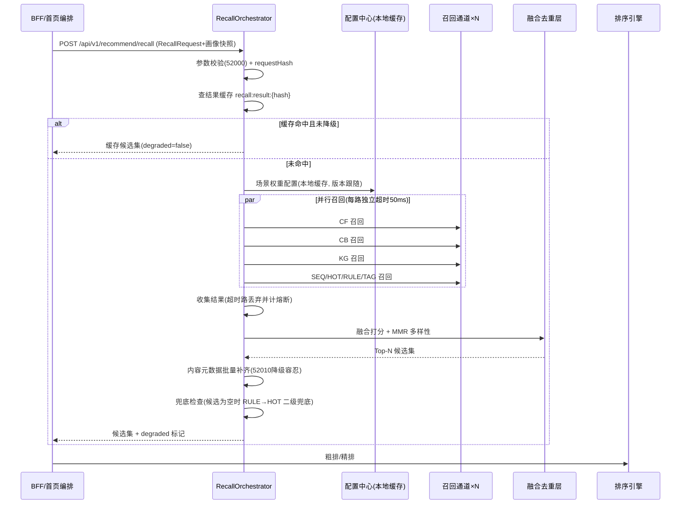

# 服务端-学生用户学习内容推荐候选集生成与多路召回融合引擎-详细设计

## 1. 概述

### 1.1 功能定位

本引擎是 PrimeTop 个性化推荐系统的**候选集生成层（Candidate Generation Layer）**，位于推荐系统架构的最前端。负责从海量教育内容库中，通过多路召回策略快速筛选出与当前学生相关的候选内容集合，输送给下游排序引擎进行精排。

```
学生请求 → [多路召回引擎] → 候选集融合去重 → [粗排引擎] → Top-N候选集 → [精排引擎] → 最终推荐列表
              ↑ 本文档覆盖范围 ↑        ↑ 本文档覆盖范围 ↑
```

### 1.2 设计目标

| 指标 | 目标值 | 说明 |
| --- | --- | --- |
| 召回响应延迟 | P99 ≤ 80ms | 多路并行召回，取最快返回 |
| 候选集大小 | 200~500条 | 融合去重后送入粗排 |
| 召回覆盖率 | ≥ 95% | 学生感兴趣内容被召回的比例 |
| 召回多样性 | 类别覆盖 ≥ 5个 | 候选集覆盖的学科/内容类型数 |
| 可扩展性 | 插件化召回通道 | 新增召回策略不改核心流程 |

### 1.3 适用范围

- 首页学习内容卡片推荐
- 同步课堂章节关联内容推荐
- 错题复习后的巩固练习推荐
- AI 辅导对话结束后的拓展学习推荐
- 学习计划完成后的下一步内容推荐

---

## 2. 整体架构

### 2.1 系统架构图

```
┌──────────────────────────────────────────────────────────────────────┐
│                        召回编排控制器 (RecallOrchestrator)              │
│  ┌──────────┐ ┌──────────┐ ┌──────────┐ ┌──────────┐ ┌──────────┐  │
│  │ 请求预处理 │ │ 召回通道  │ │ 超时控制  │ │ 结果收集  │ │ 降级策略  │  │
│  │ & 上下文   │ │ 并行调度  │ │ & 熔断    │ │ & 合并    │ │ & 兜底    │  │
│  └──────────┘ └──────────┘ └──────────┘ └──────────┘ └──────────┘  │
└──────────────┬───────────────────────────────────────────────────────┘
               │ 并行分发
    ┌──────────┼──────────┬──────────┬──────────┬──────────┐
    ▼          ▼          ▼          ▼          ▼          ▼
┌────────┐┌────────┐┌────────┐┌────────┐┌────────┐┌────────┐
│协同过滤 ││内容相似 ││知识图谱 ││行为序列 ││热门趋势 ││策略规则 │
│召回通道 ││召回通道 ││召回通道 ││召回通道 ││召回通道 ││召回通道 │
│  (CF)  ││ (CB)   ││ (KG)   ││ (SEQ)  ││ (HOT)  ││ (RULE) │
└───┬────┘└───┬────┘└───┬────┘└───┬────┘└───┬────┘└───┬────┘
    │         │         │         │         │         │
    └─────────┴─────────┴─────────┴─────────┴─────────┘
                              │
                    ┌─────────▼─────────┐
                    │  候选集融合去重层   │
                    │  (Merge & Dedup)  │
                    └─────────┬─────────┘
                              │
                    ┌─────────▼─────────┐
                    │  粗排打分引擎      │
                    │  (Rough Ranking)  │
                    └─────────┬─────────┘
                              │
                    ┌─────────▼─────────┐
                    │  候选集输出        │
                    │  Top-N Candidates │
                    └───────────────────┘
```

### 2.2 核心组件职责

| 组件 | 职责 | 技术选型 |
| --- | --- | --- |
| RecallOrchestrator | 召回流程编排、并行调度、超时控制 | Java + CompletableFuture |
| CF Recall Channel | 基于协同过滤的召回 | Redis + 离线计算矩阵 |
| CB Recall Channel | 基于内容相似度的召回 | Milvus 向量检索 |
| KG Recall Channel | 基于知识图谱关联的召回 | Neo4j / 内存图 |
| SEQ Recall Channel | 基于行为序列模式的召回 | Flink 离线挖掘 + Redis 在线查询 |
| HOT Recall Channel | 热门趋势内容召回 | Redis Sorted Set |
| RULE Recall Channel | 基于业务规则的兜底召回 | Drools / 硬编码规则 |
| Merge & Dedup | 多路结果融合、去重、来源标记 | Java 流式处理 |
| Rough Ranker | 轻量级粗排打分 | GBDT / 浅层模型 |

---

## 3. 数据结构定义

### 3.1 召回请求结构

```java
/**
 * 召回请求 - 封装学生当前上下文信息
 */
@Data
@Builder
public class RecallRequest {
    /** 学生ID */
    private Long studentId;
    
    /** 学段: KINDERGARTEN / PRIMARY / JUNIOR / SENIOR */
    private StageEnum stage;
    
    /** 年级，如 "三年级" / "初二" / "高三" */
    private String grade;
    
    /** 当前学科（可为null表示跨学科推荐） */
    private SubjectEnum subject;
    
    /** 教材版本ID */
    private String textbookVersionId;
    
    /** 当前章节ID（同步课堂场景） */
    private String chapterId;
    
    /** 当前知识点ID（用于精确召回） */
    private String knowledgePointId;
    
    /** 推荐场景 */
    private RecallSceneEnum scene;
    
    /** 学生当前能力画像快照 */
    private StudentProfileSnapshot profile;
    
    /** 排除已看过的内容ID集合 */
    private Set<String> excludeContentIds;
    
    /** 期望召回数量 */
    private int expectCount;
    
    /** 请求时间戳 */
    private long timestamp;
}
```

### 3.2 推荐场景枚举

```java
/**
 * 推荐场景类型 - 决定召回通道权重分配
 */
public enum RecallSceneEnum {
    /** 首页工作台推荐 */
    HOME_FEED("首页推荐", 50),
    
    /** 同步课堂章节学习 */
    CHAPTER_LEARN("章节学习", 80),
    
    /** 错题复习后巩固 */
    ERROR_REVIEW_FOLLOW("错题巩固", 60),
    
    /** AI对话结束拓展 */
    AI_DIALOG_FOLLOW("AI对话拓展", 40),
    
    /** 学习计划任务推荐 */
    STUDY_PLAN_TASK("计划任务", 70),
    
    /** 搜索后推荐 */
    SEARCH_FOLLOW("搜索后推", 55),
    
    /** 课间/碎片化学习 */
    MICRO_LEARNING("碎片化学习", 30);
    
    private final String description;
    /** 默认期望召回总数 */
    private final int defaultCount;
    
    RecallSceneEnum(String desc, int count) {
        this.description = desc;
        this.defaultCount = count;
    }
}
```

### 3.3 候选项数据结构

```java
/**
 * 召回候选项 - 单条召回结果
 */
@Data
@Builder
public class RecallCandidate {
    /** 内容ID */
    private String contentId;
    
    /** 内容类型: VIDEO / ARTICLE / EXERCISE / CARD / INTERACTIVE */
    private ContentTypeEnum contentType;
    
    /** 学科 */
    private SubjectEnum subject;
    
    /** 关联知识点列表 */
    private List<String> knowledgePointIds;
    
    /** 来源召回通道 */
    private RecallChannelEnum sourceChannel;
    
    /** 该通道给出的原始分数 (0~1) */
    private float channelScore;
    
    /** 召回原因（可解释性） */
    private String recallReason;
    
    /** 内容元数据快照 */
    private ContentMetaSnapshot meta;
}
```

### 3.4 内容元数据快照

```java
/**
 * 内容元数据快照 - 从内容服务获取的轻量级信息
 */
@Data
@Builder
public class ContentMetaSnapshot {
    /** 内容标题 */
    private String title;
    /** 难度等级 1-10 */
    private int difficultyLevel;
    /** 预计学习时长（分钟） */
    private int estimatedMinutes;
    /** 内容标签 */
    private Set<String> tags;
    /** 内容状态: DRAFT / PUBLISHED / ARCHIVED */
    private String status;
    /** 适合学段列表 */
    private Set<StageEnum> suitableStages;
    /** 关联教材版本 */
    private Set<String> textbookVersionIds;
    /** 内容质量评分 0~100 */
    private int qualityScore;
    /** 最近7天曝光量 */
    private long weeklyExposureCount;
    /** 最近7天完播率 */
    private float weeklyCompletionRate;
}
```

### 3.5 召回通道注册项

```java
/**
 * 召回通道注册项 - 描述一个召回通道的元信息
 */
@Data
@Builder
public class RecallChannelRegistration {
    /** 通道标识 */
    private RecallChannelEnum channel;
    
    /** 通道实现类 */
    private Class<? extends RecallChannel> implementation;
    
    /** 默认权重 (融合时使用) */
    private float defaultWeight;
    
    /** 该通道召回数量 */
    private int recallCount;
    
    /** 超时时间(ms) */
    private int timeoutMs;
    
    /** 是否启用 */
    private boolean enabled;
    
    /** 降级策略 */
    private DegradationStrategy degradationStrategy;
    
    /** 适用场景 (为空表示所有场景) */
    private Set<RecallSceneEnum> applicableScenes;
}
```

### 3.6 召回通道枚举

```java
/**
 * 召回通道类型
 */
public enum RecallChannelEnum {
    /** 协同过滤 - "学了这些内容的学生还学了..." */
    CF("协同过滤召回"),
    
    /** 内容相似 - "与当前内容相似的内容" */
    CB("内容相似召回"),
    
    /** 知识图谱 - "知识点关联内容" */
    KG("知识图谱召回"),
    
    /** 行为序列 - "基于学习行为序列模式" */
    SEQ("行为序列召回"),
    
    /** 热门趋势 - "其他学生在学什么" */
    HOT("热门趋势召回"),
    
    /** 规则策略 - "基于业务规则兜底" */
    RULE("规则策略召回"),
    
    /** 个性化标签 - "基于学生兴趣标签" */
    TAG("兴趣标签召回");
    
    private final String description;
    
    RecallChannelEnum(String desc) {
        this.description = desc;
    }
}
```

---

## 4. 召回通道详细设计

### 4.1 协同过滤召回通道 (CF Recall)

#### 4.1.1 算法选型

采用 **基于物品的协同过滤 (Item-Based CF)** 作为主要算法，原因：
- 教育内容相对稳定，物品相似度矩阵可离线预计算
- 学生行为稀疏，Item-CF 比 User-CF 更稳定
- 结果可解释性强（"因为学了A，推荐相似的B"）

#### 4.1.2 离线计算流程

```
每日凌晨2:00 离线任务执行：

Step 1: 提取近30天学生学习行为数据
  - 数据来源: learning_behavior_log 表
  - 行为类型: VIEW(1.0), COMPLETE(2.0), FAVORITE(3.0), EXERCISE_CORRECT(1.5)
  - 输出: (student_id, content_id, weight_score) 三元组

Step 2: 构建物品共现矩阵
  - 对每个学生，其学习过的内容两两组合，累加权重
  - 输出: item_co_occurrence[contentA][contentB] = 共现得分

Step 3: 计算物品相似度矩阵 (余弦相似度)
  - sim(A, B) = co_occurrence[A][B] / sqrt(|A_students| × |B_students|)
  - 非对称权重: 考虑物品热度，降低热门物品的推荐权重
  - 公式: sim_asym(A→B) = sim(A,B) / log(1 + popularity(B))
  - 输出: 存入 Redis Sorted Set: cf:sim:{contentId} → (relatedContentId, score)

Step 4: 生成学生推荐候选预计算表
  - 对每个活跃学生，基于其最近学习内容，聚合相似内容
  - 输出: 存入 Redis: cf:candidates:{studentId} → List<(contentId, score)>
```

#### 4.1.3 在线召回逻辑

```java
/**
 * 协同过滤召回通道实现
 */
@Component
@ChannelType(RecallChannelEnum.CF)
public class CFRecallChannel implements RecallChannel {
    
    @Resource
    private RedisTemplate<String, String> redisTemplate;
    
    private static final String CF_CANDIDATES_KEY = "cf:candidates:";
    private static final String CF_SIM_KEY = "cf:sim:";
    
    @Override
    public List<RecallCandidate> recall(RecallRequest request, int count) {
        Long studentId = request.getStudentId();
        
        // Step 1: 尝试从预计算缓存获取
        String cacheKey = CF_CANDIDATES_KEY + studentId;
        Set<ZSetOperations.TypedTuple<String>> cached = 
            redisTemplate.opsForZSet().reverseRangeByScoreWithScores(
                cacheKey, 0, Double.MAX_VALUE, 0, count);
        
        List<RecallCandidate> candidates = new ArrayList<>();
        
        if (cached != null && !cached.isEmpty()) {
            // 使用预计算结果
            for (ZSetOperations.TypedTuple<String> tuple : cached) {
                String contentId = tuple.getValue();
                double score = tuple.getScore();
                
                // 排除已学习内容
                if (request.getExcludeContentIds().contains(contentId)) {
                    continue;
                }
                
                candidates.add(buildCandidate(contentId, score, 
                    "与你最近学习的内容相似"));
            }
        }
        
        // Step 2: 如果预计算不足，基于最近学习内容实时扩展召回
        if (candidates.size() < count) {
            List<String> recentContentIds = getRecentLearnedContentIds(studentId, 5);
            for (String recentId : recentContentIds) {
                String simKey = CF_SIM_KEY + recentId;
                Set<ZSetOperations.TypedTuple<String>> simItems = 
                    redisTemplate.opsForZSet().reverseRangeByScoreWithScores(
                        simKey, 0.1, Double.MAX_VALUE, 0, count / recentContentIds.size());
                
                if (simItems != null) {
                    for (ZSetOperations.TypedTuple<String> tuple : simItems) {
                        String contentId = tuple.getValue();
                        if (request.getExcludeContentIds().contains(contentId)) continue;
                        if (candidates.stream().anyMatch(c -> c.getContentId().equals(contentId))) 
                            continue;
                        
                        candidates.add(buildCandidate(contentId, tuple.getScore(),
                            "因为你最近学了相关内容"));
                    }
                }
            }
        }
        
        return candidates.stream()
            .limit(count)
            .collect(Collectors.toList());
    }
    
    private RecallCandidate buildCandidate(String contentId, double score, String reason) {
        return RecallCandidate.builder()
            .contentId(contentId)
            .sourceChannel(RecallChannelEnum.CF)
            .channelScore((float) Math.min(score, 1.0))
            .recallReason(reason)
            .build();
    }
    
    private List<String> getRecentLearnedContentIds(Long studentId, int limit) {
        // 从学生学习记录服务获取最近学习的内容ID
        String key = "student:recent:" + studentId;
        List<String> recent = redisTemplate.opsForList().range(key, 0, limit - 1);
        return recent != null ? recent : Collections.emptyList();
    }
}
```

#### 4.1.4 离线计算SQL（参考）

```sql
-- Step 1: 提取近30天学生内容交互数据
CREATE TABLE IF NOT EXISTS dw.student_content_interaction_30d AS
SELECT 
    student_id,
    content_id,
    -- 行为加权: 完成权重最高，浏览最低
    SUM(
        CASE behavior_type
            WHEN 'COMPLETE' THEN 2.0
            WHEN 'FAVORITE' THEN 3.0
            WHEN 'EXERCISE_CORRECT' THEN 1.5
            WHEN 'VIEW' THEN 1.0
            ELSE 0.5
        END
    ) AS interaction_score
FROM ods.learning_behavior_log
WHERE event_time >= DATE_SUB(CURRENT_DATE, 30)
  AND student_id IS NOT NULL
  AND content_id IS NOT NULL
GROUP BY student_id, content_id
HAVING interaction_score > 0;

-- Step 2: 构建物品共现矩阵
CREATE TABLE IF NOT EXISTS dw.item_co_occurrence AS
SELECT 
    a.content_id AS content_a,
    b.content_id AS content_b,
    SUM(LEAST(a.interaction_score, b.interaction_score)) AS co_score
FROM dw.student_content_interaction_30d a
JOIN dw.student_content_interaction_30d b 
    ON a.student_id = b.student_id 
    AND a.content_id < b.content_id  -- 避免自对和重复对
GROUP BY a.content_id, b.content_id;

-- Step 3: 计算非对称相似度
CREATE TABLE IF NOT EXISTS dw.item_similarity AS
SELECT 
    co.content_a,
    co.content_b,
    -- 非对称余弦相似度
    co.co_score / (
        SQRT(a_pop.popularity) * SQRT(b_pop.popularity) * 
        LOG(1 + b_pop.popularity)  -- 降低热门物品权重
    ) AS sim_score
FROM dw.item_co_occurrence co
JOIN (
    SELECT content_id, COUNT(DISTINCT student_id) AS popularity
    FROM dw.student_content_interaction_30d
    GROUP BY content_id
) a_pop ON co.content_a = a_pop.content_id
JOIN (
    SELECT content_id, COUNT(DISTINCT student_id) AS popularity
    FROM dw.student_content_interaction_30d
    GROUP BY content_id
) b_pop ON co.content_b = b_pop.content_id
WHERE co.co_score >= 3  -- 最小共现阈值
ORDER BY co.content_a, sim_score DESC;
```

---

### 4.2 内容相似召回通道 (CB Recall)

#### 4.2.1 算法设计

基于内容的**语义向量相似度**召回，使用教育内容嵌入向量进行近邻检索。

```
内容向量化流程:
  原始内容 → 文本/标题/标签提取 → 预训练Embedding模型 → 768维向量 → Milvus索引
```

#### 4.2.2 在线召回实现

```java
/**
 * 内容相似召回通道 - 基于向量近邻检索
 */
@Component
@ChannelType(RecallChannelEnum.CB)
public class CBRecallChannel implements RecallChannel {
    
    @Resource
    private MilvusClient milvusClient;
    
    @Resource
    private ContentEmbeddingService embeddingService;
    
    private static final String COLLECTION_NAME = "content_embeddings";
    private static final int VECTOR_DIM = 768;
    
    @Override
    public List<RecallCandidate> recall(RecallRequest request, int count) {
        // 获取种子内容向量
        List<Float> seedVector = getSeedVector(request);
        if (seedVector == null || seedVector.isEmpty()) {
            return Collections.emptyList();
        }
        
        // 构建过滤表达式
        String filterExpr = buildFilterExpression(request);
        
        // Milvus 向量近邻检索
        SearchParam searchParam = SearchParam.newBuilder()
            .withCollectionName(COLLECTION_NAME)
            .withVectors(List.of(new FloatVec(seedVector)))
            .withVectorFieldName("embedding")
            .withTopK(count * 2)  // 多检索一些，过滤后保留count条
            .withMetricType(MetricType.COSINE)
            .withExpr(filterExpr)
            .withOutFields(Arrays.asList("content_id", "subject", "content_type", "difficulty"))
            .build();
        
        R<SearchResults> searchResponse = milvusClient.search(searchParam);
        
        if (searchResponse.getStatus() != R.Status.Success.getCode()) {
            log.warn("Milvus search failed: {}", searchResponse.getMessage());
            return Collections.emptyList();
        }
        
        List<RecallCandidate> candidates = new ArrayList<>();
        List<IDQueryResult> results = searchResponse.getData().getResults();
        
        for (IDQueryResult result : results) {
            String contentId = result.getEntity().get("content_id").toString();
            
            // 排除已学习内容
            if (request.getExcludeContentIds().contains(contentId)) continue;
            
            float score = result.getScore();  // 余弦相似度 0~1
            
            // 学段适配过滤
            ContentTypeEnum contentType = ContentTypeEnum.valueOf(
                result.getEntity().get("content_type").toString());
            
            candidates.add(RecallCandidate.builder()
                .contentId(contentId)
                .contentType(contentType)
                .sourceChannel(RecallChannelEnum.CB)
                .channelScore(score)
                .recallReason("内容主题与当前学习相关")
                .build());
            
            if (candidates.size() >= count) break;
        }
        
        return candidates;
    }
    
    /**
     * 根据推荐场景获取种子向量
     */
    private List<Float> getSeedVector(RecallRequest request) {
        // 场景1: 有当前章节 → 使用章节内容的平均向量
        if (request.getChapterId() != null) {
            return embeddingService.getChapterCentroidVector(request.getChapterId());
        }
        
        // 场景2: 有当前知识点 → 使用知识点描述向量
        if (request.getKnowledgePointId() != null) {
            return embeddingService.getKnowledgePointVector(request.getKnowledgePointId());
        }
        
        // 场景3: 使用学生兴趣画像向量
        if (request.getProfile() != null && request.getProfile().getInterestVector() != null) {
            return request.getProfile().getInterestVector();
        }
        
        // 场景4: 使用最近学习内容的向量
        return embeddingService.getStudentRecentCentroid(request.getStudentId());
    }
    
    /**
     * 构建过滤表达式 - 保证召回内容的适用性
     */
    private String buildFilterExpression(RecallRequest request) {
        List<String> conditions = new ArrayList<>();
        
        // 学段过滤
        conditions.add(String.format("stage == \"%s\"", request.getStage().name()));
        
        // 学科过滤（指定学科场景）
        if (request.getSubject() != null) {
            conditions.add(String.format("subject == \"%s\"", request.getSubject().name()));
        }
        
        // 难度过滤 - 基于学生能力 ±2 范围
        if (request.getProfile() != null) {
            int ability = request.getProfile().getAbilityLevel();
            int minDiff = Math.max(1, ability - 2);
            int maxDiff = Math.min(10, ability + 2);
            conditions.add(String.format("difficulty >= %d && difficulty <= %d", 
                minDiff, maxDiff));
        }
        
        // 内容状态过滤
        conditions.add("status == \"PUBLISHED\"");
        
        return String.join(" && ", conditions);
    }
}
```

---

### 4.3 知识图谱召回通道 (KG Recall)

#### 4.3.1 设计思路

利用知识点之间的**前置依赖、后续延伸、同源类比**关系，通过知识图谱进行多跳关联召回。

```
知识点关系类型:
  - PREREQUISITE: A 是 B 的前置知识点
  - FOLLOW_UP: A 学完后应该学的下一步
  - RELATED_TO: A 与 B 属于同一知识体系
  - ANALOGOUS_TO: A 与 B 是类比关系（如: 加法↔乘法）
  - CROSS_SUBJECT: A 与其他学科的知识点关联
```

#### 4.3.2 实现代码

```java
/**
 * 知识图谱召回通道
 */
@Component
@ChannelType(RecallChannelEnum.KG)
public class KGRecallChannel implements RecallChannel {
    
    @Resource
    private KnowledgeGraphService graphService;
    
    @Resource
    private ContentKnowledgePointService ckpService;
    
    @Override
    public List<RecallCandidate> recall(RecallRequest request, int count) {
        List<RecallCandidate> candidates = new ArrayList<>();
        
        // 确定种子知识点
        List<String> seedKpIds = determineSeedKnowledgePoints(request);
        if (seedKpIds.isEmpty()) return candidates;
        
        // 多跳检索: 1跳(FOLLOW_UP) + 1跳(RELATED_TO) + 2跳(延伸)
        int perHop = count / 3;
        
        // Hop 1: 后续知识点内容 (权重最高)
        List<KpRelation> followUps = graphService.findRelations(
            seedKpIds, RelationType.FOLLOW_UP, perHop);
        for (KpRelation rel : followUps) {
            List<String> contentIds = ckpService.getContentByKnowledgePoint(
                rel.getTargetKpId(), request.getStage());
            for (String contentId : contentIds) {
                if (request.getExcludeContentIds().contains(contentId)) continue;
                candidates.add(RecallCandidate.builder()
                    .contentId(contentId)
                    .sourceChannel(RecallChannelEnum.KG)
                    .channelScore(0.9f * rel.getConfidence())
                    .knowledgePointIds(List.of(rel.getTargetKpId()))
                    .recallReason("当前知识点的下一步学习")
                    .build());
            }
        }
        
        // Hop 2: 关联知识点内容
        List<KpRelation> related = graphService.findRelations(
            seedKpIds, RelationType.RELATED_TO, perHop);
        for (KpRelation rel : related) {
            List<String> contentIds = ckpService.getContentByKnowledgePoint(
                rel.getTargetKpId(), request.getStage());
            for (String contentId : contentIds) {
                if (request.getExcludeContentIds().contains(contentId)) continue;
                if (candidates.stream().anyMatch(c -> c.getContentId().equals(contentId))) continue;
                candidates.add(RecallCandidate.builder()
                    .contentId(contentId)
                    .sourceChannel(RecallChannelEnum.KG)
                    .channelScore(0.7f * rel.getConfidence())
                    .knowledgePointIds(List.of(rel.getTargetKpId()))
                    .recallReason("与当前知识点相关联")
                    .build());
            }
        }
        
        // Hop 3: 弱项前置知识补救 (如果学生该知识点掌握度低)
        StudentProfileSnapshot profile = request.getProfile();
        if (profile != null) {
            List<String> weakKps = profile.getWeakKnowledgePoints();
            if (weakKps != null && !weakKps.isEmpty()) {
                List<KpRelation> prereqs = graphService.findRelations(
                    weakKps, RelationType.PREREQUISITE, perHop);
                for (KpRelation rel : prereqs) {
                    List<String> contentIds = ckpService.getContentByKnowledgePoint(
                        rel.getTargetKpId(), request.getStage());
                    for (String contentId : contentIds) {
                        if (request.getExcludeContentIds().contains(contentId)) continue;
                        if (candidates.stream().anyMatch(c -> c.getContentId().equals(contentId))) 
                            continue;
                        candidates.add(RecallCandidate.builder()
                            .contentId(contentId)
                            .sourceChannel(RecallChannelEnum.KG)
                            .channelScore(0.5f * rel.getConfidence())
                            .knowledgePointIds(List.of(rel.getTargetKpId()))
                            .recallReason("薄弱前置知识补救")
                            .build());
                    }
                }
            }
        }
        
        // Hop 4: 跨学科类比 (低权重, 拓宽视野)
        List<KpRelation> cross = graphService.findRelations(
            seedKpIds, RelationType.ANALOGOUS_TO, Math.max(1, perHop / 2));
        for (KpRelation rel : cross) {
            List<String> contentIds = ckpService.getContentByKnowledgePoint(
                rel.getTargetKpId(), request.getStage());
            for (String contentId : contentIds) {
                if (request.getExcludeContentIds().contains(contentId)) continue;
                if (candidates.stream().anyMatch(c -> c.getContentId().equals(contentId)))
                    continue;
                candidates.add(RecallCandidate.builder()
                    .contentId(contentId)
                    .sourceChannel(RecallChannelEnum.KG)
                    .channelScore(0.4f * rel.getConfidence())
                    .knowledgePointIds(List.of(rel.getTargetKpId()))
                    .recallReason("跨学科类比拓展")
                    .build());
            }
        }
        
        return candidates.stream()
            .limit(count)
            .collect(Collectors.toList());
    }
    
    /**
     * 确定种子知识点集合
     * 优先级: 当前知识点 > 当前章节知识点 > 学生弱项知识点
     */
    private List<String> determineSeedKnowledgePoints(RecallRequest request) {
        // 场景1: 有明确知识点(拍题/章节学习场景)
        if (request.getKnowledgePointId() != null) {
            return List.of(request.getKnowledgePointId());
        }
        // 场景2: 有章节 → 取章节关联知识点
        if (request.getChapterId() != null) {
            List<String> kps = ckpService.getKnowledgePointsByChapter(
                request.getChapterId());
            if (!kps.isEmpty()) return kps;
        }
        // 场景3: 学生弱项知识点(上限5个, 避免图谱扩散过宽)
        StudentProfileSnapshot profile = request.getProfile();
        if (profile != null && profile.getWeakKnowledgePoints() != null) {
            return profile.getWeakKnowledgePoints().stream()
                .limit(5)
                .collect(Collectors.toList());
        }
        return Collections.emptyList();
    }
}
```

#### 4.3.3 性能与缓存设计

| 优化点 | 方案 | 指标 |
| --- | --- | --- |
| 图扩展结果缓存 | `graph:expand:{kpId}:{relType}` Redis Hash, EX=6h | 缓存命中率 ≥ 70%, 单次查询 P99 ≤ 15ms |
| 多跳深度限制 | 最多 2 跳, 每跳候选上限 perHop | 防止图谱稠密区域扩散爆炸 |
| 章节-KP 映射缓存 | `graph:chapter:kps:{chapterId}` Redis String, EX=24h | 章节场景免去重复查库 |
| 知识图谱读模型 | 在线读 Neo4j 只读副本 / 内存图快照(每日全量加载) | 快照加载失败时降级走副本, 不回源主库 |
| 跨路去重 | 融合层统一去重(见 §4.8), 单通道内仅粗去重 | 单通道内先用 HashSet 防 N² 比较 |

---

### 4.4 行为序列召回通道 (SEQ Recall)

#### 4.4.1 设计思路

基于**学生学习行为序列模式**召回: 离线挖掘高频学习路径(如「学了分数学完分数加减的学生, 80% 接下来学分数乘除」), 在线根据学生最近学习的内容查询其路径后继。

```
离线挖掘(Flink, 每日凌晨 3:00):
  输入: learning_behavior_log 近 60 天 (student_id, content_id, event_ts)
  Step 1: 按学生分组按时间排序, 生成内容访问序列
  Step 2: 滑动窗口(窗口=2)提取转移对 (contentA → contentB)
  Step 3: 统计 support = count(A→B) / count(A), 过滤 support ≥ 0.02 且共现 ≥ 5
  Step 4: 写入 Redis: seq:pattern:{contentA} → ZSET(contentB, confidence)

在线查询:
  学生最近学的内容 recentIds(3条) → 查 seq:pattern:* → 合并按 confidence 排序
```

#### 4.4.2 实现代码

```java
/**
 * 行为序列召回通道
 */
@Component
@ChannelType(RecallChannelEnum.SEQ)
public class SEQRecallChannel implements RecallChannel {
    
    @Resource
    private RedisTemplate<String, String> redisTemplate;
    
    private static final String SEQ_PATTERN_KEY = "seq:pattern:";
    private static final double MIN_CONFIDENCE = 0.2;  // 最小置信度门槛
    
    @Override
    public List<RecallCandidate> recall(RecallRequest request, int count) {
        // 冷启动: 无最近学习记录则本通道返回空(由 RULE/HOT 兜底)
        List<String> recentIds = getRecentLearnedContentIds(
            request.getStudentId(), 3);
        if (recentIds.isEmpty()) {
            return Collections.emptyList();
        }
        
        List<RecallCandidate> candidates = new ArrayList<>();
        int perRecent = Math.max(1, count / recentIds.size());
        
        for (String recentId : recentIds) {
            String key = SEQ_PATTERN_KEY + recentId;
            Set<ZSetOperations.TypedTuple<String>> patterns = 
                redisTemplate.opsForZSet().reverseRangeByScoreWithScores(
                    key, MIN_CONFIDENCE, Double.MAX_VALUE, 0, perRecent);
            
            if (patterns == null) continue;
            
            for (ZSetOperations.TypedTuple<String> tuple : patterns) {
                String contentId = tuple.getValue();
                double confidence = tuple.getScore();
                
                if (request.getExcludeContentIds().contains(contentId)) continue;
                if (candidates.stream().anyMatch(c -> c.getContentId().equals(contentId)))
                    continue;
                
                candidates.add(RecallCandidate.builder()
                    .contentId(contentId)
                    .sourceChannel(RecallChannelEnum.SEQ)
                    .channelScore((float) Math.min(confidence * 0.8, 1.0))
                    .recallReason("学习路径上的下一步推荐")
                    .build());
            }
        }
        
        return candidates.stream()
            .sorted(Comparator.comparingDouble(RecallCandidate::getChannelScore).reversed())
            .limit(count)
            .collect(Collectors.toList());
    }
    
    private List<String> getRecentLearnedContentIds(Long studentId, int limit) {
        String key = "student:recent:" + studentId;
        List<String> recent = redisTemplate.opsForList().range(key, 0, limit - 1);
        return recent != null ? recent : Collections.emptyList();
    }
}
```

#### 4.4.3 数据时效与口径

| 项 | 口径 |
| --- | --- |
| 行为窗口 | 近 60 天, 早于窗口的转移对不参与计算 |
| 更新频率 | 每日凌晨 3:00 全量重建(先写临时 key, RENAME 原子切换) |
| 冷启动学生 | 本通道返回空, 不制造伪个性化 |
| 置信度衰减 | confidence 按 `exp(-age_days/60)` 在离线侧先行衰减 |

---

### 4.5 热门趋势召回通道 (HOT Recall)

#### 4.5.1 设计思路

基于**群体热度**的召回, 承担两项职责: ① 新用户/冷启动学生的兜底候选; ② 多路融合中的多样性补位(热门内容天然跨人群)。

热度分计算(离线小时级更新):

```
hot_score = Σ(behavior_weight × exp(-age_hours / 72)) / log(1 + exposure_count)

behavior_weight: COMPLETE=2.0, FAVORITE=3.0, EXERCISE_CORRECT=1.5, VIEW=1.0

入榜质量门槛(入榜前过滤, G2/G5 的离线镜像):
  - 内容状态 = PUBLISHED
  - 近7天完播率 ≥ 0.4
  - 内容质量评分 ≥ 60
  - 适龄分级通过且非营销/广告内容
```

#### 4.5.2 实现代码

```java
/**
 * 热门趋势召回通道
 */
@Component
@ChannelType(RecallChannelEnum.HOT)
public class HOTRecallChannel implements RecallChannel {
    
    @Resource
    private RedisTemplate<String, String> redisTemplate;
    
    private static final String HOT_KEY_PREFIX = "hot:content:";
    
    @Override
    public List<RecallCandidate> recall(RecallRequest request, int count) {
        // 榜单 key 按学段+学科分片; 跨学科场景用 ALL 榜
        String subjectPart = request.getSubject() != null 
            ? request.getSubject().name() : "ALL";
        String key = HOT_KEY_PREFIX + request.getStage().name() + ":" + subjectPart;
        
        Set<ZSetOperations.TypedTuple<String>> hotItems = 
            redisTemplate.opsForZSet().reverseRangeByScoreWithScores(
                key, 0, Double.MAX_VALUE, 0, count * 2);
        
        if (hotItems == null || hotItems.isEmpty()) {
            return Collections.emptyList();
        }
        
        List<RecallCandidate> candidates = new ArrayList<>();
        StudentProfileSnapshot profile = request.getProfile();
        
        for (ZSetOperations.TypedTuple<String> tuple : hotItems) {
            String contentId = tuple.getValue();
            if (request.getExcludeContentIds().contains(contentId)) continue;
            
            double score = tuple.getScore();
            String reason = "同学段同学都在学";
            
            // 已掌握知识点相关内容降权(避免反复推已会内容)
            if (profile != null && profile.getMasteredKnowledgePoints() != null) {
                // 元数据中的知识点与已掌握列表命中时降权 30%
                // (精确 KP 匹配在融合层完成, 此处仅做粗粒度热度衰减提示)
                score *= 0.97;
            }
            
            candidates.add(RecallCandidate.builder()
                .contentId(contentId)
                .sourceChannel(RecallChannelEnum.HOT)
                .channelScore((float) Math.min(score, 1.0))
                .recallReason(reason)
                .build());
            
            if (candidates.size() >= count) break;
        }
        
        return candidates;
    }
}
```

#### 4.5.3 热度榜单刷新

| 项 | 方案 |
| --- | --- |
| 刷新频率 | 每小时增量更新 + 每日凌晨 2:30 全量重建 |
| 原子切换 | 离线任务写 `hot:content:*:tmp`, 校验后 RENAME |
| 榜单规模 | 每学段×学科分片保留 Top 2000 |
| 时效衰减 | 72 小时半衰期, 防止旧热点长期霸榜 |

---

### 4.6 规则策略召回通道 (RULE Recall)

#### 4.6.1 设计思路

基于**硬性业务规则**的召回, 是全链路最后的兜底通道, 任何其他通道全部失效时也必须能返回合规候选。规则包由配置中心版本化管理, 支持按场景启用/停用。

```
规则包(配置中心 recall.rule.packs, 版本化):

  RULE_EXAM_ALIGN(考期对齐):
    条件: 学生考试日历中存在 ≤14 天的考试科目
    动作: 该科目考点关联内容(近3年高频考点) recallCount+50%, channelScore=0.75

  RULE_TEXTBOOK_SYNC(教材同步):
    条件: request.chapterId 非空
    动作: 当前章节的下一课预习内容 + 本课巩固内容, channelScore=0.8

  RULE_MISTAKE_CONSOLIDATE(错题巩固):
    条件: 当日有新增错题且错题巩固任务未完成
    动作: 错题知识点下未做过的同难度题目, channelScore=0.85

  RULE_SERIES_CONTINUE(系列续学):
    条件: 存在未完成的多集课程系列
    动作: 该系列下一集, channelScore=0.9

守卫: 规则包评估只读配置与学生画像快照, 不产生副作用; 无命中规则时返回空。
```

#### 4.6.2 实现代码

```java
/**
 * 规则策略召回通道
 */
@Component
@ChannelType(RecallChannelEnum.RULE)
public class RULERecallChannel implements RecallChannel {
    
    @Resource
    private RulePackLoader rulePackLoader;
    
    @Resource
    private ExamCalendarClient examCalendarClient;
    
    @Resource
    private MistakeBookClient mistakeBookClient;
    
    @Override
    public List<RecallCandidate> recall(RecallRequest request, int count) {
        List<RulePack> packs = rulePackLoader.loadActivePacks(request.getScene());
        List<RecallCandidate> candidates = new ArrayList<>();
        Set<String> seen = new HashSet<>();
        
        for (RulePack pack : packs) {
            if (candidates.size() >= count) break;
            
            switch (pack.getRuleType()) {
                case RULE_EXAM_ALIGN: {
                    List<ExamInfo> upcoming = examCalendarClient
                        .getUpcomingExams(request.getStudentId(), 14);
                    for (ExamInfo exam : upcoming) {
                        // 考期科目考点内容由考点服务提供(只读)
                        List<String> contentIds = exam.getHotspotContentIds();
                        for (String contentId : contentIds) {
                            if (seen.add(contentId) 
                                && !request.getExcludeContentIds().contains(contentId)) {
                                candidates.add(buildRuleCandidate(
                                    contentId, 0.75f, "考试临近, 优先复习高频考点"));
                            }
                        }
                    }
                    break;
                }
                case RULE_TEXTBOOK_SYNC: {
                    if (request.getChapterId() == null) break;
                    List<String> nextLessonIds = TextbookSyncHelper
                        .findNextLessonContents(request.getChapterId());
                    for (String contentId : nextLessonIds) {
                        if (seen.add(contentId)
                            && !request.getExcludeContentIds().contains(contentId)) {
                            candidates.add(buildRuleCandidate(
                                contentId, 0.8f, "同步教材: 下一课预习"));
                        }
                    }
                    break;
                }
                case RULE_MISTAKE_CONSOLIDATE: {
                    List<String> mistakeKps = mistakeBookClient
                        .getTodayMistakeKnowledgePoints(request.getStudentId());
                    for (String kpId : mistakeKps) {
                        List<String> exerciseIds = mistakeBookClient
                            .findUnpracticedExercises(kpId, request.getStudentId());
                        for (String contentId : exerciseIds) {
                            if (seen.add(contentId)
                                && !request.getExcludeContentIds().contains(contentId)) {
                                candidates.add(buildRuleCandidate(
                                    contentId, 0.85f, "今日错题知识点巩固"));
                            }
                        }
                    }
                    break;
                }
                default:
                    // 未知规则类型: 跳过并告警(配置向前兼容)
                    log.warn("Unknown rule type: {}", pack.getRuleType());
            }
        }
        
        return candidates.stream().limit(count).collect(Collectors.toList());
    }
    
    private RecallCandidate buildRuleCandidate(String contentId, float score, String reason) {
        return RecallCandidate.builder()
            .contentId(contentId)
            .sourceChannel(RecallChannelEnum.RULE)
            .channelScore(score)
            .recallReason(reason)
            .build();
    }
}
```

---

### 4.7 兴趣标签召回通道 (TAG Recall)

#### 4.7.1 设计思路

基于学生**兴趣标签亲和度**的召回。学生画像维护兴趣标签及亲和度(0~1, 由隐式反馈与显式选择共同计算, 权威归用户画像服务, 本引擎只读快照)。内容侧维护标签倒排索引。

```
Redis 倒排: tag:content:{tagId} → SET(contentId)  (由内容生产管线维护, 内容发布/下线时增量更新)
亲和度来源: profile.interestTags = [{tagId: "math_puzzle", affinity: 0.82}, ...]
```

#### 4.7.2 实现代码

```java
/**
 * 兴趣标签召回通道
 */
@Component
@ChannelType(RecallChannelEnum.TAG)
public class TAGRecallChannel implements RecallChannel {
    
    @Resource
    private RedisTemplate<String, String> redisTemplate;
    
    private static final String TAG_INDEX_KEY = "tag:content:";
    
    @Override
    public List<RecallCandidate> recall(RecallRequest request, int count) {
        StudentProfileSnapshot profile = request.getProfile();
        if (profile == null || profile.getInterestTags() == null 
            || profile.getInterestTags().isEmpty()) {
            return Collections.emptyList();
        }
        
        // 按亲和度降序取 Top5 标签
        List<InterestTag> topTags = profile.getInterestTags().stream()
            .sorted(Comparator.comparingDouble(InterestTag::getAffinity).reversed())
            .limit(5)
            .collect(Collectors.toList());
        
        List<RecallCandidate> candidates = new ArrayList<>();
        int perTag = Math.max(1, count / topTags.size());
        
        for (InterestTag tag : topTags) {
            Set<String> contentIds = redisTemplate.opsForSet()
                .members(TAG_INDEX_KEY + tag.getTagId());
            if (contentIds == null) continue;
            
            int taken = 0;
            for (String contentId : contentIds) {
                if (taken >= perTag) break;
                if (request.getExcludeContentIds().contains(contentId)) continue;
                if (candidates.stream().anyMatch(c -> c.getContentId().equals(contentId)))
                    continue;
                
                candidates.add(RecallCandidate.builder()
                    .contentId(contentId)
                    .sourceChannel(RecallChannelEnum.TAG)
                    .channelScore((float) (tag.getAffinity() * 0.9))
                    .recallReason("符合你的学习兴趣")
                    .build());
                taken++;
            }
        }
        
        return candidates;
    }
}
```

---

### 4.8 多路融合与去重层 (Merge & Dedup)

#### 4.8.1 融合打分公式

多路召回结果按 `contentId` 分组聚合, 融合分计算公式:

```
对内容 C, 命中的通道集合 H = {ch1, ch2, ...}:

sum_score   = Σ (weight_scene(ch) × channelScore(ch))       # 加权和
max_score   = max(channelScore(ch))                          # 单路最高分

融合分 fused(C) = max(sum_score, max_score × 1.15)

说明:
  - 多路命中加成上限 15%: 多通道共识是强相关信号, 但防止热门内容因多路低分叠加虚高
  - weight_scene(ch): 场景化通道权重(配置中心版本化, 见 §6.3), 全场景默认权重:
    CF=1.0, CB=0.9, KG=0.9, SEQ=0.8, HOT=0.5, RULE=0.8, TAG=0.7
```

#### 4.8.2 多样性保障 (MMR)

```
MMR(C) = λ × fused(C) - (1-λ) × max_{S∈已选} sim(C, S)

λ = 0.7 (相关性优先, 多样性补足)
sim: 内容向量余弦相似度(Milvus 返回的 embedding 或内容标签 Jaccard 近似)
目标: 候选集类别覆盖 ≥ 5 (学科×内容类型组合), 不足时在补位池按类别轮转补齐
```

#### 4.8.3 实现代码

```java
/**
 * 候选集融合去重器
 */
@Component
public class CandidateMerger {
    
    private static final double MULTI_HIT_BONUS_CAP = 1.15;
    private static final double MMR_LAMBDA = 0.7;
    
    /**
     * 多路融合主入口
     * @param channelResults 各通道召回结果(已按路去重)
     * @param config 场景权重配置(配置中心版本快照)
     * @param expectCount 期望输出候选数
     */
    public List<RecallCandidate> merge(
            Map<RecallChannelEnum, List<RecallCandidate>> channelResults,
            SceneWeightConfig config, 
            int expectCount) {
        
        // Step 1: 按 contentId 分组聚合
        Map<String, List<RecallCandidate>> byContent = new HashMap<>();
        for (Map.Entry<RecallChannelEnum, List<RecallCandidate>> entry 
                : channelResults.entrySet()) {
            for (RecallCandidate c : entry.getValue()) {
                byContent.computeIfAbsent(c.getContentId(), k -> new ArrayList<>()).add(c);
            }
        }
        
        // Step 2: 计算融合分
        List<MergedCandidate> merged = new ArrayList<>();
        for (Map.Entry<String, List<RecallCandidate>> entry : byContent.entrySet()) {
            List<RecallCandidate> hits = entry.getValue();
            
            double sumScore = 0.0;
            double maxScore = 0.0;
            List<RecallChannelEnum> hitChannels = new ArrayList<>();
            
            for (RecallCandidate c : hits) {
                float w = config.getWeight(c.getSourceChannel());
                sumScore += w * c.getChannelScore();
                maxScore = Math.max(maxScore, c.getChannelScore());
                hitChannels.add(c.getSourceChannel());
            }
            
            double fused = Math.max(sumScore, maxScore * MULTI_HIT_BONUS_CAP);
            
            // 保留最高分的候选作为载体(携带 meta/reason), 附加多路来源信息
            RecallCandidate carrier = hits.stream()
                .max(Comparator.comparingDouble(RecallCandidate::getChannelScore))
                .get();
            
            merged.add(new MergedCandidate(carrier, fused, hitChannels));
        }
        
        // Step 3: MMR 多样性重排
        List<MergedCandidate> selected = new ArrayList<>();
        List<MergedCandidate> pool = new ArrayList<>(merged);
        
        while (!pool.isEmpty() && selected.size() < expectCount) {
            MergedCandidate best = null;
            double bestMmr = Double.NEGATIVE_INFINITY;
            
            for (MergedCandidate c : pool) {
                double maxSim = 0.0;
                for (MergedCandidate s : selected) {
                    maxSim = Math.max(maxSim, similarity(c, s));
                }
                double mmr = MMR_LAMBDA * c.fusedScore 
                    - (1 - MMR_LAMBDA) * maxSim;
                if (mmr > bestMmr) {
                    bestMmr = mmr;
                    best = c;
                }
            }
            
            selected.add(best);
            pool.remove(best);
        }
        
        // Step 4: 转换为输出结构, 保留多路命中信息供可解释性与排序层使用
        return selected.stream()
            .map(m -> {
                RecallCandidate out = m.carrier;
                out.setChannelScore((float) m.fusedScore);
                out.setRecallReason(buildMultiSourceReason(m));
                return out;
            })
            .collect(Collectors.toList());
    }
    
    /**
     * 内容相似度: 优先用知识点 Jaccard, 无 KP 信息时退化为同学科同类型=0.8
     */
    private double similarity(MergedCandidate a, MergedCandidate b) {
        List<String> kpsA = a.carrier.getKnowledgePointIds();
        List<String> kpsB = b.carrier.getKnowledgePointIds();
        if (kpsA != null && !kpsA.isEmpty() && kpsB != null && !kpsB.isEmpty()) {
            Set<String> setA = new HashSet<>(kpsA);
            Set<String> setB = new HashSet<>(kpsB);
            Set<String> intersection = new HashSet<>(setA);
            intersection.retainAll(setB);
            Set<String> union = new HashSet<>(setA);
            union.addAll(setB);
            return union.isEmpty() ? 0.0 : (double) intersection.size() / union.size();
        }
        if (a.carrier.getSubject() != null 
            && a.carrier.getSubject() == b.carrier.getSubject()
            && a.carrier.getContentType() == b.carrier.getContentType()) {
            return 0.8;
        }
        return 0.0;
    }
    
    private String buildMultiSourceReason(MergedCandidate m) {
        if (m.hitChannels.size() == 1) {
            return m.carrier.getRecallReason();
        }
        return m.carrier.getRecallReason() + "(多路共识: " 
            + m.hitChannels.size() + "个召回通道命中)";
    }
    
    private static class MergedCandidate {
        final RecallCandidate carrier;
        final double fusedScore;
        final List<RecallChannelEnum> hitChannels;
        
        MergedCandidate(RecallCandidate carrier, double fusedScore,
                        List<RecallChannelEnum> hitChannels) {
            this.carrier = carrier;
            this.fusedScore = fusedScore;
            this.hitChannels = hitChannels;
        }
    }
}
```

#### 4.8.4 场景化权重配置示例

```yaml
# recall.weights.v17 (配置中心, 双人审批后发布)
scene: CHAPTER_LEARN
weights:
  CF: 0.6      # 章节场景: 协同过滤让位于教材同步
  CB: 1.0      # 内容相似(当前章节向量)为主力
  KG: 1.0      # 图谱关联(前置/后续)为主力
  SEQ: 0.7
  HOT: 0.3
  RULE: 1.0    # RULE_TEXTBOOK_SYNC 规则必命中
  TAG: 0.5
timeoutMs: 50
expectCount: 80

scene: HOME_FEED
weights:
  CF: 1.0
  CB: 0.8
  KG: 0.7
  SEQ: 0.9
  HOT: 0.6
  RULE: 0.6
  TAG: 0.9
timeoutMs: 50
expectCount: 50
```

---

## 5. 核心流程

### 5.1 端到端召回流程



### 5.2 处理步骤与延迟预算

| 步骤 | 说明 | 延迟预算 |
| --- | --- | --- |
| 1. 参数校验 | 学段必填/场景枚举校验 | ≤ 1ms |
| 2. 结果缓存查询 | requestHash → Redis GET | ≤ 2ms |
| 3. 配置读取 | 本地缓存(配置中心推送更新) | ≤ 1ms |
| 4. 并行召回 | 7 路 CompletableFuture, 软超时 50ms | ≤ 50ms |
| 5. 结果收集 | 超时路丢弃, 记熔断统计 | ≤ 2ms |
| 6. 融合去重 | 加权融合 + MMR(N≤800 候选) | ≤ 5ms |
| 7. 元数据补齐 | 内容服务批量 MGET(容忍部分失败) | ≤ 10ms |
| 8. 兜底检查 | 空候选时二级兜底 | ≤ 8ms |
| 9. 缓存回写 | SET EX 60 | ≤ 2ms |
| **合计** | 不含网络 | **P99 ≤ 80ms** |

### 5.3 Redis 键设计总表

| Key 模式 | 类型 | TTL | 说明 |
| --- | --- | --- | --- |
| `recall:result:{requestHash}` | String(JSON) | 60s | 请求级结果缓存(幂等/防抖) |
| `cf:candidates:{studentId}` | ZSET | 24h(离线重建) | CF 预计算候选 |
| `cf:sim:{contentId}` | ZSET | 30d(离线重建) | 物品相似度 |
| `seq:pattern:{contentId}` | ZSET | 7d(离线重建) | 序列模式 |
| `hot:content:{stage}:{subject}` | ZSET | 永久(小时增量+日重建) | 热门榜单 |
| `tag:content:{tagId}` | SET | 永久(增量维护) | 标签倒排 |
| `graph:expand:{kpId}:{relType}` | Hash | 6h | 图谱扩展缓存 |
| `rc:circuit:{channel}` | String | 无(熔断器内存态为准) | 熔断状态镜像 |
| `student:recent:{studentId}` | LIST | 30d | 最近学习内容(行为管道维护) |

---

## 6. API 接口设计

### 6.1 内部 REST 接口(供 BFF/编排层)

#### 6.1.1 召回主接口

```
POST /api/v1/recommend/recall
Content-Type: application/json
X-Request-Id: {uuid}          # 链路追踪
X-Idempotency-Key: {uuid}     # 幂等键(60s 结果缓存键组成部分)
```

请求体:

```json
{
  "studentId": 88342201,
  "stage": "PRIMARY",
  "grade": "三年级",
  "subject": "MATH",
  "chapterId": "pep-math-g3-u5-c2",
  "knowledgePointId": "kp-fraction-basic-003",
  "scene": "CHAPTER_LEARN",
  "profileSnapshot": {
    "snapshotId": "ps-20261021-000183",
    "snapshotVersion": 4127,
    "abilityLevel": 5,
    "weakKnowledgePoints": ["kp-fraction-add-001"],
    "masteredKnowledgePoints": ["kp-number-basic-001"],
    "interestTags": [
      {"tagId": "math_puzzle", "affinity": 0.82}
    ]
  },
  "excludeContentIds": ["c-100234", "c-100887"],
  "expectCount": 80
}
```

响应体(成功):

```json
{
  "code": 0,
  "message": "ok",
  "data": {
    "requestId": "req-9f3a2c",
    "configVersion": "recall.weights.v17",
    "degraded": false,
    "degradedChannels": [],
    "candidates": [
      {
        "contentId": "c-204581",
        "contentType": "VIDEO",
        "subject": "MATH",
        "knowledgePointIds": ["kp-fraction-add-001"],
        "sourceChannel": "KG",
        "channelScore": 0.81,
        "recallReason": "当前知识点的下一步学习",
        "meta": {
          "title": "分数的初步认识(下)",
          "difficultyLevel": 4,
          "estimatedMinutes": 8,
          "qualityScore": 87
        }
      }
    ],
    "latencyMs": 42
  }
}
```

降级响应(`degraded=true`, HTTP 200, 语义码 52016):

```json
{
  "code": 52016,
  "message": "部分召回通道降级, 候选集来自可用通道",
  "data": {
    "degraded": true,
    "degradedChannels": ["CF", "SEQ"],
    "candidates": ["..."]
  }
}
```

#### 6.1.2 通道健康查询(运维)

```
GET /api/v1/recommend/recall/channels/health
```

```json
{
  "code": 0,
  "data": {
    "channels": [
      {"channel": "CF", "circuitState": "CLOSED", "avgLatencyMs": 6.2, "recallAvg": 45},
      {"channel": "CB", "circuitState": "OPEN", "openSince": "2026-10-21T03:12:00+08:00"}
    ]
  }
}
```

### 6.2 gRPC 接口(内部跨语言契约)

```proto
syntax = "proto3";
package primetop.recall.v1;

service RecallService {
  // 单场景召回
  rpc Recall(RecallRequest) returns (RecallResponse);
  // 批量召回(多端/多场景聚合, 最多 8 个请求/批)
  rpc BatchRecall(BatchRecallRequest) returns (BatchRecallResponse);
  // 通道健康度(供编排层降级决策)
  rpc ChannelHealth(HealthRequest) returns (HealthResponse);
}

message RecallRequest {
  int64 student_id = 1;
  string stage = 2;              // KINDERGARTEN/PRIMARY/JUNIOR/SENIOR
  string grade = 3;
  string subject = 4;            // 空串表示跨学科
  string chapter_id = 5;
  string knowledge_point_id = 6;
  string scene = 7;              // RecallSceneEnum name
  ProfileSnapshot profile = 8;
  repeated string exclude_content_ids = 9;
  int32 expect_count = 10;
  string idempotency_key = 11;   // 幂等键
}

message RecallResponse {
  repeated RecallCandidate candidates = 1;
  bool degraded = 2;
  repeated string degraded_channels = 3;
  string config_version = 4;
  int32 latency_ms = 5;
}

message RecallCandidate {
  string content_id = 1;
  string content_type = 2;
  string subject = 3;
  repeated string knowledge_point_ids = 4;
  string source_channel = 5;
  float channel_score = 6;
  string recall_reason = 7;
}

message BatchRecallRequest {
  repeated RecallRequest requests = 1;  // ≤ 8
}
message BatchRecallResponse {
  repeated RecallResponse responses = 1;
}
message HealthRequest {}
message HealthResponse {
  repeated ChannelHealth channels = 1;
}
message ChannelHealth {
  string channel = 1;
  string circuit_state = 2;   // CLOSED/OPEN/HALF_OPEN
  double avg_latency_ms = 3;
}
```

### 6.3 管理端配置接口

| 接口 | 方法 | 说明 | 权限 |
| --- | --- | --- | --- |
| `/admin/v1/recall/weights` | GET | 场景权重配置列表(按版本) | 推荐运营 |
| `/admin/v1/recall/weights` | POST | 新建权重配置草稿(version+1, 待审批) | 推荐运营 |
| `/admin/v1/recall/weights/{version}/approve` | POST | 双人审批发布(CAS version, 52015 冲突) | 推荐运营+主管 |
| `/admin/v1/recall/weights/{version}/rollback` | POST | 回滚至上一已发布版本 | 推荐运营+主管 |
| `/admin/v1/recall/channels/{channel}/toggle` | POST | 通道启停(即时生效, 审计) | 推荐运营+主管 |
| `/admin/v1/recall/rule-packs` | GET/POST/PUT | 规则包管理 | 推荐运营 |

权重发布请求示例:

```json
{
  "scene": "HOME_FEED",
  "baseVersion": "recall.weights.v17",
  "weights": {"CF": 1.0, "CB": 0.8, "KG": 0.7, "SEQ": 0.9, 
              "HOT": 0.6, "RULE": 0.6, "TAG": 0.9},
  "timeoutMs": 50,
  "expectCount": 50,
  "changeReason": "AB实验组B: 提升TAG权重"
}
```

发布约束: `baseVersion` 必须为当前线上版本(乐观锁); 权重取值域 [0, 2]; 全部通道权重和 > 0; 发布动作写审计日志(G9)并广播 `recall.weights.published` 事件。

### 6.4 角色权限矩阵

| 能力 | BFF/编排 | 推荐运营 | 运营主管 | SRE |
| --- | --- | --- | --- | --- |
| 召回主接口 | 调用 | - | - | - |
| 健康查询 | 调用 | 查看 | 查看 | 查看/操作 |
| 权重配置草稿 | - | 新建/编辑 | 审批 | - |
| 权重发布/回滚 | - | 发起 | 审批(双人第二人) | - |
| 通道启停 | - | 发起 | 审批 | 紧急操作(事后补审) |

---

## 7. 状态机与守卫

### 7.1 通道熔断器状态机

```
                 失败率>50% 且 窗口请求≥20
              ┌──────────────────────────┐
              ▼                          │
  ┌──────┐   ┌──────┐   探测成功率>60%   ┌──────────┐
  │CLOSED│──→│ OPEN │──────────────────→│HALF_OPEN │
  └──────┘   └──────┘                   └──────────┘
     ▲            ▲  探测失败                │
     │            └─────────────────────────┘
     │              (重新计时 30s)
     └──── 探测成功(连续3个)──
              
OPEN:    拒绝该通道请求, 直接计入 degradedChannels
HALF_OPEN: 每 10s 放行 ≤3 个探测请求
窗口:     滑动窗口 10s, 统计该通道请求数/失败数/超时数
```

### 7.2 守卫规则

| 编号 | 规则 | 级别 |
| --- | --- | --- |
| G1 | 单通道超时/异常不得拖垮整体: 并行取最快完成集, 迟到结果丢弃 | 强约束 |
| G2 | 候选内容必须满足 学段适配 + status=PUBLISHED + 适龄分级通过, 融合层出口再校验一次(fail-closed) | 红线 |
| G3 | excludeContentIds 必过滤; 多路聚合后以并集去重 | 强约束 |
| G4 | 场景权重仅允许来自配置中心已发布版本, 进程内禁止硬编码热改 | 强约束 |
| G5 | 内容状态/适龄性权威归内容服务与适龄性引擎, 本引擎不得自行放宽 | 红线 |
| G6 | 冷启动学生(无行为/无画像)禁止返回空候选(可推荐内容充足时): RULE+HOT 兜底 | 强约束 |
| G7 | 同一请求内画像快照版本一致, 禁止混用两代快照 | 强约束 |
| G8 | HALF_OPEN 探测流量 ≤ 该通道正常流量的 5% | 强约束 |
| G9 | 管理端权重/规则/通道变更必写审计日志(who/when/old/new/reason) | 合规 |
| G10 | 结果缓存键含画像快照版本分量, 防止旧结果错配新画像 | 强约束 |

---

## 8. 幂等与并发场景

| # | 场景 | 机制 | 结果 |
| --- | --- | --- | --- |
| 1 | 同 Idempotency-Key 60s 内重复请求 | `recall:result:{hash}` 结果缓存命中 | 返回首次结果, code=0 |
| 2 | 同学生并发不同场景请求 | 无共享可变状态, 天然线程安全 | 并行处理 |
| 3 | 同学生并发同场景同画像 | requestHash 相同 → single-flight 合并(对等在途 Future) | 共享结果, 不重复计算 |
| 4 | 配置发布与在途请求 | 请求绑定启动时读取的配置版本快照, 发布只影响新请求 | 无中间态 |
| 5 | 通道超时与结果收集竞态 | `orTimeout(50ms)` + whenComplete 原子标记, 迟到 Future 结果丢弃 | 不计入 |
| 6 | 离线榜单重建与在线读取 | 临时 key + Lua 校验 + RENAME 原子切换 | 读取永不中断 |
| 7 | 熔断半开期探测并发 | 探测配额信号量(每 10s ≤3), 超额请求按 OPEN 处理 | 限流保护 |
| 8 | 学生注销与预计算候选清除 | 订阅 `user.account.deleted`, 异步删除 `cf:candidates:{studentId}` 等(允许最终一致, 24h 兜底清理任务) | 最终一致 |

---

## 9. 事件设计

### 9.1 Outbox 事件表

```sql
CREATE TABLE recall_outbox (
  id            BIGINT PRIMARY KEY AUTO_INCREMENT,
  event_id      VARCHAR(64)  NOT NULL COMMENT '全局唯一事件ID',
  event_type    VARCHAR(64)  NOT NULL COMMENT '事件类型',
  aggregate_id  VARCHAR(64)  NOT NULL COMMENT '聚合标识(通道/配置版本)',
  payload_json  JSON         NOT NULL COMMENT '事件负载',
  occurred_at   DATETIME(3)  NOT NULL,
  published_at  DATETIME(3)  NULL COMMENT 'MQ确认时间',
  UNIQUE KEY uk_event_id (event_id)
) ENGINE=InnoDB COMMENT='召回引擎Outbox事件表';
```

### 9.2 发布事件

| 事件 | 触发 | 关键负载 | 消费方 |
| --- | --- | --- | --- |
| `recall.channel.degraded` | 通道熔断 OPEN / 持续降级超 5 分钟 | channel, scene, reason, since | 监控告警、运维看板 |
| `recall.circuit.state_changed` | 熔断器任意状态迁移 | channel, from, to, windowStats | 监控告警 |
| `recall.weights.published` | 权重配置发布 | scene, version, weights, operator | 审计系统、实验平台 |
| `recall.fallback.activated` | 全通道兜底(RULE+HOT 静态)激活 | scene, degradedChannels | 监控告警(黄色告警) |

### 9.3 订阅事件

| 上游事件 | 用途 |
| --- | --- |
| `content.published` / `content.unpublished` | 失效 `cf:sim:{contentId}`、`seq:pattern:{contentId}`、`tag:content:{tagId}` 相关缓存 |
| `user.account.deleted` | 清除学生个人预计算索引(`cf:candidates:{studentId}`, `student:recent:{studentId}`) |
| `textbook.version.switched` | 学生教材版本切换后, 使能该生 24h 内的 RULE_TEXTBOOK_SYNC 缓存 |

---

## 10. 错误码

本模块错误码段 **52000-52099**(全库段位扫描确认 520/521 段空闲)。内部码不透传学生端, 由 BFF 映射通用提示。

| 错误码 | HTTP | 语义 | 处理建议 |
| --- | --- | --- | --- |
| 52000 | 400 | 请求参数校验失败(学段缺失/场景非法) | 检查请求体 |
| 52001 | 429 | 触发限流(学生级 100 QPS, 全局 5000 QPS) | 退避重试 |
| 52002 | 200 | 画像快照过期(版本落后 >2 代), 已按缓存快照降级 | 上游刷新快照 |
| 52003 | 503 | 全部通道不可用且兜底失败 | 告警, 人工介入 |
| 52004 | 200 | Milvus 不可用, CB 通道降级 | 关注 Milvus 健康 |
| 52005 | 200 | Redis 集群不可用, CF/SEQ/HOT/TAG 降级 | 关注 Redis 健康 |
| 52006 | 200 | 图谱服务不可用, KG 降级 | 关注图服务健康 |
| 52007 | 500 | 场景权重配置缺失 | 检查配置中心 |
| 52008 | 400 | 权重配置取值非法(越界/全零) | 管理端校验 |
| 52009 | 400 | expectCount 超上限(≤500) | 调整请求 |
| 52010 | 200 | 内容元数据批量获取部分失败, 候选带 meta 缺失标记 | 容忍, 排序层降级 |
| 52011 | 200 | 多样性兜底激活(类别覆盖 <5, 补位池补齐) | 正常流程 |
| 52012 | 200 | 规则包未配置, RULE 通道返回空 | 检查规则包配置 |
| 52013 | 200 | 序列模式索引为空(新内容冷启动), SEQ 返回空 | 正常流程 |
| 52014 | 200 | 标签倒排索引为空, TAG 返回空 | 正常流程 |
| 52015 | 409 | 权重发布版本冲突(baseVersion 非线上版本) | 拉取最新版本重试 |
| 52016 | 200 | 部分通道熔断降级中 | 正常流程(带降级标记) |
| 52017 | 200 | 候选经安全过滤后为空, 返回空集(不强行填充) | 上游处理空态 |
| 52099 | 500 | 未归类系统错误 | 查日志 |

---

## 11. 降级矩阵

| 编号 | 故障场景 | 检测 | 降级动作 | 红线 |
| --- | --- | --- | --- | --- |
| D1 | Redis 故障 | 连接异常率>30% | CF/SEQ/HOT/TAG 通道整体跳过, 权重转移给 CB/KG/RULE; 结果缓存停用 | 响应可变慢, 不可出错 |
| D2 | Milvus 故障 | 查询超时率>30% | CB 通道跳过, KG/RULE 权重上调; 多样性相似度退化为标签 Jaccard | 同上 |
| D3 | 图服务故障 | 超时/异常 | KG 通道跳过, 权重转移 CB/RULE | 同上 |
| D4 | 画像服务/BFF 未传快照 | 快照缺失 | 使用 Redis 缓存快照(5min TTL); 无快照 → 走匿名热门(G7 豁免并打标) | 匿名热门仍过 G2 过滤 |
| D5 | 全动态通道不可用 | 熔断风暴(OPEN 通道 >50%) | 全量走 RULE+HOT 静态候选, 发 `recall.fallback.activated` | 内容安全过滤不降级 |
| D6 | 内容元数据服务故障 | 批量接口异常 | 候选保留 contentId+channelScore, meta 置空(52010), 交由排序层容错 | 不静默丢弃候选 |
| D7 | 配置中心故障 | 推送中断 | 使用本地兜底权重表(进程启动加载的最近已发布版本) | 兜底表每日校验 |
| D8 | 单通道延迟劣化 | P99 超 2 倍基线 | 软超时收紧(50ms→30ms), 提前截断 | 不增加整体 P99 |
| D9 | 降级响应规范 | - | 所有降级响应必须 `degraded=true` 且列出 `degradedChannels`, 供上游埋点归因 | 禁止隐式降级 |
| D10 | **总红线** | - | 任何降级不得绕过 G2/G5 内容安全过滤; 不得向学生端暴露内部错误码 | 违者 P0 |

---

## 12. 监控与容量

### 12.1 监控指标

| 编号 | 指标 | 口径 | 告警阈值 |
| --- | --- | --- | --- |
| M1 | 召回请求量/成功率 | QPS, 分钟级 | 成功率 < 99.5% 持续 5min |
| M2 | 召回延迟 | P50/P95/P99 | P99 > 80ms 持续 10min |
| M3 | 通道召回量/命中率 | 每通道每分钟候选输出数 | 某通道输出连续 30min 为 0 |
| M4 | 熔断 OPEN 次数/恢复时长 | 每通道 | OPEN > 10次/小时 |
| M5 | 降级触发率 | 按 D 编号统计占比 | D5(全兜底) > 0.1% |
| M6 | 候选集大小分布 | 融合后候选数 | < 100 占比 > 10% |
| M7 | 多样性覆盖 | 候选类别数 < 5 占比 | > 15% |
| M8 | exclude 命中率 | 被过滤候选/总召回 | > 60%(异常, 排查过滤逻辑) |
| M9 | 依赖健康度 | Redis/Milvus/图服务 RT/错误率 | 错误率 > 1% |
| M10 | 配置审计完整性 | 变更审计写入成功率 | < 100% 即告警 |

### 12.2 容量规划(DAU 50 万)

| 项 | 估算 |
| --- | --- |
| 召回请求 | 人均 30 次/日 → 1500 万次/日, 峰值约 2000 QPS |
| Redis | cf:sim 500 万内容 × 50 相关项 × ~100B ≈ 25GB(ZSET 分片); 热点 key 集群 QPS 承载 5 万+ |
| Milvus | 1000 万内容 × 768 维 float32 ≈ 30GB 原始向量 + IVF 索引约 1.2 倍内存, 3 查询节点 |
| 离线计算 | Flink 任务 2CU(序列挖掘) + Spark 3 节点(CF 矩阵), 窗口 02:00-04:00 |
| 服务实例 | 召回服务 8 实例(4C8G), CPU 日常 < 40% |

---

## 13. 合规红线

| 编号 | 红线 |
| --- | --- |
| C1 | 推荐候选必须全部通过适龄性分级, 幼儿/小学低段内容池与初高中物理隔离 |
| C2 | 禁止在学习推荐流中插入未标识的商业推广内容; 商业内容必须标识且不进学习候选池 |
| C3 | 个性化推荐必须提供关闭开关; 关闭后降级为非个性化热门榜, 状态持久化 |
| C4 | 每个候选必须携带可解释 recallReason, 不得出现无法解释的黑盒推荐 |
| C5 | 召回请求仅携带必要画像字段(最小化), 禁止携带姓名/联系方式等直接标识符 |
| C6 | 用户注销后 24h 内清除其全部个人预计算索引(订阅注销事件 + 兜底清理任务) |
| C7 | 兜底内容库覆盖各主流教材版本, 不得因地区差异造成内容可及性歧视 |
| C8 | 遵循《未成年人网络保护条例》关于算法推荐的规定, 不向未成年人推送可能诱导沉迷的内容形态 |
| C9 | 兴趣标签不得使用学生敏感属性(家庭情况、健康等)计算 |
| C10 | 心理危机信号触发时, 推荐链路让位于安全干预(危机引擎权威), 本引擎仅冻结推荐 |

---

## 14. 契约对齐

| 编号 | 契约 |
| --- | --- |
| R1 | 内容状态/适龄性/质量分权威归内容服务与适龄性引擎, 本引擎只消费不裁定 |
| R2 | 最终排序权威归排序引擎(粗排/精排), 本引擎仅做候选集生成与轻量融合 |
| R3 | 用户画像读写权威归用户画像服务, 本引擎只读快照, 不做画像写操作 |
| R4 | 行为序列离线挖掘权威归学习行为序列模式挖掘引擎, 本引擎仅在线查询其结果 |
| R5 | 知识点关系权威归知识图谱服务, 图谱修改不经过本引擎 |
| R6 | 场景权重配置权威归配置中心, 本引擎订阅发布事件并维护本地版本 |
| R7 | 曝光/点击等推荐效果指标权威归转化漏斗分析引擎, 本引擎仅上报 recall 级埋点 |
| R8 | 推荐疲劳度/防沉迷约束由编排层与防沉迷引擎执行, 召回层只保证多样性供给 |
| R9 | 跨服务事件统一经 Outbox + 消息总线, topic 规范 `recall.domain.events` |
| R10 | 管理端配置更新采用乐观锁(version CAS), 拒绝覆盖式更新 |
| R11 | 520xx 内部错误码不透传学生端, 由 BFF 统一映射友好提示 |
| R12 | 新内容向量化入库延迟 ≤ 2h(与内容生产管线对齐), 期间新内容经 RULE/KG 通道可达 |
| R13 | gRPC 契约为跨语言唯一权威, REST JSON 为 BFF 层适配, 字段语义以 proto 注释为准 |
| R14 | 全链路目标: 本引擎输出候选集不负责最终展示顺序, 展示穿插/频控归编排层 |

---

## 15. 验收场景

| 编号 | 场景 | 预期 |
| --- | --- | --- |
| AC01 | 章节学习场景召回(有章节ID+知识点) | KG/CB 权重生效, 候选含下一课与关联内容, P99 ≤ 80ms |
| AC02 | 首页推荐(老用户, 有完整画像) | ≥4 路通道参与, 候选 50±10, 类别覆盖 ≥5 |
| AC03 | 新用户冷启动(无行为无画像) | RULE+HOT 兜底生效, 返回非空合规候选(G6) |
| AC04 | CF 预计算缓存命中 | 直接从 ZSET 读取, 不触发实时扩展 |
| AC05 | CF 预计算不足自动实时扩展 | 基于最近 5 条学习内容查 cf:sim |
| AC06 | Milvus 故障注入 | CB 降级(52004), CB 通道熔断 OPEN, 其余通道补足候选 |
| AC07 | Redis 故障注入 | CF/SEQ/HOT/TAG 降级(52005), CB/KG/RULE 保证输出, 不返回 5xx |
| AC08 | 全动态通道故障 | 触发 D5 全兜底, 发 `recall.fallback.activated` 事件, 候选非空 |
| AC09 | 单通道慢调用(100ms) | 软超时 50ms 截断, 整体 P99 不受影响(G1) |
| AC10 | 已学习内容过滤 | excludeContentIds 全部不出现于候选(G3) |
| AC11 | 多路命中加权 | 同内容被 3 路命中, 融合分 ≤ 单路最高分 × 1.15 |
| AC12 | 多样性保障 | 构造同学科高度同质召回, MMR 后类别覆盖仍 ≥5(52011 兜底) |
| AC13 | 权重发布与回滚 | 新版本发布生效, 回滚后恢复上一版本, 审计日志完整(G9) |
| AC14 | 并发同场景请求 | 10 并发相同请求, single-flight 合并, 通道调用次数=1 |
| AC15 | 注销事件处理 | user.account.deleted 后 24h 内个人索引清除(C6) |
| AC16 | 熔断恢复 | OPEN → HALF_OPEN → CLOSED 迁移, 探测流量 ≤5%(G8) |
| AC17 | 降级透明性 | 任意降级响应含 degraded=true 与 degradedChannels(D9) |
| AC18 | 内容安全底线 | 构造未发布/适龄性不通过内容进各通道, 出口全部被拦截(G2/G5/D10) |

---

## 16. 关联文档

- 《服务端-学习内容推荐排序融合层与多目标加权决策引擎-详细设计》——下游排序权威, 本文档输出其输入
- 《内容推荐与个性化推荐引擎-详细设计》——推荐系统总览, 本文档为其中候选集生成层
- 《服务端-学生画像特征工程平台与统一特征存储计算管线-详细设计》——画像快照数据源
- 《自适应学习与个性化推荐引擎-详细设计》——上层自适应策略
- 《服务端-教育内容推荐冷启动与新用户内容引导策略引擎-详细设计》——冷启动场景协同
- 《服务端-教育内容多模态语义对齐与跨模态智能检索推荐引擎-详细设计》——内容向量化管线
- 《服务端-推荐内容多样性保障与信息茧房破壁引擎-详细设计》——多样性策略协同
- 《服务端-教育平台学生用户学习内容曝光统一管控与推荐疲劳智能防护引擎-详细设计》——编排层频控
- 《服务端-知识图谱数据版本控制与知识点全生命周期管理引擎-详细设计》——图谱权威
- 《服务端-用户转化漏斗分析与增长归因引擎-详细设计》——效果指标归因

---

## 17. 维护记录

### v1.1(2026-10-21)

- 补齐烂尾文档: 原文件 747 行截断于 §4.3 知识图谱召回通道 Hop3(弱项前置知识补救)代码 `.channelScore(0` 处(围栏未闭合), §4.3 后半及全部后续章节缺失。
- §4.3 收尾: 完成 Hop3/Hop4(跨学科类比)代码与 `determineSeedKnowledgePoints` 种子知识点决策(优先级: 当前知识点 > 章节知识点 > 弱项知识点上限5), 新增 §4.3.3 性能与缓存设计(图扩展缓存/多跳深度≤2/章节-KP映射缓存/只读副本+内存快照)。
- 新增 §4.4 行为序列召回通道(Flink 离线挖掘 support≥0.02/Redis seq:pattern 在线查询/冷启动返回空不造伪个性化)。
- 新增 §4.5 热门趋势召回通道(小时级热度分+72h半衰期+入榜质量门槛+已掌握降权)。
- 新增 §4.6 规则策略召回通道(考期对齐/教材同步/错题巩固/系列续学四规则包, 版本化配置, 全链路兜底)。
- 新增 §4.7 兴趣标签召回通道(画像亲和度只读+标签倒排索引)。
- 新增 §4.8 多路融合与去重层(加权和与单路最高分×1.15双轨取大防虚高/MMR 多样性 λ=0.7/场景化权重 YAML 示例)。
- 新增 §5 核心流程(mermaid 主链路时序含缓存命中分支/9 步延迟预算合计 P99 ≤ 80ms/9 类 Redis 键设计总表)。
- 新增 §6 API 接口设计(REST 召回主接口含降级响应 JSON/gRPC proto 三方法/管理端 6 接口含权重双人审批版本 CAS 52015/四角色权限矩阵)。
- 新增 §7 通道熔断器状态机(CLOSED/OPEN/HALF_OPEN, 探测配额≤3/10s)+ 守卫 G1-G10(G2/G5 内容安全红线 fail-closed, G9 审计合规)。
- 新增 §8 幂等并发八场景(结果缓存/single-flight 合并/榜单 RENAME 原子切换/注销最终一致)。
- 新增 §9 事件(recall_outbox DDL + 4 发布事件 + 3 上游订阅)。
- 新增 §10 错误码 52000-52099 共 19 项(全库段位扫描确认 520/521 段空闲, 9 个 200 语义降级码)。
- 新增 §11 降级矩阵 D1-D10(D9 降级透明标记/D10 总红线: 内容安全不可降级)。
- 新增 §12 监控 M1-M10 + DAU 50 万容量(Redis 25GB/Milvus 30GB+索引/Flink 2CU)。
- 新增 §13 合规红线 C1-C10(C2 商业内容禁混流/C3 个性化可关闭/C6 注销即删/C10 危机让位)。
- 新增 §14 契约对齐 R1-R14(R1 内容权威外置/R2 排序权威外置/R3 画像只读/R12 新内容向量延迟≤2h)。
- 新增 §15 验收场景 AC01-AC18、§16 关联文档、§17 维护记录。