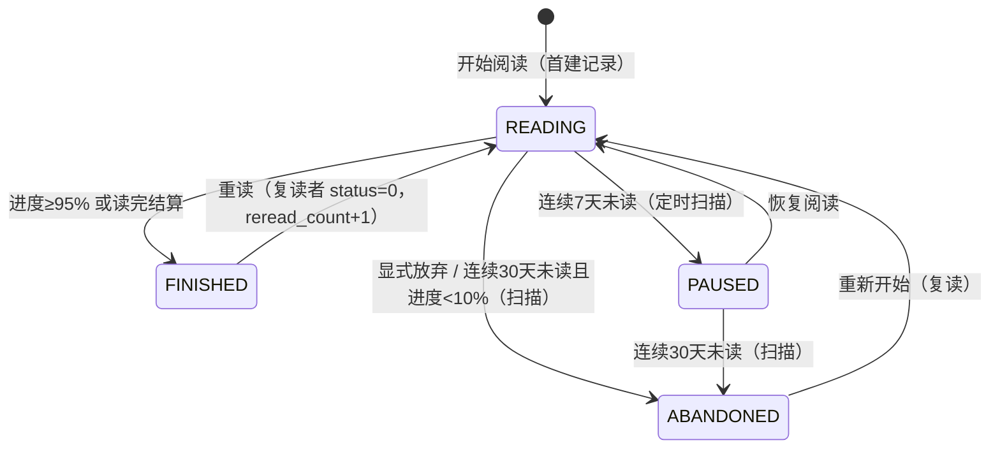
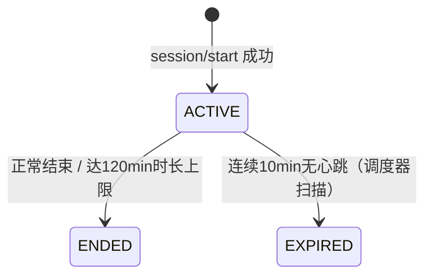

# 服务端-学生课外阅读分级推荐与阅读素养发展追踪评估引擎-详细设计

## 1. 模块概述

### 1.1 功能定位

本模块为 PrimeTop 全学段学生提供课外阅读全生命周期管理能力，包括阅读素养分级评估、个性化书单推荐、阅读进度追踪、阅读效果检测和阅读习惯分析。通过科学的中文阅读分级标准（参考新课标阅读要求及蓝思分级思路本土化），帮助学生建立良好的课外阅读习惯，提升阅读素养。

### 1.2 核心价值

1. **分级科学**：基于中文阅读特征构建多维阅读难度评估模型，为不同学段学生匹配适龄读物
2. **闭环管理**：从"选书→阅读→打卡→测评→反馈"形成完整阅读闭环
3. **数据贯通**：阅读行为数据回流至用户学习画像，丰富学情分析维度
4. **家校协同**：家长可查看孩子阅读情况，教师可布置阅读任务

### 1.3 覆盖学段

| 学段 | 阅读重点 | 推荐书目类型 |
| --- | --- | --- |
| 幼儿（3-6岁） | 绘本、桥梁书、亲子阅读 | 图画书、启蒙读物、儿歌童谣 |
| 小学低年级（1-3年级） | 拼音读物、短篇故事 | 童话、寓言、注音读物 |
| 小学高年级（4-6年级） | 儿童文学、科普读物 | 童话小说、科普百科、历史故事 |
| 初中（7-9年级） | 名著经典、纪实文学 | 中外名著、散文集、传记 |
| 高中（10-12年级） | 深度阅读、思辨读物 | 文学经典、哲学入门、社科读物 |

### 1.4 与其他模块的关系

```
┌─────────────────────────────────────────────────────────┐
│                课外阅读分级推荐引擎                         │
├─────────────┬──────────────┬──────────────┬─────────────┤
│  书库管理    │  分级评估     │  推荐引擎    │  追踪评估    │
├─────────────┴──────────────┴──────────────┴─────────────┤
│        依赖的上游 / 下游服务                               │
├──────────────┬──────────────┬──────────────┬────────────┤
│ 用户学习画像  │ 知识图谱服务  │ 学习记录服务  │ 学情分析    │
│ (用户能力)    │ (关联知识点)  │ (阅读记录)    │ (数据回流)  │
├──────────────┼──────────────┼──────────────┼────────────┤
│ 消息推送服务  │ 内容审核服务  │ 文件存储服务  │ 积分/成就   │
│ (阅读提醒)    │ (UGC书评)    │ (读书笔记)    │ (阅读激励)  │
└──────────────┴──────────────┴──────────────┴────────────┘
```

---

## 2. 数据结构定义

### 2.1 书籍信息表 `book_info`

```sql
CREATE TABLE `book_info` (
    `id` BIGINT NOT NULL COMMENT '书籍ID',
    `title` VARCHAR(200) NOT NULL COMMENT '书名',
    `subtitle` VARCHAR(200) DEFAULT NULL COMMENT '副标题',
    `author` VARCHAR(100) NOT NULL COMMENT '作者',
    `translator` VARCHAR(100) DEFAULT NULL COMMENT '译者',
    `isbn` VARCHAR(20) DEFAULT NULL COMMENT 'ISBN号',
    `publisher` VARCHAR(100) DEFAULT NULL COMMENT '出版社',
    `publish_date` DATE DEFAULT NULL COMMENT '出版日期',
    `language` VARCHAR(20) NOT NULL DEFAULT 'zh' COMMENT '语言(zh/en/bilingual)',
    `category` VARCHAR(50) NOT NULL COMMENT '分类(literature/science/history/philosophy/biography/picture_book/poetry/other)',
    `tags` JSON DEFAULT NULL COMMENT '标签列表["冒险","成长","友情"]',
    `cover_url` VARCHAR(500) DEFAULT NULL COMMENT '封面图URL',
    `summary` TEXT DEFAULT NULL COMMENT '内容简介',
    `total_words` INT DEFAULT NULL COMMENT '总字数',
    `page_count` INT DEFAULT NULL COMMENT '总页数',
    
    -- 难度分级
    `difficulty_level` TINYINT NOT NULL COMMENT '阅读难度等级(1-10)',
    `grade_min` TINYINT NOT NULL COMMENT '适读最低年级(0=幼儿,1-12)',
    `grade_max` TINYINT NOT NULL COMMENT '适读最高年级',
    `lexile_score` INT DEFAULT NULL COMMENT '蓝思等效分值(中文适配)',
    `vocabulary_level` TINYINT DEFAULT NULL COMMENT '词汇难度(1-5)',
    `sentence_complexity` TINYINT DEFAULT NULL COMMENT '句子复杂度(1-5)',
    `theme_depth` TINYINT DEFAULT NULL COMMENT '主题深度(1-5)',
    
    -- 新课标标注
    `is_curriculum_required` TINYINT NOT NULL DEFAULT 0 COMMENT '是否新课标必读(0=否,1=必读,2=选读)',
    `curriculum_grade` VARCHAR(50) DEFAULT NULL COMMENT '课标指定学段("primary"/"junior_high"/"senior_high")',
    
    -- 关联信息
    `knowledge_point_ids` JSON DEFAULT NULL COMMENT '关联知识点ID列表',
    `series_id` BIGINT DEFAULT NULL COMMENT '所属丛书ID',
    `series_order` INT DEFAULT NULL COMMENT '丛书内顺序',
    
    -- 状态
    `status` TINYINT NOT NULL DEFAULT 1 COMMENT '状态(0=下架,1=上架)',
    `source` TINYINT NOT NULL DEFAULT 0 COMMENT '来源(0=官方,1=教研推荐,2=用户推荐)',
    
    -- 统计
    `read_count` INT NOT NULL DEFAULT 0 COMMENT '累计阅读人数',
    `avg_rating` DECIMAL(3,2) NOT NULL DEFAULT 0.00 COMMENT '平均评分(0-5)',
    `rating_count` INT NOT NULL DEFAULT 0 COMMENT '评分人数',
    `finish_rate` DECIMAL(3,2) NOT NULL DEFAULT 0.00 COMMENT '完读率',
    
    `created_at` DATETIME NOT NULL DEFAULT CURRENT_TIMESTAMP,
    `updated_at` DATETIME NOT NULL DEFAULT CURRENT_TIMESTAMP ON UPDATE CURRENT_TIMESTAMP,
    PRIMARY KEY (`id`),
    UNIQUE KEY `uk_isbn` (`isbn`),
    KEY `idx_difficulty` (`difficulty_level`),
    KEY `idx_grade_range` (`grade_min`, `grade_max`),
    KEY `idx_category` (`category`),
    KEY `idx_curriculum` (`is_curriculum_required`, `curriculum_grade`)
) ENGINE=InnoDB DEFAULT CHARSET=utf8mb4 COMMENT='书籍信息表';
```

### 2.2 书籍章节表 `book_chapter`

```sql
CREATE TABLE `book_chapter` (
    `id` BIGINT NOT NULL COMMENT '章节ID',
    `book_id` BIGINT NOT NULL COMMENT '书籍ID',
    `chapter_index` INT NOT NULL COMMENT '章节序号(从1开始)',
    `title` VARCHAR(200) NOT NULL COMMENT '章节标题',
    `word_count` INT DEFAULT NULL COMMENT '本章字数',
    `estimated_read_minutes` INT DEFAULT NULL COMMENT '预计阅读分钟数',
    `difficulty_level` TINYINT DEFAULT NULL COMMENT '本章难度(可能随章节变化)',
    `is_key_chapter` TINYINT NOT NULL DEFAULT 0 COMMENT '是否关键章节(0=否,1=是)',
    `knowledge_point_ids` JSON DEFAULT NULL COMMENT '本章涉及知识点',
    PRIMARY KEY (`id`),
    UNIQUE KEY `uk_book_chapter` (`book_id`, `chapter_index`),
    KEY `idx_book` (`book_id`)
) ENGINE=InnoDB DEFAULT CHARSET=utf8mb4 COMMENT='书籍章节表';
```

### 2.3 学生阅读素养档案 `reading_profile`

```sql
CREATE TABLE `reading_profile` (
    `id` BIGINT NOT NULL COMMENT '档案ID',
    `user_id` BIGINT NOT NULL COMMENT '用户ID',
    
    -- 阅读分级
    `reading_level` DECIMAL(4,1) NOT NULL DEFAULT 1.0 COMMENT '当前阅读等级(1.0-12.0+)',
    `reading_level_confidence` DECIMAL(3,2) NOT NULL DEFAULT 0.00 COMMENT '分级置信度(0-1)',
    `target_level` DECIMAL(4,1) DEFAULT NULL COMMENT '目标阅读等级',
    
    -- 阅读速度
    `avg_reading_speed` INT DEFAULT NULL COMMENT '平均阅读速度(字/分钟)',
    
    -- 阅读偏好
    `preferred_categories` JSON DEFAULT NULL COMMENT '偏好分类["literature","science"]',
    `preferred_tags` JSON DEFAULT NULL COMMENT '偏好标签["冒险","科幻"]',
    `avoid_categories` JSON DEFAULT NULL COMMENT '不感兴趣分类',
    
    -- 阅读统计
    `total_books_read` INT NOT NULL DEFAULT 0 COMMENT '已读书籍数',
    `total_words_read` INT NOT NULL DEFAULT 0 COMMENT '累计阅读字数',
    `total_read_minutes` INT NOT NULL DEFAULT 0 COMMENT '累计阅读分钟数',
    `current_streak_days` INT NOT NULL DEFAULT 0 COMMENT '当前连续阅读天数',
    `max_streak_days` INT NOT NULL DEFAULT 0 COMMENT '最长连续阅读天数',
    `last_read_date` DATE DEFAULT NULL COMMENT '最近阅读日期',
    
    -- 阅读习惯
    `preferred_read_time_slot` VARCHAR(20) DEFAULT NULL COMMENT '偏好阅读时段(morning/afternoon/evening/night)',
    `avg_session_minutes` DECIMAL(5,1) DEFAULT NULL COMMENT '平均单次阅读时长(分钟)',
    
    -- 综合评估
    `comprehension_score` DECIMAL(4,1) DEFAULT NULL COMMENT '理解力评分(0-100)',
    `vocabulary_score` DECIMAL(4,1) DEFAULT NULL COMMENT '词汇量评分(0-100)',
    `critical_thinking_score` DECIMAL(4,1) DEFAULT NULL COMMENT '思辨力评分(0-100)',
    
    `last_assessment_at` DATETIME DEFAULT NULL COMMENT '最近分级测评时间',
    `created_at` DATETIME NOT NULL DEFAULT CURRENT_TIMESTAMP,
    `updated_at` DATETIME NOT NULL DEFAULT CURRENT_TIMESTAMP ON UPDATE CURRENT_TIMESTAMP,
    PRIMARY KEY (`id`),
    UNIQUE KEY `uk_user` (`user_id`),
    KEY `idx_level` (`reading_level`)
) ENGINE=InnoDB DEFAULT CHARSET=utf8mb4 COMMENT='学生阅读素养档案';
```

### 2.4 阅读记录表 `reading_record`

```sql
CREATE TABLE `reading_record` (
    `id` BIGINT NOT NULL COMMENT '记录ID',
    `user_id` BIGINT NOT NULL COMMENT '用户ID',
    `book_id` BIGINT NOT NULL COMMENT '书籍ID',
    
    -- 阅读状态
    `status` TINYINT NOT NULL DEFAULT 0 COMMENT '阅读状态(0=在读,1=已读,2=暂停,3=放弃)',
    `current_chapter` INT NOT NULL DEFAULT 1 COMMENT '当前阅读章节',
    `current_page` INT DEFAULT NULL COMMENT '当前阅读页码',
    `progress_percent` DECIMAL(5,2) NOT NULL DEFAULT 0.00 COMMENT '阅读进度百分比',
    
    -- 时间
    `started_at` DATETIME NOT NULL COMMENT '开始阅读时间',
    `finished_at` DATETIME DEFAULT NULL COMMENT '完成阅读时间',
    `last_read_at` DATETIME DEFAULT NULL COMMENT '最近阅读时间',
    `total_read_minutes` INT NOT NULL DEFAULT 0 COMMENT '累计阅读时长(分钟)',
    
    -- 评价
    `user_rating` TINYINT DEFAULT NULL COMMENT '用户评分(1-5)',
    `user_review` TEXT DEFAULT NULL COMMENT '用户书评',
    `is_favorite` TINYINT NOT NULL DEFAULT 0 COMMENT '是否收藏(0=否,1=是)',
    
    -- 来源
    `source` TINYINT NOT NULL DEFAULT 0 COMMENT '来源(0=自主选读,1=系统推荐,2=教师布置,3=家长推荐,4=课标必读)',
    `task_id` BIGINT DEFAULT NULL COMMENT '关联阅读任务ID',
    
    PRIMARY KEY (`id`),
    UNIQUE KEY `uk_user_book` (`user_id`, `book_id`),
    KEY `idx_user_status` (`user_id`, `status`),
    KEY `idx_book` (`book_id`),
    KEY `idx_last_read` (`last_read_at`)
) ENGINE=InnoDB DEFAULT CHARSET=utf8mb4 COMMENT='阅读记录表';
```

### 2.5 阅读会话表 `reading_session`

```sql
CREATE TABLE `reading_session` (
    `id` BIGINT NOT NULL COMMENT '会话ID',
    `user_id` BIGINT NOT NULL COMMENT '用户ID',
    `book_id` BIGINT NOT NULL COMMENT '书籍ID',
    `reading_record_id` BIGINT NOT NULL COMMENT '阅读记录ID',
    
    `start_time` DATETIME NOT NULL COMMENT '开始时间',
    `end_time` DATETIME DEFAULT NULL COMMENT '结束时间',
    `duration_seconds` INT NOT NULL COMMENT '阅读时长(秒)',
    `words_read` INT DEFAULT NULL COMMENT '本次阅读字数(估算)',
    `start_chapter` INT NOT NULL COMMENT '开始章节',
    `end_chapter` INT NOT NULL COMMENT '结束章节',
    `start_page` INT DEFAULT NULL COMMENT '开始页码',
    `end_page` INT DEFAULT NULL COMMENT '结束页码',
    
    -- 阅读质量
    `scroll_speed_avg` DECIMAL(6,1) DEFAULT NULL COMMENT '平均滚动速度',
    `pause_count` INT DEFAULT 0 COMMENT '停顿次数',
    `bookmark_count` INT DEFAULT 0 COMMENT '本次新增书签数',
    `note_count` INT DEFAULT 0 COMMENT '本次新增笔记数',
    
    -- 专注度
    `focus_score` DECIMAL(3,2) DEFAULT NULL COMMENT '专注度评分(0-1)',
    `is_distracted` TINYINT NOT NULL DEFAULT 0 COMMENT '是否检测到分心(0=否,1=是)',
    
    `device_type` VARCHAR(20) DEFAULT NULL COMMENT '设备类型(phone/tablet)',
    
    PRIMARY KEY (`id`),
    KEY `idx_user_time` (`user_id`, `start_time`),
    KEY `idx_book` (`book_id`),
    KEY `idx_record` (`reading_record_id`)
) ENGINE=InnoDB DEFAULT CHARSET=utf8mb4 COMMENT='阅读会话表';
```

### 2.6 阅读笔记表 `reading_note`

```sql
CREATE TABLE `reading_note` (
    `id` BIGINT NOT NULL COMMENT '笔记ID',
    `user_id` BIGINT NOT NULL COMMENT '用户ID',
    `book_id` BIGINT NOT NULL COMMENT '书籍ID',
    `chapter_index` INT DEFAULT NULL COMMENT '章节序号',
    `page_num` INT DEFAULT NULL COMMENT '页码',
    
    `note_type` TINYINT NOT NULL COMMENT '类型(1=摘抄,2=感想,3=提问,4=思维导图,5=人物关系)',
    `content` TEXT NOT NULL COMMENT '笔记内容',
    `quote_text` TEXT DEFAULT NULL COMMENT '原文摘录(摘抄类型时使用)',
    `quote_position` VARCHAR(100) DEFAULT NULL COMMENT '原文位置描述',
    
    -- AI辅助
    `ai_analysis` TEXT DEFAULT NULL COMMENT 'AI分析结果',
    `ai_suggestion` TEXT DEFAULT NULL COMMENT 'AI改进建议',
    
    `is_shared` TINYINT NOT NULL DEFAULT 0 COMMENT '是否公开(0=私密,1=公开)',
    `like_count` INT NOT NULL DEFAULT 0 COMMENT '点赞数',
    
    `created_at` DATETIME NOT NULL DEFAULT CURRENT_TIMESTAMP,
    `updated_at` DATETIME NOT NULL DEFAULT CURRENT_TIMESTAMP ON UPDATE CURRENT_TIMESTAMP,
    PRIMARY KEY (`id`),
    KEY `idx_user_book` (`user_id`, `book_id`),
    KEY `idx_book_chapter` (`book_id`, `chapter_index`),
    KEY `idx_shared` (`is_shared`)
) ENGINE=InnoDB DEFAULT CHARSET=utf8mb4 COMMENT='阅读笔记表';
```

### 2.7 阅读理解测试题库 `reading_quiz`

```sql
CREATE TABLE `reading_quiz` (
    `id` BIGINT NOT NULL COMMENT '题目ID',
    `book_id` BIGINT NOT NULL COMMENT '关联书籍ID',
    `chapter_index` INT DEFAULT NULL COMMENT '关联章节(NULL=整书级)',
    
    `question_type` TINYINT NOT NULL COMMENT '题型(1=单选,2=多选,3=判断,4=简答,5=读后感)',
    `difficulty` TINYINT NOT NULL COMMENT '难度(1-5)',
    
    `question_content` TEXT NOT NULL COMMENT '题干',
    `options` JSON DEFAULT NULL COMMENT '选项["A. xxx","B. xxx"]',
    `correct_answer` VARCHAR(500) NOT NULL COMMENT '正确答案',
    `analysis` TEXT DEFAULT NULL COMMENT '答案解析',
    
    -- 测试维度
    `assessment_dimension` VARCHAR(30) NOT NULL COMMENT '评估维度(comprehension/vocabulary/inference/critical_thinking/retention)',
    
    `status` TINYINT NOT NULL DEFAULT 1 COMMENT '状态(0=禁用,1=启用)',
    `created_at` DATETIME NOT NULL DEFAULT CURRENT_TIMESTAMP,
    PRIMARY KEY (`id`),
    KEY `idx_book` (`book_id`),
    KEY `idx_book_chapter` (`book_id`, `chapter_index`),
    KEY `idx_dimension` (`assessment_dimension`)
) ENGINE=InnoDB DEFAULT CHARSET=utf8mb4 COMMENT='阅读理解测试题库';
```

### 2.8 阅读测评记录 `reading_assessment`

```sql
CREATE TABLE `reading_assessment` (
    `id` BIGINT NOT NULL COMMENT '测评ID',
    `user_id` BIGINT NOT NULL COMMENT '用户ID',
    `assessment_type` TINYINT NOT NULL COMMENT '类型(1=初始定级,2=阶段性复评,3=书籍读后测评,4=专项能力测评)',
    `book_id` BIGINT DEFAULT NULL COMMENT '关联书籍(读后测评时)',
    
    -- 测评结果
    `total_questions` INT NOT NULL COMMENT '总题数',
    `correct_count` INT NOT NULL COMMENT '正确数',
    `score` DECIMAL(5,2) NOT NULL COMMENT '得分(0-100)',
    
    -- 维度得分
    `dim_comprehension` DECIMAL(5,2) DEFAULT NULL COMMENT '理解力得分',
    `dim_vocabulary` DECIMAL(5,2) DEFAULT NULL COMMENT '词汇得分',
    `dim_inference` DECIMAL(5,2) DEFAULT NULL COMMENT '推理得分',
    `dim_critical_thinking` DECIMAL(5,2) DEFAULT NULL COMMENT '思辨得分',
    `dim_retention` DECIMAL(5,2) DEFAULT NULL COMMENT '记忆保持得分',
    
    -- 分级变更
    `reading_level_before` DECIMAL(4,1) DEFAULT NULL COMMENT '测评前等级',
    `reading_level_after` DECIMAL(4,1) DEFAULT NULL COMMENT '测评后等级',
    `level_change_reason` TEXT DEFAULT NULL COMMENT '等级变更原因',
    
    `started_at` DATETIME NOT NULL COMMENT '开始时间',
    `finished_at` DATETIME DEFAULT NULL COMMENT '完成时间',
    `duration_seconds` INT DEFAULT NULL COMMENT '用时(秒)',
    
    PRIMARY KEY (`id`),
    KEY `idx_user_type` (`user_id`, `assessment_type`),
    KEY `idx_user_time` (`user_id`, `started_at`),
    KEY `idx_book` (`book_id`)
) ENGINE=InnoDB DEFAULT CHARSET=utf8mb4 COMMENT='阅读测评记录';
```

### 2.9 阅读任务表 `reading_task`

```sql
CREATE TABLE `reading_task` (
    `id` BIGINT NOT NULL COMMENT '任务ID',
    `title` VARCHAR(200) NOT NULL COMMENT '任务标题',
    `description` TEXT DEFAULT NULL COMMENT '任务描述',
    
    `task_type` TINYINT NOT NULL COMMENT '类型(1=自主阅读,2=教师布置,3=家长布置,4=课标打卡,5=假期阅读营)',
    `source_user_id` BIGINT DEFAULT NULL COMMENT '布置人ID(教师/家长)',
    `target_type` TINYINT NOT NULL COMMENT '对象类型(1=个人,2=班级,3=家庭)',
    
    -- 阅读要求
    `book_ids` JSON NOT NULL COMMENT '指定书籍ID列表',
    `required_words` INT DEFAULT NULL COMMENT '要求阅读字数',
    `required_minutes` INT DEFAULT NULL COMMENT '要求阅读时长(分钟/周)',
    `deadline` DATETIME DEFAULT NULL COMMENT '截止时间',
    
    -- 附加要求
    `require_quiz` TINYINT NOT NULL DEFAULT 0 COMMENT '是否要求完成测试(0=否,1=是)',
    `require_note` TINYINT NOT NULL DEFAULT 0 COMMENT '是否要求读书笔记(0=否,1=是)',
    `require_review` TINYINT NOT NULL DEFAULT 0 COMMENT '是否要求读后感(0=否,1=是)',
    `min_note_count` INT NOT NULL DEFAULT 1 COMMENT '最少笔记数',
    
    -- 奖励
    `reward_points` INT DEFAULT NULL COMMENT '完成后奖励积分',
    `reward_badge` VARCHAR(50) DEFAULT NULL COMMENT '完成后奖励徽章',
    
    `status` TINYINT NOT NULL DEFAULT 0 COMMENT '状态(0=进行中,1=已结束)',
    `created_at` DATETIME NOT NULL DEFAULT CURRENT_TIMESTAMP,
    PRIMARY KEY (`id`),
    KEY `idx_source` (`source_user_id`, `task_type`),
    KEY `idx_status` (`status`)
) ENGINE=InnoDB DEFAULT CHARSET=utf8mb4 COMMENT='阅读任务表';
```

### 2.10 书籍推荐候选池 `book_recommendation_candidate`

```sql
CREATE TABLE `book_recommendation_candidate` (
    `id` BIGINT NOT NULL COMMENT '推荐ID',
    `user_id` BIGINT NOT NULL COMMENT '用户ID',
    `book_id` BIGINT NOT NULL COMMENT '书籍ID',
    
    `recommend_reason` JSON NOT NULL COMMENT '推荐理由["课标必读","符合阅读等级","偏好分类","难度递进"]',
    `recommend_score` DECIMAL(5,2) NOT NULL COMMENT '推荐分值(0-100)',
    `source_type` TINYINT NOT NULL COMMENT '来源(1=系统推荐,2=课标必读,3=同主题延展,4=同作者,5=热门)',
    
    `is_shown` TINYINT NOT NULL DEFAULT 0 COMMENT '是否已展示给用户',
    `is_accepted` TINYINT NOT NULL DEFAULT 0 COMMENT '用户是否接受(0=未操作,1=接受,2=拒绝,3=忽略)',
    `accepted_at` DATETIME DEFAULT NULL COMMENT '操作时间',
    
    `batch_id` VARCHAR(36) NOT NULL COMMENT '推荐批次ID',
    `created_at` DATETIME NOT NULL DEFAULT CURRENT_TIMESTAMP,
    PRIMARY KEY (`id`),
    UNIQUE KEY `uk_user_book_batch` (`user_id`, `book_id`, `batch_id`),
    KEY `idx_user_score` (`user_id`, `recommend_score`),
    KEY `idx_batch` (`batch_id`)
) ENGINE=InnoDB DEFAULT CHARSET=utf8mb4 COMMENT='书籍推荐候选池';
```

---

## 3. 核心业务流程

### 3.1 阅读素养初始定级流程

```
新用户首次进入阅读模块
         │
         ▼
┌──────────────────┐
│  1. 基础信息收集   │  ← 学段、年级、教材版本
│  (自动从用户画像)  │
└────────┬─────────┘
         │
         ▼
┌──────────────────┐
│  2. 初始问卷      │  ← 3-5题：最近读了什么书？
│  (阅读习惯调查)   │     每周阅读时长？喜欢什么类型？
└────────┬─────────┘
         │
         ▼
┌──────────────────┐
│  3. 快速定级测试   │  ← 根据年级匹配3篇不同难度短文
│  (自适应选文)     │     每篇3-4道理解题
│                  │     根据正确率调整下一篇难度
└────────┬─────────┘
         │
         ▼
┌──────────────────┐
│  4. 综合定级计算   │  ← 输入：年级基线 + 问卷 + 测试结果
│  (加权融合)       │     输出：reading_level + confidence
└────────┬─────────┘
         │
         ▼
┌──────────────────┐
│  5. 初始化档案     │  ← 创建 reading_profile
│  + 首批推荐       │     生成首批个性化书单
└──────────────────┘
```

**定级测试自适应选文逻辑：**

```java
public class ReadingLevelAssessor {
    
    // 按年级的基线等级映射
    private static final Map<Integer, BigDecimal> GRADE_BASELINE = Map.of(
        0, new BigDecimal("1.0"),   // 幼儿
        1, new BigDecimal("2.0"),   // 一年级
        2, new BigDecimal("3.0"),
        3, new BigDecimal("4.0"),
        4, new BigDecimal("5.0"),
        5, new BigDecimal("6.0"),
        6, new BigDecimal("7.0"),
        7, new BigDecimal("7.5"),   // 初一
        8, new BigDecimal("8.5"),
        9, new BigDecimal("9.5"),
        10, new BigDecimal("10.0"), // 高一
        11, new BigDecimal("11.0"),
        12, new BigDecimal("12.0")
    );
    
    /**
     * 自适应定级测试选文
     * 策略：三段式——中等难度起步，根据正确率升降
     */
    public AssessmentSession startInitialAssessment(Long userId, Integer grade) {
        BigDecimal baselineLevel = GRADE_BASELINE.getOrDefault(grade, new BigDecimal("5.0"));
        
        // 选择三篇短文：baseline-1, baseline, baseline+1
        List<BookInfo> passages = new ArrayList<>();
        passages.add(selectPassage(baselineLevel.subtract(BigDecimal.ONE)));  // 偏易
        passages.add(selectPassage(baselineLevel));                            // 基准
        passages.add(selectPassage(baselineLevel.add(BigDecimal.ONE)));        // 偏难
        
        AssessmentSession session = AssessmentSession.builder()
            .userId(userId)
            .type(AssessmentType.INITIAL_PLACEMENT)
            .baselineGrade(grade)
            .baselineLevel(baselineLevel)
            .passages(passages)
            .currentPassageIndex(0)
            .status(SessionStatus.IN_PROGRESS)
            .build();
        
        return session;
    }
    
    /**
     * 根据测试结果计算最终阅读等级
     */
    public ReadingLevelResult computeLevel(AssessmentSession session) {
        BigDecimal baseline = session.getBaselineLevel();
        List<PassageResult> results = session.getPassageResults();
        
        // 计算各难度区间的正确率
        double easyAccuracy = getAccuracy(results, 0);     // 偏易篇
        double baseAccuracy = getAccuracy(results, 1);     // 基准篇
        double hardAccuracy = getAccuracy(results, 2);     // 偏难篇
        
        // 根据三篇表现微调等级
        BigDecimal adjustment = BigDecimal.ZERO;
        
        if (easyAccuracy < 0.6) {
            // 偏易篇都不及格，降低2级
            adjustment = new BigDecimal("-2.0");
        } else if (easyAccuracy >= 0.8 && baseAccuracy >= 0.8 && hardAccuracy >= 0.6) {
            // 全部表现优秀，提升1.5级
            adjustment = new BigDecimal("1.5");
        } else if (easyAccuracy >= 0.8 && baseAccuracy >= 0.7) {
            // 表现较好，提升0.5级
            adjustment = new BigDecimal("0.5");
        } else if (baseAccuracy < 0.5) {
            // 基准篇不及格，降低1级
            adjustment = new BigDecimal("-1.0");
        }
        
        BigDecimal finalLevel = baseline.add(adjustment).max(new BigDecimal("1.0"));
        
        // 计算置信度：测试题数越多、结果越一致，置信度越高
        double consistency = 1.0 - Math.abs(easyAccuracy - baseAccuracy) 
                           - Math.abs(baseAccuracy - hardAccuracy);
        double confidence = Math.max(0.3, Math.min(0.95, 0.5 + consistency * 0.3 
            + (results.size() >= 9 ? 0.15 : 0)));
        
        return ReadingLevelResult.builder()
            .readingLevel(finalLevel)
            .confidence(BigDecimal.valueOf(confidence))
            .dimComprehension(calculateDimensionScore(results, "comprehension"))
            .dimVocabulary(calculateDimensionScore(results, "vocabulary"))
            .dimInference(calculateDimensionScore(results, "inference"))
            .build();
    }
}
```

### 3.2 个性化推荐引擎流程

```
触发时机：每日刷新 / 用户完成阅读 / 用户拒绝推荐 / 手动刷新
                    │
                    ▼
        ┌───────────────────────┐
        │   1. 召回阶段(Recall)  │  多路召回，各100本
        │                       │
        │  ├─ 课标必读召回       │  ← 按学段筛选未读书目
        │  ├─ 等级匹配召回       │  ← difficulty_level ± 1
        │  ├─ 兴趣偏好召回       │  ← preferred_categories/tags
        │  ├─ 同作者延展召回     │  ← 读过的书的作者其他作品
        │  ├─ 同主题延展召回     │  ← 读过的书同分类
        │  ├─ 难度递进召回       │  ← level + 0.5~1.0 的书
        │  ├─ 热门/高评分召回    │  ← 同年龄段高完读率
        │  └─ 知识图谱关联召回   │  ← 关联知识点补全
        └───────────┬───────────┘
                    │ 合并去重后 ~300-500本
                    ▼
        ┌───────────────────────┐
        │   2. 粗排阶段(Pre-Rank) │  轻量模型快速打分
        │                       │
        │  特征：               │
        │  ├─ 书籍静态特征       │  难度差、分类匹配度
        │  ├─ 用户-书籍交叉特征  │  等级差、偏好相似度
        │  └─ 全局统计特征       │  完读率、评分、热度
        │                       │
        │  取 Top 100           │
        └───────────┬───────────┘
                    ▼
        ┌───────────────────────┐
        │   3. 精排阶段(Rank)    │  综合模型精细排序
        │                       │
        │  多目标加权：          │
        │  score = 0.35 × P(接受) │
        │        + 0.25 × P(读完) │
        │        + 0.20 × P(高分) │
        │        + 0.10 × 多样性  │
        │        + 0.10 × 新颖性  │
        └───────────┬───────────┘
                    ▼
        ┌───────────────────────┐
        │   4. 重排阶段(Re-Rank) │  业务规则干预
        │                       │
        │  ├─ 课标必读置顶       │
        │  ├─ 连续同分类降权     │  避免信息茧房
        │  ├─ 推荐过被拒绝降权   │  ×0.3
        │  ├─ 已在书架排除       │
        │  └─ 多样性保证         │  每个分类至少1本
        └───────────┬───────────┘
                    ▼
        ┌───────────────────────┐
        │   5. 推荐理由生成      │  为每本书生成一句话理由
        │                       │
        │  "新课标四年级必读"    │
        │  "你喜欢的冒险类故事"  │
        │  "比你当前等级高0.5级" │
        └───────────┬───────────┘
                    ▼
              返回 Top 10-15
```

**推荐打分核心代码：**

```java
@Service
public class BookRecommendationService {
    
    @Autowired
    private ReadingProfileService profileService;
    @Autowired
    private BookInfoMapper bookMapper;
    @Autowired
    private ReadingRecordMapper recordMapper;
    @Autowired
    private RecommendationCandidateMapper candidateMapper;
    
    /**
     * 为用户生成一批推荐
     */
    @Transactional
    public List<BookRecommendation> recommend(Long userId, int count) {
        ReadingProfile profile = profileService.getProfile(userId);
        if (profile == null) {
            // 未定级用户走默认推荐
            return recommendForColdStart(userId, count);
        }
        
        // 1. 多路召回
        List<BookInfo> candidates = multiChannelRecall(profile);
        
        // 2. 粗排
        candidates = preRank(candidates, profile);
        
        // 3. 精排
        List<ScoredBook> scoredBooks = rank(candidates, profile);
        
        // 4. 重排 + 业务规则
        List<ScoredBook> reRanked = reRank(scoredBooks, profile);
        
        // 5. 截断
        List<ScoredBook> result = reRanked.subList(0, Math.min(count, reRanked.size()));
        
        // 6. 生成推荐理由并持久化
        String batchId = UUID.randomUUID().toString();
        List<BookRecommendation> recommendations = result.stream()
            .map(sb -> buildRecommendation(userId, sb, profile, batchId))
            .collect(Collectors.toList());
        
        candidateMapper.batchInsert(recommendations);
        
        return recommendations;
    }
    
    /**
     * 多路召回
     */
    private List<BookInfo> multiChannelRecall(ReadingProfile profile) {
        List<BookInfo> all = new ArrayList<>();
        Set<Long> seen = new HashSet<>();
        
        // 排除用户已读/在读/已拒绝的书
        Set<Long> excludeIds = recordMapper.findBookIdsByUserId(profile.getUserId());
        Set<Long> rejectedIds = candidateMapper.findRejectedBookIds(profile.getUserId());
        excludeIds.addAll(rejectedIds);
        
        // 路1：课标必读
        List<BookInfo> required = bookMapper.findCurriculumRequired(
            profile.getGradeLevel(), excludeIds, 50);
        merge(all, seen, required);
        
        // 路2：等级匹配 (±1.0)
        BigDecimal minLevel = profile.getReadingLevel().subtract(BigDecimal.ONE);
        BigDecimal maxLevel = profile.getReadingLevel().add(BigDecimal.ONE);
        List<BookInfo> matched = bookMapper.findByDifficultyRange(
            minLevel, maxLevel, excludeIds, 100);
        merge(all, seen, matched);
        
        // 路3：兴趣偏好
        if (CollectionUtils.isNotEmpty(profile.getPreferredCategories())) {
            List<BookInfo> preferred = bookMapper.findByCategories(
                profile.getPreferredCategories(), 
                profile.getGradeRange(), excludeIds, 100);
            merge(all, seen, preferred);
        }
        
        // 路4：同作者延展
        List<Long> readBookIds = recordMapper.findFinishedBookIds(profile.getUserId());
        if (CollectionUtils.isNotEmpty(readBookIds)) {
            List<String> authors = bookMapper.findAuthorsByBookIds(readBookIds);
            List<BookInfo> sameAuthor = bookMapper.findByAuthors(authors, excludeIds, 30);
            merge(all, seen, sameAuthor);
        }
        
        // 路5：难度递进 (level + 0.5 ~ 1.0)
        List<BookInfo> advanced = bookMapper.findByDifficultyRange(
            profile.getReadingLevel().add(new BigDecimal("0.5")),
            profile.getReadingLevel().add(BigDecimal.ONE),
            excludeIds, 50);
        merge(all, seen, advanced);
        
        // 路6：同年龄段热门
        List<BookInfo> popular = bookMapper.findPopularByGradeRange(
            profile.getGradeRange(), excludeIds, 50);
        merge(all, seen, popular);
        
        return all;
    }
    
    /**
     * 精排打分
     */
    private List<ScoredBook> rank(List<BookInfo> books, ReadingProfile profile) {
        return books.parallelStream()
            .map(book -> {
                double score = calculateRankScore(book, profile);
                return new ScoredBook(book, score);
            })
            .sorted(Comparator.comparingDouble(ScoredBook::getScore).reversed())
            .collect(Collectors.toList());
    }
    
    /**
     * 精排得分计算
     */
    private double calculateRankScore(BookInfo book, ReadingProfile profile) {
        // 1. 难度匹配分 (0-1)：等级差越小越好
        double levelDiff = Math.abs(
            book.getDifficultyLevel() - profile.getReadingLevel().doubleValue());
        double levelScore = Math.max(0, 1.0 - levelDiff * 0.3);
        
        // 2. 分类偏好匹配分 (0-1)
        double categoryScore = 0.5; // 默认中等
        if (CollectionUtils.isNotEmpty(profile.getPreferredCategories())) {
            categoryScore = profile.getPreferredCategories().contains(book.getCategory()) ? 1.0 : 0.3;
        }
        
        // 3. 完读率分 (0-1)：高完读率的书更可能被读完
        double finishScore = book.getFinishRate().doubleValue();
        
        // 4. 评分分 (0-1)
        double ratingScore = book.getAvgRating().doubleValue() / 5.0;
        
        // 5. 课标加分
        double curriculumBonus = book.getIsCurriculumRequired() == 1 ? 0.15 : 0.0;
        
        // 加权融合
        double score = levelScore * 0.35
                     + categoryScore * 0.25
                     + finishScore * 0.15
                     + ratingScore * 0.15
                     + curriculumBonus
                     + 0.10 * new Random().nextDouble(); // 随机扰动避免固化
        
        return score;
    }
    
    /**
     * 重排：多样性保障
     */
    private List<ScoredBook> reRank(List<ScoredBook> books, ReadingProfile profile) {
        List<ScoredBook> result = new ArrayList<>();
        Map<String, Integer> categoryCount = new HashMap<>();
        
        for (ScoredBook sb : books) {
            String category = sb.getBook().getCategory();
            int count = categoryCount.getOrDefault(category, 0);
            
            // 同分类最多保留3本
            if (count >= 3) {
                continue;
            }
            
            result.add(sb);
            categoryCount.merge(category, 1, Integer::sum);
            
            if (result.size() >= 15) {
                break;
            }
        }
        
        return result;
    }
    
    /**
     * 生成推荐理由
     */
    private BookRecommendation buildRecommendation(Long userId, ScoredBook sb, 
                                                    ReadingProfile profile, String batchId) {
        List<String> reasons = new ArrayList<>();
        BookInfo book = sb.getBook();
        
        if (book.getIsCurriculumRequired() == 1) {
            reasons.add("新课标必读书目");
        }
        
        double levelDiff = book.getDifficultyLevel() - profile.getReadingLevel().doubleValue();
        if (Math.abs(levelDiff) < 0.3) {
            reasons.add("完美匹配你的阅读等级");
        } else if (levelDiff > 0 && levelDiff <= 1.0) {
            reasons.add("难度稍有挑战，适合提升");
        } else if (levelDiff < 0 && levelDiff >= -1.0) {
            reasons.add("轻松易读，适合碎片时间");
        }
        
        if (CollectionUtils.isNotEmpty(profile.getPreferredCategories()) 
            && profile.getPreferredCategories().contains(book.getCategory())) {
            reasons.add("你感兴趣的" + translateCategory(book.getCategory()) + "类");
        }
        
        if (book.getAvgRating().compareTo(new BigDecimal("4.5")) >= 0) {
            reasons.add("高分好评（" + book.getAvgRating() + "分）");
        }
        
        if (reasons.isEmpty()) {
            reasons.add("为你精选的好书");
        }
        
        return BookRecommendation.builder()
            .userId(userId)
            .bookId(book.getId())
            .recommendReason(reasons)
            .recommendScore(BigDecimal.valueOf(sb.getScore() * 100))
            .sourceType(determineSource(book, profile))
            .batchId(batchId)
            .build();
    }
}
```

### 3.3 阅读进度追踪与打卡流程

```
用户打开一本书开始阅读
            │
            ▼
   ┌─────────────────┐
   │ 创建/恢复阅读会话 │  reading_session INSERT
   └────────┬────────┘
            │
            ▼
   ┌─────────────────┐
   │  阅读过程追踪    │  前端定时上报(每30秒)
   │  - 章节/页码变更  │  更新 session
   │  - 滚动/翻页事件  │  更新 reading_record
   │  - 停顿/分心检测  │
   └────────┬────────┘
            │
            ▼
   ┌─────────────────┐
   │  会话结束处理     │
   │  ├ 计算时长      │
   │  ├ 计算字数      │
   │  ├ 计算阅读速度  │
   │  ├ 评估专注度    │
   │  └ 更新统计     │
   └────────┬────────┘
            │
            ▼
   ┌─────────────────┐
   │  触发后续动作     │
   │  ├ 更新阅读等级  │  ← 每读完一本书可能微调
   │  ├ 检查任务完成  │
   │  ├ 检查成就解锁  │  ← 连续阅读N天/读完N本
   │  ├ 发送打卡通知  │  ← 家长端
   │  └ 推荐读后测评  │
   └─────────────────┘
```

**阅读进度上报接口处理：**

```java
@RestController
@RequestMapping("/api/v1/reading")
public class ReadingSessionController {
    
    @Autowired
    private ReadingSessionService sessionService;
    @Autowired
    private ReadingRecordService recordService;
    @Autowired
    private ReadingProfileService profileService;
    @Autowired
    private AchievementCheckService achievementService;
    
    /**
     * 阅读进度上报（前端每30秒调用一次）
     */
    @PostMapping("/session/{sessionId}/heartbeat")
    public ApiResult<HeartbeatResponse> heartbeat(
            @PathVariable Long sessionId,
            @RequestBody HeartbeatRequest request) {
        
        ReadingSession session = sessionService.getById(sessionId);
        
        // 1. 校验会话归属
        if (!session.getUserId().equals(SecurityUtils.getUserId())) {
            return ApiResult.error(ErrCode.FORBIDDEN);
        }
        
        // 2. 更新会话
        session.setEndChapter(request.getCurrentChapter());
        session.setEndPage(request.getCurrentPage());
        session.setPauseCount(session.getPauseCount() + request.getNewPauses());
        session.setBookmarkCount(session.getBookmarkCount() + request.getNewBookmarks());
        session.setNoteCount(session.getNoteCount() + request.getNewNotes());
        
        // 3. 更新阅读记录
        ReadingRecord record = recordService.findByUserAndBook(
            session.getUserId(), session.getBookId());
        record.setCurrentChapter(request.getCurrentChapter());
        record.setCurrentPage(request.getCurrentPage());
        
        // 计算进度
        BookInfo book = bookService.getById(session.getBookId());
        if (book.getPageCount() != null && book.getPageCount() > 0) {
            double progress = (double) request.getCurrentPage() / book.getPageCount() * 100;
            record.setProgressPercent(BigDecimal.valueOf(
                Math.min(100, Math.max(0, progress))));
        }
        
        record.setTotalReadMinutes(record.getTotalReadMinutes() + 1); // 每30秒+1分钟(估算)
        record.setLastReadAt(LocalDateTime.now());
        
        // 4. 检测是否读完
        if (isBookFinished(record, book)) {
            handleBookCompletion(record, book);
        }
        
        sessionService.save(session);
        recordService.save(record);
        
        return ApiResult.success(HeartbeatResponse.builder()
            .progressPercent(record.getProgressPercent())
            .encouragement(generateEncouragement(record))
            .build());
    }
    
    /**
     * 书籍阅读完成处理
     */
    private void handleBookCompletion(ReadingRecord record, BookInfo book) {
        record.setStatus(ReadingStatus.FINISHED);
        record.setFinishedAt(LocalDateTime.now());
        
        // 异步更新阅读档案
        profileService.incrementBookReadCount(record.getUserId());
        profileService.addTotalWordsRead(record.getUserId(), book.getTotalWords());
        
        // 微调阅读等级
        profileService.adjustReadingLevel(record.getUserId(), book, record);
        
        // 检查成就
        achievementService.checkAndUnlock(record.getUserId(), AchievementType.BOOK_FINISH, 
            Map.of("bookId", book.getId(), "totalRead", record.getTotalReadMinutes()));
        
        // 发送读后测评推荐通知
        notificationService.sendReadingQuizRecommendation(record.getUserId(), book.getId());
        
        // 发送积分奖励
        pointsService.award(record.getUserId(), "BOOK_FINISH", 
            calculateBookReward(book), "完成阅读：" + book.getTitle());
    }
    
    /**
     * 判断书籍是否读完
     */
    private boolean isBookFinished(ReadingRecord record, BookInfo book) {
        if (book.getPageCount() != null && record.getCurrentPage() != null) {
            return record.getCurrentPage() >= book.getPageCount();
        }
        // 按章节判断
        Integer lastChapter = bookChapterService.getLastChapterIndex(book.getId());
        return record.getCurrentChapter() >= lastChapter;
    }
}
```

### 3.4 阅读等级动态调整机制

```java
@Service
public class ReadingLevelAdjustmentService {
    
    /**
     * 根据阅读行为动态微调阅读等级
     * 
     * 调整规则：
     * 1. 读完一本且读后测评正确率≥80% → 等级 +0.1~0.3
     * 2. 读完一本但未做测评 → 等级 +0.05（仅记录阅读量）
     * 3. 读后测评正确率 60-80% → 不变
     * 4. 读后测评正确率 <60% → 等级 -0.1~0.2
     * 5. 连续3本书未完成 → 考虑降级
     * 6. 每3个月自动触发复评
     */
    public void adjustLevel(Long userId, BookInfo book, ReadingRecord record) {
        ReadingProfile profile = profileService.getProfile(userId);
        BigDecimal currentLevel = profile.getReadingLevel();
        
        // 查最近读后测评
        ReadingAssessment latestQuiz = assessmentService.findLatestByUserAndBook(
            userId, book.getId());
        
        BigDecimal delta = BigDecimal.ZERO;
        String reason;
        
        if (latestQuiz != null) {
            double accuracy = latestQuiz.getScore().doubleValue() / 100.0;
            if (accuracy >= 0.8) {
                // 表现优秀，根据书籍难度相对等级决定提升幅度
                double difficultyDiff = book.getDifficultyLevel() - currentLevel.doubleValue();
                if (difficultyDiff >= 0.5) {
                    delta = new BigDecimal("0.3");  // 读难书且表现好
                } else {
                    delta = new BigDecimal("0.1");
                }
                reason = "读后测评正确率" + (int)(accuracy * 100) + "%，等级提升";
            } else if (accuracy >= 0.6) {
                delta = BigDecimal.ZERO;
                reason = "读后测评正确率适中，等级不变";
            } else {
                delta = new BigDecimal("-0.1");
                reason = "读后测评正确率偏低，等级微调下降";
            }
        } else {
            // 未测评，仅小幅增长
            delta = new BigDecimal("0.05");
            reason = "完成阅读（未测评）";
        }
        
        // 检查连续未完成
        List<ReadingRecord> recentRecords = recordService.findRecentAbandoned(userId, 3);
        if (recentRecords.size() >= 3) {
            delta = new BigDecimal("-0.2");
            reason = "连续3本书未完成，可能当前等级偏高";
        }
        
        BigDecimal newLevel = currentLevel.add(delta);
        newLevel = newLevel.max(new BigDecimal("1.0")).min(new BigDecimal("12.0"));
        
        // 更新等级（置信度也随数据量增加）
        if (newLevel.compareTo(currentLevel) != 0) {
            profileService.updateReadingLevel(userId, newLevel, reason);
        }
        
        log.info("阅读等级调整: userId={}, {} -> {}, reason={}", 
            userId, currentLevel, newLevel, reason);
    }
}
```

---

## 4. API 接口设计

### 4.1 接口列表

| 接口 | 方法 | 路径 | 说明 |
| --- | --- | --- | --- |
| 初始化定级 | POST | `/api/v1/reading/assessment/init` | 开始初始定级测试 |
| 提交定级答案 | POST | `/api/v1/reading/assessment/{sessionId}/submit` | 提交测试答案 |
| 获取阅读档案 | GET | `/api/v1/reading/profile` | 查看当前阅读等级和统计 |
| 获取推荐书单 | GET | `/api/v1/reading/recommendations` | 获取个性化推荐 |
| 推荐反馈 | POST | `/api/v1/reading/recommendations/{id}/feedback` | 接受/拒绝推荐 |
| 书籍详情 | GET | `/api/v1/reading/books/{bookId}` | 书籍详情 |
| 搜索书籍 | GET | `/api/v1/reading/books/search` | 按条件搜索书库 |
| 开始阅读 | POST | `/api/v1/reading/session/start` | 开始一次阅读会话 |
| 阅读心跳 | POST | `/api/v1/reading/session/{sessionId}/heartbeat` | 上报阅读进度 |
| 结束阅读 | POST | `/api/v1/reading/session/{sessionId}/end` | 结束阅读会话 |
| 阅读记录列表 | GET | `/api/v1/reading/records` | 我的书架 |
| 提交读书笔记 | POST | `/api/v1/reading/notes` | 新增读书笔记 |
| 笔记列表 | GET | `/api/v1/reading/notes` | 查看笔记列表 |
| 读后测评 | POST | `/api/v1/reading/quiz/{bookId}/start` | 开始读后测评 |
| 提交测评答案 | POST | `/api/v1/reading/quiz/{assessmentId}/submit` | 提交测评 |
| 书评/评分 | POST | `/api/v1/reading/books/{bookId}/review` | 提交书评 |
| 阅读统计 | GET | `/api/v1/reading/stats` | 阅读统计数据 |
| 阅读报告 | GET | `/api/v1/reading/report` | 阶段性阅读报告 |
| 创建阅读任务 | POST | `/api/v1/reading/tasks` | 教师/家长布置阅读任务 |
| 任务列表 | GET | `/api/v1/reading/tasks` | 查看阅读任务 |

### 4.2 核心接口详情

#### 4.2.1 初始定级测试

```json
// POST /api/v1/reading/assessment/init
// Request
{
    "grade": 4,
    "preferredCategories": ["literature", "science"]
}

// Response
{
    "code": 0,
    "data": {
        "sessionId": "ra_20260622_001",
        "passages": [
            {
                "passageId": "bp_001",
                "title": "秋天的树叶",
                "wordCount": 350,
                "difficulty": 4.0,
                "content": "秋天来了，树叶变成了金色...",
                "questions": [
                    {
                        "questionId": "q_001",
                        "type": "single_choice",
                        "content": "这篇文章主要写了什么？",
                        "options": ["A. 春天的花朵", "B. 秋天的树叶", "C. 冬天的雪", "D. 夏天的太阳"],
                        "dimension": "comprehension"
                    },
                    {
                        "questionId": "q_002",
                        "type": "single_choice",
                        "content": "文中\"金黄\"的意思最接近哪个词？",
                        "options": ["A. 深蓝", "B. 金色和黄色", "C. 银白", "D. 火红"],
                        "dimension": "vocabulary"
                    },
                    {
                        "questionId": "q_003",
                        "type": "short_answer",
                        "content": "你最喜欢秋天什么？为什么？",
                        "dimension": "critical_thinking"
                    }
                ]
            }
            // ... 共3篇
        ],
        "estimatedMinutes": 15
    }
}
```

#### 4.2.2 提交定级答案

```json
// POST /api/v1/reading/assessment/ra_20260622_001/submit
// Request
{
    "answers": [
        {"passageId": "bp_001", "questionId": "q_001", "answer": "B"},
        {"passageId": "bp_001", "questionId": "q_002", "answer": "B"},
        {"passageId": "bp_001", "questionId": "q_003", "answer": "我最喜欢秋天的落叶..."},
        // ... 全部答案
    ],
    "durationSeconds": 720
}

// Response
{
    "code": 0,
    "data": {
        "readingLevel": 4.5,
        "confidence": 0.72,
        "dimensions": {
            "comprehension": 85,
            "vocabulary": 70,
            "inference": 65,
            "criticalThinking": 80,
            "retention": null
        },
        "levelLabel": "四年级上学期水平",
        "suggestion": "你的阅读理解能力良好，建议多读一些科普类书籍拓展知识面。",
        "recommendations": [
            {
                "bookId": 10042,
                "title": "昆虫记（少儿版）",
                "author": "法布尔",
                "coverUrl": "https://cdn.primetop.com/books/10042/cover.jpg",
                "difficulty": 4.8,
                "reasons": ["新课标必读", "符合你的阅读等级", "科普类拓展"],
                "score": 92
            }
            // ...
        ]
    }
}
```

#### 4.2.3 获取推荐书单

```json
// GET /api/v1/reading/recommendations?page=1&size=10
// Response
{
    "code": 0,
    "data": {
        "list": [
            {
                "recommendationId": "rec_001",
                "book": {
                    "bookId": 10042,
                    "title": "昆虫记（少儿版）",
                    "author": "法布尔",
                    "coverUrl": "https://cdn.primetop.com/books/10042/cover.jpg",
                    "category": "science",
                    "difficulty": 4.8,
                    "totalWords": 80000,
                    "isCurriculumRequired": 1,
                    "avgRating": 4.6,
                    "finishRate": 0.78
                },
                "reasons": ["新课标必读", "符合你的阅读等级", "你喜欢的科普类"],
                "score": 92,
                "estimatedReadHours": 8
            },
            {
                "recommendationId": "rec_002",
                "book": {
                    "bookId": 10087,
                    "title": "夏洛的网",
                    "author": "E.B.怀特",
                    "coverUrl": "https://cdn.primetop.com/books/10087/cover.jpg",
                    "category": "literature",
                    "difficulty": 4.5,
                    "totalWords": 60000,
                    "isCurriculumRequired": 2,
                    "avgRating": 4.8,
                    "finishRate": 0.85
                },
                "reasons": ["高分经典", "难度稍有挑战", "友情主题"],
                "score": 88,
                "estimatedReadHours": 6
            }
        ],
        "batchId": "batch_20260622_001",
        "total": 15,
        "hasMore": true
    }
}
```

#### 4.2.4 开始阅读会话

```json
// POST /api/v1/reading/session/start
// Request
{
    "bookId": 10042,
    "startChapter": 1,
    "startPage": 1,
    "deviceType": "phone"
}

// Response
{
    "code": 0,
    "data": {
        "sessionId": "rs_20260622_001",
        "readingRecordId": "rr_001",
        "book": {
            "title": "昆虫记（少儿版）",
            "chapterTitle": "第一章 荒野的猎人"
        },
        "tips": "本次预计阅读15分钟，加油！"
    }
}
```

#### 4.2.5 阅读心跳上报

```json
// POST /api/v1/reading/session/rs_20260622_001/heartbeat
// Request
{
    "currentChapter": 1,
    "currentPage": 12,
    "newBookmarks": 0,
    "newNotes": 1,
    "newPauses": 0,
    "scrollActive": true
}

// Response
{
    "code": 0,
    "data": {
        "progressPercent": 8.5,
        "wordsRead": 3500,
        "sessionMinutes": 12,
        "encouragement": "阅读速度不错！已读完第一章的8%",
        "tips": null
    }
}
```

#### 4.2.6 阅读统计

```json
// GET /api/v1/reading/stats?period=month
// Response
{
    "code": 0,
    "data": {
        "summary": {
            "booksRead": 3,
            "wordsRead": 185000,
            "totalMinutes": 920,
            "avgMinutesPerDay": 30.7,
            "currentStreak": 12,
            "maxStreak": 21
        },
        "readingLevel": {
            "current": 4.5,
            "startOfMonth": 4.0,
            "change": "+0.5",
            "confidence": 0.82
        },
        "categoryDistribution": [
            {"category": "literature", "count": 2, "minutes": 580},
            {"category": "science", "count": 1, "minutes": 340}
        ],
        "dailyMinutes": [
            {"date": "2026-06-01", "minutes": 35},
            {"date": "2026-06-02", "minutes": 28},
            {"date": "2026-06-03", "minutes": 0}
            // ...
        ],
        "achievements": [
            {"badge": "bookworm_30", "name": "小书虫", "unlockedAt": "2026-06-15"},
            {"badge": "streak_7", "name": "坚持一周", "unlockedAt": "2026-06-08"}
        ],
        "dimensions": {
            "comprehension": 85,
            "vocabulary": 72,
            "inference": 68,
            "criticalThinking": 75,
            "retention": 80
        }
    }
}
```

---

## 5. 书籍难度分级标准

### 5.1 中文阅读难度十级量表

| 等级 | 对应学段 | 文本特征 | 典型书目 |
| --- | --- | --- | --- |
| 1.0 | 幼儿小班 | 全拼音、图画为主、每页≤20字 | 《好饿的毛毛虫》 |
| 2.0 | 幼儿大班-一年级 | 拼音+图、短句、常用字 | 《猜猜我有多爱你》 |
| 3.0 | 二年级 | 拼音渐减、每页50-100字 | 《小猪唏哩呼噜》 |
| 4.0 | 三-四年级 | 无拼音、每页200-400字 | 《了不起的狐狸爸爸》 |
| 5.0 | 五-六年级 | 纯文字为主、复杂句式 | 《草房子》 |
| 6.0 | 小学高年级-初一 | 文学性增强、含修辞手法 | 《城南旧事》 |
| 7.0 | 初一二 | 含文言元素、主题更深 | 《西游记（青少版）》 |
| 8.0 | 初二三 | 名著原著、含复杂叙事 | 《骆驼祥子》 |
| 9.0 | 初三-高一 | 深度文学、思辨性 | 《朝花夕拾》《繁星·春水》 |
| 10.0+ | 高中 | 哲学、社科、经典文学 | 《红楼梦》《乡土中国》 |

### 5.2 书籍难度自动评估

```java
@Service
public class BookDifficultyEvaluator {
    
    /**
     * 自动评估书籍难度等级
     * 输入：书籍内容文本（前3000字采样）
     * 输出：难度等级和各维度评分
     */
    public DifficultyAssessment evaluate(String sampleText, String category) {
        // 1. 词汇维度
        VocabMetrics vocab = analyzeVocabulary(sampleText);
        
        // 2. 句子维度
        SentenceMetrics sentence = analyzeSentence(sampleText);
        
        // 3. 篇章维度
        TextMetrics text = analyzeText(sampleText);
        
        // 4. 主题维度（AI辅助）
        ThemeMetrics theme = analyzeTheme(sampleText);
        
        // 加权计算综合难度
        double difficulty = 
            vocab.score() * 0.30 +
            sentence.score() * 0.25 +
            text.score() * 0.20 +
            theme.score() * 0.25;
        
        return DifficultyAssessment.builder()
            .difficultyLevel(Math.max(1.0, Math.min(12.0, difficulty)))
            .vocabularyLevel(vocab.level())
            .sentenceComplexity(sentence.level())
            .themeDepth(theme.level())
            .build();
    }
    
    private VocabMetrics analyzeVocabulary(String text) {
        // 全自动分词
        List<String> words = tokenizer.segment(text);
        
        // 统计：生僻字比例、超纲词比例、成语密度
        long totalChars = text.length();
        long rareChars = countRareChars(text);  // 不在常用3500字表内
        long idioms = countIdioms(text);
        
        double rareRatio = (double) rareChars / totalChars;
        double idiomDensity = (double) idioms / words.size();
        
        // 映射到1-5级
        int level;
        if (rareRatio < 0.02) level = 1;
        else if (rareRatio < 0.05) level = 2;
        else if (rareRatio < 0.08) level = 3;
        else if (rareRatio < 0.12) level = 4;
        else level = 5;
        
        return new VocabMetrics(level, rareRatio, idiomDensity);
    }
    
    private SentenceMetrics analyzeSentence(String text) {
        // 分句
        String[] sentences = text.split("[。！？；]");
        
        double avgLength = Arrays.stream(sentences)
            .mapToInt(s -> s.length())
            .average().orElse(10);
        
        // 复合句比例（含关联词的句子）
        long complexSentences = Arrays.stream(sentences)
            .filter(s -> containsConjunction(s))
            .count();
        double complexRatio = (double) complexSentences / sentences.length;
        
        // 映射到1-5级
        int level;
        if (avgLength < 10) level = 1;
        else if (avgLength < 15) level = 2;
        else if (avgLength < 20) level = 3;
        else if (avgLength < 25) level = 4;
        else level = 5;
        
        return new SentenceMetrics(level, avgLength, complexRatio);
    }
}
```

---

## 6. 阅读笔记与AI辅助分析

### 6.1 读书笔记类型与AI处理

```java
@Service
public class ReadingNoteService {
    
    @Autowired
    private AiClient aiClient;  // 大模型调用客户端
    
    /**
     * 创建读书笔记并触发AI分析
     */
    @Async
    public void analyzeNoteWithAi(Long noteId) {
        ReadingNote note = noteMapper.selectById(noteId);
        BookInfo book = bookMapper.selectById(note.getBookId());
        
        String prompt = buildAnalysisPrompt(note, book);
        AiResponse response = aiClient.chat(prompt, AiModelType.GPT_4O_MINI);
        
        // 解析AI响应
        NoteAnalysis analysis = parseAnalysis(response.getContent());
        
        // 更新笔记
        note.setAiAnalysis(analysis.getAnalysis());
        note.setAiSuggestion(analysis.getSuggestion());
        noteMapper.updateById(note);
    }
    
    private String buildAnalysisPrompt(ReadingNote note, BookInfo book) {
        StringBuilder sb = new StringBuilder();
        sb.append("你是一位温和的阅读辅导老师。学生正在阅读《").append(book.getTitle());
        sb.append("》（").append(book.getAuthor()).append("著），写了一段读书笔记。\n\n");
        sb.append("笔记类型：").append(translateNoteType(note.getNoteType())).append("\n");
        sb.append("笔记内容：").append(note.getContent()).append("\n");
        
        if (note.getQuoteText() != null) {
            sb.append("原文摘录：").append(note.getQuoteText()).append("\n");
        }
        
        sb.append("\n请给出：\n");
        sb.append("1. 简短的分析点评（2-3句话，肯定学生的思考）\n");
        sb.append("2. 一个引导性提问，帮助学生深入思考\n");
        sb.append("3. 如果是感想类笔记，评价其理解深度并给出拓展方向\n");
        sb.append("4. 如果是摘抄类笔记，解释这句话在书中的意义\n");
        
        sb.append("\n注意：语言要适合").append(book.getGradeMin()).append("年级学生理解。");
        sb.append("回答用JSON格式：{\"analysis\":\"...\",\"suggestion\":\"...\"}");
        
        return sb.toString();
    }
}
```

### 6.2 AI生成阅读理解测试题

```java
@Service
public class ReadingQuizGenerator {
    
    /**
     * 为书籍生成阅读理解测试题
     */
    public List<ReadingQuiz> generateForBook(BookInfo book, int questionCount) {
        List<ReadingQuiz> quizzes = new ArrayList<>();
        
        // 获取书籍关键章节内容
        List<BookChapter> keyChapters = chapterService.getKeyChapters(book.getId());
        
        for (BookChapter chapter : keyChapters) {
            String prompt = String.format(
                """
                你是一位专业的阅读理解出题老师。请根据以下书籍章节内容，出%d道阅读理解测试题。

                书名：《%s》
                章节：%s
                章节内容：
                %s

                出题要求：
                1. 题型混合覆盖：细节理解、词义推测、推理判断、主旨概括
                2. 客观题给出4个选项并标注正确选项字母；主观题给出参考答案要点
                3. 每题标注评估维度：comprehension / vocabulary / inference / critical_thinking
                4. 每题附一句话答案解析
                5. 难度适合%d-%d年级学生（difficulty 取 1-5）

                严格输出JSON数组，不要输出任何其他内容：
                [{"type":"single_choice","question":"...","options":["A. ...","B. ..."],"answer":"A","analysis":"...","dimension":"comprehension","difficulty":3}]
                """,
                perChapterCount,
                book.getTitle(),
                chapter.getTitle(),
                truncate(chapter.getContent(), 2000),
                book.getGradeMin(),
                book.getGradeMax()
            );

            AiResponse response = aiClient.chat(prompt, AiModelType.GPT_4O_MINI);

            List<ReadingQuiz> chapterQuizzes = parseQuizzes(response.getContent(), book, chapter);
            quizzes.addAll(chapterQuizzes);
        }

        // 持久化并返回（status 默认启用，需经人工抽检后方可用于正式测评）
        if (!quizzes.isEmpty()) {
            quizMapper.batchInsert(quizzes);
            log.info("AI出题完成: bookId={}, 生成{}题", book.getId(), quizzes.size());
        }
        return quizzes;
    }

    /**
     * 解析AI返回的JSON数组，逐题校验必填字段
     * 非法条目跳过并计数，全部非法时抛 QuizGenerationException(49021)
     */
    private List<ReadingQuiz> parseQuizzes(String json, BookInfo book, BookChapter chapter) {
        List<ReadingQuiz> result = new ArrayList<>();
        int skipped = 0;

        JsonNode array;
        try {
            array = objectMapper.readTree(json);
        } catch (JsonProcessingException e) {
            throw new QuizGenerationException("AI返回非JSON格式", e);
        }
        if (!array.isArray()) {
            throw new QuizGenerationException("AI返回非数组结构");
        }

        Set<String> DIMENSIONS = Set.of("comprehension", "vocabulary",
            "inference", "critical_thinking", "retention");

        for (JsonNode node : array) {
            try {
                String question = node.required("question").asText().trim();
                String dimension = node.required("dimension").asText();

                // 必填与合法性校验
                if (question.isEmpty() || !DIMENSIONS.contains(dimension)) {
                    skipped++;
                    continue;
                }

                ReadingQuiz quiz = new ReadingQuiz();
                quiz.setBookId(book.getId());
                quiz.setChapterIndex(chapter.getChapterIndex());
                quiz.setAssessmentDimension(dimension);
                quiz.setQuestionContent(question);
                quiz.setQuestionType(parseType(node.path("type").asText("single_choice")));
                quiz.setDifficulty(clamp(node.path("difficulty").asInt(3), 1, 5));
                quiz.setCorrectAnswer(node.required("answer").asText().trim());
                quiz.setAnalysis(node.path("analysis").asText(null));

                if (node.hasNonNull("options")) {
                    quiz.setOptions(objectMapper.writeValueAsString(node.get("options")));
                }

                result.add(quiz);
            } catch (Exception e) {
                skipped++;  // 单题非法不阻塞整批
            }
        }

        if (result.isEmpty()) {
            throw new QuizGenerationException("AI出题全部校验失败，skipped=" + skipped);
        }
        if (skipped > 0) {
            log.warn("AI出题部分题目被跳过: bookId={}, skipped={}", book.getId(), skipped);
        }
        return result;
    }

    private String truncate(String text, int maxLen) {
        return text.length() <= maxLen ? text : text.substring(0, maxLen);
    }

    private int clamp(int v, int lo, int hi) {
        return Math.max(lo, Math.min(hi, v));
    }
}
```

**出题约束与红线：**

| 约束 | 说明 |
| --- | --- |
| 模型选择 | 限定 `GPT_4O_MINI` 级低成本模型，批量出题走异步任务（见关联文档《服务端-异步任务DAG编排引擎》），禁止同步阻塞用户请求 |
| 每章题量 | 每章默认 4 题，整书默认不超过 20 题，超量截断 |
| 防重锁 | `reading:quiz:gen:{bookId}:{chapterIndex}` SETNX 30min，防并发重复生成 |
| 抽检红线 | AI 生成题默认进入题库后需人工抽检 ≥5% 方可标记 `verified`，未抽检题目仅用于练习模式，不进入正式定级/复评测评 |
| 错误下线 | 发现错题一键 `status=0` 禁用，已完成的测评成绩不回溯重算（原因记录至 `level_change_reason`） |

---

## 7. 状态机与守卫

### 7.1 阅读记录状态机

`reading_record.status`：0=在读，1=已读，2=暂停，3=放弃。



**复读语义裁决：** `uk_user_book` 唯一约束下，重读不新建记录：状态回 0，`reread_count+1`，保留首次 `finished_at`，进度从 0 重新累计（`progress_percent` 重置但历史峰值保留在统计口径中）。

### 7.2 阅读会话状态机

会话运行态不落库字段，由 Redis 标记派生：`CREATED → ACTIVE → ENDED / EXPIRED`。



| 守卫 | 规则 |
| --- | --- |
| G6 单会话 | 同一用户同时仅允许一个 ACTIVE 会话：`SETNX reading:active:{userId}`，TTL 130min（120min 上限 + 10min 宽限）；重复 start 返回进行中会话（幂等续用） |
| G7 心跳保活 | 心跳间隔 10-60s，频控最小间隔 10s（超限 49015）；`reading:heartbeat:{sessionId}` 滑动续期 10min |
| G8 时长上限 | 单会话累计 ≤120min 强制 ENDED（`end_reason=TIME_LIMIT`），与防沉迷服务时段限制对齐（fail-closed，时段判定权威归防沉迷服务） |
| G9 结束幂等 | end 接口幂等：以 `(session_id, clientRequestId)` uk 落库结算结果，重复调用返回首次结算 |
| G10 时长归属 | `duration_seconds/words_read` 以服务端心跳轨迹结算为准，客户端自报时长仅作校验参考，差异 >30% 记审计不采信 |

### 7.3 推荐候选状态机

`book_recommendation_candidate.is_accepted`：0=未操作，1=接受，2=拒绝，3=忽略。

- 0→1/2/3 为终态迁移，允许覆盖最后一次操作但反馈明细只记一条（`reading_recommendation_feedback` uk(user_id, candidate_id)）。
- 曝光后 7 天无操作由调度器批量置 3（忽略），仅更新候选池，不产生反馈事件。
- **G12：接受 ≠ 入书架。** 仅用户点击"开始阅读"才创建 `reading_record`，防止推荐接受行为污染书架数据。

### 7.4 阅读测评状态机

运行态：`IN_PROGRESS → COMPLETED / EXPIRED / ABANDONED`。

- `EXPIRED`：开始后 24h 未提交，调度器清理。
- `ABANDONED`：同用户同学科类型测评进行中再次开始时，旧测评作废；切换须在同一事务内完成（旧 ABANDONED + 新 IN_PROGRESS）。
- **等级变更仅由 COMPLETED 唯一触发**，幂等锚点 `uk(user_id, source_assessment_id)`（见 §8.2）。

### 7.5 阅读任务状态机

`reading_task.status`：0=进行中，1=已结束。到期或布置人手动结束后不再接受新完成回执，但已完成明细保留。任务"完成/未完成"判定由 `reading_task_progress` 派生，不落任务主表状态。

### 7.6 守卫总表与竞态裁决

| 编号 | 守卫 | 违反后果 |
| --- | --- | --- |
| G1 | `uk_user_book`：一书一记录，重复开始返回既有记录 | 409 冲突按幂等成功处理 |
| G2 | FINISHED→READING 仅允许"重读"动作且 `reread_count+1` | 非法直改拒绝（49050） |
| G3 | `progress_percent` 只增不减（CAS `WHERE progress_percent <= #{new}`） | 旧值优胜，忽略回退 |
| G4 | 扫描器批量迁移暂停/放弃状态分批 ≤500 且写审计日志 | 分批执行，禁止一次全表 UPDATE |
| G5 | 已读判定唯一入口为会话结束结算流程，禁止前端直传 status=1 | 参数拒绝 |

**竞态裁决（4 类）：**

| 竞态 | 裁决 |
| --- | --- |
| 会话 end 与迟到 heartbeat | 先到者胜：end 已结算则迟到心跳返回终态（49004）；heartbeat 已刷新则 end 按最新进度结算 |
| 等级调整并发消费 | `reading_level_change_log` uk(user_id, source_record_id) 兜底，重复消费直接跳过，等级叠加不重复 |
| 扫描放弃 vs 用户恢复阅读 | 用户操作优先：扫描器迁移必须 CAS `expected status`，用户恢复已改状态则该条跳过 |
| 重复 book.finished 事件 | Outbox `event_id` 消费端去重 + 日志表唯一键双保险 |

---

## 8. 幂等与并发设计

### 8.1 幂等键总表

| 操作 | 幂等键 | 机制 |
| --- | --- | --- |
| 开始/结束阅读会话 | `X-Idempotency-Key`（30min 窗口） | 结果缓存，重试返回首次结果 |
| 提交测评答案 | `(assessment_id, submit_hash)` uk | DB 唯一键，重复提交 49007 并返回首次成绩 |
| 创建读书笔记 | `X-Idempotency-Key` | 结果缓存 |
| 推荐反馈 | `uk(user_id, book_id, batch_id)` | 候选池唯一键 |
| AI 出题 | `reading:quiz:gen:{bookId}:{chapterIndex}` SETNX | Redis 锁 30min |
| 等级调整 | `uk(user_id, source_record_id)` | 变更日志表唯一键 |

### 8.2 幂等支撑表 DDL

```sql
-- 等级变更日志（幂等锚点 + 审计）
CREATE TABLE `reading_level_change_log` (
    `id` BIGINT NOT NULL COMMENT '日志ID',
    `user_id` BIGINT NOT NULL COMMENT '用户ID',
    `source_type` TINYINT NOT NULL COMMENT '来源(1=书籍完成,2=读后测评,3=复评,4=连续放弃扫描)',
    `source_id` BIGINT NOT NULL COMMENT '来源ID(assessment_id 或 record_id)',
    `level_before` DECIMAL(4,1) NOT NULL,
    `level_after` DECIMAL(4,1) NOT NULL,
    `delta` DECIMAL(3,2) NOT NULL,
    `reason` VARCHAR(500) NOT NULL COMMENT '变更原因',
    `created_at` DATETIME NOT NULL DEFAULT CURRENT_TIMESTAMP,
    PRIMARY KEY (`id`),
    UNIQUE KEY `uk_user_source` (`user_id`, `source_type`, `source_id`),
    KEY `idx_user_time` (`user_id`, `created_at`)
) ENGINE=InnoDB DEFAULT CHARSET=utf8mb4 COMMENT='阅读等级变更日志';

-- 推荐反馈明细（候选池操作唯一记录）
CREATE TABLE `reading_recommendation_feedback` (
    `id` BIGINT NOT NULL,
    `user_id` BIGINT NOT NULL,
    `candidate_id` BIGINT NOT NULL,
    `feedback_type` TINYINT NOT NULL COMMENT '1=接受,2=拒绝,3=忽略',
    `created_at` DATETIME NOT NULL DEFAULT CURRENT_TIMESTAMP,
    PRIMARY KEY (`id`),
    UNIQUE KEY `uk_user_candidate` (`user_id`, `candidate_id`),
    KEY `idx_candidate` (`candidate_id`)
) ENGINE=InnoDB DEFAULT CHARSET=utf8mb4 COMMENT='推荐反馈明细';
```

### 8.3 Redis 键总表

| Key | 类型 | TTL | 说明 |
| --- | --- | --- | --- |
| `reading:active_session:{userId}` | String SETNX | 130min | 单会话锁（G6） |
| `reading:heartbeat:{sessionId}` | String | 10min 滑动 | 心跳保活标记（G7） |
| `reading:hb:rate:{sessionId}` | 令牌桶 | 滑动窗口 | 心跳频控，最小间隔 10s |
| `reading:quiz:gen:{bookId}:{chapter}` | String SETNX | 30min | 出题防重 |
| `reading:recommend:{userId}` | String(JSON) | 30min | 推荐结果缓存，写反馈即失效 |
| `reading:level:lock:{userId}` | 分布式锁 | 30s | 等级调整串行化，防并发双写 |
| `reading:session:end:{sessionId}` | String | 24h | 结束幂等结果缓存 |

### 8.4 高频并发说明

- 心跳为纯追加写 + Redis 刷新，无锁；会话结算由 end 触发单写，行级锁即可。
- 等级调整：先取 `reading:level:lock:{userId}` 锁 → 读取 profile → 计算 delta → 更新 + 插日志同事务，锁内全程 <200ms。
- 推荐生成：批处理异步生成（batch_id 维度），在线请求只读候选池 + 缓存，峰值 500 QPS 以内无写竞争。

---

## 9. 领域事件

### 9.1 Outbox DDL

```sql
CREATE TABLE `reading_domain_outbox` (
    `id` BIGINT NOT NULL COMMENT '事件ID',
    `event_id` VARCHAR(64) NOT NULL COMMENT '事件唯一ID(UUID v7)',
    `event_type` VARCHAR(50) NOT NULL COMMENT '事件类型',
    `aggregate_id` VARCHAR(64) NOT NULL COMMENT '聚合ID(如 rs_xxx/ra_xxx)',
    `payload` JSON NOT NULL COMMENT '事件负载',
    `status` TINYINT NOT NULL DEFAULT 0 COMMENT '0=待发送,1=已发送,2=失败重试中',
    `retry_count` INT NOT NULL DEFAULT 0,
    `next_retry_at` DATETIME DEFAULT NULL,
    `created_at` DATETIME NOT NULL DEFAULT CURRENT_TIMESTAMP,
    `sent_at` DATETIME DEFAULT NULL,
    PRIMARY KEY (`id`),
    UNIQUE KEY `uk_event_id` (`event_id`),
    KEY `idx_status_retry` (`status`, `next_retry_at`)
) ENGINE=InnoDB DEFAULT CHARSET=utf8mb4 COMMENT='阅读域Outbox';
```

事件与业务写同事务插入；投递器扫 `status=0 OR (status=2 AND next_retry_at<=NOW)`，指数退避 1m/5m/15m/1h，超过 6 次转死信表并 P2 告警。

### 9.2 发布事件

| 事件 | 触发点 | 关键负载 | 消费方 |
| --- | --- | --- | --- |
| `reading.book.finished` | 记录置 FINISHED | userId, bookId, recordId, words, minutes, rating | 成就/积分（阅读激励）、学情分析、等级调整引擎 |
| `reading.level.changed` | 等级变更日志落库 | userId, before, after, reason, sourceType | 用户学习画像（只读镜像）、推荐重算、家长周报 |
| `reading.session.ended` | 会话结算 | sessionId, userId, durationSec, wordsRead, focusScore, endReason | 学习时长统计（只读镜像）、低效学习行为检测 |
| `reading.note.created` | 笔记创建（含 AI 分析完成后再发 enriched 版） | noteId, userId, bookId, noteType, isShared | UGC 内容审核（isShared=1 时 fail-gated）、AI 分析触发 |
| `reading.quiz.completed` | 测评 COMPLETED | assessmentId, userId, type, score, dimensions | 学情分析、知识掌握度（跨学科阅读维度）、激励 |
| `reading.task.completed` | 任务进度达成 | taskId, userId, taskType | 积分发放（event_id 幂等）、消息推送（完成祝贺） |

### 9.3 上游订阅

| 订阅事件 | 处理 |
| --- | --- |
| `user.account.deleted` | 注销级联：reading_profile / reading_record / reading_session / reading_note / reading_assessment / 推荐池 / 变更日志全量匿名化删除，纳入 22 域删除编排（只读镜像消费方自行清理） |
| `user.grade.promoted` | 学段升迁：阅读等级保留（连续量纲不重置），推荐候选池整体失效重建，书架保留 |
| `content.book.offlined` | 书籍下架：推荐池候选批量删除、在读记录保留（历史数据），任务引用书提示替换 |

---

## 10. 错误码

49xxx 段位归本模块独占（全库扫描确认 49000-49099 空闲）。`code=0` 成功；对外仅暴露白名单错误码，内部细分码映射到通用码。

| 错误码 | 符号 | 语义 | HTTP |
| --- | --- | --- | --- |
| 49001 | RRD_BOOK_NOT_FOUND | 书籍不存在 | 404 |
| 49002 | RRD_BOOK_OFFLINE | 书籍已下架 | 410 |
| 49003 | RRD_SESSION_NOT_FOUND | 阅读会话不存在 | 404 |
| 49004 | RRD_SESSION_EXPIRED | 会话已过期/已结束（迟到操作） | 409 |
| 49005 | RRD_RECORD_NOT_FOUND | 阅读记录不存在 | 404 |
| 49006 | RRD_ASSESSMENT_NOT_FOUND | 测评记录不存在 | 404 |
| 49007 | RRD_ASSESSMENT_ALREADY_SUBMITTED | 测评已提交（幂等返回首次成绩） | 409 |
| 49008 | RRD_PROFILE_NOT_FOUND | 阅读档案不存在（先完成定级） | 404 |
| 49009 | RRD_TASK_NOT_FOUND | 阅读任务不存在 | 404 |
| 49010 | RRD_TASK_ENDED | 任务已结束，不再接受回执 | 409 |
| 49011 | RRD_NOTE_TOO_LONG | 笔记内容超长（≤5000字） | 400 |
| 49012 | RRD_QUIZ_NOT_READY | 该书读后测评题目未生成 | 404 |
| 49013 | RRD_LEVEL_ASSESSMENT_REQUIRED | 需先完成初始定级 | 428 |
| 49014 | RRD_RECOMMENDATION_NOT_FOUND | 推荐候选不存在 | 404 |
| 49015 | RRD_HEARTBEAT_TOO_FREQUENT | 心跳过于频繁（最小间隔 10s） | 429 |
| 49020 | RRD_NOTE_REJECTED | 笔记内容审核未通过 | 422 |
| 49021 | RRD_QUIZ_GEN_FAILED | AI 出题失败（异步重试中，200 语义降级码不弹窗） | 200 |
| 49022 | RRD_NOTE_ANALYSIS_FAILED | AI 笔记分析失败，笔记已保存（200 语义降级码） | 200 |
| 49030 | RRD_MINOR_TIME_LIMIT | 防沉迷时段限制，当前不可阅读（fail-closed） | 423 |
| 49040 | RRD_PARENT_GATE_REQUIRED | 幼儿段公开书评需家长授权，校验失败 | 428 |
| 49050 | RRD_ILLEGAL_STATUS_FLOW | 非法状态流转（G2 裁决） | 409 |

内部细分码（49060-49099 预留）：防沉迷子类、内容安全子类等仅记日志，对外统一映射 49030/49020/40103。

---

## 11. 降级矩阵

| 编号 | 场景 | 降级策略 |
| --- | --- | --- |
| D1 | AI 出题失败 | 返回 49021 + 异步重试；重试 3 次仍失败则该书读后测评入口隐藏（不展示不可用品类） |
| D2 | AI 笔记分析失败 | 笔记正常保存，AI 分析字段留空，前端隐藏"AI 点评"区块（200 + 49022） |
| D3 | 推荐服务异常 | 返回课标必读书单（静态兜底池，按学段过滤），标记 `meta.degraded=true` 透明降级 |
| D4 | 阅读画像服务异常 | 定级入口降级为"按年级推荐"，等级相关展示隐藏 |
| D5 | Redis 不可用 | 单会话锁失效期间退化为 DB 行锁校验（G6 语义不变）；推荐缓存穿透限流 + 本地 Caffeine 30s 兜底 |
| D6 | Outbox 投递积压 | 消费方以日志表对账兜底；积压 >5min P2 告警，>30min P1 |
| D7 | AI 服务整体不可用 | 阅读主链路（书架/会话/打卡）零依赖 AI，全量可用；仅出题与笔记分析降级 |
| D8 | 第三方书评/封面 CDN 故障 | 封面走本地占位图，不影响阅读与记录 |
| D9 | 降级透明性 | 一切降级响应必须携带 `meta.degraded` 标记，禁止静默劣化 |
| D10 | **总红线** | 内容安全（笔记公开审核）与防沉迷时段限制（49030）为 fail-closed 链路，任何情况下不可降级跳过 |

---

## 12. 监控告警与容量

### 12.1 监控指标

| 编号 | 指标 | 口径 | 告警阈值 |
| --- | --- | --- | --- |
| M1 | 定级完成率 | 开始定级→提交完成 | 日完成率 <40% 连续 3 天 P3 |
| M2 | 读后测评参与率 | 读完→7 天内测评占比 | <15% 连续 7 天 P3 |
| M3 | AI 出题成功率 | 生成成功/总请求 | <90% 15min P2；<70% P1 |
| M4 | AI 出题延迟 | 单章生成 P99 | >30s P3 |
| M5 | 会话异常过期占比 | EXPIRED/全部会话 | >25% P3（引导优化心跳） |
| M6 | 心跳丢失率 | 会话中断无结束帧占比 | >5% P2 |
| M7 | 等级调整频次异常 | 单用户日调整次数 | >3 次/日 P3（防刷） |
| M8 | 推荐接受率 | accepted/曝光 | 突降 50% 环比 P3 |
| M9 | Outbox 积压 | 待发送事件数 | >5min P2，>30min P1 |
| M10 | 核心接口错误率 | 5xx/全部请求 | >1% 5min P2 |

### 12.2 容量基线（DAU 50 万）

- 并发阅读：5% DAU = 2.5 万会话；心跳 30s/次均值 ≈ 830 QPS，峰值 ×2.5 ≈ 2000 QPS。
- 心跳写全部为 Redis + 异步批量落库，DB 写峰值 <200 QPS。
- 推荐接口峰值 500 QPS，候选池读走缓存命中率目标 ≥85%。
- `reading_session` 日增约 50 万行，月分区保留 12 个月；`reading_level_change_log` 与 outbox 保留 180 天滚动归档。

---

## 13. 合规要点

| 编号 | 要点 |
| --- | --- |
| C1 | 未成年人笔记（UGC）默认私密；公开需先过内容安全审核（fail-closed，D10），且 8 岁以下需家长门授权（49040） |
| C2 | 公开书评展示采用脱敏昵称，禁止展示真实姓名/学校等 PII |
| C3 | 阅读行为数据境内存储；画像与报告数据最小必要，默认不向同学/同伴圈公开阅读数据 |
| C4 | 家长可查看孩子阅读明细（在读记录/时长/测评），但 AI 笔记分析过程性文案仅学生端可见 |
| C5 | 注销即删：阅读域全部个人数据纳入 22 域删除编排，对账任务日终校验（订阅 user.account.deleted） |
| C6 | 防沉迷时段判定权威归防沉迷服务，本引擎 fail-closed 执行（49030），禁止本地缓存时段规则绕过 |
| C7 | 课标必读书目与内容供应商版权合规：下架书 30 天内全量清除推荐池与预置书单 |
| C8 | AI 生成题目须遵守 AIGC 标识要求（关联《服务端-AIGC内容标识与生成内容溯源水印系统》） |
| C9 | 阅读专注度/focus_score 仅用于学习辅助，不用于惩罚性评分，不对学生展示排名 |
| C10 | 数据保留：笔记删除后 30 天内软删除可恢复，之后物理删除；测评原始答案保留 2 年（教育记录合规下限） |

---

## 14. 契约与边界裁决

| 编号 | 契约 |
| --- | --- |
| R1 | **时长权威边界**：原始会话记录权威归本引擎；跨模块统一学习时长归因与对账归学习时长统计引擎，消费 `reading.session.ended` 只读镜像，不回写本域 |
| R2 | **画像权威**：`reading_profile.reading_level` 由本引擎单写（等级调整引擎消费事件镜像），其他模块只读 |
| R3 | **内容安全权威**：笔记/书评公开审核归内容安全服务，本引擎只做 fail-closed 闸门，不自建审核规则 |
| R4 | **推荐权威**：本引擎负责候选生成与初筛分值；展示排序以 `recommend_score` 降序为准，商业内容禁混流（复用推荐排序引擎 R2 契约） |
| R5 | **AI 题目质量**：AI 出题仅入练习模式，正式定级/复评题目必须人工抽检 ≥5% 并标记 verified |
| R6 | 错题收录、知识点掌握度关联不在本引擎；测评维度得分经 `reading.quiz.completed` 供学情引擎消费 |
| R7 | 积分/成就发放幂等责任在消费方，须以 `event_id` 去重 |
| R8 | 幼儿段（<8 岁）公开书评家长门授权权威归统一家长门引擎，本引擎只消费校验结果 |
| R9 | 防沉迷时段与时长限制权威归防沉迷服务（R6 对齐），本引擎执行不裁决 |
| R10 | 49000-49099 错误码段归本模块独占，新增码须全库扫描 |
| R11 | 书籍版权到期下架事件 `content.book.offlined` 消费后 30 天内清除推荐池（C7） |
| R12 | AI 调用成本：出题与笔记分析限用 mini 级模型；批量出题必须走异步任务，禁止同步阻塞用户请求 |

---

## 15. 验收场景

| 编号 | 场景 | 预期 |
| --- | --- | --- |
| AC01 | 首次进入课外阅读 | 无档案用户引导至定级（49013 拦截推荐列表），定级完成出分与首批推荐 |
| AC02 | 重复提交定级答案 | 第二次提交返回 49007 及首次成绩，等级不重复调整 |
| AC03 | 开始阅读已在读的书 | 返回既有 record，进度不重置 |
| AC04 | 同一用户双开会话 | 第二次 start 返回进行中会话（G6），不产生第二个 ACTIVE |
| AC05 | 心跳中断 10min 后恢复翻页 | 会话已 EXPIRED，操作返回 49004，引导重新开启会话，已读进度保留 |
| AC06 | 单会话阅读 120min | 强制结束，end_reason=TIME_LIMIT，当日防沉迷时长联动扣减 |
| AC07 | 防沉迷限制时段开始阅读 | 49030 fail-closed，不产生任何会话记录 |
| AC08 | 进度回退攻击（前端传低进度） | G3 CAS 拦截，取高值，记审计 |
| AC09 | 读完书 + 测评正确率 85% | 等级 +0.1~0.3，日志表落 uk 锚点；重复消费事件等级只调一次 |
| AC10 | 连续 3 本放弃 | 扫描器置 ABANDONED，等级 -0.2 一次（频控，不连续重复扣） |
| AC11 | 重读已读书 | status 回 0，reread_count=1，首次 finished_at 保留 |
| AC12 | 公开一篇笔记（含敏感词） | 内容安全拦截 49020，笔记保留私密态；8 岁以下未过家长门 49040 |
| AC13 | AI 出题服务故障 | 测评入口隐藏 + 49021 异步重试，书架/会话零影响（D7） |
| AC14 | Redis 全挂 | 会话锁退化 DB 校验（G6 语义不变），推荐走 Caffeine 兜底 + degraded 标记 |
| AC15 | 用户注销 | 阅读域 6 表全量清理，日终对账 DEAD=0，无孤儿记录 |

---

## 16. 关联文档

- 《服务端-用户学习画像与能力维度模型-详细设计》（等级镜像消费 R2）
- 《服务端-学习时长统计与有效性判定引擎-详细设计》（时长归因 R1）
- 《服务端-教育内容审核工作流与多级审核管线-详细设计》（UGC 审核 R3）
- 《服务端-统一家长门与监护人授权核验引擎-详细设计》（R8）
- 《防沉迷与未成年人保护机制-详细设计》（R9/C6）
- 《服务端-学习内容推荐排序融合层与多目标加权决策引擎-详细设计》（R4）
- 《服务端-异步任务DAG编排引擎与复杂工作流调度平台-详细设计》（批量出题 R12）
- 《服务端-AIGC内容标识与生成内容溯源水印系统-详细设计》（C8）
- 《服务端-学习数据导出与账户注销服务-详细设计》（C5/22 域删除编排）
- 《服务端-统一延迟任务调度与到期事件触发引擎-详细设计》（会话过期/测评过期扫描）
- 《间隔重复算法与遗忘曲线复习调度引擎-详细设计》（复评调度）
- 《服务端-教育内容紧急下线与安全事故应急响应工作流引擎-详细设计》（R11 下架联动）

---

## 17. 维护记录

| 版本 | 日期 | 变更 |
| --- | --- | --- |
| v1.0 | 2026-08 | 初版：§1-§6.1 完整；§6.2 截断于 `ReadingQuizGenerator` 代码中段（围栏未闭合） |
| v1.1 | 2026-11-17 | 补全烂尾：§6.2 收尾（prompt 文本块/parseQuizzes 校验与跳过计数/防重锁与抽检红线表）；新增 §7 状态机与守卫（记录/会话/推荐/测评/任务五状态机+守卫 G1-G14 与 4 类竞态裁决）、§8 幂等并发（幂等键总表+2 支撑表 DDL+7 Redis 键）、§9 领域事件（Outbox DDL+6 发布+3 订阅）、§10 错误码 49000-49099 共 21 项（全库扫描确认空闲）、§11 降级 D1-D10（D10 总红线 fail-closed）、§12 监控 M1-M10+DAU50 万容量、§13 合规 C1-C10、§14 契约 R1-R12、§15 验收 AC01-AC15、§16 关联文档、§17 维护记录 |