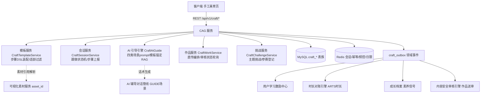
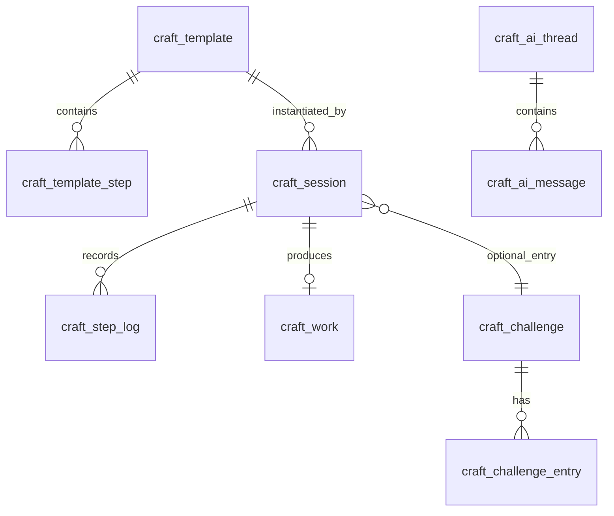
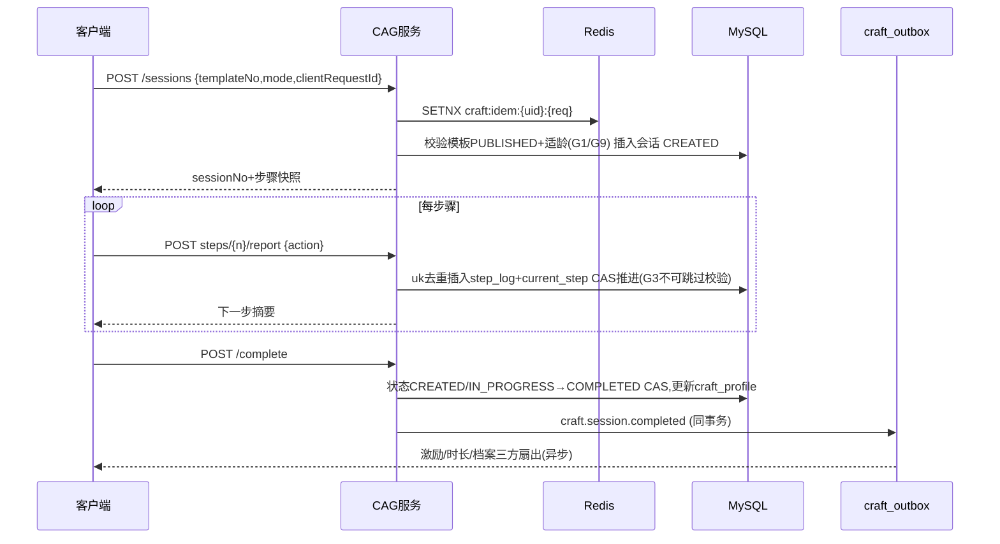
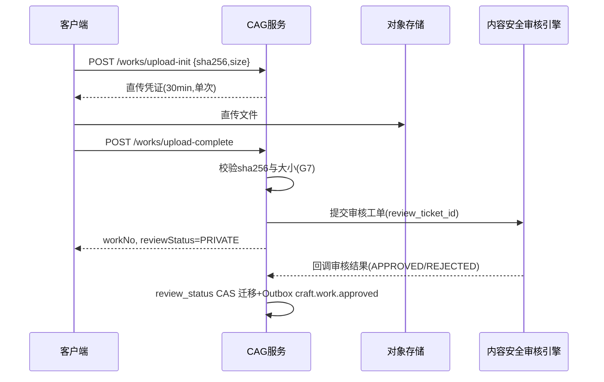
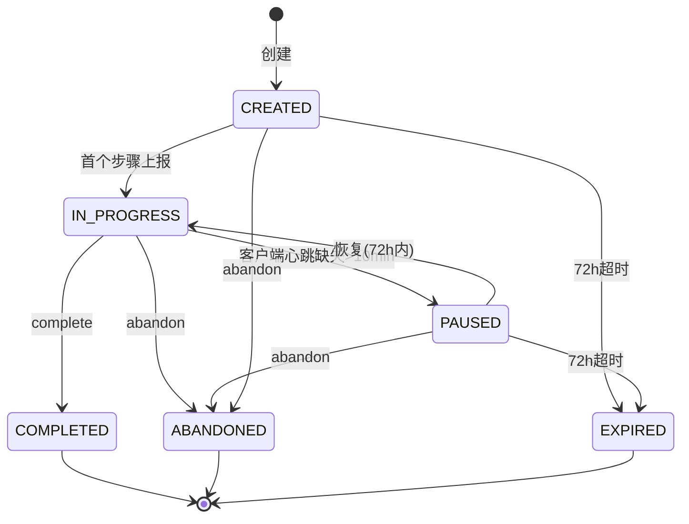

# 服务端-手工美育创作引导引擎 详细设计

- 版本: v1.0
- 日期: 2026-11-22
- 状态: 新增初版
- 错误码段: 48100-48199(全库扫描确认空闲)

## 1. 模块概述

### 1.1 功能定位

手工美育创作引导引擎(Craft & Art Guidance Engine, 内部代号 CAG)是"手工美育"专项素养域的服务端权威,REST 前缀 `/api/v1/craft/*`。手工美育(折纸/剪纸/简笔画/涂色/黏土/综合手工)是幼儿启蒙与小学低中段的核心素养品类,与平台既有域的边界:思维训练与益智游戏系统为静态 puzzle、棋类为博弈对弈、美术学科工具(几何画板/函数图)为学科辅助,均不覆盖"动手做"类创作跟做流程,独立成域(边界裁决见 R3)。

docs2 全库关键词扫描(2026-11-22 `_gap_scan5_20261122.js`)确认"手工美育(折纸/剪纸/黏土/简笔画/涂色/儿童画/手工课)"为零覆盖域:仅《客户端-拼音识字启蒙页面架构与交互设计》一处擦边命中(非本域语义)。本文补齐该缺口。

### 1.2 覆盖范围

| 范围 | 内容 | 说明 |
| --- | --- | --- |
| 手工类型 | ORIGAMI 折纸 / PAPERCUT 剪纸 / DOODLE 简笔画 / COLORING 涂色线稿 / CLAY 轻黏土 / CRAFT_SCIENCE 综合小制作(STEAM) | 本期六类,刺绣/编织等列入 P2 迭代 |
| 模式 | GUIDED 跟做教程 / FREE 自由创作 / CHALLENGE 主题挑战 | 定级不设测评页,难度由模板 age_band+step_count 标定 |
| AI 引导 | 步骤求助/卡住鼓励/材料替代/安全提醒四类场景 | LLM 只生成**引导话术**,禁生成"标准答案"、禁评判美丑(§5 红线) |
| 作品管理 | 拍照上传、家庭可见、审核后精选展示 | 审核权威外置(R5),挑战无投票排名(C5) |
| 画像 | 类型偏好、完成度统计、参与记录 | 不做"美术能力打分" |

**明确不做(本期)**:直播美术课/真人在线课堂;作品交易/打赏/虚拟货币竞价;美术社会考级挂钩(C6);AI 绘画直接生成作品图冒充学生创作(AIGC 红线 C4);材料电商(P2);刺绣/编织/木工等高危工具品类。

### 1.3 设计原则

1. **创作开放性——零判分**:手工创作无标准答案,引擎不设对错判定与分数,只有"完成/未完成"与"参与确认";AI 只引导不评判,话术红线禁贬义(对齐低效干预引擎 G5 同约定)。
2. **步骤与素材分离**:步骤结构(DSL)归本引擎权威;线稿/步骤图/视频素材的生产、版权、过期治理归教育内容可视化素材服务(R2),本引擎只存引用。
3. **安全提示 fail-closed**:涉及剪刀/美工刀/胶水/加热工具的步骤,安全提示为强制字段,客户端不可关闭、不可跳过(C3);适龄闸 fail-closed。
4. **UGC 审核前置**:作品图服务端先落私密态,经内容安全审核引擎通过后方可家庭外可见(R5);未成年人人脸默认禁公开(C1)。
5. **激励与时长外发**:积分/徽章经 Outbox 交激励中心单写(R6);时长 category=ARTS 计入素养学习时长,归时长对账引擎权威(R7)。
6. **防沉迷只执行不裁决**:时段/时长约束 fail-closed,与安全教育模块同约定(R9)。

### 1.4 权威边界

| 边界 | 裁决 |
| --- | --- |
| R1 步骤结构与跟做会话权威 | 本引擎封闭:craft_template_step DSL 为 SSOT,不委托互动课件引擎(跟做为创作场景,非课件播放) |
| R2 素材生产与版权 | 线稿/步骤图/视频归《服务端-教育内容可视化素材智能生成与管理服务》生产与版权治理,本引擎仅存 asset_id 引用;版权到期 fail-closed 由素材服务事件通知,本引擎收到后模板自动下架(G4) |
| R3 与思维训练/棋类域 | puzzle=静态题、chess=博弈对弈、本域=动手创作,三方 GameType/枚举命名空间独立互不委托 |
| R4 AI 引导 | LLM 只参与引导话术生成,禁参与完成判定/作品评价/安全判定;话术输出经统一内容安全规则引擎过滤 |
| R5 UGC 审核 | 作品审核权威归《服务端-用户生成内容安全审核与未成年人社交保护引擎》,本引擎提交后只轮询状态,不内嵌审核规则 |
| R6 激励 | 发放权威归用户学习激励中心,本引擎经 craft_outbox 事件外发(首次完成/挑战参与/累计作品里程碑),禁直接写激励表 |
| R7 学习时长 | category=ARTS 为素养学习时长,计入有效学习时长(与安全教育一致,区别于棋类/ puzzle 娱乐时长),归时长对账引擎权威 |
| R8 成长档案 | 素养维度信号(参与次数/类型覆盖)经事件外发《服务端-学生电子成长档案与综合素质评价服务》,本引擎不写档案表 |
| R9 防沉迷 | 本引擎只执行(fail-closed),不裁决不放宽 |
| R10 客户端页面 | 客户端页面架构(跟做播放器/作品墙/AI 引导浮窗)为后续批次,本文仅定义服务端契约 |

## 2. 整体架构

### 2.1 引擎架构图



### 2.2 模块职责

| 模块 | 职责 | 不做的事 |
| --- | --- | --- |
| 模板服务 | 六类手工模板/步骤 DSL 装配、适龄学段过滤、材料清单生成 | 不生产素材(归可视化素材服务),不做模板版权判定(归素材/版权引擎) |
| 会话服务 | 跟做会话生命周期、步骤推进/跳过/回看记录、完成结算 | 不判对错、不打分 |
| AI 引导引擎 | 四类场景话术生成、模板步骤上下文锚定、频控 | 不评判作品、不生成标准答案、不输出脱离锚定素材的教程步骤 |
| 作品服务 | 直传凭证签发、作品元数据管理、审核状态同步 | 不内嵌审核规则(权威外置),不做图像内容识别 |
| 挑战服务 | 主题挑战配置读取、参赛登记、精选展示列表 | 不做投票/排名/奖品发放(激励外发) |
| 画像服务 | 类型偏好 EMA、完成统计、参与里程碑检测 | 不生成学情报告(权威外置) |

## 3. 核心数据结构

### 3.1 实体关系



### 3.2 DDL(MySQL 8.0,InnoDB,utf8mb4)

```sql
-- 手工模板主表(步骤 DSL 载体)
CREATE TABLE craft_template (
  id              BIGINT UNSIGNED NOT NULL AUTO_INCREMENT,
  template_no     VARCHAR(32)  NOT NULL COMMENT '业务编号 CRAFT-T-xxxx',
  craft_type      VARCHAR(20)  NOT NULL COMMENT 'ORIGAMI/PAPERCUT/DOODLE/COLORING/CLAY/CRAFT_SCIENCE',
  title           VARCHAR(128) NOT NULL,
  summary         VARCHAR(512) NOT NULL DEFAULT '',
  age_band        VARCHAR(8)   NOT NULL COMMENT '3-5/5-7/7-9/9-12/12+',
  difficulty      TINYINT      NOT NULL DEFAULT 1 COMMENT '1-5,仅作适龄提示非评分',
  est_duration_sec INT         NOT NULL DEFAULT 900,
  material_list   JSON         NOT NULL COMMENT '[{name,amount,substitute,safety_level}]',
  cover_asset_id  VARCHAR(64)  NOT NULL DEFAULT '',
  status          VARCHAR(16)  NOT NULL DEFAULT 'DRAFT' COMMENT 'DRAFT/PENDING_REVIEW/PUBLISHED/OFFLINE',
  version_no      INT          NOT NULL DEFAULT 1,
  published_at    DATETIME     NULL,
  offline_reason  VARCHAR(32)  NOT NULL DEFAULT '' COMMENT 'COPYRIGHT_EXPIRED/SAFETY_RECALL/EDITORIAL',
  created_by      BIGINT UNSIGNED NOT NULL,
  created_at      DATETIME NOT NULL DEFAULT CURRENT_TIMESTAMP,
  updated_at      DATETIME NOT NULL DEFAULT CURRENT_TIMESTAMP ON UPDATE CURRENT_TIMESTAMP,
  PRIMARY KEY (id),
  UNIQUE KEY uk_template_no (template_no),
  KEY idx_type_status (craft_type, status, age_band)
) COMMENT='手工美育模板';

-- 模板步骤表(DSL SSOT)
CREATE TABLE craft_template_step (
  id            BIGINT UNSIGNED NOT NULL AUTO_INCREMENT,
  template_id   BIGINT UNSIGNED NOT NULL,
  step_no       INT          NOT NULL COMMENT '从1开始连续',
  title         VARCHAR(128) NOT NULL,
  instruction   TEXT         NOT NULL COMMENT '操作说明(适龄文案)',
  media_asset_ids JSON       NOT NULL COMMENT '[{asset_id,kind:image|video|svg}]',
  key_point     VARCHAR(512) NOT NULL DEFAULT '' COMMENT '本步关键观察点(AI锚定用)',
  tip           VARCHAR(512) NOT NULL DEFAULT '' COMMENT '常见困难提示',
  safety_note   VARCHAR(512) NOT NULL DEFAULT '' COMMENT '安全提示,含工具的步骤强制非空',
  safety_level  TINYINT      NOT NULL DEFAULT 0 COMMENT '0无工具/1剪刀胶水/2美工刀/3加热或电源',
  est_duration_sec INT       NOT NULL DEFAULT 60,
  skippable     TINYINT(1)   NOT NULL DEFAULT 1 COMMENT '0=不可跳过(安全步骤)',
  created_at    DATETIME NOT NULL DEFAULT CURRENT_TIMESTAMP,
  updated_at    DATETIME NOT NULL DEFAULT CURRENT_TIMESTAMP ON UPDATE CURRENT_TIMESTAMP,
  PRIMARY KEY (id),
  UNIQUE KEY uk_template_step (template_id, step_no)
) COMMENT='手工模板步骤';

-- 跟做会话
CREATE TABLE craft_session (
  id            BIGINT UNSIGNED NOT NULL AUTO_INCREMENT,
  session_no    VARCHAR(32)  NOT NULL COMMENT '业务编号 CRAFT-S-xxxx',
  user_id       BIGINT UNSIGNED NOT NULL,
  template_id   BIGINT UNSIGNED NOT NULL,
  template_version_no INT   NOT NULL COMMENT '快照防模板更新歧义',
  mode          VARCHAR(12)  NOT NULL COMMENT 'GUIDED/FREE/CHALLENGE',
  challenge_id  BIGINT UNSIGNED NULL,
  status        VARCHAR(16)  NOT NULL DEFAULT 'CREATED'
                COMMENT 'CREATED/IN_PROGRESS/PAUSED/COMPLETED/ABANDONED/EXPIRED',
  current_step  INT          NOT NULL DEFAULT 0 COMMENT '0=未开始',
  step_snapshot JSON         NOT NULL COMMENT '模板步骤摘要快照(断线恢复用)',
  client_request_id VARCHAR(64) NOT NULL DEFAULT '',
  started_at    DATETIME     NULL,
  completed_at  DATETIME     NULL,
  expire_at     DATETIME     NOT NULL COMMENT '创建+72h自动过期',
  version       INT          NOT NULL DEFAULT 0 COMMENT '乐观锁',
  created_at    DATETIME NOT NULL DEFAULT CURRENT_TIMESTAMP,
  updated_at    DATETIME NOT NULL DEFAULT CURRENT_TIMESTAMP ON UPDATE CURRENT_TIMESTAMP,
  PRIMARY KEY (id),
  UNIQUE KEY uk_session_no (session_no),
  UNIQUE KEY uk_user_clientreq (user_id, client_request_id),
  KEY idx_user_status (user_id, status, updated_at)
) COMMENT='手工跟做会话';

-- 步骤推进日志(只追加)
CREATE TABLE craft_step_log (
  id            BIGINT UNSIGNED NOT NULL AUTO_INCREMENT,
  session_id    BIGINT UNSIGNED NOT NULL,
  step_no       INT          NOT NULL,
  action        VARCHAR(12)  NOT NULL COMMENT 'CONFIRM/SKIP/BACK/HELP',
  duration_sec  INT          NOT NULL DEFAULT 0,
  client_request_id VARCHAR(64) NOT NULL DEFAULT '',
  created_at    DATETIME NOT NULL DEFAULT CURRENT_TIMESTAMP,
  PRIMARY KEY (id),
  UNIQUE KEY uk_session_step_action_req (session_id, step_no, action, client_request_id),
  KEY idx_session (session_id, created_at)
) COMMENT='步骤日志,月分区保留6个月';

-- 作品(UGC,审核权威外置)
CREATE TABLE craft_work (
  id            BIGINT UNSIGNED NOT NULL AUTO_INCREMENT,
  work_no       VARCHAR(32)  NOT NULL COMMENT '业务编号 CRAFT-W-xxxx',
  user_id       BIGINT UNSIGNED NOT NULL,
  session_id    BIGINT UNSIGNED NULL COMMENT 'FREE模式可为空',
  challenge_id  BIGINT UNSIGNED NULL,
  title         VARCHAR(64)  NOT NULL DEFAULT '',
  description   VARCHAR(255) NOT NULL DEFAULT '',
  media_assets  JSON         NOT NULL COMMENT '[{asset_id,kind:photo|video}]',
  self_rating   TINYINT      NULL COMMENT '1-5自评,可空,不参与任何排名',
  review_status VARCHAR(16)  NOT NULL DEFAULT 'PRIVATE'
                COMMENT 'PRIVATE送审中/UNDER_REVIEW/APPROVED/REJECTED/DELETED',
  review_ticket_id BIGINT UNSIGNED NULL COMMENT '外置审核工单号',
  visibility    VARCHAR(10)  NOT NULL DEFAULT 'FAMILY' COMMENT 'FAMILY/FEATURED,FAMILY为默认且唯一可选项(本期)',
  client_request_id VARCHAR(64) NOT NULL DEFAULT '',
  created_at    DATETIME NOT NULL DEFAULT CURRENT_TIMESTAMP,
  updated_at    DATETIME NOT NULL DEFAULT CURRENT_TIMESTAMP ON UPDATE CURRENT_TIMESTAMP,
  PRIMARY KEY (id),
  UNIQUE KEY uk_work_no (work_no),
  UNIQUE KEY uk_user_clientreq (user_id, client_request_id),
  KEY idx_user_created (user_id, created_at),
  KEY idx_review_status (review_status, updated_at)
) COMMENT='学生手工作品';

-- AI 引导会话与消息
CREATE TABLE craft_ai_thread (
  id            BIGINT UNSIGNED NOT NULL AUTO_INCREMENT,
  thread_no     VARCHAR(32)  NOT NULL,
  session_id    BIGINT UNSIGNED NOT NULL,
  user_id       BIGINT UNSIGNED NOT NULL,
  scene         VARCHAR(16)  NOT NULL COMMENT 'STEP_HELP/ENCOURAGE/MATERIAL_SUB/SafetyTip',
  status        VARCHAR(12)  NOT NULL DEFAULT 'ACTIVE' COMMENT 'ACTIVE/CLOSED',
  created_at    DATETIME NOT NULL DEFAULT CURRENT_TIMESTAMP,
  PRIMARY KEY (id),
  UNIQUE KEY uk_thread_no (thread_no),
  KEY idx_session (session_id)
) COMMENT='AI引导会话';

CREATE TABLE craft_ai_message (
  id            BIGINT UNSIGNED NOT NULL AUTO_INCREMENT,
  thread_id     BIGINT UNSIGNED NOT NULL,
  role          VARCHAR(8)   NOT NULL COMMENT 'USER/ASSISTANT',
  content       TEXT         NOT NULL,
  anchor_step_no INT         NULL COMMENT '话术锚定步骤',
  safety_filtered TINYINT(1) NOT NULL DEFAULT 0,
  token_cost    INT          NOT NULL DEFAULT 0,
  created_at    DATETIME NOT NULL DEFAULT CURRENT_TIMESTAMP,
  PRIMARY KEY (id),
  KEY idx_thread (thread_id, created_at)
) COMMENT='AI引导消息,文本留存90天';

-- 主题挑战
CREATE TABLE craft_challenge (
  id            BIGINT UNSIGNED NOT NULL AUTO_INCREMENT,
  challenge_no  VARCHAR(32)  NOT NULL,
  title         VARCHAR(128) NOT NULL,
  theme         VARCHAR(64)  NOT NULL,
  brief         TEXT         NOT NULL COMMENT '创作要求+材料建议',
  age_band      VARCHAR(8)   NOT NULL,
  craft_types   JSON         NOT NULL COMMENT '允许的手工类型',
  start_at      DATETIME     NOT NULL,
  end_at        DATETIME     NOT NULL,
  status        VARCHAR(12)  NOT NULL DEFAULT 'DRAFT' COMMENT 'DRAFT/PUBLISHED/CLOSED/OFFLINE',
  version       INT          NOT NULL DEFAULT 0,
  created_at    DATETIME NOT NULL DEFAULT CURRENT_TIMESTAMP,
  updated_at    DATETIME NOT NULL DEFAULT CURRENT_TIMESTAMP ON UPDATE CURRENT_TIMESTAMP,
  PRIMARY KEY (id),
  UNIQUE KEY uk_challenge_no (challenge_no),
  KEY idx_status_time (status, start_at, end_at)
) COMMENT='手工主题挑战';

CREATE TABLE craft_challenge_entry (
  id            BIGINT UNSIGNED NOT NULL AUTO_INCREMENT,
  challenge_id  BIGINT UNSIGNED NOT NULL,
  work_id       BIGINT UNSIGNED NOT NULL,
  user_id       BIGINT UNSIGNED NOT NULL,
  status        VARCHAR(12)  NOT NULL DEFAULT 'ENTERED' COMMENT 'ENTERED/FEATURED/REMOVED',
  client_request_id VARCHAR(64) NOT NULL DEFAULT '',
  created_at    DATETIME NOT NULL DEFAULT CURRENT_TIMESTAMP,
  PRIMARY KEY (id),
  UNIQUE KEY uk_challenge_work (challenge_id, work_id),
  UNIQUE KEY uk_user_clientreq (user_id, client_request_id)
) COMMENT='挑战参赛作品';

-- 画像(偏好EMA+统计,单写)
CREATE TABLE craft_profile (
  id            BIGINT UNSIGNED NOT NULL AUTO_INCREMENT,
  user_id       BIGINT UNSIGNED NOT NULL,
  type_pref     JSON         NOT NULL COMMENT '六类偏好权重EMA',
  total_sessions INT         NOT NULL DEFAULT 0,
  total_works   INT          NOT NULL DEFAULT 0,
  total_duration_sec BIGINT   NOT NULL DEFAULT 0,
  last_active_at DATETIME    NULL,
  updated_at    DATETIME NOT NULL DEFAULT CURRENT_TIMESTAMP ON UPDATE CURRENT_TIMESTAMP,
  PRIMARY KEY (id),
  UNIQUE KEY uk_user (user_id)
) COMMENT='手工美育画像';

-- 领域事件 Outbox
CREATE TABLE craft_outbox (
  id            BIGINT UNSIGNED NOT NULL AUTO_INCREMENT,
  event_id      VARCHAR(64)  NOT NULL,
  event_type    VARCHAR(48)  NOT NULL,
  aggregate_id  VARCHAR(32)  NOT NULL,
  payload       JSON         NOT NULL,
  status        VARCHAR(12)  NOT NULL DEFAULT 'PENDING' COMMENT 'PENDING/SENT/FAILED',
  retry_count   INT          NOT NULL DEFAULT 0,
  created_at    DATETIME NOT NULL DEFAULT CURRENT_TIMESTAMP,
  sent_at       DATETIME NULL,
  PRIMARY KEY (id),
  UNIQUE KEY uk_event_id (event_id),
  KEY idx_status (status, created_at)
) COMMENT='CAG领域事件';
```

### 3.3 Redis 键规划

| 键 | 类型 | TTL | 说明 |
| --- | --- | --- | --- |
| `craft:session:lock:{sessionNo}` | STRING NX | 3s | 会话操作串行锁 |
| `craft:idem:{userId}:{clientRequestId}` | STRING | 24h | 创建/上报幂等回放 |
| `craft:ai:rate:{userId}` | HASH+Lua | 滑动窗口 | AI 引导频控:每会话 ≤20 条,日 ≤60 条 |
| `craft:daily:{userId}:{date}` | STRING | 48h | 日会话数计数(防沉迷联动读) |
| `craft:work:upload:{workNo}` | STRING | 30min | 直传凭证签发防重 |
| `craft:template:published:{craftType}:{ageBand}` | STRING | 10min | 模板列表缓存(短 TTL,版权下架须快速失效) |

## 4. 模板步骤 DSL 与装配

### 4.1 步骤 DSL 示例

模板装配响应中步骤按下述契约下发(素材引用经可视化素材服务解析为 CDN URL):

```json
{
  "templateNo": "CRAFT-T-100231",
  "craftType": "ORIGAMI",
  "title": "会跳的纸青蛙",
  "ageBand": "5-7",
  "difficulty": 2,
  "materialList": [
    {"name": "正方形彩纸", "amount": "1张15x15cm", "substitute": "普通A4纸裁正方形", "safetyLevel": 0}
  ],
  "steps": [
    {
      "stepNo": 1,
      "title": "对角对折",
      "instruction": "把正方形纸沿对角线折成三角形,边角对齐,用手压平折痕。",
      "media": [{"assetId": "va_88213", "kind": "image", "url": "https://cdn.../s1.png"}],
      "keyPoint": "折痕要压平,这是后面所有折叠的基础",
      "tip": "如果边对不齐,先对齐一个角再慢慢压过去",
      "safetyNote": "",
      "safetyLevel": 0,
      "estDurationSec": 60,
      "skippable": true
    },
    {
      "stepNo": 7,
      "title": "剪出后腿形状",
      "instruction": "沿虚线剪开。剪刀尖朝外,另一只手离剪刀口远一点。",
      "media": [{"assetId": "va_88220", "kind": "image", "url": "https://cdn.../s7.png"}],
      "keyPoint": "只剪到虚线止点,不要剪过头",
      "tip": "可以先请家长帮忙扶住纸",
      "safetyNote": "使用儿童安全剪刀;剪的时候眼睛看剪刀口,不要边剪边说话。",
      "safetyLevel": 1,
      "estDurationSec": 90,
      "skippable": false
    }
  ]
}
```

### 4.2 装配规则

1. **快照一致性**: 创建会话时 `step_snapshot` 固化模板版本与步骤摘要,会话存续期内模板被编辑/下架不影响在途会话;新会话强制使用新版本(G2)。
2. **版权 fail-closed**: 收到素材服务 `asset.copyright_expired` 事件后,引用该 asset 的模板自动置 OFFLINE(原因 COPYRIGHT_EXPIRED),列表缓存立即删除;在途会话可完成但不可重启(G4)。
3. **安全步骤不可跳过**: `skippable=false` 的步骤客户端必须 CONFIRM 才能推进,服务端在步骤上报时校验(G3)。
4. **适龄闸**: age_band 与用户学段映射由服务端裁决,不在客户端计算(映射表对齐分龄 UI 规范)。

## 5. AI 创作引导引擎

### 5.1 场景定义

| 场景 | 触发 | 锚定上下文 | 输出要求 |
| --- | --- | --- | --- |
| STEP_HELP 步骤求助 | 用户在步骤停留超阈值或点"帮帮我" | 当前步骤 instruction+key_point+tip | 用幼儿/小学适龄语言重讲当前步,只讲当前步,不提前剧透后续步骤 |
| ENCOURAGE 卡住鼓励 | 步骤耗时 > 3× est_duration 或连续 BACK | 当前步骤+用户历史完成记录 | 鼓励话术+降低难度建议(如"先请家长帮忙按住纸"),禁说"你做得不对" |
| MATERIAL_SUB 材料替代 | 用户问"没有 xx 怎么办" | material_list 的 substitute 字段 | 只允许回答模板内置替代方案;模板无替代字段时引导"可以换个模板试试" |
| SafetyTip 安全提醒 | 会话内首次进入 safety_level≥1 的步骤 | 该步骤 safety_note | 原样复述 safety_note+一句趣味提醒,禁省略 |

### 5.2 红线(对齐平台 LLM 红线)

1. **禁评判**: 不得对作品美观度/像不像打分、不得与"标准作品"对比、不得说"错了/不像/不好看";只能描述观察+"可以试试..."建议句式。
2. **禁剧透**: STEP_HELP 只讲当前步;用户追问后续步骤时回答"先把这一步折好,下一步马上就来"。
3. **禁幻觉教程**: 不得生成脱离模板锚定素材的新步骤/新折法;模板未覆盖的问题引导至"换个模板"或"问家长"。
4. **禁代劳**: 不得替学生生成"让 AI 画一个交差"的出口(对齐作文不代写红线)。
5. 输出经统一内容安全规则引擎过滤,命中即拒绝并降级为通用鼓励话术(48121,200 语义)。

### 5.3 请求处理

```java
@PostMapping("/ai/messages")
public SseEmitter guide(@RequestBody @Valid CraftAiGuideReq req,
                        @RequestHeader("X-Client-Request-Id") String clientReqId) {
    // G6 频控:会话级滑动窗口 Lua 原子扣减,超限直接 48109
    rateLimiter.tryConsumeOrThrow("craft:ai:rate:" + req.userId(), 1, 48109);
    CraftSession session = sessionService.mustActive(req.sessionNo()); // 48104/48105
    // G8 防沉迷 fail-closed
    guardianService.assertPlayable(req.userId()); // 48107
    CraftTemplateStep anchor = templateService.anchorStep(session, req.anchorStepNo());
    // 锚定组装:步骤文本+材料替代表注入,模板外上下文禁止进入 prompt
    GuideContext ctx = GuideContext.of(session, anchor, req.scene());
    return aiPipeline.streamGuide(ctx, GUIDE_PROMPT_V1)
        .map(chunk -> safetyFilter.passThrough(chunk))   // 流式过滤,命中即截断
        .doOnComplete(() -> aiLogService.persist(thread, ctx)); // craft_ai_message 落库
        .toSse();
}
```

## 6. API 接口设计

统一约定: 请求头 `X-Client-Request-Id` 为幂等键;响应封装遵循《API网关统一接口规范》;错误码见 §11。限流: 学生端 100 QPS/用户。

| # | 方法+路径 | 说明 | 幂等 |
| --- | --- | --- | --- |
| 1 | GET `/api/v1/craft/categories` | 六类手工元数据(图标/名称/适龄标签) | 读 |
| 2 | GET `/api/v1/craft/templates?craftType&ageBand&page` | 模板列表(仅 PUBLISHED) | 读,10min 缓存 |
| 3 | GET `/api/v1/craft/templates/{templateNo}` | 模板详情+步骤 DSL 全量 | 读 |
| 4 | POST `/api/v1/craft/sessions` | 创建会话 `{templateNo, mode, challengeId?}` | clientRequestId 24h 回放 |
| 5 | GET `/api/v1/craft/sessions/{sessionNo}` | 会话状态+步骤快照(断线恢复) | 读 |
| 6 | POST `/api/v1/craft/sessions/{sessionNo}/steps/{stepNo}/report` | 步骤 CONFIRM/SKIP/BACK/HELP `{action, durationSec}` | (session,step,action,req) uk |
| 7 | POST `/api/v1/craft/sessions/{sessionNo}/complete` | 完成会话(首次置 COMPLETED 写 Outbox) | 会话状态 CAS |
| 8 | POST `/api/v1/craft/sessions/{sessionNo}/abandon` | 放弃 `{reason}` | 状态 CAS |
| 9 | POST `/api/v1/craft/works/upload-init` | 作品直传初始化 `{sessionNo?, challengeId?, mime, size, sha256}` | clientRequestId |
| 10 | POST `/api/v1/craft/works/upload-complete` | 直传完成后落库并送审(visibility 恒 FAMILY) | clientRequestId |
| 11 | GET `/api/v1/craft/works?page` | 我的作品(含审核状态) | 读 |
| 12 | DELETE `/api/v1/craft/works/{workNo}` | 删除(级联送审工单关闭) | 状态 CAS |
| 13 | POST `/api/v1/craft/ai/messages` | AI 引导(SSE 流式) | 消息级频控 |
| 14 | GET `/api/v1/craft/challenges?status=PUBLISHED` | 进行中挑战列表 | 读 |
| 15 | POST `/api/v1/craft/challenges/{challengeNo}/entries` | 用已 APPROVED 作品参赛 `{workNo}` | (challenge,work) uk |
| 16 | GET `/api/v1/parent/craft/report?childUserId&range` | 家长端:参与时长/类型覆盖/作品数(隐私最小集) | 家长门令牌 |
| 17-20 | 管理端 CRUD | 模板/步骤/挑战维护+上下架(双人复核) | 角色权限 |

上传约束(G7): 仅 image/jpeg|png|webp 与 video/mp4,单文件 ≤20MB,sha256 去重;客户端相机拍摄强制(禁相册选取防旧图/网图冒充,对齐听写 G12 同约定)。

## 7. 核心流程

### 7.1 跟做链路



### 7.2 作品上传与审核链路



## 8. 状态机与守卫

### 8.1 会话状态机



### 8.2 守卫表

| 守卫 | 规则 | 错误码 |
| --- | --- | --- |
| G1 模板状态 | 仅 PUBLISHED 可创建会话;OFFLINE 模板返回离线原因供客户端展示 | 48102 |
| G2 版本快照 | 会话绑定 template_version_no;步骤快照与库内不一致时以快照为准回放 | — |
| G3 不可跳过 | skippable=false 步骤 SKIP 拒绝;current_step 只允许 +1/重报/回退 | 48106 |
| G4 版权下架 | 版权到期模板立即不可新创建;在途会话可完成,AI 引导中提及该模板引导换模板 | 48102(带 offlineReason) |
| G5 完成一次性 | complete 仅 CREATED/IN_PROGRESS 可执行,终态幂等返回 | 48105 |
| G6 AI 频控 | 会话 ≤20 条且日 ≤60 条,滑动窗口原子扣减 | 48109 |
| G7 上传校验 | mime/大小/sha256 三重校验;相册选取客户端禁令(客户端守卫,服务端兜底记录来源字段) | 48110/48111 |
| G8 防沉迷 | 创建/AI 引导/每步骤上报均校验时段与剩余时长,fail-closed | 48107 |
| G9 适龄闸 | age_band 与学段映射不符拒绝,fail-closed,家长收紧以严者胜 | 48103 |
| G10 送审前置 | upload-complete 必须同步创建审核工单,失败则整个作品标记 PRIVATE 且不可见 | 48122 |
| G11 参赛资格 | 仅 APPROVED 作品可参赛;挑战 CLOSED 后不可参赛 | 48113/48114 |
| G12 删除级联 | 删除作品同事务关闭审核工单+清挑战 entries(REMOVED) | — |

### 8.3 竞态裁决

| 竞态 | 裁决 |
| --- | --- |
| complete 与 expire 调度并发 | 乐观锁 version 先者胜;EXPIRED 后 complete 返回 48105 |
| 审核回调与删除并发 | 作品 DELETED 后回调到达:仅记录审计,不回写状态 |
| 双端同时推进步骤 | session 锁串行化;current_step CAS expected 不符者返回最新态,客户端刷新 |
| AI 引导与模板下架并发 | 已开始的 AI 应答可完成;新请求校验模板状态,OFFLINE 拒绝 |

## 9. 幂等与并发

1. 创建会话/上传初始化: `uk_user_clientreq` 唯一键 + Redis 24h 回放,重复请求返回首个资源(同模板+同 clientRequestId 5 分钟窗口内)。
2. 步骤上报: `uk_session_step_action_req` 天然幂等;同一 step 重复 CONFIRM 只记一条。
3. complete/abandon: 状态 CAS(`UPDATE ... SET status=? WHERE session_no=? AND status IN (...)`),终态重复提交返回 200 幂等语义。
4. 会话操作锁: `craft:session:lock:{sessionNo}` SETNX 3s,锁只是性能设施,正确性由唯一键+CAS 保证。
5. 参赛: `uk_challenge_work` 防同一作品重复参赛;`uk_user_clientreq` 防双击。

## 10. 领域事件 Outbox

| 事件 | 触发 | 消费方 | 关键载荷 |
| --- | --- | --- | --- |
| craft.session.completed | 首次 COMPLETED | 激励中心(首次完成某类型模板徽章)/时长对账(ARTS)/成长档案 | userId, craftType, durationSec |
| craft.work.approved | 审核通过 | 激励中心(作品里程碑)/消息中心(家长端"孩子有新作品") | workNo |
| craft.work.rejected | 审核拒绝 | 消息中心(仅家长可见,话术中性) | workNo, reasonCode |
| craft.challenge.entered | 参赛登记 | 激励中心(参与徽章) | challengeNo |
| craft.work.featured | 运营精选 | 内容运营(首页展示候选,复用曝光管控) | workNo |
| craft.template.offlined | 模板下架 | 客户端缓存清理/搜索索引移除 | templateNo, reason |

订阅上游: `asset.copyright_expired`(素材版权到期→G4)、`account.deleted`(注销级联 24h 清 session/work/画像，对齐各引擎注销约定)、`engagement.guardian_updated`(防沉迷配置变更)。

## 11. 错误码(48100-48199)

| 码 | 含义 | HTTP | 可重试 |
| --- | --- | --- | --- |
| 48101 | 参数非法 | 400 | 否 |
| 48102 | 模板不存在/未发布/已下架（附 offlineReason) | 404 | 否 |
| 48103 | 适龄/学段限制 | 403 | 否 |
| 48104 | 会话不存在 | 404 | 否 |
| 48105 | 会话状态非法 | 409 | 刷新后重试 |
| 48106 | 步骤非法（不可跳过/序号越界） | 409 | 否 |
| 48107 | 防沉迷限制（时段/时长） | 200(引导态） | 时段后自动恢复 |
| 48108 | 家长门校验失败 | 403 | 否 |
| 48109 | AI 引导频控超限 | 429 | 是（退避） |
| 48110 | 文件类型不允许 | 400 | 否 |
| 48111 | 文件大小超限 | 400 | 否 |
| 48112 | 作品不可见（审核中/未通过） | 404 | 否 |
| 48113 | 挑战不存在/未开始/已结束 | 404 | 否 |
| 48114 | 作品重复参赛 | 409 | 否 |
| 48115 | 作品不存在 | 404 | 否 |
| 48116 | 直传凭证过期 | 400 | 重新 upload-init |
| 48120 | AI 引导降级（引擎超时，返回内置鼓励话术） | 200 | 自动 |
| 48121 | AI 话术安全过滤命中（返回通用鼓励话术） | 200 | 是（改述） |
| 48122 | 送审失败（作品保留 PRIVATE) | 200 | 是（后台重试送审） |
| 48130 | 家长端已关闭手工美育功能（fail-closed) | 200 | 否 |

200 语义码与棋类/体育引擎同约定（48107/48120/48121/48122/48130);40103 通用权限码、40001 通用参数码归口全局，不重复占用。

## 12. 降级矩阵

| # | 故障 | 降级行为 | 红线 |
| --- | --- | --- | --- |
| D1 | AI 管线超时/异常 | 返回内置适龄鼓励话术（48120) | 可降级 |
| D2 | AI 安全过滤命中 | 通用鼓励话术（48121) | 可降级 |
| D3 | 素材 CDN 故障 | 步骤文本下发+媒体占位图，跟做不阻断 | 可降级 |
| D4 | 送审通道故障 | 作品 PRIVATE 留存，后台重试送审（48122) | 禁"先可见后审核" |
| D5 | 模板列表缓存失效失败 | 直查 DB+短超时 | 可降级 |
| D6 | 挑战服务故障 | 跟做/作品主链路不受影响，挑战入口隐藏 | 可降级 |
| D7 | 画像写入失败 | 会话主流程不受影响，画像异步补写 | 可降级 |
| D8 | Redis 故障 | 唯一键+CAS 保底正确性，频控退化为 DB 计数 | 可降级 |
| D9 | OSS 直传凭证失败 | 返回 48116 引导重试，禁服务端代理转发大文件 | 可降级 |
| D10 | — | 总红线： 适龄闸/防沉迷/安全提示/送审前置/零判分原则不可降级 | 不可降级 |

## 13. 监控与容量

| 指标 | 阈值/目标 |
| --- | --- |
| 会话创建 P99 | ≤200ms |
| 步骤上报 P99 | ≤100ms |
| AI 引导首 token | ≤2s,P95 端到端 ≤8s |
| AI 降级率（48120) | >5% 持续 10min 告警 P2;>20% P1 |
| 送审积压 | PRIVATE 超 30min 未送审 P2 |
| 审核回调延迟 | 外置，>2h 告警 P2 |
| 会话完成率 | 日报观测，异常下跌 P3 |
| DAU 容量 | 平台 DAU 50 万，手工域日活按 3% 估算 1.5 万；日会话峰值 3 万，step_log 日 60 万行月分区 6 个月 |

## 14. 合规红线

1. **C1 未成年人人脸与隐私**: 作品含人脸默认 FAMILY 可见；本期不提供公开可见性；家长端报告遵循隐私最小集。
2. **C2 监护人授权**: 作品上传首次触发家长门（统一家长门引擎 Grant Token);8 岁以下全程家长门。
3. **C3 工具安全**: safety_level≥1 步骤安全提示不可跳过、客户端不可关闭；CRAFT_SCIENCE 含加热/电源步骤仅限家长协同模式（mode=GUIDED 且家长在场确认）。
4. **C4 AIGC 标识**: AI 生成的话术/素材若进入作品或展示，须按 AIGC 标识规范显式标识；禁 AI 绘画冒充学生作品。
5. **C5 零社交排名**: 挑战不设投票/点赞排名/评论；精选由运营+审核双后置决定，防未成年人社交攀比与拉票。
6. **C6 零考级挂钩**: 不对接任何社会美术考级，不做"证书"话术。
7. **C7 素材版权**: 模板素材 100% 走授权链路（可视化素材服务准入），版权到期 fail-closed(G4)。
8. **C8 时长口径**: 作品拍摄/上传耗时计入使用时长但不计入学习时长；只有 GUIDED/FREE 创作过程计时计入 ARTS 素养时长（口径归时长对账引擎）。

## 15. 契约对齐

| # | 契约 | 对齐 |
| --- | --- | --- |
| R1 | 步骤 DSL SSOT | 本文；互动课件引擎不承接跟做场景 |
| R2 | 素材生产/版权 | 《服务端-教育内容可视化素材智能生成与管理服务》;asset_id 引用契约 |
| R3 | puzzle/chess/craft 三域独立 | 枚举/表族/事件前缀互不共享 |
| R4 | AI 引导 | AI 辅导对话管线 GUIDE 场景；内容安全规则引擎过滤；额度经额度管控引擎 |
| R5 | UGC 审核 | 《服务端-用户生成内容安全审核与未成年人社交保护引擎》权威，回调契约 review_ticket_id |
| R6 | 激励单写 | 用户学习激励中心；事件见 §10 |
| R7 | 时长 | 时长对账引擎 category=ARTS(素养，计入有效学习时长，区别于棋类 CHESS 娱乐时长） |
| R8 | 成长档案 | 电子成长档案服务消费 §10 事件 |
| R9 | 防沉迷 | 本引擎只执行 fail-closed，配置权威归防沉迷域 |
| R10 | 客户端页面 | 后续批次：跟做播放器/作品墙/AI 引导浮窗页面文档，事件/错误码 1:1 引用本文 |

## 16. 埋点事件(module=craft)

| 事件 | 时机 | 关键属性 |
| --- | --- | --- |
| craft_home_view | 首页曝光 | ageBand |
| craft_template_open | 打开模板详情 | templateNo, craftType |
| craft_session_create | 创建会话 | templateNo, mode |
| craft_step_report | 步骤上报（服务端日志镜像，客户端不重复埋） | 仅 action+duration，禁采作品图内容 |
| craft_session_complete | 完成 | durationSec, stepCount |
| craft_session_abandon | 放弃 | reason, currentStep |
| craft_ai_guide_used | AI 引导 | scene, degraded(48120/48121) |
| craft_work_uploaded | 上传完成 | challengeId?, sizeBucket |
| craft_work_review_result | 审核回调 | result |
| craft_challenge_enter | 参赛 | challengeNo |

## 17. 验收场景

- AC01 创建会话携相同 clientRequestId 重放，返回同一会话，无重复行。
- AC02 对 OFFLINE(COPYRIGHT_EXPIRED) 模板创建会话返回 48102 且响应带 offlineReason。
- AC03 skippable=false 步骤 SKIP 返回 48106,CONFIRM 后可推进。
- AC04 防沉迷时段外创建会话返回 48107(200 语义，客户端呈现休息页）。
- AC05 双端同时上报不同步骤，后者收到 409+最新会话态，数据无撕裂。
- AC06 complete 重复提交返回 200 幂等，craft.session.completed 恰好一次。
- AC07 上传 mime=exe 返回 48110;21MB 文件返回 48111。
- AC08 upload-complete 后作品 reviewStatus=PRIVATE，家长端学生端均可见；陌生用户访问 48112。
- AC09 审核拒绝后家长端收到中性话术通知，学生端不可见拒绝原因细节（仅"再试一次"引导）。
- AC10 未 APPROVED 作品参赛返回 48113;APPROVED 作品重复参赛返回 48114。
- AC11 AI 引导会话第 21 条返回 48109;跨会话日累计 60 条后返回 48109。
- AC12 AI 话术请求"帮我画一个交差"，响应拒绝代劳并引导继续跟做（对齐红线）。
- AC13 素材版权到期事件到达后，模板 1 分钟内从列表消失（缓存删除），在途会话可完成。
- AC14 注销事件到达后 24h 内 session/work/profile/ai_message 全部清理，OSS 对象提交删除工单。
- AC15 家长端关闭手工美育后，学生端所有写接口返回 48130(fail-closed)。
- AC16 挑战 CLOSED 后参赛返回 48113；已参赛记录保留可查。

## 18. 关联文档

- 《思维训练与益智游戏系统》/《服务端-棋类对弈训练引擎》(R3 域边界）
- 《服务端-教育内容可视化素材智能生成与管理服务》(R2 素材）
- 《服务端-用户生成内容安全审核与未成年人社交保护引擎》(R5 审核）
- 《安全教育内容模块》(时长/防沉迷/家长门同约定参照）
- 《用户学习激励中心与行为奖励统一规则引擎》(R6)
- 《学习时长统计与有效性判定引擎》(R7)
- 《AI-Prompt编排与场景模板系统》(GUIDE_PROMPT_V1 注册）
- 《客户端-拼音识字启蒙页面架构与交互设计》（素养域客户端模式参照）

## 维护记录

- 2026-11-22 v1.0 新增初版：补齐"手工美育"全库零覆盖缺口（折纸/剪纸/简笔画/涂色/黏土/综合手工）。定义六类手工模板步骤 DSL 与跟做会话状态机、AI 四类引导场景与话术红线（零判分/禁剧透/禁代劳）、作品 UGC 送审前置链路、主题挑战（零排名）、48100-48199 错误码段与 D1-D10 降级矩阵、G1-G12 守卫与竞态裁决、Outbox 六事件与三上游订阅、合规红线 C1-C8 与契约 R1-R10。客户端页面文档列为后续批次（R10)。
