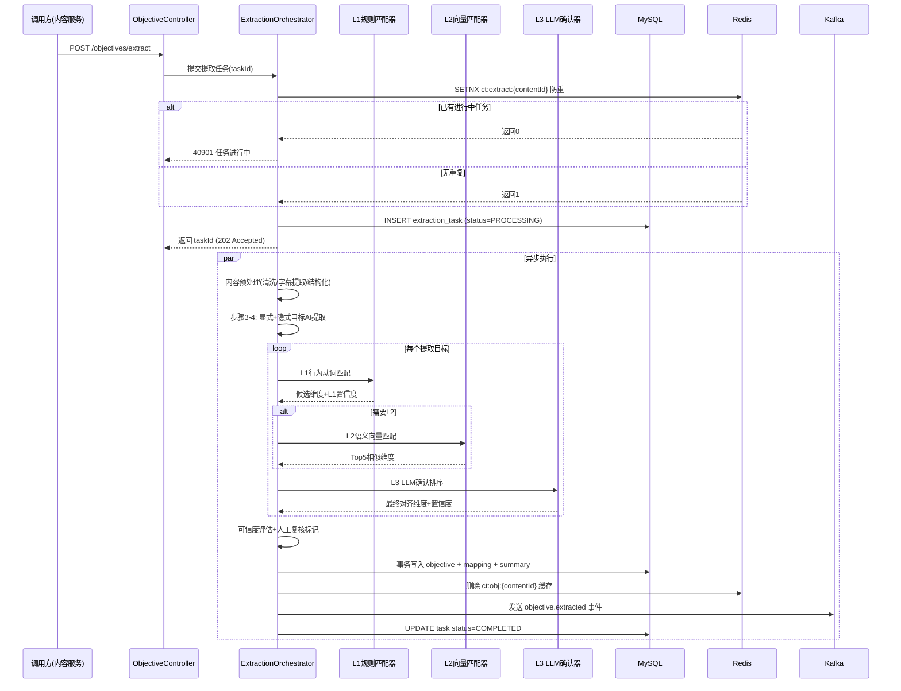
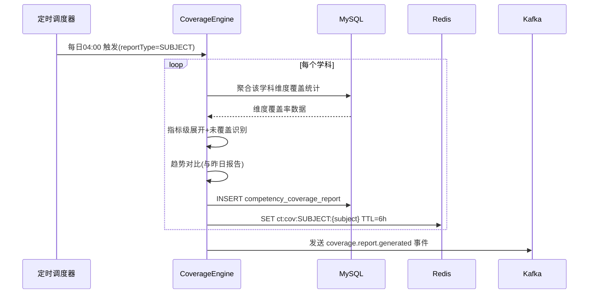

# 教育内容学习目标自动提取与课标核心素养对齐引擎 详细设计

## 1. 概述

### 1.1 模块定位

本引擎是教育内容智能化管理体系中的核心环节，负责从各类教育内容（课文、微课视频、练习题、知识讲解等）中**自动提取学习目标**，并将提取结果与国家课程标准的**核心素养维度**进行精准对齐。

引擎处于内容生产管线与内容分发/推荐系统之间，为下游系统提供结构化的目标-素养元数据支撑：

```
内容生产管线 → [本引擎] 目标提取与素养对齐 → 内容分发 / 推荐系统 / 学习路径规划 / 学情分析
```

### 1.2 核心职责

| 职责 | 说明 |
| --- | --- |
| 学习目标提取 | 从非结构化教育内容中识别并提取显式与隐式学习目标 |
| 课标素养对齐 | 将提取的目标映射至课标核心素养维度 |
| 目标-内容关联 | 建立内容到目标、目标到素养的多对多映射关系 |
| 覆盖度分析 | 统计内容库在素养维度上的覆盖情况，识别空白区域 |
| 目标校验 | 对AI提取结果进行可信度评分与人工复核触发 |
| 目标查询服务 | 为下游系统提供目标与素养维度的查询API |

### 1.3 依赖关系

```
上游依赖：
  - 内容服务：提供原始教育内容（文本、视频字幕、题目元数据）
  - 知识点体系服务：提供知识点树与课标章节映射
  - 大模型服务：提供NLP推理能力（目标提取、语义匹配）

下游消费：
  - 个性化推荐引擎：基于素养维度进行内容推荐
  - 学习路径规划引擎：基于目标依赖关系规划学习序列
  - 学情分析服务：基于素养维度评估学生能力覆盖
  - 内容审核管线：基于目标完整性进行内容质量校验
  - 管理后台数据看板：展示素养覆盖度与目标分布
```

---

## 2. 数据模型

### 2.1 核心实体定义

#### 2.1.1 LearningObjective（学习目标）

```typescript
interface LearningObjective {
  id: string;                    // 目标唯一ID，如 "obj_01HW8X9P"
  contentId: string;             // 关联的内容ID
  objectiveText: string;         // 目标描述文本，如 "理解一元二次方程的求根公式推导过程"
  objectiveType: ObjectiveType;  // 目标类型
  bloomLevel: BloomLevel;        // 布鲁姆认知层级
  knowledgePoints: string[];     // 关联知识点ID列表
  competencyDimensions: CompetencyMapping[]; // 课标素养维度映射
  extractionMethod: ExtractionMethod; // 提取方式
  confidenceScore: number;       // 可信度评分 0-1
  status: ObjectiveStatus;       // 状态
  reviewerId?: string;           // 复核人ID（如有）
  reviewedAt?: string;           // 复核时间
  createdAt: string;
  updatedAt: string;
}

type ObjectiveType =
  | 'KNOWLEDGE'        // 知识记忆类：记住概念、定义、事实
  | 'UNDERSTANDING'    // 理解领会类：理解原理、解释现象
  | 'APPLICATION'      // 应用实践类：运用知识解决问题
  | 'ANALYSIS'         // 分析思辨类：分析结构、比较异同
  | 'SYNTHESIS'        // 综合创造类：整合知识、创造方案
  | 'EVALUATION'       // 评价判断类：评估方案、判断价值
  | 'SKILL'            // 技能操作类：实验操作、计算技能
  | 'ATTITUDE';        // 情感态度类：学习兴趣、科学态度

type BloomLevel =
  | 'REMEMBER'    // 记忆
  | 'UNDERSTAND'  // 理解
  | 'APPLY'       // 应用
  | 'ANALYZE'     // 分析
  | 'EVALUATE'    // 评价
  | 'CREATE';     // 创造

type ExtractionMethod =
  | 'AI_EXTRACT'      // AI自动提取
  | 'MANUAL'          // 人工标注
  | 'AI_WITH_REVIEW'; // AI提取+人工复核确认

type ObjectiveStatus =
  | 'PENDING'       // 待处理
  | 'AUTO_EXTRACTED' // AI已提取，待复核
  | 'CONFIRMED'      // 已确认
  | 'REJECTED'       // 已驳回
  | 'NEEDS_REVISION'; // 需修改
```

#### 2.1.2 CompetencyDimension（课标核心素养维度）

```typescript
interface CompetencyDimension {
  id: string;                    // 素养维度ID，如 "comp_math_abstraction"
  subject: string;               // 学科，如 "math"
  dimensionCode: string;         // 维度代码，如 "abstraction"
  dimensionName: string;         // 维度名称，如 "数学抽象"
  description: string;            // 维度描述
  gradeRange: [string, string];  // 适用学段范围，如 ["grade_7", "grade_12"]
  indicators: CompetencyIndicator[]; // 细化指标
  parentDimensionId?: string;    // 父维度ID（支持层级结构）
}

interface CompetencyIndicator {
  id: string;                    // 指标ID
  dimensionId: string;           // 所属维度ID
  level: number;                 // 层级（1-3，1最粗，3最细）
  indicatorText: string;         // 指标描述
  behaviorVerbs: string[];       // 行为动词列表，如 ["识别", "描述", "推导"]
  exampleContent: string;        // 示例内容
}
```

#### 2.1.3 ContentObjectiveMapping（内容-目标映射）

```typescript
interface ContentObjectiveMapping {
  id: string;
  contentId: string;             // 内容ID
  contentTitle: string;          // 内容标题
  contentSubject: string;        // 学科
  contentGrade: string;          // 年级
  contentChapters: string[];     // 关联章节ID
  objectives: ObjectiveRef[];    // 目标引用列表
  primaryObjective: string;      // 主要目标ID
  coverageScore: number;         // 目标覆盖完整度评分 0-1
  lastAnalyzedAt: string;        // 最近分析时间
  analysisVersion: string;       // 分析版本号
}

interface ObjectiveRef {
  objectiveId: string;
  objectiveText: string;
  competencyDimensionIds: string[]; // 对齐的素养维度ID
  alignmentScore: number;       // 对齐置信度 0-1
  isPrimary: boolean;           // 是否为主要目标
}
```

#### 2.1.4 CompetencyCoverageReport（素养覆盖度报告）

```typescript
interface CompetencyCoverageReport {
  id: string;
  reportType: 'SUBJECT' | 'GRADE' | 'CHAPTER' | 'GLOBAL';
  scope: {                       // 报告范围
    subject?: string;
    grade?: string;
    chapterId?: string;
  };
  totalContentCount: number;     // 内容总数
  totalObjectiveCount: number;   // 目标总数
  dimensionCoverage: DimensionCoverage[]; // 各维度覆盖情况
  uncoveredIndicators: string[]; // 未覆盖的指标ID
  overrepresentedDimensions: string[]; // 过度集中维度
  generatedAt: string;
  trend: 'IMPROVING' | 'STABLE' | 'DECLINING';
}

interface DimensionCoverage {
  dimensionId: string;
  dimensionName: string;
  contentCount: number;          // 覆盖该维度的内容数
  objectiveCount: number;        // 关联目标数
  coverageRate: number;          // 覆盖率 0-1
  indicatorCoverage: {           // 细化指标覆盖
    indicatorId: string;
    covered: boolean;
    contentCount: number;
  }[];
}
```

### 2.2 数据库表结构

#### 2.2.1 learning_objective 表

```sql
CREATE TABLE learning_objective (
    id              VARCHAR(32)   PRIMARY KEY,
    content_id      VARCHAR(32)   NOT NULL,
    objective_text  TEXT          NOT NULL,
    objective_type  VARCHAR(20)   NOT NULL,
    bloom_level     VARCHAR(20)   NOT NULL,
    knowledge_points JSON         NOT NULL DEFAULT '[]',
    extraction_method VARCHAR(20) NOT NULL DEFAULT 'AI_EXTRACT',
    confidence_score DECIMAL(4,3) NOT NULL DEFAULT 0.000,
    status          VARCHAR(20)   NOT NULL DEFAULT 'PENDING',
    reviewer_id     VARCHAR(32)   NULL,
    reviewed_at     TIMESTAMP     NULL,
    created_at      TIMESTAMP     NOT NULL DEFAULT CURRENT_TIMESTAMP,
    updated_at      TIMESTAMP     NOT NULL DEFAULT CURRENT_TIMESTAMP ON UPDATE CURRENT_TIMESTAMP,
    INDEX idx_content (content_id),
    INDEX idx_status (status),
    INDEX idx_type (objective_type),
    INDEX idx_bloom (bloom_level)
) ENGINE=InnoDB DEFAULT CHARSET=utf8mb4;
```

#### 2.2.2 competency_dimension 表

```sql
CREATE TABLE competency_dimension (
    id              VARCHAR(64)   PRIMARY KEY,
    subject         VARCHAR(20)   NOT NULL,
    dimension_code  VARCHAR(50)   NOT NULL,
    dimension_name  VARCHAR(100)  NOT NULL,
    description     TEXT          NOT NULL,
    grade_start     VARCHAR(20)   NOT NULL,
    grade_end       VARCHAR(20)   NOT NULL,
    parent_id       VARCHAR(64)   NULL,
    indicators      JSON          NOT NULL DEFAULT '[]',
    is_active       TINYINT(1)    NOT NULL DEFAULT 1,
    created_at      TIMESTAMP     NOT NULL DEFAULT CURRENT_TIMESTAMP,
    updated_at      TIMESTAMP     NOT NULL DEFAULT CURRENT_TIMESTAMP ON UPDATE CURRENT_TIMESTAMP,
    UNIQUE KEY uk_subject_code (subject, dimension_code),
    INDEX idx_subject (subject),
    INDEX idx_parent (parent_id)
) ENGINE=InnoDB DEFAULT CHARSET=utf8mb4;
```

#### 2.2.3 objective_competency_mapping 表

```sql
CREATE TABLE objective_competency_mapping (
    id                  VARCHAR(32)   PRIMARY KEY,
    objective_id        VARCHAR(32)   NOT NULL,
    competency_dimension_id VARCHAR(64) NOT NULL,
    competency_indicator_id VARCHAR(64) NULL,
    alignment_score     DECIMAL(4,3)  NOT NULL,
    alignment_reason    TEXT          NULL,
    created_at          TIMESTAMP     NOT NULL DEFAULT CURRENT_TIMESTAMP,
    UNIQUE KEY uk_obj_dim (objective_id, competency_dimension_id),
    INDEX idx_objective (objective_id),
    INDEX idx_dimension (competency_dimension_id),
    FOREIGN KEY (objective_id) REFERENCES learning_objective(id) ON DELETE CASCADE
) ENGINE=InnoDB DEFAULT CHARSET=utf8mb4;
```

#### 2.2.4 content_objective_summary 表

```sql
CREATE TABLE content_objective_summary (
    id                  VARCHAR(32)   PRIMARY KEY,
    content_id          VARCHAR(32)   NOT NULL UNIQUE,
    content_title       VARCHAR(500)  NOT NULL,
    content_subject     VARCHAR(20)   NOT NULL,
    content_grade       VARCHAR(20)   NOT NULL,
    content_chapters    JSON          NOT NULL DEFAULT '[]',
    primary_objective_id VARCHAR(32)  NULL,
    objective_count     INT           NOT NULL DEFAULT 0,
    coverage_score      DECIMAL(4,3)  NOT NULL DEFAULT 0.000,
    analysis_version    VARCHAR(20)   NOT NULL,
    last_analyzed_at    TIMESTAMP     NOT NULL DEFAULT CURRENT_TIMESTAMP,
    INDEX idx_subject_grade (content_subject, content_grade),
    INDEX idx_analyzed (last_analyzed_at)
) ENGINE=InnoDB DEFAULT CHARSET=utf8mb4;
```

#### 2.2.5 competency_coverage_report 表

```sql
CREATE TABLE competency_coverage_report (
    id              VARCHAR(32)   PRIMARY KEY,
    report_type     VARCHAR(20)   NOT NULL,
    scope_subject   VARCHAR(20)   NULL,
    scope_grade     VARCHAR(20)   NULL,
    scope_chapter_id VARCHAR(32)  NULL,
    total_content   INT           NOT NULL DEFAULT 0,
    total_objective INT           NOT NULL DEFAULT 0,
    dimension_coverage JSON       NOT NULL,
    uncovered_indicators JSON     NOT NULL DEFAULT '[]',
    overrepresented  JSON         NOT NULL DEFAULT '[]',
    trend           VARCHAR(20)   NOT NULL DEFAULT 'STABLE',
    generated_at    TIMESTAMP     NOT NULL DEFAULT CURRENT_TIMESTAMP,
    INDEX idx_type_scope (report_type, scope_subject, scope_grade)
) ENGINE=InnoDB DEFAULT CHARSET=utf8mb4;
```

### 2.3 缓存策略

| 缓存对象 | Redis Key 前缀 | TTL | 失效策略 |
| --- | --- | --- | --- |
| 内容目标列表 | `ct:obj:{contentId}` | 1h | 内容重新分析时主动删除 |
| 素养维度树 | `ct:dim:{subject}` | 24h | 维度数据变更时主动刷新 |
| 覆盖度报告 | `ct:cov:{type}:{scope}` | 6h | 定时任务刷新 |
| 目标提取结果 | `ct:extract:{contentId}` | 30min | 一次性使用后自动过期 |
| 素养维度映射缓存 | `ct:map:{objectiveId}` | 2h | 映射变更时主动删除 |

---

## 3. API 接口设计

### 3.1 学习目标提取接口

#### POST /api/v1/objectives/extract

从指定内容中自动提取学习目标。

**请求：**
```json
{
  "contentId": "cnt_01HW8X9PQZ",
  "contentType": "LESSON_TEXT",
  "content": {
    "title": "一元二次方程的解法——公式法",
    "subject": "math",
    "grade": "grade_9",
    "chapters": ["ch_math_9_2_3"],
    "body": "本节课学习一元二次方程的公式解法...",
    "knowledgePoints": ["kp_quadratic_equation", "kp_discriminant"]
  },
  "options": {
    "extractImplicit": true,
    "alignCompetency": true,
    "maxObjectives": 10,
    "minConfidence": 0.6
  }
}
```

**响应：**
```json
{
  "code": 0,
  "data": {
    "taskId": "task_01HW8X9PQR",
    "contentId": "cnt_01HW8X9PQZ",
    "status": "PROCESSING",
    "estimatedSeconds": 15
  }
}
```

#### GET /api/v1/objectives/extract/{taskId}

查询提取任务结果。

**响应：**
```json
{
  "code": 0,
  "data": {
    "taskId": "task_01HW8X9PQR",
    "status": "COMPLETED",
    "contentId": "cnt_01HW8X9PQZ",
    "objectives": [
      {
        "id": "obj_01HW8X9PR0",
        "objectiveText": "掌握一元二次方程求根公式的推导过程",
        "objectiveType": "UNDERSTANDING",
        "bloomLevel": "UNDERSTAND",
        "knowledgePoints": ["kp_quadratic_equation", "kp_discriminant"],
        "competencyDimensions": [
          {
            "dimensionId": "comp_math_reasoning",
            "dimensionName": "逻辑推理",
            "alignmentScore": 0.92,
            "alignmentReason": "推导过程涉及配方法的逻辑推理步骤"
          },
          {
            "dimensionId": "comp_math_operation",
            "dimensionName": "数学运算",
            "alignmentScore": 0.85,
            "alignmentReason": "公式推导包含多项代数运算变形"
          }
        ],
        "extractionMethod": "AI_EXTRACT",
        "confidenceScore": 0.89,
        "status": "AUTO_EXTRACTED"
      },
      {
        "id": "obj_01HW8X9PR1",
        "objectiveText": "能够运用求根公式解一元二次方程",
        "objectiveType": "APPLICATION",
        "bloomLevel": "APPLY",
        "knowledgePoints": ["kp_quadratic_equation"],
        "competencyDimensions": [
          {
            "dimensionId": "comp_math_operation",
            "dimensionName": "数学运算",
            "alignmentScore": 0.95,
            "alignmentReason": "直接运用公式进行计算求解"
          }
        ],
        "extractionMethod": "AI_EXTRACT",
        "confidenceScore": 0.94,
        "status": "AUTO_EXTRACTED"
      }
    ],
    "coverageScore": 0.87,
    "analysisVersion": "v2.1.0"
  }
}
```

### 3.2 目标查询接口

#### GET /api/v1/objectives

按条件查询学习目标。

**参数：**
| 参数 | 类型 | 必填 | 说明 |
| --- | --- | --- | --- |
| contentId | string | 否 | 按内容ID查询 |
| subject | string | 否 | 按学科查询 |
| grade | string | 否 | 按年级查询 |
| chapterId | string | 否 | 按章节查询 |
| competencyDimensionId | string | 否 | 按素养维度查询 |
| bloomLevel | string | 否 | 按布鲁姆层级查询 |
| objectiveType | string | 否 | 按目标类型查询 |
| status | string | 否 | 按状态查询 |
| minConfidence | number | 否 | 最低可信度过滤 |
| page | int | 否 | 页码，默认1 |
| pageSize | int | 否 | 每页数量，默认20 |

**响应：**
```json
{
  "code": 0,
  "data": {
    "total": 156,
    "page": 1,
    "pageSize": 20,
    "items": [
      {
        "id": "obj_01HW8X9PR0",
        "contentId": "cnt_01HW8X9PQZ",
        "contentTitle": "一元二次方程的解法——公式法",
        "objectiveText": "掌握一元二次方程求根公式的推导过程",
        "objectiveType": "UNDERSTANDING",
        "bloomLevel": "UNDERSTAND",
        "knowledgePoints": ["kp_quadratic_equation"],
        "competencyDimensions": ["comp_math_reasoning", "comp_math_operation"],
        "confidenceScore": 0.89,
        "status": "CONFIRMED"
      }
    ]
  }
}
```

#### GET /api/v1/objectives/{id}

查询单个学习目标详情。

### 3.3 素养维度管理接口

#### GET /api/v1/competencies/dimensions

查询课标素养维度树。

**参数：**
| 参数 | 类型 | 必填 | 说明 |
| --- | --- | --- | --- |
| subject | string | 是 | 学科 |
| grade | string | 否 | 年级过滤 |
| includeIndicators | boolean | 否 | 是否包含细化指标，默认true |

**响应：**
```json
{
  "code": 0,
  "data": {
    "subject": "math",
    "dimensions": [
      {
        "id": "comp_math_abstraction",
        "dimensionCode": "abstraction",
        "dimensionName": "数学抽象",
        "description": "通过对数量关系与空间形式的抽象，把握事物的数学本质",
        "gradeRange": ["grade_7", "grade_12"],
        "indicators": [
          {
            "id": "ind_math_abs_1",
            "level": 1,
            "indicatorText": "能够从具体情境中抽象出数学概念",
            "behaviorVerbs": ["抽象", "概括", "提取"],
            "exampleContent": "从实物分布中抽象出函数关系"
          },
          {
            "id": "ind_math_abs_2",
            "level": 2,
            "indicatorText": "能够用数学符号表示抽象结果",
            "behaviorVerbs": ["表示", "符号化", "形式化"],
            "exampleContent": "用f(x)=ax²+bx+c表示二次函数"
          }
        ]
      },
      {
        "id": "comp_math_reasoning",
        "dimensionCode": "reasoning",
        "dimensionName": "逻辑推理",
        "description": "从已有事实或命题出发，依据规则推出其他命题",
        "gradeRange": ["grade_7", "grade_12"],
        "indicators": [...]
      }
    ]
  }
}
```

#### POST /api/v1/competencies/dimensions

新增素养维度（仅管理员）。

#### PUT /api/v1/competencies/dimensions/{id}

更新素养维度信息。

### 3.4 对齐操作接口

#### POST /api/v1/objectives/{id}/align

对单个学习目标执行课标素养对齐。

**请求：**
```json
{
  "forceRealign": false,
  "additionalContext": "本目标侧重于公式推导的逻辑推理过程"
}
```

**响应：**
```json
{
  "code": 0,
  "data": {
    "objectiveId": "obj_01HW8X9PR0",
    "alignments": [
      {
        "dimensionId": "comp_math_reasoning",
        "dimensionName": "逻辑推理",
        "alignmentScore": 0.92,
        "alignmentReason": "推导过程涉及配方法的逻辑推理步骤",
        "matchedIndicators": ["ind_math_rea_1", "ind_math_rea_3"]
      }
    ],
    "previousAlignments": [...]
  }
}
```

### 3.5 覆盖度分析接口

#### GET /api/v1/competencies/coverage

查询素养覆盖度报告。

**参数：**
| 参数 | 类型 | 必填 | 说明 |
| --- | --- | --- | --- |
| reportType | string | 是 | SUBJECT / GRADE / CHAPTER / GLOBAL |
| subject | string | 否 | 学科（SUBJECT/GRADE类型时必填） |
| grade | string | 否 | 年级 |
| chapterId | string | 否 | 章节ID |

**响应：**
```json
{
  "code": 0,
  "data": {
    "reportId": "rpt_01HW8X9PS0",
    "reportType": "SUBJECT",
    "scope": { "subject": "math" },
    "totalContentCount": 1280,
    "totalObjectiveCount": 3654,
    "dimensionCoverage": [
      {
        "dimensionId": "comp_math_abstraction",
        "dimensionName": "数学抽象",
        "contentCount": 420,
        "objectiveCount": 680,
        "coverageRate": 0.812,
        "indicatorCoverage": [
          { "indicatorId": "ind_math_abs_1", "covered": true, "contentCount": 280 },
          { "indicatorId": "ind_math_abs_2", "covered": true, "contentCount": 180 },
          { "indicatorId": "ind_math_abs_3", "covered": false, "contentCount": 0 }
        ]
      },
      {
        "dimensionId": "comp_math_reasoning",
        "dimensionName": "逻辑推理",
        "contentCount": 560,
        "objectiveCount": 1020,
        "coverageRate": 0.923,
        "indicatorCoverage": [...]
      }
    ],
    "uncoveredIndicators": ["ind_math_abs_3", "ind_math_mod_2"],
    "overrepresentedDimensions": ["comp_math_operation"],
    "generatedAt": "2026-07-08T18:05:00Z",
    "trend": "IMPROVING"
  }
}
```

#### POST /api/v1/competencies/coverage/refresh

触发覆盖度报告重新计算（异步）。

### 3.6 目标复核接口

#### PUT /api/v1/objectives/{id}/review

人工复核AI提取的学习目标。

**请求：**
```json
{
  "action": "CONFIRM",
  "revisedText": "掌握一元二次方程求根公式的推导过程及判别式的应用",
  "revisedBloomLevel": "UNDERSTAND",
  "revisedCompetencyDimensions": ["comp_math_reasoning", "comp_math_operation"],
  "comment": "补充了判别式应用部分"
}
```

**响应：**
```json
{
  "code": 0,
  "data": {
    "id": "obj_01HW8X9PR0",
    "status": "CONFIRMED",
    "reviewerId": "usr_admin_001",
    "reviewedAt": "2026-07-08T18:10:00Z"
  }
}
```

### 3.7 批量提取接口

#### POST /api/v1/objectives/extract/batch

批量提取多内容的学习目标（异步任务）。

**请求：**
```json
{
  "contentIds": ["cnt_001", "cnt_002", "cnt_003"],
  "options": {
    "extractImplicit": true,
    "alignCompetency": true,
    "maxObjectives": 8,
    "minConfidence": 0.6,
    "autoConfirm": false
  },
  "callbackUrl": "https://internal-api.primetop.com/webhooks/objective-extraction"
}
```

**响应：**
```json
{
  "code": 0,
  "data": {
    "batchTaskId": "batch_01HW8X9PS1",
    "totalCount": 3,
    "status": "PROCESSING"
  }
}
```

### 3.8 错误码定义

| 错误码 | HTTP状态码 | 说明 |
| --- | --- | --- |
| 0 | 200 | 成功 |
| 40001 | 400 | 请求参数无效 |
| 40002 | 400 | 内容ID不存在 |
| 40003 | 400 | 学科不支持 |
| 40004 | 400 | 内容格式不支持目标提取 |
| 40301 | 403 | 无权限操作 |
| 40401 | 404 | 目标/维度不存在 |
| 40901 | 409 | 目标提取任务正在进行中 |
| 42201 | 422 | 目标文本过长或为空 |
| 42901 | 429 | 提取请求频率超限 |
| 50001 | 500 | AI模型调用失败 |
| 50002 | 500 | 素养维度数据未初始化 |
| 50003 | 500 | 覆盖度计算异常 |

---

## 4. 业务逻辑

### 4.1 目标提取核心流程

```
┌─────────────────────────────────────────────────────────────┐
│                    目标提取主流程                              │
├─────────────────────────────────────────────────────────────┤
│                                                             │
│  1. 接收提取请求                                              │
│     │                                                       │
│     ▼                                                       │
│  2. 内容预处理                                                │
│     ├─ 文本清洗（去HTML、标准化格式）                           │
│     ├─ 视频/音频内容提取字幕文本                                │
│     ├─ 题目内容结构化解析                                      │
│     └─ 知识点元数据补全                                       │
│     │                                                       │
│     ▼                                                       │
│  3. 显式目标提取                                              │
│     ├─ 识别"学习目标""教学目标"等显式标记段落                    │
│     ├─ 提取"掌握""理解""能够""学会"等行为动词引导的目标句          │
│     └─ 提取"重点""难点""关键"等标记的目标                        │
│     │                                                       │
│     ▼                                                       │
│  4. 隐式目标推断（可选，基于AI）                                │
│     ├─ 分析内容主体，推断隐含的知识理解目标                      │
│     ├─ 识别方法论/技能类隐式目标                                │
│     ├─ 识别情感态度类隐式目标                                  │
│     └─ 基于知识点体系推导关联目标                               │
│     │                                                       │
│     ▼                                                       │
│  5. 目标标准化                                                │
│     ├─ 统一表述格式（行为动词 + 对象 + 条件/标准）                │
│     ├─ 去重与合并相似目标                                      │
│     ├─ 识别主次目标                                           │
│     └─ 分类标注（类型、布鲁姆层级）                             │
│     │                                                       │
│     ▼                                                       │
│  6. 课标素养对齐                                              │
│     ├─ 加载学科素养维度树                                     │
│     ├─ 语义匹配目标与维度描述                                  │
│     ├─ 行为动词匹配指标                                       │
│     ├─ 知识点-章节-素养映射辅助                                │
│     └─ 生成对齐理由与置信度                                   │
│     │                                                       │
│     ▼                                                       │
│  7. 可信度评估                                                │
│     ├─ 综合AI模型置信度                                       │
│     ├─ 对齐匹配度评分                                         │
│     ├─ 知识点覆盖完整度                                       │
│     └─ 标记需人工复核的低置信度目标                             │
│     │                                                       │
│     ▼                                                       │
│  8. 结果持久化                                                │
│     ├─ 写入learning_objective表                               │
│     ├─ 写入objective_competency_mapping表                     │
│     ├─ 更新content_objective_summary表                       │
│     ├─ 刷新缓存                                              │
│     └─ 发送复核通知（低置信度目标）                             │
│                                                             │
└─────────────────────────────────────────────────────────────┘
```

### 4.2 AI提取Prompt策略

#### 4.2.1 显式目标提取Prompt模板

```text
你是一名教育内容分析专家。请从以下教育内容中提取显式学习目标。

## 内容信息
- 标题：{title}
- 学科：{subject}
- 年级：{grade}
- 章节：{chapters}
- 知识点：{knowledgePoints}

## 内容正文
{contentBody}

## 提取规则
1. 识别内容中明确表述的学习目标（如"学习目标""教学目标""本节课将..."等引导的句子）
2. 识别"掌握""理解""能够""学会""熟练""了解"等行为动词引导的目标句
3. 识别"重点""难点""关键""核心"等标记的关键学习点
4. 每个目标应是一个完整的、可评估的学习行为描述
5. 去除重复或高度相似的目标

## 输出格式（JSON数组）
[
  {
    "objectiveText": "目标描述",
    "objectiveType": "KNOWLEDGE|UNDERSTANDING|APPLICATION|ANALYSIS|SYNTHESIS|EVALUATION|SKILL|ATTITUDE",
    "bloomLevel": "REMEMBER|UNDERSTAND|APPLY|ANALYZE|EVALUATE|CREATE",
    "isPrimary": true/false,
    "knowledgePoints": ["关联知识点ID"],
    "sourceText": "原文出处片段"
  }
]
```

#### 4.2.2 隐式目标推断Prompt模板

```text
你是一名教育内容分析专家。基于以下内容，推断其中隐含的、未明确表述的学习目标。

## 内容信息
- 标题：{title}
- 学科：{subject}
- 年级：{grade}
- 已提取的显式目标：{explicitObjectives}

## 内容正文
{contentBody}

## 推断规则
1. 分析内容主体，推断学生需要具备的理解能力
2. 识别内容中涉及的解题方法或技能操作目标
3. 识别内容中隐含的科学态度、学习兴趣等情感目标
4. 基于知识点体系，推导前置知识与延伸应用目标
5. 避免与已提取的显式目标重复
6. 每个推断目标需标注推断依据

## 输出格式（JSON数组）
[
  {
    "objectiveText": "推断目标描述",
    "objectiveType": "...",
    "bloomLevel": "...",
    "isPrimary": false,
    "knowledgePoints": ["关联知识点ID"],
    "inferenceBasis": "推断依据说明",
    "confidenceScore": 0.0-1.0
  }
]
```

#### 4.2.3 素养维度对齐Prompt模板

```text
你是一名课程标准与核心素养对齐专家。请将以下学习目标与{subject}学科的核心素养维度进行精准对齐。

## 学科素养维度参考
{competencyDimensions}

## 学习目标信息
- 目标文本：{objectiveText}
- 目标类型：{objectiveType}
- 布鲁姆层级：{bloomLevel}
- 关联知识点：{knowledgePoints}
- 所属内容：{contentTitle}（{contentGrade}）

## 对齐规则
1. 分析目标文本中体现的核心素养要素（思维方法、关键能力、价值观念）
2. 匹配最相关的1-3个素养维度，按相关度降序排列
3. 每个维度需匹配到具体的行为指标（indicator），并说明匹配理由
4. 对齐置信度基于：行为动词匹配度、知识点-素养关联强度、内容语境一致性
5. 若目标与任何素养维度关联度均低于0.4，返回空数组并说明原因

## 输出格式（JSON数组）
[
  {
    "dimensionId": "素养维度ID",
    "dimensionCode": "维度代码",
    "indicatorIds": ["匹配的指标ID列表"],
    "alignmentScore": 0.0-1.0,
    "alignmentReason": "对齐理由说明（不少于30字）",
    "matchedBehaviorVerbs": ["匹配到的行为动词"]
  }
]
```

#### 4.2.4 Prompt调用参数与成本控制

| 参数项 | 显式提取 | 隐式推断 | 素养对齐 |
| --- | --- | --- | --- |
| 模型档位 | 标准 | 推理增强 | 标准 |
| 最大Token | 2000 | 3000 | 1500 |
| 温度 | 0.3 | 0.5 | 0.2 |
| 超时(ms) | 8000 | 12000 | 6000 |
| 重试次数 | ≤2 | ≤2 | ≤2 |
| 日配额(内容条) | 5000 | 3000 | 8000 |

**成本护栏规则：**
- C1：单个内容提取+对齐总成本超过 ¥0.08 时降级为仅显式提取，标记 `cost_degraded=true`
- C2：批任务在每日 02:00-06:00 低峰期执行，享受供应商夜间折扣
- C3：连续3次AI调用失败的内容自动转人工标注队列，不再重试

---

### 4.3 对齐匹配算法

素养对齐采用**三层漏斗**架构，兼顾精度与召回：

#### 4.3.1 L1 行为动词层（规则匹配，零成本）

预建《行为动词-素养维度》映射词典，覆盖课标高频动词 320+ 个。

```java
// L1 行为动词匹配器
public class BehaviorVerbMatcher {
    
    // 动词-维度映射表（加载自配置中心，支持热更新）
    private volatile Map<String, List<String>> verbToDimensions;
    
    public L1MatchResult match(LearningObjective objective) {
        Set<String> matchedDimensions = new HashSet<>();
        Map<String, Double> verbScores = new HashMap<>();
        
        // 提取目标文本中的行为动词
        List<String> verbs = extractBehaviorVerbs(objective.getObjectiveText());
        
        for (String verb : verbs) {
            List<String> dimensions = verbToDimensions.getOrDefault(verb, 
                verbToDimensions.get(getStem(verb))); // 词干降级匹配
            if (dimensions != null) {
                for (String dim : dimensions) {
                    // 同义词组内去重计分，避免"理解"出现3次得3倍分
                    verbScores.merge(dim, 1.0 / verbs.size(), Double::sum);
                    matchedDimensions.add(dim);
                }
            }
        }
        
        // L1层最高置信度封顶 0.75（规则匹配不输出高置信）
        double maxScore = Math.min(verbScores.values().stream()
            .mapToDouble(Double::doubleValue).max().orElse(0.0), 0.75);
        
        return new L1MatchResult(matchedDimensions, maxScore, verbs);
    }
}
```

**输出：** 候选维度集合 + L1置信度。若 L1 置信度 ≥0.65 且候选维度唯一，跳过 L2 直接进入 L3 语义确认。

#### 4.3.2 L2 语义向量层（召回扩展）

当 L1 未命中或候选维度 ≥2 时，启用向量语义匹配。

```java
// L2 语义向量匹配器
public class SemanticVectorMatcher {
    
    private final EmbeddingClient embeddingClient;
    private final VectorStore vectorStore; // Milvus/pgvector
    
    public L2MatchResult match(LearningObjective objective, 
                               List<String> l1Candidates) {
        // 目标文本向量化
        float[] objectiveVector = embeddingClient.embed(
            objective.getObjectiveText());
        
        // 从向量库检索 Top-5 相似维度描述
        List<ScoredDimension> vectorHits = vectorStore.search(
            objectiveVector,
            objective.getSubject(),
            5,                    // topK
            0.55                  // 最低相似度阈值
        );
        
        // 与L1结果合并：L1命中维度加权 1.3 倍
        List<ScoredDimension> merged = mergeWithBoost(vectorHits, l1Candidates, 1.3);
        
        // 维度去重：同一父维度下只保留得分最高的子维度
        List<ScoredDimension> deduplicated = deduplicateByParent(merged);
        
        return new L2MatchResult(deduplicated);
    }
}
```

**向量库索引参数：**
| 参数 | 值 | 说明 |
| --- | --- | --- |
| 索引类型 | HNSW | 近似最近邻 |
| M | 16 | 图连通度 |
| efConstruction | 200 | 构建精度 |
| efSearch | 64 | 查询精度 |
| 度量方式 | COSINE | 余弦相似度 |

#### 4.3.3 L3 LLM语义确认层

将 L1+L2 合并后的候选维度（≤5个）提交 LLM 做最终确认与排序。

```java
// L3 LLM确认层
public class LLMConfirmMatcher {
    
    public L3MatchResult confirm(LearningObjective objective,
                                 List<ScoredDimension> candidates) {
        // 构建对齐Prompt（§4.2.3模板）
        String prompt = promptTemplate.render(objective, candidates);
        
        LLMResponse response = llmClient.complete(
            prompt,
            LLMParams.builder()
                .model("standard")
                .temperature(0.2)
                .maxTokens(1500)
                .timeout(6000)
                .build()
        );
        
        // 解析并校验输出
        List<Alignment> alignments = parseAndValidate(response.getText());
        
        // V1-V5协议校验
        for (Alignment a : alignments) {
            validate(a); // dimensionId存在于候选集、score∈[0,1]、reason非空
        }
        
        return new L3MatchResult(alignments);
    }
}
```

**三层融合决策表：**

| L1置信度 | L2 Top1相似度 | 决策路径 |
| --- | --- | --- |
| ≥0.65 且候选唯一 | 任意 | L1直出 + L3快速确认（单候选） |
| ≥0.65 且候选≥2 | 任意 | L1+L2合并 → L3排序确认 |
| <0.65 | ≥0.70 | L2直出 → L3确认 |
| <0.65 | <0.70 | L2召回Top5 → L3全量确认 |
| <0.30 | <0.55 | 标记 `LOW_CONFIDENCE`，转人工 |

#### 4.3.4 对齐置信度合成

最终对齐置信度采用多信号加权合成：

```
alignmentScore = 0.35 × L1_verbScore
               + 0.25 × L2_vectorScore
               + 0.30 × L3_llmScore
               + 0.10 × kpBonus

其中：
  kpBonus = min(关联知识点与维度历史共现率, 1.0) × 0.10
  
  若仅有两层可用（如L1未命中）：
  alignmentScore = 0.40 × L2_vectorScore + 0.50 × L3_llmScore + 0.10 × kpBonus
  
  若仅有L3一层：
  alignmentScore = 0.85 × L3_llmScore + 0.15 × kpBonus
```

**迟滞带规则：** 对齐分数在维度边界 ±0.03 范围内时，保持原维度不切换，避免内容微调导致维度抖动。

---

### 4.4 可信度评估与人工复核触发

#### 4.4.1 可信度合成公式

```
confidenceScore = 0.40 × extractionConfidence      // AI提取置信度
                + 0.30 × max(alignmentScores)       // 最佳对齐置信度
                + 0.20 × kpCoverageScore            // 知识点覆盖完整度
                + 0.10 × formatComplianceScore      // 格式规范度

各分量说明：
  extractionConfidence：LLM输出解析成功率 × 输出完整度
  kpCoverageScore：关联知识点数 / max(2, 内容知识点数)
  formatComplianceScore：目标文本长度∈[15,200]、含行为动词、无语义重复
```

#### 4.4.2 人工复核触发规则

| 触发条件 | 优先级 | 说明 |
| --- | --- | --- |
| confidenceScore < 0.55 | HIGH | 必须人工复核后才能进入CONFIRMED |
| alignmentScore < 0.40 且 alignmentScore > 0 | HIGH | 对齐不确定，人工判断 |
| competencyDimensions 为空 | HIGH | 未匹配到任何素养维度 |
| competencyDimensions ≥ 4 | MEDIUM | 维度发散，人工精简 |
| objectiveType=ATTITUDE | MEDIUM | 情感态度类目标AI准确率低 |
| 同一内容出现 ≥5 个目标 | LOW | 疑似过度拆分，人工审查 |
| extractionMethod=AI_EXTRACT 且 contentSubject ∉ {语文,数学,英语} | LOW | 小语种学科抽样复核 |

**复核队列优先级调度：** HIGH > MEDIUM > LOW；同级按 confidenceScore 升序（先复核最不确定的）。

#### 4.4.3 批量置信度校准

每周日凌晨 03:00 执行历史数据校准：
1. 抽取上周已人工复核的目标（样本 ≥100）
2. 对比AI初判 vs 人工终判的一致率
3. 一致率 <0.80 时，上调 minConfidence 阈值 +0.02（上限 0.70）
4. 一致率 >0.95 时，下调 minConfidence 阈值 -0.01（下限 0.50）
5. 校准参数写入 `objective_extraction_config` 表，双人审批后生效

---

### 4.5 覆盖度计算引擎

#### 4.5.1 覆盖率口径定义

| 指标 | 公式 | 说明 |
| --- | --- | --- |
| 维度内容覆盖率 | 覆盖该维度的内容数 / 学科内容总数 | 内容粒度 |
| 维度目标覆盖率 | 关联该维度的目标数 / 学科目标总数 | 目标粒度 |
| 指标覆盖率 | 有内容覆盖的指标数 / 该维度指标总数 | 最细粒度 |
| 综合覆盖率 | Σ(维度覆盖率 × 维度权重) | 维度权重默认相等 |

#### 4.5.2 覆盖度报告生成流程

```
触发条件：
  - 定时任务：每日 04:00 生成 SUBJECT/GRADE 级报告
  - 内容变更：learning_objective 变更 ≥50 条时增量刷新
  - 手动触发：管理后台点击"重新计算"

生成步骤：
  1. 确定报告范围（学科/年级/章节/全局）
  2. 聚合统计：按维度GROUP BY统计内容数、目标数
  3. 指标级展开：检查每个 indicator 是否有 ≥1 条 CONFIRMED 目标关联
  4. 识别未覆盖指标：coverageRate=0 的 indicator
  5. 识别过度集中维度：coverageRate > 均值×1.8 的维度
  6. 计算趋势：与上一周期覆盖率对比（±0.03以内为STABLE）
  7. 写入 competency_coverage_report 表
  8. 刷新 Redis 缓存 ct:cov:{type}:{scope}
```

#### 4.5.3 覆盖度缺口行动建议

报告生成后，按缺口类型自动生成内容生产建议：

| 缺口类型 | 判定规则 | 建议行动 |
| --- | --- | --- |
| 维度空白 | 维度覆盖率 < 0.10 | 建议新增该维度相关课程内容 ≥20 条 |
| 指标空白 | indicator 覆盖数 = 0 | 标记到内容生产任务队列，优先级 HIGH |
| 学段断层 | 某年级覆盖率 < 相邻年级均值 ×0.5 | 提示学段衔接内容缺失 |
| 过度集中 | 维度覆盖率 > 0.60 | 提示内容结构失衡，建议补充其他维度 |

---

## 5. 核心流程时序

### 5.1 单内容提取+对齐主链路



### 5.2 覆盖度报告生成时序



---

## 6. 状态机与守卫

### 6.1 学习目标状态机

```
状态：
  PENDING ──(提取完成)──▶ AUTO_EXTRACTED ──(人工复核通过)──▶ CONFIRMED
     │                          │                                  │
     │                          ├──(人工驳回)──▶ REJECTED          │
     │                          │                                  │
     │                          └──(需修改)────▶ NEEDS_REVISION ───┤
     │                                                             │
     └──(人工直接创建)──▶ CONFIRMED ◀──(复核修改后确认)─────────────┘

终态：CONFIRMED、REJECTED
```

| 转移 | 触发条件 | 守卫规则 |
| --- | --- | --- |
| PENDING → AUTO_EXTRACTED | AI提取管线完成 | G1: 至少提取到1个目标；0目标时状态=FAILED |
| AUTO_EXTRACTED → CONFIRMED | 复核 action=CONFIRM | G2: 必须经由 review 接口，携带 reviewerId |
| AUTO_EXTRACTED → REJECTED | 复核 action=REJECT | G3: REJECTED 目标软删除，保留30天后归档 |
| AUTO_EXTRACTED → NEEDS_REVISION | 复核 action=REVISE | G4: 必须提供 revisedText 或修改指令 |
| NEEDS_REVISION → CONFIRMED | 修改后确认 | G5: 修改后需重新走对齐流程，confidenceScore 重算 |
| 任意 → PENDING | 内容重大更新触发重新提取 | G6: 重新提取前旧目标保留版本快照 |

### 6.2 提取任务状态机

```
PROCESSING ──(成功)──▶ COMPLETED
     │
     ├──(AI连续失败≥3次)──▶ FAILED ──(人工接管)──▶ MANUAL_PENDING
     │                                              │
     ├──(超时>30min)──────▶ TIMEOUT ──(重试)───────▶ PROCESSING
     │
     └──(主动取消)────────▶ CANCELLED
```

| 守卫 | 规则 |
| --- | --- |
| G7 | 同一 contentId 同时只允许一个 PROCESSING 任务（Redis SETNX 分布式锁） |
| G8 | 任务超时阈值：单内容 30min，批量任务 4h；超时自动转 TIMEOUT |
| G9 | FAILED 任务不自动重试，必须由人工触发或内容变更触发重新提取 |
| G10 | 任务取消后，已部分写入的目标必须回滚（事务保证） |

### 6.3 素养维度状态机

```
DRAFT ──(管理员发布)──▶ ACTIVE ──(新版本替代)──▶ ARCHIVED
         │                    │
         └──(废弃)──▶ ARCHIVED
```

| 守卫 | 规则 |
| --- | --- |
| G11 | 同学科同 dimensionCode 只允许一个 ACTIVE 维度（数据库唯一约束保障） |
| G12 | 维度从 ACTIVE → ARCHIVED 时，需检查是否存在 PENDING 复核任务引用该维度 |

---

## 7. 幂等与并发

### 7.1 幂等键设计

| 操作 | 幂等键 | 存储位置 | TTL |
| --- | --- | --- | --- |
| 单内容提取 | `ct:extract:{contentId}` | Redis SETNX | 30min |
| 批量提取 | `X-Idempotency-Key` Header | Redis + DB 唯一索引 | 24h |
| 目标复核 | `uk_objective_review(objective_id, reviewer_id, review_round)` | DB 唯一索引 | 永久 |
| 覆盖度刷新 | `ct:cov:lock:{type}:{scope}` | Redis SETNX | 10min |
| 维度变更 | `version` 乐观锁 | DB 列 | 永久 |

### 7.2 并发场景裁决

| 场景 | 裁决规则 |
| --- | --- |
| 同一内容并发提取 | 后到请求收到 40901；先到的完成后，后到者可重新发起（force=true） |
| 复核与重新提取并发 | 复核以快照版本为准；若提取已生成新版本，复核结果应用到旧版本并提示冲突 |
| 维度变更与对齐并发 | 对齐使用维度快照（Redis缓存）；维度变更后缓存失效，新对齐使用新版本 |
| 批量任务部分失败 | 单内容失败不影响其他内容；批量任务状态=PARTIAL_COMPLETED |
| 覆盖度计算与内容写入并发 | 覆盖度计算基于快照（READ COMMITTED），不阻塞内容写入 |

---

## 8. 事件设计

### 8.1 发布事件（objective.domain.events）

| 事件 | Topic | 触发时机 | 关键载荷 |
| --- | --- | --- | --- |
| objective.extracted | objective.extracted | 提取任务完成 | taskId, contentId, objectiveCount, avgConfidence |
| objective.confirmed | objective.confirmed | 目标人工复核通过 | objectiveId, contentId, competencyDimensionIds, reviewerId |
| objective.rejected | objective.rejected | 目标人工驳回 | objectiveId, contentId, rejectReason |
| objective.realigned | objective.realigned | 目标重新对齐完成 | objectiveId, oldDimensions, newDimensions, changeReason |
| coverage.report.generated | coverage.report.generated | 覆盖度报告生成 | reportId, reportType, scope, uncoveredIndicatorCount |
| dimension.updated | dimension.updated | 素养维度变更 | dimensionId, changeType(CREATE/UPDATE/ARCHIVE), subject |

### 8.2 消费事件（订阅上游）

| 上游事件 | 消费动作 | 幂等键 |
| --- | --- | --- |
| content.published | 触发该内容的自动目标提取 | contentId + eventId |
| content.updated(major) | 旧目标快照归档，触发重新提取 | contentId + contentVersion |
| content.archived | 该内容所有目标标记为 ARCHIVED | contentId |
| knowledge.point.remapped | 重算受影响目标的知识点关联 | kpId + batchId |

### 8.3 Outbox 表

```sql
CREATE TABLE objective_outbox (
    id              VARCHAR(32)   PRIMARY KEY,
    event_type      VARCHAR(50)   NOT NULL,
    aggregate_id    VARCHAR(32)   NOT NULL,
    payload         JSON          NOT NULL,
    published       TINYINT(1)    NOT NULL DEFAULT 0,
    created_at      TIMESTAMP     NOT NULL DEFAULT CURRENT_TIMESTAMP,
    published_at    TIMESTAMP     NULL,
    INDEX idx_unpublished (published, created_at)
) ENGINE=InnoDB DEFAULT CHARSET=utf8mb4;
```

---

## 9. 错误码（专用段 55000-55099）

原 v1.0 通用错误码（40001-50003）收敛至专用段，映射如下：

| 专用码 | 原码 | HTTP | 说明 | 用户提示 |
| --- | --- | --- | --- | --- |
| 55000 | 0 | 200 | 成功 | — |
| 55001 | 40001 | 400 | 请求参数无效 | 请求参数有误，请检查后重试 |
| 55002 | 40002 | 400 | 内容ID不存在 | 内容不存在或已删除 |
| 55003 | 40003 | 400 | 学科不支持 | 该学科暂不支持目标提取 |
| 55004 | 40004 | 400 | 内容格式不支持 | 该内容格式暂不支持分析 |
| 55005 | — | 400 | 目标文本超长(>500字) | 目标描述过长，请精简 |
| 55010 | 40301 | 403 | 无权限操作 | 您没有执行此操作的权限 |
| 55011 | — | 403 | 非管理员不能新增/修改素养维度 | 仅管理员可维护素养维度 |
| 55020 | 40401 | 404 | 目标不存在 | 目标不存在或已删除 |
| 55021 | 40401 | 404 | 素养维度不存在 | 素养维度不存在 |
| 55030 | 40901 | 409 | 提取任务进行中 | 该内容正在分析中，请勿重复提交 |
| 55031 | — | 409 | 复核冲突 | 该目标已被其他复核人处理 |
| 55040 | 42201 | 422 | 目标文本为空或过长 | 目标描述不能为空且不超过500字 |
| 55041 | — | 422 | 对齐结果校验失败 | AI输出格式异常，已转人工处理 |
| 55050 | 42901 | 429 | 提取频率超限 | 操作过于频繁，请稍后再试 |
| 55051 | — | 429 | 日配额已用尽 | 今日提取配额已用完，请明日再试 |
| 55060 | 50001 | 500 | AI模型调用失败 | 智能分析暂时不可用，请稍后再试 |
| 55061 | 50002 | 500 | 素养维度数据未初始化 | 学科素养数据初始化中，请稍后再试 |
| 55062 | 50003 | 500 | 覆盖度计算异常 | 覆盖度计算失败，请联系管理员 |
| 55063 | — | 500 | 向量检索服务不可用 | 语义匹配暂时不可用，请稍后再试 |
| 55099 | — | 500 | 内部错误 | 系统繁忙，请稍后再试 |

---

## 10. 降级策略

| 编号 | 降级场景 | 降级行为 | 恢复策略 |
| --- | --- | --- | --- |
| D1 | LLM服务不可用 | 跳过AI提取，目标状态=PENDING，标记 `ai_unavailable=true`，启用人工标注 | LLM恢复后按队列顺序补提取 |
| D2 | 向量检索服务不可用 | 跳过L2层，仅使用L1+L3对齐；标记 `degraded_l2=true` | 向量服务恢复后自动恢复全链路 |
| D3 | 对齐L3 LLM超时 | 使用L1+L2分数直出（封顶0.75），标记 `llm_confirm_skipped=true` | 下次内容变更时自动补齐L3确认 |
| D4 | Redis缓存不可用 | 直接查询DB；提取防重降级为DB唯一索引约束 | Redis恢复后自动恢复缓存层 |
| D5 | 覆盖度计算超时(>10min) | 返回上次缓存报告，标记 `stale=true` | 下一周期自动重算 |
| D6 | 批量任务队列积压(>1000) | 暂停低优先级学科（体育/美术/音乐），优先处理主科 | 队列深度<500时恢复全学科 |
| D7 | 素养维度数据缺失 | 跳过对齐步骤，目标仅提取不映射维度；标记 `no_dimension=true` | 维度数据初始化后批量回补 |
| D8 | DB只读副本延迟>5s | 覆盖度读取强制走主库（短时压力可接受） | 延迟<1s时恢复读写分离 |
| D9 | 整体服务过载 | 提取接口限流（429），查询接口正常；批任务暂停 | 负载恢复正常后自动恢复 |
| D10 | 总红线 | 提取与对齐是内容质量增强层，**绝不因本引擎故障阻塞内容发布/消费主链路** | — |

---

## 11. 监控指标

| 指标 | 口径 | 告警阈值 |
| --- | --- | --- |
| 提取成功率 | COMPLETED / (COMPLETED + FAILED + TIMEOUT) | <0.90 持续15min → P2告警 |
| 平均提取延迟 | task创建到COMPLETED的P99 | >25min → P2告警 |
| 对齐置信度均值 | 所有对齐结果的alignmentScore均值 | <0.55 持续1h → P3告警 |
| 人工复核积压 | 待复核目标数（HIGH优先级） | >200条 → P2告警 |
| LLM调用成本 | 日累计提取+对齐Token成本(¥) | >日预算×1.1 → P2告警 |
| 复核一致率 | 人工复核与AI初判一致比例（周统计） | <0.80 → P3告警（提示校准） |
| 覆盖度报告时效 | 报告生成时间 - 触发时间 | >15min → P3告警 |
| 向量检索延迟 | L2层P99延迟 | >200ms → P3告警 |
| Redis缓存命中率 | 目标列表查询缓存命中/总查询 | <0.80 → P3告警 |
| 事件发布延迟 | Outbox创建到published的P99 | >30s → P2告警 |

---

## 12. 合规要求

| 编号 | 合规要求 |
| --- | --- |
| C1 | 提取的学习目标仅用于教育内容结构化，**禁止用于学生能力评估或排名** |
| C2 | 素养维度对齐结果不直接展示给学生端，仅作为内容推荐与教研参考的内部元数据 |
| C3 | 人工复核人员访问目标数据时，不接触学生个人信息（目标数据与学生数据物理隔离） |
| C4 | AI提取的隐式目标若涉及情感态度类，必须经人工复核后方可进入CONFIRMED（防AI价值判断偏差） |
| C5 | 批量提取任务的回调URL必须是内网域名或HTTPS白名单域名，防止数据外泄 |
| C6 | 素养维度数据（课标内容）的存储与展示遵循版权合规要求，不整段复制课标原文 |
| C7 | 引擎处理的教育内容如涉及第三方版权，提取的目标描述需控制在合理引用范围内（≤原文30%） |

---

## 13. 契约对齐

| 编号 | 契约方 | 对齐内容 |
| --- | --- | --- |
| R1 | 内容服务 | 内容ID与版本号以内容服务为权威；本引擎不修改内容本体 |
| R2 | 知识点体系服务 | 知识点ID与层级以知识点服务为权威；本引擎仅引用不定义 |
| R3 | 课程标准数据库 | 素养维度的编码规范与课标条目对齐以课标服务为权威（53700段） |
| R4 | 个性化推荐引擎 | 推荐引擎消费 CONFIRMED 目标的素养维度做内容推荐，但不直接查询本引擎 |
| R5 | 学习路径规划引擎 | 路径规划消费目标间的依赖关系（future），当前仅消费知识点层级的依赖 |
| R6 | 管理后台数据看板 | 看板展示覆盖度报告需经过本引擎API，不直连DB |
| R7 | Prompt编排系统 | Prompt模板以Prompt编排系统为权威版本管理，本引擎引用模板ID而非内联 |
| R8 | 内容审核管线 | 审核管线消费目标完整性指标作为质量校验维度之一 |
| R9 | 异步任务中心 | 批量提取任务的状态查询复用统一异步任务协议（UTPC） |
| R10 | 计费中心 | AI调用成本数据上报计费中心归集，本引擎不自行计费 |

---

## 14. 验收场景

| 编号 | 场景 | 预期结果 |
| --- | --- | --- |
| AC01 | 提交一元二次方程课文提取请求 | 返回taskId，异步完成后提取≥2个目标，含UNDERSTANDING和APPLICATION类型 |
| AC02 | 重复提交同一内容提取请求 | 第二次返回55030，提示任务进行中 |
| AC03 | 提取结果自动对齐素养维度 | 每个目标对齐1-3个维度，alignmentScore∈[0,1]，含对齐理由 |
| AC04 | 低置信度目标自动标记复核 | confidenceScore<0.55的目标状态=AUTO_EXTRACTED且出现在复核队列 |
| AC05 | 人工复核确认目标 | 目标状态变为CONFIRMED，reviewerId与reviewedAt正确记录 |
| AC06 | 人工复核驳回目标 | 目标状态变为REJECTED，软删除保留30天 |
| AC07 | 批量提取10个内容 | 返回batchTaskId；全部完成后收到回调通知；部分失败时状态=PARTIAL_COMPLETED |
| AC08 | 查询素养维度树 | 返回数学学科6个维度，每个维度含≥2个行为指标 |
| AC09 | LLM服务不可用 | 提取接口返回55060；目标标记ai_unavailable，不阻塞内容发布 |
| AC10 | 向量服务不可用 | 对齐跳过L2层完成；结果标记degraded_l2=true |
| AC11 | 生成学科覆盖度报告 | 报告包含各维度覆盖率、未覆盖指标列表、趋势判断；缓存TTL=6h |
| AC12 | 覆盖度报告缓存命中 | 第二次查询同一报告在<50ms内返回，generatedAt与首次一致 |
| AC13 | 维度变更后对齐使用新版本 | 维度ARCHIVED后，新提取内容不再关联该维度；旧目标保持原维度 |
| AC14 | 并发复核同一目标 | 第二个复核请求返回55031复核冲突 |
| AC15 | 提取超时 | 30min未完成自动转TIMEOUT，任务可手动重试 |
| AC16 | 内容更新触发重新提取 | 旧目标保留版本快照，新目标重新走提取+对齐流程 |
| AC17 | 权限校验 | 非管理员调用维度新增接口返回55011 |
| AC18 | 日配额耗尽 | 当日第5001条提取请求返回55051 |

---

## 15. 关联文档

- 《服务端-课程标准数据库与课标条目结构化管理服务》——素养维度的数据权威来源
- 《服务端-教育内容布鲁姆认知层级自动分类与认知深度标注引擎》——Bloom层级标注的互补与一致性
- 《服务端-教育内容知识点级讲解策略库与认知适配推荐引擎》——目标对齐结果的消费方
- 《服务端-教育内容学习目标分解与个性化里程碑动态规划服务》——目标依赖关系的下游消费者
- 《服务端-教育内容语义标签体系与多维度内容画像引擎》——内容画像的维度互补
- 《AI-Prompt编排与场景模板系统》——Prompt模板版本管理权威
- 《服务端-统一异步任务进度中心与客户端实时状态同步服务》——批任务状态查询协议

---

## 16. 维护记录

| 版本 | 日期 | 变更说明 |
| --- | --- | --- |
| v1.0 | 2026-07-08 | 初版：数据模型/API/核心流程/三层对齐架构 |
| v1.1 | 2026-10-27 | 补全烂尾：原文件836行截断于§4.2.3素养对齐Prompt模板处（围栏未闭合）。补齐至当前行数：完成§4.2.3（素养对齐Prompt全文）与§4.2.4（调用参数与成本控制）；新增§4.3三层对齐漏斗算法（L1行为动词/L2语义向量/L3 LLM确认+融合决策表+置信度合成公式）、§4.4可信度评估与人工复核触发（合成公式+触发规则表+批量校准）、§4.5覆盖度计算引擎（口径定义+生成流程+缺口行动建议）、§5核心流程时序×2、§6三状态机与守卫G1-G12、§7幂等并发、§8事件设计（6发布+3消费+Outbox）、§9错误码55000-55099共24项（全库扫描确认550xx段空闲，含v1.0通用码映射）、§10降级D1-D10、§11监控10指标、§12合规C1-C7、§13契约R1-R10、§14验收AC01-AC18、§15关联文档。修复v1.0缺陷F1：§3.8通用错误码无专用段，收敛映射至550xx段。围栏核验：全文偶数配平。