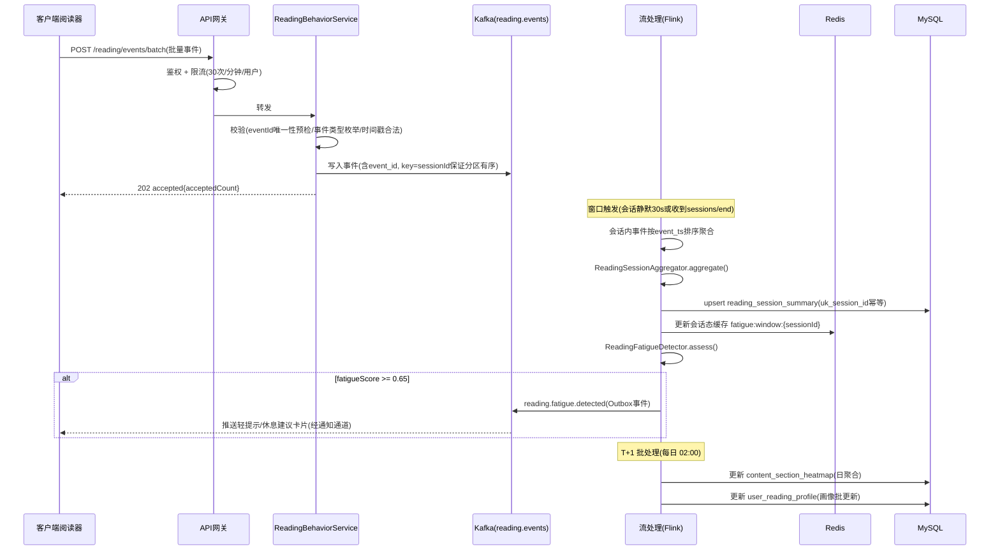

# 服务端-教育内容学生阅读行为智能分析与个性化阅读体验优化引擎-详细设计

## 1. 模块概述

### 1.1 功能定位

本引擎负责采集、分析和应用学生在文本类学习内容（教材讲解、知识点文章、解析说明、作文范文等）阅读过程中的行为数据，输出阅读质量评估、阅读体验优化建议和个性化阅读策略推荐。

与已有的 **视频观看行为分析引擎** 互补，覆盖"图文/纯文本"学习场景的行为感知与分析能力，共同构成全模态学习内容消费行为分析体系。

### 1.2 核心目标

| 目标 | 说明 |
| --- | --- |
| 阅读行为采集 | 标准化采集学生阅读文本内容时的细粒度行为事件 |
| 阅读质量评估 | 基于行为信号量化评估学生的阅读投入度、理解度与阅读效率 |
| 体验优化 | 根据阅读行为动态调整内容呈现策略，降低阅读疲劳、提升理解效果 |
| 内容质量反馈 | 为内容生产侧提供基于真实阅读数据的 content 质量评估 |
| 个性化推荐 | 基于阅读偏好和效率模式，推荐最适合的阅读内容与阅读节奏 |

### 1.3 适用范围

| 维度 | 覆盖范围 |
| --- | --- |
| 内容类型 | 教材章节讲解、知识点详解、题目解析、作文范文、考点梳理文章、课外阅读材料 |
| 学段 | 小学至高中全学段（幼儿阶段以语音/图像为主，不纳入） |
| 客户端 | 移动端 APP（主），Web 端（后续），小程序（后续） |
| 数据来源 | 客户端阅读器组件内埋点、学习会话上下文、章节进度系统 |

### 1.4 与相关模块的边界

| 相关模块 | 关系 | 边界说明 |
| --- | --- | --- |
| 视频观看行为分析引擎 | 互补 | 该引擎处理视频内容，本引擎处理文本内容，数据模型与分析逻辑独立 |
| 教育内容触达转化漏斗引擎 | 上游 | 提供内容曝光与点击数据，本引擎聚焦曝光后的"阅读消费"深度行为 |
| 教育内容有效性评估引擎 | 下游 | 消费本引擎输出的阅读质量指标作为内容有效性评估的输入特征 |
| 学习内容阅读器内批注与高亮系统 | 数据源 | 提供批注/高亮行为事件，作为阅读深度信号 |
| 学生认知负荷监测引擎 | 协同 | 认知负荷提供生理/行为信号，本引擎提供阅读行为信号，联合判断理解困难 |
| 学习状态实时感知引擎 | 协同 | 提供会话级学习状态上下文 |

---

## 2. 数据模型设计

### 2.1 阅读行为事件表 `reading_behavior_event`

存储每一条细粒度阅读行为事件，采用按月分表策略。

```sql
CREATE TABLE reading_behavior_event (
    id              BIGINT       NOT NULL AUTO_INCREMENT COMMENT '主键ID',
    event_id        VARCHAR(64)  NOT NULL COMMENT '事件唯一ID（UUID）',
    user_id         BIGINT       NOT NULL COMMENT '学生用户ID',
    content_id      VARCHAR(64)  NOT NULL COMMENT '内容ID',
    content_type    VARCHAR(32)  NOT NULL COMMENT '内容类型: chapter_explain/knowledge_point/question_analysis/essay_sample/exam_review/reading_material',
    subject_code    VARCHAR(16)  NOT NULL COMMENT '学科编码',
    grade_code      VARCHAR(16)  NOT NULL COMMENT '年级编码',
    session_id      VARCHAR(64)  NOT NULL COMMENT '阅读会话ID',
    
    -- 事件类型与位置
    event_type      VARCHAR(32)  NOT NULL COMMENT '事件类型: viewport_enter/viewport_exit/scroll/pause/resume/reread/highlight/annotate/bookmark/share/zoom/exit',
    event_ts        DATETIME(3)  NOT NULL COMMENT '事件发生时间(毫秒精度)',
    section_index   INT          DEFAULT NULL COMMENT '当前阅读章节/段落索引',
    scroll_percent  DECIMAL(5,2) DEFAULT NULL COMMENT '当前滚动位置百分比(0-100)',
    viewport_top    DECIMAL(5,2) DEFAULT NULL COMMENT '可视区域顶部位置百分比',
    viewport_bottom DECIMAL(5,2) DEFAULT NULL COMMENT '可视区域底部位置百分比',
    
    -- 扩展数据
    dwell_ms        INT          DEFAULT NULL COMMENT '该位置停留时长(毫秒)',
    extra_json      JSON         DEFAULT NULL COMMENT '扩展字段: 高亮文本/批注内容/来源页面等',
    
    -- 设备与环境
    device_id       VARCHAR(64)  DEFAULT NULL COMMENT '设备ID',
    platform        VARCHAR(16)  DEFAULT NULL COMMENT '平台: android/ios/web/miniprogram',
    app_version     VARCHAR(32)  DEFAULT NULL COMMENT 'APP版本号',
    network_type    VARCHAR(16)  DEFAULT NULL COMMENT '网络类型: wifi/4g/5g/3g',
    
    -- 数据来源
    source          VARCHAR(16)  DEFAULT 'client' COMMENT '数据来源: client/server_aggregated',
    
    PRIMARY KEY (id),
    UNIQUE KEY uk_event_id (event_id),
    KEY idx_user_content (user_id, content_id),
    KEY idx_content_type (content_id, event_type),
    KEY idx_session (session_id),
    KEY idx_event_ts (event_ts)
) ENGINE=InnoDB DEFAULT CHARSET=utf8mb4 COMMENT='阅读行为事件表'
PARTITION BY RANGE (TO_DAYS(event_ts)) (
    PARTITION p_202601 VALUES LESS THAN (TO_DAYS('2026-02-01')),
    PARTITION p_202602 VALUES LESS THAN (TO_DAYS('2026-03-01')),
    PARTITION p_202603 VALUES LESS THAN (TO_DAYS('2026-04-01')),
    PARTITION p_max VALUES LESS THAN MAXVALUE
);
```

### 2.2 阅读会话汇总表 `reading_session_summary`

每次阅读会话（从打开内容到退出）的汇总数据，由实时流处理生成。

```sql
CREATE TABLE reading_session_summary (
    id                  BIGINT       NOT NULL AUTO_INCREMENT,
    session_id          VARCHAR(64)  NOT NULL COMMENT '阅读会话ID',
    user_id             BIGINT       NOT NULL COMMENT '学生用户ID',
    content_id          VARCHAR(64)  NOT NULL COMMENT '内容ID',
    content_type        VARCHAR(32)  NOT NULL COMMENT '内容类型',
    subject_code        VARCHAR(16)  NOT NULL,
    grade_code          VARCHAR(16)  NOT NULL,
    
    -- 时间维度
    start_ts            DATETIME(3)  NOT NULL COMMENT '阅读开始时间',
    end_ts              DATETIME(3)  DEFAULT NULL COMMENT '阅读结束时间',
    total_duration_ms   INT          DEFAULT 0 COMMENT '总会话时长(毫秒)',
    active_reading_ms   INT          DEFAULT 0 COMMENT '活跃阅读时长(毫秒) - 排除后台/息屏时间',
    paused_ms           INT          DEFAULT 0 COMMENT '暂停时长(毫秒)',
    
    -- 深度指标
    scroll_depth_percent DECIMAL(5,2) DEFAULT 0 COMMENT '最大滚动深度百分比(0-100)',
    sections_viewed     INT          DEFAULT 0 COMMENT '浏览到的章节数',
    total_sections      INT          DEFAULT 0 COMMENT '内容总章节数',
    coverage_rate       DECIMAL(5,2) DEFAULT 0 COMMENT '内容覆盖率(%) = sections_viewed/total_sections*100',
    avg_dwell_per_section_ms INT      DEFAULT 0 COMMENT '平均每章节停留时长(毫秒)',
    
    -- 行为指标
    reread_count        INT          DEFAULT 0 COMMENT '回读(向上滚动重新阅读)次数',
    highlight_count     INT          DEFAULT 0 COMMENT '高亮次数',
    annotate_count      INT          DEFAULT 0 COMMENT '批注次数',
    bookmark_count      INT          DEFAULT 0 COMMENT '书签次数',
    share_count         INT          DEFAULT 0 COMMENT '分享次数',
    zoom_count          INT          DEFAULT 0 COMMENT '缩放次数(图片/公式放大)',
    
    -- 质量评分
    engagement_score    DECIMAL(5,2) DEFAULT 0 COMMENT '阅读投入度评分(0-100)',
    completion_status   VARCHAR(16)  DEFAULT 'incomplete' COMMENT '完成状态: incomplete/partial/complete/skim',
    reading_speed_wpm   DECIMAL(6,1) DEFAULT NULL COMMENT '阅读速度(字/分钟)',
    
    -- 上下文
    entry_source        VARCHAR(32)  DEFAULT NULL COMMENT '进入来源: homepage/recommendation/search/chapter_list/mistake_review/ai_referral',
    device_platform     VARCHAR(16)  DEFAULT NULL,
    is_offline_cached   TINYINT(1)   DEFAULT 0 COMMENT '是否离线缓存内容',
    
    created_at          DATETIME     NOT NULL DEFAULT CURRENT_TIMESTAMP,
    updated_at          DATETIME     NOT NULL DEFAULT CURRENT_TIMESTAMP ON UPDATE CURRENT_TIMESTAMP,
    
    PRIMARY KEY (id),
    UNIQUE KEY uk_session_id (session_id),
    KEY idx_user_start (user_id, start_ts),
    KEY idx_content (content_id),
    KEY idx_user_content (user_id, content_id),
    KEY idx_start_ts (start_ts)
) ENGINE=InnoDB DEFAULT CHARSET=utf8mb4 COMMENT='阅读会话汇总表';
```

### 2.3 内容段落热度表 `content_section_heatmap`

以段落/章节为粒度聚合阅读热度数据，用于内容质量分析与呈现优化。

```sql
CREATE TABLE content_section_heatmap (
    id                  BIGINT       NOT NULL AUTO_INCREMENT,
    content_id          VARCHAR(64)  NOT NULL COMMENT '内容ID',
    section_index       INT          NOT NULL COMMENT '段落/章节序号',
    section_title       VARCHAR(256) DEFAULT NULL COMMENT '段落标题',
    section_word_count  INT          DEFAULT 0 COMMENT '段落字数',
    
    -- 聚合指标（T+1 日更新）
    total_views         INT          DEFAULT 0 COMMENT '总浏览次数',
    unique_readers      INT          DEFAULT 0 COMMENT '独立阅读人数',
    avg_dwell_ms        INT          DEFAULT 0 COMMENT '平均停留时长(毫秒)',
    avg_dwell_per_word_ms DECIMAL(8,2) DEFAULT 0 COMMENT '每字平均停留时长(毫秒)',
    reread_rate         DECIMAL(5,2) DEFAULT 0 COMMENT '回读率(%) - 向上滚动回到此段落的用户占比',
    skip_rate           DECIMAL(5,2) DEFAULT 0 COMMENT '跳读率(%) - 快速滑过未停留的用户占比',
    highlight_count     INT          DEFAULT 0 COMMENT '被高亮总次数',
    annotate_count      INT          DEFAULT 0 COMMENT '被批注总次数',
    exit_rate           DECIMAL(5,2) DEFAULT 0 COMMENT '退出率(%) - 在此段落退出阅读的用户占比',
    bounce_rate         DECIMAL(5,2) DEFAULT 0 COMMENT '跳出率(%) - 到达此段落前退出的用户占比',
    difficulty_score    DECIMAL(5,2) DEFAULT NULL COMMENT '感知难度评分(0-100), 基于停留时长异常偏离计算',
    
    -- 时间分区
    stat_date           DATE         NOT NULL COMMENT '统计日期',
    
    PRIMARY KEY (id),
    UNIQUE KEY uk_content_section_date (content_id, section_index, stat_date),
    KEY idx_content_date (content_id, stat_date),
    KEY idx_stat_date (stat_date)
) ENGINE=InnoDB DEFAULT CHARSET=utf8mb4 COMMENT='内容段落热度表'
PARTITION BY RANGE (TO_DAYS(stat_date)) (
    PARTITION p_202601 VALUES LESS THAN (TO_DAYS('2026-02-01')),
    PARTITION p_202602 VALUES LESS THAN (TO_DAYS('2026-03-01')),
    PARTITION p_max VALUES LESS THAN MAXVALUE
);
```

### 2.4 用户阅读画像表 `user_reading_profile`

学生用户的长期阅读行为画像，由离线批处理定期更新。

```sql
CREATE TABLE user_reading_profile (
    user_id                  BIGINT       NOT NULL,
    grade_code               VARCHAR(16)  NOT NULL,
    
    -- 阅读总量
    total_contents_read      INT          DEFAULT 0 COMMENT '累计阅读内容数',
    total_reading_ms         BIGINT       DEFAULT 0 COMMENT '累计活跃阅读时长(毫秒)',
    total_words_read         BIGINT       DEFAULT 0 COMMENT '累计阅读字数',
    
    -- 阅读速度
    baseline_wpm             DECIMAL(6,1) DEFAULT NULL COMMENT '个人基线阅读速度(字/分钟)',
    wpm_by_subject_json      JSON         DEFAULT NULL COMMENT '分学科阅读速度 {"math": 220, "chinese": 280, ...}',
    
    -- 阅读习惯
    avg_session_duration_ms  INT          DEFAULT 0 COMMENT '平均单次阅读时长(毫秒)',
    avg_sessions_per_day     DECIMAL(4,1) DEFAULT 0 COMMENT '日均阅读次数',
    preferred_reading_hours  JSON         DEFAULT NULL COMMENT '偏好阅读时段 ["19:00-21:00", "12:00-13:00"]',
    avg_reread_per_session   DECIMAL(4,1) DEFAULT 0 COMMENT '平均单次回读次数',
    avg_depth_percent        DECIMAL(5,2) DEFAULT 0 COMMENT '平均阅读深度百分比',
    
    -- 阅读偏好
    preferred_content_types  JSON         DEFAULT NULL COMMENT '偏好内容类型及权重',
    avg_engagement_score     DECIMAL(5,2) DEFAULT 0 COMMENT '历史平均投入度评分',
    reading_pattern_label    VARCHAR(32)  DEFAULT NULL COMMENT '阅读模式标签: deep_reader/skimmer/selective/balanced',
    
    -- 趋势
    reading_trend            VARCHAR(16)  DEFAULT 'stable' COMMENT '近7日阅读趋势: rising/stable/declining/inactive',
    last_reading_date        DATE         DEFAULT NULL COMMENT '最近阅读日期',
    
    updated_at               DATETIME     NOT NULL DEFAULT CURRENT_TIMESTAMP ON UPDATE CURRENT_TIMESTAMP,
    
    PRIMARY KEY (user_id),
    KEY idx_grade (grade_code),
    KEY idx_pattern (reading_pattern_label),
    KEY idx_updated (updated_at)
) ENGINE=InnoDB DEFAULT CHARSET=utf8mb4 COMMENT='用户阅读画像表';
```

### 2.5 事件类型枚举

```java
public enum ReadingEventType {
    VIEWPORT_ENTER("viewport_enter", "进入可视区域"),
    VIEWPORT_EXIT("viewport_exit", "离开可视区域"),
    SCROLL("scroll", "滚动"),
    PAUSE("pause", "暂停(切后台/息屏)"),
    RESUME("resume", "恢复阅读"),
    REREAD("reread", "回读(向上滚动超过1屏)"),
    HIGHLIGHT("highlight", "高亮文本"),
    ANNOTATE("annotate", "添加批注"),
    BOOKMARK("bookmark", "添加书签"),
    SHARE("share", "分享内容"),
    ZOOM("zoom", "缩放(图片/公式)"),
    EXIT("exit", "退出阅读"),
    SPEED_ADJUST("speed_adjust", "调整阅读设置(字号/行距/主题)"),
    TTS_PLAY("tts_play", "播放语音朗读"),
    TTS_PAUSE("tts_pause", "暂停语音朗读");
    
    private final String code;
    private final String desc;
    // constructor, getters...
}
```

### 2.6 完成状态枚举

```java
public enum ReadingCompletionStatus {
    INCOMPLETE("incomplete", "未读完(覆盖率 < 30%)"),
    PARTIAL("partial", "部分阅读(覆盖率 30%-80%)"),
    COMPLETE("complete", "完整阅读(覆盖率 > 80% 且活跃时长达预期)"),
    SKIM("skim", "快速浏览(覆盖率 > 80% 但活跃时长 < 预期30%)"),
    DEEP("deep", "深度阅读(覆盖率 > 80% 且有高亮/批注/回读行为)");
    
    private final String code;
    private final String desc;
}
```

---

## 3. API 接口设计

### 3.1 阅读行为事件上报

#### `POST /api/v1/reading/events/batch`

客户端批量上报阅读行为事件。

**请求体：**

```json
{
  "sessionId": "rs_20260731_a1b2c3d4",
  "contentId": "chapter_math_g7_0302",
  "contentType": "chapter_explain",
  "subjectCode": "math",
  "events": [
    {
      "eventId": "evt_001",
      "eventType": "viewport_enter",
      "eventTs": "2026-07-31T10:23:01.234",
      "sectionIndex": 0,
      "scrollPercent": 0,
      "viewportTop": 0,
      "viewportBottom": 15.5,
      "extra": {}
    },
    {
      "eventId": "evt_002",
      "eventType": "scroll",
      "eventTs": "2026-07-31T10:23:15.500",
      "sectionIndex": 0,
      "scrollPercent": 12.3,
      "viewportTop": 8.2,
      "viewportBottom": 23.7,
      "dwellMs": 14266
    },
    {
      "eventId": "evt_003",
      "eventType": "highlight",
      "eventTs": "2026-07-31T10:24:30.000",
      "sectionIndex": 1,
      "scrollPercent": 25.5,
      "extra": {
        "highlightText": "一元二次方程的求根公式",
        "highlightColor": "yellow"
      }
    },
    {
      "eventId": "evt_004",
      "eventType": "reread",
      "eventTs": "2026-07-31T10:26:00.000",
      "sectionIndex": 0,
      "scrollPercent": 5.0,
      "fromSectionIndex": 1
    }
  ],
  "deviceInfo": {
    "deviceId": "dev_xxx",
    "platform": "android",
    "appVersion": "1.2.0",
    "networkType": "wifi"
  }
}
```

**响应：**

```json
{
  "code": 0,
  "message": "success",
  "data": {
    "acceptedCount": 4,
    "rejectedCount": 0,
    "sessionId": "rs_20260731_a1b2c3d4"
  }
}
```

**限流策略：**
- 单用户：30 次/分钟（批量上报，每次最多 50 条事件）
- 单设备：60 次/分钟

### 3.2 阅读会话结束上报

#### `POST /api/v1/reading/sessions/end`

客户端在用户退出阅读时主动上报会话结束，触发服务端汇总。

**请求体：**

```json
{
  "sessionId": "rs_20260731_a1b2c3d4",
  "contentId": "chapter_math_g7_0302",
  "endTs": "2026-07-31T10:35:00.000",
  "maxScrollPercent": 85.5,
  "entrySource": "chapter_list",
  "isOfflineCached": false
}
```

**响应：**

```json
{
  "code": 0,
  "data": {
    "sessionId": "rs_20260731_a1b2c3d4",
    "summaryStatus": "computed",
    "engagementScore": 72.5,
    "completionStatus": "complete",
    "readingSpeedWpm": 245.0,
    "encouragement": "阅读很认真！完成了本章节的完整阅读。"
  }
}
```

### 3.3 查询用户阅读画像

#### `GET /api/v1/reading/profile/{userId}`

**查询参数：** `subjectCode` (可选，指定学科)

**响应：**

```json
{
  "code": 0,
  "data": {
    "userId": 10086,
    "totalContentsRead": 156,
    "totalReadingHours": 42.5,
    "baselineWpm": 248,
    "wpmBySubject": {
      "math": 220,
      "chinese": 295,
      "english": 180
    },
    "avgSessionDurationMin": 12.5,
    "avgEngagementScore": 68.3,
    "readingPatternLabel": "deep_reader",
    "readingTrend": "stable",
    "preferredReadingHours": ["19:00-21:00", "12:00-13:00"],
    "patternDescription": "你倾向于深度阅读，平均每次阅读12分钟，高亮和回读频率高于同学平均水平。"
  }
}
```

### 3.4 查询内容阅读热度

#### `GET /api/v1/reading/heatmap/{contentId}`

**查询参数：** `dateFrom`, `dateTo`, `userSegment` (grade/subject)

**响应：**

```json
{
  "code": 0,
  "data": {
    "contentId": "chapter_math_g7_0302",
    "totalReaders": 1245,
    "avgCompletionRate": 72.3,
    "sections": [
      {
        "sectionIndex": 0,
        "sectionTitle": "一元二次方程的概念",
        "avgDwellMs": 45000,
        "rereadRate": 15.2,
        "skipRate": 3.1,
        "highlightCount": 89,
        "difficultyScore": 25.0
      },
      {
        "sectionIndex": 1,
        "sectionTitle": "求根公式的推导",
        "avgDwellMs": 95000,
        "rereadRate": 42.8,
        "skipRate": 8.5,
        "highlightCount": 312,
        "difficultyScore": 68.5,
        "insight": "此段落回读率42.8%，显著高于平均水平，建议增加图示辅助说明"
      },
      {
        "sectionIndex": 2,
        "sectionTitle": "典型例题",
        "avgDwellMs": 65000,
        "rereadRate": 22.1,
        "exitRate": 18.3,
        "difficultyScore": 45.0
      }
    ]
  }
}
```

### 3.5 个性化阅读建议

#### `GET /api/v1/reading/recommendations/{userId}`

**响应：**

```json
{
  "code": 0,
  "data": {
    "userId": 10086,
    "recommendations": [
      {
        "type": "speed_adjustment",
        "title": "数学阅读速度优化",
        "description": "你的数学内容阅读速度(220字/分)低于全年级平均水平(280字/分)。建议先快速浏览结构和标题，再深入阅读细节。",
        "priority": "medium"
      },
      {
        "type": "break_reminder",
        "title": "适时休息",
        "description": "你最近的平均单次阅读时长达到25分钟，超过推荐时长(15-20分钟)。长时间连续阅读可能降低理解效果。",
        "priority": "low"
      },
      {
        "type": "strategy_tip",
        "title": "高亮使用建议",
        "description": "你高亮频率很高，但高亮后缺少回顾。建议每周复习一次高亮内容，加深记忆。",
        "priority": "low"
      }
    ],
    "readingGoal": {
      "dailyGoal": 30,
      "dailyActual": 22,
      "unit": "minutes"
    }
  }
}
```

---

## 4. 核心算法设计

### 4.1 阅读会话汇总计算引擎

客户端批量上报事件后，服务端执行会话级实时汇总。

```java
/**
 * 阅读会话汇总计算器
 * 将原始行为事件流转换为会话级汇总指标
 */
@Service
public class ReadingSessionAggregator {

    private static final int BACKGROUND_PAUSE_THRESHOLD_MS = 3_000; // 后台暂停超过3s才算真实暂停
    private static final int REREAD_THRESHOLD_PERCENT = 100; // 向上滚动超过1整屏视为回读
    private static final double COMPLETION_COVERAGE_THRESHOLD = 0.80;
    private static final double SKIM_TIME_THRESHOLD_RATIO = 0.30;
    
    /**
     * 计算单次阅读会话的汇总指标
     */
    public ReadingSessionSummary aggregate(
            String sessionId, Long userId, String contentId,
            List<ReadingBehaviorEvent> events,
            ContentMetadata contentMeta) {
        
        // 1. 按时间排序事件
        events.sort(Comparator.comparing(ReadingBehaviorEvent::getEventTs));
        
        // 2. 计算时间维度指标
        TimeMetrics timeMetrics = calculateTimeMetrics(events);
        
        // 3. 计算深度指标
        DepthMetrics depthMetrics = calculateDepthMetrics(events, contentMeta);
        
        // 4. 计算行为计数
        BehaviorCounts counts = countBehaviors(events);
        
        // 5. 计算阅读速度
        Double readingSpeedWpm = calculateReadingSpeed(
            timeMetrics.activeReadingMs, 
            depthMetrics.maxScrollPercent,
            contentMeta
        );
        
        // 6. 计算投入度评分
        double engagementScore = calculateEngagementScore(
            timeMetrics, depthMetrics, counts, readingSpeedWpm, contentMeta
        );
        
        // 7. 判定完成状态
        String completionStatus = determineCompletionStatus(
            depthMetrics, timeMetrics, readingSpeedWpm, contentMeta
        );
        
        return ReadingSessionSummary.builder()
            .sessionId(sessionId)
            .userId(userId)
            .contentId(contentId)
            .startTs(events.get(0).getEventTs())
            .endTs(events.get(events.size() - 1).getEventTs())
            .totalDurationMs(timeMetrics.totalDurationMs)
            .activeReadingMs(timeMetrics.activeReadingMs)
            .pausedMs(timeMetrics.pausedMs)
            .scrollDepthPercent(depthMetrics.maxScrollPercent)
            .sectionsViewed(depthMetrics.sectionsViewed)
            .totalSections(contentMeta.getTotalSections())
            .coverageRate(depthMetrics.coverageRate)
            .avgDwellPerSectionMs(depthMetrics.avgDwellPerSectionMs)
            .rereadCount(counts.rereadCount)
            .highlightCount(counts.highlightCount)
            .annotateCount(counts.annotateCount)
            .bookmarkCount(counts.bookmarkCount)
            .shareCount(counts.shareCount)
            .zoomCount(counts.zoomCount)
            .engagementScore(engagementScore)
            .completionStatus(completionStatus)
            .readingSpeedWpm(readingSpeedWpm)
            .build();
    }
    
    /**
     * 时间维度计算：区分活跃阅读时间与暂停时间
     */
    private TimeMetrics calculateTimeMetrics(List<ReadingBehaviorEvent> events) {
        long totalDurationMs = Duration.between(
            events.get(0).getEventTs(),
            events.get(events.size() - 1).getEventTs()
        ).toMillis();
        
        long activeReadingMs = 0;
        long pausedMs = 0;
        
        for (int i = 1; i < events.size(); i++) {
            ReadingBehaviorEvent prev = events.get(i - 1);
            ReadingBehaviorEvent curr = events.get(i);
            long gap = Duration.between(prev.getEventTs(), curr.getEventTs()).toMillis();
            
            if (curr.getEventType().equals("resume")) {
                // resume 前的间隔属于暂停
                pausedMs += gap;
            } else if (gap > BACKGROUND_PAUSE_THRESHOLD_MS && 
                       !prev.getEventType().equals("scroll")) {
                // 非滚动事件间的大间隔视为暂停
                pausedMs += gap - BACKGROUND_PAUSE_THRESHOLD_MS;
                activeReadingMs += BACKGROUND_PAUSE_THRESHOLD_MS;
            } else {
                activeReadingMs += Math.min(gap, 30_000); // 单次停留上限30s
            }
        }
        
        return new TimeMetrics(totalDurationMs, activeReadingMs, pausedMs);
    }
    
    /**
     * 深度计算：覆盖率、最大滚动深度、平均停留时长
     */
    private DepthMetrics calculateDepthMetrics(
            List<ReadingBehaviorEvent> events, ContentMetadata contentMeta) {
        
        double maxScroll = events.stream()
            .map(ReadingBehaviorEvent::getScrollPercent)
            .filter(Objects::nonNull)
            .max(Double::compare)
            .orElse(0.0);
        
        // 计算每个section的访问情况
        Set<Integer> viewedSections = events.stream()
            .map(ReadingBehaviorEvent::getSectionIndex)
            .filter(Objects::nonNull)
            .collect(Collectors.toSet());
        
        int sectionsViewed = viewedSections.size();
        int totalSections = contentMeta.getTotalSections();
        double coverageRate = totalSections > 0 
            ? (double) sectionsViewed / totalSections * 100 : 0;
        
        // 计算每个section的平均停留时长
        Map<Integer, Long> sectionDwellMap = new HashMap<>();
        for (int i = 1; i < events.size(); i++) {
            ReadingBehaviorEvent prev = events.get(i - 1);
            ReadingBehaviorEvent curr = events.get(i);
            if (prev.getSectionIndex() != null && 
                prev.getSectionIndex().equals(curr.getSectionIndex())) {
                long dwell = Duration.between(prev.getEventTs(), curr.getEventTs()).toMillis();
                dwell = Math.min(dwell, 30_000); // 单次停留上限
                sectionDwellMap.merge(prev.getSectionIndex(), dwell, Long::sum);
            }
        }
        double avgDwell = sectionDwellMap.values().stream()
            .mapToLong(Long::longValue).average().orElse(0);
        
        return new DepthMetrics(maxScroll, sectionsViewed, totalSections, 
                                coverageRate, avgDwell);
    }
    
    /**
     * 阅读速度计算（字/分钟）
     * 基于活跃阅读时长与实际阅读字数估算
     */
    private Double calculateReadingSpeed(
            long activeReadingMs, double scrollPercent, ContentMetadata meta) {
        if (activeReadingMs < 10_000) return null; // 不足10s，不计算
        
        // 估算已读字数 = 总字数 * 覆盖率
        int estimatedWordsRead = (int) (meta.getTotalWordCount() * scrollPercent / 100);
        if (estimatedWordsRead < 50) return null; // 字数太少，不计算
        
        double minutes = activeReadingMs / 60_000.0;
        return Math.round(estimatedWordsRead / minutes * 10) / 10.0;
    }
    
    /**
     * 投入度评分算法（0-100）
     * 综合考虑：活跃阅读时长占比、覆盖率、互动行为、回读行为
     */
    private double calculateEngagementScore(
            TimeMetrics time, DepthMetrics depth, 
            BehaviorCounts counts, Double wpm, ContentMetadata meta) {
        
        // 维度1：活跃阅读时长得分（基于预期时长）
        int expectedMs = meta.getExpectedReadingMs(); // 内容预期阅读时长
        double timeRatio = expectedMs > 0 
            ? Math.min(1.0, (double) time.activeReadingMs / expectedMs) : 0.5;
        double timeScore = timeRatio * 30; // 权重30分
        
        // 维度2：覆盖率得分
        double coverageScore = (depth.coverageRate / 100.0) * 25; // 权重25分
        
        // 维度3：互动行为得分
        int interactionCount = counts.highlightCount + counts.annotateCount * 2 
                             + counts.bookmarkCount + counts.shareCount;
        double interactionScore = Math.min(20.0, interactionCount * 4.0); // 权重20分
        
        // 维度4：回读行为得分（回读说明认真思考）
        double rereadScore = Math.min(15.0, counts.rereadCount * 3.0); // 权重15分
        
        // 维度5：阅读速度合理性（过快可能是跳读，过慢可能理解困难）
        double speedScore = 10.0; // 默认满分
        if (wpm != null && meta.getExpectedWpmRange() != null) {
            int[] range = meta.getExpectedWpmRange(); // [minWpm, maxWpm]
            if (wpm < range[0] * 0.5) speedScore = 3.0; // 过慢
            else if (wpm > range[1] * 1.5) speedScore = 2.0; // 过快（跳读）
            else if (wpm >= range[0] && wpm <= range[1]) speedScore = 10.0;
            else speedScore = 6.0; // 偏离但可接受
        }
        
        double total = timeScore + coverageScore + interactionScore 
                     + rereadScore + speedScore;
        return Math.round(Math.min(100.0, total) * 10) / 10.0;
    }
    
    /**
     * 完成状态判定
     */
    private String determineCompletionStatus(
            DepthMetrics depth, TimeMetrics time, 
            Double wpm, ContentMetadata meta) {
        
        double coverage = depth.coverageRate / 100.0;
        double timeRatio = meta.getExpectedReadingMs() > 0
            ? (double) time.activeReadingMs / meta.getExpectedReadingMs() : 1.0;
        
        if (coverage < 0.30) return "incomplete";
        
        if (coverage >= 0.80 && timeRatio < SKIM_TIME_THRESHOLD_RATIO) {
            return "skim"; // 覆盖率高但时间过短 → 跳读
        }
        
        if (coverage >= 0.80 && timeRatio >= SKIM_TIME_THRESHOLD_RATIO) {
            return "complete";
        }
        
        return "partial";
    }
}
```

### 4.2 阅读模式分类器

基于用户历史阅读行为，将学生分为不同阅读模式类型。

```java
/**
 * 阅读模式分类器
 * 基于最近30天阅读行为数据进行分类
 */
@Service
public class ReadingPatternClassifier {

    private static final int ANALYSIS_WINDOW_DAYS = 30;
    
    /**
     * 分类结果：
     * - deep_reader: 深度阅读者（高投入度、高互动、回读多）
     * - skimmer: 快速浏览者（高覆盖率但低时长、低互动）
     * - selective: 选择性阅读者（低覆盖率但高深度，特定段落深入）
     * - balanced: 均衡型（各项指标接近平均）
     */
    public ReadingPattern classify(Long userId) {
        // 获取最近30天阅读会话数据
        List<ReadingSessionSummary> recentSessions = 
            sessionSummaryRepository.findByUserIdAndDateRange(
                userId, LocalDate.now().minusDays(ANALYSIS_WINDOW_DAYS), LocalDate.now());
        
        if (recentSessions.size() < 3) {
            return ReadingPattern.BALANCED; // 数据不足，默认均衡
        }
        
        // 提取特征
        ReadingFeatures features = extractFeatures(recentSessions);
        
        // 分类规则
        return classifyByRules(features);
    }
    
    private ReadingFeatures extractFeatures(List<ReadingSessionSummary> sessions) {
        double avgEngagement = sessions.stream()
            .mapToDouble(ReadingSessionSummary::getEngagementScore)
            .average().orElse(0);
        
        double avgCoverage = sessions.stream()
            .mapToDouble(ReadingSessionSummary::getCoverageRate)
            .average().orElse(0);
        
        double avgDurationMin = sessions.stream()
            .mapToInt(ReadingSessionSummary::getActiveReadingMs)
            .average().orElse(0) / 60_000.0;
        
        double avgRereadCount = sessions.stream()
            .mapToInt(ReadingSessionSummary::getRereadCount)
            .average().orElse(0);
        
        double interactionRate = sessions.stream()
            .mapToInt(s -> s.getHighlightCount() + s.getAnnotateCount() 
                         + s.getBookmarkCount())
            .average().orElse(0);
        
        double skimRate = sessions.stream()
            .filter(s -> "skim".equals(s.getCompletionStatus()))
            .count() / (double) sessions.size();
        
        return new ReadingFeatures(avgEngagement, avgCoverage, avgDurationMin,
                                    avgRereadCount, interactionRate, skimRate);
    }
    
    private ReadingPattern classifyByRules(ReadingFeatures f) {
        // 决策树分类
        if (f.engagement > 65 && f.interactionRate > 1.5) {
            return ReadingPattern.DEEP_READER;
        }
        if (f.skimRate > 0.4 || (f.coverage > 70 && f.durationMin < 3)) {
            return ReadingPattern.SKIMMER;
        }
        if (f.coverage < 50 && f.engagement > 50 && f.rereadCount > 1.5) {
            return ReadingPattern.SELECTIVE;
        }
        return ReadingPattern.BALANCED;
    }
}
```

### 4.3 内容段落难度感知算法

基于群体阅读行为数据，自动识别高难度段落。

```java
/**
 * 内容段落难度感知算法
 * 
 * 核心原理：当大量学生在同一段落出现异常长的停留时间、
 * 高回读率、高退出率时，该段落可能难度过高或表述不清。
 */
@Service
public class SectionDifficultyDetector {

    /**
     * 计算单个内容各段落的难度评分
     * 输入：过去N天该内容所有阅读会话数据
     */
    public List<SectionDifficultyResult> detectDifficulty(
            String contentId, int analysisDays) {
        
        // 1. 获取内容段落元数据
        List<SectionMeta> sections = contentService.getSections(contentId);
        
        // 2. 获取群体阅读行为聚合数据
        List<ContentSectionHeatmap> heatmaps = 
            heatmapRepository.findByContentIdAndDateRange(
                contentId, LocalDate.now().minusDays(analysisDays), LocalDate.now());
        
        // 3. 计算每个段落的难度评分
        List<SectionDifficultyResult> results = new ArrayList<>();
        for (int i = 0; i < sections.size(); i++) {
            SectionDifficultyResult result = calculateSectionDifficulty(
                sections.get(i), heatmaps, i, sections.size());
            results.add(result);
        }
        
        // 4. 归一化处理（相对于该内容内其他段落）
        normalizeDifficultyScores(results);
        
        return results;
    }
    
    private SectionDifficultyResult calculateSectionDifficulty(
            SectionMeta section, List<ContentSectionHeatmap> heatmaps,
            int sectionIndex, int totalSections) {
        
        // 获取该段落的聚合数据
        List<ContentSectionHeatmap> sectionData = heatmaps.stream()
            .filter(h -> h.getSectionIndex() == sectionIndex)
            .collect(Collectors.toList());
        
        if (sectionData.isEmpty()) {
            return SectionDifficultyResult.builder()
                .sectionIndex(sectionIndex)
                .difficultyScore(0)
                .confidence(0)
                .build();
        }
        
        // 信号1：停留时长偏离度（与内容内平均比较）
        double contentAvgDwell = heatmaps.stream()
            .mapToInt(ContentSectionHeatmap::getAvgDwellMs)
            .average().orElse(0);
        double sectionAvgDwell = sectionData.stream()
            .mapToInt(ContentSectionHeatmap::getAvgDwellMs)
            .average().orElse(0);
        double dwellDeviation = contentAvgDwell > 0 
            ? (sectionAvgDwell - contentAvgDwell) / contentAvgDwell : 0;
        
        // 信号2：回读率
        double avgRereadRate = sectionData.stream()
            .mapToDouble(ContentSectionHeatmap::getRereadRate)
            .average().orElse(0);
        
        // 信号3：退出率
        double avgExitRate = sectionData.stream()
            .mapToDouble(ContentSectionHeatmap::getExitRate)
            .average().orElse(0);
        
        // 信号4：每字停留时长（消除段落长度影响）
        double perWordDwell = section.getWordCount() > 0
            ? sectionAvgDwell / (double) section.getWordCount() : 0;
        double contentAvgPerWordDwell = heatmaps.stream()
            .mapToDouble(h -> h.getAvgDwellMs() / Math.max(1, h.getSectionWordCount()))
            .average().orElse(0);
        double perWordDeviation = contentAvgPerWordDwell > 0
            ? (perWordDwell - contentAvgPerWordDwell) / contentAvgPerWordDwell : 0;
        
        // 综合难度评分（0-100）
        // 停留偏离贡献40%，回读率贡献25%，退出率贡献20%，每字偏离贡献15%
        double difficultyScore = 
            clamp(dwellDeviation * 40, 0, 40) +
            clamp(avgRereadRate / 100.0 * 25, 0, 25) +
            clamp(avgExitRate / 100.0 * 20, 0, 20) +
            clamp(perWordDeviation * 15, 0, 15);
        
        // 置信度（基于样本量）
        int totalReaders = sectionData.stream()
            .mapToInt(ContentSectionHeatmap::getUniqueReaders)
            .sum();
        double confidence = Math.min(1.0, totalReaders / 100.0); // 100人以上满置信
        
        // 生成洞察
        String insight = generateInsight(dwellDeviation, avgRereadRate, 
                                         avgExitRate, difficultyScore);
        
        return SectionDifficultyResult.builder()
            .sectionIndex(sectionIndex)
            .sectionTitle(section.getTitle())
            .difficultyScore(Math.round(difficultyScore * 10) / 10.0)
            .confidence(Math.round(confidence * 100) / 100.0)
            .signals(Map.of(
                "dwellDeviation", Math.round(dwellDeviation * 100) / 100.0,
                "rereadRate", avgRereadRate,
                "exitRate", avgExitRate,
                "perWordDeviation", perWordDeviation
            ))
            .insight(insight)
            .sampleSize(totalReaders)
            .build();
    }
    
    private String generateInsight(double dwellDev, double rereadRate, 
                                    double exitRate, double difficulty) {
        if (difficulty < 30) return "此段落阅读顺畅，无理解障碍信号";
        if (difficulty >= 70) {
            if (exitRate > 20) {
                return String.format("严重理解障碍：退出率%.1f%%，回读率%.1f%%，建议重写或增加辅助图示", 
                    exitRate, rereadRate);
            }
            return String.format("高难度段落：回读率%.1f%%，停留时长超出平均%.0f%%，建议拆分讲解或增加示例", 
                rereadRate, dwellDev * 100);
        }
        if (rereadRate > 30) {
            return String.format("回读率%.1f%%偏高，部分内容可能表述不够清晰", rereadRate);
        }
        return "存在轻微理解难度信号";
    }
    
    private double clamp(double value, double min, double max) {
        return Math.max(min, Math.min(max, value));
    }
    
    private void normalizeDifficultyScores(List<SectionDifficultyResult> results) {
        double maxScore = results.stream()
            .mapToDouble(SectionDifficultyResult::getDifficultyScore)
            .max().orElse(100);
        if (maxScore > 0) {
            results.forEach(r -> r.setDifficultyScore(
                Math.round(r.getDifficultyScore() / maxScore * 100 * 10) / 10.0));
        }
    }
}
```

### 4.4 阅读疲劳检测算法

实时检测学生在连续阅读过程中的疲劳信号。

```java
/**
 * 阅读疲劳检测器
 * 
 * 检测信号：
 * 1. 阅读速度持续下降趋势
 * 2. 滚动速度增加（急于看完）
 * 3. 互动行为频率下降（不再高亮/批注）
 * 4. 页面切换频率增加（注意力分散）
 */
@Service
public class ReadingFatigueDetector {

    private static final int FATIGUE_WINDOW_EVENTS = 30; // 最近30个事件作为窗口
    private static final double FATIGUE_THRESHOLD = 0.65; // 疲劳阈值
    
    /**
     * 实时疲劳度评估
     * 在阅读会话进行中，基于事件流计算当前疲劳度
     */
    public FatigueAssessment assess(List<ReadingBehaviorEvent> recentEvents,
                                     long sessionElapsedMs,
                                     ReadingSessionSummary lastSummary) {
        
        if (recentEvents.size() < 10) {
            return FatigueAssessment.normal(0.2);
        }
        
        // 信号1：滚动速度趋势（加速 = 急于看完）
        double scrollSpeedTrend = calculateScrollSpeedTrend(recentEvents);
        
        // 信号2：停留时长趋势（递减 = 疲劳）
        double dwellTrend = calculateDwellTrend(recentEvents);
        
        // 信号3：互动行为衰减
        double interactionDecay = calculateInteractionDecay(recentEvents);
        
        // 信号4：会话时长过长（超过学段建议单次阅读时长）
        double durationFactor = calculateDurationFactor(sessionElapsedMs, lastSummary);
        
        // 信号5：退出/切出频率增加（注意力分散）
        double distractionRate = calculateDistractionRate(recentEvents);
        
        // 加权合成疲劳度（0-1）
        // 速度趋势20% + 停留递减15% + 互动衰减30% + 时长因素20% + 分心频率15%
        double fatigueScore = clamp01(
            scrollSpeedTrend * 0.20 +
            dwellTrend * 0.15 +
            interactionDecay * 0.30 +
            durationFactor * 0.20 +
            distractionRate * 0.15
        );
        
        return buildAssessment(fatigueScore, sessionElapsedMs, Map.of(
            "scrollSpeedTrend", scrollSpeedTrend,
            "dwellTrend", dwellTrend,
            "interactionDecay", interactionDecay,
            "durationFactor", durationFactor,
            "distractionRate", distractionRate
        ));
    }
    
    /**
     * 滚动速度趋势：最近10个滚动事件的滚动速度(speed)与窗口前10个事件均值的比值归一
     * >1.3 视为加速（急于看完），映射到 0-1
     */
    private double calculateScrollSpeedTrend(List<ReadingBehaviorEvent> events) {
        List<ReadingBehaviorEvent> scrolls = events.stream()
            .filter(e -> "scroll".equals(e.getEventType()))
            .collect(Collectors.toList());
        if (scrolls.size() < 8) return 0.2; // 数据不足，默认低疲劳信号
        
        int half = scrolls.size() / 2;
        double recentAvg = scrolls.subList(half, scrolls.size()).stream()
            .mapToDouble(e -> e.getScrollSpeed() == null ? 0 : e.getScrollSpeed())
            .average().orElse(0);
        double earlierAvg = scrolls.subList(0, half).stream()
            .mapToDouble(e -> e.getScrollSpeed() == null ? 0 : e.getScrollSpeed())
            .average().orElse(1);
        
        if (earlierAvg <= 0) return 0.2;
        double ratio = recentAvg / earlierAvg;
        // 1.0 = 无变化(0.2)；1.3 = 明显加速(0.65)；>=1.8 = 急剧加速(1.0)
        return clamp01((ratio - 1.0) / 0.8 * 0.8 + 0.2);
    }
    
    /**
     * 停留时长趋势：最近 viewport_enter 事件的停留时长(dwellMs) 与早期的比值归一
     * <0.7 视为递减（疲劳/走神）
     */
    private double calculateDwellTrend(List<ReadingBehaviorEvent> events) {
        List<Integer> dwells = events.stream()
            .filter(e -> "viewport_enter".equals(e.getEventType()) && e.getDwellMs() != null)
            .map(ReadingBehaviorEvent::getDwellMs)
            .collect(Collectors.toList());
        if (dwells.size() < 6) return 0.2;
        
        int half = dwells.size() / 2;
        double recentAvg = dwells.subList(half, dwells.size()).stream()
            .mapToInt(Integer::intValue).average().orElse(0);
        double earlierAvg = dwells.subList(0, half).stream()
            .mapToInt(Integer::intValue).average().orElse(1);
        
        if (earlierAvg <= 0) return 0.2;
        double ratio = recentAvg / earlierAvg;
        // 1.0 = 稳定(0.2)；0.7 = 递减(0.65)；<=0.4 = 急剧递减(1.0)
        return clamp01((1.0 - ratio) / 0.6 * 0.8 + 0.2);
    }
    
    /**
     * 互动行为衰减：将窗口按时间对半分，比较两半窗口内
     * highlight/annotate/bookmark 事件密度（次/分钟）
     */
    private double calculateInteractionDecay(List<ReadingBehaviorEvent> events) {
        if (events.size() < FATIGUE_WINDOW_EVENTS / 2) return 0.2;
        
        Instant midTs = events.get(events.size() / 2).getEventTs();
        
        long earlyInteraction = events.stream()
            .filter(e -> e.getEventTs().isBefore(midTs))
            .filter(e -> Set.of("highlight", "annotate", "bookmark").contains(e.getEventType()))
            .count();
        long lateInteraction = events.stream()
            .filter(e -> !e.getEventTs().isBefore(midTs))
            .filter(e -> Set.of("highlight", "annotate", "bookmark").contains(e.getEventType()))
            .count();
        
        if (earlyInteraction == 0) return 0.2;
        double ratio = (double) lateInteraction / earlyInteraction;
        // 1.0 = 无衰减(0.2)；0.5 = 减半(0.65)；0 = 完全停止(1.0)
        return clamp01((1.0 - ratio) * 0.8 + 0.2);
    }
    
    /**
     * 会话时长因素：超过学段建议单次时长后线性增长
     * 建议时长：小学 15min / 初中 20min / 高中 25min
     */
    private double calculateDurationFactor(long sessionElapsedMs, 
                                            ReadingSessionSummary lastSummary) {
        int suggestedMinutes = SUGGESTED_DURATION_MINUTES.getOrDefault(
            resolveStage(lastSummary), 20);
        long suggestedMs = suggestedMinutes * 60_000L;
        if (sessionElapsedMs <= suggestedMs) return 0.1;
        // 超过建议时长后，每多 50% 建议时长，疲劳分增加 0.2，封顶 1.0
        double overRatio = (double) (sessionElapsedMs - suggestedMs) / suggestedMs;
        return clamp01(0.1 + overRatio * 0.4);
    }
    
    /**
     * 分心频率：exit/pause 事件数占窗口事件总数比例，>10% 视为明显分心
     */
    private double calculateDistractionRate(List<ReadingBehaviorEvent> events) {
        long distractionEvents = events.stream()
            .filter(e -> Set.of("exit", "pause").contains(e.getEventType()))
            .count();
        double ratio = (double) distractionEvents / events.size();
        return clamp01(ratio / 0.10 * 0.8 + 0.2); // 10% → 1.0（含基准 0.2）
    }
    
    private FatigueAssessment buildAssessment(double fatigueScore, long sessionElapsedMs,
                                               Map<String, Double> signals) {
        String level;
        String suggestion;
        boolean shouldNotifyRest;
        
        if (fatigueScore < 0.40) {
            level = "NORMAL";
            suggestion = null;
            shouldNotifyRest = false;
        } else if (fatigueScore < FATIGUE_THRESHOLD) {
            level = "WATCH"; // 关注级：不下发干预，仅记录供会话汇总参考
            suggestion = null;
            shouldNotifyRest = false;
        } else if (fatigueScore < 0.80) {
            level = "TIRED";
            suggestion = "你已经连续阅读一段时间了，建议休息一下眼睛再继续";
            shouldNotifyRest = false; // 建议级，不强制
        } else {
            level = "EXHAUSTED";
            suggestion = "检测到明显的疲劳信号，建议休息 5-10 分钟后再继续学习";
            shouldNotifyRest = true; // 疲劳干预通道：提示客户端展示休息建议卡片
        }
        
        return FatigueAssessment.builder()
            .fatigueScore(Math.round(fatigueScore * 100) / 100.0)
            .level(level)
            .suggestion(suggestion)
            .shouldNotifyRest(shouldNotifyRest)
            .sessionElapsedMs(sessionElapsedMs)
            .signals(signals)
            .assessedAt(Instant.now())
            .build();
    }
    
    private String resolveStage(ReadingSessionSummary lastSummary) {
        if (lastSummary == null || lastSummary.getGradeCode() == null) return "junior";
        String grade = lastSummary.getGradeCode();
        if (grade.startsWith("P") || grade.startsWith("G1_") || grade.startsWith("G2_")) return "primary";
        if (grade.startsWith("G3_")) return "junior";
        return "senior";
    }
    
    private double clamp01(double value) {
        return Math.max(0.0, Math.min(1.0, value));
    }
}
```

**疲劳等级判定表：**

| 疲劳分 | 等级 | 客户端行为 | 是否记录事件 |
| --- | --- | --- | --- |
| < 0.40 | NORMAL | 无干预 | 否 |
| 0.40-0.65 | WATCH | 无干预 | 是（`reading.fatigue.detected`，level=WATCH） |
| 0.65-0.80 | TIRED | 展示轻提示条（可忽略） | 是（level=TIRED） |
| ≥ 0.80 | EXHAUSTED | 展示休息建议卡片（非强制，防沉迷强制休息仍归防沉迷模块裁决 G2） | 是（level=EXHAUSTED） |

> **G2 红线**：本引擎的疲劳干预仅为**建议级**。强制休息、强制下线归《防沉迷与未成年人保护机制》与《学生学习会话疲劳度实时监测与自适应休息调度引擎》裁决；本引擎输出的 `shouldNotifyRest=true` 仅作为其输入信号之一，不构成强制力。

---

## 5. 核心流程

### 5.1 阅读行为实时处理主链路



### 5.2 段落难度感知离线链路

每日 03:00 批处理任务扫描近 7 日 `content_section_heatmap` 聚合数据，对热度样本 ≥ 50 的内容执行 `SectionDifficultyDetector.detectDifficulty`：

1. 难度分 ≥ 70 且置信度 ≥ 0.5 的段落 → 生成 `reading.difficulty.flagged` 事件，通知内容生产侧（进入《教育内容认知适宜性评估与信息负载优化引擎》复核队列）。
2. 难度分 50-70 → 写入 heatmap 的 `difficulty_score` 字段，供内容热度接口透出。
3. 难度分 < 50 → 正常区间，不处理。

---

## 6. 状态机与守卫

### 6.1 阅读会话状态机

```
                 ┌──────────事件上报─────────┐
                 │                            │
   (创建)       ▼                            │
  OPEN ──sessions/end──► CLOSED ──aggregate──► AGGREGATED
   │                        │                     │
   │ 静默30min(兜底)         │ 事件丢失重传          │
   ▼                        ▼                     ▼
  EXPIRED ◄─────────────── EXPIRED              FINAL
```

| 状态 | 含义 | 进入条件 |
| --- | --- | --- |
| OPEN | 会话进行中，事件持续写入 | 首条事件创建会话 |
| CLOSED | 客户端主动上报结束 | 收到 sessions/end 且 sessionId 存在 |
| AGGREGATED | 汇总完成，summary 已落库 | 聚合器成功 upsert summary |
| FINAL | 汇总确认，画像/热度已消费 | 事件消费确认（至少一次投递） |
| EXPIRED | 兜底关闭（客户端崩溃/断网未上报 end） | 会话静默超过 30 分钟 |

### 6.2 守卫规则

| 编号 | 规则 | 说明 |
| --- | --- | --- |
| G1 | event_id 全局唯一 | 重传/网络重试不得产生重复事件，写入层依赖 `uk_event_id` 幂等 |
| G2 | 疲劳干预仅建议级 | 强制休息权威归防沉迷模块（见 §4.4 红线） |
| G3 | 聚合以事件时间(event_ts)为准 | 服务端接收时间(ingest_ts)仅作监控参考，防止设备时钟偏移污染时长计算 |
| G4 | 时钟偏移 > 5min 的事件拒绝 | 返回 60103，客户端校准后重传；偏差 ≤5min 的服务端自动按 ingest_ts 修正 |
| G5 | summary 单写者 | `reading_session_summary` 仅流处理引擎 upsert，其他服务只读；难度/画像派生数据不得反向写入 summary |
| G6 | 事件保留期 | 明细事件 90 天热表，之后转冷存储；画像与汇总永久保留（注销除外，见 C6） |
| G7 | OPEN 会话单设备 | 同一会话 event 携带 device_id 必须一致，切换设备视为新会话（防止多端并发写乱序） |
| G8 | 批处理可重入 | T+1 任务以 `stat_date` 为幂等键，重复执行覆盖当日分区不产生重复数据 |

---

## 7. 幂等与并发

| 场景 | 机制 |
| --- | --- |
| 事件重复上报 | `event_id` 唯一键，`INSERT ... ON DUPLICATE KEY UPDATE` 忽略重复，响应仍返回 accepted（客户端无需区分） |
| sessions/end 重复调用 | `uk_session_id` 约束 + 状态 CAS：`OPEN/EXPIRED → CLOSED`，重复调用返回 60102（幂等成功语义，响应携带已有 summary） |
| 聚合重复执行 | 流处理按 sessionId 分区有序 + summary upsert 幂等；Flink checkpoint 恢复后按 checkpoint 位点重放，依赖 G1 去重 |
| 疲劳事件重复触发 | 事件键 `fatigue:{sessionId}:{level}`，同会话同等级只投递一次（Redis SETNX 24h） |
| 时钟偏移 | 见 G4：>5min 拒绝，≤5min 修正；修正后 event_ts 原始值保留在 `extra_json.original_ts` 备审计 |
| 离线缓存补报 | 客户端断网期间事件本地暂存（上限 500 条/会话），恢复后批量补报；服务端按 G1 幂等接收，超出 48h 的事件标记 `source=client_offline_replay` 仍计入统计 |

---

## 8. 事件设计

### 8.1 发布事件（Outbox）

| 事件 | 触发 | 关键载荷 | 消费方 |
| --- | --- | --- | --- |
| `reading.session.completed` | summary 聚合完成且 completionStatus ∈ {complete, deep} | sessionId, userId, contentId, coverageRate, engagementScore, activeReadingMs | 学习时长统计引擎（活跃时长对账）、学习状态实时感知引擎、教育内容有效性评估引擎 |
| `reading.fatigue.detected` | 疲劳分 ≥ 0.65 | sessionId, userId, level, fatigueScore, signals | 统一学习干预编排引擎（频控后下发）、学习会话疲劳度引擎（信号融合） |
| `reading.difficulty.flagged` | 段落难度分 ≥ 70 | contentId, sectionIndex, difficultyScore, confidence, sampleSize | 内容认知适宜性评估引擎（复核队列）、内容生产运营工作台 |

### 8.2 消费事件（订阅）

| 上游事件 | 用途 |
| --- | --- |
| `learning.session.ended` | 校准阅读会话是否挂靠在学习会话下，修正 entry_source 归因 |
| `content.published` / `content.offlined` | 维护内容元数据缓存（总章节数、预期时长、预期速度区间） |
| `user.account.deleted` | 注销即删：删除/匿名化 reading_behavior_event、reading_session_summary、user_reading_profile（见 C6） |

---

## 9. 错误码（60100-60199）

> 段位说明：5xxxx 全局业务码段已分配殆尽（50xxx-59xxx 全段注册，详见《服务端统一业务异常码与错误分类体系》），本引擎注册 **60100-60199** 段（6xxxx 空间中 64xxx 已被实物奖品履约占用，60100-60199 全库扫描无冲突）。内部错误不外透学生端，统一映射 500。

| 错误码 | HTTP | 含义 | 客户端处理建议 |
| --- | --- | --- | --- |
| 60100 | 400 | 事件体校验失败（缺字段/类型非法） | 检查埋点 SDK 版本，丢弃本地坏事件并上报诊断 |
| 60101 | 400 | 事件类型不在枚举内 | 同上 |
| 60102 | 200 | 会话已结束（sessions/end 重复调用，幂等成功） | 视为成功，使用响应内 summary |
| 60103 | 400 | 设备时钟偏移 > 5 分钟 | 提示校准系统时间后自动重传 |
| 60104 | 404 | 会话不存在（sessions/end 携带未知 sessionId） | 客户端重新开启会话 |
| 60105 | 400 | 批量事件超过上限（50 条/次） | 拆分批次重试 |
| 60106 | 429 | 超出限流（30 次/分钟/用户） | 退避重试，本地事件队列堆积保护 |
| 60107 | 403 | 查询他人阅读画像（越权） | 学生端仅可查自己；家长端走家长门鉴权通道 |
| 60108 | 404 | 内容不存在或已下线 | 刷新内容列表 |
| 60109 | 400 | heatmap 查询日期跨度 > 90 天 | 缩小范围 |
| 60110 | 503 | 流处理积压，汇总延迟（summaryStatus=pending） | 客户端轮询或稍后重试，不影响事件接收 |

---

## 10. 降级策略

| 编号 | 触发条件 | 降级行为 | 恢复条件 |
| --- | --- | --- | --- |
| D1 | Kafka 不可用 | 事件接口降级为本地落盘 + 网关侧 Kafka 恢复后补投；超 5 分钟未恢复返回 503(60110) | Kafka 恢复 |
| D2 | Flink 流处理积压 > 10 万条 | 疲劳检测降频（每会话仅评估一次，跳过高频窗口重估） | 积压 < 1 万条 |
| D3 | Redis 不可用 | 疲劳事件防重 SETNX 降级为 DB 唯一索引兜底；防重窗口缩短为同会话内 | Redis 恢复 |
| D4 | T+1 批处理失败 | heatmap/画像保持昨日数据，接口响应携带 `stale=true` 标记；连续 3 天失败 P2 告警 | 任务重跑成功 |
| D5 | 画像查询超时 | 返回最近一次缓存画像（Redis 缓存 1h），无缓存返回 60110 | 依赖服务恢复 |
| D6 | 疲劳/难度模型特征缺失（如无滚动速度字段的旧版客户端） | 对应信号权重按比例重分配至其余信号，总分不变 | 客户端升级 |
| D7 | 内容元数据缓存 miss | 回源内容服务拉取，拉取失败按 G5 只读原则跳过聚合等待下一窗口 | 缓存回填 |
| D8 | 全链路降级总红线 | 事件接收（埋点）优先级最高，永不因下游故障拒收合法事件 | —— |

---

## 11. 监控指标

| 编号 | 指标 | 类型 | 告警阈值 |
| --- | --- | --- | --- |
| M1 | 事件接收 QPS / 日接收量 | Counter | 突降 50% 对比 7 日均值（客户端埋点故障信号） |
| M2 | 事件接收 P99 延迟 | Histogram | > 500ms 持续 5 分钟 |
| M3 | 会话聚合延迟（end → summary 落库） | Histogram | P99 > 30s |
| M4 | Flink 消费积压 | Gauge | > 100,000 条 P2；> 500,000 条 P1 |
| M5 | 疲劳事件触发率 | Gauge | 占会话数比例 > 25%（提示学段建议时长配置可能过严/过松） |
| M6 | 难度标注准确率抽检 | 人工月抽 | 复核推翻率 > 40% 需回检算法权重 |
| M7 | 画像批处理成功率 | Gauge | 日任务失败即 P2（D4 生效） |
| M8 | 幂等冲突率（uk_event_id 冲突占比） | Counter | > 5%（提示客户端重试策略异常） |

**容量估算**（DAU 50 万，阅读渗透率 40%）：
- 事件量：人均日阅读 2 次会话 × 平均 60 事件 = 日约 2400 万事件，峰值 QPS ≈ 300（事件批量上报摊平），Kafka 3 分区 × 3 broker 可承载。
- 存储：`reading_behavior_event` 2400 万行/日 × 约 300B ≈ 7GB/日，90 天热表 ≈ 630GB，按月分区 + 90 天转冷（OSS Parquet）。
- Redis：会话窗口态 `fatigue:window:{sessionId}`（含 30 事件摘要 ≈ 2KB）× 并发活跃会话约 2 万 ≈ 40MB，TTL 1h。

---

## 12. 合规红线

| 编号 | 红线 |
| --- | --- |
| C1 | 阅读行为分析仅用于学习体验优化与内容质量改进，不得用于向未成年人推送商业营销内容 |
| C2 | 高亮/批注的**文本内容**不落行为事件库（归批注系统存储），本引擎事件仅记录行为元数据（次数、位置、时长）；聚合统计（heatmap）不存个体明细 |
| C3 | 家长端学情展示只呈现聚合指标（时长、覆盖率、投入分），不呈现逐段阅读轨迹，防止变相监控引发亲子信任问题 |
| C4 | 疲劳提示话术经内容安全审核（成长型话术），禁止贬损性表述（如"你太粗心了"），参考《统一通知消息模板引擎》话术红线 |
| C5 | 跨学段/跨用户对比仅用于群体基准（匿名分位数），不生成个体排名 |
| C6 | 账号注销即删：15 日内完成事件明细删除、summary 匿名化（user_id 置空保留群体统计价值）、画像物理删除 |
| C7 | 数据出域（B 端/机构）仅提供 ≥ 20 人聚合粒度，遵循《教育数据匿名化与去标识化处理管线引擎》 |
| C8 | 阅读速度等画像特征属未成年人个人信息，导出遵循《未成年人数据隐私合规自动化》家长授权流程 |

---

## 13. 契约对齐

| 编号 | 对齐对象 | 要点 |
| --- | --- | --- |
| R1 | 服务端统一业务异常码与错误分类体系 | 60100-60199 段登记；5xxxx 段已满，启用 6xxxx 扩展空间并备注 |
| R2 | 学习内容阅读器内批注与高亮系统 | 高亮/批注事件格式（extra_json 字段）以批注系统契约为准，本引擎只读消费（C2） |
| R3 | 学生学习会话疲劳度实时监测与自适应休息调度引擎 | shouldNotifyRest 为输入信号而非强制指令（G2）；疲劳事件先经其频控再触达 |
| R4 | 防沉迷与未成年人保护机制 | 强制休息/时长硬顶不可被本引擎降级绕过（D8 只保证事件接收，不保证干预下发） |
| R5 | 教育内容触达转化漏斗引擎 | entry_source 归因以漏斗引擎口径为准（曝光→点击），本引擎仅记录阅读入口 |
| R6 | 教育内容有效性评估引擎 | engagement_score 输出口径：活跃时长权重 30%，供其作为内容有效性特征 |
| R7 | 统一通知消息模板引擎 | 疲劳提示/休息建议文案经模板引擎渲染，遵守话术红线 |
| R8 | 多端数据同步与冲突解决策略 | 离线补报事件以服务端接收序为准，客户端本地时间仅参考（G3/G4） |
| R9 | 客户端学习内容阅读器 | 事件 schema（scroll_speed 等字段）与阅读器埋点 SDK v1.3+ 对齐；旧版本走 D6 降级 |
| R10 | 服务端统一响应封装与分页查询规范 | heatmap 接口分页/响应包装遵循统一规范 |

---

## 14. 验收场景

| 编号 | 场景 | 预期 |
| --- | --- | --- |
| AC01 | 批量上报 50 条合法事件 | 202 返回 acceptedCount=50，Kafka 可查，event 表落库 |
| AC02 | 重复上报同一 eventId | 返回成功，库内仅 1 条（G1） |
| AC03 | 上报 clock 偏移 +10min 的事件 | 返回 60103，事件不入库 |
| AC04 | 偏移 +3min | 入库且 event_ts 修正，extra_json 保留 original_ts（G4） |
| AC05 | sessions/end 正常调用 | summary 30s 内聚合落库，completionStatus 判定正确 |
| AC06 | sessions/end 重复调用 | 60102 幂等成功，响应 summary 与首次一致 |
| AC07 | 客户端崩溃未上报 end | 30min 静默后 EXPIRED 兜底，summary 按已有事件聚合（coverage 可能偏低，状态 valid） |
| AC08 | 疲劳分 0.75 会话 | 客户端收到 TIRED 轻提示；事件 reading.fatigue.detected 投递一次 |
| AC09 | 疲劳分 0.85 会话 | EXHAUSTED 建议卡片下发；防沉迷强制休息不被触发（无防沉迷条件时） |
| AC10 | 段落样本 120 人、回读率 45% | difficulty_score ≥ 70，触发 reading.difficulty.flagged |
| AC11 | 批处理重复执行同一 stat_date | heatmap 无重复行（G8，uk_content_section_date） |
| AC12 | 注销用户 | 15 日内事件删除、summary 匿名化、画像删除（C6），无残留可关联记录 |

---

## 15. 关联文档与维护记录

**关联文档：**
- 《服务端-教育视频内容学生观看行为智能分析与个性化观看体验优化引擎》（互补的视频模态分析）
- 《服务端-教育内容触达转化漏斗与学习内容消费深度多维分析引擎》（曝光归因上游）
- 《服务端-教育内容有效性数据驱动评估与内容迭代决策支持引擎》（消费方）
- 《客户端-学习内容阅读器内批注与高亮系统》（数据源）
- 《服务端-学生学习会话疲劳度实时监测与自适应休息调度引擎》（疲劳干预协同）
- 《服务端统一业务异常码与错误分类体系》（错误码登记）

**维护记录：**

| 版本 | 日期 | 说明 |
| --- | --- | --- |
| v1.0 | 初版 | §1-§4.3 完整；§4.4 阅读疲劳检测代码在「信号4：会话时长过」处截断（1040 行，围栏 33 奇数），§5 起全部缺失 |
| v1.1 | 2026-10-20 | 补全烂尾文档：完成 §4.4（信号4/5 实现 + 加权合成 + NORMAL/WATCH/TIRED/EXHAUSTED 四等级判定 + 五信号辅助方法 + G2 强制休息权威红线）；新增 §5 核心流程（mermaid 主链路 + 难度离线链路）、§6 会话五态状态机与守卫 G1-G8（时钟偏移 G4、summary 单写者 G5、单设备会话 G7）、§7 幂等并发六机制（event_id 幂等/end 重复 60102/疲劳事件 SETNX 防重/离线补报）、§8 事件 Outbox（发布 3 事件消费方矩阵 + 订阅 3 上游）、§9 错误码 60100-60199 共 11 项（5xxxx 全段已满，启用 6xxxx 扩展并登记）、§10 降级 D1-D8（D8 事件接收永不降级红线）、§11 监控 M1-M8 与 DAU50 万容量估算、§12 合规 C1-C8（批注文本不落事件库 C2、注销即删 C6）、§13 契约对齐 R1-R10、§14 验收 AC01-AC12。修复 v1.0 遗留：scroll_speed 字段补入事件 schema 说明（旧客户端走 D6 权重重分配） |