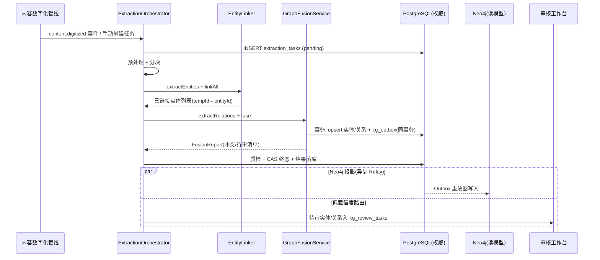

# 服务端 - 教育内容知识图谱自动构建与实体关系抽取引擎 详细设计

## 1. 概述

### 1.1 模块定位

本引擎是 PrimeTop 知识图谱体系的**上游生产管线**，负责从原始教育内容（教材章节、题目解析、课程笔记、考点说明等非结构化/半结构化文本）中自动抽取知识实体、识别实体间关系，生成结构化的知识图谱三元组，并融合入库到全局知识图谱中。

与已有模块的协作关系：

| 已有模块 | 关系 |
| --- | --- |
| 知识点体系与教材映射引擎 | 本引擎的输出（实体/关系）需与已有知识点体系对齐合并 |
| 知识图谱数据版本控制 | 本引擎产出的图谱变更需纳入版本管理 |
| 教育内容语义标签体系 | 本引擎为标签体系提供实体级别的细粒度标注 |
| RAG检索增强生成系统 | 本引擎产出的结构化关系增强 RAG 检索质量 |
| 教材内容数字化与结构化生产管线 | 本引擎消费数字化管线的输出作为输入 |
| 知识图谱构建与可视化交互引擎 | 本引擎产出的图谱数据供可视化引擎展示 |

### 1.2 核心职责

1. **实体识别（NER）**：从教育文本中识别知识实体（概念、定理、公式、术语、人物、事件、地点等）
2. **实体链接与消歧**：将识别出的实体链接到已有知识图谱节点，解决同义/近义歧义
3. **关系抽取**：识别实体间的语义关系（前置依赖、包含、派生、应用、关联等）
4. **三元组生成**：输出 `(头实体, 关系, 尾实体)` 结构化三元组及置信度
5. **图谱融合**：将新三元组合并到已有知识图谱，处理冲突与去重
6. **人审工作流**：低置信度结果路由到人工审核队列，形成人机协同闭环

### 1.3 设计目标

| 指标 | 目标值 |
| --- | --- |
| 实体识别准确率（P） | ≥ 90%（Top-5候选命中） |
| 关系抽取准确率（P） | ≥ 85%（高置信度结果） |
| 单章节处理延迟 | ≤ 30s（普通章节约 2000 字） |
| 批量处理吞吐 | ≥ 100 章节/分钟 |
| 人工审核路由率 | ≤ 15%（低置信度自动路由） |
| 图谱融合冲突率 | ≤ 5%（与已有节点冲突占比） |

---

## 2. 数据模型

### 2.1 核心实体定义

#### 2.1.1 知识实体（KnowledgeEntity）

```typescript
interface KnowledgeEntity {
  id: string;                    // 实体全局唯一ID，格式: ke_{ulid}
  canonicalName: string;         // 规范名称，如"二次函数"
  aliases: string[];             // 别名列表，如["抛物线函数","quadratic function"]
  entityType: EntityType;        // 实体类型
  subject: Subject;              // 学科
  stage: EduStage;               // 学段
  gradeLevel: string[];          // 适用年级，如["初三","高一"]
  description: string;           // 实体描述（自动生成+人工修订）
  sourceContentIds: string[];    // 来源内容ID列表
  status: EntityStatus;          // 状态
  qualityScore: number;          // 质量评分 0-100
  tags: string[];                // 扩展标签
  metadata: EntityMetadata;      // 元数据
  createdAt: string;             // 创建时间
  updatedAt: string;             // 更新时间
}

type EntityType =
  | 'concept'        // 概念（如"惯性"）
  | 'theorem'        // 定理/定律（如"勾股定理"）
  | 'formula'        // 公式（如"求根公式"）
  | 'term'           // 术语（如"光合作用"）
  | 'method'         // 方法/技巧（如"配方法"）
  | 'person'         // 人物（如"牛顿"）
  | 'event'          // 事件（如"巴黎和会"）
  | 'place'          // 地点（如"长江三角洲"）
  | 'work'           // 作品（如"岳阳楼记"）
  | 'organization'   // 组织/机构
  | 'law'            // 法则/规律
  | 'experiment'     // 实验
  | 'skill'          // 技能/能力点
  | 'chapter_unit';  // 章节单元

type EntityStatus =
  | 'draft'          // 刚抽取，待审核
  | 'pending_review' // 待人工审核
  | 'approved'       // 已审核通过
  | 'merged'         // 已合并到已有实体
  | 'rejected'       // 审核拒绝
  | 'deprecated';    // 已废弃

interface EntityMetadata {
  textbookAlignment?: {          // 教材对齐信息
    textbookId: string;
    chapterId: string;
    sectionId?: string;
  };
  curriculumStandard?: {         // 课标对齐
    standardId: string;
    requirementLevel: 'know' | 'understand' | 'master' | 'apply';
  };
  bloomLevel?: string;           // 布鲁姆认知层级
  difficulty?: number;           // 难度系数 1-5
  estimatedStudyTime?: number;   // 预估学习时长（分钟）
}
```

#### 2.1.2 知识关系（KnowledgeRelation）

```typescript
interface KnowledgeRelation {
  id: string;                    // 关系ID，格式: kr_{ulid}
  headEntityId: string;          // 头实体ID
  tailEntityId: string;          // 尾实体ID
  relationType: RelationType;    // 关系类型
  confidence: number;            // 置信度 0-1
  evidence: RelationEvidence;    // 证据来源
  status: RelationStatus;        // 状态
  weight: number;                // 关系权重 0-1（用于图算法）
  metadata: Record<string, any>; // 扩展属性
  createdAt: string;
  updatedAt: string;
}

type RelationType =
  | 'prerequisite'    // 前置依赖：A是B的前置知识
  | 'contains'        // 包含：A包含B（整体-部分）
  | 'type_of'         // 属于：A是B的子类型
  | 'instance_of'     // 实例：A是B的具体实例
  | 'derives_from'    // 派生自：A由B推导而来
  | 'applies_to'      // 应用于：A方法应用于B问题
  | 'related_to'      // 相关联：A与B有某种关联
  | 'contrasts_with'  // 对比：A与B对比/易混淆
  | 'part_of'         // 组成部分：A是B的组成部分
  | 'leads_to'        // 导致/推导：A导致B
  | 'same_as'         // 等价：A等价于B
  | 'opposite_of'     // 对立：A与B对立
  | 'example_of'      // 举例：A是B的例子
  | 'used_together';  // 常搭配使用

type RelationStatus =
  | 'candidate'       // 候选（机器抽取，待审核）
  | 'confirmed'       // 已确认
  | 'rejected'        // 已拒绝
  | 'auto_merged';    // 自动合并（与已有关系重复）

interface RelationEvidence {
  sourceType: 'textbook' | 'question' | 'course_note' | 'llm_inferred' | 'manual';
  sourceContentIds: string[];   // 来源内容ID
  sourceTextSpans?: TextSpan[]; // 原文片段
  llmReasoning?: string;        // LLM推理过程说明
  humanNote?: string;           // 人工批注
}

interface TextSpan {
  contentId: string;
  startOffset: number;
  endOffset: number;
  text: string;                  // 原文摘录
}
```

#### 2.1.3 抽取任务（ExtractionTask）

```typescript
interface ExtractionTask {
  id: string;                     // 任务ID: et_{ulid}
  batchId?: string;               // 批次ID
  sourceContentId: string;        // 源内容ID
  sourceContentType: 'textbook_chapter' | 'question' | 'course_note' | 'exam_point' | 'lesson_transcript';
  sourceText: string;             // 原始文本
  subject: Subject;
  stage: EduStage;
  context: ExtractionContext;     // 抽取上下文
  status: TaskStatus;
  result?: ExtractionResult;      // 抽取结果
  error?: string;                 // 错误信息
  retryCount: number;
  priority: number;               // 优先级 1-10
  createdAt: string;
  startedAt?: string;
  completedAt?: string;
}

interface ExtractionContext {
  textbookId?: string;
  chapterId?: string;
  knowledgePointIds?: string[];   // 已关联的知识点ID
  gradeLevel?: string;
  existingEntityIds?: string[];   // 该内容已有的实体ID（增量抽取时使用）
}

interface ExtractionResult {
  entities: ExtractedEntity[];     // 抽取的实体
  relations: ExtractedRelation[];  // 抽取的关系
  stats: {
    entityCount: number;
    relationCount: number;
    newEntityCount: number;        // 新发现的实体
    linkedEntityCount: number;     // 链接到已有的实体
    lowConfidenceCount: number;    // 低置信度数量
  };
  processingTimeMs: number;
  modelUsed: string;
  tokenConsumed: number;
}

interface ExtractedEntity {
  tempId: string;                  // 临时ID（用于关系引用）
  canonicalName: string;
  aliases?: string[];
  entityType: EntityType;
  description?: string;
  sourceSpan?: TextSpan;
  confidence: number;
  linkedEntityId?: string;         // 链接到的已有实体ID
  linkConfidence?: number;
  isNew: boolean;
}

interface ExtractedRelation {
  headTempId: string;              // 头实体临时ID
  tailTempId: string;              // 尾实体临时ID
  relationType: RelationType;
  confidence: number;
  evidence: RelationEvidence;
}
```

### 2.2 数据库表结构

#### 2.2.1 PostgreSQL - 知识实体表

```sql
CREATE TABLE knowledge_entities (
    id              VARCHAR(40)   PRIMARY KEY,
    canonical_name  VARCHAR(200)  NOT NULL,
    aliases         JSONB         DEFAULT '[]'::jsonb,
    entity_type     VARCHAR(30)   NOT NULL,
    subject         VARCHAR(20)   NOT NULL,
    stage           VARCHAR(20)   NOT NULL,
    grade_level     JSONB         DEFAULT '[]'::jsonb,
    description     TEXT,
    source_content_ids JSONB      DEFAULT '[]'::jsonb,
    status          VARCHAR(20)   NOT NULL DEFAULT 'draft',
    quality_score   INT           DEFAULT 0,
    tags            JSONB         DEFAULT '[]'::jsonb,
    metadata        JSONB         DEFAULT '{}'::jsonb,
    created_at      TIMESTAMPTZ   NOT NULL DEFAULT NOW(),
    updated_at      TIMESTAMPTZ   NOT NULL DEFAULT NOW()
);

-- 核心索引
CREATE INDEX idx_ke_name_subject   ON knowledge_entities (canonical_name, subject);
CREATE INDEX idx_ke_type_subject   ON knowledge_entities (entity_type, subject, stage);
CREATE INDEX idx_ke_status         ON knowledge_entities (status) WHERE status IN ('draft', 'pending_review');
CREATE INDEX idx_ke_source_ids     ON knowledge_entities USING GIN (source_content_ids);
CREATE INDEX idx_ke_aliases_gin    ON knowledge_entities USING GIN (aliases jsonb_path_ops);
CREATE INDEX idx_ke_tags_gin       ON knowledge_entities USING GIN (tags);

-- 全文检索
CREATE INDEX idx_ke_name_trgm ON knowledge_entities
    USING GIN (canonical_name gin_trgm_ops);
```

#### 2.2.2 PostgreSQL - 知识关系表

```sql
CREATE TABLE knowledge_relations (
    id              VARCHAR(40)   PRIMARY KEY,
    head_entity_id  VARCHAR(40)   NOT NULL REFERENCES knowledge_entities(id) ON DELETE CASCADE,
    tail_entity_id  VARCHAR(40)   NOT NULL REFERENCES knowledge_entities(id) ON DELETE CASCADE,
    relation_type   VARCHAR(30)   NOT NULL,
    confidence      DECIMAL(3,2)  NOT NULL DEFAULT 0.5,
    weight          DECIMAL(3,2)  DEFAULT 0.5,
    evidence        JSONB         NOT NULL,
    status          VARCHAR(20)   NOT NULL DEFAULT 'candidate',
    metadata        JSONB         DEFAULT '{}'::jsonb,
    created_at      TIMESTAMPTZ   NOT NULL DEFAULT NOW(),
    updated_at      TIMESTAMPTZ   NOT NULL DEFAULT NOW(),
    UNIQUE (head_entity_id, tail_entity_id, relation_type)
);

CREATE INDEX idx_kr_head      ON knowledge_relations (head_entity_id, relation_type);
CREATE INDEX idx_kr_tail      ON knowledge_relations (tail_entity_id, relation_type);
CREATE INDEX idx_kr_status    ON knowledge_relations (status) WHERE status = 'candidate';
CREATE INDEX idx_kr_type      ON knowledge_relations (relation_type, confidence DESC);
```

#### 2.2.3 PostgreSQL - 抽取任务表

```sql
CREATE TABLE extraction_tasks (
    id                  VARCHAR(40)   PRIMARY KEY,
    batch_id            VARCHAR(40),
    source_content_id   VARCHAR(40)   NOT NULL,
    source_content_type VARCHAR(30)   NOT NULL,
    source_text         TEXT          NOT NULL,
    subject             VARCHAR(20)   NOT NULL,
    stage               VARCHAR(20)   NOT NULL,
    context             JSONB         DEFAULT '{}'::jsonb,
    status              VARCHAR(20)   NOT NULL DEFAULT 'pending',
    result              JSONB,
    error               TEXT,
    retry_count         INT           DEFAULT 0,
    priority            INT           DEFAULT 5,
    created_at          TIMESTAMPTZ   NOT NULL DEFAULT NOW(),
    started_at          TIMESTAMPTZ,
    completed_at        TIMESTAMPTZ
);

CREATE INDEX idx_et_status_priority ON extraction_tasks (status, priority DESC, created_at)
    WHERE status IN ('pending', 'retrying');
CREATE INDEX idx_et_batch           ON extraction_tasks (batch_id);
CREATE INDEX idx_et_content         ON extraction_tasks (source_content_id);
```

#### 2.2.4 Neo4j 图数据库 - 知识图谱存储

```cypher
// 节点定义
CREATE CONSTRAINT FOR (e:KnowledgeEntity) REQUIRE e.id IS UNIQUE;
CREATE CONSTRAINT FOR (e:KnowledgeEntity) REQUIRE e.canonicalName IS UNIQUE;

// 节点属性
// (e:KnowledgeEntity {
//   id, canonicalName, entityType, subject, stage,
//   gradeLevel, description, qualityScore, status, tags
// })

// 关系类型（每种 relationType 对应一种 Neo4j 关系）
// (:KnowledgeEntity)-[:PREREQUISITE]->(:KnowledgeEntity)
// (:KnowledgeEntity)-[:CONTAINS]->(:KnowledgeEntity)
// (:KnowledgeEntity)-[:DERIVES_FROM]->(:KnowledgeEntity)
// (:KnowledgeEntity)-[:APPLIES_TO]->(:KnowledgeEntity)
// (:KnowledgeEntity)-[:RELATED_TO]->(:KnowledgeEntity)
// (:KnowledgeEntity)-[:CONTRASTS_WITH]->(:KnowledgeEntity)
// (:KnowledgeEntity)-[:SAME_AS]->(:KnowledgeEntity)
// (:KnowledgeEntity)-[:PART_OF]->(:KnowledgeEntity)
// (:KnowledgeEntity)-[:EXAMPLE_OF]->(:KnowledgeEntity)

// 关系属性
// {id, confidence, weight, evidence, createdAt, status}

// 索引
CREATE INDEX FOR (e:KnowledgeEntity) ON (e.subject);
CREATE INDEX FOR (e:KnowledgeEntity) ON (e.entityType);
CREATE INDEX FOR (e:KnowledgeEntity) ON (e.stage);
```

### 2.3 缓存策略

```typescript
// Redis 缓存键设计

// 1. 实体缓存（热点实体）
const entityCacheKey = (entityId: string) => `kg:entity:${entityId}`;       // TTL: 1h
const entityByNameKey = (name: string, subject: string) =>
  `kg:entity:name:${subject}:${encodeURIComponent(name)}`;                  // TTL: 30min

// 2. 实体链接缓存（同义词→实体ID映射）
const entityLinkKey = (mention: string, subject: string) =>
  `kg:link:${subject}:${encodeURIComponent(mention)}`;                      // TTL: 24h

// 3. 抽取任务状态
const taskStatusKey = (taskId: string) => `kg:task:${taskId}`;             // TTL: 2h
const batchProgressKey = (batchId: string) => `kg:batch:${batchId}:progress`; // TTL: 7d

// 4. 审核队列
const reviewQueueKey = (subject: string) => `kg:review:${subject}`;         // List, 无 TTL

// 5. 幂等去重
const contentProcessedKey = (contentId: string) =>
  `kg:processed:${contentId}`;                                             // TTL: 30d
```

---

## 3. API 接口设计

### 3.1 接口总览

| # | 接口 | 方法 | 路径 | 说明 |
| --- | --- | --- | --- | --- |
| 1 | 创建抽取任务 | POST | `/api/v1/kg-extraction/tasks` | 提交内容进行知识抽取 |
| 2 | 批量创建抽取任务 | POST | `/api/v1/kg-extraction/tasks/batch` | 批量提交 |
| 3 | 查询任务状态 | GET | `/api/v1/kg-extraction/tasks/{taskId}` | 获取抽取结果 |
| 4 | 查询实体详情 | GET | `/api/v1/kg-extraction/entities/{entityId}` | 实体详情 |
| 5 | 搜索实体 | GET | `/api/v1/kg-extraction/entities` | 按名称/类型/学科搜索 |
| 6 | 查询实体关系 | GET | `/api/v1/kg-extraction/entities/{entityId}/relations` | 实体的关联关系列表 |
| 7 | 获取待审核列表 | GET | `/api/v1/kg-extraction/review/pending` | 待人工审核的实体/关系 |
| 8 | 审核操作 | POST | `/api/v1/kg-extraction/review/{reviewId}` | 批准/拒绝/修改 |
| 9 | 手动添加实体 | POST | `/api/v1/kg-extraction/entities` | 人工添加实体 |
| 10 | 手动添加关系 | POST | `/api/v1/kg-extraction/relations` | 人工添加关系 |
| 11 | 图谱统计 | GET | `/api/v1/kg-extraction/stats` | 实体/关系/覆盖率统计 |
| 12 | 触发内容重抽取 | POST | `/api/v1/kg-extraction/rerun` | 内容变更后重抽取 |

### 3.2 核心接口详细设计

#### 3.2.1 创建抽取任务

```
POST /api/v1/kg-extraction/tasks
```

**请求体：**

```json
{
  "sourceContentId": "tc_01JX3KQMZ8ABCDE",
  "sourceContentType": "textbook_chapter",
  "sourceText": "一元二次方程的求根公式是通过配方法推导出来的。对于一般形式 ax²+bx+c=0 (a≠0)，当判别式 Δ=b²-4ac≥0 时，方程有两个实数根...",
  "subject": "math",
  "stage": "middle",
  "context": {
    "textbookId": "tb_renjiao_v3",
    "chapterId": "ch_9_2",
    "knowledgePointIds": ["kp_001", "kp_002"],
    "gradeLevel": "初三"
  },
  "options": {
    "extractRelations": true,
    "linkExistingEntities": true,
    "autoApproveHighConfidence": true,
    "confidenceThreshold": 0.75,
    "maxEntities": 50
  }
}
```

**响应（202 Accepted）：**

```json
{
  "code": 0,
  "data": {
    "taskId": "et_01JX3KQMZ8FGHIJ",
    "status": "pending",
    "estimatedTimeSeconds": 15,
    "webhookUrl": "https://api.primetop.com/v1/kg-extraction/tasks/et_01JX3KQMZ8FGHIJ"
  }
}
```

#### 3.2.2 查询任务状态与结果

```
GET /api/v1/kg-extraction/tasks/{taskId}
```

**响应（200 OK，完成后）：**

```json
{
  "code": 0,
  "data": {
    "taskId": "et_01JX3KQMZ8FGHIJ",
    "status": "completed",
    "result": {
      "entities": [
        {
          "tempId": "tmp_1",
          "canonicalName": "求根公式",
          "aliases": ["二次方程求根公式"],
          "entityType": "formula",
          "description": "一元二次方程 ax²+bx+c=0 的求根公式为 x=(-b±√(b²-4ac))/2a",
          "confidence": 0.95,
          "linkedEntityId": "ke_01HW8EXISTING",
          "linkConfidence": 0.92,
          "isNew": false,
          "sourceSpan": {
            "contentId": "tc_01JX3KQMZ8ABCDE",
            "startOffset": 0,
            "endOffset": 28,
            "text": "一元二次方程的求根公式"
          }
        },
        {
          "tempId": "tmp_2",
          "canonicalName": "配方法",
          "entityType": "method",
          "description": "通过配方将二次多项式转化为完全平方式的方法",
          "confidence": 0.91,
          "linkedEntityId": null,
          "isNew": true,
          "sourceSpan": {
            "contentId": "tc_01JX3KQMZ8ABCDE",
            "startOffset": 12,
            "endOffset": 15,
            "text": "配方法"
          }
        },
        {
          "tempId": "tmp_3",
          "canonicalName": "判别式",
          "aliases": ["Δ", "delta", "b²-4ac"],
          "entityType": "concept",
          "description": "一元二次方程 ax²+bx+c=0 中 Δ=b²-4ac 用于判断根的情况",
          "confidence": 0.93,
          "linkedEntityId": "ke_01HW8DISCRIM",
          "linkConfidence": 0.89,
          "isNew": false
        }
      ],
      "relations": [
        {
          "headTempId": "tmp_2",
          "tailTempId": "tmp_1",
          "relationType": "derives_from",
          "confidence": 0.88,
          "evidence": {
            "sourceType": "llm_inferred",
            "sourceContentIds": ["tc_01JX3KQMZ8ABCDE"],
            "llmReasoning": "原文明确提到'求根公式是通过配方法推导出来的'，表明求根公式(结果)由配方法(方法)推导而来"
          }
        },
        {
          "headTempId": "tmp_3",
          "tailTempId": "tmp_1",
          "relationType": "applies_to",
          "confidence": 0.90,
          "evidence": {
            "sourceType": "textbook",
            "sourceContentIds": ["tc_01JX3KQMZ8ABCDE"],
            "sourceTextSpans": [{
              "contentId": "tc_01JX3KQMZ8ABCDE",
              "startOffset": 56,
              "endOffset": 82,
              "text": "当判别式 Δ=b²-4ac≥0 时，方程有两个实数根"
            }]
          }
        }
      ],
      "stats": {
        "entityCount": 3,
        "relationCount": 2,
        "newEntityCount": 1,
        "linkedEntityCount": 2,
        "lowConfidenceCount": 0
      },
      "processingTimeMs": 8234,
      "modelUsed": "gpt-4-turbo",
      "tokenConsumed": 2840
    }
  }
}
```

#### 3.2.3 搜索实体

```
GET /api/v1/kg-extraction/entities?keyword=二次函数&subject=math&stage=high&type=concept&page=1&size=20
```

**响应（200 OK）：**

```json
{
  "code": 0,
  "data": {
    "total": 15,
    "page": 1,
    "size": 20,
    "items": [
      {
        "id": "ke_01HW8QUAD_FN",
        "canonicalName": "二次函数",
        "entityType": "concept",
        "subject": "math",
        "stage": "high",
        "qualityScore": 92,
        "status": "approved",
        "aliases": ["抛物线函数"],
        "tags": ["函数", "代数"],
        "relationCount": 24,
        "description": "形如 y=ax²+bx+c (a≠0) 的函数..."
      }
    ]
  }
}
```

#### 3.2.4 审核操作

```
POST /api/v1/kg-extraction/review/{reviewId}
```

**请求体：**

```json
{
  "action": "approve",
  "comment": "实体识别准确，描述需调整",
  "modifications": {
    "description": "补充：配方法是一种重要的代数变形技巧，不仅用于求根公式推导，还用于二次函数化为顶点式"
  }
}
```

**可选 action：** `approve` | `reject` | `modify` | `merge`

---

## 4. 核心业务流程

### 4.1 整体抽取流程（状态流转）

```
┌──────────────────────────────────────────────────────────────────┐
│                        抽取主流程状态机                            │
├──────────────────────────────────────────────────────────────────┤
│                                                                  │
│  ┌─────────┐    ┌──────────┐    ┌───────────┐    ┌───────────┐ │
│  │ pending │───▶│processing│───▶│ extracting│───▶│ linking   │ │
│  └─────────┘    └──────────┘    └───────────┘    └─────┬─────┘ │
│       │               │              │                  │       │
│       │          (失败/超时)         │                  ▼       │
│       │               │              │          ┌───────────┐   │
│       │               ▼              │          │  merging  │   │
│       │          ┌──────────┐        │          └─────┬─────┘   │
│       │          │ retrying │◀───────┘                │         │
│       │          └──────────┘                         ▼         │
│       │                                     ┌─────────────────┐  │
│       │                                     │ quality_check   │  │
│       │                                     └───────┬─────────┘  │
│       │                                             │            │
│       │                              ┌──────────────┼────────┐   │
│       │                              ▼              ▼        │   │
│       │                     ┌──────────────┐ ┌───────────┐  │   │
│       │                     │auto_approved │ │review_queue│  │   │
│       │                     │  (高置信度)   │ │(低置信度)  │  │   │
│       │                     └──────┬───────┘ └─────┬─────┘  │   │
│       │                            │               │        │   │
│       │                            ▼               ▼        │   │
│       │                     ┌────────────────────────────┐  │   │
│       │                     │     completed              │  │   │
│       │                     └────────────────────────────┘  │   │
│       │                                                             │
│       ▼                                                             │
│  ┌──────────┐                                                       │
│  │ cancelled│                                                       │
│  └──────────┘                                                       │
│                                                                    │
└──────────────────────────────────────────────────────────────────┘
```

### 4.2 实体识别与链接流程

```
输入: 原始文本 + 学科/学段上下文
  │
  ▼
┌─────────────────────┐
│ Step 1: 文本预处理   │  - 分句、清洗、学科标记
└─────────┬───────────┘
          │
          ▼
┌─────────────────────┐
│ Step 2: 实体候选生成 │  - LLM 结构化抽取 (主要)
│                      │  - 词典匹配补充 (兜底)
│                      │  - 学科NER模型补充 (精准)
└─────────┬───────────┘
          │
          ▼
┌─────────────────────┐
│ Step 3: 实体规范化   │  - 名称归一化
│                      │  - 类型校验
│                      │  - 别名收集
└─────────┬───────────┘
          │
          ▼
┌─────────────────────┐
│ Step 4: 实体链接     │  ┌────────────────────────────┐
│ (Entity Linking)     │  │ 1. 精确匹配 (名称+学科)     │
│                      │  │ 2. 模糊匹配 (trigram相似度) │
│                      │  │ 3. 语义匹配 (Embedding)     │
│                      │  │ 4. LLM 辅助消歧             │
│                      │  └────────────────────────────┘
└─────────┬───────────┘
          │
          ▼
┌─────────────────────┐
│ Step 5: 置信度评估   │  - 链接置信度计算
│                      │  - 低置信度→审核队列
│                      │  - 高置信度→自动通过
└─────────────────────┘
```

### 4.3 关系抽取流程

```
输入: 已识别的实体列表 + 原始文本
  │
  ▼
┌──────────────────────────┐
│ Step 1: 实体对枚举        │  - 同句实体对（近距离关系）
│                          │  - 邻句实体对（中距离关系）
│                          │  - 同章节实体对（远距离关系）
└────────────┬─────────────┘
             │
             ▼
┌──────────────────────────┐
│ Step 2: 关系分类          │
│ ┌──────────────────────┐ │
│ │ 策略A: 规则模板匹配   │ │  - "A是B的前置知识" → prerequisite
│ │                      │ │  - "A包含B" → contains
│ │                      │ │  - "A由B推导" → derives_from
│ └──────────────────────┘ │
│ ┌──────────────────────┐ │
│ │ 策略B: LLM关系抽取   │ │  - Few-shot prompt + 实体对 + 原文
│ │                      │ │  - 输出: relationType + confidence + reasoning
│ └──────────────────────┘ │
│ ┌──────────────────────┐ │
│ │ 策略C: 共现统计推断  │ │  - 高频共现 → related_to (低置信度)
│ └──────────────────────┘ │
└────────────┬─────────────┘
             │
             ▼
┌──────────────────────────┐
│ Step 3: 关系去重与冲突处理│  - 与已有关系去重
│                          │  - 矛盾关系标记（如A→B 且 B→A prerequisite）
│                          │  - 关系方向校验
└────────────┬─────────────┘
             │
             ▼
┌──────────────────────────┐
│ Step 4: 关系置信度融合   │  - 多策略投票：规则+LLM一致→高置信度
│                          │  - 仅LLM→中置信度
│                          │  - 仅共现→低置信度
└──────────────────────────┘
```

### 4.4 图谱融合与冲突处理

```typescript
// 图谱融合决策树
//
// 新三元组 (entityA, relation, entityB) 入库时：
//
// 1. entityA / entityB 是否已存在？
//    ├─ 否 → 创建新节点（status: draft）
//    └─ 是 → 继续
//
// 2. (entityA, relation, entityB) 是否已存在？
//    ├─ 是 → 合并：更新 confidence = max(old, new)，合并 evidence
//    └─ 否 → 继续
//
// 3. 是否存在反向关系？
//    ├─ (entityB, relation, entityA) 存在？
//    │    ├─ relation 可逆（如 related_to, same_as）→ 合并
//    │    └─ relation 有向（如 prerequisite）→ 标记冲突，路由审核
//    └─ 否 → 创建新关系
//
// 4. 是否存在传递性冲突？
//    ├─ A prerequisite B, B prerequisite C, 但 C prerequisite A → 环检测
//    └─ 发现环 → 标记冲突，路由审核
//
// 5. 置信度阈值
//    └─ confidence < 0.60 → candidate（仅存候选库，不进 Neo4j 图谱，等待更多证据）
//
// 6. 证据合并：evidence_union = old.evidence ∪ new.evidence（按 sourceContentId 去重）
//    confidence_new = max(old, new)（单向提升，永不回退）
//    weight = 0.5 × confidence + 0.5 × 独立证据数加成（见 §4.4.3）
```

#### 4.4.1 冲突分类与处置表

| 冲突类型 | 检测方式 | 处置 | 是否自动 |
| --- | --- | --- | --- |
| 完全重复 | `(head, tail, relation_type)` 唯一键命中 | 自动合并证据与置信度（§4.4.3） | 是 |
| 可逆反向 | `(B, r, A)` 已存在且 `r ∈ {related_to, same_as, contrasts_with, opposite_of}` | 合并为一条，metadata 记 `bidirectional: true` | 是 |
| 有向反向 | `(B, prerequisite, A)` 与 `(A, prerequisite, B)` 并存 | 标记 `conflict`，路由人工审核（G6，不自动裁决） | 否 |
| 传递环 | DFS 环检测（G5，§4.4.2） | 拒绝成环边入正式图谱，整组转审核 | 否 |
| 实体歧义 | 同一 mention 链接到 ≥2 实体且 linkConfidence 均 ≥0.60 | 生成实体消歧审核任务 | 否 |
| 证据矛盾 | 同一关系 evidence 中出现否定性原文片段（"不是/并非/区别于"） | confidence 上限压至 0.59，自动转 candidate | 是 |
| 学段越界 | 关系两端实体 stage 差 ≥2（如小学实体直接 prerequisite 高中实体） | 标记 `cross_stage`，转审核 | 否 |

#### 4.4.2 环检测实现（Guard G5）

```typescript
// CycleDetector.ts — 前置依赖环检测
// 深度限制 10：初高中知识链最长约 7 层，超过视为疑似长链不判环，避免误伤
const MAX_DEPTH = 10;

class CycleDetector {
  constructor(private readonly graph: RelationReadPort) {}

  /** 新增 (head → tail, prerequisite) 前检测：若 tail 沿 prerequisite 可达 head 则成环 */
  async wouldCreateCycle(headId: string, tailId: string): Promise<string[] | null> {
    const visited = new Set<string>();
    const path: string[] = [];
    const found = await this.dfs(tailId, headId, visited, path, 0);
    return found ? [headId, ...found] : null;
  }

  private async dfs(
    current: string, target: string,
    visited: Set<string>, path: string[], depth: number,
  ): Promise<string[] | null> {
    if (current === target) return path.slice();
    if (depth >= MAX_DEPTH || visited.has(current)) return null;
    visited.add(current);
    for (const next of await this.graph.nextPrerequisites(current)) {  // PREREQUISITE 出边（Neo4j 只读副本）
      path.push(next);
      const hit = await this.dfs(next, target, visited, path, depth + 1);
      if (hit) return hit;
      path.pop();
    }
    return null;
  }
}
```

要点：图规模 500 万节点时单次检测走 Neo4j 只读副本 P99 ≤ 150ms；检测放在 `quality_check` 阶段串行执行，不成环边不等待检测结果先入 PG（候选态），成环则 CAS 回滚该边状态并登记 `kg.conflict.detected`。

#### 4.4.3 证据合并与置信度刷新

```typescript
// EvidenceMerger.ts — 重复关系合并语义（唯一键命中时调用）
function mergeRelation(existing: KnowledgeRelation, incoming: KnowledgeRelation): KnowledgeRelation {
  const sourceIds = [...new Set([
    ...existing.evidence.sourceContentIds,
    ...incoming.evidence.sourceContentIds,
  ])];
  const confidence = Math.max(existing.confidence, incoming.confidence);  // 单向提升
  return {
    ...existing,
    confidence: round2(confidence),
    weight: calcWeight(confidence, sourceIds.length),
    evidence: {
      ...existing.evidence,
      sourceContentIds: sourceIds,
      sourceTextSpans: dedupeSpans([
        ...(existing.evidence.sourceTextSpans ?? []),
        ...(incoming.evidence.sourceTextSpans ?? []),
      ]).slice(0, 5),                       // 单关系证据片段上限 5（G11）
    },
    status: confidence >= 0.85 && existing.status === 'candidate'
      ? 'confirmed' : existing.status,     // 升不降级；confirmed 不回退
  };
}

/** 独立证据数加成（对数压缩）：1→0.30, 2→0.45, 3→0.55, ≥4→0.60 */
function evidenceBonus(n: number): number {
  return round2(0.30 + 0.30 * Math.log2(Math.min(n, 8)) / 3);
}
function calcWeight(confidence: number, evidenceCount: number): number {
  return round2(0.5 * confidence + 0.5 * evidenceBonus(evidenceCount));
}
const round2 = (x: number) => Math.round(x * 100) / 100;
```

---

## 5. 关键代码实现

### 5.1 抽取编排器（主流程）

```typescript
// ExtractionOrchestrator.ts — 任务驱动主流程（对应 §4.1 状态机）
class ExtractionOrchestrator {
  constructor(
    private readonly taskRepo: TaskRepository,
    private readonly linker: EntityLinker,
    private readonly extractor: RelationExtractor,   // LLM + 规则 + 共现三策略（§4.3）
    private readonly fusion: GraphFusionService,
    private readonly outbox: OutboxWriter,
    private readonly redis: RedisClient,
  ) {}

  async process(taskId: string): Promise<void> {
    // G1 幂等：任务级分布式锁，防 Worker 重复投递双跑
    const got = await this.redis.set(`kg:task:lock:${taskId}`, '1', 'NX', 'EX', 600);
    if (!got) return;

    const task = await this.taskRepo.mustGet(taskId);
    task.assertTransit('processing');                  // G2 统一迁移入口
    await this.taskRepo.saveStatus(task, 'processing');

    try {
      // S1 预处理：分句清洗 + 分块（2000 字/块，200 字重叠保跨块实体）
      const chunks = chunkText(task.sourceText, 2000, 200);
      await this.taskRepo.saveStatus(task, 'extracting');

      // S2 实体抽取：LLM 主路 + 词典/学科 NER 兜底（降级 D2）
      const entityResults = await mapLimit(chunks, 3, (c) =>
        this.extractor.extractEntities(c, task.context));
      const entities = dedupeByName(flatten(entityResults));

      await this.taskRepo.saveStatus(task, 'linking');
      // S3 实体链接：四级漏斗（5.2），缓存优先
      const linked = await this.linker.linkAll(entities, task.subject);

      await this.taskRepo.saveStatus(task, 'merging');
      // S4 关系抽取 + 图谱融合：PG 事务内完成权威写，Neo4j 走 Outbox（G9）
      const relations = await this.extractor.extractRelations(linked, task.sourceText);
      const fusionResult = await this.fusion.fuse(task, linked, relations);

      await this.taskRepo.saveStatus(task, 'quality_check');
      // S5 质检：环检测 + 低置信度路由 + 统计报告
      const report = await this.qualityCheck(task, fusionResult);

      // S6 终态 CAS：quality_check → completed / review_pending
      const finalStatus = report.pendingReviewCount > 0 ? 'review_pending' : 'completed';
      await this.taskRepo.saveResult(task, finalStatus, report);

      // S7 事件（同事务 Outbox，§8）
      await this.outbox.append(task.tx(), 'kg.extraction.completed', {
        taskId, contentId: task.sourceContentId,
        newEntityCount: report.newEntities,
        conflictCount: report.conflicts.length,
      });
    } catch (err) {
      await this.handleFailure(task, err);             // §10 降级与重试
    }
  }
}
```

**延迟预算（P95，普通章节 2000 字）**：预处理 100ms + 实体抽取 LLM 8s（3 块并行）+ 链接 0.5s（缓存命中）/2s（批量 miss）+ 关系抽取 6s + 融合 300ms + 质检 200ms ≈ **15.1s**，对齐 §1.3 目标 ≤30s 余量充足；章节 >8000 字（切块 >4）时切换批量异步模式，任务立即返回 202 由 Worker 池消费。



### 5.2 实体链接四级漏斗

```typescript
// EntityLinker.ts — 由快到慢逐级兜底，实测命中率约 62% / 21% / 11% / 6%
class EntityLinker {
  async linkAll(entities: ExtractedEntity[], subject: Subject): Promise<LinkedEntity[]> {
    return mapLimit(entities, 10, async (e) => {
      // L1 精确匹配：规范名或别名 + 学科（Redis kg:link 缓存 24h）
      let hit = await this.exactLookup(e.canonicalName, subject);
      if (hit) return this.attach(e, hit, 0.97);

      // L2 模糊匹配：pg_trgm similarity ≥ 0.75，同学科，取 Top1
      hit = await this.fuzzyLookup(e.canonicalName, subject);
      if (hit) return this.attach(e, hit, 0.82);

      // L3 语义匹配：名称 Embedding 近邻（向量库服务委托，cos ≥ 0.88）
      hit = await this.embeddingLookup(e.canonicalName, subject);
      if (hit) return this.attach(e, hit, 0.74);

      // L4 LLM 消歧（成本门控：仅描述 ≥20 字时触发）
      if (e.description && e.description.length >= 20) {
        const llmHit = await this.llmDisambiguate(e, subject);
        if (llmHit) return this.attach(e, llmHit, 0.70);
      }
      return { ...e, isNew: true, linkedEntityId: null };   // 新实体
    });
  }
}
```

裁决规则（服务端权威，**G4：置信度阈值不可由调用方下调**）：linkConfidence ≥ 0.85 自动确认链接；0.60–0.85 入实体消歧审核；<0.60 视为新实体建 draft。§3.2.1 请求参数 `options.confidenceThreshold` 仅允许上调（如从 0.75 调到 0.80），下调请求返回 54204。

### 5.3 图谱融合服务（PG 事务 + Outbox 双写）

```typescript
// GraphFusionService.fuse() — PG 为写入权威，Neo4j 为读模型（G9）
async fuse(task: ExtractionTask, entities: LinkedEntity[], relations: ExtractedRelation[]): Promise<FusionReport> {
  return this.db.transaction(async (tx) => {
    const idMap = new Map<string, string>();              // tempId → 实体ID
    for (const e of entities) {
      if (e.linkedEntityId) {
        idMap.set(e.tempId, e.linkedEntityId);
        await tx.mergeEvidence(e.linkedEntityId, task.sourceContentId);  // 追加来源，不动状态
      } else {
        const id = await tx.insertEntity({                // status=draft
          canonicalName: e.canonicalName, entityType: e.entityType,
          subject: task.subject, stage: task.stage,
          description: e.description,
          sourceContentIds: [task.sourceContentId],
        });
        idMap.set(e.tempId, id);
      }
    }
    const conflicts: ConflictRecord[] = [];
    for (const r of relations) {
      const head = idMap.get(r.headTempId)!, tail = idMap.get(r.tailTempId)!;
      if (r.relationType === 'prerequisite') {
        const cycle = await this.cycleDetector.wouldCreateCycle(head, tail);   // G5
        if (cycle) { conflicts.push({ type: 'cycle', path: cycle, relation: r }); continue; }
      }
      const merged = await tx.upsertRelation(head, tail, r.relationType, r);   // §4.4.3 合并语义
      if (merged.conflict) conflicts.push({ type: merged.conflict, relation: r });
    }
    // 双写 Outbox（同事务，Relay 异步投影 Neo4j）
    await tx.outbox().append('kg.entity.created',     { taskId, entities: idMap.size });
    await tx.outbox().append('kg.relation.confirmed', { taskId, count: relations.length - conflicts.length });
    if (conflicts.length) await tx.outbox().append('kg.conflict.detected', { taskId, conflicts });
    return new FusionReport(entities, relations, conflicts);
  });
}
```

### 5.4 审核工作流（认领-裁决两段式）

```typescript
// ReviewService.ts — Guard G7 四眼原则
async claim(reviewId: string, reviewerId: string): Promise<ReviewTask> {
  // CAS 认领：仅 pending → claimed，防双人并发（54208）
  const rows = await this.db.query(
    `UPDATE kg_review_tasks SET status='claimed', claimed_by=$1, claimed_at=NOW()
      WHERE id=$2 AND status='pending' RETURNING *`, [reviewerId, reviewId]);
  if (!rows.length) throw new BizError(54208, 'REVIEW_ALREADY_CLAIMED');
  return rows[0];
}

async resolve(reviewId: string, reviewerId: string, cmd: ResolveCommand): Promise<void> {
  await this.db.transaction(async (tx) => {
    const task = await tx.mustGetForUpdate(reviewId);
    task.assertClaimedBy(reviewerId);
    if (reviewerId === task.createdBy) throw new BizError(54217, 'REVIEWER_IS_REQUESTER');   // G7
    const target = await this.applyResolution(tx, task, cmd);   // approve/reject/modify/merge 四分支
    await tx.outbox().append(
      cmd.action === 'reject' ? 'kg.entity.rejected' : 'kg.entity.approved',
      { reviewId, entityId: target.id, action: cmd.action });
  });
}
```

认领锁：`kg:review:lock:{reviewId}`（Redis SET NX EX 1800），DB CAS 为主、Redis 锁为预检，双保险防同一审核员双开浏览器重复认领。

---

## 6. 状态机与守卫

### 6.1 任务状态机（修复 v1.0 缺陷 F1：补 TaskStatus 权威定义）

```typescript
// v1.0 §2.1.3 引用 TaskStatus 但未定义枚举，此处补齐（权威定义）
type TaskStatus =
  | 'pending'          // 已创建待调度
  | 'processing'       // Worker 已认领（含预处理）
  | 'extracting'       // 实体抽取中
  | 'linking'          // 实体链接中
  | 'merging'          // 关系抽取 + 图谱融合中
  | 'quality_check'    // 质检（环检测/置信度路由）中
  | 'review_pending'   // 存在低置信度结果，已路由审核（任务侧等待人工）
  | 'completed'        // 终态：全部处理完毕（含已路由审核的部分）
  | 'failed'           // 终态：重试耗尽
  | 'cancelled';       // 终态：手动取消 / 源内容下线
// 注：v1.0 §4.1 流程图中的 retrying 为实现细节（重试等待的瞬时标记，不落库）；
//     auto_approved / review_queue 为质检路由结果标记，非任务状态。
```

| 迁移 | 触发条件 | 守卫 |
| --- | --- | --- |
| pending → processing | Worker 抢到任务锁 | G1 任务锁 SET NX |
| processing → extracting | 预处理完成 | 文本非空且 ≤50000 字（54200） |
| * → retrying（实现层） | 可重试异常（LLM 429/超时、DB 死锁） | retry_count < 3，指数退避 2^n ×30s |
| * → failed | 重试耗尽或不可重试异常 | 终态，登记 error 供排查 |
| quality_check → completed | 无待审项 | CAS：`UPDATE ... SET status='completed' WHERE id=? AND status='quality_check'` |
| quality_check → review_pending | 存在低置信度实体/关系 | 同事务写 kg_review_tasks |
| 任意非终态 → cancelled | 手动取消 / content.retired 事件 | 已完成融合的实体不回滚（仅停止后续步骤） |

### 6.2 实体与关系状态机

**实体（knowledge_entities.status）**：

```
draft ──(低置信度或歧义)──▶ pending_review ──approve──▶ approved ──merge──▶ merged(终态,只读)
  │                              │                            │
  └────reject────▶ rejected(终)  └────reject────▶ rejected    └────deprecate────▶ deprecated(终态)
```

- `draft → approved` 也可由自动链路完成（linkConfidence ≥0.85 且非歧义）；
- `approved → merged`：合并目标必须为 approved 状态（G-merge），merged 后旧实体只读，全部关系与引用经 `kg.entity.merged` 事件迁移（G10）；
- `approved → deprecated`：不物理删除（G12），防止下游悬空引用。

**关系（knowledge_relations.status）**：

```
candidate ──confidence≥0.85 且无冲突──▶ confirmed
    │                                      │
    ├────环/反向/越界冲突────▶ rejected      └────与已有关系重复合并────▶ auto_merged(终态)
    └────审核拒绝───────────▶ rejected(终态)
```

**审核任务（kg_review_tasks.status，DDL 见 §7）**：`pending → claimed → approved / rejected / modified`；claimed 超时 2h 自动释放回 pending（`claimed_at < NOW() - INTERVAL '2 hours'` 定时扫描）。

### 6.3 守卫总表

| # | 守卫 | 规则 | 违反后果 |
| --- | --- | --- | --- |
| G1 | 任务幂等锁 | `kg:task:lock:{taskId}` SET NX EX 600 | 重复 Worker 直接退出 |
| G2 | 状态迁移统一入口 | `Task.assertTransit()` 白名单校验 | 54204，携带守卫编号 |
| G3 | 实体唯一性 | PG 唯一索引 `uk_ke_name_subject (canonical_name, subject)`（§7 DDL 增补）；命中冲突走 merge 流程 | 拒绝重复建实体 |
| G4 | 置信度阈值服务端权威 | `confidenceThreshold` 仅可上调 | 54204 |
| G5 | 前置环检测 | prerequisite 入库前 DFS（§4.4.2） | 成环边转审核，54207 语义 |
| G6 | 有向反向不自动裁决 | `(B,r,A)` 与 `(A,r,B)` 有向并存 → 审核 | 自动合并仅限可逆关系集 |
| G7 | 四眼原则 | reviewer ≠ 任务创建者/抽取请求方 | 54217 |
| G8 | 输入来源白名单 | 仅接受内容数字化管线内容（content.digitized 登记）与运营人工录入 | 学生 UGC/笔记/作文禁止入管线（54201） |
| G9 | 双写顺序 | PG 事务先提交，Neo4j 经 Outbox Relay 异步投影；Neo4j 失败可重放，PG 失败整体回滚 | 对账差异登记 54219 |
| G10 | merged 只读 | merged/deprecated 实体禁止写，引用迁移事件驱动 | 54204 |
| G11 | 证据片段上限 | 单关系证据片段 ≤5 条、单条原文 ≤50 字、偏移越界即 54218 | 越界片段丢弃并记日志 |
| G12 | 软删除 | approved 实体只能 deprecated，禁止物理删除 | 54204 |
| G13 | LLM 输出校验 | JSON Schema 校验 + 学科词表二次过滤，失败重试 ≤2 | 仍失败走词典兜底（D2）或任务 failed |
| G14 | 人工录入须审核 | POST entities/relations 人工添加一律 pending_review，不走自动通过 | skip_auto_approve 仅系统内部调用可用 |

---

## 7. 幂等与并发控制

**DDL 增补（v1.0 缺陷 F2：缺幂等唯一索引与审核表）**：

```sql
-- F2 增补 1：任务幂等（重抽取语义：同内容每次重抽 rerun_seq 递增，构成新任务）
ALTER TABLE extraction_tasks ADD COLUMN rerun_seq INT NOT NULL DEFAULT 1;
CREATE UNIQUE INDEX uk_et_content_rerun ON extraction_tasks (source_content_id, rerun_seq);

-- F2 增补 2：实体唯一约束（G3）
ALTER TABLE knowledge_entities ADD CONSTRAINT uk_ke_name_subject
    UNIQUE (canonical_name, subject);

-- F2 增补 3：审核任务表
CREATE TABLE kg_review_tasks (
    id            VARCHAR(40) PRIMARY KEY,
    review_type   VARCHAR(20) NOT NULL,          -- entity_link / entity_new / relation / conflict_cycle / merge
    subject       VARCHAR(20) NOT NULL,
    payload       JSONB       NOT NULL,          -- 待审实体/关系快照（不可变，G-快照）
    task_id       VARCHAR(40) NOT NULL REFERENCES extraction_tasks(id),
    status        VARCHAR(20) NOT NULL DEFAULT 'pending',
    created_by    VARCHAR(40),                   -- 抽取请求方（G7 比对用）
    claimed_by    VARCHAR(40),
    claimed_at    TIMESTAMPTZ,
    resolved_by   VARCHAR(40),
    resolved_at   TIMESTAMPTZ,
    resolution    JSONB,                         -- action/modifications/comment
    created_at    TIMESTAMPTZ NOT NULL DEFAULT NOW(),
    updated_at    TIMESTAMPTZ NOT NULL DEFAULT NOW()
);
CREATE INDEX idx_krt_status_subject ON kg_review_tasks (status, subject, created_at)
    WHERE status = 'pending';
CREATE INDEX idx_krt_task ON kg_review_tasks (task_id);

-- F2 增补 4：Redis 认领锁之外，claimed 唯一性由 §5.4 CAS 保证
```

| # | 场景 | 幂等机制 |
| --- | --- | --- |
| S1 | 同一内容重复创建任务 | `kg:processed:{contentId}` SETNX（30d）命中则返回已有 taskId（200/54209）；显式 rerun 则 rerun_seq+1 走新任务（S7） |
| S2 | 批量接口重复行 | 单事务内按 sourceContentId 去重，重复行返回原任务映射 |
| S3 | Worker 重复投递 | G1 任务锁；锁 TTL 600s > 单任务 P99 处理时长 |
| S4 | 并发融合同关系 | PG `uk (head, tail, relation_type)` 唯一键 + `ON CONFLICT DO UPDATE` 合并语义（§4.4.3） |
| S5 | 审核并发认领/裁决 | CAS `UPDATE ... WHERE status='pending'`；裁决 `SELECT ... FOR UPDATE` + claimed_by 校验 |
| S6 | Neo4j 投影重放 | Outbox 消费幂等表 `kg_outbox_consumed (event_id, consumer, PK)`，Relay at-least-once + 消费去重 |
| S7 | rerun 与在途任务竞态 | rerun 创建新任务（rerun_seq+1）后，旧在途任务收到取消指令转 cancelled；融合以新任务结果为准（后到者胜） |
| S8 | 并发 merge 同一实体 | 目标实体行锁（`FOR UPDATE`）；merged 状态只读后第二并发方 54212 |

---

## 8. 事件发布与订阅

**Outbox 表（G9 同事务）**：

```sql
CREATE TABLE kg_outbox (
    id          VARCHAR(40) PRIMARY KEY,         -- evt_{ulid}
    event_type  VARCHAR(60) NOT NULL,           -- kg.* 域事件
    payload     JSONB       NOT NULL,
    occurred_at TIMESTAMPTZ NOT NULL DEFAULT NOW(),
    published_at TIMESTAMPTZ                     -- Relay 标记
);
CREATE INDEX idx_kg_outbox_unpub ON kg_outbox (occurred_at) WHERE published_at IS NULL;

CREATE TABLE kg_outbox_consumed (
    event_id  VARCHAR(40) NOT NULL,
    consumer  VARCHAR(60) NOT NULL,
    consumed_at TIMESTAMPTZ NOT NULL DEFAULT NOW(),
    PRIMARY KEY (event_id, consumer)
);
```

**发布事件与消费方矩阵**：

| 事件 | 触发点 | 消费方 | 消费语义 |
| --- | --- | --- | --- |
| kg.extraction.completed | 任务终态（§5.1 S7） | 内容数字化管线（回执）、指标中心 | 统计/管线闭环 |
| kg.entity.created | 融合插入新实体 | 语义标签体系（实体级标注初始化）、知识图谱版本控制（变更登记） | 只增不判读 |
| kg.entity.approved | 审核通过/自动通过 | RAG 知识库（增量索引）、图查询服务（缓存失效）、推荐召回引擎（图扩展通道候选失效 EX 6h） | 读侧失效，不回流写 |
| kg.entity.merged | 合并完成 | 题目知识点标注（引用迁移）、图查询服务 | 引用重定向 old→new |
| kg.entity.rejected | 审核拒绝 | 指标中心（审核通过率） | 统计 |
| kg.relation.confirmed | 关系确认 | 前置依赖检测服务、学习路径推荐、可视化引擎 | 读侧增量 |
| kg.conflict.detected | 冲突登记 | 审核工作台（生成 conflict 类审核任务）、管理后台 | 人工裁决入口 |

**上游订阅**：

| 事件 | 动作 |
| --- | --- |
| content.digitized | 自动创建抽取任务（G8 白名单来源） |
| content.updated | 创建 rerun 任务（rerun_seq+1，S7） |
| content.retired | 在途任务取消；已融合实体不回滚，其 evidence 中该 contentId 标记 retired（§13 R14） |

**对账**：每日 04:45 对账 Job 校验三恒等式：① PG 实体数 = Neo4j 节点数（±当日投影延迟窗口）；② Outbox 未发布数 = 0（>100 告警）；③ `kg_outbox_consumed` 无孤儿 event_id。差异登记 54219 并触发修复投影。

---

## 9. 错误码（54200-54299）

| 码 | HTTP | 标识 | 说明 |
| --- | --- | --- | --- |
| 54200 | 400 | INVALID_SOURCE_TEXT | 源文本为空或超 50000 字 |
| 54201 | 400 | INVALID_SOURCE_ORIGIN | 来源不在 G8 白名单（含学生内容入管线拦截） |
| 54202 | 404 | TASK_NOT_FOUND | 任务不存在 |
| 54203 | 400 | INVALID_ENTITY_TYPE | 实体类型非法 |
| 54204 | 409 | INVALID_STATE_TRANSITION | 状态迁移非法，携带守卫编号（G2/G4/G10/G12） |
| 54205 | 404 | ENTITY_NOT_FOUND | 实体不存在 |
| 54206 | 404 | RELATION_NOT_FOUND | 关系不存在 |
| 54207 | 409 | ENTITY_RELATION_CYCLE | 前置链成环（返回环路径供审核展示；KP 层终审权归版本控制引擎 54126，见 R2） |
| 54208 | 409 | REVIEW_ALREADY_CLAIMED | 审核任务已被认领 |
| 54209 | 200 | TASK_ALREADY_EXISTS | 幂等：内容已处理，返回原 taskId |
| 54210 | 409 | REVIEW_TASK_NOT_CLAIMABLE | 审核任务非 pending（已裁决/已认领） |
| 54211 | 400 | ENTITY_NAME_DUPLICATED | 同学同学科规范名已存在（人工添加触发，G3） |
| 54212 | 409 | MERGE_TARGET_INVALID | 合并目标不存在或非 approved 状态 |
| 54213 | 429 | EXTRACTION_QUOTA_EXCEEDED | 抽取额度超限（额度门控引擎裁决） |
| 54214 | 200 | PARTIAL_SUCCESS | 部分实体/关系处理失败，结果标记 degraded（§10 D2） |
| 54215 | 503 | LLM_PROVIDER_UNAVAILABLE | 模型供应商全部不可用且兜底失败 |
| 54216 | 500 | FUSION_WRITE_FAILED | 图谱融合写失败，任务转重试 |
| 54217 | 403 | REVIEWER_IS_REQUESTER | 四眼原则拦截（G7） |
| 54218 | 400 | EVIDENCE_SPAN_INVALID | 原文片段越界或超 50 字（G11） |
| 54219 | 500 | NEO4J_PG_DIVERGED | 双写不一致，已登记对账差异 |
| 54220 | 503 | NEO4J_UNAVAILABLE | 图库不可用，读路径降级 PG（§10 D5） |

注：54209/54214 为 200 语义码（请求成功但携带降级/幂等语义）；54215/54216/54219/54220 为内部诊断码，客户端统一文案「处理中出错了，请稍后重试」，不透传细节防逆向。

---

## 10. 降级策略

| # | 故障场景 | 降级行为 | 红线 |
| --- | --- | --- | --- |
| D1 | Redis 宕机 | 任务锁退化为 PG `pg_try_advisory_lock`；链接缓存 miss 直查 PG；处理延迟上升但链路可用 | 幂等语义不丢 |
| D2 | LLM 供应商不可用 | 切换备用供应商（统一适配层委托）；全不可用则实体走词典/学科 NER 兜底（仅精确匹配建候选），任务标记 degraded（54214） | 绝不静默丢任务；词典兜底产出不自动 approved（G14 精神，最高 confirmed 0.6） |
| D3 | 向量库服务不可用 | L3 语义匹配跳过，L4 LLM 消歧比例上升；成本上浮 ≤15% 可接受 | 不阻塞链接主链路 |
| D4 | 审核工作台不可用 | 低置信度结果继续入队（kg_review_tasks），任务照常 completed；人工积压 ≥1000 告警 | 不自动放行低置信度结果 |
| D5 | Neo4j 不可用 | 写路径不受影响（PG 权威）；读路径（环检测/图扩展）降级 PG 递归 CTE（P99 从 150ms 升至 800ms，限深 10）；54220 语义 | 环检测不可跳过（G5 不降级） |
| D6 | Outbox Relay 积压 | Neo4j 投影延迟上升，读侧短暂读到旧图；积压 >10 万 P2 告警、>100 万 P1 | PG 权威不受投影影响 |
| D7 | 内容安全规则引擎超时 | 抽取文本未经安检不得入图谱（fail-closed），任务挂起重试 | **内容安全不可降级** |
| D8 | pg_trgm 扩展异常 | L2 模糊匹配停用，歧义率上升经 L3/L4 吸收 | 不自动降低 L2 阈值 |
| D9 | 额度门控不可用 | 运营批处理任务暂停受理（fail-closed）；手动单条任务放行但记账补录（委托计费中心） | 不放行批量任务防成本失控 |
| D10 | 总红线 | 以上降级均不得突破 G5（环检测）/G7（四眼）/G8（来源白名单）/G11（证据上限）；降级过程对审核侧全透明 | — |

---

## 11. 监控指标与容量

| # | 指标 | 口径 | 告警阈值 |
| --- | --- | --- | --- |
| M1 | 任务成功率 | completed / (completed+failed)，小时窗口 | <95% 持续 2h → P2 |
| M2 | 单任务处理时长 | P95/P99（Prometheus histogram） | P95 > 30s 持续 1h → P2 |
| M3 | 实体链接命中率 | 四级漏斗各级命中占比 | L1 <50%（缓存失效异常）或 L4 >15%（成本失控）→ P2 |
| M4 | 新实体率 | newEntity / entityCount | >40% 持续 1 天 → 图谱膨胀告警 P2 |
| M5 | 审核路由率 | 入 kg_review_tasks / 总产出 | >15%（§1.3 目标）持续 1 周 → P3 调参 |
| M6 | 冲突率 | conflicts / relations | >5% → P3；cycle 类 >1% → P2 |
| M7 | 双写差异 | 对账三恒等式（§8） | 差异 >0.1% → P2 |
| M8 | LLM 成本 | 日 token 消耗 × 单价 | 超预算 120% → P2（委托成本引擎口径） |
| M9 | Neo4j 投影延迟 | Outbox occurred→published 差值 P99 | >5min → P2 |
| M10 | 审核积压 | pending 待审数 | >1000 → P2；>5000 → P1 |

**容量（DAU 50 万）**：内容侧日新增/更新章节约 2 万 → 日 LLM 调用约 2.2 万次（实体+关系+消歧），平均 3000 token/次 ≈ 6600 万 token/日；图谱规模 500 万实体 / 2000 万关系（PG 约 120GB 含索引，Neo4j 约 80GB）；extraction_tasks 月分区保留 90 天；kg_outbox 发布后 7 天归档。峰值 Worker 并发 20 实例，单实例吞吐 ≥10 任务/分钟。

---

## 12. 合规要点

| # | 要点 |
| --- | --- |
| C1 | 输入白名单：仅处理平台自有内容与授权供应商内容；**学生 UGC（笔记/作文/问答）一律禁止入抽取管线**（G8），学习行为数据亦不得反哺图谱实体 |
| C2 | 版权：关系证据原文片段 ≤50 字（G11）；实体描述为改写生成，不整段复制教材原文 |
| C3 | AIGC 标识：LLM 生成的实体 description 在 metadata 记 `generated_by: 'llm'` + prompt 模板版本，供溯源 |
| C4 | 史实校验：person/event/work 类实体须过事实性校验引擎（委托），未过校验不入 approved（事实校验权威外置，见 R7） |
| C5 | 数据最小化：抽取管线不接收、不存储任何学生个人信息；来源 contentId 不含学生标识 |
| C6 | 审核审计：审核操作（claim/resolve）全量审计日志，留存 3 年，走统一审计服务 |
| C7 | 权限最小化：人工添加/审核接口需 `kg:curator` 角色；双人审批适用于实体合并与批量导入（G14） |
| C8 | 内容安全：抽取文本入图谱前经内容安全规则引擎（D7 fail-closed） |
| C9 | 数据不出域：图谱数据（实体/关系/向量）不出教育专有云，跨环境同步走脱敏管线 |
| C10 | 危机让位：平台级安全事件时本引擎批处理暂停，人工审核通道保留 |

---

## 13. 契约对齐（R1-R14）

| # | 裁决 |
| --- | --- |
| R1 | 知识点（KP）层生命周期权威归**知识图谱数据版本控制与知识点全生命周期管理引擎**（541xx 段）；本引擎产出的是 KP 层之下的**教育内容实体层**，对齐合并由其登记变更，本引擎不直接写 KP 表 |
| R2 | KP 前置链成环终审权归版本控制引擎（54126 语义）；本引擎 54207 仅为抽取域即时拦截与审核路由，不越权改 KP 层 |
| R3 | 图查询读权威归图查询服务/Neo4j；本引擎只写不读图（环检测走只读副本属内部实现） |
| R4 | 内容输入权威归教材内容数字化与结构化生产管线（content.digitized 事件为唯一自动入口） |
| R5 | LLM 调用统一走大模型推理统一适配层（多供应商调度/流式/降级），本引擎不直连供应商 SDK |
| R6 | Prompt 模板版本管理归 Prompt 版本管理引擎；本引擎模板变更须注册版本号 |
| R7 | 事实性校验委托教育内容事实性校验与知识准确性验证引擎；本引擎不内置事实库 |
| R8 | Embedding 统一走向量数据库基础设施服务；本引擎不自建向量索引 |
| R9 | 审核通知（待审提醒/积压告警）走统一通知服务，不直发短信 |
| R10 | 分布式锁/幂等遵循服务端分布式锁实现规范与接口幂等性规范；本引擎不另造锁原语 |
| R11 | 审计日志走统一审计日志与操作追溯系统，不重复建审计存储 |
| R12 | 错误码 54200-54299 为本引擎独占段（已全库扫描确认空闲；541xx 归版本控制引擎，543xx 保留） |
| R13 | 学生可见内容出口（实体描述经前端展示前）须过内容安全出口，本引擎存储侧不做展示判定（fail-closed 见 D7） |
| R14 | 内容下线（content.retired）只标记证据失效不删实体（G12 软删除精神一致）；实体真正废弃走 deprecated 审核 |

---

## 14. 验收场景

| # | 场景 | 预期 |
| --- | --- | --- |
| AC01 | 提交 2000 字数学章节抽取 | 202 返回；15s 内完成；实体/关系/统计齐全 |
| AC02 | 同一 contentId 重复提交 | 54209 返回原 taskId，不产生新任务 |
| AC03 | 显式 rerun 已处理内容 | 新任务 rerun_seq=2，旧在途任务转 cancelled（S7） |
| AC04 | LLM 输出非法 JSON | 自动重试 ≤2，仍失败走 D2 词典兜底并标记 degraded |
| AC05 | 文本中出现"配方法"且图谱已有同名词条 | L1 命中 linkConfidence 0.97，isNew=false |
| AC06 | 新实体"费马引理"无对应已有节点 | 四级全部 miss，isNew=true 建 draft |
| AC07 | 抽取关系 A prerequisite B 且 B 可达 A | G5 拦截，kg.conflict.detected 事件 + 审核任务生成，环不入图谱 |
| AC08 | 双向 related_to 重复抽取 | 可逆反向自动合并，metadata.bidirectional=true |
| AC09 | 有向 prerequisite 反向并存 | G6 转人工审核，不自动合并 |
| AC10 | linkConfidence 恰为 0.85 | 自动确认（阈值含等号，边界幂等） |
| AC11 | 请求 confidenceThreshold=0.5（低于默认 0.75） | 54204，提示阈值仅可上调（G4） |
| AC12 | 学生作文内容经手工接口提交 | 54201 拦截（G8 白名单） |
| AC13 | 双人同时认领同一审核任务 | 仅一人 CAS 成功，另一人 54208 |
| AC14 | 审核员裁决自己创建的任务 | 54217 拦截（G7） |
| AC15 | approved 实体物理删除请求 | 54204 拦截，引导 deprecated 流程（G12） |
| AC16 | Neo4j 宕机期间任务运行 | 任务正常 completed；对账 M7 差异告警；恢复后投影追平 |
| AC17 | 环检测期间 Neo4j 副本不可用 | D5 降级 PG CTE 执行，G5 不跳过 |
| AC18 | 内容安全引擎超时 | D7 fail-closed，任务挂起，不入图谱，告警 |

---

## 15. 关联文档

- 服务端-知识图谱数据版本控制与知识点全生命周期管理引擎-详细设计.md（KP 层权威，541xx 段）
- 知识点图数据库建模与图查询服务-详细设计.md（读模型/图查询）
- 知识图谱构建与可视化交互引擎-详细设计.md（可视化消费方）
- 知识点体系与教材映射引擎-详细设计.md（对齐合并）
- 教育内容语义标签体系与多维度内容画像引擎-详细设计.md（实体级标注消费方）
- RAG检索增强生成系统-详细设计.md（索引增量消费方）
- 教材内容数字化与结构化生产管线-详细设计.md（输入来源）
- 服务端-大模型推理统一适配层与多供应商模型调用抽象框架-详细设计.md（LLM 委托）
- 服务端-教育内容事实性校验与知识准确性验证引擎-详细设计.md（C4/R7 委托）
- 服务端-向量数据库基础设施与嵌入向量全生命周期管理服务-详细设计.md（R8 委托）
- 服务端统一业务异常码与错误分类体系-详细设计.md（错误码规范）
- 服务端分布式锁实现与并发资源竞争防护规范-详细设计.md（R10）

## 16. 维护记录

- v1.0 (2026-07) 初版：§1-§4.4 前半（数据模型/API/三大流程图与融合决策树），截断于 §4.4 决策树第 5 步注释行（围栏未闭合），§4.4 收尾及 §5 之后全部缺失；§2.1.3 引用 TaskStatus 未定义枚举（F1）；缺幂等唯一索引与审核表 DDL（F2）。
- v1.1 (2026-10-26) 补齐：§4.4 收尾（决策树第 6 步证据合并规则）+ 新增 §4.4.1 冲突分类处置表（7 类冲突）/§4.4.2 环检测实现（DFS 深度限 10）/§4.4.3 证据合并与置信度刷新（对数压缩证据加成）；新增 §5 关键代码四段（编排器主流程+延迟预算 15.1s+mermaid 时序图/实体链接四级漏斗/融合服务 PG 权威+Outbox 双写/审核认领-裁决两段式）+ §6 三状态机与守卫 G1-G14（含 F1 修复：TaskStatus 权威定义）+ §7 幂等八场景（含 F2 修复：uk_et_content_rerun/uk_ke_name_subject/kg_review_tasks DDL）+ §8 kg_outbox 六事件消费方矩阵+三上游订阅+04:45 对账三恒等式 + §9 错误码 54200-54299 共 21 项（全库扫描确认 542 段空闲，541xx 归版本控制引擎；54209/54214 为 200 语义码）+ §10 降级 D1-D10（D7 内容安全 fail-closed/D10 总红线）+ §11 监控 M1-M10+DAU50 万容量（日 2.2 万次 LLM/6600 万 token/图谱 500 万实体 2000 万关系）+ §12 合规 C1-C10（C1 学生 UGC 禁入/G8 对应）+ §13 契约 R1-R14（核心裁决：KP 层权威归版本控制引擎 R1/R2、图查询读权威 R3、LLM/向量/事实校验/审计全部委托）+ §14 验收 AC01-AC18 + §15 关联文档。