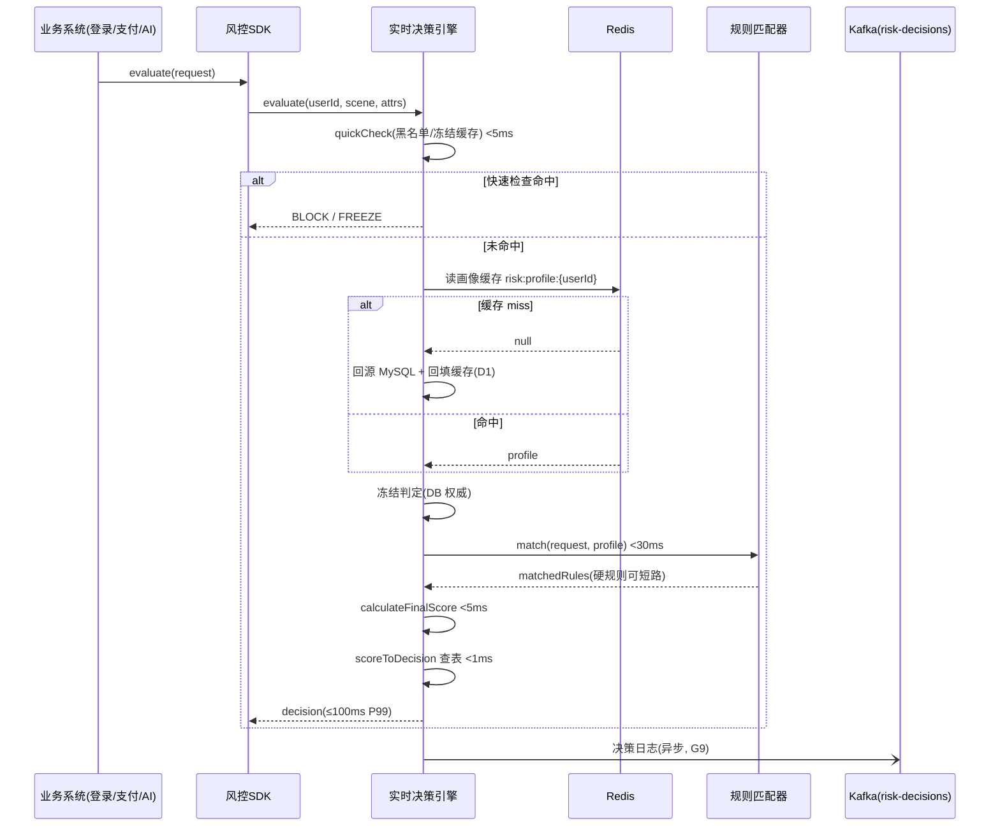
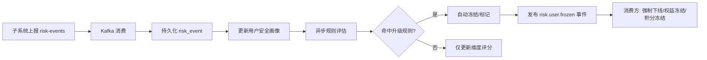
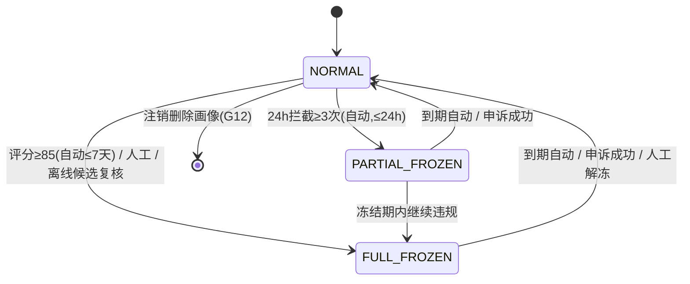

# 服务端-教育平台统一风控决策中心与用户安全画像引擎-详细设计

## 1. 概述

### 1.1 模块定位

统一风控决策中心是 PrimeTop 教育平台的**中枢安全决策层**，负责汇聚各子系统（账号安全、支付风控、设备指纹、内容安全、行为反作弊、API 防护等）的风险信号，构建统一的用户安全画像，并在实时和离线两个层面输出风控决策（放行、质询、拦截、冻结）。

当前平台已有多条独立风控链路：

| 现有引擎 | 职责范围 |
| --- | --- |
| 用户账号安全与登录风控引擎 | 登录异常、撞库、异地登录 |
| 未成年人支付风控与误充值识别 | 支付环节的未成年保护、误充值退款 |
| 设备指纹与反作弊风控引擎 | 设备识别、模拟器检测、群控检测 |
| 统一人机验证与智能风控验证码 | CAPTCHA 挑战、人机区分 |
| 用户学习行为异常检测与作弊行为识别 | 刷题作弊、行为异常 |
| 反爬虫与内容数据防泄漏防护 | 爬虫防护、数据脱敏 |
| API 接口安全防护与渗透防御 | 接口防刷、注入防护 |
| AI 提示词注入攻击防御 | Prompt 注入检测 |

**核心问题**：这些引擎各自为战，缺乏统一的风险评分、交叉关联和全局决策编排。例如：
- 某用户在登录环节触发"异地登录"风控（被放行，因认为是假期回老家）
- 同一用户在支付环节触发"未成年误充值"（被拦截）
- 但两个系统互不感知，无法综合评估该账户的整体风险

**统一风控决策中心**正是解决这一问题的中间件层。

### 1.2 设计目标

1. **信号汇聚**：统一接入所有风控子系统的风险事件
2. **安全画像**：为每个用户构建动态的安全画像与风险评分
3. **全局决策**：基于多维度信号综合输出风控决策
4. **实时拦截**：关键路径（登录、支付、AI 调用）的毫秒级决策
5. **离线分析**：批量风险扫描与关联分析
6. **可解释性**：决策依据可追溯、可审计

### 1.3 适用范围

| 场景 | 决策时机 | 典型延迟要求 |
| --- | --- | --- |
| 登录/注册 | 实时 | < 100ms |
| 支付下单 | 实时 | < 200ms |
| AI 对话请求 | 实时 | < 50ms |
| 内容发布 | 实时 | < 100ms |
| 积分兑换 | 实时 | < 100ms |
| 批量风险扫描 | 离线 | 分钟级 |
| 关联分析 | 离线 | 小时级 |

---

## 2. 整体架构

```
┌─────────────────────────────────────────────────────────────┐
│                    风控信号源（现有引擎）                      │
│  登录风控  支付风控  设备指纹  行为反作弊  内容安全  API防护   │
└──────┬──────┬──────┬──────┬──────┬──────┬──────────────────┘
       │      │      │      │      │      │
       ▼      ▼      ▼      ▼      ▼      ▼
┌──────────────────────────────────────────────────────────────┐
│                  风控事件接入层 (Event Ingestion)              │
│           Kafka Topic: risk-events                            │
│    SDK 同步上报 / 异步上报 / 批量补偿上报                       │
└──────────────────────┬───────────────────────────────────────┘
                       │
       ┌───────────────┼───────────────┐
       ▼               ▼               ▼
┌────────────┐  ┌────────────┐  ┌────────────┐
│ 实时决策引擎 │  │ 画像构建引擎 │  │ 离线分析引擎 │
│ (Real-time  │  │ (Profile    │  │ (Offline    │
│  Decision)  │  │  Builder)   │  │  Analytics) │
└──────┬─────┘  └──────┬─────┘  └──────┬─────┘
       │               │               │
       ▼               ▼               ▼
┌──────────────────────────────────────────────────────────────┐
│                   统一风控数据存储                              │
│  Redis (实时画像)  MySQL (事件/规则)  ClickHouse (分析)        │
│  Elasticsearch (关联查询)                                     │
└──────────────────────────────────────────────────────────────┘
       │
       ▼
┌──────────────────────────────────────────────────────────────┐
│              风控决策输出 & 管理后台                            │
│  放行 / 质询(验证码) / 延迟(人工审核) / 拦截 / 冻结            │
│  风控仪表盘 / 规则管理 / 案例中心 / 误报申诉                    │
└──────────────────────────────────────────────────────────────┘
```

---

## 3. 数据结构定义

### 3.1 风控事件 (RiskEvent)

风控事件是所有子系统上报的原始信号。

```sql
CREATE TABLE `risk_event` (
    `id`              BIGINT       NOT NULL AUTO_INCREMENT COMMENT '主键ID',
    `event_id`        VARCHAR(64)  NOT NULL COMMENT '事件唯一ID (UUID)',
    `user_id`         BIGINT       NOT NULL COMMENT '用户ID',
    `source_system`   VARCHAR(32)  NOT NULL COMMENT '来源系统: LOGIN/PAYMENT/DEVICE/BEHAVIOR/CONTENT/API/AI',
    `event_type`      VARCHAR(64)  NOT NULL COMMENT '事件类型，如 ABNORMAL_LOGIN, UNDERAGE_PAYMENT, DEVICE_FARM, etc.',
    `risk_level`      TINYINT      NOT NULL COMMENT '风险等级: 1=低 2=中 3=高 4=极高',
    `risk_score`      INT          NOT NULL COMMENT '风险分值 0-100',
    `scene`           VARCHAR(32)  NOT NULL COMMENT '业务场景: LOGIN/REGISTER/PAYMENT/AI_CALL/CONTENT_POST/POINTS_REDEEM',
    `device_id`       VARCHAR(128) DEFAULT NULL COMMENT '设备指纹ID',
    `ip_addr`         VARCHAR(64)  DEFAULT NULL COMMENT 'IP地址',
    `ip_location`     VARCHAR(128) DEFAULT NULL COMMENT 'IP归属地（省-市）',
    `payload`         JSON         DEFAULT NULL COMMENT '事件详情JSON，各子系统自定义',
    `decision`        VARCHAR(16)  DEFAULT NULL COMMENT '决策结果: ALLOW/CHALLENGE/DELAY/BLOCK/FREEZE',
    `created_at`      DATETIME(3)  NOT NULL DEFAULT CURRENT_TIMESTAMP(3) COMMENT '事件时间',
    `processed_at`    DATETIME(3)  DEFAULT NULL COMMENT '处理时间',
    PRIMARY KEY (`id`),
    UNIQUE KEY `uk_event_id` (`event_id`),
    KEY `idx_user_id_created` (`user_id`, `created_at`),
    KEY `idx_source_type` (`source_system`, `event_type`),
    KEY `idx_created_at` (`created_at`),
    KEY `idx_decision` (`decision`)
) ENGINE=InnoDB DEFAULT CHARSET=utf8mb4 COMMENT='风控事件表';
```

**Payload JSON 各场景示例**：

```jsonc
// 登录异常事件
{
  "login_type": "PASSWORD",
  "login_location": "广东省深圳市",
  "history_locations": ["湖南省长沙市"],
  "distance_km": 650,
  "device_change": true,
  "vpn_detected": false
}

// 支付风控事件
{
  "payment_amount": 298.00,
  "payment_method": "WECHAT_PAY",
  "user_age": 14,
  "account_age_days": 3,
  "large_amount_for_minor": true,
  "parent_bound": false
}

// 设备异常事件
{
  "device_model": "unknown",
  "emulator_detected": true,
  "root_detected": true,
  "app_tampering": false,
  "device_farm_score": 87
}

// 行为异常事件
{
  "actions_per_minute": 45,
  "normal_average": 8,
  "session_duration_sec": 30,
  "repeated_pattern": true,
  "target_endpoint": "/api/v1/points/claim"
}
```

### 3.2 用户安全画像 (UserSecurityProfile)

```sql
CREATE TABLE `user_security_profile` (
    `user_id`               BIGINT       NOT NULL COMMENT '用户ID',
    `overall_risk_score`    INT          NOT NULL DEFAULT 0 COMMENT '综合风险评分 0-100 (越高越危险)',
    `risk_level`            TINYINT      NOT NULL DEFAULT 0 COMMENT '风险等级: 0=正常 1=低风险 2=中风险 3=高风险 4=极高',
    `total_events`          INT          NOT NULL DEFAULT 0 COMMENT '累计风控事件数',
    `high_risk_events`      INT          NOT NULL DEFAULT 0 COMMENT '高风险事件数',
    `blocked_count`         INT          NOT NULL DEFAULT 0 COMMENT '被拦截次数',
    `challenged_count`      INT          NOT NULL DEFAULT 0 COMMENT '被质询次数',
    `frozen_status`         TINYINT      NOT NULL DEFAULT 0 COMMENT '冻结状态: 0=正常 1=部分冻结 2=完全冻结',
    `frozen_until`          DATETIME     DEFAULT NULL COMMENT '冻结到期时间',
    `frozen_reason`         VARCHAR(256) DEFAULT NULL COMMENT '冻结原因',
    `trusted_devices`       JSON         DEFAULT NULL COMMENT '可信设备列表',
    `trusted_locations`     JSON         DEFAULT NULL COMMENT '常用地点列表',
    `account_age_days`      INT          NOT NULL DEFAULT 0 COMMENT '账户年龄（天）',
    `is_minor`              TINYINT      NOT NULL DEFAULT 0 COMMENT '是否未成年',
    `parent_bound`          TINYINT      NOT NULL DEFAULT 0 COMMENT '是否绑定家长',
    `risk_dimensions`       JSON         DEFAULT NULL COMMENT '多维度风险评分',
    `last_event_at`         DATETIME(3)  DEFAULT NULL COMMENT '最后一次风控事件时间',
    `last_review_at`        DATETIME(3)  DEFAULT NULL COMMENT '最后一次人工审核时间',
    `updated_at`            DATETIME(3)  NOT NULL DEFAULT CURRENT_TIMESTAMP(3) ON UPDATE CURRENT_TIMESTAMP(3) COMMENT '更新时间',
    `created_at`            DATETIME(3)  NOT NULL DEFAULT CURRENT_TIMESTAMP(3) COMMENT '创建时间',
    PRIMARY KEY (`user_id`),
    KEY `idx_risk_level` (`risk_level`),
    KEY `idx_frozen_status` (`frozen_status`),
    KEY `idx_overall_risk` (`overall_risk_score`)
) ENGINE=InnoDB DEFAULT CHARSET=utf8mb4 COMMENT='用户安全画像表';
```

**risk_dimensions JSON 结构**：

```jsonc
{
  "login": { "score": 15, "level": 0, "last_trigger": "2026-07-15T10:30:00Z" },
  "payment": { "score": 0, "level": 0, "last_trigger": null },
  "device": { "score": 35, "level": 1, "last_trigger": "2026-07-20T14:22:00Z" },
  "behavior": { "score": 10, "level": 0, "last_trigger": "2026-07-10T09:15:00Z" },
  "content": { "score": 0, "level": 0, "last_trigger": null },
  "ai_abuse": { "score": 5, "level": 0, "last_trigger": "2026-07-18T16:45:00Z" }
}
```

### 3.3 风控规则 (RiskRule)

```sql
CREATE TABLE `risk_rule` (
    `id`              BIGINT       NOT NULL AUTO_INCREMENT COMMENT '主键ID',
    `rule_code`       VARCHAR(64)  NOT NULL COMMENT '规则编码',
    `rule_name`       VARCHAR(128) NOT NULL COMMENT '规则名称',
    `description`     VARCHAR(512) DEFAULT NULL COMMENT '规则描述',
    `scene`           VARCHAR(32)  NOT NULL COMMENT '适用场景: LOGIN/REGISTER/PAYMENT/AI_CALL/CONTENT_POST/POINTS_REDEEM/GLOBAL',
    `source_system`   VARCHAR(32)  DEFAULT NULL COMMENT '关联来源系统，NULL表示全来源',
    `condition_type`  VARCHAR(32)  NOT NULL COMMENT '条件类型: THRESHOLD/TIME_WINDOW/CORRELATION/ML_MODEL',
    `condition_expr`  JSON         NOT NULL COMMENT '条件表达式',
    `action`          VARCHAR(16)  NOT NULL COMMENT '触发动作: ALLOW/CHALLENGE/DELAY/BLOCK/FREEZE',
    `action_params`   JSON         DEFAULT NULL COMMENT '动作参数',
    `priority`        INT          NOT NULL DEFAULT 100 COMMENT '优先级（越小越高）',
    `enabled`         TINYINT      NOT NULL DEFAULT 1 COMMENT '是否启用',
    `effective_from`  DATETIME     DEFAULT NULL COMMENT '生效开始时间',
    `effective_to`    DATETIME     DEFAULT NULL COMMENT '生效结束时间',
    `hit_count`       BIGINT       NOT NULL DEFAULT 0 COMMENT '累计命中次数',
    `false_positive`  INT          NOT NULL DEFAULT 0 COMMENT '误报次数（申诉成功）',
    `version`         INT          NOT NULL DEFAULT 1 COMMENT '规则版本号',
    `created_by`      BIGINT       NOT NULL COMMENT '创建人',
    `updated_at`      DATETIME(3)  NOT NULL DEFAULT CURRENT_TIMESTAMP(3) ON UPDATE CURRENT_TIMESTAMP(3),
    `created_at`      DATETIME(3)  NOT NULL DEFAULT CURRENT_TIMESTAMP(3),
    PRIMARY KEY (`id`),
    UNIQUE KEY `uk_rule_code_version` (`rule_code`, `version`),
    KEY `idx_scene_enabled` (`scene`, `enabled`),
    KEY `idx_priority` (`priority`)
) ENGINE=InnoDB DEFAULT CHARSET=utf8mb4 COMMENT='风控规则表';
```

**condition_expr JSON 示例**：

```jsonc
// 阈值条件
{
  "metric": "risk_events_count_24h",
  "operator": ">=",
  "threshold": 5,
  "min_risk_level": 2
}

// 时间窗口条件
{
  "window_minutes": 60,
  "aggregation": "count",
  "event_types": ["ABNORMAL_LOGIN", "DEVICE_CHANGE"],
  "threshold": 3
}

// 关联条件
{
  "correlation": "same_device_different_accounts",
  "min_accounts": 3,
  "time_window_hours": 24
}

// ML 模型条件
{
  "model_name": "payment_fraud_detector_v2",
  "model_version": "2.1.0",
  "min_confidence": 0.75,
  "fallback_action": "CHALLENGE"
}
```

### 3.4 风控决策日志 (RiskDecisionLog)

```sql
CREATE TABLE `risk_decision_log` (
    `id`              BIGINT       NOT NULL AUTO_INCREMENT COMMENT '主键ID',
    `decision_id`     VARCHAR(64)  NOT NULL COMMENT '决策唯一ID',
    `user_id`         BIGINT       NOT NULL COMMENT '用户ID',
    `scene`           VARCHAR(32)  NOT NULL COMMENT '业务场景',
    `request_id`      VARCHAR(64)  DEFAULT NULL COMMENT '业务请求ID（链路追踪）',
    `input_events`    JSON         NOT NULL COMMENT '输入的风控事件列表',
    `matched_rules`   JSON         DEFAULT NULL COMMENT '命中的规则列表',
    `pre_score`       INT          DEFAULT NULL COMMENT '决策前风险评分',
    `final_score`     INT          NOT NULL COMMENT '最终风险评分',
    `decision`        VARCHAR(16)  NOT NULL COMMENT '决策: ALLOW/CHALLENGE/DELAY/BLOCK/FREEZE',
    `decision_reason` VARCHAR(512) DEFAULT NULL COMMENT '决策原因',
    `executed_action` VARCHAR(32)  DEFAULT NULL COMMENT '实际执行动作',
    `appeal_status`   VARCHAR(16)  DEFAULT NULL COMMENT '申诉状态: PENDING/APPROVED/REJECTED/EXPIRED',
    `response_time_ms` INT         NOT NULL COMMENT '决策耗时(毫秒)',
    `created_at`      DATETIME(3)  NOT NULL DEFAULT CURRENT_TIMESTAMP(3),
    PRIMARY KEY (`id`),
    UNIQUE KEY `uk_decision_id` (`decision_id`),
    KEY `idx_user_created` (`user_id`, `created_at`),
    KEY `idx_scene_decision` (`scene`, `decision`),
    KEY `idx_appeal` (`appeal_status`)
) ENGINE=InnoDB DEFAULT CHARSET=utf8mb4 COMMENT='风控决策日志表';
```

### 3.5 申诉工单 (RiskAppeal)

```sql
CREATE TABLE `risk_appeal` (
    `id`              BIGINT       NOT NULL AUTO_INCREMENT COMMENT '主键ID',
    `appeal_id`       VARCHAR(64)  NOT NULL COMMENT '申诉ID',
    `user_id`         BIGINT       NOT NULL COMMENT '用户ID',
    `decision_id`     VARCHAR(64)  NOT NULL COMMENT '关联的决策ID',
    `scene`           VARCHAR(32)  NOT NULL COMMENT '业务场景',
    `original_decision` VARCHAR(16) NOT NULL COMMENT '原决策',
    `appeal_reason`   TEXT         NOT NULL COMMENT '申诉理由',
    `evidence_urls`   JSON         DEFAULT NULL COMMENT '证据材料URL',
    `status`          VARCHAR(16)  NOT NULL DEFAULT 'PENDING' COMMENT '状态: PENDING/UNDER_REVIEW/APPROVED/REJECTED',
    `reviewer_id`     BIGINT       DEFAULT NULL COMMENT '审核人ID',
    `review_comment`  TEXT         DEFAULT NULL COMMENT '审核意见',
    `reviewed_at`     DATETIME(3)  DEFAULT NULL COMMENT '审核时间',
    `auto_expire_at`  DATETIME     NOT NULL COMMENT '自动过期时间（48h未审核自动关闭）',
    `created_at`      DATETIME(3)  NOT NULL DEFAULT CURRENT_TIMESTAMP(3),
    `updated_at`      DATETIME(3)  NOT NULL DEFAULT CURRENT_TIMESTAMP(3) ON UPDATE CURRENT_TIMESTAMP(3),
    PRIMARY KEY (`id`),
    UNIQUE KEY `uk_appeal_id` (`appeal_id`),
    KEY `idx_user_status` (`user_id`, `status`),
    KEY `idx_decision_id` (`decision_id`),
    KEY `idx_status_expire` (`status`, `auto_expire_at`)
) ENGINE=InnoDB DEFAULT CHARSET=utf8mb4 COMMENT='风控申诉工单表';
```

---

## 4. 核心模块设计

### 4.1 风控事件接入层

#### 4.1.1 同步接入（SDK 调用）

用于需要实时决策的场景。业务系统在执行操作前，主动调用风控中心进行评估。

```java
// 风控 SDK 同步调用接口
public interface RiskControlClient {

    /**
     * 实时风控评估
     * @param request 风控评估请求
     * @return 风控决策结果
     */
    RiskDecision evaluate(RiskEvaluateRequest request);

    /**
     * 异步事件上报（不影响主流程）
     * @param event 风控事件
     */
    void reportEvent(RiskEvent event);
}
```

```java
// 风控评估请求
@Data
@Builder
public class RiskEvaluateRequest {
    private Long userId;             // 用户ID
    private String scene;            // 业务场景
    private String requestId;        // 请求链路ID
    private String deviceId;         // 设备指纹
    private String ipAddr;           // IP地址
    private Map<String, Object> attributes; // 业务属性（金额、操作类型等）

    // 便捷构造
    public static RiskEvaluateRequest forLogin(Long userId, String deviceId, String ipAddr) {
        return RiskEvaluateRequest.builder()
            .userId(userId)
            .scene("LOGIN")
            .deviceId(deviceId)
            .ipAddr(ipAddr)
            .build();
    }

    public static RiskEvaluateRequest forPayment(Long userId, BigDecimal amount, String paymentMethod) {
        return RiskEvaluateRequest.builder()
            .userId(userId)
            .scene("PAYMENT")
            .attributes(Map.of(
                "amount", amount,
                "payment_method", paymentMethod
            ))
            .build();
    }

    public static RiskEvaluateRequest forAICall(Long userId, String conversationType) {
        return RiskEvaluateRequest.builder()
            .userId(userId)
            .scene("AI_CALL")
            .attributes(Map.of("conversation_type", conversationType))
            .build();
    }

    public static RiskEvaluateRequest forPointsRedeem(Long userId, int points, String itemId) {
        return RiskEvaluateRequest.builder()
            .userId(userId)
            .scene("POINTS_REDEEM")
            .attributes(Map.of(
                "points", points,
                "item_id", itemId
            ))
            .build();
    }
}
```

```java
// 风控决策结果
@Data
public class RiskDecision {
    private String decisionId;       // 决策ID
    private DecisionType decision;   // 决策类型
    private int riskScore;           // 风险评分
    private List<String> matchedRules; // 命中规则
    private String reason;           // 决策原因
    private Map<String, Object> extra; // 附加数据（如验证码配置）
    private long responseTimeMs;     // 响应耗时

    public enum DecisionType {
        ALLOW,      // 放行
        CHALLENGE,  // 质询（需要验证码/人脸等）
        DELAY,      // 延迟（转人工审核）
        BLOCK,      // 拦截
        FREEZE      // 冻结账户
    }

    public boolean isAllowed() {
        return decision == DecisionType.ALLOW;
    }

    public boolean needsChallenge() {
        return decision == DecisionType.CHALLENGE;
    }

    public boolean isBlocked() {
        return decision == DecisionType.BLOCK || decision == DecisionType.FREEZE;
    }
}
```

#### 4.1.2 异步接入（Kafka 事件）

用于不需要实时决策的场景，如行为分析、事后关联。

```java
// Kafka 事件消费者
@Component
@Slf4j
public class RiskEventConsumer {

    @Autowired
    private RiskProfileService profileService;

    @Autowired
    private RiskRuleEngine ruleEngine;

    @KafkaListener(topics = "risk-events", groupId = "risk-decision-center")
    public void onRiskEvent(RiskEventPayload payload) {
        try {
            // 1. 持久化事件
            RiskEvent event = persistEvent(payload);

            // 2. 更新用户安全画像
            profileService.updateProfileOnEvent(event);

            // 3. 检查是否需要升级风险等级
            ruleEngine.evaluateAsyncRules(event);

        } catch (Exception e) {
            log.error("Failed to process risk event: {}", payload, e);
            // 发送到死信队列
            sendToDLQ(payload, e.getMessage());
        }
    }

    @KafkaListener(topics = "risk-events-dlq", groupId = "risk-dlq-handler")
    public void onDLQ(RiskEventPayload payload, Exception exception) {
        // 告警通知
        alertService.sendRiskEventProcessingFailure(payload, exception);
    }
}
```

### 4.2 用户安全画像构建引擎

#### 4.2.1 画像初始化

新用户注册时创建初始画像。

```java
@Service
@Slf4j
public class RiskProfileService {

    @Autowired
    private UserSecurityProfileMapper profileMapper;

    @Autowired
    private RedisTemplate<String, Object> redisTemplate;

    private static final String PROFILE_REDIS_KEY = "risk:profile:%d";
    private static final int PROFILE_TTL_HOURS = 24;

    /**
     * 初始化用户安全画像
     */
    @Transactional
    public void initProfile(Long userId, boolean isMinor) {
        UserSecurityProfile profile = new UserSecurityProfile();
        profile.setUserId(userId);
        profile.setOverallRiskScore(0);
        profile.setRiskLevel((byte) 0);
        profile.setTotalEvents(0);
        profile.setHighRiskEvents(0);
        profile.setBlockedCount(0);
        profile.setChallengedCount(0);
        profile.setFrozenStatus((byte) 0);
        profile.setIsMinor(isMinor ? (byte) 1 : (byte) 0);
        profile.setAccountAgeDays(0);
        profile.setRiskDimensions(initEmptyDimensions());

        profileMapper.insert(profile);
        cacheProfile(profile);
    }

    /**
     * 获取用户安全画像（优先读缓存）
     */
    public UserSecurityProfile getProfile(Long userId) {
        String key = String.format(PROFILE_REDIS_KEY, userId);
        UserSecurityProfile cached = (UserSecurityProfile) redisTemplate.opsForValue().get(key);
        if (cached != null) {
            return cached;
        }

        UserSecurityProfile profile = profileMapper.selectByPrimaryKey(userId);
        if (profile != null) {
            cacheProfile(profile);
        }
        return profile;
    }

    /**
     * 风控事件触发后更新画像
     */
    @Transactional
    public void updateProfileOnEvent(RiskEvent event) {
        UserSecurityProfile profile = getOrCreateProfile(event.getUserId());
        if (profile == null) {
            return;
        }

        // 更新统计计数
        profile.setTotalEvents(profile.getTotalEvents() + 1);
        if (event.getRiskLevel() >= 3) {
            profile.setHighRiskEvents(profile.getHighRiskEvents() + 1);
        }
        if ("BLOCK".equals(event.getDecision())) {
            profile.setBlockedCount(profile.getBlockedCount() + 1);
        }
        if ("CHALLENGE".equals(event.getDecision())) {
            profile.setChallengedCount(profile.getChallengedCount() + 1);
        }

        // 更新维度评分
        updateDimensionScore(profile, event);

        // 重新计算综合评分
        recalculateOverallScore(profile);

        // 检查是否需要自动冻结
        checkAutoFreeze(profile);

        profile.setLastEventAt(event.getCreatedAt());
        profileMapper.updateByPrimaryKey(profile);
        cacheProfile(profile);
    }

    /**
     * 多维度评分更新（指数衰减加权）
     */
    private void updateDimensionScore(UserSecurityProfile profile, RiskEvent event) {
        String dimension = mapSourceToDimension(event.getSourceSystem());
        RiskDimension dim = profile.getRiskDimensions().get(dimension);

        // 指数衰减：新事件权重高，旧事件衰减
        double decayFactor = 0.85; // 每次新事件，旧评分衰减15%
        int eventScore = event.getRiskScore();

        int newScore = (int) (dim.getScore() * decayFactor + eventScore * (1 - decayFactor));
        newScore = Math.min(100, Math.max(0, newScore));

        dim.setScore(newScore);
        dim.setLevel(scoreToLevel(newScore));
        dim.setLastTrigger(event.getCreatedAt().toString());
    }

    /**
     * 综合评分计算（加权平均 + 惩罚项）
     */
    private void recalculateOverallScore(UserSecurityProfile profile) {
        RiskDimensions dims = profile.getRiskDimensions();

        // 各维度权重
        double[] weights = { 0.20, 0.25, 0.15, 0.15, 0.10, 0.15 };
        String[] dimensions = { "login", "payment", "device", "behavior", "content", "ai_abuse" };

        double weightedSum = 0;
        double totalWeight = 0;
        for (int i = 0; i < dimensions.length; i++) {
            RiskDimension dim = dims.get(dimensions[i]);
            if (dim != null) {
                weightedSum += dim.getScore() * weights[i];
                totalWeight += weights[i];
            }
        }

        int baseScore = totalWeight > 0 ? (int) (weightedSum / totalWeight) : 0;

        // 惩罚项：高风险事件累积
        int penalty = Math.min(20, profile.getHighRiskEvents() * 2);

        // 惩罚项：账户年龄短 + 高事件量
        if (profile.getAccountAgeDays() < 7 && profile.getTotalEvents() > 3) {
            penalty += 10;
        }

        int finalScore = Math.min(100, baseScore + penalty);
        profile.setOverallRiskScore(finalScore);
        profile.setRiskLevel(scoreToLevel(finalScore));
    }

    /**
     * 自动冻结检查
     */
    private void checkAutoFreeze(UserSecurityProfile profile) {
        // 综合评分 >= 85 → 完全冻结
        if (profile.getOverallRiskScore() >= 85 && profile.getFrozenStatus() == 0) {
            profile.setFrozenStatus((byte) 2);
            profile.setFrozenUntil(LocalDateTime.now().plusDays(7));
            profile.setFrozenReason("综合风险评分超过阈值，自动冻结7天");

            // 触发冻结事件
            eventPublisher.publishEvent(new UserFrozenEvent(profile.getUserId(), "AUTO_FROZEN_HIGH_RISK"));

        // 24小时内被拦截 >= 3次 → 部分冻结
        } else if (profile.getBlockedCount() >= 3 && profile.getFrozenStatus() == 0) {
            profile.setFrozenStatus((byte) 1);
            profile.setFrozenUntil(LocalDateTime.now().plusHours(24));
            profile.setFrozenReason("24小时内多次触发拦截，部分冻结24小时");

            eventPublisher.publishEvent(new UserFrozenEvent(profile.getUserId(), "AUTO_FROZEN_REPEATED_BLOCK"));
        }
    }

    private void cacheProfile(UserSecurityProfile profile) {
        String key = String.format(PROFILE_REDIS_KEY, profile.getUserId());
        redisTemplate.opsForValue().set(key, profile, PROFILE_TTL_HOURS, TimeUnit.HOURS);
    }

    private byte scoreToLevel(int score) {
        if (score >= 80) return 4;
        if (score >= 60) return 3;
        if (score >= 30) return 2;
        if (score >= 10) return 1;
        return 0;
    }
}
```

#### 4.2.2 画像维度定义

```java
@Data
public class RiskDimensions {
    private RiskDimension login;     // 登录安全维度
    private RiskDimension payment;   // 支付安全维度
    private RiskDimension device;    // 设备安全维度
    private RiskDimension behavior;  // 行为安全维度
    private RiskDimension content;   // 内容安全维度
    private RiskDimension aiAbuse;   // AI 滥用维度
}

@Data
public class RiskDimension {
    /** 维度风险评分 0-100 */
    private int score;
    /** 风险等级 0-4 */
    private byte level;
    /** 最后触发时间 */
    private String lastTrigger;
    /** 最近7天事件数 */
    private int recentEventCount;
}
```

### 4.3 实时决策引擎

#### 4.3.1 决策流程

```
请求进入
    │
    ▼
┌───────────────────┐
│ 1. 加载用户画像     │ ← Redis缓存 (命中率 > 95%)
│    (Profile)       │
└────────┬──────────┘
         │
         ▼
┌───────────────────┐
│ 2. 快速检查        │ ← 内存规则 (< 5ms)
│   - 冻结状态?      │
│   - 黑名单?        │
│   - 高风险等级?    │
└────────┬──────────┘
         │
    ┌────┴────┐
    │         │
  通过      需详细评估
    │         │
    │         ▼
    │   ┌───────────────────┐
    │   │ 3. 规则匹配        │ ← MySQL/Redis (< 30ms)
    │   │   - 阈值规则       │
    │   │   - 时间窗口规则   │
    │   │   - 关联规则       │
    │   └────────┬──────────┘
    │            │
    │            ▼
    │   ┌───────────────────┐
    │   │ 4. 综合评分        │ ← 内存计算 (< 5ms)
    │   │   画像评分(60%)    │
    │   │   + 规则评分(40%)  │
    │   └────────┬──────────┘
    │            │
    │            ▼
    │   ┌───────────────────┐
    │   │ 5. 决策输出        │ ← 查表 (< 1ms)
    │   │   score < 30 → ALLOW    │
    │   │   30 ≤ score < 50 → CHALLENGE │
    │   │   50 ≤ score < 75 → DELAY     │
    │   │   75 ≤ score < 90 → BLOCK     │
    │   │   score ≥ 90 → FREEZE         │
    │   └───────────────────┘
    │         │
    └─────────┤
              ▼
┌───────────────────┐
│ 6. 记录决策日志     │ ← 异步写入 Kafka
└───────────────────┘
```

#### 4.3.2 决策引擎核心实现

```java
@Service
@Slf4j
public class RiskDecisionEngine {

    @Autowired
    private RiskProfileService profileService;

    @Autowired
    private RiskRuleMatcher ruleMatcher;

    @Autowired
    private RiskDecisionLogMapper decisionLogMapper;

    @Autowired
    private KafkaTemplate<String, Object> kafkaTemplate;

    // 决策阈值配置（可通过配置中心动态调整）
    @Value("${risk.threshold.allow:30}")
    private int allowThreshold;

    @Value("${risk.threshold.challenge:50}")
    private int challengeThreshold;

    @Value("${risk.threshold.delay:75}")
    private int delayThreshold;

    @Value("${risk.threshold.block:90}")
    private int blockThreshold;

    // 本地缓存：黑名单用户 Set（从 Redis 同步）
    private final Set<Long> blacklistCache = ConcurrentHashMap.newKeySet();

    // 本地缓存：冻结用户 Map（userId → unfreezeTime）
    private final Map<Long, LocalDateTime> frozenCache = new ConcurrentHashMap<>();

    /**
     * 实时风控评估主入口
     * 目标：P99 < 100ms
     */
    public RiskDecision evaluate(RiskEvaluateRequest request) {
        long startTime = System.currentTimeMillis();
        String decisionId = generateDecisionId();

        try {
            // Step 1: 快速检查（内存级）
            RiskDecision quickCheck = quickCheck(request, decisionId);
            if (quickCheck != null) {
                return logAndReturn(quickCheck, request, startTime);
            }

            // Step 2: 加载用户画像
            UserSecurityProfile profile = profileService.getProfile(request.getUserId());
            if (profile == null) {
                // 无画像的新用户，给默认低风险
                profile = createDefaultProfile(request.getUserId());
            }

            // Step 3: 检查冻结状态
            if (isFrozen(profile)) {
                return buildFrozenDecision(decisionId, profile, request);
            }

            // Step 4: 规则匹配
            List<RiskRule> matchedRules = ruleMatcher.match(request, profile);

            // Step 5: 综合评分
            int finalScore = calculateFinalScore(profile, matchedRules, request);

            // Step 6: 输出决策
            RiskDecision.DecisionType decisionType = scoreToDecision(finalScore);
            String reason = buildDecisionReason(decisionType, finalScore, matchedRules, profile);

            RiskDecision decision = RiskDecision.builder()
                .decisionId(decisionId)
                .decision(decisionType)
                .riskScore(finalScore)
                .matchedRules(matchedRules.stream().map(RiskRule::getRuleCode).toList())
                .reason(reason)
                .extra(buildExtraParams(decisionType, request))
                .build();

            return logAndReturn(decision, request, startTime);

        } catch (Exception e) {
            log.error("Risk evaluation failed for user {}", request.getUserId(), e);
            // 风控引擎异常时的降级策略：放行但告警
            return buildFallbackDecision(decisionId, request, e);
        }
    }

    /**
     * 快速检查（内存级，< 5ms）
     */
    private RiskDecision quickCheck(RiskEvaluateRequest request, String decisionId) {
        // 黑名单检查
        if (blacklistCache.contains(request.getUserId())) {
            return RiskDecision.builder()
                .decisionId(decisionId)
                .decision(RiskDecision.DecisionType.BLOCK)
                .riskScore(100)
                .reason("用户在黑名单中")
                .matchedRules(List.of("BLACKLIST"))
                .build();
        }

        // 冻结检查
        LocalDateTime unfreezeTime = frozenCache.get(request.getUserId());
        if (unfreezeTime != null && unfreezeTime.isAfter(LocalDateTime.now())) {
            return RiskDecision.builder()
                .decisionId(decisionId)
                .decision(RiskDecision.DecisionType.FREEZE)
                .riskScore(95)
                .reason("账户已冻结，解冻时间: " + unfreezeTime)
                .matchedRules(List.of("AUTO_FROZEN"))
                .build();
        } else if (unfreezeTime != null) {
            // 冻结已过期，清理缓存
            frozenCache.remove(request.getUserId());
        }

        return null; // 通过快速检查
    }

    /**
     * 综合评分计算
     */
    private int calculateFinalScore(UserSecurityProfile profile,
                                     List<RiskRule> matchedRules,
                                     RiskEvaluateRequest request) {
        // 1. 画像基础分（权重 60%）：无画像新用户按 0 分计
        int profileScore = profile != null ? profile.getOverallRiskScore() : 0;

        // 1.1 画像时效衰减：最后一次事件超过 7 天，每周衰减 10%（防止历史风险永久化）
        if (profile != null && profile.getLastEventAt() != null) {
            long daysSinceLastEvent = Duration.between(
                profile.getLastEventAt(), LocalDateTime.now()).toDays();
            if (daysSinceLastEvent > 7) {
                double decay = Math.pow(0.90, daysSinceLastEvent / 7.0);
                profileScore = (int) Math.round(profileScore * decay);
            }
        }

        // 2. 规则命中分（权重 40%）：取命中规则中最高动作分，多条命中叠加封顶 +15
        int ruleScore = 0;
        if (matchedRules != null && !matchedRules.isEmpty()) {
            int maxActionScore = matchedRules.stream()
                .mapToInt(r -> actionBaseScore(r.getAction()))
                .max()
                .orElse(0);
            int extra = Math.min(15, (matchedRules.size() - 1) * 5);
            ruleScore = Math.min(100, maxActionScore + extra);
        }

        // 3. 场景敏感度系数：资金/权益相关场景从严
        double sceneCoefficient = sceneCoefficient(request.getScene());

        // 4. 未成年从严系数：未成年 +10%（仅抬升评分，不绕过 G6/G8 人工约束）
        double minorCoefficient = (profile != null && profile.getIsMinor() == 1) ? 1.10 : 1.00;

        double raw = (profileScore * 0.6 + ruleScore * 0.4)
                   * sceneCoefficient * minorCoefficient;
        return Math.min(100, (int) Math.round(raw));
    }

    /** 规则动作基础分：动作越重基础分越高 */
    private int actionBaseScore(String action) {
        return switch (action == null ? "ALLOW" : action) {
            case "FREEZE"    -> 100;
            case "BLOCK"     -> 90;
            case "DELAY"     -> 70;
            case "CHALLENGE" -> 50;
            default          -> 0;
        };
    }

    /** 场景敏感度系数表（配置中心可调，热更新） */
    private double sceneCoefficient(String scene) {
        return switch (scene == null ? "" : scene) {
            case "PAYMENT", "POINTS_REDEEM" -> 1.20;   // 资金/虚拟资产从严
            case "LOGIN", "REGISTER"        -> 1.00;
            case "CONTENT_POST"             -> 1.10;   // UGC 发布从严
            case "AI_CALL"                  -> 0.90;   // 高频只读场景略宽
            default                         -> 1.00;
        };
    }

    /**
     * 评分 → 决策映射（查表，阈值配置中心动态调整）
     */
    private RiskDecision.DecisionType scoreToDecision(int score) {
        if (score >= blockThreshold)     return RiskDecision.DecisionType.FREEZE;
        if (score >= delayThreshold)     return RiskDecision.DecisionType.BLOCK;
        if (score >= challengeThreshold) return RiskDecision.DecisionType.DELAY;
        if (score >= allowThreshold)     return RiskDecision.DecisionType.CHALLENGE;
        return RiskDecision.DecisionType.ALLOW;
    }

    /** 决策原因构建（禁含 PII 明文，R10：IP 脱敏/设备 ID 哈希） */
    private String buildDecisionReason(RiskDecision.DecisionType type, int score,
                                       List<RiskRule> matchedRules,
                                       UserSecurityProfile profile) {
        StringBuilder sb = new StringBuilder();
        sb.append(type).append("(score=").append(score).append(")");
        if (matchedRules != null && !matchedRules.isEmpty()) {
            sb.append(" rules=").append(
                matchedRules.stream().map(RiskRule::getRuleCode).toList());
        }
        if (profile != null && profile.getOverallRiskScore() > 0) {
            sb.append(" profile=").append(profile.getOverallRiskScore());
        }
        return sb.toString();
    }

    /**
     * 决策附加参数：
     * CHALLENGE 仅携带质询意图与场景，验证码 token 由统一人机验证引擎签发（R2）
     */
    private Map<String, Object> buildExtraParams(RiskDecision.DecisionType type,
                                                 RiskEvaluateRequest request) {
        if (type != RiskDecision.DecisionType.CHALLENGE) {
            return Map.of();
        }
        return Map.of(
            "challenge_type", "CAPTCHA",          // 具体验证方式由人机验证引擎按策略决定
            "challenge_scene", request.getScene(), // 复用人机验证引擎的场景配置
            "expire_seconds", 300
        );
    }

    /** 冻结状态判定（DB 权威，缓存仅加速） */
    private boolean isFrozen(UserSecurityProfile profile) {
        if (profile.getFrozenStatus() == 0) {
            return false;
        }
        if (profile.getFrozenUntil() != null
                && profile.getFrozenUntil().isBefore(LocalDateTime.now())) {
            // 已到期：异步解冻，本次按未冻结处理（G2 防缓存过期长期误判）
            profile.setFrozenStatus((byte) 0);
            profileMapper.updateByPrimaryKeySelective(profile);
            eventPublisher.publishEvent(new UserUnfrozenEvent(profile.getUserId(), "AUTO_UNFREEZE_EXPIRED"));
            return false;
        }
        return true;
    }

    private RiskDecision buildFrozenDecision(String decisionId, UserSecurityProfile profile,
                                             RiskEvaluateRequest request) {
        return RiskDecision.builder()
            .decisionId(decisionId)
            .decision(RiskDecision.DecisionType.FREEZE)
            .riskScore(profile.getOverallRiskScore())
            .reason("账户冻结中: " + profile.getFrozenReason())
            .matchedRules(List.of("FROZEN_STATUS"))
            .extra(Map.of("frozen_until", String.valueOf(profile.getFrozenUntil())))
            .build();
    }

    /**
     * 降级决策（D10 总红线）：
     * - 资金/权益场景（PAYMENT/POINTS_REDEEM）fail-secure → CHALLENGE
     * - 其余场景 fail-open → ALLOW，但告警并计入 fail_open 指标
     */
    private RiskDecision buildFallbackDecision(String decisionId,
                                               RiskEvaluateRequest request,
                                               Exception e) {
        boolean secureScene = Set.of("PAYMENT", "POINTS_REDEEM").contains(request.getScene());
        RiskDecision.DecisionType type = secureScene
            ? RiskDecision.DecisionType.CHALLENGE
            : RiskDecision.DecisionType.ALLOW;

        alertService.sendRiskEngineFailure(request, e);   // M3 指标来源
        log.warn("Risk engine fallback: scene={} decision={} err={}",
                 request.getScene(), type, e.getMessage());

        return RiskDecision.builder()
            .decisionId(decisionId)
            .decision(type)
            .riskScore(secureScene ? challengeThreshold : 0)
            .reason(secureScene ? "风控引擎异常，资金安全场景从严质询"
                              : "风控引擎异常，降级放行（已告警）")
            .matchedRules(List.of("ENGINE_FALLBACK"))
            .build();
    }

    /**
     * 决策返回前处理：填充耗时 + 异步记录决策日志（G9：日志失败不阻塞主链路）
     */
    private RiskDecision logAndReturn(RiskDecision decision,
                                      RiskEvaluateRequest request,
                                      long startTimeMs) {
        decision.setResponseTimeMs(System.currentTimeMillis() - startTimeMs);
        try {
            kafkaTemplate.send("risk-decisions", RiskDecisionLogPayload.builder()
                .decisionId(decision.getDecisionId())
                .userId(request.getUserId())
                .scene(request.getScene())
                .requestId(request.getRequestId())
                .matchedRules(decision.getMatchedRules())
                .finalScore(decision.getRiskScore())
                .decision(decision.getDecision().name())
                .decisionReason(decision.getReason())
                .responseTimeMs(decision.getResponseTimeMs())
                .build());
        } catch (Exception ex) {
            log.error("Failed to write decision log: {}", decision.getDecisionId(), ex);
            // 落本地 spool 文件，由对账任务补录（§9.4）
            localSpool.write(decision.getDecisionId(), ex);
        }
        return decision;
    }

    private String generateDecisionId() {
        return "RSD" + UUID.randomUUID().toString().replace("-", "");
    }

    /**
     * 黑名单/冻结缓存同步（每 30s 从 Redis 增量拉取，G4：同步延迟 > 60s 告警 M8）
     */
    @Scheduled(fixedDelay = 30_000)
    public void syncBlacklistCache() {
        try {
            Set<Long> blacklist = redisTemplate.opsForSet()
                .members("risk:blacklist");
            if (blacklist != null) {
                blacklistCache.retainAll(blacklist);
                blacklistCache.addAll(blacklist);
            }
            Map<Object, Object> frozen = redisTemplate.opsForHash()
                .entries("risk:frozen");
            frozenCache.clear();
            frozen.forEach((k, v) ->
                frozenCache.put(Long.valueOf(String.valueOf(k)), (LocalDateTime) v));
        } catch (Exception e) {
            log.error("Blacklist cache sync failed", e);
            alertService.sendCacheSyncFailure(e);
        }
    }
}
```

> **评分口径说明**：画像分（60%）体现用户长期风险水位，规则分（40%）体现本次请求的即时风险；场景系数与未成年系数只做抬升/压低，不得将评分清 0。硬规则（priority < 10 的 BLOCK/FREEZE 规则）不走评分，直接输出动作（G5）。

### 4.4 规则匹配引擎（RiskRuleMatcher）

规则本地缓存（Caffeine，10s 版本探测热更新），按 scene 过滤后逐条求值。

```java
@Component
@Slf4j
public class RiskRuleMatcher {

    @Autowired
    private RiskRuleMapper ruleMapper;

    @Autowired
    private RedisTemplate<String, Object> redisTemplate;

    @Autowired
    private MlModelGateway mlModelGateway;

    // 本地规则缓存：scene -> 规则列表（按 priority 升序）
    private final Map<String, List<RiskRule>> ruleCache = new ConcurrentHashMap<>();
    private volatile long cachedVersion = -1;

    private static final long RELOAD_INTERVAL_MS = 10_000;

    /**
     * 规则匹配主入口
     */
    public List<RiskRule> match(RiskEvaluateRequest request, UserSecurityProfile profile) {
        reloadIfStale();

        List<RiskRule> matched = new ArrayList<>();
        List<RiskRule> sceneRules = ruleCache.getOrDefault(request.getScene(), List.of());

        for (RiskRule rule : sceneRules) {
            if (rule.getEnabled() == 0) continue;
            try {
                if (evaluateCondition(rule, request, profile)) {
                    matched.add(rule);
                    // 硬规则（G5）：最高优先级硬规则命中即短路
                    if (rule.getPriority() < 10
                        && Set.of("BLOCK", "FREEZE").contains(rule.getAction())) {
                        break;
                    }
                }
            } catch (Exception e) {
                // 50601：单条规则求值失败 → 跳过该规则 + 告警，不影响整体决策
                log.error("Rule evaluation failed: {} {}", rule.getRuleCode(), e.getMessage());
                alertService.sendRuleEvaluationFailure(rule.getRuleCode(), e);
            }
        }
        return matched;
    }

    /** 条件求值分发 */
    private boolean evaluateCondition(RiskRule rule, RiskEvaluateRequest request,
                                      UserSecurityProfile profile) {
        return switch (rule.getConditionType()) {
            case "THRESHOLD"   -> evalThreshold(rule, profile);
            case "TIME_WINDOW" -> evalTimeWindow(rule, request);
            case "CORRELATION" -> evalCorrelation(rule, request);
            case "ML_MODEL"    -> evalMlModel(rule, request);
            default -> false;
        };
    }

    /** 阈值条件：画像/计数指标与阈值比较 */
    private boolean evalThreshold(RiskRule rule, UserSecurityProfile profile) {
        JsonNode expr = rule.getConditionExprNode();
        String metric = expr.get("metric").asText();
        int threshold = expr.get("threshold").asInt();

        int actual = switch (metric) {
            case "overall_risk_score" -> profile.getOverallRiskScore();
            case "blocked_count"      -> profile.getBlockedCount();
            case "high_risk_events"   -> profile.getHighRiskEvents();
            default -> redisTemplate.opsForValue()
                .get("risk:metric:" + metric + ":" + profile.getUserId()) != null
                ? (int) redisTemplate.opsForValue()
                    .get("risk:metric:" + metric + ":" + profile.getUserId()) : 0;
        };
        return actual >= threshold;
    }

    /** 时间窗口条件：统计窗口期内事件数（Redis ZSET 滑动窗口） */
    private boolean evalTimeWindow(RiskRule rule, RiskEvaluateRequest request) {
        JsonNode expr = rule.getConditionExprNode();
        int windowMinutes = expr.get("window_minutes").asInt();
        int threshold = expr.get("threshold").asInt();

        long windowStart = Instant.now().minus(windowMinutes, ChronoUnit.MINUTES)
            .toEpochMilli();
        String key = "risk:event:win:" + request.getUserId();
        Long count = redisTemplate.opsForZSet()
            .count(key, windowStart, Instant.now().toEpochMilli());
        return count != null && count >= threshold;
    }

    /** 关联条件：读取离线分析产出的关联结果表（§4.5） */
    private boolean evalCorrelation(RiskRule rule, RiskEvaluateRequest request) {
        JsonNode expr = rule.getConditionExprNode();
        String correlation = expr.get("correlation").asText();

        // 例：同设备 24h 内账号数
        return switch (correlation) {
            case "same_device_different_accounts" ->
                offlineFindingService.exists("SAME_DEVICE_MULTI_ACCOUNT",
                    request.getDeviceId(), expr.get("min_accounts").asInt());
            case "same_ip_multi_accounts" ->
                offlineFindingService.exists("SAME_IP_MULTI_ACCOUNT",
                    hashIp(request.getIpAddr()), expr.get("min_accounts").asInt());
            default -> false;
        };
    }

    /** ML 模型条件：50ms 超时，超时/异常执行 fallback_action（D4） */
    private boolean evalMlModel(RiskRule rule, RiskEvaluateRequest request) {
        JsonNode expr = rule.getConditionExprNode();
        try {
            MlScoreResult result = mlModelGateway.score(
                expr.get("model_name").asText(),
                expr.get("model_version").asText(),
                request, 50 /* timeout ms */);
            return result.getConfidence() >= expr.get("min_confidence").asDouble();
        } catch (TimeoutException | IOException e) {
            log.warn("ML model timeout/fail: {} fallback={}",
                     expr.get("model_name").asText(),
                     expr.path("fallback_action").asText("CHALLENGE"));
            return "BLOCK".equals(expr.path("fallback_action").asText()) // 保守语义
                || "FREEZE".equals(expr.path("fallback_action").asText());
        }
    }

    /** 版本探测热更新（G10：规则变更双人审批后 version+1，60s 生效窗口） */
    @Scheduled(fixedDelay = RELOAD_INTERVAL_MS)
    public void reloadIfStale() {
        Long dbVersion = ruleMapper.selectMaxVersion();
        if (dbVersion != null && dbVersion > cachedVersion) {
            synchronized (this) {
                if (dbVersion > cachedVersion) {
                    Map<String, List<RiskRule>> snapshot = new HashMap<>();
                    ruleMapper.selectAllEnabled().forEach(rule ->
                        snapshot.computeIfAbsent(rule.getScene(), k -> new ArrayList<>())
                            .add(rule));
                    snapshot.values().forEach(list ->
                        list.sort(Comparator.comparingInt(RiskRule::getPriority)));
                    ruleCache.clear();
                    ruleCache.putAll(snapshot);
                    cachedVersion = dbVersion;
                    log.info("Risk rules reloaded, version={}", dbVersion);
                }
            }
        }
    }

    private String hashIp(String ip) {
        // IP 脱敏存储（R10）：SHA-256 取前 16 位
        return DigestUtils.sha256Hex(ip).substring(0, 16);
    }
}
```

### 4.5 离线分析引擎（Offline Analytics）

实时链路只做毫秒级决策；**关联发现**（跨账号、跨设备、跨时间）由离线引擎每日计算，产出候选清单进人工复核工作台（G6：离线分析只产候选，BLOCK/FREEZE 必须人工复核）。

| 分析任务 | 调度 | 数据源 | 判定阈值 | 产出动作 |
| --- | --- | --- | --- | --- |
| 同设备多账号关联（群控识别） | 每日 02:00，分 8 片 | risk_event + 设备指纹表 | 同设备 24h ≥ 5 账号 | 候选冻结（人工） |
| IP 聚集分析 | 每日 02:30 | risk_event（IP 哈希） | 同 IP 24h ≥ 20 账号 | 全员 CHALLENGE 升级 |
| 积分农场环形检测 | 每日 03:00 | 积分流水 + 邀请关系 | 同地址 ≥ 3 账号 或 环 ≥ 5 节点 | 候选冻结（人工） |
| 沉睡账户突发激活 | 每日 03:30 | 登录日志 | 沉默 90 天 + 24h 操作 ≥ 20 次 | 标记观察 + 登录 CHALLENGE |

```java
@Component
@Slf4j
public class DeviceAccountCorrelationJob {

    @Autowired
    private JdbcTemplate jdbcTemplate;

    @Autowired
    private OfflineFindingService findingService;

    private static final int SHARD_COUNT = 8;

    /** 分片执行，支持断点续跑（50611：分片失败重试 ≤ 3 次） */
    @Scheduled(cron = "0 0 2 * * ?")
    public void execute() {
        for (int shard = 0; shard < SHARD_COUNT; shard++) {
            int finalShard = shard;
            retryTemplate.execute(context -> {
                processShard(finalShard);
                return null;
            });
        }
    }

    private void processShard(int shard) {
        // 取昨日该分片设备的事件聚合（设备 ID 哈希分组，防 PII 泄露）
        String sql = """
            SELECT device_id_hash, COUNT(DISTINCT user_id) AS account_cnt,
                   GROUP_CONCAT(DISTINCT user_id) AS user_ids
            FROM risk_event
            WHERE created_at >= CURDATE() - INTERVAL 1 DAY
              AND device_id_hash IS NOT NULL
              AND device_id_hash % ? = ?
            GROUP BY device_id_hash
            HAVING account_cnt >= 5
            """;
        jdbcTemplate.query(sql, (rs, rowNum) -> {
            findingService.submit(OfflineFinding.builder()
                .findingType("SAME_DEVICE_MULTI_ACCOUNT")
                .subjectHash(rs.getString("device_id_hash"))
                .accountCount(rs.getInt("account_cnt"))
                .userIds(parseIds(rs.getString("user_ids")))
                .suggestedAction("FREEZE_CANDIDATE")   // 仅候选，人工复核后生效（G6）
                .status("PENDING_REVIEW")
                .build());
            return null;
        }, SHARD_COUNT, shard);
    }
}
```

**k-匿名约束（G11/C7）**：离线分析聚合结果若去重后个体数 < 5，不进入运营报表，仅作为安全线索保留。

### 4.6 申诉处理（AppealService）

```java
@Service
public class AppealService {

    @Autowired
    private RiskAppealMapper appealMapper;

    @Autowired
    private RiskProfileService profileService;

    @Autowired
    private RiskRuleMapper ruleMapper;

    /**
     * 提交申诉（幂等：同 decision_id 仅一个 PENDING 单，50608）
     */
    @Transactional
    public String submit(Long userId, String decisionId, String reason, List<String> evidenceUrls) {
        RiskAppeal existing = appealMapper.selectPendingByDecisionId(decisionId);
        if (existing != null) {
            return existing.getAppealId();  // 幂等返回已有单号
        }
        RiskDecisionLog decision = decisionLogMapper.selectByDecisionId(decisionId);
        if (decision == null) {
            throw new RiskException(50609, "关联决策不存在");
        }
        String appealId = "APL" + UUID.randomUUID().toString().replace("-", "").substring(0, 20);
        RiskAppeal appeal = RiskAppeal.builder()
            .appealId(appealId)
            .userId(userId)
            .decisionId(decisionId)
            .scene(decision.getScene())
            .originalDecision(decision.getDecision())
            .appealReason(reason)
            .evidenceUrls(JSON.toJSONString(evidenceUrls))
            .status("PENDING")
            .autoExpireAt(LocalDateTime.now().plusHours(48))   // R8：48h SLA
            .build();
        appealMapper.insert(appeal);
        return appealId;
    }

    /**
     * 审核（双人复核制：BLOCK/FREEZE 类申诉需 secondReviewer）
     */
    @Transactional
    public void resolve(String appealId, boolean approved, Long reviewerId,
                        String comment, Long secondReviewerId) {
        RiskAppeal appeal = appealMapper.selectByAppealIdForUpdate(appealId);
        if (appeal == null || !"PENDING".equals(appeal.getStatus())) {
            throw new RiskException(50609, "申诉不存在或已处理");
        }
        boolean severe = Set.of("BLOCK", "FREEZE").contains(appeal.getOriginalDecision());
        if (severe && (secondReviewerId == null || secondReviewerId.equals(reviewerId))) {
            throw new RiskException(50610, "严重处置申诉需双人复核");
        }

        appeal.setStatus(approved ? "APPROVED" : "REJECTED");
        appeal.setReviewerId(reviewerId);
        appeal.setReviewComment(comment);
        appeal.setReviewedAt(LocalDateTime.now());
        appealMapper.updateByPrimaryKey(appeal);

        if (approved) {
            // G7：申诉成功自动纠正——解冻 + 规则误报计数 + 7 天该规则对该用户降权
            profileService.unfreeze(appeal.getUserId(), "APPEAL_APPROVED");
            ruleMapper.incrementFalsePositive(appeal.getDecisionId());
            redisTemplate.opsForValue().set(
                "risk:rule:downgrade:" + appeal.getUserId(),
                "1", 7, TimeUnit.DAYS);
            decisionLogMapper.updateAppealStatus(appeal.getDecisionId(), "APPROVED");
        }
    }

    /** 48h 未审核自动过期（R8：超时升级 P1 工单，M5） */
    @Scheduled(fixedDelay = 300_000)
    public void autoExpire() {
        List<RiskAppeal> expired = appealMapper.selectExpiredPending();
        expired.forEach(a -> {
            a.setStatus("EXPIRED");
            appealMapper.updateByPrimaryKey(a);
            alertService.sendAppealSlaBreach(a);   // 升级为人工工单
        });
    }
}
```

---

## 5. 核心流程

### 5.1 实时决策时序



### 5.2 异步事件处理流程



### 5.3 延迟预算

| 步骤 | 预算 | 说明 |
| --- | --- | --- |
| 快速检查（内存） | ≤ 5ms | 黑名单/冻结缓存 |
| 画像读取（Redis） | ≤ 10ms | miss 时回源 DB +40ms |
| 规则匹配 | ≤ 30ms | 本地缓存 + Redis 窗口计数 |
| 综合评分 + 查表 | ≤ 6ms | 纯内存计算 |
| 决策日志 | 异步 0ms | Kafka 发送不阻塞 |
| **合计 P99** | **≤ 100ms** | R13 红线，超时按 §4.3.2 降级裁决 |

### 5.4 Redis 键总表

| Key | 类型 | TTL | 说明 |
| --- | --- | --- | --- |
| `risk:profile:{userId}` | STRING | 24h | 画像缓存（D1 miss 回源） |
| `risk:blacklist` | SET | 永久 | 全局黑名单（30s 同步本地） |
| `risk:frozen` | HASH | 永久 | userId → 解冻时间 |
| `risk:event:win:{userId}` | ZSET | 24h | 滑动窗口事件时间戳 |
| `risk:metric:{metric}:{userId}` | STRING | 24h | 计数型指标 |
| `risk:rule:version` | STRING | 永久 | 规则版本号（热更新探测） |
| `risk:challenge:cooldown:{userId}` | STRING | 15min | 质询冷却（防质询轰炸） |
| `risk:decision:replay:{decisionId}` | STRING | 15min | 决策幂等重放缓存 |
| `risk:rule:downgrade:{userId}` | STRING | 7d | 申诉成功后规则降权标记 |

---

## 6. 关键代码补充

### 6.1 决策日志消费者（Kafka → MySQL + ClickHouse）

```java
@Component
public class RiskDecisionLogConsumer {

    @Autowired
    private RiskDecisionLogMapper decisionLogMapper;

    @KafkaListener(topics = "risk-decisions", groupId = "risk-log-writer")
    public void onDecision(RiskDecisionLogPayload payload) {
        // MySQL：近 6 个月在线（申诉/审计关联查询）
        decisionLogMapper.insertSelective(toEntity(payload));
        // ClickHouse：全量分析（180 天 TTL，脱敏后）
        clickHouseJdbc.update(
            "INSERT INTO risk_decision_log_ch (...) VALUES (...)", toChRow(payload));
    }
}
```

### 6.2 冻结到期调度器

```java
@Component
public class FreezeScheduler {

    /** 每 60s 扫描到期冻结账户，自动解冻并发布事件 */
    @Scheduled(fixedDelay = 60_000)
    public void unfreezeExpired() {
        List<UserSecurityProfile> expired = profileMapper.selectExpiredFrozen(LocalDateTime.now());
        expired.forEach(p -> {
            int updated = profileMapper.unfreezeCas(p.getUserId(), p.getFrozenStatus());
            if (updated == 1) {   // CAS 防并发双发
                redisTemplate.opsForHash().delete("risk:frozen", String.valueOf(p.getUserId()));
                outboxPublisher.publish(RiskDomainEvents.userUnfrozen(
                    p.getUserId(), "AUTO_UNFREEZE_EXPIRED"));
            }
        });
    }
}
```

### 6.3 画像维度原子更新（Lua，防并发覆盖）

```lua
-- KEYS[1]=risk:profile:{userId}  ARGV[1]=dimension  ARGV[2]=eventScore  ARGV[3]=ttlSec
local raw = redis.call('GET', KEYS[1])
if not raw then return nil end  -- 缓存 miss 走 DB 路径
local profile = cjson.decode(raw)
local dim = profile.risk_dimensions[ARGV[1]] or {score = 0}
dim.score = math.min(100, math.max(0, math.floor(dim.score * 0.85 + tonumber(ARGV[2]) * 0.15)))
dim.last_trigger = tostring(redis.call('TIME')[1])
profile.risk_dimensions[ARGV[1]] = dim
redis.call('SET', KEYS[1], cjson.encode(profile), 'EX', tonumber(ARGV[3]))
return dim.score
```

---

## 7. 状态机与守卫

### 7.1 冻结状态机



### 7.2 守卫总表

| 编号 | 规则 | 说明 |
| --- | --- | --- |
| G1 | 决策幂等 | decisionId 全局唯一；同请求 15min 重放窗口返回首次结果 |
| G2 | 冻结 DB 权威 | 缓存仅加速；缓存过期/不同步不得造成超期冻结，到期必须放行 |
| G3 | 资金场景 fail-secure | PAYMENT/POINTS_REDEEM 引擎故障一律降级 CHALLENGE，不得放行 |
| G4 | 黑名单同步延迟 ≤ 60s | 超期告警（M8）；同步失败沿用旧快照并告警，不清空 |
| G5 | 硬规则直通 | priority < 10 的 BLOCK/FREEZE 规则跳过评分直接执行 |
| G6 | 离线只产候选 | 离线分析产出 BLOCK/FREEZE 候选必须人工复核后生效 |
| G7 | 申诉成功自动纠正 | 解冻 + 规则误报计数 + 7 天该用户该规则降权 |
| G8 | 自动冻结上限 7 天 | 续冻必须人工；部分冻结上限 24h |
| G9 | 日志不阻塞主链路 | 决策日志异步写 Kafka，失败落本地 spool 对账补录 |
| G10 | 规则变更双人审批 | BLOCK/FREEZE 类规则 60s 生效窗口期内可撤回 |
| G11 | k-匿名 | 离线聚合结果 < 5 个体不出运营报表 |
| G12 | 注销即删 | 消费 user.account.deleted 后 24h 删除画像与关联索引 |

---

## 8. 幂等与并发场景

| 场景 | 机制 |
| --- | --- |
| 同请求重复评估 | `risk:decision:replay:{decisionId}` 15min 窗口返回缓存结果（G1） |
| 风控事件重复消费 | `risk_event.uk_event_id` 唯一键，冲突即丢弃 |
| 画像并发更新 | Redis Lua 原子维度更新（§6.3）；DB 层 `version` 乐观锁 CAS |
| 规则热更新并发 | `risk:rule:version` 单调递增 + 双检锁，只前进不回退 |
| 冻结/解冻并发 | `unfreezeCas(frozenStatus)` 条件更新 + 先发者胜，事件仅发一次 |
| 申诉重复提交 | 同 decision_id 唯一 PENDING 单，幂等返回原单号 |
| 离线分片重跑 | 分片 + 处理游标断点续跑；`risk_offline_finding` 业务唯一键去重 |
| 申诉过期与审核竞态 | 审核走 `SELECT ... FOR UPDATE` + 状态条件更新，先到者胜 |

---

## 9. 领域事件

### 9.1 发布事件（risk_outbox，同事务持久化 + Relay 投递）

| 事件 | 触发点 | 关键消费方 |
| --- | --- | --- |
| `risk.user.frozen` | 自动/人工冻结 | 设备管理（强制下线）、会员订阅（权益冻结）、积分结算（积分冻结） |
| `risk.user.unfrozen` | 到期/申诉/人工解冻 | 上述三方恢复 |
| `risk.decision.challenged` | 输出 CHALLENGE 决策 | 人机验证引擎（签发验证 token） |
| `risk.level.changed` | 风险等级变化 | 账号安全引擎（登录策略收紧/放松）、管理后台仪表盘 |
| `risk.appeal.resolved` | 申诉审核完成 | 客服工单（回访）、审计日志 |
| `risk.offline.finding` | 离线分析产出候选 | 风控复核工作台 |

### 9.2 订阅事件

| 来源事件 | 用途 |
| --- | --- |
| `user.registered` | 初始化安全画像（§4.2.1） |
| `user.account.deleted` | G12：24h 删除画像与关联索引 |
| `device.fingerprint.blacklisted` | 刷新黑名单缓存（设备维度） |
| 各子引擎 risk 信号 | Kafka `risk-events` 汇聚（§4.1.2） |

### 9.3 risk_outbox DDL

```sql
CREATE TABLE `risk_outbox` (
    `id`          BIGINT      NOT NULL AUTO_INCREMENT,
    `event_id`    VARCHAR(64) NOT NULL COMMENT '事件唯一ID',
    `event_type`  VARCHAR(64) NOT NULL,
    `payload`     JSON        NOT NULL,
    `status`      VARCHAR(16) NOT NULL DEFAULT 'PENDING',
    `retry_count` INT         NOT NULL DEFAULT 0,
    `created_at`  DATETIME(3) NOT NULL DEFAULT CURRENT_TIMESTAMP(3),
    PRIMARY KEY (`id`),
    UNIQUE KEY `uk_event_id` (`event_id`)
) ENGINE=InnoDB DEFAULT CHARSET=utf8mb4 COMMENT='风控域事件Outbox';
```

### 9.4 对账任务（每日 04:20）

| 对账项 | 口径 | 告警 |
| --- | --- | --- |
| 决策日志完整性 | Kafka 源 vs MySQL+CH 落库数 | 差异 > 0.5%（M10） |
| 本地 spool 积压 | spool 文件数 | > 0 持续 1h |
| 冻结状态一致性 | `risk:frozen` HASH vs DB frozen_status | 差异 > 0 |
| Outbox 积压 | PENDING > 5min | P1 |

---

## 10. 错误码（50600-50699，内部码不透传客户端）

> 本模块错误码段 **50600-50699**（全库扫描确认 506 段位空闲；500/504/505/507/508/509 段已被其他引擎占用）。风控决策通过 `decision` 字段表达，客户端不接触本段错误码。

| 码值 | 含义 | 处置 |
| --- | --- | --- |
| 50600 | 风控引擎内部错误 | 触发 buildFallbackDecision（D10） |
| 50601 | 规则表达式解析/求值失败 | 跳过该规则 + 告警，整体决策继续 |
| 50602 | 规则版本冲突 | 以 DB 最新版本为准重载 |
| 50603 | ML 模型调用超时/失败 | 执行规则 fallback_action（D4） |
| 50604 | 关联分析查询超时 | 离线任务重试 ≤ 3 次 |
| 50605 | 画像更新锁竞争失败 | 延迟 200ms 重试，仍失败走 DB CAS |
| 50606 | 决策日志写入失败 | Kafka 重试 → 本地 spool → 对账补录 |
| 50607 | 冻结事件发布失败 | Outbox 重放 |
| 50608 | 申诉重复提交 | 幂等返回已有申诉单（200 语义） |
| 50609 | 申诉/决策不存在 | 404 语义 |
| 50610 | 黑名单/复核权限不足 | 双人审批拦截（403 语义） |
| 50611 | 离线分析分片失败 | 断点续跑 |
| 50612 | 画像缓存重建失败 | 回源 DB，禁用缓存写 60s |

---

## 11. 降级矩阵（D1-D10）

| 编号 | 故障场景 | 降级策略 | 红线 |
| --- | --- | --- | --- |
| D1 | 画像缓存 miss | 回源 MySQL 并回填 | — |
| D2 | Redis 宕机 | 本地短期快照（5min）+ 限流评估；恢复后重建 | 不永久依赖本地快照 |
| D3 | 规则库不可读 | 沿用本地缓存快照（fail-static） | 禁止回退到"默认放行" |
| D4 | ML 模型超时 | 执行规则 fallback_action（默认 CHALLENGE） | — |
| D5 | Kafka 不可用 | SDK/引擎本地 spool + 恢复后重放 | spool 磁盘上限告警 |
| D6 | 决策日志积压 | ClickHouse 直写降级 | 不丢日志（对账兜底） |
| D7 | 离线分析引擎故障 | 跳过当日，次日补偿 | 不自动执行累计惩罚 |
| D8 | ES 关联查询故障 | SQL JOIN 降级（小时级延迟） | — |
| D9 | 管理后台不可用 | 规则热更新暂停，运行态规则继续生效 | fail-static 非 fail-open |
| D10 | 总红线 | 资金/权益场景 fail-secure；评分 ≥ 75 的请求任何降级不得静默放行 | — |

---

## 12. 监控与容量（DAU 50 万基线）

| 编号 | 指标 | 阈值/告警 |
| --- | --- | --- |
| M1 | 决策耗时 P99 | > 100ms 持续 5min → P2（R13） |
| M2 | 决策失败率 | > 0.5% → P1 |
| M3 | fail-open 降级次数 | > 10/h → P1（疑似安全事件） |
| M4 | 冻结中用户占比 | > 0.1% DAU → P2 |
| M5 | 申诉积压 | > 50 → P2；> 200 → P1 |
| M6 | 单规则命中量突增 | 同比 > 300% → P2（误判或攻击） |
| M7 | risk-events DLQ 积压 | > 1000 → P1 |
| M8 | 黑名单缓存同步延迟 | > 60s → P2（G4） |
| M9 | 离线候选产出 | > 500/日 → P2（疑似规模化攻击） |
| M10 | 决策日志对账差异 | > 0.5% → P2 |

**容量估算**：日决策 800 万（AI_CALL 为主，占比约 80%），峰值 600 QPS；Redis ≈ 800MB（画像 50 万 × 1KB + 窗口键）；`risk_event` ClickHouse 月增约 1.2 亿行（TTL 180 天）；`risk_decision_log` MySQL 月分区保留 6 个月 + CH 归档 5 年（脱敏）。

---

## 13. 合规要点（C1-C10）

| 编号 | 红线 |
| --- | --- |
| C1 | PIPL 最小化：`payload` 禁含敏感明文，IP 仅存 SHA-256 前 16 位哈希 |
| C2 | 未成年用户安全画像明细不对家长端展示，仅展示安全事件聚合结论 |
| C3 | 决策可解释：BLOCK/FREEZE 必须携带 `reason`，客户端展示人工可懂话术 |
| C4 | 自动处置兜底：冻结 ≥ 3 天或涉资金的 BLOCK 必须提供申诉入口且常驻可达 |
| C5 | 数据保留：决策日志 180 天热存 + 5 年审计归档（脱敏）；画像注销即删（G12） |
| C6 | 风控数据禁用于营销、推荐、画像增值等任何商业目的 |
| C7 | 离线聚合 < 5 个体不出报表（G11） |
| C8 | 规则变更全量审计：who/when/what/diff 留痕 5 年 |
| C9 | 危机让位：心理危机/自伤信号优先级高于风控拦截，不得因风控延误处置 |
| C10 | 风控数据境内存储，不出境 |

---

## 14. 契约对齐（R1-R14）

| 编号 | 裁决 |
| --- | --- |
| R1 | 域内首判权威归各子引擎：子引擎已做出的拦截决策（如支付风控拦未成年大额充值）本中心直接采信聚合，不得降级其结论 |
| R2 | 质询执行权威归统一人机验证引擎：本中心仅下发 CHALLENGE 意图与 scene，验证 token 由该引擎签发（对齐其 §11 契约"风控决策中心单向边界"） |
| R3 | 用户安全画像 SSOT 归本中心；登录风控/支付风控等经 SDK 只读查询，禁止旁路写画像 |
| R4 | 冻结落地经事件扇出：强制下线归设备管理，权益冻结归会员订阅，积分冻结归积分结算，本中心不直接操作业务表 |
| R5 | 设备指纹数据只读来源于设备指纹引擎，本中心不自行采集设备特征 |
| R6 | 内容安全 fail-closed 边界归内容安全体系，本中心不替代内容裁决，仅接收其风险信号 |
| R7 | 错误码段 50600-50699 为本引擎独占（全库扫描确认空闲） |
| R8 | 申诉 SLA 48h，超时自动升级 P1 工单（M5） |
| R9 | Kafka topic `risk-events`/`risk-decisions` 由统一事件总线托管，schema 归事件 Schema 注册中心 |
| R10 | 决策原因与日志禁含 PII 明文（IP 哈希/设备 ID 哈希） |
| R11 | 未成年从严系数仅影响评分，不绕过 G6 人工复核与 G8 冻结上限 |
| R12 | 登录场景的质询执行（短信/人脸验证）归登录风控引擎，本中心提供评分与决策意图 |
| R13 | 实时决策 P99 ≤ 100ms 红线，超时按 buildFallbackDecision 裁决 |
| R14 | 黑名单来源仅三个：风控子系统信号、离线分析候选（人工确认）、人工录入（双人审批）；禁止运营直接拉黑 |

---

## 15. 验收场景（AC01-AC16）

| 编号 | 场景 | 预期 |
| --- | --- | --- |
| AC01 | 黑名单用户发起登录评估 | 返回 BLOCK（score=100，规则 BLACKLIST） |
| AC02 | 冻结期内用户请求 AI 对话 | 返回 FREEZE 并附 frozen_until |
| AC03 | 冻结到期后首次请求 | 自动解冻（CAS 一次），返回正常决策，仅发一次 unfrozen 事件 |
| AC04 | 支付场景引擎异常 | fail-secure 返回 CHALLENGE（G3/D10）并告警 M3 |
| AC05 | AI 场景引擎异常 | fail-open 返回 ALLOW 并告警 M3 |
| AC06 | priority<10 硬规则命中 | 跳过评分直接 BLOCK（G5） |
| AC07 | 画像最后事件 30 天前 | 画像分按 0.9^(30/7) 衰减后参与计算 |
| AC08 | 同请求 15min 内重放 | 返回首次决策结果（G1） |
| AC09 | 离线分析产出 6 账号同设备 | 进入复核工作台，不自动冻结（G6） |
| AC10 | 申诉审核通过 | 自动解冻 + 规则误报 +1 + 降权键 7 天（G7） |
| AC11 | 严重申诉单人审核 | 50610 拦截 |
| AC12 | 申诉 48h 未审 | 自动 EXPIRED + P1 工单（R8） |
| AC13 | 用户注销 | 24h 内画像与关联索引删除（G12） |
| AC14 | ML 模型 50ms 超时 | 执行规则 fallback_action（D4） |
| AC15 | Redis 宕机 10min | 本地快照继续评估 + 告警，恢复后缓存重建（D2） |
| AC16 | 未成年用户同分请求 | 从严系数抬升后决策不低于非未成年同档 |

---

## 16. 关联文档

- 《服务端-用户账号安全与登录风控引擎-详细设计》（信号源 + R12 登录质询边界）
- 《服务端-未成年人支付风控与误充值自动识别退款引擎-详细设计》（R1 首判采信）
- 《服务端-设备指纹与反作弊风控引擎-详细设计》（R5 设备数据只读来源）
- 《服务端-统一人机验证与智能风控验证码引擎-详细设计》（R2 质询执行）
- 《服务端-用户学习行为异常检测与作弊行为识别服务-详细设计》（行为信号源）
- 《服务端-反爬虫与内容数据防泄漏防护引擎-详细设计》（API 信号源）
- 《服务端-事件驱动架构与统一事件总线详细设计》（R9 topic 托管）
- 《服务端-统一业务异常码与错误分类体系》（506 段登记）
- 《安全与内容合规系统-详细设计》（C1-C10 上位约束）

---

## 17. 维护记录

| 版本 | 日期 | 说明 |
| --- | --- | --- |
| v1.0 | 2026-08 | 初版：§1-§4.3.2 前半（概述/架构/五表 DDL/接入层/画像引擎/决策引擎主流程） |
| v1.1 | 2026-11-03 | 补全烂尾文档：原文件 757 行截断于 §4.3.2 `calculateFinalScore` 方法签名行（围栏未闭合）。本次补齐：§4.3.2 收尾（综合评分四因子公式/动作基础分/场景系数/未成年系数/评分→决策查表/决策原因/质询附加参数/冻结判定/降级决策 fail-secure/fail-open 分支/异步决策日志/黑名单缓存同步）；新增 §4.4 规则匹配引擎（四类条件求值/硬规则短路/版本探测热更新）、§4.5 离线分析引擎（四任务/分片断点续跑/G6 候选制/k-匿名）、§4.6 申诉处理（幂等提交/双人复核/自动纠正 G7/48h SLA）；新增 §5 核心流程（mermaid 时序/异步流程/延迟预算表 P99≤100ms/Redis 九类键）、§6 关键代码（日志消费者/解冻调度 CAS/Lua 原子维度更新）、§7 冻结状态机+守卫 G1-G12、§8 幂等并发八场景、§9 risk_outbox+六发布六订阅+04:20 四向对账、§10 错误码 50600-50699 共 12 项（506 段位全库扫描确认空闲，内部码不透传客户端）、§11 降级 D1-D10（D10 总红线：资金场景 fail-secure+高分请求不得静默放行）、§12 监控 M1-M10+DAU50 万容量、§13 合规 C1-C10、§14 契约 R1-R14（关键裁决：子引擎首判采信 R1/质询执行归人机验证 R2/画像 SSOT R3/冻结事件扇出 R4）、§15 验收 AC01-AC16、§16 关联文档 9 篇。 |
