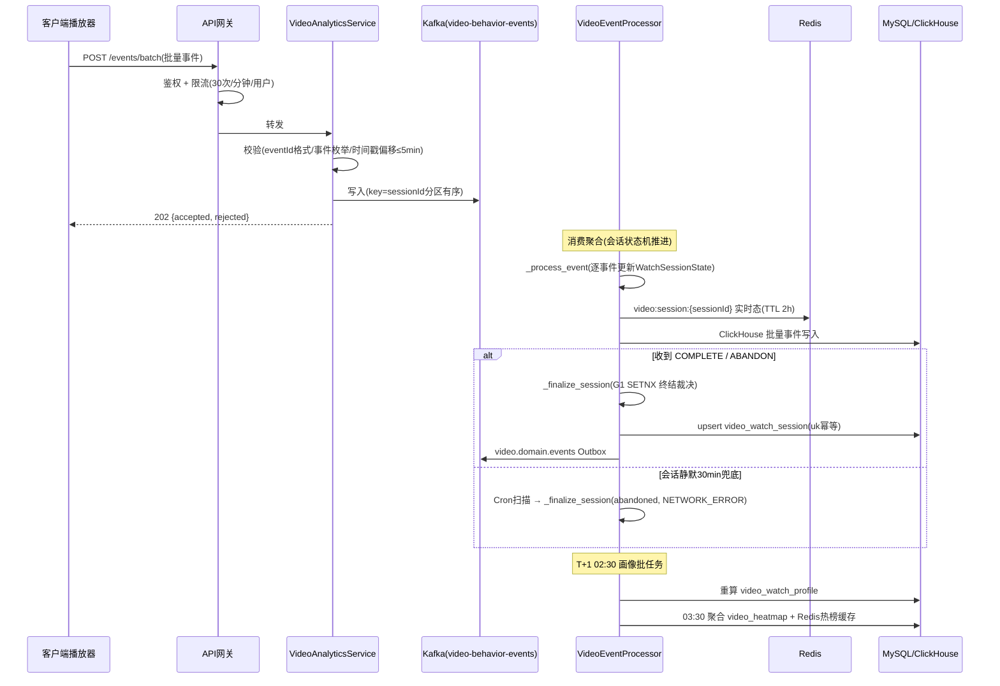

# 服务端 - 教育视频内容学生观看行为智能分析与个性化观看体验优化引擎 详细设计

## 1. 概述

### 1.1 模块定位

教育视频内容学生观看行为智能分析引擎（Video Watch Analytics & Experience Optimization Engine, VWO）是 PrimeTop 学习数据分析层的核心服务之一。与已有的 `教育视频内容智能分析与知识点时间戳标注引擎`（分析视频**内容本身**）不同，本引擎聚焦于分析**学生观看视频时的行为模式**——包括播放、暂停、拖拽跳转、倍速、重看、弃看等微观行为信号，构建学生视频学习行为画像，输出个性化观看优化策略，并为内容创作者提供视频观看热度与流失分析数据。

### 1.2 设计目标

| 目标 | 说明 |
|------|------|
| 行为采集 | 统一收口视频播放过程中的微观行为事件，标准化存储 |
| 模式识别 | 识别重看热点、弃看高发点、倍速偏好、跳转模式等行为特征 |
| 体验优化 | 为每个学生生成个性化播放参数推荐（默认倍速、字幕偏好、分段建议等） |
| 内容洞察 | 为内容团队提供视频级别的观看热度图、流失漏斗、完播率分析 |
| 学习关联 | 将观看行为数据与知识点掌握度、学习效果建立因果关联 |

### 1.3 与现有模块的边界

| 现有模块 | 职责 | 与本引擎的关系 |
|----------|------|----------------|
| 教育视频内容智能分析与知识点时间戳标注引擎 | 分析视频内容，生成知识时间线 | 本引擎消费其时间线数据，将学生行为映射到知识点 |
| 教育内容多媒体转码处理与自适应码率流媒体分发服务 | 视频转码、CDN分发 | 本引擎不处理媒体文件，仅分析行为数据 |
| 多媒体内容播放与交互引擎 | 客户端播放器渲染与交互 | 客户端播放器是本引擎的行为数据来源 |
| 统一用户行为埋点平台与事件流处理管线 | 通用埋点采集 | 本引擎定义视频专用事件Schema，由埋点平台统一传输 |
| 学习时长统计与有效性判定引擎 | 统计学习时长 | 本引擎输出有效观看时长，供时长统计引擎消费 |
| 学习内容疲劳度检测与学习形式多样性自动调度引擎 | 检测内容形式疲劳 | 本引擎输出视频形式疲劳信号，供调度引擎决策 |

### 1.4 适用范围

- **学段**: 小学、初中、高中（幼儿阶段视频消费极少，暂不纳入）
- **视频类型**: 知识点微课、名师讲座、实验演示、试卷讲评、动画讲解
- **播放终端**: APP（iOS/Android）、Web端（后续）、小程序（后续）

---

## 2. 数据结构定义

### 2.1 核心数据模型

#### 2.1.1 VideoWatchSession（视频观看会话）

一次完整的视频观看会话（从点击播放到关闭页面/退出）。

```json
{
  "sessionId": "vws_20260731_u10086_vid_20301",
  "userId": 10086,
  "videoId": "vid_math_grade8_ch3_01",
  "videoDuration": 1820,
  "startTime": "2026-07-31T09:30:00+08:00",
  "endTime": "2026-07-31T09:52:30+08:00",
  "deviceType": "ANDROID_PHONE",
  "appVersion": "2.1.0",
  "networkType": "WIFI",
  "playbackMode": "STANDARD",
  "totalWatchTime": 1350,
  "effectiveWatchTime": 1280,
  "completionRate": 0.703,
  "abandoned": true,
  "abandonPoint": 1280,
  "abandonReason": "USER_CLOSE",
  "maxContinuousPlay": 620,
  "pauseCount": 3,
  "seekCount": 2,
  "replaySegments": [
    {"start": 180, "end": 240, "count": 2},
    {"start": 850, "end": 900, "count": 1}
  ],
  "speedDistribution": [
    {"speed": 1.0, "duration": 800},
    {"speed": 1.25, "duration": 350},
    {"speed": 1.5, "duration": 200}
  ],
  "subtitleEnabled": true,
  "qualityLevel": "720p"
}
```

#### 2.1.2 VideoBehaviorEvent（视频行为事件）

播放过程中的微观行为事件，由客户端实时上报。

```json
{
  "eventId": "evt_vbe_20260731_001",
  "sessionId": "vws_20260731_u10086_vid_20301",
  "userId": 10086,
  "videoId": "vid_math_grade8_ch3_01",
  "eventType": "SEEK",
  "position": 450.5,
  "targetPosition": 180.0,
  "timestamp": "2026-07-31T09:38:15.300+08:00",
  "metadata": {
    "speed": 1.0,
    "source": "USER_GESTURE",
    "chapterId": "ch_002"
  }
}
```

**事件类型枚举**:

| eventType | 说明 | 关键字段 |
|-----------|------|----------|
| `PLAY` | 点击播放 | position, source(USER_AUTO/USER_MANUAL/SYSTEM_AUTO) |
| `PAUSE` | 暂停 | position, reason(USER/SYSTEM/BUFFERING/INTERRUPTION) |
| `SEEK` | 拖拽跳转 | position, targetPosition, source(USER_GESTURE/CHAPTER_LINK) |
| `SPEED_CHANGE` | 倍速切换 | oldSpeed, newSpeed |
| `QUALITY_CHANGE` | 画质切换 | oldQuality, newQuality |
| `SUBTITLE_TOGGLE` | 字幕开关 | enabled |
| `BUFFER_START` | 开始缓冲 | position |
| `BUFFER_END` | 缓冲结束 | position, bufferDurationMs |
| `FULLSCREEN_TOGGLE` | 全屏切换 | isFullscreen |
| `BACKGROUND_ENTER` | 进入后台 | position |
| `BACKGROUND_RETURN` | 从后台返回 | position, backgroundDurationMs |
| `PROGRESS` | 定期进度上报（每15s） | position, speed |
| `COMPLETE` | 视频播放完成 | totalWatchTime |
| `ABANDON` | 用户放弃观看 | position, reason |
| `CHAPTER_JUMP` | 通过章节列表跳转 | fromChapter, toChapter |
| `NOTE_ADD` | 视频内记笔记 | position, noteId |

#### 2.1.3 VideoWatchProfile（学生视频观看画像）

每个学生的视频观看行为画像，周期性更新。

```json
{
  "userId": 10086,
  "profileVersion": 7,
  "updatedAt": "2026-07-31T02:00:00+08:00",
  "totalVideosWatched": 147,
  "avgCompletionRate": 0.74,
  "medianWatchDuration": 1020,
  "preferredSpeed": 1.25,
  "preferredSpeedByType": {
    "MICRO_COURSE": 1.25,
    "EXPERIMENT_DEMO": 1.0,
    "EXAM_REVIEW": 1.5,
    "LECTURE": 1.0
  },
  "preferredVideoLength": "MEDIUM",
  "pauseFrequency": 2.1,
  "seekFrequency": 1.3,
  "replayTendency": 0.34,
  "engagementScore": 78.5,
  "watchingStyle": "ACTIVE_LEARNER",
  "peakWatchHours": ["19:00-21:00", "12:30-13:00"],
  "weekdayVsWeekendRatio": 0.65,
  "subtitlePreference": true,
  "qualityPreference": "720p",
  "subjectAffinity": {
    "MATH": 0.82,
    "PHYSICS": 0.65,
    "CHINESE": 0.43
  },
  "weaknessSignals": {
    "frequentReplaySubjects": ["PHYSICS"],
    "highAbandonSubjects": ["CHINESE"],
    "lowCompletionTypes": ["LECTURE"]
  },
  "fatigueIndicators": {
    "recentCompletionTrend": -0.12,
    "recentPauseRateDelta": 0.08,
    "consecutiveVideoCount": 3
  }
}
```

#### 2.1.4 VideoHeatmap（视频观看热度图）

单个视频的聚合观看行为分析数据，用于内容洞察。

```json
{
  "videoId": "vid_math_grade8_ch3_01",
  "videoDuration": 1820,
  "totalViewers": 1542,
  "generatedAt": "2026-07-31T03:00:00+08:00",
  "heatmapBuckets": [
    {
      "startSec": 0,
      "endSec": 60,
      "viewerCount": 1542,
      "replayCount": 45,
      "avgWatchTime": 52,
      "dropOffCount": 12,
      "pauseCount": 38,
      "heatScore": 0.97,
      "kpId": "kp_math_8_3_1"
    },
    {
      "startSec": 60,
      "endSec": 120,
      "viewerCount": 1530,
      "replayCount": 120,
      "avgWatchTime": 58,
      "dropOffCount": 8,
      "pauseCount": 85,
      "heatScore": 1.0,
      "kpId": "kp_math_8_3_1",
      "tags": ["HOT_REPLAY", "HIGH_PAUSE"]
    }
  ],
  "overallMetrics": {
    "avgCompletionRate": 0.71,
    "medianWatchTime": 1290,
    "p25WatchTime": 450,
    "p75WatchTime": 1620,
    "avgPauseCount": 2.4,
    "avgSeekCount": 1.1,
    "avgReplayCount": 0.8,
    "hotReplaySegments": [
      {"start": 175, "end": 245, "replayRate": 0.18, "kpId": "kp_math_8_3_2", "label": "函数表达式推导"}
    ],
    "coldDropSegments": [
      {"start": 1400, "end": 1500, "dropRate": 0.15, "label": "拓展例题"}
    ],
    "speedDistribution": {
      "1.0": 0.45,
      "1.25": 0.32,
      "1.5": 0.18,
      "2.0": 0.05
    }
  }
}
```

### 2.2 数据库表设计

#### 2.2.1 `video_watch_session` 表

```sql
CREATE TABLE video_watch_session (
    id              BIGINT       NOT NULL AUTO_INCREMENT,
    session_id      VARCHAR(64)  NOT NULL COMMENT '会话唯一ID',
    user_id         BIGINT       NOT NULL COMMENT '用户ID',
    video_id        VARCHAR(64)  NOT NULL COMMENT '视频资源ID',
    video_duration  INT          NOT NULL DEFAULT 0 COMMENT '视频时长(秒)',
    start_time      DATETIME(3)  NOT NULL COMMENT '会话开始时间',
    end_time        DATETIME(3)  NULL COMMENT '会话结束时间',
    device_type     VARCHAR(20)  NOT NULL COMMENT '设备类型 ANDROID_PHONE/IPHONE/IPAD/WEB',
    app_version     VARCHAR(20)  NOT NULL,
    network_type    VARCHAR(20)  NULL COMMENT 'WIFI/4G/5G/UNKNOWN',
    total_watch_sec INT          NOT NULL DEFAULT 0 COMMENT '累计观看秒数',
    effective_watch_sec INT      NOT NULL DEFAULT 0 COMMENT '有效观看秒数（扣除暂停/缓冲）',
    completion_rate DECIMAL(5,4) NOT NULL DEFAULT 0 COMMENT '完成率 0-1',
    is_abandoned    TINYINT      NOT NULL DEFAULT 0 COMMENT '是否中途放弃',
    abandon_point   INT          NULL COMMENT '放弃时播放位置(秒)',
    abandon_reason  VARCHAR(30)  NULL COMMENT 'USER_CLOSE/SWITCH_CONTENT/NETWORK_ERROR/BACKGROUND_TIMEOUT',
    max_continuous_play_sec INT  NOT NULL DEFAULT 0 COMMENT '最长连续播放时长',
    pause_count     INT          NOT NULL DEFAULT 0,
    seek_count      INT          NOT NULL DEFAULT 0,
    replay_count    INT          NOT NULL DEFAULT 0 COMMENT '重看片段总次数',
    preferred_speed DECIMAL(3,2) NULL COMMENT '本次会话主要倍速',
    subtitle_enabled TINYINT     NOT NULL DEFAULT 0,
    quality_level   VARCHAR(10)  NULL COMMENT '360p/480p/720p/1080p',
    speed_distribution JSON      NULL COMMENT '[{"speed":1.0,"duration":800},...]',
    replay_segments JSON         NULL COMMENT '重看片段列表',
    metadata        JSON         NULL COMMENT '扩展字段',
    created_at      DATETIME(3)  NOT NULL DEFAULT CURRENT_TIMESTAMP(3),
    PRIMARY KEY (id),
    UNIQUE KEY uk_session_id (session_id),
    INDEX idx_user_video (user_id, video_id),
    INDEX idx_video_start (video_id, start_time),
    INDEX idx_user_start (user_id, start_time),
    INDEX idx_abandoned (is_abandoned, abandon_point)
) ENGINE=InnoDB DEFAULT CHARSET=utf8mb4 COMMENT='视频观看会话表';
```

#### 2.2.2 `video_behavior_event` 表（ClickHouse）

```sql
-- ClickHouse: 高写入吞吐的事件流表
CREATE TABLE video_behavior_event (
    event_id        String,
    session_id      String,
    user_id         UInt64,
    video_id        String,
    event_type      LowCardinality(String),
    position_sec    Float32,
    target_position Float32,
    speed           Float32,
    timestamp       DateTime64(3),
    device_type     LowCardinality(String),
    network_type    LowCardinality(String),
    chapter_id      String,
    metadata        String  -- JSON
) ENGINE = MergeTree()
PARTITION BY toYYYYMM(timestamp)
ORDER BY (video_id, user_id, timestamp)
TTL timestamp + INTERVAL 90 DAY
SETTINGS index_granularity = 8192;

-- 辅助跳数索引：按事件类型快速过滤
ALTER TABLE video_behavior_event ADD INDEX idx_event_type (event_type) TYPE set(0) GRANULARITY 4;
ALTER TABLE video_behavior_event ADD INDEX idx_position (position_sec) TYPE minmax GRANULARITY 2;
```

#### 2.2.3 `video_watch_profile` 表

```sql
CREATE TABLE video_watch_profile (
    user_id             BIGINT       NOT NULL,
    profile_version     INT          NOT NULL DEFAULT 1,
    updated_at          DATETIME(3)  NOT NULL DEFAULT CURRENT_TIMESTAMP(3),
    total_videos_watched INT         NOT NULL DEFAULT 0,
    avg_completion_rate DECIMAL(5,4) NOT NULL DEFAULT 0,
    median_watch_sec    INT          NOT NULL DEFAULT 0,
    preferred_speed     DECIMAL(3,2) NOT NULL DEFAULT 1.00,
    preferred_speed_by_type JSON     NULL,
    preferred_video_length VARCHAR(10) NOT NULL DEFAULT 'MEDIUM' COMMENT 'SHORT(<5min)/MEDIUM(5-15min)/LONG(>15min)',
    pause_frequency     DECIMAL(5,2) NOT NULL DEFAULT 0 COMMENT '次/分钟',
    seek_frequency      DECIMAL(5,2) NOT NULL DEFAULT 0,
    replay_tendency     DECIMAL(5,4) NOT NULL DEFAULT 0 COMMENT '重看倾向 0-1',
    engagement_score    DECIMAL(5,2) NOT NULL DEFAULT 0,
    watching_style      VARCHAR(20)  NOT NULL DEFAULT 'UNDETERMINED',
    peak_watch_hours    JSON         NULL COMMENT '["19:00-21:00"]',
    weekday_weekend_ratio DECIMAL(4,3) DEFAULT 0.5,
    subtitle_preference TINYINT      NOT NULL DEFAULT 0,
    quality_preference  VARCHAR(10)  NULL,
    subject_affinity    JSON         NULL,
    weakness_signals    JSON         NULL,
    fatigue_indicators  JSON         NULL,
    PRIMARY KEY (user_id),
    INDEX idx_style (watching_style),
    INDEX idx_engagement (engagement_score)
) ENGINE=InnoDB DEFAULT CHARSET=utf8mb4 COMMENT='学生视频观看画像表';
```

#### 2.2.4 `video_heatmap` 表

```sql
CREATE TABLE video_heatmap (
    id              BIGINT       NOT NULL AUTO_INCREMENT,
    video_id        VARCHAR(64)  NOT NULL,
    generated_at    DATETIME(3)  NOT NULL,
    bucket_size_sec INT          NOT NULL DEFAULT 60 COMMENT '热力图桶大小(秒)',
    total_viewers   INT          NOT NULL DEFAULT 0,
    heatmap_data    JSON         NOT NULL COMMENT '热度图桶数组',
    overall_metrics JSON         NOT NULL COMMENT '聚合指标',
    PRIMARY KEY (id),
    UNIQUE KEY uk_video_gen (video_id, generated_at),
    INDEX idx_video (video_id)
) ENGINE=InnoDB DEFAULT CHARSET=utf8mb4 COMMENT='视频观看热度图表';

-- Redis 缓存最新热度图
-- Key: video:heatmap:{videoId} → JSON, TTL: 6h
-- Key: video:heatmap:hot_replay:{videoId} → ZSET, score=replayRate
```

#### 2.2.5 `video_optimization_suggestion` 表

```sql
CREATE TABLE video_optimization_suggestion (
    id              BIGINT       NOT NULL AUTO_INCREMENT,
    user_id         BIGINT       NOT NULL,
    suggestion_type VARCHAR(30)  NOT NULL COMMENT 'PLAYBACK_CONFIG/CONTENT_RECOMMEND/BEHAVIOR_NUDGE',
    suggestion_data JSON         NOT NULL,
    priority        INT          NOT NULL DEFAULT 50 COMMENT '优先级 1-100',
    status          VARCHAR(20)  NOT NULL DEFAULT 'PENDING' COMMENT 'PENDING/SHOWN/ACCEPTED/DISMISSED/EXPIRED',
    expires_at      DATETIME     NULL,
    created_at      DATETIME(3)  NOT NULL DEFAULT CURRENT_TIMESTAMP(3),
    updated_at      DATETIME(3)  NULL,
    PRIMARY KEY (id),
    INDEX idx_user_status (user_id, status),
    INDEX idx_expires (expires_at)
) ENGINE=InnoDB DEFAULT CHARSET=utf8mb4 COMMENT='视频观看优化建议表';
```

### 2.3 Redis 数据结构

```bash
# 视频热度图缓存 (TTL: 6h)
SET video:heatmap:{videoId} "{heatmapJson}"

# 热门重看片段 (TTL: 6h)
ZADD video:hot_replay:{videoId} {replayRate} "{startSec}:{endSec}:{kpId}"

# 学生实时观看会话 (TTL: 2h)
HSET video:session:{sessionId} userId "{userId}" videoId "{videoId}" startTime "{ts}" lastPosition "{pos}" lastEventTs "{ts}"
EXPIRE video:session:{sessionId} 7200

# 学生观看偏好快照 (TTL: 24h)
SET video:profile:snapshot:{userId} "{profileJson}"
EXPIRE video:profile:snapshot:{userId} 86400

# 视频每日统计计数器 (TTL: 8h, 每日重置)
INCR video:daily:views:{videoId}:{date}
INCR video:daily:completions:{videoId}:{date}

# 连续视频观看防疲劳计数器
INCR video:consecutive:user:{userId}
EXPIRE video:consecutive:user:{userId} 1800  # 30分钟无视频观看后重置
```

---

## 3. API 接口设计

### 3.1 批量上报视频行为事件

客户端定期（每15s或事件触发时）批量上报行为事件。

```
POST /api/v1/video-analytics/events/batch
```

**请求体**:
```json
{
  "sessionId": "vws_20260731_u10086_vid_20301",
  "userId": 10086,
  "videoId": "vid_math_grade8_ch3_01",
  "events": [
    {
      "eventId": "evt_001",
      "eventType": "PLAY",
      "position": 0.0,
      "timestamp": "2026-07-31T09:30:00.000+08:00",
      "metadata": {"source": "USER_MANUAL", "speed": 1.0}
    },
    {
      "eventId": "evt_002",
      "eventType": "PROGRESS",
      "position": 15.0,
      "timestamp": "2026-07-31T09:30:15.000+08:00",
      "metadata": {"speed": 1.0}
    },
    {
      "eventId": "evt_003",
      "eventType": "SPEED_CHANGE",
      "position": 30.5,
      "timestamp": "2026-07-31T09:30:30.500+08:00",
      "oldSpeed": 1.0,
      "newSpeed": 1.25,
      "metadata": {}
    },
    {
      "eventId": "evt_004",
      "eventType": "PAUSE",
      "position": 180.0,
      "timestamp": "2026-07-31T09:33:00.000+08:00",
      "metadata": {"reason": "USER"}
    }
  ]
}
```

**响应**:
```json
{
  "code": 0,
  "data": {
    "accepted": 4,
    "rejected": 0,
    "sessionId": "vws_20260731_u10086_vid_20301",
    "serverTimestamp": "2026-07-31T09:33:01.000+08:00"
  }
}
```

### 3.2 结束观看会话

```
POST /api/v1/video-analytics/sessions/{sessionId}/end
```

**请求体**:
```json
{
  "userId": 10086,
  "videoId": "vid_math_grade8_ch3_01",
  "endTime": "2026-07-31T09:52:30.000+08:00",
  "totalWatchSec": 1350,
  "effectiveWatchSec": 1280,
  "completionRate": 0.703,
  "isAbandoned": true,
  "abandonReason": "USER_CLOSE",
  "finalSpeed": 1.25
}
```

### 3.3 获取学生视频观看画像

```
GET /api/v1/video-analytics/profiles/{userId}
```

**响应**:
```json
{
  "code": 0,
  "data": {
    "userId": 10086,
    "watchingStyle": "ACTIVE_LEARNER",
    "preferredSpeed": 1.25,
    "avgCompletionRate": 0.74,
    "engagementScore": 78.5,
    "preferredVideoLength": "MEDIUM",
    "subjectAffinity": {
      "MATH": 0.82,
      "PHYSICS": 0.65
    },
    "weaknessSignals": {
      "frequentReplaySubjects": ["PHYSICS"],
      "highAbandonSubjects": ["CHINESE"]
    },
    "recommendations": {
      "defaultSpeed": 1.25,
      "maxContinuousVideos": 4,
      "breakReminderInterval": 25
    }
  }
}
```

### 3.4 获取视频热度图

```
GET /api/v1/video-analytics/videos/{videoId}/heatmap
```

**查询参数**:
| 参数 | 类型 | 说明 |
|------|------|------|
| bucketSize | int | 桶大小(秒)，默认60 |
| dateRange | string | 时间范围 7d/30d/all |

**响应**:
```json
{
  "code": 0,
  "data": {
    "videoId": "vid_math_grade8_ch3_01",
    "videoDuration": 1820,
    "totalViewers": 1542,
    "generatedAt": "2026-07-31T03:00:00+08:00",
    "heatmap": [
      {"start": 0, "end": 60, "viewerCount": 1542, "heatScore": 0.97, "kpId": "kp_math_8_3_1"},
      {"start": 60, "end": 120, "viewerCount": 1530, "heatScore": 1.0, "kpId": "kp_math_8_3_1", "tags": ["HOT_REPLAY"]},
      {"start": 120, "end": 180, "viewerCount": 1495, "heatScore": 0.85, "kpId": "kp_math_8_3_2"}
    ],
    "overallMetrics": {
      "avgCompletionRate": 0.71,
      "medianWatchTime": 1290,
      "hotReplaySegments": [
        {"start": 175, "end": 245, "replayRate": 0.18, "label": "函数表达式推导"}
      ],
      "coldDropSegments": [
        {"start": 1400, "end": 1500, "dropRate": 0.15, "label": "拓展例题"}
      ]
    }
  }
}
```

### 3.5 获取个性化播放配置建议

客户端在开始播放视频前调用，获取推荐播放参数。

```
GET /api/v1/video-analytics/playback-config?userId={userId}&videoId={videoId}
```

**响应**:
```json
{
  "code": 0,
  "data": {
    "recommendedSpeed": 1.25,
    "recommendedQuality": "720p",
    "subtitleEnabled": true,
    "chapterMarkersVisible": true,
    "smartBreakPoints": [
      {"position": 300, "hint": "建议暂停做笔记：本段讲解了函数定义域的求法"},
      {"position": 850, "hint": "建议暂停尝试练习：试着自己推导一次"}
    ],
    "abandonRisk": {
      "level": "LOW",
      "predictedCompletion": 0.85
    },
    "optimizationNudges": [
      {
        "type": "SPEED_TIP",
        "message": "你通常在物理微课中以1.5倍速观看，是否切换？",
        "action": {"type": "SET_SPEED", "value": 1.5}
      }
    ]
  }
}
```

### 3.6 获取视频观看统计概览（管理后台）

```
GET /api/v1/video-analytics/videos/{videoId}/overview
```

**响应**:
```json
{
  "code": 0,
  "data": {
    "videoId": "vid_math_grade8_ch3_01",
    "videoTitle": "一次函数概念精讲",
    "videoType": "MICRO_COURSE",
    "videoDuration": 1820,
    "kpIds": ["kp_math_8_3_1", "kp_math_8_3_2"],
    "metrics": {
      "totalViews": 8541,
      "uniqueViewers": 6234,
      "avgCompletionRate": 0.71,
      "medianWatchTime": 1290,
      "avgEffectiveWatchTime": 1185,
      "replayRate": 0.12,
      "abandonRate": 0.29,
      "avgPauseCount": 2.4,
      "avgSeekCount": 1.1
    },
    "viewerDistribution": {
      "byGrade": {"GRADE_8": 0.62, "GRADE_9": 0.28, "GRADE_7": 0.10},
      "byWatchingStyle": {
        "ACTIVE_LEARNER": 0.34,
        "SPEED_RUNNER": 0.22,
        "DEEP_LEARNER": 0.18,
        "PASSIVE_VIEWER": 0.16,
        "SKIMMER": 0.10
      }
    },
    "trend": {
      "completionRateTrend7d": 0.03,
      "viewCountTrend7d": -0.05
    }
  }
}
```

### 3.7 批量获取视频指标（内容管理用）

```
POST /api/v1/video-analytics/videos/batch-metrics
```

**请求体**:
```json
{
  "videoIds": ["vid_001", "vid_002", "vid_003"],
  "dateRange": "30d"
}
```

---

## 4. 关键算法与代码实现

### 4.1 观看行为事件处理管线

```python
"""
视频行为事件实时处理管线
从 Kafka 消费事件 → 会话状态管理 → 实时指标更新 → ClickHouse 写入
"""
from kafka import KafkaConsumer
from dataclasses import dataclass
from typing import Optional
import json
import redis
import clickhouse_driver
from datetime import datetime, timedelta

@dataclass
class WatchSessionState:
    session_id: str
    user_id: int
    video_id: str
    start_time: datetime
    video_duration: float = 0.0
    last_position: float = 0.0
    last_event_ts: datetime = None
    total_watch_sec: int = 0
    effective_watch_sec: int = 0
    max_continuous_play: int = 0
    current_continuous_play: int = 0
    pause_count: int = 0
    seek_count: int = 0
    replay_count: int = 0
    is_paused: bool = False
    current_speed: float = 1.0
    speed_duration_map: dict = None  # {1.0: 0, 1.25: 0, ...}
    replay_segments: list = None     # [{"start":, "end":, "count":}]
    skip_segments: list = None       # [{"start":, "end":}] 向前跳跃片段
    last_completion_reported: float = 0.0
    chapter_context: str = None
    buffer_start_ts: datetime = None

    def __post_init__(self):
        self.speed_duration_map = {}
        self.replay_segments = []
        self.skip_segments = []
        if self.last_event_ts is None:
            self.last_event_ts = self.start_time


class VideoEventProcessor:
    def __init__(self):
        self.kafka_consumer = KafkaConsumer(
            'video-behavior-events',
            bootstrap_servers=['kafka:9092'],
            group_id='video-analytics-processor',
            value_deserializer=lambda m: json.loads(m.decode('utf-8'))
        )
        self.redis = redis.Redis(host='redis', port=6379, db=5)
        self.clickhouse = clickhouse_driver.Client(host='clickhouse')
        self.session_states: dict[str, WatchSessionState] = {}

    def run(self):
        """主消费循环"""
        for msg in self.kafka_consumer:
            events = msg.value
            if isinstance(events, dict) and 'events' in events:
                batch = events['events']
                session_id = events.get('sessionId')
                for event in batch:
                    self._process_event(session_id, event)
                # 批量写入 ClickHouse
                self._flush_to_clickhouse(batch)

    def _process_event(self, session_id: str, event: dict):
        """处理单个行为事件"""
        state = self._get_or_create_session(session_id, event)
        event_type = event['eventType']
        event_ts = datetime.fromisoformat(event['timestamp'])
        position = event.get('position', 0.0)

        handler = {
            'PLAY': self._handle_play,
            'PAUSE': self._handle_pause,
            'SEEK': self._handle_seek,
            'SPEED_CHANGE': self._handle_speed_change,
            'PROGRESS': self._handle_progress,
            'COMPLETE': self._handle_complete,
            'ABANDON': self._handle_abandon,
            'BUFFER_START': self._handle_buffer_start,
            'BUFFER_END': self._handle_buffer_end,
            'CHAPTER_JUMP': self._handle_chapter_jump,
        }.get(event_type)

        if handler:
            handler(state, event, event_ts, position)

        # 更新 Redis 实时会话状态
        self._update_session_cache(state)

        # 更新实时计数器
        self._update_realtime_counters(state, event_type)

    def _handle_play(self, state: WatchSessionState, event: dict, ts: datetime, pos: float):
        """处理播放事件"""
        if state.is_paused:
            state.is_paused = False
        state.last_position = pos
        state.last_event_ts = ts

    def _handle_pause(self, state: WatchSessionState, event: dict, ts: datetime, pos: float):
        """处理暂停事件"""
        # 累加连续播放时长
        if not state.is_paused:
            delta = (ts - state.last_event_ts).total_seconds()
            effective_delta = min(delta, 300)  # 超过5分钟按5分钟算（防异常）
            state.current_continuous_play += effective_delta
            state.effective_watch_sec += effective_delta
            state.max_continuous_play = max(
                state.max_continuous_play,
                state.current_continuous_play
            )

        state.is_paused = True
        state.pause_count += 1
        state.last_position = pos
        state.last_event_ts = ts

    def _handle_seek(self, state: WatchSessionState, event: dict, ts: datetime, pos: float):
        """处理拖拽事件"""
        target = event.get('targetPosition', pos)

        # 检测是否是重看（向后拖拽超过30秒）
        if pos - target > 30:
            state.replay_count += 1
            self._add_replay_segment(state, target, pos)

        # 向前跳跃超过60秒记录为跳过
        if target - pos > 60:
            self._record_skip(state, pos, target)

        state.seek_count += 1
        state.last_position = target
        state.last_event_ts = ts

    def _handle_progress(self, state: WatchSessionState, event: dict, ts: datetime, pos: float):
        """处理定期进度上报"""
        if not state.is_paused:
            delta = (ts - state.last_event_ts).total_seconds()
            effective_delta = min(delta, 60)  # 两个PROGRESS之间最多15s，防异常

            state.total_watch_sec += delta
            state.effective_watch_sec += effective_delta
            state.current_continuous_play += effective_delta

            # 累加倍速时长
            speed = state.current_speed
            state.speed_duration_map[speed] = (
                state.speed_duration_map.get(speed, 0) + effective_delta
            )

            state.max_continuous_play = max(
                state.max_continuous_play,
                state.current_continuous_play
            )

        state.last_position = pos
        state.last_event_ts = ts

        # 检查完成率里程碑
        completion = pos / state.video_duration if state.video_duration else 0
        milestones = [0.25, 0.50, 0.75, 1.0]
        for m in milestones:
            if state.last_completion_reported < m <= completion:
                self._on_completion_milestone(state, m)
                state.last_completion_reported = m

    def _handle_speed_change(self, state: WatchSessionState, event: dict, ts: datetime, pos: float):
        """处理倍速切换"""
        old_speed = event.get('oldSpeed', state.current_speed)
        new_speed = event.get('newSpeed', 1.0)

        # 累加旧倍速的时长
        if not state.is_paused and state.last_event_ts:
            delta = (ts - state.last_event_ts).total_seconds()
            state.speed_duration_map[old_speed] = (
                state.speed_duration_map.get(old_speed, 0) + min(delta, 60)
            )

        state.current_speed = new_speed
        state.last_position = pos
        state.last_event_ts = ts

    def _handle_complete(self, state: WatchSessionState, event: dict, ts: datetime, pos: float):
        """处理视频播放完成"""
        state.total_watch_sec = int(event.get('totalWatchTime', state.effective_watch_sec))
        state.effective_watch_sec = state.total_watch_sec
        state.last_position = state.video_duration

        # 发送完成事件到下游
        self._publish_completion_event(state)

    def _handle_abandon(self, state: WatchSessionState, event: dict, ts: datetime, pos: float):
        """处理用户放弃观看"""
        reason = event.get('metadata', {}).get('reason', 'UNKNOWN')
        self._finalize_session(state, abandoned=True, abandon_point=int(pos), abandon_reason=reason)

    def _add_replay_segment(self, state: WatchSessionState, start: float, end: float):
        """记录重看片段"""
        # 合并相邻或重叠的重看片段
        merged = False
        for seg in state.replay_segments:
            if abs(seg['start'] - start) < 30 and abs(seg['end'] - end) < 30:
                seg['count'] += 1
                seg['start'] = min(seg['start'], start)
                seg['end'] = max(seg['end'], end)
                merged = True
                break
        if not merged:
            state.replay_segments.append({
                'start': int(start), 'end': int(end), 'count': 1
            })

    def _on_completion_milestone(self, state: WatchSessionState, milestone: float):
        """完成率里程碑回调"""
        # 更新Redis实时指标
        self.redis.hincrby(
            f"video:realtime:{state.video_id}",
            f"milestone_{int(milestone*100)}", 1
        )

    def _update_realtime_counters(self, state: WatchSessionState, event_type: str):
        """更新实时计数器"""
        key = f"video:realtime:{state.video_id}"
        self.redis.hincrby(key, event_type.lower(), 1)
        self.redis.hincrby(key, 'total_events', 1)
        self.redis.expire(key, 86400)  # 24h TTL

    def _get_or_create_session(self, session_id: str, event: dict) -> WatchSessionState:
        """获取或创建会话状态"""
        if session_id not in self.session_states:
            cached = self.redis.hgetall(f"video:session:{session_id}")
            if cached:
                # 从Redis恢复
                state = WatchSessionState(
                    session_id=session_id,
                    user_id=int(cached[b'userId']),
                    video_id=cached[b'videoId'].decode(),
                    start_time=datetime.fromisoformat(cached[b'startTime'].decode())
                )
                state.last_position = float(cached.get(b'lastPosition', b'0'))
                self.session_states[session_id] = state
            else:
                state = WatchSessionState(
                    session_id=session_id,
                    user_id=event.get('userId', 0),
                    video_id=event.get('videoId', ''),
                    start_time=datetime.fromisoformat(event['timestamp']),
                    video_duration=self._get_video_duration(event.get('videoId', ''))
                )
                self.session_states[session_id] = state
        return self.session_states[session_id]

    def _flush_to_clickhouse(self, events: list):
        """批量写入事件到ClickHouse"""
        rows = []
        for event in events:
            rows.append([
                event.get('eventId', ''),
                event.get('sessionId', ''),
                event.get('userId', 0),
                event.get('videoId', ''),
                event.get('eventType', ''),
                event.get('position', 0),
                event.get('targetPosition', 0),
                event.get('metadata', {}).get('speed', 1.0),
                event.get('timestamp', ''),
                event.get('deviceType', ''),
                event.get('networkType', ''),
                event.get('metadata', {}).get('chapterId', ''),
                json.dumps(event.get('metadata', {}))
            ])
        self.clickhouse.execute(
            "INSERT INTO video_behavior_event VALUES",
            rows
        )

    # ============ 以下为 v1.1 补全（_finalize_session 实现 + 缺失处理器 + 辅助方法） ============

    def _finalize_session(self, state: WatchSessionState,
                          abandoned: bool = False, abandon_point: int = 0,
                          abandon_reason: str = ''):
        """会话终结唯一入口：汇总落库 + 事件发布 + 状态清理。

        守卫 G1：同一会话仅允许终结一次。COMPLETE 与 ABANDON 双通道
        （正常播完 + 用户关闭/崩溃兜底 Cron 扫描）可能并发到达，
        以 Redis SETNX `video:finalized:{sessionId}` 裁决先到者生效，
        后到者仅清理本地内存态后返回。
        """
        duration = state.video_duration or 1.0
        completion_rate = min(state.last_position / duration, 1.0)

        # 主倍速 = 时长占比最高的倍速（时长相同取低速，防 2x 刷时长误判偏好）
        if state.speed_duration_map:
            preferred_speed = max(
                sorted(state.speed_duration_map.items()),
                key=lambda kv: kv[1]
            )[0]
        else:
            preferred_speed = 1.0

        session_row = {
            'session_id': state.session_id,
            'user_id': state.user_id,
            'video_id': state.video_id,
            'video_duration': int(duration),
            'start_time': state.start_time.isoformat(),
            'end_time': datetime.now().isoformat(),
            'device_type': '',  # 由首批事件元数据补齐
            'network_type': None,
            'total_watch_sec': int(state.total_watch_sec),
            'effective_watch_sec': int(state.effective_watch_sec),
            'completion_rate': round(completion_rate, 4),
            'is_abandoned': 1 if abandoned else 0,
            'abandon_point': abandon_point if abandoned else None,
            'abandon_reason': abandon_reason if abandoned else None,
            'max_continuous_play_sec': int(state.max_continuous_play),
            'pause_count': state.pause_count,
            'seek_count': state.seek_count,
            'replay_count': state.replay_count,
            'preferred_speed': preferred_speed,
            'subtitle_enabled': 0,
            'quality_level': None,
            'speed_distribution': json.dumps(
                [{'speed': k, 'duration': int(v)}
                 for k, v in state.speed_duration_map.items()]
            ),
            'replay_segments': json.dumps(state.replay_segments),
            'metadata': json.dumps({
                'skip_segments': state.skip_segments[-20:],  # 仅保留末20段防膨胀
            }),
        }
        self._upsert_session_summary(session_row)

        # G1：终结裁决（SETNX 原子，TTL 24h 覆盖重传窗口）
        if not self.redis.setnx(f"video:finalized:{state.session_id}", "1"):
            self.session_states.pop(state.session_id, None)
            return
        self.redis.expire(f"video:finalized:{state.session_id}", 86400)

        self._publish_completion_event(state, session_row, abandoned)

        # 清理内存态与实时缓存（崩溃恢复键一并删除，避免误续）
        self.session_states.pop(state.session_id, None)
        self.redis.delete(f"video:session:{state.session_id}")
        if state.user_id:
            self.redis.decr(f"video:consecutive:user:{state.user_id}")

    def _handle_buffer_start(self, state: WatchSessionState, event: dict,
                             ts: datetime, pos: float):
        """开始缓冲：进入缓冲不计有效观看，但与 PAUSE 互斥防双计。"""
        if not state.is_paused and state.last_event_ts:
            delta = (ts - state.last_event_ts).total_seconds()
            state.effective_watch_sec += min(delta, 60)
            state.speed_duration_map[state.current_speed] = (
                state.speed_duration_map.get(state.current_speed, 0)
                + min(delta, 60)
            )
        state.buffer_start_ts = ts
        state.last_position = pos
        state.last_event_ts = ts

    def _handle_buffer_end(self, state: WatchSessionState, event: dict,
                           ts: datetime, pos: float):
        """缓冲结束：成对回退缓冲期间误计的暂停（G4 口径裁决）。"""
        if state.buffer_start_ts:
            buffer_ms = event.get('metadata', {}).get(
                'bufferDurationMs',
                int((ts - state.buffer_start_ts).total_seconds() * 1000)
            )
            if buffer_ms > 3000:
                # 缓冲触发的 PAUSE(reason=BUFFERING) 在 _handle_pause 已计数，
                # 此处成对回退，保证 pause_count 仅统计用户主动暂停
                state.pause_count = max(0, state.pause_count - 1)
        state.buffer_start_ts = None
        state.last_position = pos
        state.last_event_ts = ts

    def _handle_chapter_jump(self, state: WatchSessionState, event: dict,
                             ts: datetime, pos: float):
        """章节列表跳转：计入 seek 但不判重看（G6 来源裁决）。"""
        state.seek_count += 1
        state.last_position = event.get('targetPosition', pos)
        state.chapter_context = event.get('metadata', {}).get('toChapter')
        state.last_event_ts = ts

    def _record_skip(self, state: WatchSessionState, start: float, end: float):
        """记录向前跳跃片段（"已掌握可跳过"信号，供画像引擎消费）。"""
        state.skip_segments.append({'start': int(start), 'end': int(end)})

    def _update_session_cache(self, state: WatchSessionState):
        """Redis 实时会话缓存：崩溃恢复唯一来源，TTL 2h。"""
        self.redis.hset(f"video:session:{state.session_id}", mapping={
            'userId': state.user_id,
            'videoId': state.video_id,
            'startTime': state.start_time.isoformat(),
            'lastPosition': state.last_position,
            'lastEventTs': state.last_event_ts.isoformat(),
            'videoDuration': state.video_duration,
        })
        self.redis.expire(f"video:session:{state.session_id}", 7200)

    def _get_video_duration(self, video_id: str) -> float:
        """视频时长：内容元数据缓存优先，miss 回源内容服务（200ms 超时）。"""
        cached = self.redis.get(f"video:meta:{video_id}")
        if cached:
            return float(cached)
        try:
            meta = self.content_service.get_video_meta(video_id, timeout=0.2)
            duration = float(meta.get('duration', 0))
        except Exception:
            duration = 0.0
        if duration > 0:
            self.redis.setex(f"video:meta:{video_id}", 86400, duration)
        return duration

    def _publish_completion_event(self, state: WatchSessionState,
                                  session_row: dict, abandoned: bool):
        """会话终结事件（Outbox，至少一次投递，消费方幂等）。"""
        event = {
            'eventType': 'video.watch.session.completed' if not abandoned
                         else 'video.watch.session.abandoned',
            'occurredAt': datetime.now().isoformat(),
            'payload': {
                'sessionId': state.session_id,
                'userId': state.user_id,
                'videoId': state.video_id,
                'videoDuration': session_row['video_duration'],
                'effectiveWatchSec': session_row['effective_watch_sec'],
                'completionRate': session_row['completion_rate'],
                'abandonPoint': session_row['abandon_point'],
                'abandonReason': session_row['abandon_reason'],
                'preferredSpeed': session_row['preferred_speed'],
                'replaySegments': state.replay_segments,
                'kpIds': self._get_video_kp_ids(state.video_id),
            },
        }
        self.outbox.publish('video.domain.events', event)

    def _upsert_session_summary(self, row: dict):
        """会话汇总落库（uk_session_id 幂等，G2 单写者：仅本引擎写）。"""
        sql = """
        INSERT INTO video_watch_session
            (session_id, user_id, video_id, video_duration, start_time, end_time,
             device_type, network_type, total_watch_sec, effective_watch_sec,
             completion_rate, is_abandoned, abandon_point, abandon_reason,
             max_continuous_play_sec, pause_count, seek_count, replay_count,
             preferred_speed, subtitle_enabled, quality_level,
             speed_distribution, replay_segments, metadata)
        VALUES
            (%(session_id)s, %(user_id)s, %(video_id)s, %(video_duration)s,
             %(start_time)s, %(end_time)s, %(device_type)s, %(network_type)s,
             %(total_watch_sec)s, %(effective_watch_sec)s, %(completion_rate)s,
             %(is_abandoned)s, %(abandon_point)s, %(abandon_reason)s,
             %(max_continuous_play_sec)s, %(pause_count)s, %(seek_count)s,
             %(replay_count)s, %(preferred_speed)s, %(subtitle_enabled)s,
             %(quality_level)s, %(speed_distribution)s, %(replay_segments)s,
             %(metadata)s)
        ON DUPLICATE KEY UPDATE
            end_time = VALUES(end_time),
            total_watch_sec = VALUES(total_watch_sec),
            effective_watch_sec = VALUES(effective_watch_sec),
            completion_rate = VALUES(completion_rate),
            is_abandoned = VALUES(is_abandoned),
            abandon_point = VALUES(abandon_point),
            abandon_reason = VALUES(abandon_reason)
        """
        self.mysql.execute(sql, row)

    def _get_video_kp_ids(self, video_id: str) -> list:
        """视频挂载知识点（消费《教育视频内容智能分析与知识点时间戳标注引擎》产出）。"""
        cached = self.redis.get(f"video:kp:{video_id}")
        if cached:
            return json.loads(cached)
        return []
```

### 4.2 观看画像计算引擎（T+1 批处理）

每日 02:30 批任务聚合近 90 日 `video_watch_session` 数据，重算 `video_watch_profile`。核心算法：观看风格分类器、投入度评分、疲劳信号合成。

```python
"""
观看风格分类器 + 投入度评分
规则先行（可解释、可灰度），模型兜底后续迭代。
"""
from enum import Enum

class WatchingStyle(Enum):
    ACTIVE_LEARNER = "ACTIVE_LEARNER"    # 主动学习者：高重看+中暂停+完播高
    DEEP_LEARNER = "DEEP_LEARNER"        # 深耕者：低倍速+高完播+长连续
    SPEED_RUNNER = "SPEED_RUNNER"        # 速学者：高倍速+高完播（疑似已掌握）
    PASSIVE_VIEWER = "PASSIVE_VIEWER"    # 被动观看：低交互+中完播
    SKIMMER = "SKIMMER"                  # 浏览者：高跳转+低完播
    UNDETERMINED = "UNDETERMINED"        # 样本不足

MIN_SAMPLES = 10  # 少于10个会话不判定风格（防单会话噪音定终身）

def classify_watching_style(sessions: list) -> WatchingStyle:
    if len(sessions) < MIN_SAMPLES:
        return WatchingStyle.UNDETERMINED

    avg_completion = sum(s['completion_rate'] for s in sessions) / len(sessions)
    avg_speed = sum(s['preferred_speed'] for s in sessions) / len(sessions)
    replay_tendency = sum(s['replay_count'] for s in sessions) / len(sessions)
    avg_pause = sum(s['pause_count'] for s in sessions) / len(sessions)
    avg_seek = sum(s['seek_count'] for s in sessions) / len(sessions)

    # 决策顺序即优先级：先排除浏览者，再识别速学者，最后细分主动/深耕
    if avg_completion < 0.45 and avg_seek >= 2.0:
        return WatchingStyle.SKIMMER
    if avg_completion < 0.5 and avg_pause < 0.5 and replay_tendency < 0.2:
        return WatchingStyle.PASSIVE_VIEWER
    if avg_speed >= 1.5 and avg_completion >= 0.7:
        return WatchingStyle.SPEED_RUNNER
    if replay_tendency >= 0.5 or avg_pause >= 2.5:
        # 重看/暂停多：主动加工信号；再按倍速细分
        return WatchingStyle.ACTIVE_LEARNER if avg_speed >= 1.1 \
               else WatchingStyle.DEEP_LEARNER
    return WatchingStyle.DEEP_LEARNER if avg_completion >= 0.7 \
           else WatchingStyle.PASSIVE_VIEWER

def calc_engagement_score(sessions: list, style: WatchingStyle) -> float:
    """投入度评分 0-100：完播35% + 有效时长密度30% + 交互深度20% + 连续度15%。"""
    if not sessions:
        return 0.0
    n = len(sessions)
    avg_completion = sum(s['completion_rate'] for s in sessions) / n

    # 有效时长密度 = 有效观看 / 视频总时长（跨会话平均，>1 截断）
    density = sum(
        min(s['effective_watch_sec'] / max(s['video_duration'], 1), 1.0)
        for s in sessions
    ) / n

    # 交互深度：重看、笔记、章节跳转归一（每视频0-3次交互≈满分）
    interaction = sum(
        min((s['replay_count'] + s['seek_count'] * 0.5) / 3.0, 1.0)
        for s in sessions
    ) / n

    # 连续度：最长连续播放 / 视频时长
    continuity = sum(
        min(s['max_continuous_play_sec'] / max(s['video_duration'], 1), 1.0)
        for s in sessions
    ) / n

    score = (avg_completion * 35 + density * 30 + interaction * 20
             + continuity * 15)

    # 风格校准：速学者交互项权重低是特征不是缺陷，不惩罚；
    # 浏览者即使完播偶然偏高，投入度上限封顶 60
    if style == WatchingStyle.SKIMMER:
        score = min(score, 60.0)
    return round(score, 2)

def calc_fatigue_signals(recent_sessions: list) -> dict:
    """疲劳信号（近7日 vs 前7日环比），供《学习内容疲劳度检测引擎》融合。"""
    def _avg(sessions, key):
        return sum(s[key] for s in sessions) / len(sessions) if sessions else 0

    cur = [s for s in recent_sessions if s['recency'] == 'CURRENT_WEEK']
    prev = [s for s in recent_sessions if s['recency'] == 'PREV_WEEK']

    completion_delta = _avg(cur, 'completion_rate') - _avg(prev, 'completion_rate')
    pause_delta = _avg(cur, 'pause_count') - _avg(prev, 'pause_count')
    consecutive = _avg(cur, 'consecutive_count')  # 由 Redis 计数器快照

    return {
        'recentCompletionTrend': round(completion_delta, 4),
        'recentPauseRateDelta': round(pause_delta, 4),
        'consecutiveVideoCount': int(consecutive),
        'consecutiveRisk': consecutive >= 4,  # 连续≥4个视频触发形式疲劳复核
    }
```

### 4.3 视频热度图聚合引擎（离线）

每日 03:30 对昨日有观看记录的视频执行热度聚合，产出 `video_heatmap` 与 Redis 热榜缓存。

```sql
-- Step 1: 分桶观看热度（60s 桶，按视频+桶聚合）
SELECT
    video_id,
    FLOOR(position_sec / 60)          AS bucket_idx,
    COUNT(DISTINCT user_id)           AS viewer_count,
    COUNTIf(event_type = 'PAUSE'
            AND metadata.reason = 'USER') AS user_pause_count,
    COUNTIf(event_type = 'SEEK'
            AND position_sec - target_position > 30) AS replay_seek_count,
    AVGIf(position_sec, event_type = 'PROGRESS') AS avg_position
FROM video_behavior_event
WHERE timestamp >= yesterday() AND timestamp < today()
GROUP BY video_id, bucket_idx;

-- Step 2: 重看热点片段（重看率 = 重看人数 / 该桶观看人数，Top10）
SELECT
    video_id,
    FLOOR(target_position / 30) * 30  AS seg_start,
    FLOOR(position_sec / 30) * 30     AS seg_end,
    COUNT(DISTINCT user_id)           AS replay_users,
    replay_users / max(viewer_count)  AS replay_rate
FROM video_behavior_event
WHERE event_type = 'SEEK'
  AND position_sec - target_position > 30
  AND timestamp >= today() - 30
GROUP BY video_id, seg_start, seg_end
ORDER BY replay_rate DESC
LIMIT 10 PER PARTITION video_id;

-- Step 3: 流失点（首次 ABANDON/静默断流位置分布，Top5 冷区）
SELECT
    video_id,
    FLOOR(abandon_point / 60) * 60    AS drop_bucket,
    COUNT(*)                          AS drop_count,
    drop_count / total_viewers        AS drop_rate
FROM video_watch_session
WHERE start_time >= today() - 30 AND is_abandoned = 1
GROUP BY video_id, drop_bucket
ORDER BY drop_rate DESC
LIMIT 5 PER PARTITION video_id;
```

热度分归一化：`heatScore(bucket) = 0.6 * (viewerCount / maxViewer) + 0.3 * (replayCount / maxReplay) + 0.1 * (pauseCount / maxPause)`，再按 `dropOffCount` 反向扣减（`-0.5 * dropRate`），最终截断至 [0, 1]。

---

## 5. 核心流程

### 5.1 观看行为实时处理主链路



### 5.2 崩溃未上报兜底链路

客户端崩溃/杀进程时无法发送 `ABANDON` 与 `sessions/end`，依赖双兜底：

1. **Redis 静默扫描（分钟级）**：`video:session:{sessionId}` 存在但 `lastEventTs` 距今 > 30min → 处理器从 Redis 恢复 `WatchSessionState`，以 `abandon_reason=BACKGROUND_TIMEOUT`、`abandon_point=lastPosition` 走 `_finalize_session`（G1 保证与迟到的 COMPLETE 竞态时先到者胜）。
2. **sessions/end API 迟达**：客户端下次启动补报 end 请求，若会话已被兜底终结，返回 60202（幂等成功语义，携带既有 summary，与 §3.2 响应一致）。

---

## 6. 状态机与守卫

### 6.1 观看会话状态机

```
                 ┌────────事件持续上报───────┐
                 │                            │
   (首事件)     ▼                            │
  ACTIVE ──COMPLETE/ABANDON──► FINALIZED     │
   │  │              ▲                        │
   │  │静默30min      │ G1 SETNX 先到者胜       │
   │  ▼              │                        │
   │ EXPIRED_SCAN ───┘                        │
   │ (兜底终结,reason=BACKGROUND_TIMEOUT)      │
   │                                          │
   └──sessions/end 迟达 → 60202 幂等成功,不重开──┘
```

| 状态 | 含义 | 进入条件 |
| --- | --- | --- |
| ACTIVE | 会话进行中，事件持续聚合 | 首条事件创建 `WatchSessionState` |
| FINALIZED | 会话已终结，summary 落库 + 事件已发 | `COMPLETE`/`ABANDON`/兜底扫描触发 `_finalize_session` 且 G1 裁决通过 |
| EXPIRED_SCAN | 静默兜底终结的终态（终态仍记 FINALIZED，扫描路径在 metadata.source 标记） | `lastEventTs` 静默 > 30min |

终态唯一：无论正常完成、主动放弃、崩溃兜底，落库统一 `end_time` 非空且 G1 防重；`is_abandoned`/`abandon_reason` 区分路径。

### 6.2 守卫规则

| 编号 | 规则 | 说明 |
| --- | --- | --- |
| G1 | 会话终结唯一性 | `video:finalized:{sessionId}` SETNX 原子裁决，COMPLETE/ABANDON/兜底扫描三路并发先到者胜；后到者清内存态即返回 |
| G2 | summary 单写者 | `video_watch_session` 仅本引擎 upsert，时长统计/学情等消费方只读；画像（profile）与热度图（heatmap）派生数据不得反向写回 |
| G3 | 时长以事件时间戳推算 | `effective_watch_sec` 由事件间隔累加（单间隔封顶 60s），不信任客户端上报的总时长字段，防设备时钟异常与篡改 |
| G4 | 暂停口径纯化 | `reason=BUFFERING/SYSTEM` 的暂停不计入 `pause_count`（`_handle_buffer_end` 成对回退），暂停指标仅反映用户主动行为 |
| G5 | 有效观看封顶 | 单会话 `effective_watch_sec ≤ video_duration × 1.2`（倍速回看冗余容忍 20%），超出截断并打标 `metadata.capped=true` |
| G6 | 重看判定来源豁免 | 仅 `source=USER_GESTURE` 的向后 SEEK（>30s）判重看；`CHAPTER_JUMP` 与进度条微调（≤30s）不计 |
| G7 | 会话单设备 | 同会话事件的 `deviceType/deviceId` 必须一致，切换设备视为新会话（防多端并发写乱序） |
| G8 | 热度图批处理可重入 | 聚合任务以 `(video_id, stat_date)` 为幂等键，重复执行覆盖当日分区不产生重复行 |
| G9 | 事件保留期 | ClickHouse 明细 90 天 TTL；MySQL summary 与画像长期保留；注销用户按 C6 删除 |
| G10 | 连续观看计数器衰减 | `video:consecutive:user:{userId}` 30min 无视频事件自动过期重置，崩溃清理时 DECR 兜底防负数（`max(0, n-1)` 由 Lua 保证） |

---

## 7. 幂等与并发

| 场景 | 机制 |
| --- | --- |
| 事件重复上报 | `eventId` 全局唯一（客户端 UUID v7），写入层 ClickHouse 以 `(event_id)` 去重（`ReplacingMergeTree` 语义/下游 GROUP BY 兜底）；MySQL 侧不存明细，无重复落库风险 |
| sessions/end 重复调用 | G1 终结裁决已生效 → 返回 60202 幂等成功（响应携带既有 summary）；未终结则正常推进 |
| COMPLETE 与 ABANDON 竞态 | 同会话双事件连续到达：G1 SETNX 先到者生效；`COMPLETE` 与 `ABANDON` 同时到达时 `COMPLETE` 优先（处理器内先处理 COMPLETE 队列） |
| 兜底扫描与事件重放竞态 | 扫描启动前二次校验 `video:finalized` 未置位；Redis 恢复状态后再 SETNX，仍可能被正在处理的活跃会话抢占，后到者丢弃扫描结果（G1） |
| 画像批处理重复执行 | `video_watch_profile` 按 `user_id` 单行 upsert，`profile_version` 单调递增，旧版本结果直接丢弃 |
| 离线补报 | 客户端断网事件本地暂存（上限 300 条/会话，环形丢弃最旧），恢复后批量补报；超 48h 的事件标记 `source=offline_replay` 仍计入统计但疲劳信号降权（×0.5） |
| 时钟偏移 | >5min 拒绝（60203），≤5min 服务端按接收时间修正，原始值保留在 metadata 备审计 |

---

## 8. 事件设计

### 8.1 发布事件（Outbox，topic: video.domain.events）

| 事件 | 触发 | 关键载荷 | 消费方 |
| --- | --- | --- | --- |
| `video.watch.session.completed` | 会话终结且 `is_abandoned=0` | sessionId, userId, videoId, videoDuration, effectiveWatchSec, completionRate, preferredSpeed, kpIds | 学习时长统计与有效性判定引擎（有效观看时长对账）、学习内容疲劳度检测引擎、教育内容有效性评估引擎 |
| `video.watch.session.abandoned` | 会话终结且 `is_abandoned=1` | sessionId, userId, videoId, abandonPoint, abandonReason, completionRate | 学习内容疲劳度检测引擎（弃看信号）、学生用户学习内容曝光管控引擎（负反馈降权） |
| `video.fatigue.detected` | 疲劳信号合成达 TIRED 级（见 §4.2） | userId, fatigueScore, signals{completionTrend, pauseDelta, consecutive}, window7d | 统一学习干预编排引擎（频控后下发）、学习会话疲劳度实时监测引擎（融合，非强制指令） |
| `video.heatmap.generated` | 每日热度聚合完成 | videoId, statDate, hotReplaySegments[], coldDropSegments[], avgCompletionRate | 教育内容有效性评估引擎、管理后台内容生产运营工作台（选题优化/拆条建议） |

### 8.2 消费事件（订阅）

| 上游事件 | 用途 |
| --- | --- |
| `kp.timeline.annotated`（视频内容分析引擎） | 回填 `video:kp:{videoId}` 知识点时间线，热度图分桶挂载 kpId |
| `content.published` / `content.offlined` | 维护视频元数据缓存（时长/类型/学段），下线视频的热度图停止更新并标注 stale |
| `user.account.deleted` | 注销即删：ClickHouse 明细删除（C6）、MySQL summary 匿名化（user_id 置空）、画像物理删除 |
| `learning.session.ended` | 校准观看会话是否挂靠学习会话，修正归因入口 |

---

## 9. 错误码（60200-60299）

> 段位说明：5xxxx 全局业务码段已分配殆尽（50xxx-59xxx 全段注册，详见《服务端统一业务异常码与错误分类体系》）；6xxxx 空间中 60100-60199 归阅读行为分析引擎、64xxx 归实物奖品履约，本引擎注册 **60200-60299** 段（全库扫描无冲突）。内部错误不外透学生端，统一映射通用提示。

| 错误码 | HTTP | 含义 | 客户端处理建议 |
| --- | --- | --- | --- |
| 60200 | 400 | 事件体校验失败（缺字段/类型非法） | 检查播放器埋点 SDK 版本，丢弃本地坏事件并上报诊断 |
| 60201 | 400 | 事件类型不在枚举内 | 同上 |
| 60202 | 200 | 会话已终结（sessions/end 重复/迟达，幂等成功） | 视为成功，使用响应内 summary |
| 60203 | 400 | 设备时钟偏移 > 5 分钟 | 校准系统时间后自动重传 |
| 60204 | 404 | 会话不存在（end 携带未知 sessionId 且 Redis 无恢复态） | 重新开启会话 |
| 60205 | 400 | 批量事件超过上限（100 条/次） | 拆分批次重试 |
| 60206 | 429 | 超出限流（30 次/分钟/用户） | 退避重试，本地事件队列堆积保护 |
| 60207 | 403 | 查询他人观看画像（越权） | 学生端仅可查自己；家长端走家长门鉴权通道 |
| 60208 | 404 | 视频不存在或已下线 | 刷新列表 |
| 60209 | 400 | heatmap 查询日期跨度 > 90 天 | 缩小范围 |
| 60210 | 503 | 流处理积压，会话汇总延迟 | 轮询或稍后重试，不影响事件接收 |
| 60211 | 422 | playback-config 请求 videoId 与学段不匹配 | 忽略建议，使用默认配置 |
| 60212 | 200 | 画像样本不足（<10 会话），返回 UNDETERMINED | 正常展示默认配置 |

---

## 10. 降级策略

| 编号 | 触发条件 | 降级行为 | 恢复条件 |
| --- | --- | --- | --- |
| D1 | Kafka 不可用 | 事件接口本地落盘 + 恢复后补投；超 5min 未恢复返回 503(60210) | Kafka 恢复 |
| D2 | 处理器积压 > 20 万事件 | 里程碑回调与实时计数降频（每会话仅首末两次），热度桶精度不变 | 积压 < 2 万 |
| D3 | Redis 不可用 | 终结裁决 SETNX 降级为 MySQL `uk_session_id` 唯一约束兜底（靠 INSERT 冲突判重）；实时缓存暂停，崩溃兜底扫描退化为扫 MySQL 未终结会话 | Redis 恢复 |
| D4 | T+1 批处理失败 | heatmap/画像保持昨日数据，接口响应携带 `stale=true`；连续 3 天失败 P2 告警 | 重跑成功 |
| D5 | 画像查询超时 | 返回 Redis 快照（TTL 24h），无快照返回 60212 语义（默认配置） | 依赖恢复 |
| D6 | 旧版客户端缺字段（无 bufferDurationMs/speed 等） | G4 回退与倍速统计跳过缺失项，画像按可用信号重归一权重 | 客户端升级 |
| D7 | 内容元数据服务超时 | `video_duration=0` 兜底，完成率按 last_position 绝对值口径计算并标记 `metadata.duration_missing=true` | 元数据恢复 |
| D8 | 全链路降级总红线 | 事件接收（埋点）优先级最高，永不因下游故障拒收合法事件（与 G1-G7 不冲突：接收≠终结≠干预） | —— |

---

## 11. 监控指标与容量

| 编号 | 指标 | 类型 | 告警阈值 |
| --- | --- | --- | --- |
| M1 | 事件接收 QPS / 日接收量 | Counter | 突降 50% 对比 7 日均值（播放器埋点故障信号） |
| M2 | 事件接收 P99 延迟 | Histogram | > 500ms 持续 5min |
| M3 | 会话终结延迟（COMPLETE → summary 落库） | Histogram | P99 > 30s |
| M4 | Kafka 消费积压 | Gauge | > 20 万 P2；> 100 万 P1 |
| M5 | 兜底扫描终结占比 | Gauge | > 15%（提示客户端上报链路异常） |
| M6 | 弃看率（abandoned/总会话） | Gauge | 单视频 > 60% 且样本 > 100 会话 → 触发内容复核建议 |
| M7 | 热度图批处理成功率 | Gauge | 日任务失败即 P2（D4 生效） |
| M8 | G1 终结裁决冲突率 | Counter | > 5%（提示 COMPLETE/ABANDON 双发策略异常） |
| M9 | 连续观看 ≥4 视频用户占比 | Gauge | > 20%（形式疲劳信号，联动疲劳度引擎核对学段建议时长） |
| M10 | playback-config 建议采纳率（客户端回传 action 结果） | Gauge | < 5% 持续 7 天（建议质量存疑，回检画像权重） |

**容量估算**（DAU 50 万，视频渗透率 55%，人均日观看 3 个视频）：
- 事件量：3 会话 × 均 80 事件 ≈ 日 1.32 亿事件，批量上报（每 15s/10 事件）后峰值 QPS ≈ 900；Kafka 6 分区 × 3 broker 可承载。
- 存储：ClickHouse 明细约 1.32 亿行/日 × 350B ≈ 46GB/日，90 天 TTL ≈ 4.1TB（按月分区，到期 DROP PARTITION）；MySQL summary 约 150 万行/日 × 2KB ≈ 3GB/日增量，按 `(video_id, start_time)` 月归档。
- Redis：活跃会话态（≈2KB）× 并发 5 万 ≈ 100MB；`video:finalized` 键 24h TTL 峰值 150 万键 × 60B ≈ 90MB。
- 处理器：事件状态机为内存计算，无 LLM 依赖，单机 5 万 QPS 余量充足，按 Kafka 分区水平扩展。

---

## 12. 合规红线

| 编号 | 红线 |
| --- | --- |
| C1 | 观看行为分析仅用于学习体验优化与内容质量改进，不得用于向未成年人推送商业营销内容 |
| C2 | 笔记正文/字幕文本不落行为事件库（归笔记系统存储），本引擎事件仅记录行为元数据（位置、时长、次数）；heatmap 仅产出聚合结果 |
| C3 | 家长端学情展示只呈现聚合指标（有效时长、完播率、投入分），不呈现逐秒观看轨迹与精确重看片段，防止变相监控引发亲子信任问题 |
| C4 | 播放建议（倍速/休息提醒）话术经内容安全审核（成长型话术），禁止贬损性表述，参考《统一通知消息模板引擎》话术红线 |
| C5 | 跨用户对比仅用于群体基准（匿名分位数），不生成个体观看行为排名 |
| C6 | 账号注销即删：15 日内完成 ClickHouse 明细删除、summary 匿名化（user_id 置空保留群体统计价值）、画像物理删除 |
| C7 | 数据出域（B 端/机构）仅提供 ≥ 20 人聚合粒度，遵循《教育数据匿名化与去标识化处理管线引擎》 |
| C8 | 观看画像特征属未成年人个人信息，导出遵循《未成年人数据隐私合规自动化》家长授权流程 |
| C9 | 视频内笔记（NOTE_ADD 事件）仅记录 noteId 关联，笔记内容本身受笔记系统权限与隐私边界管控，本引擎不做内容级分析 |

---

## 13. 契约对齐

| 编号 | 对齐对象 | 要点 |
| --- | --- | --- |
| R1 | 服务端统一业务异常码与错误分类体系 | 60200-60299 段登记；5xxxx 段已满，沿用 6xxxx 扩展空间（601xx 阅读行为/602xx 观看行为/64xxx 履约相邻不冲突） |
| R2 | 教育视频内容智能分析与知识点时间戳标注引擎 | 知识点时间线为只读消费（`kp.timeline.annotated` 事件回填），本引擎不重复做内容分析（§1.3 边界表） |
| R3 | 学习内容疲劳度检测与学习形式多样性自动调度引擎 | `video.fatigue.detected` 为输入信号而非强制指令；强制休息权威归防沉迷模块，本引擎不可绕过（D8 仅保证事件接收） |
| R4 | 防沉迷与未成年人保护机制 | 连续观看计数器（G10）仅为信号，不执行强制断播 |
| R5 | 学习时长统计与有效性判定引擎 | 有效观看时长输出口径 = `effective_watch_sec`（G3 事件推算/G5 封顶后），供其对账 |
| R6 | 多媒体内容播放与交互引擎（客户端播放器） | 事件 Schema（§2.1.2 枚举与字段）以播放器埋点 SDK v2.0+ 契约为准；旧版本走 D6 降级 |
| R7 | 统一用户行为埋点平台与事件流处理管线 | 视频事件为专用 Schema 直传本服务，不走通用埋点 topic；网关限流口径与埋点平台统一（30 次/分钟/用户） |
| R8 | 统一通知消息模板引擎 | 播放建议/休息提醒文案经模板引擎渲染，遵守话术红线（C4） |
| R9 | 多端数据同步与冲突解决策略 | 离线补报以服务端接收序为准，设备时钟仅参考（G3/G7） |
| R10 | 服务端统一响应封装与分页查询规范 | heatmap/overview 接口分页与响应包装遵循统一规范 |

---

## 14. 验收场景

| 编号 | 场景 | 预期 |
| --- | --- | --- |
| AC01 | 批量上报 100 条合法事件 | 202 返回 accepted=100；Kafka 可查；ClickHouse 落库 |
| AC02 | 重复上报同一 eventId | 聚合结果与单次一致，无重复计数（去重兜底生效） |
| AC03 | 上报时钟偏移 +10min 事件 | 60203 拒绝，不入库 |
| AC04 | 偏移 +3min | 入库且按接收时间修正，原始值保留 metadata（G3） |
| AC05 | 正常 COMPLETE 流程 | 30s 内 summary 落库，`is_abandoned=0`，事件 video.watch.session.completed 投递 |
| AC06 | COMPLETE 后 10s 内 ABANDON 到达 | G1 裁决：仅 COMPLETE 生效，无重复事件（M8 计数 +1 但无重复消费） |
| AC07 | 客户端崩溃未上报 | 30min 兜底扫描终结，`abandon_reason=BACKGROUND_TIMEOUT`，弃看事件投递 |
| AC08 | 崩溃后客户端补报 sessions/end | 60202 幂等成功，响应 summary 与兜底结果一致 |
| AC09 | 缓冲 >3s 触发 PAUSE(BUFFERING) 后 BUFFER_END | `pause_count` 不增加（G4 成对回退） |
| AC10 | 向后拖拽 120s（USER_GESTURE） | `replay_count +1`，重看片段合并记录（G6） |
| AC11 | 章节跳转（CHAPTER_JUMP）回退 300s | 计入 `seek_count`，不计 `replay_count`（G6 豁免） |
| AC12 | 用户 2x 倍速完整观看 20 视频 | 风格判定 SPEED_RUNNER，`preferred_speed=2.0`，画像版本 +1 |
| AC13 | 新用户仅 3 个会话 | 风格 UNDETERMINED，playback-config 返回默认配置（60212 语义） |
| AC14 | 单会话有效时长 > 视频时长 1.2 倍（异常刷量） | G5 截断，`metadata.capped=true`，画像侧降权 |
| AC15 | 热度聚合任务重复执行同一 stat_date | heatmap 无重复行（G8） |
| AC16 | 注销用户 | 15 日内明细删除、summary 匿名化、画像删除（C6） |
| AC17 | Redis 宕机期间会话终结 | MySQL uk 兜底判重，无双份 summary（D3） |
| AC18 | 旧版客户端（无 speed 字段）上报 | 事件正常接收，倍速统计跳过（D6），其余信号重归一 |

---

## 15. 关联文档与维护记录

**关联文档：**
- 《服务端-教育内容学生阅读行为智能分析与个性化阅读体验优化引擎》（姊妹篇：阅读模态行为分析，60100-60199 段）
- 《服务端-教育视频内容智能分析与知识点时间戳标注引擎》（视频内容分析，本引擎消费其知识点时间线）
- 《教育视频内容智能分析与知识点时间戳标注引擎》/《服务端-教育内容多媒体转码处理与自适应码率流媒体分发服务》（媒体层，无行为耦合）
- 《多媒体内容播放与交互引擎》（客户端播放器，事件数据源）
- 《服务端-学习内容疲劳度检测与学习形式多样性自动调度引擎》（疲劳信号消费方）
- 《服务端-学习时长统计与有效性判定引擎》（有效时长对账方）
- 《服务端-统一用户行为埋点平台与事件流处理管线》（通用埋点，本引擎为专用 Schema 旁路）
- 《服务端统一业务异常码与错误分类体系》（60200-60299 段登记）

**维护记录：**

| 版本 | 日期 | 说明 |
| --- | --- | --- |
| v1.0 | 初版 | §1-§3 完整（概述/数据结构/7 个 API）；§4.1 事件处理管线代码截断于 `_finalize_session` 方法签名行（833 行，围栏未闭合），§4.2 起全部缺失；数据类已由前序批次补入 `video_duration`/`skip_segments` 字段 |
| v1.1 | 2026-11-03 | 补全烂尾文档：完成 §4.1 收尾（`_finalize_session` 终结唯一入口实现 + G1 SETNX 裁决 + 缺失处理器 `_handle_buffer_start`/`_handle_buffer_end`/`_handle_chapter_jump` 与辅助方法 `_record_skip`/`_update_session_cache`/`_get_video_duration`/`_publish_completion_event`/`_upsert_session_summary`）；新增 §4.2 观看画像计算引擎（六风格规则分类器 MIN_SAMPLES=10/投入度四因子评分/疲劳信号环比合成）、§4.3 热度图聚合引擎（ClickHouse 三段 SQL：分桶热度/重看热点/流失点 + 热度分归一公式）、§5 核心流程（mermaid 主链路 + 崩溃双兜底）、§6 会话状态机与守卫 G1-G10（终结唯一性 G1/单写者 G2/时长事件推算 G3/暂停口径纯化 G4/有效时长封顶 G5/重看来源豁免 G6/单设备 G7/批处理可重入 G8/保留期 G9/连续计数衰减 G10）、§7 幂等并发七场景、§8 事件 Outbox 四事件 + 订阅四上游、§9 错误码 60200-60299 共 13 项（5xxxx 全段已满，6xxxx 空间 602xx 经全库扫描无冲突）、§10 降级 D1-D8（D8 事件接收永不降级红线）、§11 监控 M1-M10 与 DAU50 万容量估算、§12 合规 C1-C9（轨迹不展示 C3/注销即删 C6）、§13 契约 R1-R10、§14 验收 AC01-AC18 |