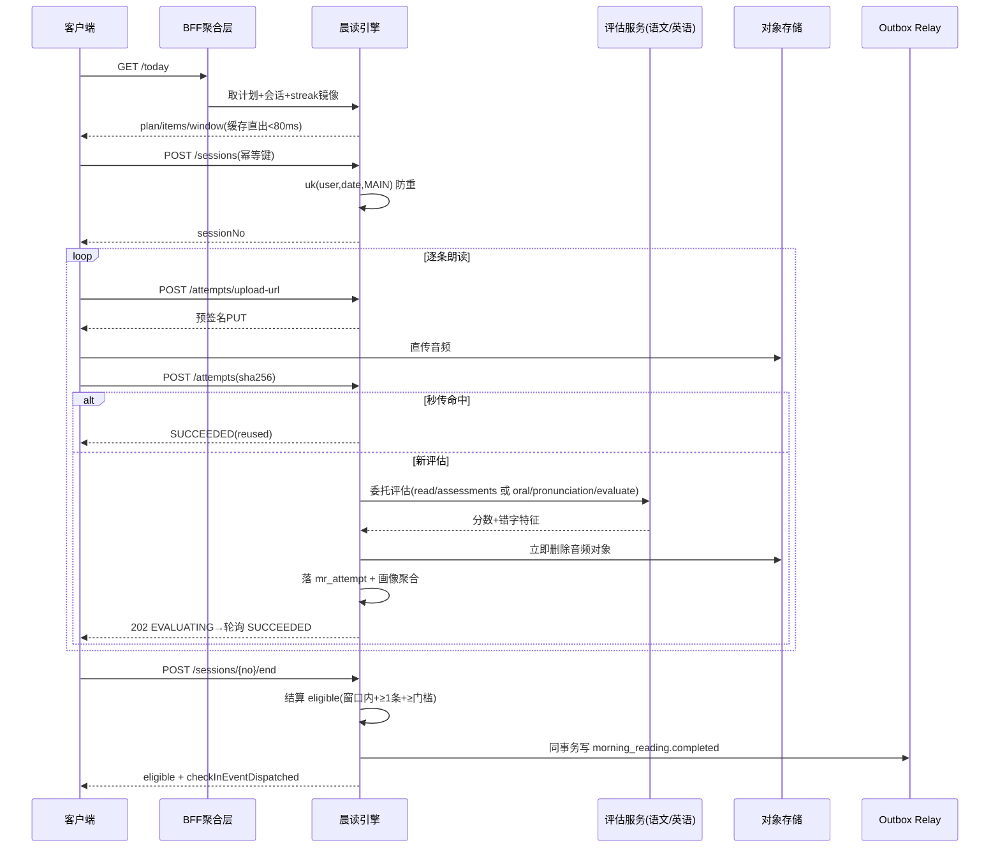

# 服务端-晨读打卡与朗读习惯养成引擎 - 详细设计

- 版本：v1.0
- 状态：新建初版
- 错误码段：48200-48299（全库严格扫描确认空闲）
- 依赖文档：《语文朗读评估系统》《发音陪练服务》《学习习惯养成与打卡系统》《学习时长统计与有效性判定引擎》《服务端-教材点读音频资源管理与同步点读调度服务》《服务端-文科背诵内容管理与记忆效果检测服务》《防沉迷与未成年人保护机制》《数据安全与隐私合规体系》

---

## 1. 模块概述

### 1.1 定位与缺口依据

本引擎为 **晨读打卡域（Morning Reading Domain, MRD）服务端编排权威**，覆盖"每日晨读计划生成 → 晨读会话 → 逐条朗读录音 → 评估委托 → 打卡事件发布"全链路。

**缺口依据**：对 docs2 全目录执行关键词扫描（`晨读打卡 / 朗读打卡 / 每日朗读`），仅《服务端-教材点读音频资源管理与同步点读调度服务》§10.2 出现 1 处蹭词（"每日朗读时长"，属下游消费口径描述），无任何文档承接晨读计划、晨读会话、打卡编排。总体设计文档中"朗读"仅作为 AI 能力与拼音识字启蒙的附属能力出现，无晨读场景定义。本文补齐该零覆盖域。

### 1.2 核心职责

| 职责 | 说明 |
|------|------|
| 每日晨读计划编排 | 每日为每生生成 2~4 条朗读条目，来源优先级规则化选择 |
| 晨读会话生命周期 | 当日会话创建、续接、心跳、结束、过期清理 |
| 朗读评估委托代理 | 语文条目委托朗读评估系统、英语条目委托发音陪练服务，本引擎不实现评估算法 |
| 打卡事件发布 | 达标后发布 `morning_reading.completed` 事件（Outbox 同事务），打卡/时长/激励/通知全部外置消费 |
| 晨读窗口与资格判定 | 窗口内完成≥1 条且有效时长≥门槛判定为"晨读达标"，窗口外朗读记学习但不记晨读打卡 |
| 朗读画像维护 | 错字特征、流利度趋势、薄弱音素聚合（供复习与学情消费，只读出口） |

### 1.3 服务边界（权威归属裁决）

| 能力 | 权威归属 | 本文关系 |
|------|----------|----------|
| 朗读评分算法（字词级对齐、音素 GOP） | 朗读评估系统（语文）/ 发音陪练服务（英语） | R1/R2 委托调用，禁重复实现 |
| 打卡记录与连续天数（Streak）SSOT | 学习习惯养成与打卡系统 | R3 只发事件；Streak 镜像只读 |
| 学习时长归因与对账 | 学习时长统计与有效性判定引擎 | R4 只发事件；category=`morning_reading` |
| 积分/勋章发放 | 用户学习激励中心 | R5 只发事件，不直接写激励账户 |
| 课文音频与点读时间轴 | 教材点读音频资源管理服务 | 上游只读 |
| 背诵检测（记忆曲线） | 文科背诵内容管理与记忆效果检测服务 | 上游只读；本文不含背诵链路 |
| 强制休息/防沉迷裁决 | 防沉迷与未成年人保护机制 | 只执行不裁决（R9） |
| 家长同意校验 | 统一家长门与监护人授权核验引擎 | 委托校验 |

### 1.4 核心红线

1. **音频零留存**：学生朗读音频在完成评估后**立即物理删除**（默认≤1 小时，最长不超过 24 小时强制清理），任何表/缓存/日志禁存音频内容，仅存评估分数与错字文本特征（合规 C1）。
2. **评估零 LLM**：评分完全由外部评估服务确定性产出，LLM 禁入判分链路；LLM 仅允许生成"晨读寄语"且可整体降级（G4）。
3. **无社交排名**：晨读 streak 仅学生本人与家长可见，不做班级榜/全服榜（合规 C4）。
4. **防沉迷 fail-closed**：防沉迷服务不可达时拒绝创建新会话（48212），不得放行（D10）。

---

## 2. 核心概念与数据模型

### 2.1 核心概念

| 概念 | 定义 |
|------|------|
| 晨读窗口（window） | 默认 04:30-09:30（Asia/Shanghai），家庭级可配置，家长仅可收紧不可放宽（G2） |
| 晨读达标（eligible） | 窗口内完成 ≥1 条条目且有效朗读时长 ≥ 学段门槛（见 §2.5） |
| 每日计划（plan） | 每生每日一份，`mr_daily_plan`，04:00 预生成 + 懒生成兜底 |
| 晨读会话（session） | 每生每日一个主会话（`session_type=MAIN`），窗口内可断点续接 |
| 朗读条目（item） | 计划内一条朗读素材（课文/古诗文/英语），含文本快照与来源引用 |
| 朗读尝试（attempt） | 一条条目的一次录音评估记录，存分数与特征，不存音频 |
| 自由朗读（free read） | 窗口外或非计划内容的朗读，记时长、不记晨读打卡 |

### 2.2 数据库表设计（MySQL 8.0）

```sql
-- 2.2.1 每日晨读计划表
CREATE TABLE mr_daily_plan (
  id              BIGINT UNSIGNED NOT NULL AUTO_INCREMENT,
  plan_no         VARCHAR(32)  NOT NULL COMMENT '业务单号 MR+yyyyMMdd+seq',
  user_id         BIGINT UNSIGNED NOT NULL,
  plan_date       DATE         NOT NULL,
  grade_level     VARCHAR(16)  NOT NULL COMMENT '冗余快照防升迁漂移',
  window_start    TIME         NOT NULL COMMENT '快照，配置变更不影响当日',
  window_end      TIME         NOT NULL,
  min_duration_ms INT UNSIGNED NOT NULL COMMENT '达标门槛快照',
  source_summary  JSON         NOT NULL COMMENT '来源条目统计 {textbook:n,review:n,poem:n,english:n}',
  message         VARCHAR(256) NULL COMMENT '晨读寄语，LLM 生成或模板兜底',
  message_is_aigc TINYINT(1)   NOT NULL DEFAULT 0,
  status          VARCHAR(16)  NOT NULL DEFAULT 'READY' COMMENT 'READY/EXPIRED/FAILED',
  version         INT UNSIGNED NOT NULL DEFAULT 0,
  created_at      DATETIME(3)  NOT NULL DEFAULT CURRENT_TIMESTAMP(3),
  updated_at      DATETIME(3)  NOT NULL DEFAULT CURRENT_TIMESTAMP(3) ON UPDATE CURRENT_TIMESTAMP(3),
  PRIMARY KEY (id),
  UNIQUE KEY uk_user_plan_date (user_id, plan_date),
  KEY idx_plan_date_status (plan_date, status)
) ENGINE=InnoDB DEFAULT CHARSET=utf8mb4 COMMENT='晨读每日计划';

-- 2.2.2 计划条目表（文本快照 SSOT，上游改版不回溯）
CREATE TABLE mr_plan_item (
  id            BIGINT UNSIGNED NOT NULL AUTO_INCREMENT,
  plan_id       BIGINT UNSIGNED NOT NULL,
  item_no       VARCHAR(32)  NOT NULL,
  seq           TINYINT      NOT NULL COMMENT '朗读顺序 1..N',
  category      VARCHAR(16)  NOT NULL COMMENT 'TEXTBOOK/POEM/ENGLISH/REVIEW',
  title         VARCHAR(128) NOT NULL,
  content_text  TEXT         NOT NULL COMMENT '朗读文本快照，禁存上游引用替代',
  content_hash  CHAR(64)     NOT NULL COMMENT 'sha256(content_text)，秒传与去重键',
  ref_type      VARCHAR(32)  NULL COMMENT '上游引用 lesson_audio/recitation_material/oral_clip',
  ref_id        VARCHAR(64)  NULL,
  est_duration_ms INT UNSIGNED NOT NULL COMMENT '预估时长，用于进度展示',
  kp_ids        JSON         NULL COMMENT '关联知识点，消费方去重用',
  status        VARCHAR(16)  NOT NULL DEFAULT 'PENDING'
                COMMENT 'PENDING/IN_PROGRESS/DONE/SKIPPED/FAILED',
  PRIMARY KEY (id),
  UNIQUE KEY uk_plan_item (plan_id, seq),
  UNIQUE KEY uk_item_no (item_no),
  KEY idx_ref (ref_type, ref_id)
) ENGINE=InnoDB DEFAULT CHARSET=utf8mb4 COMMENT='晨读计划条目';

-- 2.2.3 晨读会话表（每生每日一个主会话）
CREATE TABLE mr_session (
  id               BIGINT UNSIGNED NOT NULL AUTO_INCREMENT,
  session_no       VARCHAR(32) NOT NULL,
  user_id          BIGINT UNSIGNED NOT NULL,
  plan_id          BIGINT UNSIGNED NOT NULL,
  plan_date        DATE        NOT NULL,
  session_type     VARCHAR(8)  NOT NULL DEFAULT 'MAIN',
  client_request_id VARCHAR(64) NOT NULL,
  device_id        VARCHAR(64) NOT NULL,
  status           VARCHAR(16) NOT NULL DEFAULT 'ACTIVE' COMMENT 'ACTIVE/ENDED/EXPIRED',
  eligible         TINYINT(1)  NOT NULL DEFAULT 0 COMMENT '是否晨读达标（结束时结算）',
  total_duration_ms INT UNSIGNED NOT NULL DEFAULT 0 COMMENT '有效朗读时长',
  done_items       TINYINT     NOT NULL DEFAULT 0,
  fail_items       TINYINT     NOT NULL DEFAULT 0,
  skip_items       TINYINT     NOT NULL DEFAULT 0,
  avg_score        DECIMAL(5,2) NULL COMMENT '已完成条目平均分',
  end_reason       VARCHAR(16) NULL COMMENT 'USER_FINISH/ANTI_ADDICTION/FORCE_OFFLINE/AUTO_EXPIRE',
  started_at       DATETIME(3) NOT NULL,
  ended_at         DATETIME(3) NULL,
  last_heartbeat_at DATETIME(3) NULL,
  version          INT UNSIGNED NOT NULL DEFAULT 0,
  created_at       DATETIME(3) NOT NULL DEFAULT CURRENT_TIMESTAMP(3),
  updated_at       DATETIME(3) NOT NULL DEFAULT CURRENT_TIMESTAMP(3) ON UPDATE CURRENT_TIMESTAMP(3),
  PRIMARY KEY (id),
  UNIQUE KEY uk_client_req (user_id, client_request_id),
  UNIQUE KEY uk_user_date_type (user_id, plan_date, session_type),
  KEY idx_status_heartbeat (status, last_heartbeat_at)
) ENGINE=InnoDB DEFAULT CHARSET=utf8mb4 COMMENT='晨读会话';

-- 2.2.4 朗读尝试表（评估记录，音频零留存）
CREATE TABLE mr_attempt (
  id            BIGINT UNSIGNED NOT NULL AUTO_INCREMENT,
  attempt_no    VARCHAR(32) NOT NULL,
  session_id    BIGINT UNSIGNED NOT NULL,
  item_id       BIGINT UNSIGNED NOT NULL,
  user_id       BIGINT UNSIGNED NOT NULL,
  client_request_id VARCHAR(64) NOT NULL,
  audio_obj_key VARCHAR(256) NOT NULL COMMENT 'OSS 对象键，评估后立删',
  audio_sha256  CHAR(64)    NOT NULL COMMENT '音频摘要，秒传去重（非内容留存）',
  audio_duration_ms INT UNSIGNED NOT NULL,
  eval_provider VARCHAR(32) NOT NULL COMMENT 'READ_CN/READ_EN 委托目标',
  eval_ref_no   VARCHAR(64) NULL COMMENT '下游评估任务号',
  status        VARCHAR(16) NOT NULL DEFAULT 'EVALUATING'
                COMMENT 'EVALUATING/SUCCEEDED/FAILED/DEGRADED',
  overall_score DECIMAL(5,2) NULL,
  fluency_score DECIMAL(5,2) NULL,
  integrity_score DECIMAL(5,2) NULL,
  error_chars   JSON        NULL COMMENT '错字列表 [{char,pos,ref_char}]，仅文本特征',
  prosody_features JSON     NULL COMMENT '节奏/停顿特征',
  degraded      TINYINT(1)  NOT NULL DEFAULT 0 COMMENT '是否降级完成（评估失败仍放行）',
  deleted_audio_at DATETIME(3) NULL COMMENT '音频删除时间，审计约束',
  created_at    DATETIME(3) NOT NULL DEFAULT CURRENT_TIMESTAMP(3),
  finished_at   DATETIME(3) NULL,
  PRIMARY KEY (id),
  UNIQUE KEY uk_client_req (user_id, client_request_id),
  UNIQUE KEY uk_attempt_no (attempt_no),
  KEY idx_session (session_id),
  KEY idx_item (item_id),
  KEY idx_audio_cleanup (status, deleted_audio_at)
) ENGINE=InnoDB DEFAULT CHARSET=utf8mb4 COMMENT='晨读朗读尝试';

-- 2.2.5 朗读画像表（streak 镜像只读，SSOT 归打卡系统）
CREATE TABLE mr_profile (
  id              BIGINT UNSIGNED NOT NULL AUTO_INCREMENT,
  user_id         BIGINT UNSIGNED NOT NULL,
  current_streak  INT UNSIGNED NOT NULL DEFAULT 0 COMMENT '镜像，更新源=打卡系统 STREAK_UPDATED 事件',
  longest_streak  INT UNSIGNED NOT NULL DEFAULT 0,
  total_sessions  INT UNSIGNED NOT NULL DEFAULT 0,
  total_eligible  INT UNSIGNED NOT NULL DEFAULT 0,
  avg_score_30d   DECIMAL(5,2) NULL,
  weak_chars      JSON NULL COMMENT '高频错字 TOP50 [{char,count}]',
  weak_phonemes   JSON NULL COMMENT '英语薄弱音素 [{phoneme,count}]',
  last_read_at    DATETIME(3) NULL,
  mirror_updated_at DATETIME(3) NULL COMMENT '镜像刷新时间，防 fork 漂移校验',
  PRIMARY KEY (id),
  UNIQUE KEY uk_user (user_id)
) ENGINE=InnoDB DEFAULT CHARSET=utf8mb4 COMMENT='晨读画像（streak 镜像）';

-- 2.2.6 事件 Outbox 表
CREATE TABLE mr_outbox (
  id            BIGINT UNSIGNED NOT NULL AUTO_INCREMENT,
  event_id      VARCHAR(64) NOT NULL,
  aggregate_type VARCHAR(32) NOT NULL,
  aggregate_id  VARCHAR(64) NOT NULL,
  event_type    VARCHAR(64) NOT NULL,
  payload       JSON        NOT NULL,
  status        VARCHAR(16) NOT NULL DEFAULT 'PENDING' COMMENT 'PENDING/SENT/FAILED',
  retry_count   INT UNSIGNED NOT NULL DEFAULT 0,
  next_retry_at DATETIME(3) NULL,
  created_at    DATETIME(3) NOT NULL DEFAULT CURRENT_TIMESTAMP(3),
  sent_at       DATETIME(3) NULL,
  PRIMARY KEY (id),
  UNIQUE KEY uk_event (event_id),
  KEY idx_status_retry (status, next_retry_at)
) ENGINE=InnoDB DEFAULT CHARSET=utf8mb4 COMMENT='晨读域 Outbox';
```

### 2.3 索引与容量说明

- `mr_session` 的 `uk_user_date_type` 保证每生每日一个主会话，重复创建直接返回已存在会话（幂等语义）。
- `mr_attempt` 预估日增 20 万行（DAU 50 万、晨读日活 5 万、人均 4 条），按月分区 `PARTITION BY RANGE (TO_DAYS(created_at))`，保留 12 个月后转冷归档。
- `mr_daily_plan`/`mr_plan_item` 量级小（日 5 万/20 万行），保留 24 个月后归档。

### 2.4 Redis 键设计

| 键 | 类型 | TTL | 说明 |
|----|------|-----|------|
| `mr:today:{userId}` | STRING(JSON) | 至当日 window_end+2h | 今日计划+进度 BFF 缓存，版本号防 stale |
| `mr:planlock:{userId}:{date}` | STRING | 30s | 计划懒生成 SETNX 锁 |
| `mr:session:{sessionNo}` | STRING | window_end+2h | 会话热态（心跳续期） |
| `mr:audio:day:{userId}` | HASH | 至次日 00:00 | 当日音频上传计数（限频） |
| `mr:eval:idem:{audioSha256}` | STRING | 24h | 同音频秒传评估结果复用 |
| `mr:streak:{userId}` | STRING | 7d | streak 镜像直读（写源=事件消费） |
| `mr:cfg:{familyId}` | HASH | 7d | 家庭窗口配置缓存，变更事件主动失效 |

### 2.5 分龄参数矩阵（服务端权威，家长仅可收紧）

| 学段 | 计划条数 | 单条时长上限 | 达标门槛 | 每日总量上限 | 寄语长度 |
|------|----------|--------------|----------|--------------|----------|
| 幼儿园 (preschool) | 2 | 60s | 完成 1 条（不设时长） | 5 min | ≤40 字 |
| 小学 (primary) | 3 | 120s | ≥2 min | 10 min | ≤60 字 |
| 初中 (junior) | 3 | 180s | ≥3 min | 15 min | ≤80 字 |
| 高中 (senior) | 4 | 240s | ≥4 min | 20 min | ≤80 字 |

窗口与总量为防沉迷联动输入，强制休息裁决权归防沉迷服务（R9）。

---

## 3. API 接口设计

### 3.1 接口总览（学生端 BFF）

| 接口 | 方法 | 路径 | 幂等键 | 说明 |
|------|------|------|--------|------|
| 获取今日晨读 | GET | /api/v1/morning-reading/today | ETag | 计划+进度+streak 镜像聚合 |
| 创建晨读会话 | POST | /api/v1/morning-reading/sessions | X-Idempotency-Key | 每生每日一个主会话 |
| 会话心跳 | POST | /api/v1/morning-reading/sessions/{no}/heartbeat | 否 | 30s 间隔，断线 5min 自动结束 |
| 申请上传 | POST | /api/v1/morning-reading/attempts/upload-url | X-Idempotency-Key | 返回 OSS 预签名 PUT（15min） |
| 提交评估 | POST | /api/v1/morning-reading/attempts | X-Idempotency-Key | 秒传/直评双路 |
| 查询评估结果 | GET | /api/v1/morning-reading/attempts/{no} | 否 | 轮询，SSE 预留 |
| 结束会话 | POST | /api/v1/morning-reading/sessions/{no}/end | X-Idempotency-Key | 结算达标+发事件 |
| 跳过条目 | POST | /api/v1/morning-reading/items/{no}/skip | X-Idempotency-Key | 需 reason |
| Streak 查询 | GET | /api/v1/morning-reading/streak | 否 | 镜像直读 |
| 历史记录 | GET | /api/v1/morning-reading/history | 否 | 分页，含分数趋势 |
| 自由朗读上报 | POST | /api/v1/morning-reading/free-read | X-Idempotency-Key | 窗口外朗读，记时长不打卡 |

### 3.2 获取今日晨读

```json
// GET /api/v1/morning-reading/today  → 200
{
  "planNo": "MR20261122000123",
  "planDate": "2026-11-22",
  "window": { "start": "04:30", "end": "09:30", "inWindow": true },
  "eligibleConfig": { "minItems": 1, "minDurationMs": 120000 },
  "items": [
    {
      "itemNo": "MRI2026112200012301",
      "seq": 1,
      "category": "TEXTBOOK",
      "title": "《秋天的雨》第 2 自然段",
      "contentText": "秋天的雨，有一盒五彩缤纷的颜料……",
      "estDurationMs": 90000,
      "status": "DONE",
      "bestScore": 92.5
    },
    { "itemNo": "MRI2026112200012302", "seq": 2, "category": "POEM",
      "title": "《山行》杜牧", "contentText": "远上寒山石径斜……",
      "estDurationMs": 45000, "status": "PENDING" }
  ],
  "session": { "sessionNo": "MRS20261122000088", "status": "ACTIVE",
               "totalDurationMs": 98000, "doneItems": 1 },
  "streak": { "current": 12, "longest": 21, "mirrorUpdatedAt": "2026-11-22T07:10:00+08:00" },
  "message": { "text": "今天也要大声朗读，让文字醒一醒。", "isAigc": true },
  "checkInEligible": false,
  "degraded": []
}

// 304 协商：客户端带 If-None-Match=plan.version_hash
// 窗口外访问：inWindow=false，eligibleConfig=null，仍可朗读但不打卡（D2 裁决）
```

### 3.3 创建晨读会话

```json
// POST /api/v1/morning-reading/sessions
{ "clientRequestId": "8f2c...uuid-v7", "deviceId": "android-a1b2", "planNo": "MR20261122000123" }

// 200 首次创建
{ "sessionNo": "MRS20261122000088", "status": "ACTIVE", "created": true }
// 200 幂等重放（同 clientRequestId 或同日已存在主会话）
{ "sessionNo": "MRS20261122000088", "status": "ACTIVE", "created": false }
// 403 48212 防沉迷拦截（fail-closed）
// 403 48213 需家长门校验（幼儿首次录音设备）
// 429 48217 当日音频上传已达上限
```

### 3.4 申请上传与提交评估

```json
// POST /api/v1/morning-reading/attempts/upload-url
{ "clientRequestId": "u1", "itemNo": "MRI2026112200012302",
  "audioDurationMs": 52000, "audioSha256": "ab12..." }

// 200 → { "uploadUrl": "https://oss.../signed-put", "objectKey": "mr/tmp/u1001/a1.wav",
//        "expiresAt": "...", "sizeLimit": 31457280, "format": ["wav","m4a","aac"] }

// PUT objectKey（客户端直传 OSS，禁经服务端中转，降带宽与泄露面）

// POST /api/v1/morning-reading/attempts
{ "clientRequestId": "u2", "itemNo": "MRI2026112200012302",
  "objectKey": "mr/tmp/u1001/a1.wav", "audioSha256": "ab12...", "audioDurationMs": 52000 }

// 200 秒传命中（同 audioSha256 24h 内有成功评估）
{ "attemptNo": "MRA...", "status": "SUCCEEDED", "overallScore": 91.0, "reused": true }
// 202 已受理进入评估
{ "attemptNo": "MRA20261122000567", "status": "EVALUATING", "pollAfterMs": 1500 }
// 200 降级完成（评估服务不可达，朗读有效但不计分）
{ "attemptNo": "MRA...", "status": "DEGRADED", "degraded": true, "code": "EVAL_DEGRADED_48208" }
```

### 3.5 结束会话与事件载荷

```json
// POST /api/v1/morning-reading/sessions/{no}/end
{ "clientRequestId": "e1", "reason": "USER_FINISH" }
// 200 → { "sessionNo": "MRS...", "status": "ENDED", "eligible": true,
//         "totalDurationMs": 215000, "avgScore": 90.2, "checkInEventDispatched": true }
```

`morning_reading.completed` 事件 payload（Outbox 同事务写入）：

```json
{
  "eventId": "mr-evt-uuid-v7",
  "eventType": "morning_reading.completed",
  "version": "1.0",
  "occurredAt": "2026-11-22T08:20:00+08:00",
  "data": {
    "userId": 10001,
    "planNo": "MR20261122000123",
    "sessionNo": "MRS20261122000088",
    "planDate": "2026-11-22",
    "inWindow": true,
    "eligible": true,
    "doneItems": 3,
    "totalDurationMs": 215000,
    "avgScore": 90.2,
    "categories": ["TEXTBOOK", "POEM", "ENGLISH"],
    "kpIds": ["KP-CN-3-012", "KP-CN-6-088"],
    "degraded": false
  }
}
```

### 3.6 管理端接口（运营/教研）

| 接口 | 说明 | 守卫 |
|------|------|------|
| GET /api/v1/admin/morning-reading/configs | 学段参数矩阵查询 | 只读 |
| PUT /api/v1/admin/morning-reading/configs | 修改分龄参数 | 双人审批 G13，次日 04:00 生效 |
| GET /api/v1/admin/morning-reading/pools | 兜底内容池管理（上游全不可用时的静态素材） | 素材须已过内容审核管线 |
| POST /api/v1/admin/morning-reading/messages | 寄语模板库 CRUD | LLM 模板须过安全过滤 |
| GET /api/v1/admin/morning-reading/stats | 达标率/降级率/音频清理延迟 | 仅运维网段 |

### 3.7 内部 gRPC

```proto
service MorningReadingService {
  // BFF 批量聚合（首页卡片等），≤200 用户/次
  rpc BatchGetTodayStatus(BatchGetTodayStatusReq) returns (BatchGetTodayStatusResp);
  // 学情/家长报告取数（近 30 天趋势，只读）
  rpc GetReadingTrend(GetReadingTrendReq) returns (GetReadingTrendResp);
}
```

---

## 4. 核心业务流程

### 4.1 每日计划生成（04:00 预生成 + 懒生成兜底）

```
调度器 04:00 → 扫描昨日活跃学生（预估 5 万）
  │ 逐生：SETNX mr:planlock:{user}:{date}（防调度与懒生成并发）
  ▼
PlanGenerator.generate(userId, date)
  ├─ 1. 读画像/同步课堂进度/复习队列/点读可用性（并行 fan-out，超时 800ms/路）
  ├─ 2. 条目选择（纯规则，禁 LLM）：
  │     P1 TEXTBOOK：今日同步课堂课文段落（对齐年级教材）×1
  │     P2 REVIEW：朗读错字/薄弱 KP 关联短文（来源间隔重复引擎到期项）≤1
  │     P3 POEM：古诗文轮换（按已学清单轮询，7 天内不重复）×1
  │     P4 ENGLISH：英语课文/短句（初中及以上）≤1
  │     兜底：以上全不可用 → 静态内容池（已过审素材，D5）
  ├─ 3. 文本快照落 mr_plan_item（content_hash 去重，上游改版不回溯 G7）
  ├─ 4. 可选：LLM 生成晨读寄语（缓存 24h，失败/超时用模板库 G4）
  └─ 5. status=READY，刷新 Redis mr:today:{userId}
懒生成兜底：窗口内首次 GET /today 且计划缺失 → 同流程（限 300ms，超时返回 FAILED+兜底池）
```

### 4.2 主链路时序图



### 4.3 评估委托三级降级

| 级别 | 条件 | 行为 | 对打卡影响 |
|------|------|------|------------|
| L0 正常 | 评估服务 200 | 分数/错字特征全量落库 | 正常计分 |
| L1 单次失败 | 5xx/超时（重试 2 次，退避 1s/3s） | 记 FAILED→允许客户端重录重传 | 不计分条目可换条继续 |
| L2 持续不可达 | 熔断器开启（30s，错误率≥50%） | 新 attempt 直接 DEGRADED：朗读有效、时长照记、分数为空 | **不阻断打卡**（D3 裁决：朗读行为本身有效） |
| L3 全域降级开关 | 运营手动关闭评估 | 全量 DEGRADED | 同上 |

### 4.4 音频删除链路（C1 红线）

```
评估成功/失败终态 → 立即 OSS 删除（同步调用，失败入 mr_audio_cleanup_retry 队列）
兜底 Job：每 10min 扫描 deleted_audio_at IS NULL 且 finished_at < NOW()-1h 的 attempt → 强制删除
审计：attempt.deleted_audio_at 必非空；对账 Job 04:40 校验"终态 attempt 100% 已删音频"
```

---

## 5. 状态机与守卫

### 5.1 状态机

```
计划:   [FAILED] --重试成功--> READY --当日 window_end+2h--> EXPIRED
会话:   ACTIVE --USER_FINISH--> ENDED
        ACTIVE --心跳丢失>5min--> ENDED(endReason=FORCE_OFFLINE)
        ACTIVE --防沉迷触发--> ENDED(endReason=ANTI_ADDICTION)
        ACTIVE --window_end+30min 兜底扫描--> EXPIRED(未结束按 last_heartbeat 结算)
条目:   PENDING --attempt受理--> IN_PROGRESS --评估终态--> DONE(成功) / FAILED(可重试)
        PENDING/IN_PROGRESS --skip--> SKIPPED(需 reason，每日≤2 次 G6)
尝试:   EVALUATING --成功--> SUCCEEDED
        EVALUATING --重试2次失败--> FAILED
        (熔断开启时新建) --> DEGRADED(终态)
```

### 5.2 守卫总表

| 守卫 | 规则 | 违反后果 |
|------|------|----------|
| G1 | 每生每日仅一个 MAIN 会话（uk） | 重复创建返回已有会话（幂等，非错误） |
| G2 | 晨读窗口家庭可收紧不可放宽，最小窗口 30min | 48218，配置拒绝 |
| G3 | attempt 必须归属当日 ACTIVE 会话且 item 属于该生当日计划 | 48205/48206 |
| G4 | LLM 仅寄语生成；评估/判分/计划选择零 LLM | 代码评审红线+告警 |
| G5 | 音频删除为同步强制步骤，禁止"先记后删"异步化 | 对账告警 P1 |
| G6 | 每日跳过 ≤2 次；跳过不计入 doneItems | 超限 48205 语义拒绝 |
| G7 | 条目标签/文本以快照为准，上游变更不回溯当日计划 | 天然满足（快照表） |
| G8 | 防沉迷拦截→endReason=ANTI_ADDICTION，且 eligible=false 不发打卡事件 | fail-closed |
| G9 | eligible 结算仅服务端权威，客户端禁传 eligible 字段 | 入参直接丢弃 |
| G10 | streak 镜像与打卡系统事件单向同步，本引擎禁写 streak 源数据 | 48214 对账告警 |
| G11 | 秒传复用限同 user+同 sha256+24h+SUCCEEDED | 跨用户禁复用（防串音画像污染） |
| G12 | 窗口外自由朗读禁发 morning_reading.completed，仅发时长事件 | D2 裁决 |
| G13 | 分龄参数/窗口默认值变更双人审批，次日生效 | 单人提交 48230 |
| G14 | 幼儿（preschool）条目禁纯文字长段，须有拼音标注来源 | 内容池准入校验 |

### 5.3 竞态裁决

| 竞态 | 裁决 |
|------|------|
| 调度预生成 vs 懒生成 | SETNX 锁先到者胜，后者读结果 |
| end 与最后一条 attempt 评估完成回调并发 | 评估回调先更新 item→attempt CAS 计数；end 结算以 DB 当前值重读（禁凭入参结算），两端幂等 |
| 音频删除 Job vs 评估重试回调 | 评估终态唯一（attempt 状态 CAS），删除键幂等，OSS 404 视为成功 |
| 防沉迷触发 vs 用户 end | 先到者胜；ANTI_ADDICTION 优先（endReason 以先到为准，eligible 恒 false） |
| 秒传命中 vs 评估中同 sha256 | 进行中禁复用（仅 SUCCEEDED 可复用），并发以 uk(audio_sha256,user) 去重 |

---

## 6. 关键代码示例（Java / Spring Boot）

### 6.1 幂等创建会话

```java
@Transactional
public SessionCreateResp createSession(Long userId, CreateSessionReq req) {
    // G8 防沉迷：不可达即拒绝（fail-closed）
    AntiAddictionVerdict verdict = antiAddictionClient.check(userId, "MORNING_READING");
    if (!verdict.isAllowed()) {
        throw new BizException(48212, "防沉迷限制，暂不能开始晨读");
    }
    // G1 幂等：同 clientRequestId 或同日已存在主会话 → 返回已有
    Optional<MrSession> byReq = sessionRepo.findByUserIdAndClientRequestId(userId, req.clientRequestId());
    if (byReq.isPresent()) return SessionCreateResp.of(byReq.get(), false);

    MrPlan plan = planRepo.findByPlanNo(req.planNo())
            .filter(p -> p.getUserId().equals(userId) && p.getStatus().equals("READY"))
            .orElseThrow(() -> new BizException(48201, "计划未就绪"));

    try {
        MrSession s = new MrSession();
        s.setSessionNo(idGen.next("MRS"));
        s.setUserId(userId); s.setPlanId(plan.getId()); s.setPlanDate(plan.getPlanDate());
        s.setClientRequestId(req.clientRequestId()); s.setDeviceId(req.deviceId());
        s.setStatus("ACTIVE"); s.setStartedAt(Instant.now());
        sessionRepo.insertIgnoreDuplicate(s);   // uk_user_date_type 冲突 → 读回已有
        return SessionCreateResp.of(s, true);
    } catch (DuplicateKeyException e) {
        return SessionCreateResp.of(sessionRepo.findByUserAndDateAndType(userId, plan.getPlanDate(), "MAIN"), false);
    }
}
```

### 6.2 计划生成器（纯规则）

```java
public MrDailyPlan generate(Long userId, LocalDate date) {
    String lockKey = "mr:planlock:" + userId + ":" + date;
    if (!redis.setNxEx(lockKey, "1", 30)) {
        return planRepo.findByUserIdAndPlanDate(userId, date);   // 他人/调度已生成
    }
    AgeBand band = ageBandOf(userId);
    List<PlanItemDraft> drafts = new ArrayList<>();
    // P1 今日课文（同步课堂上游，只读，800ms 超时则跳过）
    syncClassroomClient.todayReading(userId).ifPresent(t -> drafts.add(TEXTBOOK.of(t)));
    // P2 薄弱复习（间隔重复引擎到期朗读项）
    reviewClient.dueReadingItems(userId, 1).forEach(drafts::add);
    // P3 古诗文轮换
    poemRotation.next(userId, 1).ifPresent(drafts::add);
    // P4 英语（小学三年级及以上）
    if (band.ordinal() >= PRIMARY_3) englishClient.todayClip(userId).ifPresent(drafts::add);
    // 兜底：条数不足时静态池补齐至 band.minItems（素材已过审）
    if (drafts.size() < band.minItems()) drafts.addAll(fallbackPool.fill(userId, band.minItems() - drafts.size()));
    // 截断至上限并编号
    ...
    // 寄语：LLM 可选，失败降级模板（G4）
    String message = messageService.dailyMessage(userId, date)
                      .orElseGet(() -> templateLibrary.pick(band));
    ...
}
```

### 6.3 评估委托代理（三级降级）

```java
public EvaluateResp evaluate(MrAttempt attempt, PlanItem item) {
    CircuitBreaker breaker = breakers.get(attempt.getEvalProvider());
    if (!breaker.tryAcquire()) {
        return EvaluateResp.degraded("EVAL_DEGRADED_48208");     // L2 熔断
    }
    for (int i = 0; i < 3; i++) {                                // L1 重试 2 次
        try {
            EvalResult r = switch (attempt.getEvalProvider()) {
                case "READ_CN" -> readAloudClient.assess(item.getContentText(), attempt.getAudioObjKey());
                case "READ_EN" -> oralClient.pronunciationEvaluate(item.getContentText(), attempt.getAudioObjKey());
                default -> throw new IllegalStateException("unknown provider");
            };
            breaker.onSuccess();
            return EvaluateResp.success(r);
        } catch (Exception e) {
            if (i == 2) { breaker.onFailure(); return EvaluateResp.failed(e); }
            sleep(Duration.ofSeconds(1L << i));
        }
    }
    throw new IllegalStateException("unreachable");
}

// 终态统一出口：音频必删（G5）
public void finalizeAttempt(MrAttempt attempt, EvaluateResp resp) {
    attempt.applyResult(resp);                     // 状态 CAS: EVALUATING→SUCCEEDED/FAILED/DEGRADED
    ossClient.deleteQuietly(attempt.getAudioObjKey());
    attempt.setDeletedAudioAt(Instant.now());
    attemptRepo.updateResult(attempt);
}
```

### 6.4 会话结算与事件发布（同事务 Outbox）

```java
@Transactional
public EndSessionResp end(String sessionNo, EndSessionReq req) {
    MrSession s = sessionRepo.lockBySessionNo(sessionNo);        // SELECT ... FOR UPDATE
    if (s.getStatus().equals("ENDED")) return EndSessionResp.of(s);   // 幂等
    if (!s.getStatus().equals("ACTIVE")) throw new BizException(48206, "会话状态非法");

    MrPlan plan = planRepo.findById(s.getPlanId());
    boolean inWindow = clock.now().toLocalTime()
        .isAfter(plan.getWindowStart()) && clock.now().toLocalTime().isBefore(plan.getWindowEnd());
    // G9/G12：eligible 纯服务端裁决
    boolean eligible = inWindow
        && s.getDoneItems() >= 1
        && s.getTotalDurationMs() >= plan.getMinDurationMs()
        && !"ANTI_ADDICTION".equals(req.reason());

    s.setStatus("ENDED"); s.setEndedAt(clock.now());
    s.setEndReason(req.reason()); s.setEligible(eligible);
    sessionRepo.updateSettlement(s);

    MrOutbox evt = MrOutbox.of("morning_reading.completed", s, plan);
    outboxRepo.insert(evt);                                      // Relay 异步分发
    return EndSessionResp.of(s);
}
```

---

## 7. 幂等与并发

| 操作 | 幂等机制 | 重放语义 |
|------|----------|----------|
| 创建会话 | uk(user,date,MAIN) + uk(user,clientRequestId) | 返回已有会话，created=false |
| 申请上传 | uk(user,clientRequestId) | 返回同一 objectKey（复用未过期则续签） |
| 提交评估 | uk(user,clientRequestId)；秒传键 (user,audioSha256) 24h | 命中返回既有终态，reused=true |
| 结束会话 | uk(user,clientRequestId) + 状态 CAS(ACTIVE→ENDED) | 重复 end 返回首次结算结果 |
| 跳过条目 | uk(itemNo,clientRequestId) + 每日 2 次计数 | 重复 skip 幂等成功 |
| 心跳 | 无（天然幂等） | 刷新 last_heartbeat_at |

**上传-提交窗口**：objectKey 15min 有效；提交时校验 objectKey 归属该生会话（防越权引用他人对象）。

---

## 8. 事件集成

### 8.1 发布事件（mr.domain.events）

| 事件 | 消费方 | 关键载荷 |
|------|--------|----------|
| `morning_reading.completed` | 打卡系统（生成 MORNING_READING 规则打卡）/ 时长引擎（category=morning_reading）/ 激励中心（达标发积分）/ 通知服务（家长推送）/ 学情分析（趋势） | 见 §3.5 |
| `morning_reading.degraded` | 监控告警 / 客户端（提示"本次不计分"） | attemptNo, provider, cause |
| `reading.weak_signal_updated` | 间隔重复引擎（朗读错字转复习项 R6）/ 学情分析 | weak_chars, weak_phonemes |

消费方幂等：event_id 全局唯一，各消费方 SETNX 24h 去重；本引擎 Relay 至少一次投递。

### 8.2 上游订阅

| 订阅事件 | 动作 |
|----------|------|
| `user.account.deleted`（注销） | 24h 内级联删除/匿名化：mr_session、mr_attempt（无音频可删，删特征）、mr_profile；plan/item 匿名化保留聚合统计 |
| `user.checkin.config_changed`（打卡配置） | 刷新 mr:cfg 缓存，当日计划窗口不回溯 |
| `anti_addiction.policy_changed` | 刷新防沉迷判定缓存；进行中会话不强制踢出，下次创建拦截（G8） |
| `grade.promoted`（学段升迁） | 画像保留，次日起按新学段参数生成计划 |
| `content.emergency_offline` | 内容池素材紧急下架；当日计划含该素材的条目置 FAILED 并通知换条 |

### 8.3 日终对账（04:40）

1. `SELECT count(*) FROM mr_attempt WHERE status IN ('SUCCEEDED','FAILED','DEGRADED') AND deleted_audio_at IS NULL AND created_at < CURDATE()` 必须为 0（音频清理）。
2. Outbox `PENDING` 积压 >5min 告警；`SENT` 与 Kafka 回执抽样一致。
3. 打卡侧对账：本引擎 eligible=true 会话数 vs 打卡系统当日 MORNING_READING 打卡数，差异 >0.5% 告警（R3 边界校验）。

---

## 9. 错误码定义（48200-48299）

| 码 | 名称 | HTTP | 说明 |
|----|------|------|------|
| 48200 | MR_GENERIC | 500 | 未分类错误 |
| 48201 | PLAN_NOT_READY | 200* | 计划生成中/失败，返回兜底池（降级码） |
| 48203 | SESSION_NOT_FOUND | 404 | |
| 48204 | SESSION_EXPIRED | 409 | 会话已过期 |
| 48205 | ITEM_NOT_IN_PLAN | 409 | 条目不属于该生当日计划 |
| 48206 | SESSION_NOT_ACTIVE | 409 | 会话非 ACTIVE |
| 48207 | EVALUATION_FAILED | 200* | 条目评估失败可重录（降级码） |
| 48208 | EVALUATION_DEGRADED | 200* | 熔断降级，朗读有效不计分（降级码） |
| 48209 | AUDIO_TOO_LARGE | 413 | >30MB |
| 48210 | AUDIO_FORMAT_UNSUPPORTED | 415 | 非 wav/m4a/aac |
| 48211 | UPLOAD_URL_EXPIRED | 410 | 预签名过期，需重新申请 |
| 48212 | ANTI_ADDICTION_BLOCKED | 403 | 防沉迷拦截（fail-closed） |
| 48213 | PARENT_GATE_REQUIRED | 403 | 幼儿首录设备需家长门 |
| 48214 | STREAK_MIRROR_STALE | 200* | streak 镜像延迟，提示稍后刷新（降级码） |
| 48215 | CONTENT_UPSTREAM_UNAVAILABLE | 200* | 上游内容不可用，已用兜底池（降级码） |
| 48217 | AUDIO_DAILY_LIMIT | 429 | 当日上传超限（学段总量上限的 1.5 倍硬顶） |
| 48218 | INVALID_WINDOW_CONFIG | 400 | 窗口配置非法（G2） |
| 48219 | FREE_READ_ONLY | 200* | 窗口外自由朗读已记录，不计晨读 |
| 48230 | ADMIN_APPROVAL_REQUIRED | 403 | 配置变更缺双人审批 |
| 48231 | POOL_MATERIAL_UNREVIEWED | 409 | 兜底素材未过审（G14 前置） |
| 48240 | UNAUTHORIZED_CROSS_USER | 403 | 跨用户对象键引用 |

> 降级码（200*）均带 `degraded[]` 数组明示客户端，客户端必须向用户透出"本次不计分/已记录"的诚实文案（D8）。

---

## 10. 降级矩阵

| 编号 | 故障 | 降级行为 | 红线 |
|------|------|----------|------|
| D1 | 计划上游（同步课堂/复习/古诗文）超时 | 跳过该来源，兜底池补齐（48215） | 禁给用户空白计划 |
| D2 | 窗口外访问 | 允许自由朗读，eligible 恒 false（48219） | 禁窗口外发打卡事件 |
| D3 | 评估服务熔断 | DEGRADED 放行，时长照记 | 禁因评估故障阻断朗读行为 |
| D4 | LLM 寄语不可用 | 模板库轮换 | 禁评估链路引入 LLM（G4） |
| D5 | 全部内容上游不可用 | 静态兜底池（每日素材总量 ≥ 学段条数×3 冗余） | 素材必须已过审（48231 前置拦截） |
| D6 | Redis 不可用 | DB 直读 + 本地短 TTL 缓存；计划锁退化为 DB 唯一键 | 禁双会话（uk 兜底） |
| D7 | OSS 删除失败 | 重试队列 + 1h 强制清理 Job | 终态音频滞留 >1h 即 P1 告警（G5） |
| D8 | 任一 200* 降级 | 客户端诚实文案透出 | 禁静默吞降级 |
| D9 | Streak 镜像延迟 | 48214 提示 + 后台对账自愈 | 禁本引擎自算 streak 回写（G10） |
| D10 | **总红线** | — | 音频零留存（C1）/防沉迷 fail-closed（G8）/内容安全（D5）/评估零 LLM（G4）四项不可降级 |

---

## 11. 监控与容量

| 指标 | 阈值 |
|------|------|
| M1 晨读 DAU / 达标率 | 达标率日环比跌 >20% 告警 |
| M2 评估调用成功率 | <99% 持续 5min 告警；熔断开启即 P2 |
| M3 DEGRADED 占比 | >5% 持续 10min 告警 |
| M4 音频清理延迟 | 终态未删 >1h 数 >0 即 P1 |
| M5 Outbox 积压 | >5min P2 / >30min P1 |
| M6 秒传命中率 | 日报（成本优化观测） |
| M7 打卡对账差异 | >0.5% 告警 |
| M8 GET /today P99 | >150ms 告警（缓存直出目标 <80ms） |
| M9 音频上传峰值 QPS | 容量水位 70% 预警 |
| M10 寄语 LLM 成本 | 日预算超支告警，超限自动切模板 |

**容量（DAU 50 万）**：晨读日活预估 5 万（10%）；窗口高峰 06:30-07:30 并发 1.5 万；GET /today 峰值 3000 QPS（Redis 直出）；评估调用日 20 万次（语文 15 万/英语 5 万），峰值 60 QPS；音频上传峰值 200 QPS（单文件 ≤30MB、建议转码 m4a ≤5MB）；attempt 日增 20 万行，年热数据 0.9 亿行，12 个月分区 + 冷表。

---

## 12. 合规要点

| 编号 | 条款 |
|------|------|
| C1 | 朗读音频评估后立即物理删除（≤1h，兜底 ≤24h），禁任何形式的音频留存/抽样留存；仅存分数与错字文本特征（PIPL 最小必要） |
| C2 | 错字/音素特征属学习数据，家长端可见，学生端呈现正向话术；原始特征不出家庭范围 |
| C3 | 幼儿首次录音设备触发家长门校验（48213） |
| C4 | 无班级榜/全服榜/好友排行，streak 仅本人与家长可见（防焦虑） |
| C5 | 防沉迷命中即 fail-closed 拦截创建（G8），禁任何"仅提示"放行 |
| C6 | 注销级联 24h 内完成（§8.2），画像匿名化 |
| C7 | LLM 生成的晨读寄语须标识 isAigc 并过安全过滤；禁评价性比较/排名话术（AIGC 标识管理办法） |
| C8 | 音频直传 OSS 禁经服务端中转；日志禁打 objectKey 以外的音频元数据细节 |
| C9 | 兜底内容池素材必须已过内容审核管线（48231 硬拦截） |
| C10 | 服务端时钟以 NTP 为准；window 判定用 Asia/Shanghai，跨境合规按账号主体时区 |

---

## 13. 契约对齐

| 编号 | 契约 |
|------|------|
| R1 | 语文朗读评估权威归《语文朗读评估系统》（`/api/v1/read/assessments`），本文仅委托；评分口径/重试语义以该系统为准 |
| R2 | 英语发音评估权威归《发音陪练服务》（`/oral/pronunciation/evaluate`，与 IPAE §2.2 同一约定） |
| R3 | 打卡记录与 Streak SSOT 归《学习习惯养成与打卡系统》；本文仅发 `morning_reading.completed`，打卡系统需新增规则 `MORNING_READING`（消费侧登记）；streak 镜像只读 |
| R4 | 学习时长归因归《学习时长统计与有效性判定引擎》，本文发事件 category=`morning_reading`；有效性判定（如 2.0x 截断）归该引擎 |
| R5 | 积分/勋章发放归用户学习激励中心，本文不直接写激励账户 |
| R6 | 朗读错字转复习项：`reading.weak_signal_updated` 由间隔重复引擎消费生成复习条目 |
| R7 | 课文音频/时间轴归教材点读服务，本文只读引用（ref_type=lesson_audio） |
| R8 | 时长上限与强制休息归防沉迷服务裁决，本引擎只执行（R9） |
| R9 | 家长门校验委托统一家长门引擎，不自实现 |
| R10 | 客户端晨读页面（录音交互/进度可视化/窗口外自由朗读入口）列为后续批次，本文不展开 |
| R11 | `morning_reading` 为新增时长 category，时长引擎 category 枚举需登记（与 `recitation` 并列，不合并） |
| R12 | 通知触达（家长推送"今日已完成晨读"）归通知服务，本文只发事件 |

---

## 14. 验收场景

| 编号 | 场景 | 预期 |
|------|------|------|
| AC01 | 窗口内完成 3 条、总时长 4min，end | eligible=true，事件含 doneItems=3 |
| AC02 | 窗口内完成 1 条但时长 30s（小学门槛 2min） | eligible=false，不发打卡事件，发时长事件 |
| AC03 | 窗口外完成 2 条 | 自由朗读记录，eligible=false，无打卡事件（G12） |
| AC04 | 重复创建会话（同 clientRequestId） | 返回已有会话 created=false |
| AC05 | 同日换设备创建会话 | 返回已有会话（uk_user_date_type） |
| AC06 | 评估服务熔断期提交 attempt | 202→DEGRADED，音频仍删除，时长照记（D3） |
| AC07 | 同音频 24h 内重传 | 秒传命中 reused=true，不重复调评估（G11） |
| AC08 | 换用户重传同 sha256 音频 | 不复用（G11），正常评估 |
| AC09 | 防沉迷命中创建会话 | 48212，无会话落库 |
| AC10 | end 与评估回调并发 | 结算以 DB 重读为准，无负计数/丢失（§5.3） |
| AC11 | OSS 删除失败 | 重试队列入账，1h 强制清理，M4 告警 |
| AC12 | streak 镜像延迟 | 48214 + degraded[] 透出 |
| AC13 | 上游全不可用 | 兜底池补齐计划（48215），素材已过审 |
| AC14 | 跳过第 3 次 | 拒绝且当日计数不增（G6） |
| AC15 | 注销用户 | 24h 级联完成，画像匿名化 |
| AC16 | 窗口配置收紧为 06:00-07:00 | 当日不回溯，次日生效（G13 同规则） |

---

## 15. 关联文档与维护记录

**关联文档**：《语文朗读评估系统》《发音陪练服务》《学习习惯养成与打卡系统》《学习时长统计与有效性判定引擎》《服务端-教材点读音频资源管理与同步点读调度服务》《服务端-文科背诵内容管理与记忆效果检测服务》《间隔重复算法与遗忘曲线复习调度引擎》《防沉迷与未成年人保护机制》《用户额度管控与功能门控引擎》《数据安全与隐私合规体系》。

**维护记录**：

- 2026-11-22 v1.0 新建初版：补齐"晨读打卡/每日朗读"零覆盖缺口（`_gap_scan5_20261122.js` 唯一组内仅 1 蹭词）。覆盖窗口语义与达标裁决、计划生成纯规则管线、评估委托三级降级（R1/R2 边界）、打卡/时长/激励全外置（R3/R4/R5）、7 表 DDL + 6 类 Redis 键、11 组学生端 API + 管理端 + gRPC、双 mermaid 流程、四态状态机、守卫 G1-G14、竞态裁决 5 类、幂等 6 操作、Outbox 3 事件 + 5 上游订阅、48200-48240 错误码 21 项（段全库严格扫描确认空闲）、降级 D1-D10（总红线 4 项）、监控 M1-M10 + DAU 50 万容量、合规 C1-C10、契约 R1-R12、验收 AC01-AC16。客户端晨读页面列后续批次（R10）。
