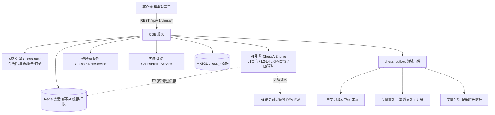
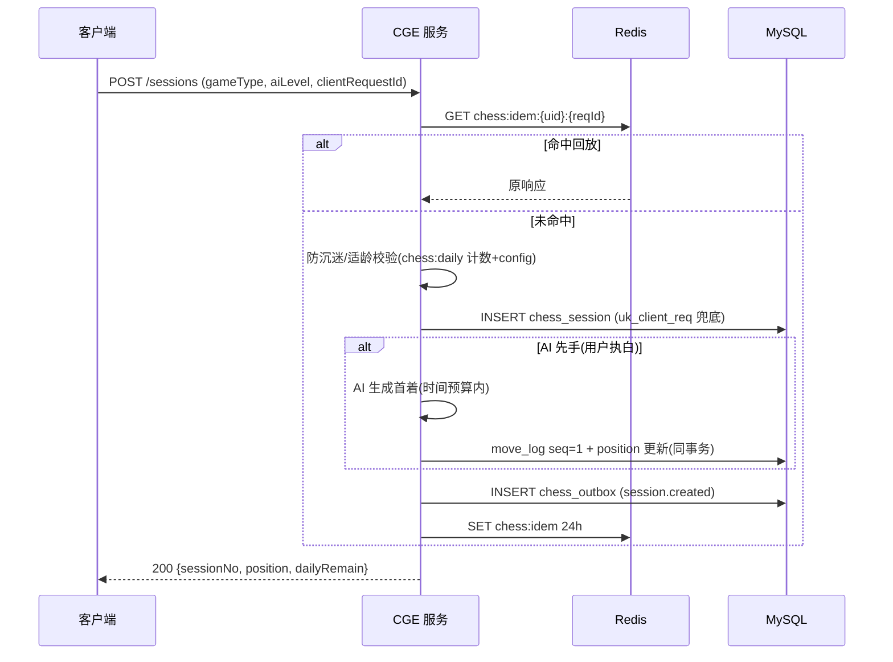
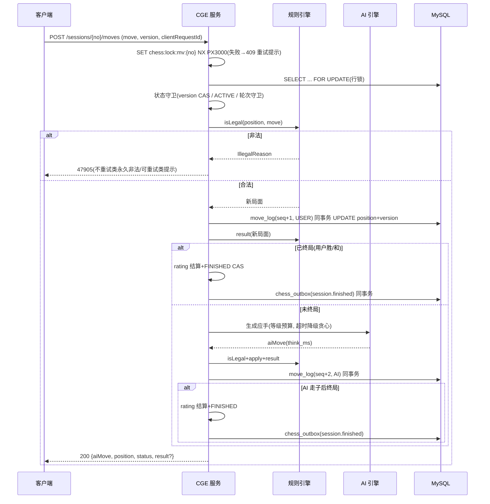
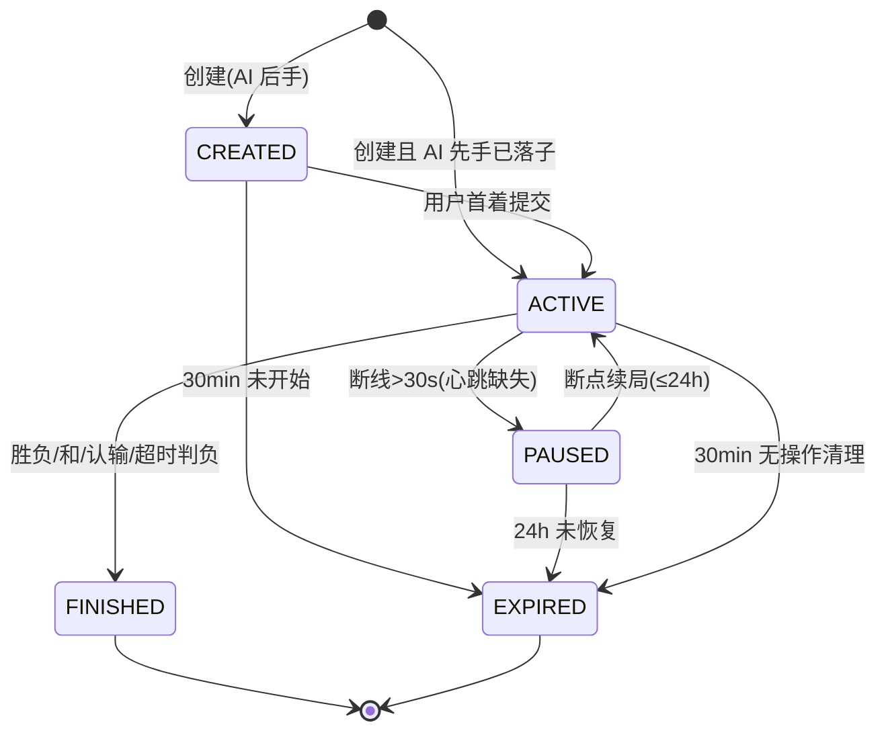

# 服务端-棋类对弈训练引擎 详细设计

- 版本: v1.0
- 日期: 2026-11-22
- 状态: 新增初版
- 错误码段: 47900-47999(全库扫描确认空闲)

## 1. 模块概述

### 1.1 功能定位

棋类对弈训练引擎(Chess Game Engine, 内部代号 CGE)是"棋类对弈"专项娱乐训练域的服务端权威,REST 前缀 `/api/v1/chess/*`。棋类(五子棋/中国象棋/围棋)是思维训练的高粘性品类,在 K12 益智赛道有成熟付费验证,且与现有"思维训练与益智游戏系统"(数独/24 点/舒尔特/华容道/火柴棒)互补:puzzle 系统是**无对手的静态题**,本域是**有对手(服务端 AI)的博弈对弈**,两者规则引擎、状态载体、判题语义均不同构,独立成域(边界裁决见 R3)。

docs2 全库关键词扫描(2026-11-22 `_gap_scan5_20261122.js`)确认"棋类(围棋/象棋/五子棋/跳棋/军棋)"为零覆盖域:仅《服务端-基础计算能力诊断与口算速算自适应训练引擎》《题目难度标定与能力评估模型》两处擦边命中(均非棋类语义)。本文补齐该缺口。

### 1.2 覆盖范围

| 范围 | 内容 | 说明 |
| --- | --- | --- |
| 棋种 | GOMOKU 五子棋(15 路)、XIANGQI 中国象棋、GO 围棋(9/13 路入门) | 围棋 19 路列入 P2 迭代(见 §5.1 L5 预留) |
| 模式 | PLAY 人机对弈 / PUZZLE 残局死活题 / REVIEW AI 复盘 | 定级由 rating 隐式完成,不设独立测评页 |
| AI 对手 | L1 入门 → L5 最强,分层算法(§5) | 服务端算力预算硬约束 |
| 复盘 | 棋谱回放 + LLM 生成讲解 | LLM 只参与**讲解生成**,禁参与**胜负/合法性判定**(R9) |
| 画像 | 分棋种 rating(内部等级标签)+ 对局统计 | 不做全服排行榜(合规 C3) |

**明确不做(本期)**:跳棋/军棋/国际象棋;真人在线对弈(PvP)与对局内聊天;比赛/直播/打赏;棋类"考级证书"挂钩(合规 C6);19 路围棋。

### 1.3 设计原则

1. **规则判定确定性**:着法合法性、将军/应将、提子/打劫/禁入、连五、胜负与和棋判定全部为纯规则代码,LLM 禁入判定(与口算/珠心算/puzzle 同一红线)。
2. **服务端局面唯一权威**:客户端只提交坐标着法,永不下发可推导出必胜策略的内部评估数据;AI 思考细节(剪枝日志等)不下发。
3. **AI 应答永不阻塞**:AI 走子设硬时间预算,超时/引擎异常降级内置贪心着法,用户走子请求必须成功返回(降级矩阵 D2)。
4. **残局正解不下发**:PUZZLE 模式题面不含正解着法序列,提交后服务端比对判定;同义正解集见 §6.2。
5. **棋牌合规底线**:纯训练定位,对弈场景**零虚拟货币押注/赢取/消耗**(积分只经成就事件外发,由激励中心裁决,禁"赢了得积分"直接挂钩,R5+C1),无真人对弈社交(本版),娱乐时长独立计数不计学习时长(R7)。

### 1.4 权威边界

| 边界 | 裁决 |
| --- | --- |
| R1 棋类规则判定权威 | 本引擎封闭。不接入多题型统一判题引擎(与口算/珠心算/puzzle 同约定),LLM 禁参与 |
| R2 残局题出题权威 | 本引擎自治:内置局面编辑器 DSL + 双人审核流,不向题库服务委托(残局题与学科题判题语义不同构) |
| R3 与思维训练与益智游戏系统 | puzzle=无对手静态题(数独等 5 类);本域=AI 对手博弈。双方互不委托;GameType 命名空间独立(puzzle 侧 `puzzle_item.game_type` 与本域 `chess_session.game_type` 不共享枚举) |
| R4 与口算/珠心算引擎 | 口算=横式计算 IRT;珠心算=算盘/脑像专项;本域=博弈策略。能力画像各自单写,跨域只读消费经融合引擎 |
| R5 积分/成就 | 发放权威归用户学习激励中心,本引擎经 `chess_outbox` 事件外发,禁直接写激励表;对局胜负**不直接映射**积分增减,仅里程碑事件(首胜/连胜/破级)外发 |
| R6 复习调度 | 残局题掌握信号经 `chess.puzzle.mastered` 注册间隔重复引擎(对齐拼音/Phonics/珠心算约定) |
| R7 学习时长 | 对弈时长 category=CHESS 为娱乐时长,**不计入**有效学习时长(时长对账引擎权威) |
| R8 防沉迷 | 本引擎只执行时段/时长约束(fail-closed),不裁决不放宽 |
| R9 AI 复盘 | 棋谱结构化数据归本引擎;讲解文案生成经 AI 辅导对话管线,LLM 禁改判胜负/禁着法纠错越权(只许"讲解建议",复核权归规则引擎) |

## 2. 整体架构

### 2.1 引擎架构图



### 2.2 模块职责

| 模块 | 职责 | 不做的事 |
| --- | --- | --- |
| 规则引擎 | 三种棋的着法合法性、局面应用、终局判定;残局正解比对 | 不做评估函数(归 AI 引擎),不做 UI 棋盘渲染 |
| AI 引擎 | 分层对手着法生成、时间预算控制、超时降级、开局库/缓存 | 不做胜负裁决(归规则引擎),不下发思考过程 |
| 残局题服务 | 残局/死活题下发、解答判定、通过率统计 | 不委托题库服务出题 |
| 画像服务 | 分棋种 rating(简化 Glicko-EMA)、对局统计、复盘棋谱聚合 | 不生成完整学情报告(权威外置) |
| 会话服务 | 对局生命周期、行锁串行化、幂等回放、Outbox 同事务 | 不直写激励/时长表 |

## 3. 核心数据结构

### 3.1 枚举定义

```typescript
// 棋种(与 puzzle 系统的 GameType 命名空间独立, R3)
enum ChessGameType {
  GOMOKU  = 'GOMOKU',   // 五子棋 15x15
  XIANGQI = 'XIANGQI',  // 中国象棋 9x10
  GO      = 'GO',       // 围棋 9/13 路(19 路 P2)
}

// 对局模式
enum ChessMode {
  PLAY   = 'PLAY',    // 人机对弈
  PUZZLE = 'PUZZLE',  // 残局/死活题(单局面,非完整对局)
}

// AI 对手等级(服务端权威,家长仅可收紧)
enum ChessAILevel {
  L1 = 1,  // 随机+就近偏好(幼儿/破冰)
  L2 = 2,  // 贪心评估(吃子优先/连四必应)
  L3 = 3,  // α-β 浅搜 或 MCTS 低 sims(默认推荐)
  L4 = 4,  // α-β 深搜+静态搜索 或 MCTS 高 sims
  L5 = 5,  // 策略/价值网络接口预留(P2,当前降级=L4)
}

// 会话状态(见 §9 状态机)
enum ChessSessionStatus {
  CREATED  = 'CREATED',   // 已创建未落首子(AI 先手时已直接落子并转 ACTIVE)
  ACTIVE   = 'ACTIVE',    // 对局进行中,等待用户走子
  PAUSED   = 'PAUSED',    // 客户端断线挂起(≤24h 可续)
  FINISHED = 'FINISHED',  // 终局(胜负/和/认输/超时)
  EXPIRED  = 'EXPIRED',   // 过期清理(无效局,不入统计)
}

// 终局结果(用户视角)
enum ChessResult {
  WIN      = 'WIN',
  LOSE     = 'LOSE',
  DRAW     = 'DRAW',
  RESIGN   = 'RESIGN',    // 用户认输
  TIMEOUT  = 'TIMEOUT',   // 用户超时判负(可选开启)
  ABORTED  = 'ABORTED',   // 中止(EXPIRED 前未分胜负的残局,不入统计)
}

// 走子方
enum ChessMover {
  USER = 'USER',
  AI   = 'AI',
}

// 围棋路数
enum GoBoardSize { B9 = 9, B13 = 13, B19 = 19 /* P2 预留 */ }
```

### 3.2 数据库表设计

```sql
-- 3.2.1 分龄配置表(收紧双人审批,放宽禁止;对齐 puzzle_game_config 守卫 G7 语义)
CREATE TABLE chess_game_config (
  id BIGINT UNSIGNED NOT NULL AUTO_INCREMENT,
  game_type VARCHAR(16) NOT NULL,
  ai_level TINYINT NOT NULL,
  stage_scope VARCHAR(16) NOT NULL DEFAULT 'ALL',     -- 幼儿/小学低/小学高/初中/高中/ALL
  board_size TINYINT NULL,                            -- GO 专用 9/13/19
  time_budget_ms INT NOT NULL DEFAULT 800,            -- AI 思考预算
  daily_game_limit INT NOT NULL DEFAULT 5,
  daily_minute_limit INT NOT NULL DEFAULT 15,
  enable_forbidden TINYINT NOT NULL DEFAULT 0,        -- 五子棋禁手开关(L4+ 默认开)
  config_json JSON NOT NULL,                          -- 禁入名单/申诉窗等扩展
  status TINYINT NOT NULL DEFAULT 1,
  version INT NOT NULL DEFAULT 0,
  updated_by BIGINT UNSIGNED NOT NULL,
  approved_by BIGINT UNSIGNED NULL,                   -- 收紧变更双人审批
  updated_at DATETIME NOT NULL DEFAULT CURRENT_TIMESTAMP ON UPDATE CURRENT_TIMESTAMP,
  PRIMARY KEY (id),
  UNIQUE KEY uk_type_level_scope (game_type, ai_level, stage_scope)
) ENGINE=InnoDB DEFAULT CHARSET=utf8mb4 COMMENT='棋类分龄配置';

-- 3.2.2 对局会话表
CREATE TABLE chess_session (
  id BIGINT UNSIGNED NOT NULL AUTO_INCREMENT,
  session_no VARCHAR(32) NOT NULL,                    -- 对外单号 CS+yyyyMMdd+seq
  user_id BIGINT UNSIGNED NOT NULL,
  game_type VARCHAR(16) NOT NULL,
  mode VARCHAR(16) NOT NULL DEFAULT 'PLAY',
  ai_level TINYINT NOT NULL DEFAULT 3,
  board_size TINYINT NULL,                            -- GO 专用
  status VARCHAR(16) NOT NULL DEFAULT 'CREATED',
  position_json JSON NOT NULL,                        -- 局面权威(CGE-FEN,见 §3.4)
  move_count INT UNSIGNED NOT NULL DEFAULT 0,
  result VARCHAR(16) NULL,                            -- 终局填充(ChessResult)
  rating_delta INT NOT NULL DEFAULT 0,                -- rating 变化(终局填充)
  ai_think_ms_total INT UNSIGNED NOT NULL DEFAULT 0,
  last_move_at DATETIME NULL,
  client_request_id VARCHAR(64) NOT NULL,
  version INT NOT NULL DEFAULT 0,                     -- 乐观锁
  created_at DATETIME NOT NULL DEFAULT CURRENT_TIMESTAMP,
  updated_at DATETIME NOT NULL DEFAULT CURRENT_TIMESTAMP ON UPDATE CURRENT_TIMESTAMP,
  finished_at DATETIME NULL,
  PRIMARY KEY (id),
  UNIQUE KEY uk_session_no (session_no),
  UNIQUE KEY uk_client_req (user_id, client_request_id),
  KEY idx_user_created (user_id, created_at),
  KEY idx_status_expire (status, last_move_at)        -- 过期清理扫描
) ENGINE=InnoDB DEFAULT CHARSET=utf8mb4 COMMENT='棋类对局会话';

-- 3.2.3 走子流水表(棋谱,复盘数据源;只增不改)
CREATE TABLE chess_move_log (
  id BIGINT UNSIGNED NOT NULL AUTO_INCREMENT,
  session_id BIGINT UNSIGNED NOT NULL,
  seq INT UNSIGNED NOT NULL,                          -- 从 1 起,会话内严格递增
  mover VARCHAR(8) NOT NULL,                          -- USER / AI
  move_text VARCHAR(16) NOT NULL,                     -- 坐标着法(如 H8/Q2.5=炮五平四/PASS)
  move_json JSON NOT NULL,                            -- 结构化着法+应用后快照摘要
  think_ms INT UNSIGNED NULL,                         -- AI 思考耗时
  eval_cp INT NULL,                                   -- AI 评估(仅服务端留存,禁下发)
  created_at DATETIME NOT NULL DEFAULT CURRENT_TIMESTAMP,
  PRIMARY KEY (id),
  UNIQUE KEY uk_session_seq (session_id, seq),
  KEY idx_session (session_id)
) ENGINE=InnoDB DEFAULT CHARSET=utf8mb4 COMMENT='棋类走子流水';

-- 3.2.4 残局题表(正解不下发)
CREATE TABLE chess_problem (
  id BIGINT UNSIGNED NOT NULL AUTO_INCREMENT,
  problem_no VARCHAR(32) NOT NULL,
  game_type VARCHAR(16) NOT NULL,
  difficulty TINYINT NOT NULL,                        -- 1-5
  board_size TINYINT NULL,                            -- GO 专用
  position_json JSON NOT NULL,                        -- 起始局面(CGE-FEN)
  goal VARCHAR(16) NOT NULL,                          -- GOMOKU:VCF_WIN / XIANGQI:RED_WIN|DRAW_GOAL / GO:KILL|LIVE|SEME
  solution_json JSON NOT NULL,                        -- 正解着法集合(同义集,见 §6.2),禁下发
  solution_hash CHAR(64) NOT NULL,                    -- sha256(正解规范化),防拖库反推
  min_stage VARCHAR(16) NOT NULL DEFAULT '小学低',
  status VARCHAR(16) NOT NULL DEFAULT 'DRAFT',        -- DRAFT/REVIEW/ONLINE/OFFLINE
  pass_count INT UNSIGNED NOT NULL DEFAULT 0,
  attempt_count INT UNSIGNED NOT NULL DEFAULT 0,
  version INT NOT NULL DEFAULT 0,
  created_by BIGINT UNSIGNED NOT NULL,
  reviewed_by BIGINT UNSIGNED NULL,
  created_at DATETIME NOT NULL DEFAULT CURRENT_TIMESTAMP,
  updated_at DATETIME NOT NULL DEFAULT CURRENT_TIMESTAMP ON UPDATE CURRENT_TIMESTAMP,
  PRIMARY KEY (id),
  UNIQUE KEY uk_problem_no (problem_no),
  KEY idx_type_diff (game_type, difficulty, status)
) ENGINE=InnoDB DEFAULT CHARSET=utf8mb4 COMMENT='棋类残局题';

-- 3.2.5 残局作答表(幂等:同用户同题重试允许,计数去重由 uk 保证)
CREATE TABLE chess_puzzle_attempt (
  id BIGINT UNSIGNED NOT NULL AUTO_INCREMENT,
  problem_id BIGINT UNSIGNED NOT NULL,
  user_id BIGINT UNSIGNED NOT NULL,
  moves_json JSON NOT NULL,
  passed TINYINT NOT NULL,
  client_request_id VARCHAR(64) NOT NULL,
  created_at DATETIME NOT NULL DEFAULT CURRENT_TIMESTAMP,
  PRIMARY KEY (id),
  UNIQUE KEY uk_user_problem_req (user_id, problem_id, client_request_id)
) ENGINE=InnoDB DEFAULT CHARSET=utf8mb4 COMMENT='棋类残局作答';

-- 3.2.6 棋力画像表(分棋种单行,rating 服务端唯一权威)
CREATE TABLE chess_profile (
  id BIGINT UNSIGNED NOT NULL AUTO_INCREMENT,
  user_id BIGINT UNSIGNED NOT NULL,
  game_type VARCHAR(16) NOT NULL,
  board_size TINYINT NULL,                            -- GO 分路数画像;其余 NULL
  rating INT NOT NULL DEFAULT 800,                    -- 简化 Glicko-EMA(§5.6)
  rd INT NOT NULL DEFAULT 200,                        --  rating 偏差(可信度)
  games INT UNSIGNED NOT NULL DEFAULT 0,
  wins INT UNSIGNED NOT NULL DEFAULT 0,
  draws INT UNSIGNED NOT NULL DEFAULT 0,
  losses INT UNSIGNED NOT NULL DEFAULT 0,
  best_streak INT UNSIGNED NOT NULL DEFAULT 0,
  current_streak INT NOT NULL DEFAULT 0,              -- 负数为连败
  version INT NOT NULL DEFAULT 0,
  updated_at DATETIME NOT NULL DEFAULT CURRENT_TIMESTAMP ON UPDATE CURRENT_TIMESTAMP,
  PRIMARY KEY (id),
  UNIQUE KEY uk_user_type_size (user_id, game_type, board_size)
) ENGINE=InnoDB DEFAULT CHARSET=utf8mb4 COMMENT='棋力画像';

-- 3.2.7 领域事件表(Outbox,与事务同库同事务)
CREATE TABLE chess_outbox (
  id BIGINT UNSIGNED NOT NULL AUTO_INCREMENT,
  event_id VARCHAR(64) NOT NULL,                      -- UUID v7
  event_type VARCHAR(48) NOT NULL,
  aggregate_id VARCHAR(32) NOT NULL,                  -- session_no / problem_no
  user_id BIGINT UNSIGNED NOT NULL,
  payload_json JSON NOT NULL,
  status VARCHAR(16) NOT NULL DEFAULT 'PENDING',      -- PENDING/PUBLISHED/FAILED
  retry_count INT NOT NULL DEFAULT 0,
  next_retry_at DATETIME NOT NULL DEFAULT CURRENT_TIMESTAMP,
  created_at DATETIME NOT NULL DEFAULT CURRENT_TIMESTAMP,
  published_at DATETIME NULL,
  PRIMARY KEY (id),
  UNIQUE KEY uk_event_id (event_id),
  KEY idx_status_retry (status, next_retry_at)
) ENGINE=InnoDB DEFAULT CHARSET=utf8mb4 COMMENT='棋类领域事件';
```

> 说明:`chess_session.uk_client_req (user_id, client_request_id)` 保证创建幂等;走子幂等不走唯一索引(同一对局多次走子合法),由 `chess:lock:mv:{sessionNo}` 分布式锁 + `version` 乐观锁 + 客户端幂等键回放三重保证(见 §10)。

### 3.3 Redis 键设计

| 键 | 类型 | TTL | 内容 | 说明 |
| --- | --- | --- | --- | --- |
| `chess:sess:{sessionNo}` | String(JSON) | 24h | 局面镜像+状态 | 读缓存;**写后 DEL 不 SET**(DB 唯一权威) |
| `chess:lock:mv:{sessionNo}` | String | 3s | owner=reqId | SET NX PX 走子锁,防并发双走 |
| `chess:idem:{userId}:{clientRequestId}` | String(JSON) | 24h | 创建/提交回放结果 | 幂等重放快速路径 |
| `chess:ai:mv:{gameType}:{posHash}` | String | 24h | AI 着法缓存 | 仅 L3+(确定性引擎才可缓存) |
| `chess:book:{gameType}` | Hash | 永久(版本号 bump 失效) | 开局库 | 管理端发布,客户端不可见 |
| `chess:daily:{userId}:{yyyyMMdd}` | Hash | 48h | games/minutes per type | 日限计数,Lua 原子自增(§10.3) |
| `chess:ai:sem` | Semaphore | - | 并发 AI 搜索许可 | 上限=AI 执行器核数×2,防算力打满 |

### 3.4 局面序列化协议(CGE-FEN)

局面统一存 JSON,三种棋各自 schema,`position_json` 为唯一权威,客户端只读渲染:

```json
// GOMOKU
{ "v": 1, "board": 15, "grid": "..........", "next": "BLACK", "moves": 0,
  "lastMove": {"r": 7, "c": 7}, "forbiddenOn": false }

// XIANGQI(数组 90 格,行 0=黑方底线;大写红方;空=null)
{ "v": 1, "sq": ["r","n","b","a","k","a","b","n","r",null,...], "next": "RED",
  "moves": 0, "captured": {"RED":[],"BLACK":[]} }

// GO(坐标串:S 黑 W 白;history 为打劫检测的位置哈希链)
{ "v": 1, "size": 9, "stones": {"B":["D4","Q16"],"W":["D16"]},
  "next": "B", "komi": 5.5, "passChain": 0, "historyHash": ["a1b2..."],
  "captured": {"B": 0, "W": 0}, "moves": 0 }
```

## 4. 着法规则引擎(确定性)

### 4.1 总则

- 每种棋实现统一接口 `ChessRules`(§4.5),输入 CGE-FEN + 着法,输出 `IllegalReason` 或应用后新局面。
- 全部判定为纯函数,无 IO、无随机,可单测穷举(验收 AC02)。
- LLM 禁入本层(R1)。

### 4.2 五子棋规则

- 合法性:棋盘内空位。
- 胜负:落子后横/竖/左斜/右斜四方向任一连五即胜;白方长连(≥6)也算胜,黑方长连按禁手规则处理。
- 禁手(`enable_forbidden=1` 时仅约束黑方):双三、双四、长连为禁手点,判负。禁手检测实现:对候选点模拟落子,分别计数活三/冲四/连五数量。

```java
public final class GomokuRules implements ChessRules {
  public static final int BOARD = 15;
  private static final int[][] DIRS = {{0,1},{1,0},{1,1},{1,-1}};

  public IllegalReason isLegal(Position p, Move m) {
    if (!p.inBoard(m.r, m.c)) return IllegalReason.OUT_OF_BOARD;
    if (p.grid[m.r][m.c] != EMPTY) return IllegalReason.OCCUPIED;
    if (p.forbiddenOn && p.next == BLACK && isForbiddenPoint(p.grid, m, BLACK))
      return IllegalReason.FORBIDDEN_POINT;           // 双三/双四/长连
    return null;
  }

  /** 连五判定:落子点沿四方向双向计数 */
  public boolean isFive(byte[][] g, int r, int c, byte color) {
    for (int[] d : DIRS) {
      int n = 1 + countDir(g, r, c, d[0], d[1], color)
                + countDir(g, r, c, -d[0], -d[1], color);
      if (n >= 5) return true;
    }
    return false;
  }

  private static int countDir(byte[][] g, int r, int c, int dr, int dc, byte color) {
    int n = 0;
    for (int i = 1; i < 5; i++) {
      int rr = r + dr * i, cc = c + dc * i;
      if (!inBoard(rr, cc) || g[rr][cc] != color) break;
      n++;
    }
    return n;
  }
}
```

### 4.3 中国象棋规则

- 走子生成按兵种:车直线、马日字(**马腿**——相邻正点被绊则该方向两点位均非法)、相/象田字(**象眼**塞则不能过,不过河)、士/仕斜一格不出九宫、将/帅一格不出九宫且**不可照面**(双方将帅同列且中间无子为非法局面)、炮不吃子走直线、吃子需且仅需**一个炮架**、兵/卒过河前只能进、过河后可平不可退。
- 将军判定:对方将/帅是否在我方任一棋子攻击范围内。
- 应将约束:走子后己方被将军即为非法(送将)。
- 终局:无合法着法且被将=困毙负(与将死同判);无合法着法且未被将=困毙和(中国象棋规则按和棋处理,配置项可改)。

```java
public IllegalReason isLegal(Position p, Move m) {
  Piece pc = p.at(m.from);
  if (pc == null || pc.side != p.next) return IllegalReason.NOT_YOUR_PIECE;
  if (!MoveGen.of(pc.kind).canMove(p, m.from, m.to)) return IllegalReason.BAD_SHAPE; // 马腿/象眼/炮架在此内
  Position after = p.apply(m);
  if (inCheck(after, p.next)) return IllegalReason.LEAVE_KING_IN_CHECK;              // 送将非法
  if (facingKings(after))  return IllegalReason.KINGS_FACING;                          // 照面非法
  return null;
}

public GameResult result(Position p) {
  List<Move> legal = MoveGen.all(p, p.next).filter(m -> isLegal(p, m) == null).toList();
  if (!legal.isEmpty()) return GameResult.ONGOING;
  return inCheck(p, p.next) ? GameResult.CHECKMATED : GameResult.STALEMATE_DRAW;
}
```

### 4.4 围棋规则

- 合法性:空点落子;应用后先移除对方无气子,再检查己方是否有气——己方无气且未提对方子 = **禁入点**(自杀禁);提子后盘面哈希与 `historyHash` 任一环形相同 = **打劫**,禁着。
- 终局:任一方可 PASS;**连续两次 PASS** 触发数目结算(L1 直接服务端权威;L3+ 提供 60s 申诉窗重数一次,见守卫 G8)。
- 计分:采用数子法(中国规则简化):`得分 = 己方存活棋子数 + 围住的空点数`(贴目 komi 默认 5.5/9 路=3.5)。死活判定:入门等级(L1-L2)采用**区域归属启发式**(空点四邻单色连通归属,双方异邻的空点计半目,有歧义时以对局双方 AI 复活的 Monte-Carlo 模拟胜率折半);L3+ 由用户点选死子后确认,服务端重算。
- 棋谱保存 PASS 与终局快照,支持复盘重放。

```java
public IllegalReason isLegal(Position p, Move m) {
  if (!m.isPass()) {
    if (!p.inBoard(m.point)) return IllegalReason.OUT_OF_BOARD;
    if (p.stoneAt(m.point) != null) return IllegalReason.OCCUPIED;
  }
  Position after = p.apply(m);                       // apply 内含提子
  if (after.capturedBy(m.color) == 0 && liberties(after, m.point) == 0)
    return IllegalReason.SUICIDE;
  if (after.hash() != null && p.historyHash().contains(after.hash()))
    return IllegalReason.KO;                         // 全局同形(含劫财变体,采用全链比较)
  return null;
}
```

### 4.5 统一规则接口

```java
public interface ChessRules {
  ChessGameType type();
  IllegalReason isLegal(Position p, Move m);   // null=合法
  Position apply(Position p, Move m);          // 纯函数,返回新局面
  GameResult  result(Position p);              // ONGOING / 终局(含胜负方/和)
  /** 残局正解比对:用户着法序列是否命中同义正解集(§6.2) */
  boolean matchSolution(Position start, List<Move> userMoves, SolutionSet sol);
}
```

## 5. AI 对手引擎

### 5.1 分层定义(服务端权威配置)

| 等级 | 五子棋 | 中国象棋 | 围棋 | 时间预算 | 适用 |
| --- | --- | --- | --- | --- | --- |
| L1 | 随机合法点 + 就近偏好 | 随机合法 + 大子吃子贪心 | 随机星位附近 | 50ms | 幼儿破冰 |
| L2 | 静态评估贪心(连子形状分) | 子力价值贪心 + 被吃回退检查 | 气/提子贪心 | 100ms | 1-2 年级 |
| L3 | VCT 威胁搜索(α-β depth≤6) | α-β 迭代加深 depth 4-6 + 吃子静态搜索 | MCTS 500 sims | 500ms | 默认 |
| L4 | MCTS 2000 sims + 开局库 | α-β depth 6-8 + 置换表 | MCTS 3000 sims | 1200ms | 高阶 |
| L5 | 策略网络占位(P2) | 同 L4 深搜 | 策略/价值网络占位(P2) | 1500ms | 19 路围棋 P2 同步开放 |

> L5 本期为占位:配置可下发但实现降级路由至 L4(降级 D2),管理端标注 `L5=PREVIEW`,对客户端不承诺稳定强度。

### 5.2 α-β 搜索(象棋/五子棋威胁搜索共用骨架)

```java
public final class AlphaBetaEngine {
  public SearchResult search(Position p, int depthBudget, long timeBudgetMs, TransTable tt) {
    long deadline = System.currentTimeMillis() + timeBudgetMs;
    Move best = null; int bestDepth = 0;
    for (int d = 2; ; d += 2) {                       // 迭代加深,偶数层保证回合同步
      IterResult r = searchDepth(p, d, -INF, +INF, deadline, tt);
      if (r.completed) { best = r.best; bestDepth = d; }
      if (!r.completed || d >= depthBudget || isMateScore(r.score)) break;
    }
    return best != null ? new SearchResult(best, bestDepth)
                        : new SearchResult(greedyFallback(p), 0); // 超时兜底永不空着
  }
}
```

要点:**迭代加深 + 超时返回上一轮完整结果**;终局分(将死/连五)以距离层数加权(MATE_SCORE - ply)保证最快杀;置换表按 `(posHash, depth)` 存 EXACT/LOWER/UPPER 三类。

### 5.3 MCTS(五子棋/围棋)

```java
public final class MctsEngine {
  public Move search(Position p, int simulations, long timeBudgetMs) {
    Node root = new Node(p);
    long deadline = System.currentTimeMillis() + timeBudgetMs;
    int n = 0;
    while (n < simulations && System.currentTimeMillis() < deadline) {
      Node leaf = select(root);                       // UCT: argmax( w_i/n_i + c*sqrt(ln N / n_i) )
      if (!leaf.terminal() && !leaf.fullyExpanded()) expand(leaf);
      double v = simulate(leaf, p.next);              // 默认策略 rollout(五子棋:连子形状;围棋:气差)
      backpropagate(leaf, v);
      n++;
    }
    return root.mostVisitedChild().move;              // 访问数最大而非胜率最大,稳态
  }
}
```

### 5.4 时间预算与算力隔离

- AI 搜索提交独立线程池(`chess-ai-executor`),核心线程=CPU 核数×1,队列 200,**拒绝策略=调用方立即走贪心降级**(不排队阻塞 HTTP 线程;对齐《服务端-线程池与异步执行资源统一治理规范》)。
- Redis 信号量 `chess:ai:sem` 做实例级并发上限;超时(预算+200ms 缓冲)即降级。
- 每次 AI 走子记录 `think_ms` 与 `eval_cp` 入 `chess_move_log`(服务端留存,禁下发)。

### 5.5 开局库与着法缓存

- 开局库 `chess:book:{gameType}`:Hash,field=局面哈希,value=着法列表(带权重)。由管理端导入(双人审批),发布即 bump 版本号使旧缓存失效。
- 命中开局库直接返回(0ms),think_ms=0 并标记 `book=true`。
- `chess:ai:mv:*` 缓存仅对**确定性引擎**(L2-L4 α-β/MCTS 固定种子)开启;L1 含随机不缓存;缓存键含 `(gameType, level, posHash, bookVersion)`。

### 5.6 rating 计算(简化 Glicko-EMA)

```java
// 期望胜率
double e = 1.0 / (1.0 + Math.pow(10, (opp.rating - me.rating) / 400.0));
// K 值:前 20 局 40(新手期),之后 24;rd>150 时 K×1.5(低可信度加速回归)
int k = (me.games < 20 ? 40 : 24) * (me.rd > 150 ? 3 / 2 : 1);
int newRating = me.rating + Math.round(k * (score - e));   // score: 胜1 和0.5 负0
// rd 衰减:每局 rd' = max(30, rd - 12 + (结果与预期偏差>0.35 ? 24 : 0))
```

- rating 只用于**匹配对应 AI 等级难度**与内部成长标签,**不展示全服排名**(合规 C3);客户端仅展示"本级胜率/最近走势"。
- 内部等级标签(纯展示,不挂钩社会证书,合规 C6):<900 启蒙级 / 900-1200 进阶级 / 1200-1600 挑战级 / >1600 大师级。

## 6. 残局/死活题模式

### 6.1 题面结构

| 棋种 | 题面(position_json) | 目标(goal) | 判定 |
| --- | --- | --- | --- |
| GOMOKU | 中盘局面 | VCF_WIN 黑先连五 | 用户着法序列首着命中正解集且最终连五 |
| XIANGQI | 残局局面(红先行) | RED_WIN 红先胜 / DRAW_GOAL 谋和 | 连续将杀/守和正解序列比对 |
| GO | 局部棋形(9/13 路局部坐标) | KILL 杀棋 / LIVE 做活 / SEME 打劫收气 | 终局判定目标达成(气数/死活状态) |

### 6.2 同义正解集

象棋存在"多解归一"(不同顺序但等价杀法);五子棋 VCF 首着唯一但后续存在等价必胜分支。判定规则:

1. **首着必须命中** `solution.firstMoves` 集合;
2. 后续着法在对方每一应手后,存在至少一条 `solution.tree` 分支可延续(对手应手按"最顽强应手集"校验——即正解树中记录的全部应手,用户偏离后若仍能胜,经服务端引擎复算验证,允许并记 `passed_with_alternate=true`);
3. 五子棋/围棋终局型目标以规则引擎终局判定为准,不依赖枚举正解。

> 正解数据仅存服务端,`solution_hash` 防拖库比对;客户端只收到题面 + 目标描述。

### 6.3 作答链路

创建题会话(复用 `chess_session` mode=PUZZLE,绑定 problem_id 扩展字段)→ 客户端本地推演 → 提交 `moves_json` → 服务端 `matchSolution` 判定 → `chess_puzzle_attempt` 落库(uk 幂等)→ 通过则 Outbox `chess.puzzle.passed` + `chess.puzzle.mastered`(R6)。

## 7. API 接口设计

### 7.1 学生端接口

统一约定:请求头 `X-Client-Request-Id`(幂等键),响应封装遵循《API网关统一接口规范》;错误码见 §12。

| # | 方法 | 路径 | 说明 | 幂等 |
| --- | --- | --- | --- | --- |
| 1 | POST | `/api/v1/chess/sessions` | 创建对局(PLAY) | clientRequestId |
| 2 | GET | `/api/v1/chess/sessions/{sessionNo}` | 查询局面+棋谱(最近 200 手) | - |
| 3 | POST | `/api/v1/chess/sessions/{sessionNo}/moves` | 提交走子(同步返回 AI 应手) | lock+version |
| 4 | POST | `/api/v1/chess/sessions/{sessionNo}/pass` | 围棋虚着 | lock+version |
| 5 | POST | `/api/v1/chess/sessions/{sessionNo}/finish` | 围棋终局结算(连续双 PASS 自动触发亦可) | lock+version |
| 6 | POST | `/api/v1/chess/sessions/{sessionNo}/resign` | 认输 | lock+version |
| 7 | GET | `/api/v1/chess/sessions?cursor=` | 历史对局列表 | - |
| 8 | GET | `/api/v1/chess/puzzles?gameType=&difficulty=&cursor=` | 残局题列表(不含正解) | - |
| 9 | GET | `/api/v1/chess/puzzles/{problemNo}` | 题面详情(不含正解) | - |
| 10 | POST | `/api/v1/chess/puzzles/{problemNo}/attempts` | 提交解答 | clientRequestId |
| 11 | GET | `/api/v1/chess/profile` | 棋力画像(分棋种 rating/走势/标签) | - |
| 12 | POST | `/api/v1/chess/sessions/{sessionNo}/review-request` | 申请 AI 复盘(异步) | clientRequestId |

**创建对局(例)**

```json
// POST /api/v1/chess/sessions
{ "gameType": "GOMOKU", "aiLevel": 3, "userColor": "BLACK", "clientRequestId": "7f3a..." }
// 200
{ "sessionNo": "CS202611220001", "status": "ACTIVE", "gameType": "GOMOKU",
  "aiLevel": 3, "yourColor": "BLACK", "position": { "v": 1, "board": 15, "grid": "...", "next": "BLACK" },
  "moves": [], "dailyRemain": { "games": 4, "minutes": 13 } }
```

**提交走子(例,五子棋 user 落 H8,AI 应手 H9)**

```json
// POST /api/v1/chess/sessions/CS.../moves
{ "move": {"r":7,"c":7}, "clientRequestId": "9c1e...", "version": 3 }
// 200
{ "accepted": true, "seq": 7, "yourMove": {"r":7,"c":7},
  "aiMove": {"r":8,"c":7}, "aiFromBook": false,
  "position": { "v": 1, "grid": "...", "next": "BLACK", "moves": 8 },
  "status": "ACTIVE", "result": null }
// 终局时:
{ "accepted": true, "seq": 21, "yourMove": {"r":3,"c":3}, "aiMove": null,
  "status": "FINISHED", "result": "WIN", "endReason": "FIVE_IN_ROW",
  "ratingDelta": +18, "newRating": 1012 }
```

**围棋终局结算(例)**

```json
// POST .../finish (连续双 PASS 后客户端确认)
{ "deadStones": ["P3","Q4"], "clientRequestId": "ab22...", "version": 41 }
// 200
{ "status": "FINISHED", "result": "WIN", "endReason": "SCORE",
  "score": { "black": 47.0, "white": 44.5, "komi": 3.5, "margin": 2.5 },
  "appealWindowSec": 60 }
```

### 7.2 管理端接口(运营网段,角色 `chess:admin`)

| # | 方法 | 路径 | 说明 |
| --- | --- | --- | --- |
| 1 | GET/PUT | `/admin/chess/configs*` | 配置查询/修改(收紧双人审批) |
| 2 | POST | `/admin/chess/problems` | 残局题创建(DSL 校验+REVIEW) |
| 3 | POST | `/admin/chess/problems/{no}/review` | 审核(通过 ONLINE / 驳回) |
| 4 | POST | `/admin/chess/books` | 开局库导入发布(版本 bump) |
| 5 | GET | `/admin/chess/sessions/{no}` | 对局全量核查(含 eval_cp) |

### 7.3 内部 gRPC(`chess.internal.v1`)

| 方法 | 用途 | 消费方 |
| --- | --- | --- |
| `GetSessionSnapshot(sessionNo)` | 复盘/客服核查取全量 | AI 辅导管线、客服 |
| `GetProfile(userId)` | 画像只读 | 学情分析 |
| `VerifyMoves(gameType, fen, moves)` | 外部复核(回放仲裁) | 客服工单 |

### 7.4 幂等限流总表

| 接口 | 幂等机制 | 限流(默认,可配) |
| --- | --- | --- |
| 创建对局 | uk_client_req 冲突→原样回放 | 10 次/min/用户 |
| 提交走子/pass/finish/resign | 走子锁 + version CAS + idem 键回放 | 30 次/min/会话 |
| 残局提交 | uk(user,problem,req) | 20 次/min/用户 |
| 复盘申请 | uk clientRequestId | 5 次/min/用户 |
| 查询类 | - | 120 次/min/用户 |

## 8. 核心流程

### 8.1 创建会话主链路



### 8.2 提交走子主链路



**结算要点**:rating 变化、result、finished_at 的写入与 `chess_outbox` 插入必须在**同一本地事务**;Outbox 由 relay 异步发布,失败重试不影响主链路(对齐《事件驱动架构与统一事件总线》)。

### 8.3 AI 复盘链路

1. 用户申请 `review-request` → 校验会话 FINISHED 且为本人 → 生成 `chess.review.requested` 事件;
2. 消费方(AI 辅导管线)调用 gRPC `GetSessionSnapshot` 取棋谱 → 组装讲解 Prompt(禁包含胜负裁决指令,LLM 只生成"思路讲解/妙手点评")→ 生成讲解卡片;
3. 讲解结果回写 `chess_review`(轻量表,本期以事件 payload 异步通知客户端,不落大字段);LLM 输出经教育敏感词过滤(复用统一规则引擎)。
4. 复核红线:讲解中若出现与规则引擎结论冲突的胜负表述,客户端以规则引擎结论为准(R9)。

## 9. 状态机与守卫

### 9.1 会话状态机



PUZZLE 模式会话无 PAUSED(AI 无时间压力),创建即 ACTIVE,提交后 FINISHED。

### 9.2 守卫规则

| 守卫 | 规则 | 违反后果 |
| --- | --- | --- |
| G1 状态守卫 | 仅 ACTIVE 可接受走子;FINISHED/EXPIRED 走子返回 47906 | 409 |
| G2 轮次守卫 | 仅服务端 `position.next` 为用户色时可走子 | 47904 |
| G3 乐观锁 | 提交须携带 version,与库内不符即 47909(客户端需刷新局面) | 409 |
| G4 行锁串行 | 走子事务 `SELECT FOR UPDATE`;分布式锁兜底跨实例 | 串行化 |
| G5 非法着法分级 | 永久非法(越界/己方子)不重试提示;规则非法(送将/禁入/打劫)给具体原因;**不记错不处罚**(对齐 puzzle 反作弊中性原则) | 47905 |
| G6 适龄/难度守卫 | aiLevel/board_size 不得超出配置开放区间;家长收紧以严者胜 | 47901 |
| G7 防沉迷 fail-closed | 日限计数/管控服务不可达时**禁止开新局**,进行中对局可正常终局 | 47907(200 语义话术) |
| G8 围棋结算守卫 | 双 PASS 才可结算;申诉窗内仅可重数一次;终局后棋谱锁定 | 47913 |
| G9 题面泄漏守卫 | 任何响应不得含 `solution_json`/`eval_cp`/AI 内部日志;CI 契约测试断言 | 阻断 |
| G10 AI 降级守卫 | AI 超时/异常必须降级贪心,**禁止返回 5xx 使用户走子失败** | 内部降级 |
| G11 幂等回放 | 同 clientRequestId 重放返回首次结果,不重复落子/事件 | 原样回放 |
| G12 终局一次性 | FINISHED CAS 仅允许 EXPIRED/ACTIVE→FINISHED 一次;重复结算请求返回首次结果 | 原样回放 |

### 9.3 关键竞态裁决

| 竞态 | 裁决 |
| --- | --- |
| 用户双击提交同着 | 走子锁 + idem 键:第二个请求等待锁释放后命中幂等回放(版本已变→走 G3 或 G11,以 idem 优先) |
| 走子与认输并发 | 行锁串行,先到者生效;后到的认输若已 FINISHED 走 G12 原样回放 |
| 断线 PAUSED 期间恢复与过期清理并发 | 过期清理为低频 Job,领取时二次校验状态(仅 ACTIVE→EXPIRED),PAUSED 不在其列;恢复与清理并发时行锁裁决,恢复优先 |
| AI 缓存与开局库版本更新 | 缓存键含 bookVersion,发布即旧缓存自然失效,无脏读窗口 |
| 双 PASS 自动结算与客户端 finish 并发 | finish 以 `passChain>=2` 为前提条件幂等,CAS 只一次成功 |

## 10. 幂等与并发

1. **创建幂等**:`uk_client_req` 唯一冲突 → 查 `chess:idem` 回放;Redis 失效时以 DB  uk 兜底,保证重试不产生两局。
2. **走子幂等**:走子本身是追加式(每次 seq+1),天然非幂等操作,故以"幂等键回放响应"实现**用户侧重试安全**;同键重放返回首次响应(G11),不同键重复提交由 G3 版本锁拦截。
3. **残局提交幂等**:`uk(user_id, problem_id, client_request_id)`;同题不同键允许重复作答(练习语义),但 `passed` 计数与 mastered 事件以 `(user_id, problem_id)` 首次通过为准(去重键 `chess:puzzle:passed:{uid}:{pid}` SET NX)。
4. **并发控制**:会话行锁(G4)+ 分布式走子锁 + AI 信号量三层;画像 rating 更新以 `uk_user_type_size` 行内 `version` CAS,失败重读重试(上限 3)。
5. **日限计数 Lua**(原子):

```lua
-- KEYS[1]=chess:daily:{uid}:{date}  ARGV=type, needMinutes, limitGames, limitMinutes
local g = tonumber(redis.call('HGET', KEYS[1], ARGV[1]..'_games') or '0')
local m = tonumber(redis.call('HGET', KEYS[1], ARGV[1]..'_minutes') or '0')
if g >= tonumber(ARGV[3]) or (m + tonumber(ARGV[2])) > tonumber(ARGV[4]) then
  return 0
end
redis.call('HINCRBY', KEYS[1], ARGV[1]..'_games', 1)
redis.call('HINCRBY', KEYS[1], ARGV[1]..'_minutes', ARGV[2])
redis.call('EXPIRE', KEYS[1], 172800)
return 1
```

## 11. 领域事件

### 11.1 发布(Outbox 同事务)

| event_type | 触发 | payload 摘要 |
| --- | --- | --- |
| `chess.session.finished` | 对局终局 | sessionNo/gameType/result/ratingDelta/moveCount/durationSec |
| `chess.puzzle.passed` | 残局首过 | problemNo/gameType/difficulty/alternateSolution? |
| `chess.puzzle.mastered` | 残局首过(与上同事务) | problemNo(供间隔重复注册,R6) |
| `chess.review.requested` | 复盘申请 | sessionNo |
| `chess.review.completed` | 讲解生成完成 | sessionNo/reviewRef |

### 11.2 订阅(消费矩阵)

| 消费方 | 事件 | 动作 |
| --- | --- | --- |
| 用户学习激励中心 | session.finished(passed 里程碑)/puzzle.passed | 成就判定(首胜/三连胜/破级),**积分增减由激励中心自行裁决**,本域不承诺"胜负=积分"(C1) |
| 间隔重复引擎 | puzzle.mastered | 注册残局复习调度(R6) |
| 学情分析 | session.finished | 娱乐时长聚合(category=CHESS,R7) |
| AI 辅导管线 | review.requested | 生成讲解 → 发 review.completed |
| 客户端推送 | review.completed | 讲解就绪通知 |

### 11.3 对账(每日 04:30)

1. `chess_session FINISHED` 数 = outbox `session.finished` 数(同日期分区);
2. `chess_profile.games` 增量 = 当日 FINISHED 会话数(按 user 聚合容差为 0);
3. `chess_puzzle_attempt.passed=1` 去重数 = outbox `puzzle.passed` 数;
4. Redis `chess:daily:*` 与 DB 时长抽样 5% 对账(容差 <1%,超阈值 P2)。

## 12. 错误码(47900-47999)

| 码 | 常量 | HTTP | 语义 | 客户端处理 |
| --- | --- | --- | --- | --- |
| 47900 | CHESS_PARAM_INVALID | 400 | 参数非法(棋种/等级/坐标) | 表单内联提示 |
| 47901 | CHESS_AGE_LEVEL_FORBIDDEN | 200* | 适龄/难度不可达 | 成长型话术,不引导充值(C1) |
| 47902 | CHESS_NOT_FOUND | 404 | 会话/题不存在 | 通用空态 |
| 47903 | CHESS_SESSION_EXPIRED | 410 | 会话已过期 | 返回首页,可开新局 |
| 47904 | CHESS_NOT_YOUR_TURN | 409 | 非己方轮次 | 刷新局面同步 |
| 47905 | CHESS_MOVE_ILLEGAL | 422 | 着法非法(附 reason:KO/SUICIDE/CHECK/…) | 棋盘原位提示,不处罚(G5) |
| 47906 | CHESS_SESSION_FINISHED | 409 | 对局已终局 | 跳转结果页(G12) |
| 47907 | CHESS_DAILY_LIMIT | 200* | 防沉迷日限/时长到顶 | 中性话术+明日提醒(G7) |
| 47908 | CHESS_AI_BUSY | 429 | AI 算力瞬时占满(仅查询类/复盘可能触发) | 指数退避重试 |
| 47909 | CHESS_STATE_CONFLICT | 409 | version 冲突 | 拉取最新局面后重试 |
| 47910 | CHESS_PUZZLE_NOT_FOUND | 404 | 题目不存在/下线 | 列表刷新 |
| 47911 | CHESS_PUZZLE_LOCKED | 403 | 难度未解锁(前置通过率不足) | 展示解锁条件 |
| 47912 | CHESS_REVIEW_UNAVAILABLE | 200* | 复盘生成失败/不可用 | 仅展示棋谱,无讲解(D6) |
| 47913 | CHESS_SETTLE_FORBIDDEN | 409 | 围棋结算前提不满足(未双 PASS) | 继续对局 |
| 47914 | CHESS_CONFIG_MISSING | 500 | 分龄配置缺失 | 告警,客户端重试 |
| 47915 | CHESS_ADULT_GATE_REQUIRED | 200* | 未成年人敏感操作需家长门(复盘分享外发) | 拉起家长授权 |

> `200*` 为业务语义成功帧(与 47520-47522 同约定);47901/47907/47912/47915 客户端按成功帧渲染引导 UI。通用码(40103 未登录/40001 参数)归口全局不重复占用。

## 13. 降级矩阵

| # | 场景 | 降级行为 | 红线 |
| --- | --- | --- | --- |
| D1 | 配置中心不可达 | 使用本地快照(上次启动加载),缓存 5min | 快照 >24h 则 fail-closed 禁开新局(G7) |
| D2 | AI 引擎超时/异常/算力占满 | 贪心降级着法(必回应);L5 恒降级 L4 | **禁止用户走子失败**(G10) |
| D3 | Redis 不可达 | 走子锁退化为 DB 行锁(性能降不丢正确性);idem 失效由 uk/version 兜底 | 日限计数不可用时按当日已落库对局数估算,超限 fail-closed |
| D4 | 开局库不可用 | 跳过库直接搜索 | 不影响终局判定 |
| D5 | Outbox relay 积压 | 主链路不受影响;事件延迟消费 | 积压 >5min P1 告警 |
| D6 | AI 复盘生成失败(LLM 不可用) | 仅提供棋谱回放,47912 无讲解 | 禁以规则引擎伪造"AI 点评" |
| D7 | 围棋死子识别不确定度超阈值 | L1-L2 区域归属启发式;L3+ 转人工点选确认 | 服务端不得无提示自行收单官归属 |
| D8 | 客户端对局中掉线 | PAUSED 续局(≤24h) | 超期 EXPIRED 不入统计不扣 rating |
| D9 | 推送通道失败 | 复盘就绪改客户端下次进入拉取 | - |
| D10 | —总红线— | 规则判定确定性/正解不下发/防沉迷 fail-closed 三者**任何场景不降级** | - |

## 14. 监控与容量

### 14.1 监控指标(M1-M8)

| 指标 | 口径 | 告警阈值 |
| --- | --- | --- |
| M1 AI 走子 P99 延迟 | 按等级分桶 | L3>600ms/L4>1500ms 持续 10min → P2 |
| M2 AI 降级率 | 降级次数/AI 走子总数 | >2% 持续 15min → P2;>10% → P1 |
| M3 非法着法尝试率 | 47905/走子总量 | >5%(异常爬升,疑似外挂探测)→ P2 安全告警 |
| M4 对局完成率 | FINISHED/(FINISHED+EXPIRED) | 日环比降 >20% → P3 |
| M5 日对局数/残局作答数 | 分棋种 | 容量基线(见 14.2)80% → P3 |
| M6 Outbox 积压 | PENDING 最老年龄 | >5min P1 / >1h P0 |
| M7 幂等回放命中率 | idem 命中/创建总量 | 突增 >3 倍 → P3(排查客户端重试风暴) |
| M8 复盘生成成功率/耗时 | review.requested→completed | 成功率 <98% 或 P95>60s → P2 |

### 14.2 容量估算(DAU 50 万)

- 渗透率假设:棋类日活 4 万(8%),人均 3 局 + 5 题残局 → 日对局 12 万、日作答 20 万。
- 峰值 QPS:晚间峰值走子 300 QPS;AI 搜索并发峰值 40(L3 预算 500ms×单核近似 2 并发/核,执行器 24 核→48 许可,信号量上限 40 留缓冲)。
- 存储:`chess_move_log` 均 30 手/局 → 日增 360 万行(≈0.5GB),按月分区保留 6 个月,冷归档 12 个月(对齐《服务端数据归档与生命周期管理策略》)。
- AI 算力:单实例 24 vCPU 支撑 40 并发搜索;横向扩容 2 实例起步,AI 缓存命中率目标 >35%。

## 15. 合规红线

| # | 红线 |
| --- | --- |
| C1 | **零博弈商业化**:对弈不得挂钩虚拟货币押注/赢取/消耗,胜负不得直接映射积分增减;页面不得出现"赢积分"话术 |
| C2 | 本版**无真人对弈、无对局内聊天/表情包**,杜绝陌生人社交风险 |
| C3 | 义务教育学段**无全服排行榜**,仅展示个人 rating 走势与本级胜率 |
| C4 | 娱乐时长独立计数(category=CHESS),**不计入有效学习时长**,家长端可查看/收紧 |
| C5 | 防沉迷 fail-closed:管控服务不可达禁止开新局;时段禁用时仅允许完成进行中对局 |
| C6 | 内部等级标签(启蒙/进阶/挑战/大师)**不挂钩任何社会考级/证书**,页面不得出现"考级""认证"表述 |
| C7 | AI 复盘讲解经统一教育敏感词过滤;棋谱分享海报脱敏(隐去对局对手标识=AI 等级即可,本版无人机昵称) |
| C8 | 棋类属娱乐品类,分龄默认时长上限从严(puzzle 系统同口径:小学高 20min/日),家长收紧以严者胜 |

## 16. 契约对齐

| # | 契约 |
| --- | --- |
| R1 | 规则判定封闭:本域不接入多题型统一判题引擎;LLM 禁入规则层(与口算/珠心算/puzzle 同一红线家族) |
| R2 | 残局题自治:内置 DSL + 双人审核,不向题库服务委托(R2);题目内容安全经统一审核管线抽检 |
| R3 | 与思维训练与益智游戏系统:puzzle=静态题,chess=AI 对手博弈;枚举/表/Redis 键命名空间全隔离;客户端入口分设(`puzzle` 与 `chess` 路由族) |
| R4 | 与口算/珠心算:能力信号各自单写,融合只读;channel=chess 信号仅标记"策略思维"维度,不与计算能力维度混算 |
| R5 | 激励中心单写者:本域只发事件;里程碑(首胜/三连胜/破级)由激励中心定义与裁决 |
| R6 | 复习调度:仅 `chess.puzzle.mastered` 注册间隔重复;对局棋谱不进入复习调度 |
| R7 | 时长权威:category=CHESS 娱乐时长,对账归统一学习时长跨模块归因引擎,本域不自建口径 |
| R8 | 榜单权威外置:本域不提供任何排行数据接口 |
| R9 | AI 复盘:讲解生成经 AI 辅导对话管线,输出禁含胜负裁决指令;与规则结论冲突时以规则引擎为准 |
| R10 | 客户端页面文档为后续批次(棋类对弈页/残局页/复盘页客户端架构),本文只承诺服务端契约 |
| R11 | 账号注销级联:注销后 24h 内清理 `chess_session` 进行态与 `chess_profile`,棋谱/事件按《数据导出与账户注销》匿名化口径执行 |
| R12 | AI 执行器遵循《服务端-线程池与异步执行资源统一治理规范》独立命名空间 `chess-ai-executor`,禁与其他域共享池 |

## 17. 验收场景

| # | 场景 | 预期 |
| --- | --- | --- |
| AC01 | 创建五子棋 L3 对局(AI 后手) | 返回空盘 ACTIVE,首着后 AI 500ms 内应手 |
| AC02 | 规则穷举一致性 | 象棋全兵种走子生成与人工谱例 1000 局回放,胜负判定与权威规则一致 |
| AC03 | 五子棋连五即终局 | 用户落子成五立即 FINISHED/WIN,AI 不再应手 |
| AC04 | 禁手开启时黑双三判负 | 落禁手点返回 47905(FORBIDDEN),对局按规则判负 |
| AC05 | 象棋送将非法 | 走子后己方被将返回 47905(CHECK),局面不变 |
| AC06 | 象棋照面非法 | 导致将帅照面的着法被拒绝 |
| AC07 | 围棋打劫 | 回提劫位返回 47905(KO);隔一手后允许 |
| AC08 | 围棋禁入(自杀) | 无气且未提子返回 47905(SUICIDE) |
| AC09 | 双 PASS 自动结算 | passChain=2 触发 finish,返回数子法比分与申诉窗 |
| AC10 | AI 超时降级 | 注入引擎慢故障,用户走子仍 200,AI 走贪心着,think_ms 记超时标记 |
| AC11 | 双击重试同一着 | 第二次命中幂等回放,棋谱仅一着,version 不跳变 |
| AC12 | version 冲突 | 携旧 version 提交返回 47909,拉新后可继续 |
| AC13 | 防沉迷到顶 | 开新局 47907(200 话术),进行中对局可终局,次计数清零 |
| AC14 | 残局正解不外泄 | 抓包/契约测试断言任何响应无 solution 字段与 eval_cp(G9) |
| AC15 | 残局同义解 | 偏离正解树但复算可胜,passed_with_alternate=true 记通过 |
| AC16 | 断线续局 | 断线 10min 恢复续局;25h 后 EXPIRED 不入统计不扣 rating |

## 18. 关联文档

- 《思维训练与益智游戏系统-详细设计》(R3 边界姊妹域,puzzle 静态题)
- 《客户端-思维训练与益智游戏页面架构与交互设计》(客户端呈现层参考,棋类客户端文档后续批次 R10)
- 《服务端-珠心算训练引擎-详细设计》(同批次新增专项引擎,模式参照)
- 《服务端-基础计算能力诊断与口算速算自适应训练引擎-详细设计》(专项引擎边界约定参照)
- 《服务端-线程池与异步执行资源统一治理规范》(AI 执行器治理 R12)
- 《事件驱动架构与统一事件总线-详细设计》(Outbox 机制)
- 《服务端-间隔重复算法与遗忘曲线复习调度引擎-详细设计》(R6 复习注册)
- 《服务端-统一业务异常码与错误分类体系-详细设计》(错误码归口)
- 《端到端流程设计-数据导出与账户注销完整链路-详细设计》(R11 注销级联)
- 《服务端-用户额度管控与功能门控引擎-详细设计》(防沉迷 fail-closed 联动)

## 维护记录

- 2026-11-22 v1.0 新增初版:补齐"棋类"零覆盖缺口(全库扫描 围棋/象棋/五子棋/跳棋/军棋 零命中,`_gap_scan5_20261122.js`)。定义 GOMOKU/XIANGQI/GO 三棋种 PLAY/PUZZLE 双模式,CGE-FEN 局面协议,确定性规则引擎(连五/禁手/马腿象眼炮架/将帅照面/提子打劫禁入/数子法),AI 五层对手(L1 贪心→L4 MCTS/α-β,L5 网络占位降 L4),7 表 DDL(uk 幂等+version CAS)+7 类 Redis 键,REST 12+管理 5+gRPC 3,双 mermaid 时序/状态机+守卫 G1-G12+竞态裁决 5 项,47900-47915 错误码段(全库扫描确认空闲),降级 D1-D10(总红线 D10),监控 M1-M8+容量(DAU50 万/日 12 万局),合规 C1-C8(零博弈商业化/无 PvP/无全服榜/内部等级不挂钩考级),契约 R1-R12,验收 AC01-AC16。客户端页面文档列为后续批次(R10)。
