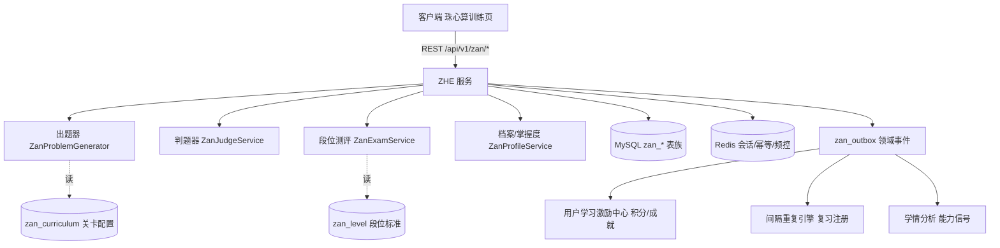
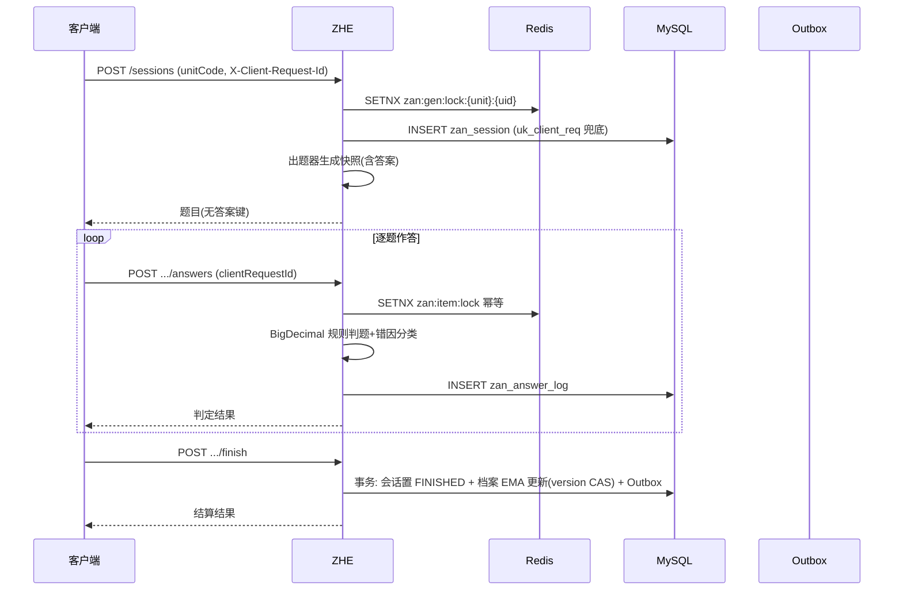
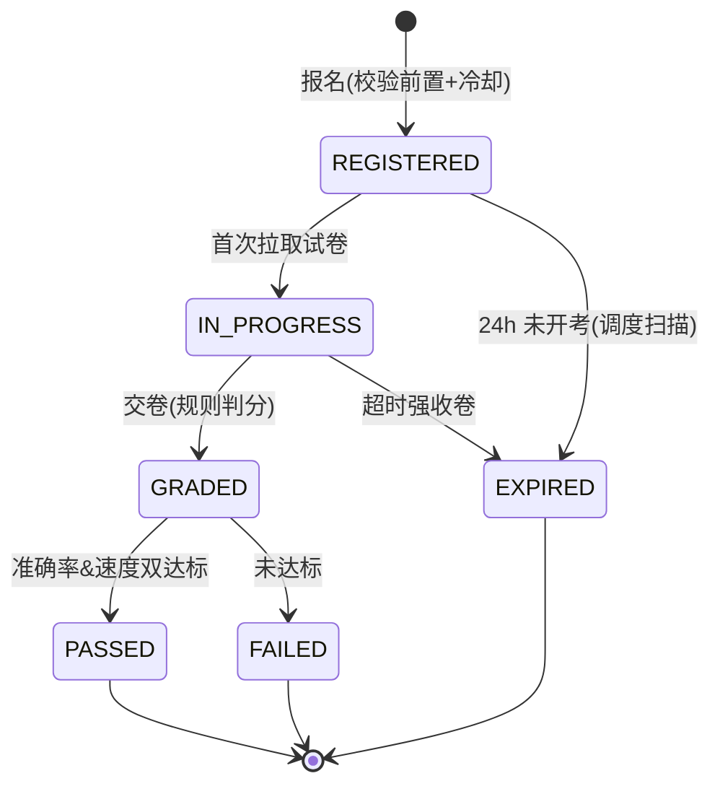

# 服务端-珠心算训练引擎 详细设计

- 版本: v1.0
- 日期: 2026-11-22
- 状态: 新增初版
- 错误码段: 47800-47899(全库扫描确认空闲)

## 1. 模块概述

### 1.1 功能定位

珠心算训练引擎(Zhuxinsuan Engine, 内部代号 ZHE)是"珠心算"专项学习域的服务端权威。珠心算是以算盘为工具、以脑内算盘表象("脑像")为核心的心算训练体系,在国内小学低年级及幼儿大班阶段有稳定的家长付费意愿,是口算速算训练之外计算能力培养的独立赛道。

docs2 全库关键词扫描(珠心算/算盘)确认本域此前零覆盖:口算速算训练引擎覆盖"横式口算/速算"交互训练,思维训练与益智游戏系统覆盖趣味 puzzle,均不含算盘认知、珠算口诀、脑像心算、听心算与段位测评链路。本文补齐该缺口。

### 1.2 覆盖范围

| 层级 | 内容 | 说明 |
| --- | --- | --- |
| L0 算盘认知 | 算盘结构(档/梁/珠)、指法(拇指托、食指拨) | 图文+交互认知课,无判分 |
| L1 珠算基本功 | 定数连加连减、凑五破五、进位加退位减口诀 | 珠算式训练,确定性判题 |
| L2 珠算进阶 | 乘法口诀表运用、除法试商 | 3-4 年级可选 |
| L3 看心算 | 看算式心算(脑像 flash) | 限时看算,速度阶梯 |
| L4 听心算 | 听数列累加/累减(TTS 播报) | 服务端下发序列,音频不留存 |
| L5 段位测评 | 普通级 10→1 级 + 能手级 | 限时定量,准确率+速度双阈值 |

适用学段: 幼儿园大班至小学 4 年级(主战场 1-3 年级),5-6 年级可作为兴趣拓展保留入口。

### 1.3 设计原则

1. **判题确定性**:珠心算全部题型答案为整数(小学阶段),纯规则判题,BigDecimal 比较,LLM 禁参与判题(与口算速算训练引擎同一红线)。
2. **答案键不下发**:题目下发时只给题干与算式,标准答案服务端留存,提交后返回判定。
3. **速度即能力**:珠心算的核心指标是"准确率×速度"双维,速度基线按用户历史自适应,不与同龄排名挂钩(防焦虑红线)。
4. **脑像训练端侧渲染**:脑算盘动画、闪算数字呈现为客户端职责,服务端只下发序列参数与节奏配置。
5. **段位权威唯一**:等级定义、测评标准、晋级判定唯一权威归本引擎,成就/积分经 Outbox 事件外发,不直接写激励系统。

### 1.4 权威边界

| 边界 | 裁决 |
| --- | --- |
| R1 珠心算判题权威 | 本引擎。本域封闭,不接入多题型统一判题引擎(与口算引擎同约定),LLM 禁参与判分 |
| R2 珠心算出题权威 | 本引擎自研参数化生成器(档位/口诀/退位约束与口算横式不同构),不向题库服务委托 |
| R3 与口算速算训练引擎 | 口算引擎=横式口算/速算训练与计算能力 IRT 标定;本引擎=算盘/脑像专项与段位测评。双方互不委托;能力画像各自单写,跨域只读消费经融合引擎 |
| R4 计算能力画像 | 本引擎只发 channel=zan 的能力信号(经统一掌握度计算引擎),不直接写 user 能力画像表 |
| R5 积分/成就/段位证书 | 发放权威归用户学习激励中心,本引擎经 zan_outbox 事件外发,禁直接写激励表 |
| R6 复习调度 | 遗忘曲线/SM-2 调度权威归间隔重复算法引擎,本引擎只发 level.mastered 注册信号(对齐拼音/Phonics 模块约定) |
| R7 听心算音频 | TTS 合成与播放为客户端职责(复用语音服务 ASR/TTS 通道),音频即时销毁不留存;服务端只下发数字序列与节奏参数 |
| R8 防沉迷 | 本引擎只执行时段/时长约束(fail-closed),不裁决不放宽 |
| R9 学情报告 | 珠心算维度数据经事件供学情分析消费,报告生成权威归学习报告服务 |

## 2. 整体架构

### 2.1 引擎架构图



### 2.2 模块职责

| 模块 | 职责 | 不做的事 |
| --- | --- | --- |
| 出题器 | 按关卡参数生成珠算式/看心算/听心算序列 | 不生成应用题/几何题,不委托题库 |
| 判题器 | 整数答案确定性判定、错因分类、速度评分 | 不用 LLM 判分,不做主观评价 |
| 测评服务 | 段位测评编排、限时控制、晋级判定 | 不发积分成就(经 Outbox) |
| 档案服务 | 用户珠心算档案、掌握度、速度基线 EMA | 不写统一能力画像(只发信号) |
| 报告聚合 | 训练周报数据接口 | 不生成完整学情报告(权威外置 R9) |

## 3. 核心数据结构

### 3.1 枚举定义

```typescript
// 训练阶段
enum ZanStage {
  L0_ABACUS_BASIC = 'L0',   // 算盘认知(无判分)
  L1_SUAN_BASIC     = 'L1', // 珠算基本功
  L2_SUAN_ADVANCED  = 'L2', // 珠算进阶(乘除)
  L3_MENTAL_VISUAL  = 'L3', // 看心算
  L4_MENTAL_AURAL   = 'L4', // 听心算
  L5_EXAM           = 'L5', // 段位测评(非训练层,特殊标记)
}

// 题型
enum ZanItemType {
  ABACUS_RECOGNIZE = 'ABACUS_RECOGNIZE', // L0 认读算珠表示的数(唯一 L0 判分题)
  FIXED_ADD        = 'FIXED_ADD',        // 定数连加(如连加3, 10 笔)
  FIXED_SUB        = 'FIXED_SUB',        // 定数连减
  DIRECT_ADD_SUB   = 'DIRECT_ADD_SUB',   // 直加减(一位/两位)
  MAKE_FIVE        = 'MAKE_FIVE',        // 凑五/破五专项
  CARRY_ADD        = 'CARRY_ADD',        // 进位加
  BORROW_SUB       = 'BORROW_SUB',       // 退位减
  MULTIPLY         = 'MULTIPLY',         // 珠算乘法(口诀)
  DIVIDE           = 'DIVIDE',           // 珠算除法(试商)
  MENTAL_VISUAL    = 'MENTAL_VISUAL',    // 看心算(脑像)
  MENTAL_AURAL     = 'MENTAL_AURAL',     // 听心算(序列累加)
}

// 题目载体
enum ZanCarrier {
  ABACUS  = 'ABACUS',  // 需在算盘交互组件上拨珠作答
  KEYPAD  = 'KEYPAD',  // 数字键盘作答
  VOICE   = 'VOICE',   // 语音作答(读结果,ASR 复用发音陪练通道)
}

// 会话状态
enum ZanSessionStatus {
  CREATED = 'CREATED', ACTIVE = 'ACTIVE',
  FINISHED = 'FINISHED', ABANDONED = 'ABANDONED', EXPIRED = 'EXPIRED',
}

// 测评状态
enum ZanExamStatus {
  REGISTERED = 'REGISTERED', IN_PROGRESS = 'IN_PROGRESS',
  GRADED = 'GRADED', PASSED = 'PASSED', FAILED = 'FAILED', EXPIRED = 'EXPIRED',
}

// 错因
enum ZanErrorCause {
  NONE = 'NONE',
  CARRY_MISTAKE   = 'CARRY_MISTAKE',   // 进位错
  BORROW_MISTAKE  = 'BORROW_MISTAKE',  // 退位错
  MAKE_FIVE_MISTAKE = 'MAKE_FIVE_MISTAKE', // 凑五破五错
  TIMES_TABLE     = 'TIMES_TABLE',     // 口诀不熟
  MISHEARD        = 'MISHEARD',        // 听心算听错(仅 L4)
  SLOW            = 'SLOW',            // 答对但超时(速度性错误)
}
```

### 3.2 数据库表设计

```sql
-- 3.2.1 段位等级定义(zan_level)
CREATE TABLE zan_level (
  id              BIGINT UNSIGNED PRIMARY KEY AUTO_INCREMENT,
  level_code      VARCHAR(16)  NOT NULL COMMENT '等级编码: G10..G1(普通级), M1..M3(能手级)',
  level_name      VARCHAR(32)  NOT NULL COMMENT '如 普通十级、普通一级、能手三级',
  stage_scope     VARCHAR(8)   NOT NULL COMMENT '考察阶段范围 L1-L4',
  item_count      INT          NOT NULL COMMENT '测评分题量',
  time_limit_sec  INT          NOT NULL COMMENT '总限时(秒)',
  pass_accuracy   DECIMAL(4,3) NOT NULL COMMENT '晋级正确率阈值, 如 0.900',
  pass_speed_sec  INT          NOT NULL COMMENT '平均单题用时上限(秒/题)',
  prereq_level    VARCHAR(16)  NULL     COMMENT '前置等级编码( NULL=入门开放)',
  config_version  INT          NOT NULL DEFAULT 1,
  status          VARCHAR(16)  NOT NULL DEFAULT 'PUBLISHED' COMMENT 'DRAFT/PUBLISHED/RETIRED',
  UNIQUE KEY uk_level_code_ver (level_code, config_version)
) COMMENT='珠心算段位等级定义';

-- 3.2.2 关卡配置(zan_curriculum)
CREATE TABLE zan_curriculum (
  id              BIGINT UNSIGNED PRIMARY KEY AUTO_INCREMENT,
  unit_code       VARCHAR(24)  NOT NULL COMMENT '关卡编码, 如 L1-U03',
  stage           VARCHAR(8)   NOT NULL,
  unit_name       VARCHAR(64)  NOT NULL,
  item_type       VARCHAR(24)  NOT NULL COMMENT 'ZanItemType',
  carrier         VARCHAR(12)  NOT NULL DEFAULT 'KEYPAD' COMMENT 'ZanCarrier',
  gen_params      JSON         NOT NULL COMMENT '出题参数, 见 3.3',
  item_count      INT          NOT NULL DEFAULT 10,
  time_limit_sec  INT          NULL     COMMENT 'NULL=不限时',
  unlock_rule     JSON         NULL     COMMENT '解锁规则: {prereqUnits:[], minAccuracy:0.8}',
  sort_no         INT          NOT NULL DEFAULT 0,
  config_version  INT          NOT NULL DEFAULT 1,
  status          VARCHAR(16)  NOT NULL DEFAULT 'PUBLISHED',
  UNIQUE KEY uk_unit_code_ver (unit_code, config_version)
) COMMENT='珠心算训练关卡配置';

-- 3.2.3 用户珠心算档案(zan_user_profile)
CREATE TABLE zan_user_profile (
  id               BIGINT UNSIGNED PRIMARY KEY AUTO_INCREMENT,
  user_id          BIGINT UNSIGNED NOT NULL,
  current_level    VARCHAR(16)  NOT NULL DEFAULT 'G10' COMMENT '当前段位编码',
  stage_progress   JSON         NOT NULL COMMENT '各 stage 掌握度快照 {L1:0.82,...}',
  speed_baseline_ms JSON        NOT NULL COMMENT '各 item_type 速度基线 EMA {CARRY_ADD:5200,...}',
  total_train_cnt  INT          NOT NULL DEFAULT 0,
  total_exam_cnt   INT          NOT NULL DEFAULT 0,
  streak_days      INT          NOT NULL DEFAULT 0 COMMENT '连续训练天数',
  enrolled_at      DATETIME     NOT NULL DEFAULT CURRENT_TIMESTAMP,
  version          INT          NOT NULL DEFAULT 0 COMMENT '乐观锁',
  updated_at       DATETIME     NOT NULL DEFAULT CURRENT_TIMESTAMP ON UPDATE CURRENT_TIMESTAMP,
  UNIQUE KEY uk_user_id (user_id)
) COMMENT='珠心算用户档案(SSOT)';

-- 3.2.4 训练会话(zan_session)
CREATE TABLE zan_session (
  id               BIGINT UNSIGNED PRIMARY KEY AUTO_INCREMENT,
  session_id       VARCHAR(36)  NOT NULL COMMENT '对外 UUID',
  user_id          BIGINT UNSIGNED NOT NULL,
  unit_code        VARCHAR(24)  NOT NULL,
  config_version   INT          NOT NULL,
  stage            VARCHAR(8)   NOT NULL,
  item_type        VARCHAR(24)  NOT NULL,
  status           VARCHAR(16)  NOT NULL DEFAULT 'CREATED',
  item_count       INT          NOT NULL,
  items_snapshot   JSON         NOT NULL COMMENT '题目快照含标准答案(服务端留存禁下发)',
  client_request_id VARCHAR(64) NOT NULL COMMENT '幂等键',
  started_at       DATETIME     NULL,
  finished_at      DATETIME     NULL,
  accuracy         DECIMAL(4,3) NULL,
  avg_speed_ms     INT          NULL,
  created_at       DATETIME     NOT NULL DEFAULT CURRENT_TIMESTAMP,
  version          INT          NOT NULL DEFAULT 0,
  UNIQUE KEY uk_client_req (user_id, client_request_id),
  KEY idx_user_status (user_id, status),
  KEY idx_created (created_at)
) COMMENT='珠心算训练会话';

-- 3.2.5 作答日志(zan_answer_log)
CREATE TABLE zan_answer_log (
  id               BIGINT UNSIGNED PRIMARY KEY AUTO_INCREMENT,
  session_id       BIGINT UNSIGNED NOT NULL,
  item_seq         INT          NOT NULL COMMENT '题序 1..N',
  user_answer      VARCHAR(32)  NOT NULL,
  correct          TINYINT(1)   NOT NULL,
  error_cause      VARCHAR(24)  NOT NULL DEFAULT 'NONE',
  elapsed_ms       INT          NOT NULL,
  answered_at      DATETIME     NOT NULL DEFAULT CURRENT_TIMESTAMP,
  client_request_id VARCHAR(64) NOT NULL,
  UNIQUE KEY uk_item (session_id, item_seq, client_request_id),
  KEY idx_session (session_id)
) COMMENT='逐题作答日志';

-- 3.2.6 段位测评(zan_exam)
CREATE TABLE zan_exam (
  id               BIGINT UNSIGNED PRIMARY KEY AUTO_INCREMENT,
  exam_id          VARCHAR(36)  NOT NULL,
  user_id          BIGINT UNSIGNED NOT NULL,
  level_code       VARCHAR(16)  NOT NULL,
  config_version   INT          NOT NULL,
  status           VARCHAR(16)  NOT NULL DEFAULT 'REGISTERED',
  paper_snapshot   JSON         NOT NULL COMMENT '试卷快照含标准答案',
  deadline_at      DATETIME     NOT NULL COMMENT '开考截止时间(报名后 24h)',
  started_at       DATETIME     NULL,
  submitted_at     DATETIME     NULL,
  accuracy         DECIMAL(4,3) NULL,
  avg_speed_sec    DECIMAL(6,2) NULL,
  pass             TINYINT(1)   NULL,
  client_request_id VARCHAR(64) NOT NULL,
  created_at       DATETIME     NOT NULL DEFAULT CURRENT_TIMESTAMP,
  version          INT          NOT NULL DEFAULT 0,
  UNIQUE KEY uk_client_req (user_id, client_request_id),
  UNIQUE KEY uk_active_exam (user_id, level_code, status),
  KEY idx_deadline (deadline_at)
) COMMENT='段位测评记录';

-- 3.2.7 领域事件 Outbox(zan_outbox)
CREATE TABLE zan_outbox (
  id               BIGINT UNSIGNED PRIMARY KEY AUTO_INCREMENT,
  event_id         VARCHAR(64)  NOT NULL,
  event_type       VARCHAR(48)  NOT NULL,
  aggregate_id     VARCHAR(64)  NOT NULL COMMENT 'session_id 或 exam_id',
  payload          JSON         NOT NULL,
  status           VARCHAR(16)  NOT NULL DEFAULT 'PENDING',
  retry_count      INT          NOT NULL DEFAULT 0,
  created_at       DATETIME     NOT NULL DEFAULT CURRENT_TIMESTAMP,
  sent_at          DATETIME     NULL,
  UNIQUE KEY uk_event_id (event_id),
  KEY idx_status (status, id)
) COMMENT='ZHE 领域事件 Outbox';
```

说明:`zan_exam` 的 `uk_active_exam (user_id, level_code, status)` 依赖 MySQL 不支持部分唯一索引的限制,活跃态唯一由守卫 G2 应用层保证(见 §6),索引仅用于查询加速。

### 3.3 出题参数(gen_params)结构

```json
{
  "digitMin": 1,
  "digitMax": 2,
  "operandCount": 2,
  "allowNegative": false,
  "carryRate": 0.5,
  "borrowRate": 0.5,
  "makeFiveRate": 0.3,
  "fixedNumber": 3,
  "fixedCount": 10,
  "aural": {
    "digit": 2,
    "count": 10,
    "paceMs": 900,
    "repeat": 1
  }
}
```

### 3.4 Redis 键设计

| 键 | 类型 | TTL | 说明 |
| --- | --- | --- | --- |
| zan:session:{sessionId} | Hash | 2h | 会话热数据(题序游标/已完成数) |
| zan:item:lock:{sessionId}:{seq} | String | 60s | 单题提交幂等占位(SETNX) |
| zan:exam:active:{userId} | String | 25h | 活跃测评指针(防同段并发 G2) |
| zan:profile:{userId} | String | 15min | 档案读缓存(镜像, DB 为 SSOT) |
| zan:daily:{userId}:{yyyyMMdd} | Hash | 48h | 当日训练计数(防沉迷对接) |
| zan:gen:lock:{unitCode}:{userId} | String | 30s | 同关卡并发创建会话锁 |
| zan:code:segment:478xx | — | — | 错误码段占位声明(防冲突) |

## 4. API 接口设计

统一前缀 `/api/v1/zan`,鉴权: 学生 access token;限流: 60 QPS/用户(创建/提交类 10 QPS)。除注明外均返回统一响应封装 `{code, message, data}`。

### 4.1 GET /overview 训练首页聚合

响应:

```json
{
  "code": 0,
  "data": {
    "currentLevel": "G10",
    "currentLevelName": "普通十级",
    "stageProgress": {"L1": 0.35, "L2": 0.0, "L3": 0.0},
    "todayTrainedItems": 20,
    "todayLimitItems": 40,
    "recommendedUnits": [
      {"unitCode": "L1-U03", "unitName": "凑五破五(一)", "itemType": "MAKE_FIVE", "carrier": "ABACUS"}
    ],
    "examEligible": [
      {"levelCode": "G10", "levelName": "普通十级", "itemCount": 20, "timeLimitSec": 300}
    ],
    "streakDays": 5
  }
}
```

### 4.2 POST /sessions 创建训练会话

请求头: `X-Client-Request-Id`(必填,幂等键)。

```json
{"unitCode": "L1-U03"}
```

响应(题目不含答案键):

```json
{
  "code": 0,
  "data": {
    "sessionId": "8f2c...",
    "status": "ACTIVE",
    "unitCode": "L1-U03",
    "itemType": "MAKE_FIVE",
    "carrier": "ABACUS",
    "timeLimitSec": 180,
    "items": [
      {"seq": 1, "prompt": "3 + 4 = ?", "aural": null},
      {"seq": 2, "prompt": "2 + 3 = ?", "aural": null}
    ],
    "serverTime": "2026-11-22T09:30:00+08:00"
  }
}
```

错误: 47801(关卡不存在/未发布) 47802(未解锁) 47803(防沉迷/每日限额 fail-closed) 47804(同关卡并发创建,重试或复用)。

### 4.3 POST /sessions/{sessionId}/answers 逐题提交

```json
{"seq": 1, "userAnswer": "7", "elapsedMs": 4200, "clientRequestId": "c-uuid-0001"}
```

响应:

```json
{"code": 0, "data": {"correct": true, "errorCause": "NONE", "nextSeq": 2, "finished": false}}
```

规则: 顺序提交不强制(允许跳题回补),但 `finished=true` 判定要求已答数≥item_count×0.8(G5)。重复提交同 `clientRequestId` 返回首次判定结果(幂等重放)。

### 4.4 POST /sessions/{sessionId}/finish 结束结算

响应:

```json
{
  "code": 0,
  "data": {
    "status": "FINISHED",
    "accuracy": 0.9,
    "avgSpeedMs": 5100,
    "weakCauses": [{"cause": "MAKE_FIVE_MISTAKE", "count": 1}],
    "rewardHint": {"xp": 20, "badge": null}
  }
}
```

rewardHint 仅为提示,实际发放以 Outbox 消费为准(禁客户端自行加分, R5)。

### 4.5 POST /aural-sequences 生成听心算序列(L4 预取)

```json
{"unitCode": "L4-U01"}
```

响应(服务端只下发数字序列与节奏,音频由客户端 TTS 合成):

```json
{
  "code": 0,
  "data": {
    "sequenceId": "as-uuid",
    "paceMs": 900,
    "repeat": 1,
    "numbers": [37, 42, 18, 55, 64, 21, 89, 46, 12, 73],
    "expectedItems": 1
  }
}
```

序列一次性下发且与测评/会话绑定使用,禁客户端凭序列自行出题反复刷(G6)。

### 4.6 POST /exams 报名段位测评

```json
{"levelCode": "G10"}
```

规则: 前置段位已持有(prereq_level);该段位无活跃测评(G2);距上次同段失败≥3 天冷却(47807)。

### 4.7 POST /exams/{examId}/submit 交卷

```json
{"answers": [{"seq": 1, "userAnswer": "518", "elapsedMs": 9000}], "clientRequestId": "e-uuid-1"}
```

响应:

```json
{
  "code": 0,
  "data": {
    "status": "PASSED",
    "accuracy": 0.95,
    "avgSpeedSec": 9.2,
    "newLevel": "G9"
  }
}
```

超时未交卷由调度器置 EXPIRED(按 deadline_at 扫描)。

### 4.8 GET /report 训练报告(BFF 聚合接口)

返回近 30 天训练热力、速度趋势线、错因分布、段位历程。明细数据权威在本引擎,报告渲染归客户端。

### 4.9 管理端接口(内部 /admin/zan/*)

| 接口 | 说明 |
| --- | --- |
| PUT /admin/zan/levels/{code} | 段位标准配置(双人审批后生效,乐观锁 version) |
| PUT /admin/zan/units/{code} | 关卡配置(同左) |
| GET /admin/zan/stats/overview | 渗透/完训率/晋级率看板 |
| POST /admin/zan/exams/{id}/void | 测评作废(审计留痕) |

## 5. 核心流程

### 5.1 训练主链路



### 5.2 听心算链路

1. 客户端进入 L4 关卡 → POST /aural-sequences 预取序列;
2. 服务端生成随机序列(均匀分布数位内,禁同数连出≥3 次防记忆捷径),序列绑定 sessionId;
3. 客户端按 paceMs 节奏本地 TTS 播报(复用语音服务,音频即时销毁, R7);
4. 学生心算后 keypad 提交结果,判定为序列之和(或差,由 unit 决定);
5. 服务端校验提交的 sessionId 与序列绑定关系,禁跨会话复用序列(G6)。

### 5.3 段位测评链路



晋级双达标: `accuracy ≥ pass_accuracy` 且 `avg_speed_sec ≤ pass_speed_sec`。判分后立即 CAS 更新 `zan_user_profile.current_level`,并同事务写 Outbox `zan.exam.passed`(消费方: 激励中心发段位证书/成就, 学情分析, 家长通知经家长门)。

## 6. 状态机与守卫

### 6.1 状态机迁移表

| 实体 | 迁移 | 触发 | 守卫 |
| --- | --- | --- | --- |
| 会话 | CREATED→ACTIVE | 创建成功即激活 | G1 |
| 会话 | ACTIVE→FINISHED | finish 且作答率≥80% | G5 |
| 会话 | ACTIVE→ABANDONED | 用户退出/换关卡 | 任意时刻 |
| 会话 | ACTIVE→EXPIRED | 2h 无活动(调度) | — |
| 测评 | 见 5.3 | — | G2/G3 |

### 6.2 守卫 G1-G10

| 守卫 | 规则 |
| --- | --- |
| G1 | 幂等双保险: 创建/提交/交卷均以 (user_id, client_request_id) DB 唯一键为准,Redis SETNX 只做前置去抖;重放返回首次结果,禁二次判分 |
| G2 | 同用户同段位同时只允许一个活跃测评(非 EXPIRED/GRADED/PASSED/FAILED);应用层 FOR UPDATE + `zan:exam:active:{userId}` 指针双保险 |
| G3 | 测评试卷快照创建后不可变(config_version 锁定);配置热更新不影响在途测评 |
| G4 | 判题零 LLM: 判题器单元测试覆盖全部 ZanItemType;代码评审红线 |
| G5 | finish 门槛: 已答数≥item_count×0.8,否则 47808 拒绝结算(允许 ABANDONED) |
| G6 | 听心算序列一次性绑定 sessionId,复用提交判 47809 |
| G7 | 答案键禁下发: BFF/客户端任何响应不得含标准答案;集成测试断言扫描 |
| G8 | 速度基线为个人 EMA(α=0.2),报告中禁出现同龄排名/百分位(防焦虑红线) |
| G9 | 防沉迷约束 fail-closed: 时段/日限额校验失败直接拒绝(47803),无任何白名单绕过 |
| G10 | 注销级联: 订阅 account.deleted,24h 内删除 zan_* 全部个人数据(档案/会话/日志/测评) |

### 6.3 竞态裁决

| 竞态 | 裁决 |
| --- | --- |
| 同 clientRequestId 并发重试 | DB uk 冲突→查询返回已有结果(先到者胜) |
| finish 与最后一题提交并发 | 提交先入库者胜;finish 时重算作答率,不足 80% 拒绝 |
| 测评交卷与超时强收并发 | 交卷事务 CAS 状态,EXPIRED 后提交返回 47810(已过期按已答部分不计成绩) |
| 配置更新与在途会话 | 会话按创建时 config_version 快照跑完(G3) |

## 7. 幂等与并发

1. **创建会话**: (user_id, client_request_id) uk;同关卡并发创建由 `zan:gen:lock` 30s 锁拦截,锁内发现已有 ACTIVE 会话则复用返回(47804 仅在网络重试无法复用时提示)。
2. **逐题提交**: (session_id, item_seq, client_request_id) uk;允许同题不同 clientRequestId 重复作答时以首次为准,后续同题返回 47811(该题已作答)。
3. **交卷**: (user_id, client_request_id) uk + 状态 CAS(version)。
4. **档案更新**: 唯一写入口为结算事务,version 乐观锁;并发会话串行化由单会话结算完成后再更新 EMA 保证(结算事务内 `SELECT ... FOR UPDATE` 档案行)。

## 8. 领域事件

### 8.1 zan_outbox 发布事件

| event_type | 触发 | 消费方 | 载荷要点 |
| --- | --- | --- | --- |
| zan.session.finished | 会话结算 | 学情分析(时长/信号), 防沉迷计数 | userId, accuracy, avgSpeedMs, durationSec |
| zan.weak_cause.detected | 同一会话同错因≥3 | 统一学习干预编排引擎(频控后投递) | cause, stage, count |
| zan.level.mastered | stage_progress 达 0.9 | 间隔重复引擎(复习注册 R6), 激励中心 | stage, score |
| zan.exam.passed | 测评晋级 | 激励中心(段位证书/成就), 学情分析, 家长通知(经家长门) | newLevel, accuracy, avgSpeedSec |
| zan.exam.failed | 测评未达标 | 学习计划重排(建议补练,不强制) | levelCode, weakCauses |

### 8.2 上游订阅

| 事件 | 用途 |
| --- | --- |
| account.deleted | G10 级联删除(GA 对齐 22 域注销编排) |
| parent.control.updated | 训练限额参数刷新(只执行不裁决) |
| fatigue.updated / 防沉迷配置变更 | 限额读模型刷新 |

## 9. 错误码(47800-47899)

| 码 | 含义 | 客户端话术 |
| --- | --- | --- |
| 47800 | 成功 | — |
| 47801 | 关卡不存在或未发布 | "这个练习还没准备好,先看看别的吧" |
| 47802 | 关卡未解锁 | "先完成前面的练习就能解锁啦" |
| 47803 | 防沉迷/每日限额(fail-closed) | "今天的小算盘练习时间到了,明天再来" |
| 47804 | 同关卡已有在途会话 | 复用原会话(透明重试) |
| 47805 | 会话不存在或不属于该用户 | 通用错误 |
| 47806 | 会话状态非法(已结束/过期) | "这次练习已经结束了" |
| 47807 | 测评冷却中(同段失败未满 3 天) | "再练几天,三天后再来挑战" |
| 47808 | 作答率不足 80%,禁止结算 | "还有几道题没做完哦" |
| 47809 | 听心算序列与会话不匹配 | 通用错误 |
| 47810 | 测评已过期 | "这次挑战超时了,重新报名吧" |
| 47811 | 该题已作答(重复提交) | 幂等返回首次结果(200 语义) |
| 47812 | 测评前置段位不满足 | "先通过前面的等级哦" |
| 47813 | 管理端配置冲突(version 过期) | 内部码 |
| 47814-47899 | 预留 | — |

## 10. 降级矩阵

| 级别 | 场景 | 降级策略 |
| --- | --- | --- |
| D1 | Redis 宕机 | DB uk 兜底幂等;档案读直查 DB |
| D2 | 出题器参数校验失败 | 拒绝创建(47801),禁出残缺题 |
| D3 | Outbox 投递失败 | 重试 3 次退避,仍失败转死信告警;激励延迟发放不丢单 |
| D4 | TTS/语音通道不可用 | 听心算单元整体降级为看心算(中性提示,不计训练违约) |
| D5 | 学情消费方不可用 | 事件积压,消费方恢复后追平(Outbox 至少一次) |
| D6 | 管理端配置服务不可用 | 读最近 PUBLISHED 版本,禁改配置 |
| D7 | 报告聚合超时 | 返回缓存上一日数据并标记 degraded |
| D8 | 判题器依赖(无外部依赖) | — |
| D9 | 测评调度器(超时扫描)停摆 | 补偿扫描 10min 窗口;漏扫由下次扫描兜住 |
| D10 | **总红线** | 判题确定性(G4)、答案键不下发(G7)、防沉迷 fail-closed(G9) 三大红线任何场景不可降级 |

## 11. 监控与容量

| 指标 | 告警阈值 |
| --- | --- |
| 会话创建成功率 | <99.5% 持续 5min P2 |
| 判题平均延迟 | P99 >100ms 持续 10min P3 |
| 完成率(创建→FINISHED) | <60%(日维度, 波动>15% P3 排查) |
| 晋级率 | 某段位>80% 或 <20% 提示标准漂移(周维度 P3) |
| 47809 触发量 | >0.1% 判序列复用漏洞 P2 |
| Outbox 积压 | >5min P1 |
| 注销级联延迟 | >24h P1 |
| 配置热更生效延迟 | >60s P3 |

容量(DAU 50 万口径): 珠心算渗透按 6% 估算日活 3 万,人均日 2 会话×15 题,创建/提交峰值合计约 150 QPS;`zan_answer_log` 日增 90 万行,按月分区保留 12 个月,冷数据归档 ClickHouse。

## 12. 合规

1. C1 面向未成年人: 全学段无社交、无排名、无 PK,速度基线只与自身历史比较(G8)。
2. C2 听心算音频即时销毁,服务端不落音频文件(R7);ASR 语音作答复用发音陪练通道,遵守其音频不留存红线。
3. C3 防沉迷时段/日限额 fail-closed(G9),家长可进一步收紧不可放宽(与统一家长门一致)。
4. C4 营销禁入: 本域任何响应/报告不得含商品推荐位。
5. C5 数据最小化: 作答日志仅存答案与耗时,不采集点击轨迹明细。
6. C6 注销级联删除(G10),对接 22 域注销编排。
7. C7 段位证书属虚拟荣誉,禁宣传"考证""考级加分"等违规话术,管理端文案白名单审核。
8. C8 境内存储,`zan_*` 表禁跨域同步。

## 13. 契约对齐

| # | 契约 |
| --- | --- |
| R1-R9 | 见 §1.4 权威边界表 |
| R10 | 客户端珠心算页面(后续批次)复用统一卡片/骨架屏/错误态规范;算盘交互组件渲染归客户端 |
| R11 | 段位证书展示复用成就勋章组件,数据经激励中心事件回传后展示(禁客户端读 ZHE 直接渲染证书) |
| R12 | 训练入口门控: 免费用户每日 2 会话,会员不限会话但受防沉迷硬顶(额度裁决归用户额度管控引擎,ZHE 只读执行) |

## 14. 验收场景

1. AC01 创建会话幂等: 同 X-Client-Request-Id 重放返回同 sessionId,题目一致。
2. AC02 答案键不下发: 创建/详情响应 JSON 递归扫描无 answer 字段(G7 集成断言)。
3. AC03 凑五破五题判题: 3+4 判对,3+5 判错且 error_cause=MAKE_FIVE_MISTAKE。
4. AC04 进位错因: 18+7=25 判错且 error_cause=CARRY_MISTAKE。
5. AC05 听心算: 序列 [37,42,18] 提交 97 判对;换 session 复用同序列判 47809。
6. AC06 作答率 75% 时 finish 返回 47808。
7. AC07 防沉迷: 达日限额创建返回 47803,无任何绕过参数。
8. AC08 测评晋级: G10 达标后 current_level=G9,激励中心收到 zan.exam.passed。
9. AC09 测评冷却: G10 失败后 24h 内再报名返回 47807,72h 后可报名。
10. AC10 双达标裁决: 准确率 0.95 但平均 12s/题(上限 10s)判 FAILED。
11. AC11 在途会话配置热更: 旧会话按旧 config_version 跑完,结果一致。
12. AC12 同段双活跃测评: 第二个报名被拒(G2)。
13. AC13 注销: account.deleted 后 24h 内 zan_* 个人数据清零。
14. AC14 弱网重试: 提交超时重发同 clientRequestId,不重复计数。
15. AC15 报告中无同龄排名字段(G8)。
16. AC16 管理端配置双人审批: 单人提交不生效(47813 或待审批态)。

## 15. 关联文档

- 服务端-基础计算能力诊断与口算速算自适应训练引擎-详细设计.md(R3 边界)
- 服务端-统一掌握度计算与多源学习数据融合引擎(能力信号 channel=zan 消费方)
- 服务端-间隔重复算法与遗忘曲线复习调度引擎(R6)
- 服务端-用户学习激励中心与行为奖励统一规则引擎(R5)
- 服务端-统一家长门与监护人授权核验引擎(G9/C3)
- 客户端-音频播放器与录制引擎及听力练习交互组件(听心算 TTS 复用)
- 发音陪练服务(语音作答 ASR 复用)
- 端到端流程设计-数据导出与账户注销完整链路(G10 级联)

## 16. 维护记录

- v1.0 (2026-11-22): 新增初版。补齐"珠心算"专项训练域全库零覆盖缺口(全目录关键词扫描 珠心算/算盘 零命中);47800-47899 错误码段经全库扫描确认空闲;定位 L0-L5 六层训练与段位测评链路,判题确定性/答案键不下发/防沉迷 fail-closed 三大红线对齐口算速算引擎既有约定。
