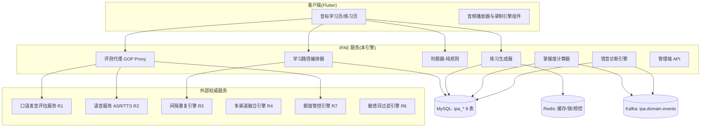
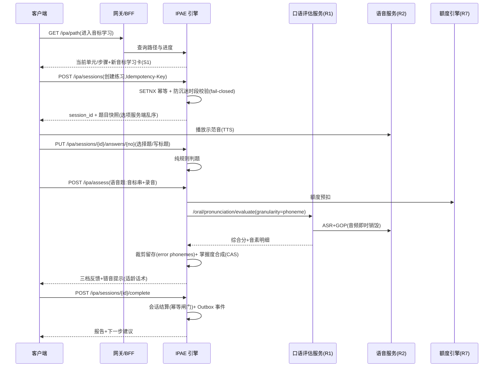

# 服务端-英语国际音标学习与音素级发音训练引擎 - 详细设计

> 版本: v1.0 | 状态: 新增初版 | 错误码段: 49500-49599(全库扫描确认空闲)
> 模块简称: IPAE(IPA Engine)

## 1. 概述

### 1.1 模块定位

IPAE 是 PrimeTop 英语专项学习域的音标教学子引擎,面向**小学高年级、初中、高中**学生,提供英语国际音标(IPA)符号体系的课程编排、音素级发音训练、音标掌握度建模与错音诊断能力。

- **编排权威**:音标学习路径(单元/步骤/门控)、六类音标练习的生成与判定、音标级掌握度 SSOT、错音诊断画像,均归本引擎。
- **执行复用**:音素级发音评分(GOP)不自建,统一代理《服务端-英语口语发音评估与AI情景对话编排服务》的独立评估接口;ASR/TTS 复用《语音服务(ASR-TTS)》。
- **学段衔接**:与《服务端-英语字母认知与自然拼读Phonics启蒙教学引擎》互补——Phonics 覆盖幼儿至小学低段(字母名/字母音/CVC 拼读),IPAE 覆盖小学高年级以上(IPA 符号认读/拼读/听写/辨音),两段不重叠、不重复学习。

### 1.2 与已有模块的边界

| 边界项 | 权威归属 | 本引擎职责 |
|--------|----------|------------|
| R1 音素/单词级发音评分(GOP) | 《服务端-英语口语发音评估与AI情景对话编排服务》(`POST /api/v1/oral/pronunciation/evaluate`,Phonics 引擎 §2.2 已确立该约定) | 纯代理调用 + 结果裁剪(只留音标相关维度)+ 失败降级;**不自建评分、不复制评分算法** |
| R2 ASR/TTS 基础设施 | 《语音服务(ASR-TTS)-详细设计》 | 仅消费标准合成/识别接口 |
| R3 复习调度(遗忘曲线/间隔重复) | 《间隔重复算法与遗忘曲线复习调度引擎》 | 到期的音标复习任务只读拉取并执行;新产生的复习需求信号发送给它,**不自建复习队列** |
| R4 跨渠道知识掌握度 SSOT | 《服务端-多渠道学习数据融合与统一知识掌握度计算引擎》 | 本引擎 `ipa_mastery` 是音标粒度 SSOT,融合引擎只接收 `ipa.mastery.changed` 信号,不回写本引擎 |
| R5 练习会话编排框架 | 《服务端-练习测评会话服务与答题流程状态机》 | 音标练习是会话式轻练习,自管会话状态机(简单六态),不接入统一练习测评会话(其面向考试化测评) |
| R6 内容安全(音频/文本 UGC) | 《服务端-教育场景敏感词多层次过滤与内容安全规则引擎》 | 本引擎无 UGC 文本;录音走语音服务安全通道,遵循同一红线 |
| R7 额度/功能门控 | 《服务端-用户额度管控与功能门控引擎》 | 语音评测调用前向额度引擎预扣,失败按 200 语义降级码处理 |
| R8 错音诊断 vs 发音陪练 | 《发音陪练服务-详细设计》覆盖拼音/汉字/词句朗读练习框架(含英语单词/短句场景) | 发音陪练管"读得对不对"的通用练习;IPAE 管"这个音标你会不会"的课程学习与音素级弱项诊断。读句子的评分归发音陪练/口语评估服务,读音标的评分代理后归 IPAE 组织训练 |

**明确不与 Phonics 重叠**:Phonics 的学生(幼儿/小学低段)不进入 IPAE 路径;小学三年级为默认切换点(可配置),切换前若用户已完成 Phonics L04(高频词),首次进入 IPAE 做一次**音素摸底快测**(§4.2),已牢固的音素标记 `FAMILIAR` 起步,避免重复学习。

### 1.3 核心业务场景

| 编号 | 场景 | 说明 | 优先级 |
|------|------|------|--------|
| S1 | 音标学习卡 | 认标:符号(DJ 音标)+ 中文名称 + 发音部位/方法 + 口型示意 + TTS 示范音 + 3 个示例词 | P0 |
| S2 | 听音辨标 | 播放示范音/示例词,从 4 个形近或音近符号中选出听到的音标(minimal pair 入口) | P0 |
| S3 | 见标拼读 | 给出音标串,学生拼读对应单词,录音后经代理 GOP 评估 | P0 |
| S4 | 听音写标 | 听单词/音,选出或写出该词含有的目标音标 | P1 |
| S5 | 音素跟读 | 单个音标 + 示例词跟读,代理 GOP 评估,输出三档反馈 + 音素错标记 | P0 |
| S6 | 错音诊断与中式发音纠正 | 聚合 GOP 错音 → 匹配中式发音典型错误规则库 → 生成针对性 minimal pair 训练集与讲解卡 | P1 |

### 1.4 设计目标

1. **可教**:48 音标(DJ 体系,附 KK 对照)结构化主数据,支持教材单元对齐(人教版七年级 Starter Unit 起)。
2. **可练**:六类练习覆盖"认→辨→读→写"完整闭环,判定确定性:选择题纯规则判题,语音题代理 GOP。
3. **可诊断**:错音画像按 12 类中式发音典型错误模式聚合,输出可执行的个性化训练集。
4. **可合规**:未成年人场景音频不留存、防沉迷 fail-closed、额度受控。

### 1.5 非目标(明确不做)

- 不自建 ASR/GOP/声学模型,不做发音评分算法的任何本地化实现(R1)。
- 不做美音/英音口音训练课程(美音/英音仅符号对照与示范音双轨,默认跟随教材版本)。
- 不做口语对话/情景编排(归《服务端-英语口语发音评估与AI情景对话编排服务》)。
- 不做音标 AI 讲解自由对话(讲解卡内容由教研生产 + AI 辅助生成但经审核管线,见 §12 合规)。
- 不覆盖 Phonics 学段(R8),不与自然拼读重复教学。

## 2. 整体架构

### 2.1 架构图



### 2.2 处理管线总览

```
学习路径编排  →  练习生成  →  作答提交  →  判定/评测  →  掌握度合成  →  诊断聚合  →  事件扇出
(Path)          (Gen)        (Submit)    (Judge/Proxy)  (Mas)          (Diag 周任务)  (Outbox)
```

1. **编排**:按学段/教材版本生成音标学习路径(默认 12 单元,每单元 4-6 个音标)。
2. **生成**:按掌握度与弱项画像选题型、选目标音标、生成干扰项(形近/音近符号)。
3. **判定**:选择题/写标题纯规则;跟读/拼读题代理 GOP(R1),音频即时销毁。
4. **合成**:四维信号(认/辨/读/写)加权合成音标掌握度,单写者 CAS 更新。
5. **诊断**:错音聚合周任务匹配中式发音错误规则库,生成个性化 minimal pair 训练集。
6. **扇出**:掌握度变化、训练完成、诊断更新经 Outbox 事件通知融合引擎/复习引擎/成长激励。

## 3. 核心数据结构

### 3.1 枚举定义

```typescript
// 音标类别(DJ 48 音标体系)
enum IpaSymbolType {
  VOWEL_MONOPHTHONG = 'VOWEL_MONOPHTHONG', // 单元音 12 个: iː ɪ e æ ɜː ə ʌ ɑː ɒ ɔː ʊ uː
  VOWEL_DIPHTHONG   = 'VOWEL_DIPHTHONG',   // 双元音 8 个: eɪ aɪ ɔɪ əʊ aʊ ɪə eə ʊə
  CONSONANT         = 'CONSONANT',         // 辅音 28 个(含 8 个清浊对)
}

// 练习题型
enum IpaPracticeType {
  RECOGNIZE_CARD      = 'RECOGNIZE_CARD',      // S1 学习卡浏览(不计判定)
  LISTEN_DISCRIMINATE = 'LISTEN_DISCRIMINATE', // S2 听音辨标(选择)
  READ_FROM_SYMBOL    = 'READ_FROM_SYMBOL',    // S3 见标拼读(语音)
  LISTEN_WRITE        = 'LISTEN_WRITE',        // S4 听音写标(选择/书写)
  PHONEME_REPEAT      = 'PHONEME_REPEAT',      // S5 音素跟读(语音)
  MINIMAL_PAIR        = 'MINIMAL_PAIR',        // S6 最小对立对辨音(选择)
}

// 掌握度等级(对齐 user_item_mastery 语义,详见 R4 契约)
enum IpaMasteryLevel {
  UNLEARNED = 'UNLEARNED', // 未学习
  LEARNING  = 'LEARNING',  // 学习中(默认起步)
  FAMILIAR  = 'FAMILIAR',  // 较熟悉(摸底快测通过或 streak 达标)
  MASTERED  = 'MASTERED', // 已掌握(四维信号均达标)
}

// 错音诊断置信类型(中式发音典型错误模式,详见 §4.6)
enum DiagnosisConfType {
  CONF_SUBSTITUTION   = 'CONF_SUBSTITUTION',   // 替换错误(θ→s, v→w, ð→z)
  CONF_VOWEL_LENGTH   = 'CONF_VOWEL_LENGTH',   // 长短元音不分(iː/ɪ, ɑː/ʌ)
  CONF_L1_L2          = 'CONF_L1_L2',          // 拼音迁移(n/l, r/l, f/h 混同)
  CONF_DIPHTHONG      = 'CONF_DIPHTHONG',      // 双元音单元音化(eɪ→e, əʊ→o)
  CONF_NG             = 'CONF_NG',             // 前后鼻音(n/ŋ 混同 sing→sin)
  CONF_AE_E           = 'CONF_AE_E',           // æ/e 不分(bad/bed)
  CONF_CONS_CLUSTER   = 'CONF_CONS_CLUSTER',   // 辅音连缀加音(desk→deskə)
  CONF_END_CONS       = 'CONF_END_CONS',       // 词尾辅音脱落(dog→do)
  CONF_WU_V           = 'CONF_WU_V',           // w/v 混同(wet/vet)
  CONF_ZH_CH          = 'CONF_ZH_CH',          // dʒ/tʃ 与拼音 zh/ch 混同
  CONF_SCHWA          = 'CONF_SCHWA',          // 弱读 schwa 强读
  CONF_UNKNOWN        = 'CONF_UNKNOWN',        // 未匹配规则,仅记录原始错音
}

// 评测降级原因(代理层)
enum AssessDegradeReason {
  NONE          = 'NONE',
  ORAL_TIMEOUT  = 'ORAL_TIMEOUT',  // 口语评估服务超时
  ORAL_5XX      = 'ORAL_5XX',      // 口语评估服务故障
  QUOTA_EXCEED  = 'QUOTA_EXCEED',  // 额度不足(200 语义)
  VOICE_DOWN    = 'VOICE_DOWN',    // 语音服务故障
}

// 会话状态
enum IpaSessionStatus {
  CREATED    = 'CREATED',
  IN_PROGRESS= 'IN_PROGRESS',
  SCORING    = 'SCORING',   // 存在语音题在评测
  COMPLETED  = 'COMPLETED',
  EXPIRED    = 'EXPIRED',
  ABANDONED  = 'ABANDONED',
}
```

### 3.2 数据库表 DDL

```sql
-- ============================================================
-- 3.2.1 音标主数据表
-- ============================================================
CREATE TABLE ipa_symbol (
  id                BIGINT UNSIGNED NOT NULL AUTO_INCREMENT,
  symbol_id         VARCHAR(32)  NOT NULL COMMENT '业务ID: ipa_xxx,如 ipa_theta',
  ipa               VARCHAR(8)   NOT NULL COMMENT 'DJ 音标符号,如 θ',
  ipa_display       VARCHAR(16)  NOT NULL COMMENT '带长音记号展示形,如 θ(θː 不适用,纯展示)',
  kk                VARCHAR(8)   DEFAULT NULL COMMENT 'KK 音标对照(美音),如 θ 对应 θ',
  name_zh           VARCHAR(32)  NOT NULL COMMENT '中文名称,如 清齿擦音',
  category          VARCHAR(24)  NOT NULL COMMENT 'VOWEL_MONOPHTHONG/VOWEL_DIPHTHONG/CONSONANT',
  place             VARCHAR(32)  DEFAULT NULL COMMENT '发音部位: 齿间/唇齿/齿龈/硬腭/软腭/声门',
  manner            VARCHAR(32)  DEFAULT NULL COMMENT '发音方法: 爆破/摩擦/破擦/鼻音/边音/近音',
  voicing           TINYINT      DEFAULT NULL COMMENT '清浊: 0清音 1浊音 NULL元音',
  vowel_length      TINYINT      DEFAULT NULL COMMENT '元音长短: 0短 1长 NULL非元音',
  mouth_shape_url   VARCHAR(500) DEFAULT NULL COMMENT '口型示意图URL(内容生产管线产出)',
  articulation_tip  VARCHAR(500) DEFAULT NULL COMMENT '发音要领文案(教研审核后入库)',
  example_words     JSON         NOT NULL COMMENT '示例词[{word, phonetic, audio_url}×3]',
  demo_audio_url    VARCHAR(500) NOT NULL COMMENT '音标本身示范音',
  difficulty        TINYINT      NOT NULL DEFAULT 3 COMMENT '教学难度 1-5',
  sort_order        INT          NOT NULL DEFAULT 0 COMMENT '教学顺序',
  status            VARCHAR(16)  NOT NULL DEFAULT 'PUBLISHED' COMMENT 'DRAFT/PUBLISHED/ARCHIVED',
  created_at        DATETIME     NOT NULL DEFAULT CURRENT_TIMESTAMP,
  updated_at        DATETIME     NOT NULL DEFAULT CURRENT_TIMESTAMP ON UPDATE CURRENT_TIMESTAMP,
  PRIMARY KEY (id),
  UNIQUE KEY uk_symbol_id (symbol_id),
  UNIQUE KEY uk_ipa (ipa)
) ENGINE=InnoDB DEFAULT CHARSET=utf8mb4 COMMENT='音标主数据表';

-- ============================================================
-- 3.2.2 学习路径定义表(按学段/教材版本)
-- ============================================================
CREATE TABLE ipa_learn_path (
  id               BIGINT UNSIGNED NOT NULL AUTO_INCREMENT,
  path_id          VARCHAR(32) NOT NULL COMMENT '业务ID: ipapath_xxx',
  stage            VARCHAR(16) NOT NULL COMMENT 'primary_junior(小高)/junior(初中)/senior(高中)',
  textbook_version VARCHAR(32) DEFAULT NULL COMMENT '教材版本,NULL=通用路径',
  unit_count       INT         NOT NULL DEFAULT 12,
  entry_quiz       TINYINT     NOT NULL DEFAULT 1 COMMENT '进入前是否摸底快测',
  status           VARCHAR(16) NOT NULL DEFAULT 'PUBLISHED',
  version          INT         NOT NULL DEFAULT 1,
  created_at       DATETIME NOT NULL DEFAULT CURRENT_TIMESTAMP,
  updated_at       DATETIME NOT NULL DEFAULT CURRENT_TIMESTAMP ON UPDATE CURRENT_TIMESTAMP,
  PRIMARY KEY (id),
  UNIQUE KEY uk_path_scope (stage, textbook_version)
) ENGINE=InnoDB DEFAULT CHARSET=utf8mb4 COMMENT='音标学习路径定义表';

CREATE TABLE ipa_path_step (
  id           BIGINT UNSIGNED NOT NULL AUTO_INCREMENT,
  path_id      VARCHAR(32) NOT NULL,
  unit_no      INT         NOT NULL COMMENT '单元序号 1..N',
  step_no      INT         NOT NULL COMMENT '步骤序号',
  step_type    VARCHAR(24) NOT NULL COMMENT 'NEW_SYMBOLS(新学)/REVIEW(复习)/QUIZ(单元测)/ASSESS(摸底)',
  symbol_ids   JSON        NOT NULL COMMENT '本步骤涉及的 symbol_id 列表',
  gate_rule    JSON        DEFAULT NULL COMMENT '前置门控规则,如 {type:MIN_MASTERED,unit:2,count:4}',
  created_at   DATETIME NOT NULL DEFAULT CURRENT_TIMESTAMP,
  PRIMARY KEY (id),
  UNIQUE KEY uk_path_unit_step (path_id, unit_no, step_no)
) ENGINE=InnoDB DEFAULT CHARSET=utf8mb4 COMMENT='音标路径步骤表';

-- ============================================================
-- 3.2.3 用户路径进度表(单用户单路径一行)
-- ============================================================
CREATE TABLE ipa_user_path_progress (
  id               BIGINT UNSIGNED NOT NULL AUTO_INCREMENT,
  user_id          BIGINT UNSIGNED NOT NULL,
  path_id          VARCHAR(32)     NOT NULL,
  current_unit     INT  NOT NULL DEFAULT 1,
  current_step     INT  NOT NULL DEFAULT 1,
  assess_done      TINYINT NOT NULL DEFAULT 0 COMMENT '摸底快测是否已完成',
  weak_symbol_ids  JSON     DEFAULT NULL COMMENT '摸底/诊断出的弱项音标',
  status           VARCHAR(16) NOT NULL DEFAULT 'ACTIVE' COMMENT 'ACTIVE/FINISHED/SWITCHED',
  version          INT NOT NULL DEFAULT 0 COMMENT '乐观锁',
  created_at       DATETIME NOT NULL DEFAULT CURRENT_TIMESTAMP,
  updated_at       DATETIME NOT NULL DEFAULT CURRENT_TIMESTAMP ON UPDATE CURRENT_TIMESTAMP,
  PRIMARY KEY (id),
  UNIQUE KEY uk_user_path (user_id, path_id)
) ENGINE=InnoDB DEFAULT CHARSET=utf8mb4 COMMENT='用户音标路径进度表';

-- ============================================================
-- 3.2.4 练习会话表(幂等创建)
-- ============================================================
CREATE TABLE ipa_practice_session (
  id                BIGINT UNSIGNED NOT NULL AUTO_INCREMENT,
  session_id        VARCHAR(40)  NOT NULL COMMENT '业务ID: ipasess_xxx',
  user_id           BIGINT UNSIGNED NOT NULL,
  practice_type     VARCHAR(24)  NOT NULL COMMENT 'IpaPracticeType',
  path_id           VARCHAR(32)  DEFAULT NULL,
  unit_no           INT          DEFAULT NULL,
  target_symbol_ids JSON         NOT NULL COMMENT '本会话目标音标',
  question_count    INT          NOT NULL DEFAULT 8,
  status            VARCHAR(16)  NOT NULL DEFAULT 'CREATED' COMMENT 'IpaSessionStatus',
  client_request_id VARCHAR(64)  NOT NULL COMMENT '幂等键',
  idem_key          VARCHAR(80)  NOT NULL COMMENT '(user_id, practice_type, client_request_id)',
  score             INT          DEFAULT NULL COMMENT '会话总分 0-100',
  pass              TINYINT      DEFAULT NULL,
  degrade_reason    VARCHAR(20)  DEFAULT 'NONE' COMMENT '评测降级原因',
  started_at        DATETIME     DEFAULT NULL,
  completed_at      DATETIME     DEFAULT NULL,
  expires_at        DATETIME     NOT NULL COMMENT '创建+24h 过期',
  created_at        DATETIME NOT NULL DEFAULT CURRENT_TIMESTAMP,
  updated_at        DATETIME NOT NULL DEFAULT CURRENT_TIMESTAMP ON UPDATE CURRENT_TIMESTAMP,
  PRIMARY KEY (id),
  UNIQUE KEY uk_session_id (session_id),
  UNIQUE KEY uk_idem (idem_key),
  KEY idx_user_status (user_id, status, created_at)
) ENGINE=InnoDB DEFAULT CHARSET=utf8mb4 COMMENT='音标练习会话表';

-- ============================================================
-- 3.2.5 答题记录表
-- ============================================================
CREATE TABLE ipa_practice_answer (
  id             BIGINT UNSIGNED NOT NULL AUTO_INCREMENT,
  session_id     VARCHAR(40) NOT NULL,
  user_id        BIGINT UNSIGNED NOT NULL,
  question_no    INT         NOT NULL,
  question_type  VARCHAR(24) NOT NULL,
  target_symbol  VARCHAR(32) NOT NULL COMMENT '目标 symbol_id',
  payload        JSON        NOT NULL COMMENT '题目快照(选项/音标串/音频),服务端为权威',
  user_answer    JSON        DEFAULT NULL COMMENT '用户作答(选项id/音标串/audio_ref)',
  correct        TINYINT     DEFAULT NULL COMMENT '0错 1对 NULL未判定',
  gop_score      DECIMAL(5,2) DEFAULT NULL COMMENT '语音题 GOP 综合分',
  error_phonemes JSON        DEFAULT NULL COMMENT '[{expected, actual, conf_type}]',
  client_request_id VARCHAR(64) NOT NULL,
  answered_at    DATETIME    DEFAULT NULL,
  created_at     DATETIME NOT NULL DEFAULT CURRENT_TIMESTAMP,
  PRIMARY KEY (id),
  UNIQUE KEY uk_session_qno_req (session_id, question_no, client_request_id),
  KEY idx_user_target (user_id, target_symbol, answered_at)
) ENGINE=InnoDB DEFAULT CHARSET=utf8mb4 COMMENT='音标答题记录表';

-- ============================================================
-- 3.2.6 音素评估日志(代理 GOP 结果裁剪留存;音频不落库)
-- ============================================================
CREATE TABLE ipa_phoneme_assess_log (
  id             BIGINT UNSIGNED NOT NULL AUTO_INCREMENT,
  assess_id      VARCHAR(40) NOT NULL COMMENT '业务ID: ipaass_xxx',
  user_id        BIGINT UNSIGNED NOT NULL,
  session_id     VARCHAR(40) NOT NULL,
  answer_id      BIGINT UNSIGNED NOT NULL,
  target_text    VARCHAR(64) NOT NULL COMMENT '评估目标(音标/单词)',
  granularity    VARCHAR(16) NOT NULL DEFAULT 'phoneme',
  gop_overall    DECIMAL(5,2) NOT NULL,
  completeness   DECIMAL(5,2) DEFAULT NULL,
  accuracy       DECIMAL(5,2) DEFAULT NULL,
  fluency        DECIMAL(5,2) DEFAULT NULL,
  phoneme_detail JSON        DEFAULT NULL COMMENT '音素级明细(裁剪:只留 error 音素与低分音素)',
  degrade_reason VARCHAR(20) NOT NULL DEFAULT 'NONE',
  provider       VARCHAR(32) DEFAULT NULL COMMENT '实际评分供应方(多供应商容灾切换后记录)',
  created_at     DATETIME NOT NULL DEFAULT CURRENT_TIMESTAMP,
  PRIMARY KEY (id),
  UNIQUE KEY uk_assess_id (assess_id),
  KEY idx_user_created (user_id, created_at)
) ENGINE=InnoDB DEFAULT CHARSET=utf8mb4 COMMENT='音素评估日志表';

-- ============================================================
-- 3.2.7 音标掌握度表(音标粒度 SSOT,单写者=掌握度计算器)
-- ============================================================
CREATE TABLE ipa_mastery (
  id               BIGINT UNSIGNED NOT NULL AUTO_INCREMENT,
  user_id          BIGINT UNSIGNED NOT NULL,
  symbol_id        VARCHAR(32) NOT NULL,
  level            VARCHAR(16) NOT NULL DEFAULT 'LEARNING' COMMENT 'IpaMasteryLevel',
  recog_streak     INT NOT NULL DEFAULT 0 COMMENT '认标连续正确(听辨+写标合并计)',
  read_eval_count  INT NOT NULL DEFAULT 0 COMMENT '语音评估次数',
  read_eval_avg    DECIMAL(5,2) DEFAULT NULL COMMENT '语音评估均分',
  write_correct    INT NOT NULL DEFAULT 0,
  write_total      INT NOT NULL DEFAULT 0,
  last_signal_at   DATETIME DEFAULT NULL COMMENT '最近学习信号时间(供衰减)',
  version          INT NOT NULL DEFAULT 0,
  created_at       DATETIME NOT NULL DEFAULT CURRENT_TIMESTAMP,
  updated_at       DATETIME NOT NULL DEFAULT CURRENT_TIMESTAMP ON UPDATE CURRENT_TIMESTAMP,
  PRIMARY KEY (id),
  UNIQUE KEY uk_user_symbol (user_id, symbol_id),
  KEY idx_user_level (user_id, level)
) ENGINE=InnoDB DEFAULT CHARSET=utf8mb4 COMMENT='音标掌握度表';

-- ============================================================
-- 3.2.8 错音诊断画像表(周任务聚合产出)
-- ============================================================
CREATE TABLE ipa_error_profile (
  id             BIGINT UNSIGNED NOT NULL AUTO_INCREMENT,
  user_id        BIGINT UNSIGNED NOT NULL,
  conf_type      VARCHAR(24) NOT NULL COMMENT 'DiagnosisConfType',
  evidence_count INT NOT NULL DEFAULT 0 COMMENT '支撑证据数(error phoneme 命中次数)',
  confidence     DECIMAL(4,3) NOT NULL DEFAULT 0 COMMENT '0-1 置信度',
  sample_symbols JSON         DEFAULT NULL COMMENT '典型错音示例 [{expected, actual}]',
  drill_pack     JSON         DEFAULT NULL COMMENT '针对性训练集 minimal pair 题包',
  last_seen_at   DATETIME DEFAULT NULL,
  status         VARCHAR(16) NOT NULL DEFAULT 'ACTIVE' COMMENT 'ACTIVE/RESOLVED(连续4周未复发)',
  created_at     DATETIME NOT NULL DEFAULT CURRENT_TIMESTAMP,
  updated_at     DATETIME NOT NULL DEFAULT CURRENT_TIMESTAMP ON UPDATE CURRENT_TIMESTAMP,
  PRIMARY KEY (id),
  UNIQUE KEY uk_user_conf (user_id, conf_type),
  KEY idx_user_status (user_id, status)
) ENGINE=InnoDB DEFAULT CHARSET=utf8mb4 COMMENT='错音诊断画像表';

-- ============================================================
-- 3.2.9 最小对立对题库表
-- ============================================================
CREATE TABLE ipa_minimal_pair_bank (
  id            BIGINT UNSIGNED NOT NULL AUTO_INCREMENT,
  pair_id       VARCHAR(32) NOT NULL,
  symbol_a      VARCHAR(32) NOT NULL COMMENT 'symbol_id A(目标)',
  symbol_b      VARCHAR(32) NOT NULL COMMENT 'symbol_id B(干扰/对立)',
  word_a        VARCHAR(32) NOT NULL COMMENT '如 ship',
  word_b        VARCHAR(32) NOT NULL COMMENT '如 sheep',
  phonetic_a    VARCHAR(64) NOT NULL,
  phonetic_b    VARCHAR(64) NOT NULL,
  audio_a_url   VARCHAR(500) NOT NULL,
  audio_b_url   VARCHAR(500) NOT NULL,
  conf_type     VARCHAR(24) NOT NULL COMMENT '主要训练的 DiagnosisConfType',
  difficulty    TINYINT NOT NULL DEFAULT 2,
  status        VARCHAR(16) NOT NULL DEFAULT 'PUBLISHED',
  created_at    DATETIME NOT NULL DEFAULT CURRENT_TIMESTAMP,
  PRIMARY KEY (id),
  UNIQUE KEY uk_pair (word_a, word_b),
  KEY idx_conf (conf_type, status)
) ENGINE=InnoDB DEFAULT CHARSET=utf8mb4 COMMENT='最小对立对题库表';

-- ============================================================
-- 3.2.10 Outbox 事件表
-- ============================================================
CREATE TABLE ipa_domain_outbox (
  id            BIGINT UNSIGNED NOT NULL AUTO_INCREMENT,
  event_id      VARCHAR(64) NOT NULL,
  event_type    VARCHAR(48) NOT NULL,
  aggregate_id  VARCHAR(64) NOT NULL,
  payload       JSON        NOT NULL,
  status        VARCHAR(16) NOT NULL DEFAULT 'PENDING' COMMENT 'PENDING/SENT/FAILED',
  retry_count   INT NOT NULL DEFAULT 0,
  next_retry_at DATETIME DEFAULT NULL,
  created_at    DATETIME NOT NULL DEFAULT CURRENT_TIMESTAMP,
  sent_at       DATETIME DEFAULT NULL,
  PRIMARY KEY (id),
  UNIQUE KEY uk_event_id (event_id),
  KEY idx_status_retry (status, next_retry_at)
) ENGINE=InnoDB DEFAULT CHARSET=utf8mb4 COMMENT='IPAE 领域事件 Outbox';
```

### 3.3 Redis 键设计

| 键模式 | 类型 | TTL | 说明 |
|--------|------|-----|------|
| `ipae:path:{user_id}` | String(JSON) | 6h | 用户路径进度缓存,写后失效 |
| `ipae:mastery:{user_id}` | String(JSON) | 6h | 掌握度全量缓存(48 音标,写后失效) |
| `ipae:symbol:all` | String(JSON) | 24h | 音标主数据全量(后台更新主动失效) |
| `ipae:session:lock:{session_id}` | String | 10min | 作答提交互斥锁(防并发重复结算) |
| `ipae:idem:{idem_key}` | String | 30min | 会话创建幂等键(SETNX) |
| `ipae:answer:idem:{uk}` | String | 24h | 答题幂等去重 |
| `ipae:assess:lock:{answer_id}` | String | 5min | 同一答题并发评测互斥 |
| `ipae:daily:count:{user_id}:{date}` | String | 48h | 当日语音评测次数(额度软限) |
| `ipae:proxy:circuit:oral` | String | 30s滑窗 | 口语评估服务熔断器状态 |
| `ipae:diag:lock:{user_id}` | String | 1h | 诊断聚合任务锁(周任务切片内) |

## 4. 核心流程设计

### 4.1 端到端时序



### 4.2 学习路径编排与摸底快测

**默认路径**(初中通用版,可配置):12 单元,单元按"元音→双元音→清浊辅音对→难音(θ/ð/ŋ/ðz 等)"递进;每单元 = 新学(4-6 音标)+ 复习步骤 + 单元测。

**门控规则**:
- G1:单元测通过线 ≥ 70 分且本单元音标 `level ≥ FAMILIAR` 比例 ≥ 60%,否则解锁补救练习而非重学全部。
- G2:进入新单元前必须完成上一单元测(CAS 推进 `current_unit`)。

**摸底快测**(entry_quiz=1 且 Phonics 完成用户首次进入):
- 8 题混合快测(听辨 4 + 见标拼读 2 + 写标 2),5 分钟上限;
- 结果只用于**起步定位**:全对音标直接 `FAMILIAR`;错 ≥2 次的音标标弱项进入 `weak_symbol_ids`,优先排入前 3 单元复习位;
- 快测不通过/中断不设失败惩罚(防挫败),可随时重测,重测冷却 3 天。

### 4.3 练习生成算法

```python
def generate_session(user_id, practice_type, path_ctx, count=8):
    mastery = load_mastery(user_id)                      # Redis 缓存
    targets = pick_target_symbols(mastery, path_ctx)     # 弱项优先 + 当前单元新学
    questions = []
    for sym in targets:
        if practice_type == LISTEN_DISCRIMINATE:
            distractors = pick_distractors(sym, mode='visual_then_acoustic')
            # 干扰项策略: 元音优先形近(iː/ɪ, æ/e),辅音优先发音部位相邻(s/θ, n/ŋ)
            questions.append(build_listen_choice(sym, distractors))   # 选项服务端乱序
        elif practice_type == READ_FROM_SYMBOL:
            words = pick_example_words(sym, count=3, difficulty_match=True)
            questions.append(build_read_from_symbol(sym, words))      # 音标串→单词
        elif practice_type == PHONEME_REPEAT:
            questions.append(build_repeat(sym))                       # 音标+示例词跟读
        elif practice_type == LISTEN_WRITE:
            questions.append(build_listen_write(sym, mode='choice'))  # P1 书写式用 AI 判读+规则兜底
        elif practice_type == MINIMAL_PAIR:
            pair = pick_minimal_pair(sym, error_profile(user_id))     # 诊断画像优先
            questions.append(build_minimal_pair(pair))
    return shuffle_keep_first_two(questions)   # 前 2 题放最有把握的目标,建立信心
```

**判定规则**:
- 选择类(听音辨标/写标/minimal pair):纯规则比对 `payload.answer`,**LLM 不参与判题**(红线 G9,判题确定性同《服务端-口算拍照整页批改引擎》裁决)。
- 语音类(见标拼读/音素跟读):代理 GOP,阈值:≥85 通过档,70-84 待巩固,<70 未通过;错误反馈只描述"哪个音发成了什么"(如"θ 读成了 s"),不输出分数细粒度给低龄用户(分龄展示,见 §13)。

### 4.4 评测代理(GOP Proxy)

对齐 Phonics 引擎 §2.2/§6.3 既定约定:

1. 客户端录音经语音服务**临时区**上传,`store_audio=false`,评估完成后即时销毁(红线 C1,未成年人音频不留存)。
2. 代理调用 `POST /api/v1/oral/pronunciation/evaluate`:
   - `referenceText` = 目标音标串/示例词音标;
   - `granularity` = `phoneme`(音素级)或 `word`(整词,拼读题);
   - 结果裁剪:**只留存** `gop_overall / completeness / accuracy / fluency` 与 error/低分音素明细,其余字段不落库。
3. **降级三级**:
   - 额度不足 → 记 `QUOTA_EXCEED`,返回 200 语义码 49521,引导次日再来(不扣学习信号);
   - 口语评估服务超时/5xx → 熔断器(30s 滑窗,错误率>50% 熔断 60s),记 `ORAL_TIMEOUT/ORAL_5XX`,返回 49522,该题标记"未评测不计对错"(不计错、不判对,G3);
   - 语音服务故障 → `VOICE_DOWN`,示范音不可用,选择题仍可作答。
4. 代理超时预算:整体 P99 ≤ 3.5s(口语评估服务内部预算 3s + 网络 0.5s),超时即按降级处理,**不阻塞会话**(语音题可稍后重评,会话进入 `SCORING` 态等待,20min 未完成则该题记未评测并结算)。

### 4.5 掌握度计算引擎

**单写者原则**:`ipa_mastery` 只允许掌握度计算器在服务内事务外按 CAS 更新,任何其他模块不得直写(R4)。

四维信号与合成:

| 维度 | 信号来源 | 权重 | 升级条件(示例) |
|------|----------|------|------------------|
| 认/辨 | 听音辨标、minimal pair 答对 | 0.3 | recog_streak ≥ 4 |
| 读 | 见标拼读/音素跟读 GOP 均分 | 0.35 | read_eval_avg ≥ 80 且次数 ≥ 3 |
| 写 | 听音写标正确率 | 0.25 | write_correct/write_total ≥ 0.8 且 total ≥ 4 |
| 时新性 | last_signal_at 衰减 | 0.1 | 30 天无信号降级半档 |

等级映射:
- `MASTERED`:四维全部达标(综合分 ≥ 85)。
- `FAMILIAR`:综合分 ≥ 65 且读维度 ≥ 70。
- `LEARNING`:默认;综合分 < 40 且 14 天无信号保持 LEARNING 不降级到 UNLEARNED(防来回跳档)。
- `UNLEARNED`:仅初始化/路径切换时存在,学习中不回退(裁决:已学音标不因遗忘回退 UNLEARNED,遗忘由复习引擎调度解决,同《错题整理》retention SSOT 语义)。

更新公式:`score = 0.3*recog + 0.35*read + 0.25*write + 0.1*freshness`,信号变化时同事务写 `ipa_mastery`(CAS version)+ `ipa_domain_outbox(ipa.mastery.changed)`。

### 4.6 错音诊断引擎(周任务 + 实时触发)

**输入**:`ipa_phoneme_assess_log.error_phonemes`(expected→actual 映射)。

**中式发音规则库**(预置 12 类,对应 `DiagnosisConfType`,教研可后台增改版本化配置):

| 规则 | expected→actual 模式 | 典型 |
|------|----------------------|------|
| θ→s / ð→z | 齿间音替换 | think→sink, this→zis |
| v→w | 浊唇齿擦音替换 | vet→wet |
| iː↔ɪ / uː↔ʊ / ɑː↔ʌ | 长短元音不分 | sheep↔ship |
| æ↔e | 前元音开口度 | bad↔bed |
| eɪ→e / əʊ→o | 双元音单元音化 | day→de, go→ɡo |
| n→ŋ / ŋ→n | 前后鼻音 | sin↔sing |
| dʒ↔zh / tʃ↔ch | 破擦音拼音化 | jeep→"zhip" |
| desk→deskə | 辅音连缀加元音 | 词尾插入 schwa |
| 词尾辅音脱落 | dog→do, cold→cole | END_CONS |
| w↔v | 近音/擦音混同 | west↔vest |
| schwa 强读 | about 首音节重读 | SCHWA |
| 其他 | 未匹配 | UNKNOWN |

**聚合逻辑**(周任务,凌晨 03:40,与全库批处理错峰):
1. 拉取近 7 天 `error_phonemes`,按 (user_id, expected, actual) 计数 ≥ 3 才入诊断(防单次噪声);
2. 匹配规则库得 `conf_type`,多规则命中取 evidence 最多者,并列取 conf_type 字典序小者(确定性);
3. `confidence = min(1, evidence_count / 10)`,≥ 0.3 才生成/更新画像(uk_user_conf 幂等);
4. 生成 `drill_pack`:从 `ipa_minimal_pair_bank` 按 conf_type 取 10 题(难度匹配学段),供客户端"我的弱音训练"入口;
5. 连续 4 周无新证据 → 画像 `RESOLVED`;复发 → 回 `ACTIVE` 并刷新 evidence。

**实时触发**:单次评估 error_phonemes 命中 ≥ 3 个同类错音时,不等周任务,即时 upsert 画像(evidence 按 +1 计,仍受 0.3 置信门槛)。

### 4.7 与词汇系统联动(生词音标前置学习)

《英语词汇记忆与单词本系统》单词卡含 `phonetic_us/phonetic_uk`。联动规则:
- 客户端展示生词卡时,若词内音素对应的本引擎掌握度存在 `LEARNING` 级且该生词标记"发音困难"(用户手动或 2 次跟读低分),则卡片出现"先学这个音"入口;
- 跳转 IPAE 生成仅含该音标的 3 题微训练(不占每日正式练习额度);
- 微训练完成回跳单词卡,记 `ipa.micro_drill.done` 事件供词汇系统打点。

## 5. API 接口设计

### 5.1 接口总览

| 方法 | 路径 | 说明 | 幂等 |
|------|------|------|------|
| GET | `/api/v1/ipa/path` | 当前路径/进度/下一学习卡 | 读 |
| POST | `/api/v1/ipa/entry-quiz/submit` | 摸底快测提交 | client_request_id |
| GET | `/api/v1/ipa/symbols/{symbolId}` | 音标学习卡详情 | 读 |
| POST | `/api/v1/ipa/sessions` | 创建练习会话 | Idempotency-Key |
| GET | `/api/v1/ipa/sessions/{sessionId}` | 会话状态/题目快照 | 读 |
| PUT | `/api/v1/ipa/sessions/{sessionId}/answers/{qno}` | 提交单题作答 | (sessionId,qno,clientRequestId) |
| POST | `/api/v1/ipa/assess` | 语音题评测(录音已在语音服务临时区) | assess 幂等键 |
| POST | `/api/v1/ipa/sessions/{sessionId}/complete` | 会话结算 | 会话状态 CAS |
| GET | `/api/v1/ipa/mastery` | 48 音标掌握度全景 | 读 |
| GET | `/api/v1/ipa/diagnosis` | 错音画像+训练集 | 读 |
| POST | `/api/v1/ipa/micro-drill` | 生词音标微训练(联动) | client_request_id |
| GET | `/api/v1/ipa/review-due` | 到期复习音标(拉自 SRS R3) | 读 |
| POST | `/admin/v1/ipa/symbols` | 音标主数据增改(双人审批) | 后台审计 |
| POST | `/admin/v1/ipa/pairs` | minimal pair 题库维护 | 后台审计 |
| GET | `/admin/v1/ipa/stats` | 维度统计(掌握分布/诊断分布) | 读 |

### 5.2 创建练习会话

```http
POST /api/v1/ipa/sessions
Idempotency-Key: 7f3a9c2e-8b1d-4a6f-9c3e-2d5b6a8f1c4e
```
```json
{
  "practiceType": "LISTEN_DISCRIMINATE",
  "unitNo": 3,
  "questionCount": 8,
  "clientRequestId": "clmob_20261117_183022_5571"
}
```
响应 200:
```json
{
  "sessionId": "ipasess_20261117183025_ab12cd",
  "status": "IN_PROGRESS",
  "questions": [
    {
      "questionNo": 1,
      "type": "LISTEN_DISCRIMINATE",
      "targetSymbolId": "ipa_theta",
      "audioUrl": "https://oss.example.com/ipa/demo/theta.mp3",
      "options": [
        {"optionId": "opt_s", "symbol": "s"},
        {"optionId": "opt_theta", "symbol": "θ"},
        {"optionId": "opt_f", "symbol": "f"},
        {"optionId": "opt_z", "symbol": "z"}
      ]
    }
  ],
  "expiresAt": "2026-11-18T18:30:25+08:00"
}
```
- 选项**服务端乱序**(G6 防位置记忆,同拼音识字链路既定裁决);
- 命中幂等键返回首次受理的同一 session(49503 语义对齐注册引导链路)。

### 5.3 语音评测

```http
POST /api/v1/ipa/assess
```
```json
{
  "sessionId": "ipasess_20261117183025_ab12cd",
  "questionNo": 2,
  "targetSymbolId": "ipa_i_long",
  "targetText": "ʃiːp",
  "granularity": "word",
  "audioRef": "voice-tmp://20261117/8f2e1c9d.mp3",
  "clientRequestId": "clmob_20261117_183104_8812"
}
```
响应 200(评测成功):
```json
{
  "assessId": "ipaass_20261117183105_77aa",
  "gopOverall": 82.5,
  "verdict": "NEED_CONSOLIDATION",
  "feedback": {
    "tone": "encouraging",
    "text": "很接近了!注意 iː 要拉长,像微笑一样。",
    "errorPhonemes": [
      {"expected": "iː", "actual": "ɪ", "confType": "CONF_VOWEL_LENGTH"}
    ]
  },
  "masteryDelta": {"symbolId": "ipa_i_long", "level": "LEARNING", "recogStreak": 0}
}
```
响应 200(降级,200 语义码见 §10):
```json
{"degraded": true, "code": 49522, "message": "评测服务忙,本题先不计成绩,已为你保留录音可稍后重试", "verdict": "UNASSESSED"}
```

### 5.4 会话结算

```http
POST /api/v1/ipa/sessions/ipasess_20261117183025_ab12cd/complete
```
```json
{
  "sessionId": "ipasess_20261117183025_ab12cd",
  "status": "COMPLETED",
  "score": 81,
  "pass": true,
  "summary": {
    "correctCount": 7,
    "unassessedCount": 1,
    "weakSymbols": ["ipa_theta"],
    "nextStep": {"type": "NEW_SYMBOLS", "unitNo": 3, "stepNo": 2}
  }
}
```
- 存在未评测语音题也允许结算(降级不阻塞,§4.4);
- `complete` 幂等:重复提交返回首次结算结果(49509 语义)。

## 6. 关键代码示例

### 6.1 会话创建(幂等 + 防沉迷 fail-closed)

```go
// ipae/session_service.go
func (s *SessionService) Create(ctx context.Context, uid int64, req CreateReq) (*Session, error) {
    // G7 防沉迷:时段/时长校验失败一律 fail-closed(与防沉迷引擎契约,不自行裁决额度)
    if err := s.minorGuard.CheckLearnAllowed(ctx, uid, "ipa_practice"); err != nil {
        return nil, err // 49030 语义由家长门/防沉迷域输出,本引擎不翻译
    }
    idem := fmt.Sprintf("%d:%s:%s", uid, req.PracticeType, req.ClientRequestID)
    ok, _ := s.redis.SetNX(ctx, "ipae:idem:"+idem, 1, 30*time.Minute).Result()
    if !ok {
        return s.repo.FindByIdem(ctx, idem) // 命中幂等:返回首次受理会话
    }
    sess := buildSession(uid, req) // 生成题目快照(选项乱序)
    if err := s.repo.InsertWithIdem(ctx, sess, idem); err != nil {
        // DB uk_idem 兜底:并发下唯一一个写入成功
        if isDuplicateErr(err) {
            return s.repo.FindByIdem(ctx, idem)
        }
        return nil, err
    }
    return sess, nil
}
```

### 6.2 掌握度合成(CAS 单写者)

```go
// ipae/mastery_service.go
func (s *MasteryService) ApplySignal(ctx context.Context, uid int64, sig Signal) error {
    return s.tx.With(ctx, func(tx db.Tx) error {
        m, err := s.repo.GetForUpdate(tx, uid, sig.SymbolID) // SELECT ... FOR UPDATE
        if err != nil { return err }
        m.Add(sig) // 四维信号叠加;读信号更新 streak/avg,写信号更新正确率
        newLevel := calcLevel(m) // 综合分映射,带迟滞:降档需连续 2 次信号支撑
        changed := newLevel != m.Level
        m.Level = newLevel
        if err := s.repo.UpdateCAS(tx, m, m.Version); err != nil { // UPDATE ... WHERE version=?
            return err // 并发冲突外层重试(单写者下理论不触发,兜底)
        }
        if changed {
            return s.outbox.Insert(tx, Event{
                EventID:  uuid.NewString(),
                Type:     "ipa.mastery.changed",
                Payload:  map[string]any{"userId": uid, "symbolId": sig.SymbolID,
                          "from": stringLevel(m.LevelPrev), "to": stringLevel(newLevel)},
            })
        }
        return nil
    })
}
```

### 6.3 评测代理与降级

```go
// ipae/assess_proxy.go
func (p *Proxy) Evaluate(ctx context.Context, uid int64, req AssessReq) (*AssessResult, error) {
    if p.breaker.IsOpen("oral") {
        return Degraded(AssessDegradeReasonORAL5XX), nil // 49522,不计对错
    }
    if left, err := p.quota.TryPreDeduct(ctx, uid, "ipa_voice_assess"); err != nil || left <= 0 {
        return Degraded(AssessDegradeReasonQUOTAEXCEED), nil // 49521,次日再来
    }
    ctx, cancel := context.WithTimeout(ctx, 3500*time.Millisecond)
    defer cancel()
    res, err := p.oral.Evaluate(ctx, oraleval.Req{
        ReferenceText: req.TargetText,
        Granularity:   req.Granularity, // phoneme/word
        AudioRef:      req.AudioRef,    // store_audio=false,评估后销毁
        Scene:         "ipa_drill",     // 供口语服务路由与成本归集
    })
    if err != nil {
        p.breaker.Record("oral", false)
        p.quota.Refund(ctx, uid, "ipa_voice_assess")
        return Degraded(mapTimeout(err)), nil
    }
    p.breaker.Record("oral", true)
    trimmed := TrimPhonemeDetail(res.PhonemeDetail) // 只留 error/低分(<70)音素
    p.log.Save(ctx, uid, req, res, trimmed)         // ipa_phoneme_assess_log
    return &AssessResult{Overall: res.Overall, Errors: trimmed, Degrade: "NONE"}, nil
}
```

### 6.4 诊断聚合(周任务,幂等切片)

```sql
-- 1) 近 7 天错音计数(诊断门槛:同 expected→actual 命中 >= 3)
SELECT user_id,
       JSON_EXTRACT(error_phonemes, '$[*].expected') AS exp,
       JSON_EXTRACT(error_phonemes, '$[*].actual')   AS act,
       COUNT(*) AS hits
FROM ipa_phoneme_assess_log
WHERE created_at >= DATE_SUB(CURDATE(), INTERVAL 7 DAY)
GROUP BY user_id, exp, act
HAVING hits >= 3;

-- 2) 画像 upsert(uk_user_conf 幂等,confidence 封顶 1.0)
INSERT INTO ipa_error_profile (user_id, conf_type, evidence_count, confidence, last_seen_at, status)
VALUES (?, ?, ?, LEAST(1.0, ? / 10.0), NOW(), 'ACTIVE')
ON DUPLICATE KEY UPDATE
  evidence_count = VALUES(evidence_count),
  confidence     = GREATEST(ipa_error_profile.confidence, VALUES(confidence)),
  last_seen_at   = NOW(),
  status         = 'ACTIVE';
```

## 7. 状态机与守卫

### 7.1 会话状态机

```
CREATED → IN_PROGRESS → SCORING → COMPLETED
   │            │           │
   │            ▼           ▼
   │         (ABANDONED)  (EXPIRED 创建+24h / SCORING 超时 20min)
   ▼
EXPIRED
```
- `SCORING`:仅当存在在途语音评测时进入;评测全部返回(含降级)或 20min 超时后流转;
- `EXPIRED/ABANDONED` 为终态,不产生掌握度信号,只保留答题日志。

### 7.2 掌握度等级流转

```
UNLEARNED → LEARNING → FAMILIAR → MASTERED
                              ↘________↗ (遗忘不回退 UNLEARNED;FAMILIAR↔LEARNING 允许,
                                          降档需连续 2 次信号,防单次抖动)
```

### 7.3 守卫规则表

| 编号 | 规则 | 实现 | 违反处理 |
|------|------|------|----------|
| G1 | 会话幂等 | `uk_idem (user_id, practice_type, client_request_id)` + Redis SETNX 双保险 | 返回首次受理结果(49503 语义) |
| G2 | 单事件单结算 | `ipae:session:lock:{session_id}` SETNX 10min | 重复 complete 返回首次结果(49509) |
| G3 | 降级不计成绩 | 评测失败题 `correct=NULL`,不入掌握度信号 | 客户端展示"已保留可重试" |
| G4 | 音频不留存 | 录音只走语音服务临时区,`store_audio=false` | 违规属 P0 事故(§13 C1) |
| G5 | 判题确定性 | 选择/写标题纯规则;语音题代理 GOP;LLM 禁参与判题 | 评审红线 |
| G6 | 选项服务端乱序 | 题目快照生成时 Fisher-Yates | 防位置记忆 |
| G7 | 防沉迷 fail-closed | 会话创建/语音评测前校验;失败拒绝服务 | 话术由防沉迷域提供,不自行解释 |
| G8 | 掌握度单写者 | 仅掌握度计算器 CAS 更新;融合引擎只读信号 | 违规写入审计告警 |
| G9 | 弱项画像置信门槛 | confidence ≥ 0.3 才生成训练集 | 低置信只记录不干预 |
| G10 | 时长权威 | 会话有效时长以服务端时间计,客户端时钟不可信 | 与统一时长归因引擎对齐 |
| G11 | 路径推进单调 | `current_unit/step` 只增不减,CAS version 乐观锁 | 冲突重试,禁止回退 |
| G12 | 注销级联 | 收到 `account.deleted` 24h 内删除/匿名化本域数据 | 对齐 22 域删除编排 |

### 7.4 竞态裁决

| 场景 | 裁决 |
|------|------|
| 同会话两道题语音评测并发返回 | 各自独立写日志;掌握度信号串行入队按 assess_id 序消费 |
| complete 与最后一题评测回调同时到达 | 先到者持会话锁结算;后者发现终态直接返回首次结果 |
| 摸底快测与首个正式会话并发 | 快测优先(快测写 weak_symbol_ids 后再生成会话题目),会话生成读快照 |
| 周诊断任务与实时诊断并发 upsert 同一画像 | uk_user_conf 幂等,confidence 取 GREATEST,后写覆盖 evidence |
| 注销与在途评测 | 评测照常完成但不写画像/掌握度(用户态已冻结),数据随注销清理 |

## 8. 幂等、并发与对账

**幂等场景总表**:

| 操作 | 幂等键 | 窗口 | 命中行为 |
|------|--------|------|----------|
| 创建会话 | (user_id, practice_type, client_request_id) | 30min | 返回首次会话 |
| 提交单题 | (session_id, question_no, client_request_id) | 24h | 返回首次判定结果 |
| 语音评测 | (session_id, question_no) 单题单次有效 | 5min 锁 | 重复提交返回在途/首次结果 |
| 会话结算 | session_id 终态闸门 | 永久 | 返回首次结算 |
| 摸底快测 | client_request_id | 24h | 返回首次结果 |
| 微训练 | client_request_id | 30min | 返回首次结果 |
| 周诊断 upsert | uk_user_conf | 永久 | GREATEST 合并 |
| Outbox 投递 | event_id | 永久 | 跳过已存在 |

**日终对账**(04:50,对齐全库对账框架):
1. 会话数 = 答题记录按 session 聚合数(孤儿会话 >100 告警);
2. 掌握度信号数 vs assess_log 数 + 选择判定数(差异 >0.5% 告警,人工核查丢信号);
3. Outbox `PENDING>10min` 积压 >500 告警;
4. 语音评测调用量 vs 额度引擎扣减量(两边应相等,不等 P2,差异单向修复以额度引擎为准 R7)。

## 9. 领域事件

### 9.1 发布事件(ipa_domain_outbox,同事务投递)

| 事件 | 触发 | 消费方 |
|------|------|--------|
| `ipa.mastery.changed` | 掌握度等级变化 | 多渠道融合引擎(R4,信号非 SSOT)/成长激励体系 |
| `ipa.session.completed` | 会话结算 | 学习时长统一归因引擎/学习任务调度引擎(任务完成态) |
| `ipa.entry_assess.done` | 摸底快测完成 | 学习画像冷启动引擎(英语语音维度初始值) |
| `ipa.error_profile.updated` | 诊断画像新增/复发 | 个性化推荐引擎(弱音内容推荐)/家长端学情聚合(仅聚合级) |
| `ipa.micro_drill.done` | 生词音标微训练完成 | 英语词汇系统 |
| `ipa.all_mastered` | 48 音标全部 MASTERED(首次) | 成就与勋章体系 |

### 9.2 上游订阅

| 事件 | 用途 |
|------|------|
| `account.deleted` | G12 注销级联清理(24h 内) |
| `user.stage.promoted`(升学) | 学段路径切换评估:初三→高中重置 assess_done=0 触发高中摸底 |
| `phonics.path.completed` | Phonics 毕业用户自动开通 IPAE 入口(§1.2 衔接) |
| `quota.policy.changed`(额度域) | 刷新语音评测额度缓存 |

## 10. 错误码(49500-49599 段,全库扫描确认空闲)

| 码 | 符号 | HTTP | 说明 | 客户端处理 |
|----|------|------|------|------------|
| 49500 | INTERNAL_ERROR | 500 | 内部错误 | 稍后重试 |
| 49501 | SESSION_NOT_FOUND | 404 | 会话不存在或不属于当前用户 | 刷新列表 |
| 49502 | SYMBOL_NOT_FOUND | 404 | 音标不存在/未发布 | 刷新 |
| 49503 | SESSION_IN_PROGRESS_ACCEPTED | 200* | 同幂等键会话在途(首次受理回放) | 无感 |
| 49504 | SESSION_EXPIRED | 409 | 会话已过期(24h) | 新建会话 |
| 49505 | SESSION_ALREADY_COMPLETED | 200* | 会话已结算(幂等回放) | 展示首次结果 |
| 49506 | ANSWER_OUT_OF_RANGE | 400 | 题号越界/重复提交题号 | 同步会话快照 |
| 49507 | INVALID_OPTION | 400 | 选项 id 不属于本题 | 刷新题目 |
| 49508 | PATH_GATE_LOCKED | 409 | 单元门控未满足(单元测未过) | 引导补救练习 |
| 49509 | COMPLETE_REPLAY | 200* | complete 幂等回放 | 返回首次结算 |
| 49510 | QUIZ_COOLDOWN | 409 | 摸底快测冷却中(3 天) | 提示冷却 |
| 49511 | MICRO_DRILL_LIMIT | 429 | 当日微训练次数达上限(20) | 明日再来 |
| 49512 | ENTRY_QUIZ_TIMEOUT | 409 | 快测超 5 分钟未交卷自动收卷 | 展示部分成绩 |
| 49513 | PROFILE_NOT_READY | 200* | 画像证据不足(置信 <0.3),返回空训练集 | 继续练习 |
| 49514 | INVALID_GRANULARITY | 400 | 评测粒度非法 | 客户端升级 |
| 49515 | AUDIO_REF_INVALID | 400 | 音频引用无效/已销毁 | 重新录音 |
| 49516 | PATH_NOT_SUPPORTED | 404 | 当前学段无路径(如幼儿直接访问) | 引导 Phonics |
| 49517 | REVIEW_SOURCE_DEGRADED | 200* | SRS 复习源降级,返回空列表 | 正常练习不受影响 |
| 49518 | DIAG_RESOLVED_REPLAY | 200* | 弱音训练集已康复,返回历史快照 | 展示康复鼓励 |
| 49519 | CONCURRENT_MODIFY | 409 | 路径进度并发修改冲突 | 自动重试一次 |
| 49520 | CONTENT_STALE | 409 | 题目快照版本过期(音标主数据更新) | 刷新会话题目 |
| 49521 | VOICE_QUOTA_EXHAUSTED_DEGRADED | 200* | 额度不足,本题不计成绩 | 引导次日/权益 |
| 49522 | ASSESS_SERVICE_BUSY_DEGRADED | 200* | 评测服务超时/故障,已降级 | 稍后重试本题 |
| 49523 | VOICE_PROVIDER_DOWN_DEGRADED | 200* | 语音服务故障,示范音不可用 | 选择题可继续 |

> 带 `200*` 为 200 语义降级码(评测降级类),与全库既定惯例一致:HTTP 200 + body.code 标识降级,不触发客户端全局错误处理。未成年人防沉迷类错误(49030 语义)由防沉迷/家长门域权威输出,本引擎不占用该段位。

## 11. 降级策略

| 编号 | 故障域 | 降级行为 | 红线 |
|------|--------|----------|------|
| D1 | 口语评估服务故障 | 熔断 60s;语音题转"未评测不计对错";选择类练习不受影响 | — |
| D2 | 语音服务(TTS)故障 | 示范音不可用时展示符号+口型图+要领文本,练习可继续 | — |
| D3 | 额度引擎不可达 | fail-closed 拒绝语音评测(不做免单);选择类不受影响 | — |
| D4 | SRS 复习源故障 | `review-due` 返回空(49517),不影响正式路径练习 | — |
| D5 | 融合引擎事件失败 | Outbox 重试 3 次→死信,人工介入;本地掌握度不受影响 | — |
| D6 | Redis 故障 | 幂等锁退化为 DB uk 兜底;掌握度缓存降级直读 DB | — |
| D7 | minimal pair 题库为空 | S6 入口隐藏,练习生成跳过该题型 | — |
| D8 | 诊断规则库配置缺失 | 画像只记 UNKNOWN 原始错音,不生成训练集(49513) | — |
| D9 | 管理端不可用 | 学习链路不受影响(管理端为旁路) | — |
| D10 | 内容安全/防沉迷 | **不可降级**:G4 音频不留存、G7 防沉迷 fail-closed 任何情况下不得跳过 | 总红线 |

## 12. 监控与容量

### 12.1 监控指标(M1-M10)

| 编号 | 指标 | 阈值/告警 |
|------|------|-----------|
| M1 | 语音评测代理 P99 延迟 | >3.5s 持续 5min → P2 |
| M2 | 评测降级率(49521/49522/49523 占比) | >15% 持续 10min → P2 |
| M3 | 口语评估熔断次数 | >20 次/h → P2 |
| M4 | 会话创建 QPS / 成功率 | 成功率 <99.5%(1h 窗) → P2 |
| M5 | 掌握度信号丢失(对账第 2 项差异) | >0.5% → P2 |
| M6 | Outbox PENDING 积压 | >500 或 >10min → P2 |
| M7 | 音标主数据缓存命中率 | <95% → 优化告警 |
| M8 | 诊断周任务耗时 | >20min → P3 |
| M9 | DAU 渗透率(音标学习日活/英语活跃) | 业务观察项 |
| M10 | 平均 MASTERED 耗时(天) | 业务观察项 |

### 12.2 容量估算(DAU 50 万)

- 渗透率假设:初中+小高英语活跃约 30 万,音标学习渗透 8% ≈ 2.4 万日活;
- 峰值 QPS:会话创建 ≈ 60/s(早晚高峰),语音评测代理 ≈ 35/s;
- 存储:答题记录 ≈ 2.4 万 × 10 题/日 ≈ 24 万行/日,assess_log ≈ 10 万行/日;按月分区,热表保留 12 个月,assess_log 明细 90 天滚动归档(ClickHouse);
- 语音成本:评测 ≈ 10 万次/日 × 3s 音频,走统一语音服务成本归集;
- 实例:2 实例(2C4G)+ 网关水平扩展;Redis ≈ 200MB(主数据+进度缓存)。

## 13. 合规要点

| 编号 | 要点 |
|------|------|
| C1 | 未成年人原始音频不留存:录音仅语音服务临时区、`store_audio=false`、评估后即时销毁;留存物仅为评分数字与音素错标记(对齐幼儿语音引擎红线) |
| C2 | 音频传输加密(TLS)+ 语音服务侧 AES-256 临时存储,与本引擎契约由《语音服务(ASR-TTS)》承担 |
| C3 | 防沉迷 fail-closed:时段与时长校验拒绝时不得提供任何绕过路径(D10) |
| C4 | 语音评测额度受控,未成年人每日语音评测软上限 30 次(额度引擎 R7 配置,家长可调) |
| C5 | 讲解卡/口型图/要领文案为教研审核内容,AI 辅助生成须走内容审核管线,禁自由生成进学生端 |
| C6 | 错音诊断为学习辅助,不对学生贴"发音缺陷"标签;反馈话术正向化(只描述现象与练习方法),禁贬义评价 |
| C7 | 家长端可见聚合级信息(弱音类别/练习次数),不可见单条音频与原始识别文本 |
| C8 | 数据境内存储;注销即删(G12,24h 内完成) |
| C9 | 义务教育阶段训练成绩不排名、不做同伴对比(学习挑战赛禁接入本域数据) |
| C10 | 分龄展示:小学阶段语音反馈只出三档(很棒/接近/再试)不露分数;初中起可露分数与音标级明细 |

## 14. 契约与关联文档

### 14.1 契约裁决(R1-R12)

| 编号 | 契约 |
|------|------|
| R1 | 音素/单词级 GOP 评分权威 100% 归《服务端-英语口语发音评估与AI情景对话编排服务》;本引擎代理调用、结果裁剪、失败降级,不自建评分(与 Phonics 引擎 §2.2 同一约定) |
| R2 | ASR/TTS 权威归《语音服务(ASR-TTS)-详细设计》,音频生命周期(临时区/销毁/加密)以该文档为准 |
| R3 | 复习调度权威归《间隔重复算法与遗忘曲线复习调度引擎》,本引擎只发信号与执行到期任务 |
| R4 | 跨渠道掌握度 SSOT 归《服务端-多渠道学习数据融合与统一知识掌握度计算引擎》;本引擎 `ipa_mastery` 为音标粒度域内 SSOT,只发 `ipa.mastery.changed`,双向不回写 |
| R5 | 判题确定性:选择/写标题纯规则,LLM 禁参与判题(同《服务端-口算拍照整页批改引擎》G9 裁决) |
| R6 | 额度权威归《服务端-用户额度管控与功能门控引擎》,预扣/返还/对账以其为准 |
| R7 | 防沉迷/家长门权威归对应域,本引擎只执行 fail-closed,不解释规则 |
| R8 | 与 Phonics 学段切分:三年级为默认切换点(可配置),互不重复教学,Phonics 毕业生自动开通 IPAE |
| R9 | 录音采集组件复用《客户端-音频播放器与录制引擎及听力练习交互组件》,客户端不另建录音栈 |
| R10 | 事件 Schema 走《服务端-学习行为事件标准化Schema注册中心与事件溯源基础设施》注册,禁私自扩展 |
| R11 | 时长归因归《服务端-学生学习时长跨模块统一归因与对账引擎》,本引擎会话时长信号由其消费 |
| R12 | 注销删除顺序服从《端到端流程设计-数据导出与账户注销完整链路》22 域编排,本引擎为其中一环 |

### 14.2 关联文档

- 《服务端-英语口语发音评估与AI情景对话编排服务-详细设计》(R1 评分权威)
- 《语音服务(ASR-TTS)-详细设计》(R2 音频基础设施)
- 《服务端-英语字母认知与自然拼读Phonics启蒙教学引擎-详细设计》(R8 学段衔接,代理模式同源)
- 《发音陪练服务-详细设计》(词句朗读练习边界)
- 《间隔重复算法与遗忘曲线复习调度引擎-详细设计》(R3)
- 《服务端-多渠道学习数据融合与统一知识掌握度计算引擎-详细设计》(R4)
- 《英语词汇记忆与单词本系统-详细设计》(§4.7 生词音标前置学习)
- 《客户端-音频播放器与录制引擎及听力练习交互组件-详细设计》(R9)
- 《服务端-口算拍照整页批改引擎-详细设计》(判题确定性 G9 裁决来源)
- 《服务端-用户额度管控与功能门控引擎-详细设计》(R6)
- 《服务端-统一业务异常码与错误分类体系-详细设计》(49500-49599 段注册)
- 《服务端-教育场景敏感词多层次过滤与内容安全规则引擎-详细设计》(R6 内容安全)

## 15. 验收场景

| 编号 | 场景 | 预期 |
|------|------|------|
| AC01 | 首次进入(Phonics 毕业生) | 触发摸底快测,完成后按结果定位起步等级 |
| AC02 | 创建会话幂等 | 同 Idempotency-Key 重复创建返回同一 session_id |
| AC03 | 听音辨标答对/答错 | 纯规则即时判定,选项服务端乱序 |
| AC04 | 音素跟读 GOP 通过 | 三档反馈(小学)/分数(初中+),掌握度信号 +1 |
| AC05 | 评测服务超时 | 49522 降级,该题不计对错,可重试,会话可结算 |
| AC06 | 额度耗尽 | 49521,选择类练习不受影响 |
| AC07 | 防沉迷时段到点 | 创建/评测均被拒,话术来自防沉迷域 |
| AC08 | 录音不落库 | DB 与 OSS 无原始音频,assess_log 只有数字与音素标记 |
| AC09 | 掌握度升 MASTERED | `ipa.mastery.changed` + 全部 MASTERED 触发 `ipa.all_mastered` |
| AC10 | 同一 θ→s 错音 7 天内出现 3 次 | 周任务(或实时)生成 CONF_SUBSTITUTION 画像+drill_pack |
| AC11 | 画像康复 | 4 周无复发 → RESOLVED,复发回 ACTIVE |
| AC12 | 词尾辅音脱落 | 命中 CONF_END_CONS 规则,dog/doke 类 minimal pair 入训练集 |
| AC13 | 单元测未过 | 49508,解锁补救练习,current_unit 不回退 |
| AC14 | 会话 24h 过期 | 49504,新建会话;过期会话不产生信号 |
| AC15 | 注销用户 | 24h 内全部 9 表清理完成,事件不再发 |
| AC16 | 日终对账 | 会话/信号/Outbox/额度四账无差异,异常有告警 |

## 16. 维护记录

- **2026-11-17 v1.0 新增初版**:补齐"英语国际音标学习"场景——docs2 此前零独立覆盖(音标仅在词汇系统单词卡/字体渲染等文档中作为展示字段出现;Phonics 覆盖幼儿字母音、发音陪练覆盖词句朗读,均不含 IPA 符号体系课程/辨音/见标拼读/听音写标/中式错音诊断)。本引擎为音标课程编排与掌握度/诊断权威(R1 评分代理口语评估服务,R2 音频复用语音服务,R3 复习归间隔重复引擎,R4 掌握度信号归融合引擎):枚举 6 类练习/12 类中式错音 + DDL 10 表(含 uk 幂等+乐观锁+JSON 快照)+ Redis 11 键 + mermaid 时序与架构 + REST 16 接口 + Go 代码四段(幂等创建/掌握度 CAS 单写者/评测代理三级降级/诊断聚合 SQL)+ 会话/掌握度双状态机 + 守卫 G1-G12 + 竞态裁决 5 类 + 幂等八场景 + 日终对账四项 + Outbox 6 事件 4 订阅 + 错误码 49500-49523 共 24 项(全库扫描确认 495xx 段空闲;200 语义降级码 9 项沿用全库惯例)+ 降级 D1-D10(D10 总红线:内容安全/防沉迷不可降级)+ 监控 M1-M10 + DAU50 万容量 + 合规 C1-C10(音频不留存/正向话术/不排名/分龄露分)+ 契约 R1-R12 + 验收 AC01-AC16。
