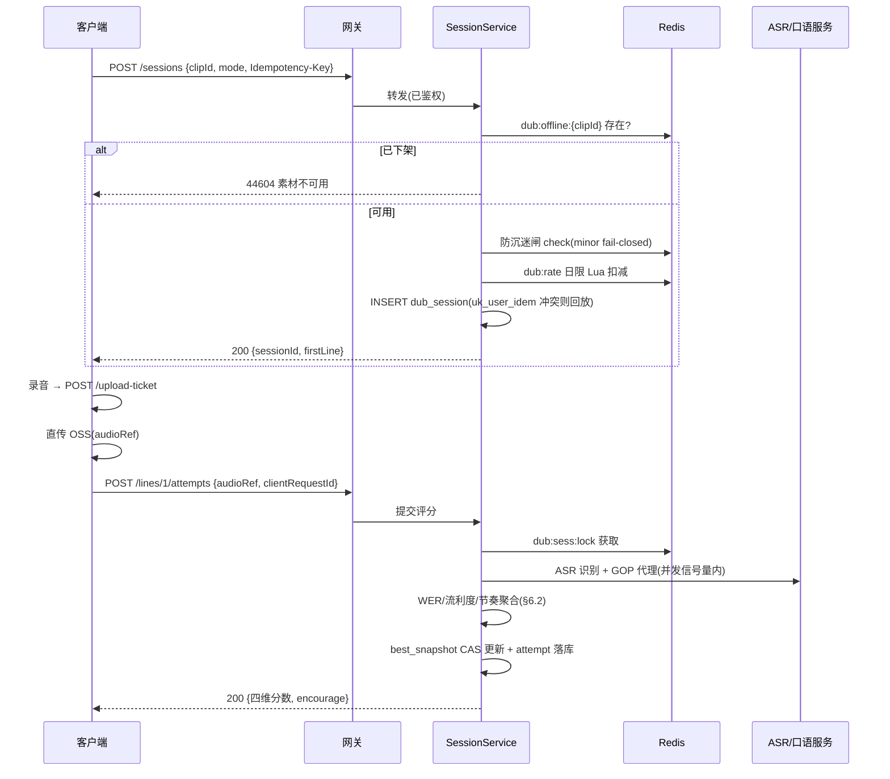
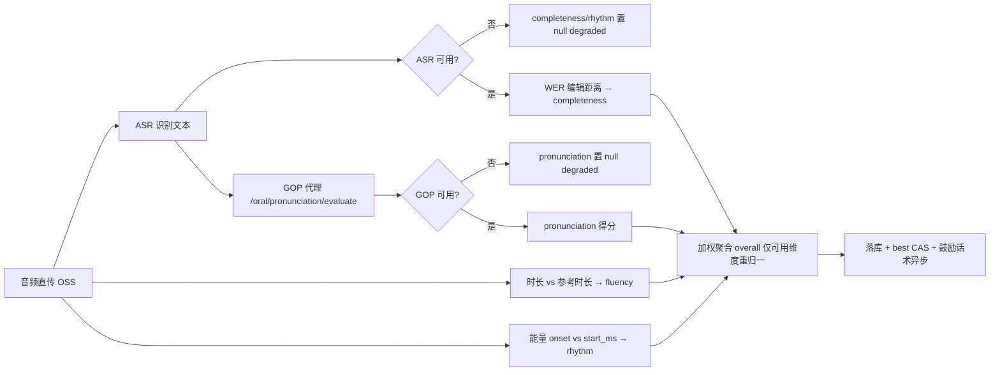
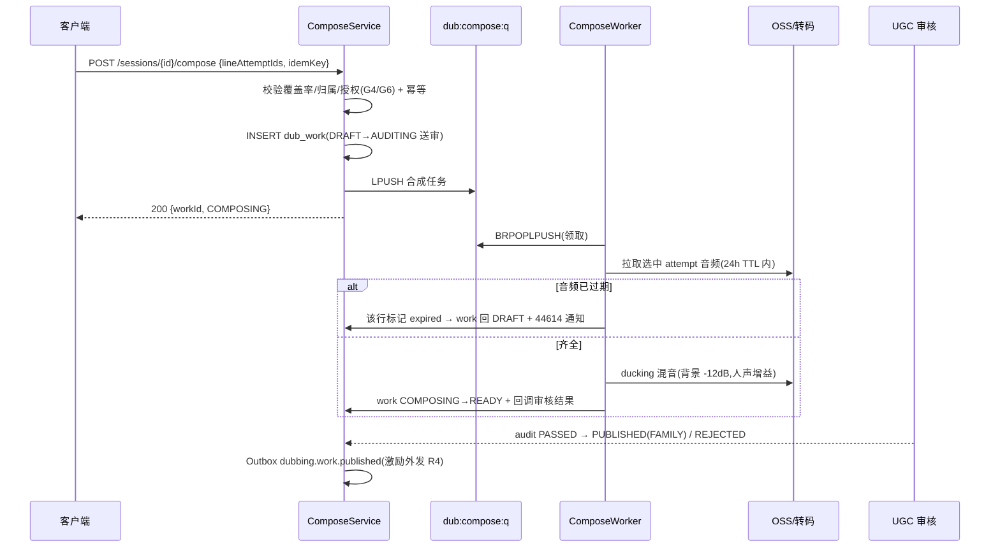

# 服务端-英语配音练习引擎 详细设计

- 版本: v1.0
- 日期: 2026-11-22
- 状态: 新增初版
- 错误码段: 44600-44699(全库扫描确认空闲,`_errcode_scan_20261122.js`)

## 1. 模块概述

### 1.1 功能定位

英语配音练习引擎(Dubbing Practice Engine,内部代号 DBE)是"英语配音"专项口语训练域的服务端权威,REST 前缀 `/api/v1/dubbing/*`。配音练习是学生为影视/动画/情景剧片段的台词逐句录音、合成完整配音作品的沉浸式口语训练形式:与自由对话(口语陪练)、朗读评估(发音陪练)不同,本域的核心是**剧本约束下的语音复现**——有参照音频、有字幕文本、有逐句评分、有作品合成与家庭内分享。

docs2 全库关键词扫描(2026-11-22,`$TEMP/gap_scan_now.js`)确认"英语配音"为零覆盖域:《服务端-英语口语发音评估与AI情景对话编排服务》覆盖自由情景对话与发音打分执行、《服务端-教材点读音频资源管理与同步点读调度服务》覆盖课文点读音频分发、《服务端-教育内容自动有声化与智能音频课程生成引擎》覆盖 TTS 有声化,均无"选片段→逐句跟读→逐句评分→混音合成→作品分享"的配音编排链路。本文补齐该缺口。

### 1.2 覆盖范围

| 范围 | 内容 | 说明 |
| --- | --- | --- |
| 素材 | LICENSED 授权动画/影视片段、SELF_PRODUCED 自制情景剧、AI_SCENARIO AI 生成情景剧本 | 三类来源准入口径见 §3.1,授权到期 fail-closed |
| 模式 | FOLLOW 逐句跟读(看-听-跟-录四步)、CHALLENGE 无字幕盲配 | 本期不支持自由创作剧本(红线 C7) |
| 评分 | 四维:发音(代理口语服务)/完整度(WER)/流利度(时长比)/节奏(时间轴偏移) | 发音评分权威外置 R1,LLM 禁参与任何打分判定 |
| 合成 | 逐句优选 + 背景音 ducking 混音 → 作品文件 | 异步任务,断点续跑 |
| 作品 | UGC 送审前置,visibility 恒 FAMILY(本期无公开态) | 审核权威外置 R3 |
| 画像 | 分维度 EMA(dub_profile)+ 逐句掌握度(用于复习联动) | 不做全服排行榜(合规 C4) |

**明确不做(本期)**:真人在线合配(PvP 协同配音);作品公开广场/点赞/评论;剧本自由创作(AI 代写台词);影视片段原片视频下发(仅下发台词、参考音频与封面,规避版权风险,见 C2);配音"考级/证书"挂钩;幼儿段(3-6 岁)配音功能(语音识别可靠性不足,适龄闸 fail-closed,G3)。

### 1.3 设计原则

1. **评分判定零 LLM**:发音(GOP 代理)、完整度(WER 编辑距离)、流利度(时长比)、节奏(偏移量)全部为确定性计算或外部评分服务代理,LLM 仅可用于"表现讲解/鼓励话术"且话术必须经内容安全过滤(降级矩阵 D3)。
2. **音频最小留存**:用户录音音频即时评分、即时销毁(默认 24h 内物理删除,仅合成选中的句子进入作品混音流程);数据库只存 ASR 文本、评分特征与时长,不存音频本体(合规 C1,与口语陪练/IPAE 同一约定)。
3. **授权素材 fail-closed**:片段授权到期/被投诉/版权方要求下线时,该片段即时不可新开会话;进行中的会话可完成但不可再合成作品(守卫 G4)。
4. **答案参照物合法下发**:与棋类"正解不下发"不同,配音的参考音频与台词文本本身是训练素材,合法下发;但**评分参数细节**(GOP 阈值、节奏容差、WER 权重)不下发,客户端只展示分数与等级话术。
5. **合成永不阻塞练习**:作品混音是异步任务,评分与报告与合成解耦;合成队列积压/转码故障不阻塞学生拿到逐句评分(降级 D6)。
6. **防沉迷与时长独立计数**:配音属娱乐化训练,时长 category=DUBBING 单独计数并计入英语素养时长,防沉迷闸 fail-closed(守卫 G2)。

### 1.4 权威边界

| 边界 | 裁决 |
| --- | --- |
| R1 发音评分权威 | 归《服务端-英语口语发音评估与AI情景对话编排服务》(`/oral/pronunciation/evaluate` GOP 评分),本引擎仅代理调用与结果编排,不自建音素评分模型 |
| R2 版权治理权威 | 授权合同/到期扫描归《服务端-教育内容版权到期预警与授权内容自动下线替换引擎》,本引擎只消费 copyright.expired 事件执行 fail-closed 下架 |
| R3 UGC 审核权威 | 作品送审/审核状态归《服务端-用户生成内容安全审核与未成年人社交保护引擎》,本引擎只维护送审前置闸与 visibility 枚举 |
| R4 激励外发 | 积分/徽章只发领域事件(dubbing.work.published 等),由激励中心统一结算,本引擎禁直接写用户资产 |
| R5 时长归因 | 时长 category=DUBBING 计入素养时长,跨模块归因权威归《服务端-学生学习时长跨模块统一归因与对账引擎》 |
| R6 逐句掌握度与复习 | 掌握度单写者为本引擎,达到 mastered 阈值时发 dubbing.line.mastered 事件注册间隔重复复习(归复习调度引擎) |
| R7 ASR/TTS 权威 | ASR 识别与 TTS 合成归《语音服务(ASR-TTS)》,本引擎只编排调用;ASR 宕机时按 D2 降级 |
| R8 适龄闸权威 | 年龄段可见性由客户端渲染闸+服务端双重校验,服务端校验为 fail-closed 权威 |
| R9 素材生产 | 授权片段剪辑/字幕切分由内容生产管线完成,本引擎只消费成品 clip;AI 剧本素材走 AIGC 标识(C5) |
| R10 客户端呈现 | 配音练习页面架构(选片段/四步跟做/波形回放/作品卡)列为后续批次客户端文档 |

## 2. 整体架构

### 2.1 引擎架构图

```mermaid
flowchart TB
    subgraph Client[客户端配音页面]
        UI1[片段列表/详情]
        UI2[四步跟做器]
        UI3[作品卡/分享]
    end
    GW[API 网关 / 鉴权 / 限流]
    subgraph DBE[配音引擎 dubbing-service]
        C1[素材服务 ClipService]
        C2[会话编排 SessionService]
        C3[评分聚合 ScoringAggregator]
        C4[合成编排 ComposeService]
        C5[画像服务 ProfileService]
        C6[管理端 AdminController]
    end
    subgraph External[外部/内部依赖]
        ASR[语音服务 ASR]
        ORAL[口语评估服务 GOP]
        OSS[(对象存储 录音/作品)]
        AUD[UGC 审核服务]
        MQ[消息总线 Outbox]
    end
    UI1 & UI2 & UI3 --> GW --> DBE
    C3 --> ASR
    C3 --> ORAL
    C4 --> OSS
    C1 -.copyright.expired.-> C1
    DBE --> AUD
    DBE --> MQ
```

### 2.2 模块职责

| 模块 | 职责 | 非职责 |
| --- | --- | --- |
| ClipService | 素材/行字幕查询、适龄过滤、授权状态校验 | 素材生产与剪辑(归内容管线) |
| SessionService | 会话创建、逐句进度、幂等控制、防沉迷闸 | 音频存储(直传 OSS) |
| ScoringAggregator | 单句四维评分编排:ASR→WER→GOP 代理→流利度→节奏→聚合 | 音素级发音模型(R1) |
| ComposeService | 逐句优选、混音任务编排、送审前置、作品状态推进 | 公开内容分发(本期无) |
| ProfileService | dub_profile EMA 更新、逐句掌握度、报告聚合 | 全服排行/能力总画像(归画像平台) |
| AdminController | 素材导入/字幕版本化/发布双人审核/作品审核联动 | 版权合同管理(R2) |

## 3. 核心数据结构

### 3.1 枚举定义

```java
public enum ClipSourceType {
    LICENSED,        // 授权动画/影视片段(需 license_id + 到期日)
    SELF_PRODUCED,   // 自制情景剧(平台自有版权)
    AI_SCENARIO      // AI 生成情景剧本(AIGC 标识强制,aigc_labeled=true)
}

public enum ClipStatus {
    DRAFT, REVIEWING, PUBLISHED, OFFLINE, ARCHIVED
    // OFFLINE: copyright_expired / complained / manual / safety
    // 语义:仅 PUBLISHED 可新开会话(守卫 G4)
}

public enum SessionMode { FOLLOW, CHALLENGE }
// FOLLOW: 看(字幕+原音) → 听(参考音频) → 跟读(带文本) → 录(无字幕预演)
// CHALLENGE: 盲听原句后直接录制,评分后回显文本

public enum SessionStatus {
    CREATED, PRACTICING, COMPOSING, COMPLETED, ABANDONED, EXPIRED
}

public enum LineAttemptStatus { SCORING, SCORED, SCORE_DEGRADED }
// SCORE_DEGRADED: 部分维度降级(如 GOP 不可用),attempt 仍可用并标注 degraded=true

public enum WorkStatus {
    DRAFT, COMPOSING, READY, AUDITING, PUBLISHED, REJECTED, DELETED
    // PUBLISHED 语义=家庭内可见(visibility=FAMILY),非公开发布
}

public enum ScoreDim { PRONUNCIATION, COMPLETENESS, FLUENCY, RHYTHM }
// 总分 = 0.4*发音 + 0.3*完整度 + 0.2*流利度 + 0.1*节奏(权重服务端配置,不下发)
```

### 3.2 数据库表设计

```sql
-- 3.2.1 配音片段表
CREATE TABLE dub_clip (
    id               BIGINT PRIMARY KEY AUTO_INCREMENT,
    title            VARCHAR(128) NOT NULL COMMENT '片段标题',
    scene_desc       VARCHAR(256) DEFAULT NULL COMMENT '情景描述',
    source_type      VARCHAR(20)  NOT NULL COMMENT 'LICENSED/SELF_PRODUCED/AI_SCENARIO',
    source_ref       VARCHAR(64)  DEFAULT NULL COMMENT '授权合同号/自制批次/AIGC 任务号',
    license_id       BIGINT       DEFAULT NULL COMMENT '版权合同ID(R2 域外引用)',
    license_expire_at DATETIME    DEFAULT NULL COMMENT '授权到期时间,G4 依据',
    cover_url        VARCHAR(512) NOT NULL COMMENT '封面图(不含原片视频帧版权风险图)',
    duration_ms      INT          NOT NULL COMMENT '片段总时长',
    line_count       SMALLINT     NOT NULL COMMENT '台词行数 3-20',
    cefr_level       VARCHAR(8)   NOT NULL COMMENT 'A1/A2/B1/B2',
    age_min          TINYINT      NOT NULL DEFAULT 6,
    age_max          TINYINT      NOT NULL DEFAULT 18,
    tags             JSON         COMMENT '["校园","家庭","冒险"]',
    status           VARCHAR(20)  NOT NULL DEFAULT 'DRAFT',
    status_version   INT          NOT NULL DEFAULT 0 COMMENT '乐观锁',
    aigc_labeled     TINYINT(1)   NOT NULL DEFAULT 0 COMMENT 'AIGC 标识,C5',
    published_at     DATETIME     DEFAULT NULL,
    created_at       DATETIME     NOT NULL DEFAULT CURRENT_TIMESTAMP,
    updated_at       DATETIME     NOT NULL DEFAULT CURRENT_TIMESTAMP ON UPDATE CURRENT_TIMESTAMP,
    KEY idx_query (status, cefr_level, age_min),
    KEY idx_license (license_expire_at)
) COMMENT='配音片段';

-- 3.2.2 片段行字幕表(行级 SSOT,字幕修改走版本化禁原地改)
CREATE TABLE dub_clip_line (
    id            BIGINT PRIMARY KEY AUTO_INCREMENT,
    clip_id       BIGINT NOT NULL,
    line_no       SMALLINT NOT NULL COMMENT '行号 1..N',
    speaker       VARCHAR(32) DEFAULT NULL COMMENT '角色名',
    text_en       VARCHAR(500) NOT NULL COMMENT '英文台词',
    text_zh       VARCHAR(500) DEFAULT NULL COMMENT '参考译文(可空)',
    start_ms      INT NOT NULL COMMENT '时间轴起始',
    end_ms        INT NOT NULL COMMENT '时间轴结束',
    wpm_ref       SMALLINT COMMENT '参考语速(词/分)',
    ref_audio_url VARCHAR(512) NOT NULL COMMENT '参考音频(训练素材,合法下发)',
    vocab_tags    JSON COMMENT '[{"word":"adventure","sense":"n.冒险"}]',
    disable_flag  TINYINT(1) NOT NULL DEFAULT 0 COMMENT '单行禁用(台词合规问题)',
    created_at    DATETIME NOT NULL DEFAULT CURRENT_TIMESTAMP,
    updated_at    DATETIME NOT NULL DEFAULT CURRENT_TIMESTAMP ON UPDATE CURRENT_TIMESTAMP,
    UNIQUE KEY uk_clip_line (clip_id, line_no),
    KEY idx_clip (clip_id)
) COMMENT='配音片段行字幕';

-- 3.2.3 配音会话表
CREATE TABLE dub_session (
    id              BIGINT PRIMARY KEY AUTO_INCREMENT,
    user_id         BIGINT NOT NULL,
    clip_id         BIGINT NOT NULL,
    mode            VARCHAR(20) NOT NULL COMMENT 'FOLLOW/CHALLENGE',
    status          VARCHAR(20) NOT NULL DEFAULT 'CREATED',
    idem_key        VARCHAR(64) NOT NULL COMMENT '客户端幂等键',
    current_line_no SMALLINT NOT NULL DEFAULT 0 COMMENT '已推进到的行号',
    best_snapshot   JSON COMMENT '每行当前最优 attempt_id 与分数快照',
    total_score     DECIMAL(5,2) DEFAULT NULL COMMENT '全片加权总分',
    report_json     JSON COMMENT '逐句报告(服务端权威,客户端只读)',
    started_at      DATETIME NOT NULL DEFAULT CURRENT_TIMESTAMP,
    finished_at     DATETIME DEFAULT NULL,
    expire_at       DATETIME NOT NULL COMMENT 'CREATED 起 72h 过期',
    version         INT NOT NULL DEFAULT 0 COMMENT '乐观锁',
    created_at      DATETIME NOT NULL DEFAULT CURRENT_TIMESTAMP,
    updated_at      DATETIME NOT NULL DEFAULT CURRENT_TIMESTAMP ON UPDATE CURRENT_TIMESTAMP,
    UNIQUE KEY uk_user_idem (user_id, idem_key),
    KEY idx_user_status (user_id, status),
    KEY idx_expire (expire_at)
) COMMENT='配音会话';

-- 3.2.4 单行录音尝试表(音频不留存,只存特征,C1)
CREATE TABLE dub_line_attempt (
    id               BIGINT PRIMARY KEY AUTO_INCREMENT,
    session_id       BIGINT NOT NULL,
    line_no          SMALLINT NOT NULL,
    attempt_no       SMALLINT NOT NULL COMMENT '本行第几次尝试',
    audio_ref        VARCHAR(512) NOT NULL COMMENT 'OSS 临时音频 key(24h 物理删除)',
    asr_text         VARCHAR(600) DEFAULT NULL COMMENT 'ASR 识别文本(评分后可销毁音频)',
    asr_conf         DECIMAL(4,3) DEFAULT NULL,
    pronunciation    DECIMAL(5,2) DEFAULT NULL COMMENT 'GOP 代理分 0-100',
    completeness     DECIMAL(5,2) DEFAULT NULL COMMENT '基于 WER 映射 0-100',
    fluency          DECIMAL(5,2) DEFAULT NULL COMMENT '时长比映射 0-100',
    rhythm           DECIMAL(5,2) DEFAULT NULL COMMENT '时间轴偏移映射 0-100',
    overall          DECIMAL(5,2) DEFAULT NULL,
    degraded_dims    JSON COMMENT '["PRONUNCIATION"] 降级维度',
    duration_ms      INT NOT NULL,
    status           VARCHAR(20) NOT NULL DEFAULT 'SCORING',
    created_at       DATETIME NOT NULL DEFAULT CURRENT_TIMESTAMP,
    UNIQUE KEY uk_session_line_attempt (session_id, line_no, attempt_no),
    KEY idx_session (session_id),
    KEY idx_audio_ttl (created_at)
) COMMENT='单行录音尝试';

-- 3.2.5 配音作品表
CREATE TABLE dub_work (
    id           BIGINT PRIMARY KEY AUTO_INCREMENT,
    user_id      BIGINT NOT NULL,
    session_id   BIGINT NOT NULL,
    clip_id      BIGINT NOT NULL,
    title        VARCHAR(128) NOT NULL,
    audio_url    VARCHAR(512) DEFAULT NULL COMMENT '合成作品音频(混音后)',
    duration_ms  INT DEFAULT NULL,
    overall_score DECIMAL(5,2) DEFAULT NULL,
    score_detail JSON COMMENT '四维明细+逐句选中情况',
    visibility   VARCHAR(20) NOT NULL DEFAULT 'FAMILY' COMMENT '本期恒 FAMILY',
    audit_status VARCHAR(20) NOT NULL DEFAULT 'AUDITING' COMMENT '送审前置(R3)',
    audit_ref    VARCHAR(64) DEFAULT NULL COMMENT '审核单号(域外)',
    status       VARCHAR(20) NOT NULL DEFAULT 'DRAFT',
    status_version INT NOT NULL DEFAULT 0,
    idem_key     VARCHAR(64) NOT NULL,
    created_at   DATETIME NOT NULL DEFAULT CURRENT_TIMESTAMP,
    updated_at   DATETIME NOT NULL DEFAULT CURRENT_TIMESTAMP ON UPDATE CURRENT_TIMESTAMP,
    UNIQUE KEY uk_session_idem (session_id, idem_key),
    KEY idx_user (user_id, status),
    KEY idx_audit (audit_status, status)
) COMMENT='配音作品';

-- 3.2.6 配音画像表(EMA 单写者)
CREATE TABLE dub_profile (
    user_id            BIGINT PRIMARY KEY,
    total_sessions     INT NOT NULL DEFAULT 0,
    total_works        INT NOT NULL DEFAULT 0,
    total_lines        INT NOT NULL DEFAULT 0,
    ema_pronunciation  DECIMAL(5,2) DEFAULT NULL COMMENT 'alpha=0.25',
    ema_completeness   DECIMAL(5,2) DEFAULT NULL,
    ema_fluency        DECIMAL(5,2) DEFAULT NULL,
    ema_rhythm         DECIMAL(5,2) DEFAULT NULL,
    cefr_shadow        VARCHAR(8) DEFAULT NULL COMMENT '配音能力 CEFR 影子评级(内部)',
    last_practice_at   DATETIME DEFAULT NULL,
    version            INT NOT NULL DEFAULT 0,
    updated_at         DATETIME NOT NULL DEFAULT CURRENT_TIMESTAMP ON UPDATE CURRENT_TIMESTAMP
) COMMENT='配音画像';

-- 3.2.7 逐行掌握度表(复习联动 R6)
CREATE TABLE dub_line_mastery (
    id          BIGINT PRIMARY KEY AUTO_INCREMENT,
    user_id     BIGINT NOT NULL,
    clip_id     BIGINT NOT NULL,
    line_no     SMALLINT NOT NULL,
    best_score  DECIMAL(5,2) NOT NULL,
    attempts    INT NOT NULL DEFAULT 1,
    status      VARCHAR(20) NOT NULL DEFAULT 'LEARNING' COMMENT 'LEARNING/MASTERED',
    updated_at  DATETIME NOT NULL DEFAULT CURRENT_TIMESTAMP ON UPDATE CURRENT_TIMESTAMP,
    UNIQUE KEY uk_user_clip_line (user_id, clip_id, line_no),
    KEY idx_user_status (user_id, status)
) COMMENT='逐行掌握度';

-- 3.2.8 Outbox 事件表(同事务写入)
CREATE TABLE dub_outbox (
    id           BIGINT PRIMARY KEY AUTO_INCREMENT,
    aggregate_id BIGINT NOT NULL COMMENT '聚合ID(会话/作品/片段)',
    event_type   VARCHAR(64) NOT NULL,
    payload      JSON NOT NULL,
    occurred_at  DATETIME NOT NULL DEFAULT CURRENT_TIMESTAMP,
    published_at DATETIME DEFAULT NULL,
    UNIQUE KEY uk_agg_type (aggregate_id, event_type, occurred_at)
) COMMENT='配音域事件';
```

### 3.3 Redis 键设计

| 键 | 类型 | TTL | 说明 |
| --- | --- | --- | --- |
| `dub:clip:{clipId}` | String(JSON) | 30min | 片段详情缓存,发布/下架时主动失效 |
| `dub:clip:lines:{clipId}` | String(JSON) | 30min | 行字幕缓存(禁 disable_flag 行下发) |
| `dub:sess:lock:{sessionId}` | String | 60s | 会话推进分布式锁(SET NX PX) |
| `dub:idem:{userId}:{idemKey}` | String | 72h | 会话创建幂等回放(值为 session_id) |
| `dub:score:sem` | 信号量 | 无 | 评分代理并发上限(保护 ASR/GOP 依赖) |
| `dub:rate:{userId}` | Hash | 自然日 | 日限计数 {sessions, attempts},Lua 原子扣减 |
| `dub:compose:q` | List | 无 | 合成任务队列(异步 worker 消费) |
| `dub:offline:{clipId}` | String | 永久 | 版权/安全下架标记(fail-closed 快路径) |

## 4. API 接口设计

### 4.1 学生端接口

#### 4.1.1 片段列表 `GET /api/v1/dubbing/clips`

```http
GET /api/v1/dubbing/clips?cefr=A2&mode=FOLLOW&cursor=&pageSize=20
```

```json
{
  "code": 0,
  "data": {
    "items": [
      {
        "clipId": 880012,
        "title": "At the School Fair",
        "coverUrl": "https://cdn.example.com/dub/covers/880012.jpg",
        "durationMs": 95000,
        "lineCount": 8,
        "cefr": "A2",
        "tags": ["校园", "节日"],
        "aigcLabeled": false,
        "bestScore": 86.50
      }
    ],
    "nextCursor": "eyJvZmZzZXQiOjIwfQ=="
  }
}
```

说明:`bestScore` 为当前用户该片段历史最高分(无历史则为 null);服务端已按用户年龄段过滤(age_min/age_max),客户端不得自行放宽(双重校验 R8)。

#### 4.1.2 片段详情(含行字幕) `GET /api/v1/dubbing/clips/{clipId}`

```json
{
  "code": 0,
  "data": {
    "clipId": 880012,
    "title": "At the School Fair",
    "modeAllowed": ["FOLLOW", "CHALLENGE"],
    "lines": [
      {
        "lineNo": 1,
        "speaker": "Lily",
        "textEn": "Look at all these colorful games!",
        "textZh": "看看这些五彩缤纷的游戏!",
        "startMs": 3200,
        "endMs": 6100,
        "refAudioUrl": "https://cdn.example.com/dub/ref/880012/l1.mp3"
      }
    ],
    "aigcLabeled": false,
    "copyrightNotice": "Licensed content, for study use only"
  }
}
```

守卫:下架/过期片段返回 44604(与列表缓存过期容忍 30s,快路径 `dub:offline:{clipId}` 秒级拦截);`disable_flag=1` 的行不下发(响应中该行缺失,客户端按缺失行跳过)。

#### 4.1.3 创建会话 `POST /api/v1/dubbing/sessions`

```http
POST /api/v1/dubbing/sessions
Idempotency-Key: 7f3a9c2e-20261122
```

```json
{ "clipId": 880012, "mode": "FOLLOW" }
```

```json
{
  "code": 0,
  "data": {
    "sessionId": 99000021,
    "status": "CREATED",
    "expireAt": "2026-11-25T14:30:00+08:00",
    "firstLine": { "lineNo": 1, "textEn": "...", "refAudioUrl": "..." }
  }
}
```

服务端校验顺序:防沉迷闸(G2)→ 授权状态(G4)→ 适龄(G3)→ 幂等回放 → 限频(日 10 会话/80 次尝试)→ 创建。幂等键 72h 内同键重放返回同一会话(不重建)。

#### 4.1.4 录音直传凭证 `POST /api/v1/dubbing/sessions/{id}/upload-ticket`

```json
{ "lineNo": 3, "contentType": "audio/m4a", "sizeBytes": 245760 }
```

```json
{
  "code": 0,
  "data": {
    "uploadUrl": "https://oss.example.com/...signed",
    "audioRef": "dub/tmp/99000021/3/a1.m4a",
    "expiresIn": 300
  }
}
```

约束:`sizeBytes ≤ 2MB` 且预计时长 ≤ 30s,超限 44607;直传完成后客户端须调用 4.1.5 提交评分,音频对象 TTL 24h。

#### 4.1.5 提交单句评分 `POST /api/v1/dubbing/sessions/{id}/lines/{lineNo}/attempts`

```json
{
  "audioRef": "dub/tmp/99000021/3/a1.m4a",
  "durationMs": 4120,
  "clientRequestId": "cr-9f31-003"
}
```

```json
{
  "code": 0,
  "data": {
    "attemptId": 55000133,
    "attemptNo": 2,
    "status": "SCORED",
    "scores": { "pronunciation": 84.0, "completeness": 92.0, "fluency": 78.0, "rhythm": 70.0, "overall": 82.4 },
    "degraded": false,
    "asrText": "Look at all these colorful games!",
    "isNewBest": true,
    "encourage": "Great rhythm! Try stressing the word colorful."
  }
}
```

语义:`clientRequestId` 幂等(网络重试安全);同 (session,line) 的 attempt_no 由服务端分配递增;`encourage` 为 LLM 生成鼓励话术(可空,D3 降级时为空,话术零贬义红线 C6)。`isNewBest` 表示刷新本行最佳并更新 best_snapshot。评分总超时 8s,超时按 D2 返回部分维度并置 `degraded=true`(状态 SCORE_DEGRADED)。

#### 4.1.6 会话报告 `GET /api/v1/dubbing/sessions/{id}/report`

```json
{
  "code": 0,
  "data": {
    "sessionId": 99000021,
    "status": "PRACTICING",
    "progress": { "currentLineNo": 5, "lineCount": 8 },
    "lines": [
      { "lineNo": 1, "bestAttemptId": 55000121, "overall": 86.0, "attempts": 2, "masteredHint": true }
    ],
    "canCompose": false,
    "composeThreshold": "≥85% 行有有效 attempt"
  }
}
```

#### 4.1.7 合成作品 `POST /api/v1/dubbing/sessions/{id}/compose`

```json
{ "title": "我的校园集市配音", "lineAttemptIds": [55000121, 55000125, 55000133], "idemKey": "compose-cr-9f31" }
```

```json
{
  "code": 0,
  "data": { "workId": 7700008, "status": "COMPOSING", "estimatedSeconds": 15 }
}
```

守卫:`lineAttemptIds` 必须覆盖 ≥85% 的行且全部属于本会话(G6);逐行校验所选 attempt 有效(未被音频 TTL 清理,被清理返回 44614 需重录该行);幂等键同会话 24h 内唯一(防双击双作品);创建即置 work AUDITING 送审(R3 前置),审核通过才 READY→PUBLISHED。

#### 4.1.8 作品详情/分享 `GET /api/v1/dubbing/works/{workId}` · `POST /api/v1/dubbing/works/{workId}/share-card`

作品仅本人与家长可见(家长门校验);share-card 生成家庭分享卡片(图片渲染权威客户端,服务端只下发分享数据);`audit_status≠PASSED` 的作品返回 44618。

#### 4.1.9 我的配音档案 `GET /api/v1/dubbing/profile`

```json
{
  "code": 0,
  "data": {
    "ema": { "pronunciation": 82.4, "completeness": 90.1, "fluency": 79.6, "rhythm": 74.2 },
    "totalSessions": 12, "totalWorks": 3, "totalLines": 96,
    "cefrShadow": "A2+",
    "weakDims": ["RHYTHM"],
    "recentWorks": [ { "workId": 7700008, "title": "...", "overallScore": 84.2 } ]
  }
}
```

#### 4.1.10 放弃会话 `POST /api/v1/dubbing/sessions/{id}/abandon`

幂等;ABANDONED 后 10min 宽限可恢复(置回 PRACTICING),超时不可恢复但保留成绩入画像(已产生的 attempt 不浪费)。

### 4.2 管理端接口(运营网段,角色 `dubbing:admin`)

| 接口 | 说明 | 守卫 |
| --- | --- | --- |
| `POST /admin/dubbing/clips` | 导入片段元数据 | source_type=LICENSED 必传 license_id+到期日 |
| `PUT /admin/dubbing/clips/{id}/lines` | 字幕整包替换 | 版本化:写新 disable/修订,禁原地改 text_en(G9);触发缓存失效 |
| `POST /admin/dubbing/clips/{id}/submit-review` | 提交发布审核 | DRAFT→REVIEWING |
| `POST /admin/dubbing/clips/{id}/publish` | 发布 | 双人审核;REVIEWING→PUBLISHED |
| `POST /admin/dubbing/clips/{id}/offline` | 下架(reason) | 即刻写入 `dub:offline` 标记;进行中的会话完成但禁合成 |
| `GET /admin/dubbing/works?auditStatus=` | 作品列表 | 审核操作在 UGC 审核域完成,本接口只读 |
| `GET /admin/dubbing/stats` | 日活/完成率/均分/合成成功率 | 只读 |

### 4.3 内部 gRPC(`dubbing.internal.v1`)

| 方法 | 请求→响应 | 用途 |
| --- | --- | --- |
| `GetDubProfile` | user_id → DubProfile | 画像平台/学情聚合只读镜像(R5 边界) |
| `GetClipBrief` | clip_id → {title, cefr, status} | 报告/分享卡 BFF 聚合 |
| `OnCopyrightExpired` | clip_id, reason → Empty | 版权域主动调用(事件兜底双通道,G4) |

### 4.4 幂等限流总表

| 操作 | 幂等机制 | 限流 |
| --- | --- | --- |
| 创建会话 | Idempotency-Key,uk_user_idem 72h | 日 10 会话(未成年)/30(成年) |
| 提交评分 | clientRequestId + uk(session,line,attempt) | 日 80 次尝试;`dub:score:sem` 全局 200 并发 |
| 合成作品 | idemKey + uk_session_idem | 日 5 作品 |
| 其余 GET | 天然幂等 | 常规 200 QPS/用户 |

## 5. 核心流程

### 5.1 创建会话与首句跟读主链路



延迟预算:提交评分 P95 ≤ 8s(ASR 4s + GOP 代理 3s + 聚合 1s);超时按 D2 降级。

### 5.2 单句评分管线



权重归一规则:某维度降级时,overall = Σ(wᵢ·sᵢ)/Σ(wᵢ|可用),响应中 `degradedDims` 明示;全维度不可用(极端)返回 44612 不计次数。

### 5.3 作品合成链路



合成 worker 幂等:任务以 work_id 去重表领取,崩溃重启后按 work.status 重推进(COMPOSING 超 30min 可回收重跑);混音输出统一转码 128kbps AAC。

### 5.4 版权到期自动下架

```mermaid
flowchart LR
    E[copyright.expired 事件 / OnCopyrightExpired] --> F[写 dub:offline:{clipId}]
    F --> G[缓存失效 dub:clip:*]
    G --> H[clip.status → OFFLINE]
    H --> I{进行中会话}
    I -- 可完成练习 --> J[可出分/可报告]
    I -- 禁合成 --> K[compose 返回 44615]
    H --> L[未送审作品关联片段 → 冻结等待审核域裁决]
```

## 6. 关键代码

### 6.1 幂等创建会话(Java/Spring)

```java
@PostMapping("/sessions")
public DubSessionCreateResp create(@AuthUser long userId,
                                   @RequestHeader("Idempotency-Key") String idemKey,
                                   @Valid @RequestBody DubSessionCreateReq req) {
    // 1. 快路径:授权/安全下架标记(fail-closed)
    if (Boolean.TRUE.equals(redis.hasKey("dub:offline:" + req.getClipId()))) {
        throw new BizException(44604, "CLIP_OFFLINE");
    }
    DubClip clip = clipService.getPublished(req.getClipId()); // 缓存→DB,非 PUBLISHED 即 44604
    // 2. 适龄闸(服务端权威,R8)
    int age = userProfileService.getAge(userId);
    if (age < clip.getAgeMin() || age > clip.getAgeMax()) {
        throw new BizException(44603, "AGE_GATE");
    }
    // 3. 防沉迷闸(fail-closed,与棋类引擎同约定)
    minorGuardService.assertAllowed(userId, Feature.DUBBING);
    // 4. 幂等回放
    String idemRedisKey = "dub:idem:" + userId + ":" + idemKey;
    String cached = redis.get(idemRedisKey);
    if (cached != null) {
        return sessionService.toResp(Long.parseLong(cached)); // 回放,不重建
    }
    // 5. 限频 + 创建(uk_user_idem 兜底并发)
    rateLimiter.consumeOrThrow("dub:rate:" + userId, 10, 80);
    try {
        long sessionId = sessionService.insertIgnoreDuplicate(userId, req.getClipId(),
                req.getMode(), idemKey); // INSERT ... ON DUPLICATE KEY UPDATE 语义
        redis.setex(idemRedisKey, 72 * 3600, String.valueOf(sessionId));
        return sessionService.toResp(sessionId);
    } catch (DuplicateKeyException e) {
        return sessionService.toResp(sessionService.findByIdem(userId, idemKey));
    }
}
```

### 6.2 评分聚合器(确定性计算,G1 红线)

```java
@Component
public class ScoringAggregator {
    private static final Map<ScoreDim, Double> WEIGHTS = Map.of(
            ScoreDim.PRONUNCIATION, 0.40,
            ScoreDim.COMPLETENESS, 0.30,
            ScoreDim.FLUENCY, 0.20,
            ScoreDim.RHYTHM, 0.10);

    public LineScoreResult aggregate(DubClipLine line, DubLineAttempt a,
                                     AsrResult asr, GopResult gop) {
        LineScoreResult r = new LineScoreResult();
        List<ScoreDim> degraded = new ArrayList<>();

        // 完整度:WER → 0-100 映射(词级编辑距离 / 参考词数)
        if (asr != null && asr.isOk()) {
            double wer = werCalculator.compute(line.getTextEn(), asr.getText());
            r.setCompleteness(clamp(Math.max(0, 100 - wer * 130))); // WER 77% 归零
            r.setAsrText(asr.getText());
        } else { degraded.add(ScoreDim.COMPLETENESS); }

        // 发音:GOP 代理(R1),超时/异常 → 降级
        if (gop != null && gop.isOk()) {
            r.setPronunciation(clamp(gop.getOverallGop())); // 0-100 已归一
        } else { degraded.add(ScoreDim.PRONUNCIATION); }

        // 流利度:实测时长 vs 参考时长比(±15% 满分,线性衰减)
        double ratio = (double) a.getDurationMs() / (line.getEndMs() - line.getStartMs());
        r.setFluency(clamp(100 - Math.max(0, Math.abs(ratio - 1.0) - 0.15) * 250));

        // 节奏:能量起始点 vs start_ms 偏移(<120ms 满分)
        int onsetOffset = audioEnergyAnalyzer.onsetOffsetMs(a.getAudioRef(), line.getStartMs());
        r.setRhythm(clamp(100 - Math.max(0, onsetOffset - 120) * 0.35));

        // 加权聚合(仅可用维度重归一,降级透明)
        double sumW = WEIGHTS.entrySet().stream()
                .filter(e -> !degraded.contains(e.getKey()))
                .mapToDouble(Map.Entry::getValue).sum();
        if (sumW < 0.30) { // 可用维度权重 <30% 视为整体失败
            throw new BizException(44612, "SCORE_UNAVAILABLE");
        }
        double overall = WEIGHTS.entrySet().stream()
                .filter(e -> !degraded.contains(e.getKey()))
                .mapToDouble(e -> e.getValue() * scoreOf(r, e.getKey())).sum() / sumW;
        r.setOverall(round2(overall));
        r.setDegradedDims(degraded);
        return r;
    }
}
```

### 6.3 合成 worker 断点续跑

```java
@Component
public class ComposeWorker {
    @Scheduled(fixedDelay = 3000)
    public void drain() {
        String taskJson = redis.brPopLpush("dub:compose:q", "dub:compose:processing", 5);
        if (taskJson == null) return;
        ComposeTask task = Jsons.read(taskJson, ComposeTask.class);
        try {
            // CAS 领取:仅 DRAFT/AUDITING 可推进,防双 worker 重复混音
            int rows = jdbc.update(
                "UPDATE dub_work SET status='COMPOSING', status_version=status_version+1 " +
                "WHERE id=? AND status IN ('DRAFT','AUDITING')", task.getWorkId());
            if (rows == 0) return; // 已被其他 worker 领取或状态非法
            List<DubLineAttempt> picked = attemptService.findByIds(task.getAttemptIds());
            List<Long> expired = picked.stream()
                .filter(a -> oss.ttl(a.getAudioRef()) <= 0).map(DubLineAttempt::getId).toList();
            if (!expired.isEmpty()) {
                // 音频 TTL 过期:回退 DRAFT,通知客户端重录过期行
                jdbc.update("UPDATE dub_work SET status='DRAFT' WHERE id=?", task.getWorkId());
                notifyService.pushExpiredLines(task.getWorkId(), expired); // 44614 语义
                return;
            }
            String out = audioMixer.mixWithDucking(picked, task.getClipBgUrl(), -12.0);
            String audioUrl = oss.persist(out, "dub/works/" + task.getWorkId() + ".aac");
            jdbc.update("UPDATE dub_work SET audio_url=?, status='READY' WHERE id=?",
                    audioUrl, task.getWorkId());
        } catch (Exception e) {
            recoverQueue.requeueWithBackoff(task); // 指数退避,5 次后转死信 P1 告警
        }
    }
}
```

### 6.4 日限频控 Lua(原子)

```lua
-- KEYS[1]=dub:rate:{userId}  ARGV={dailySessionCap, dailyAttemptCap}
local h = redis.call('HMGET', KEYS[1], 'sessions', 'attempts')
local sess = tonumber(h[1] or 0)
local atts = tonumber(h[2] or 0)
if sess >= tonumber(ARGV[1]) then return -1 end
if atts >= tonumber(ARGV[2]) then return -2 end
redis.call('HINCRBY', KEYS[1], 'sessions', 1)
redis.call('EXPIREAT', KEYS[1], nextMidnightEpoch())
return 0
```

## 7. 状态机与守卫

### 7.1 会话状态机

```text
CREATED --(首句 attempt 提交)--> PRACTICING
PRACTICING --(全部行完成 或 手动)--> COMPOSING --(作品创建)--> COMPLETED
PRACTICING --(abandon)--> ABANDONED --(10min 内)--> PRACTICING | --(超时)--> 终态
任意非终态 --(72h 未动)--> EXPIRED(成绩仍入画像,attempt 不删)
```

### 7.2 作品状态机

```text
DRAFT --(compose 校验通过)--> AUDITING(送审前置) --(审核通过)--> READY
READY --(可见性激活)--> PUBLISHED(FAMILY)   AUDITING --(驳回)--> REJECTED
PUBLISHED/REJECTED --(注销级联/违规)--> DELETED
```

### 7.3 守卫规则

| 守卫 | 规则 | 失败处置 |
| --- | --- | --- |
| G1 评分零 LLM | 分数只来自 ASR/WER/GOP/确定性映射;LLM 只允许 encourage 话术且禁含分数重判 | 静态鼓励语料兜底 |
| G2 防沉迷 fail-closed | minor 时段到顶禁新会话;进行中会话可完成,次计数清零;防沉迷服务不可用=禁新会话 | 44610 |
| G3 适龄闸 fail-closed | 幼儿(<6)零配音功能;年龄校验服务端权威,客户端绕过无效 | 44603 |
| G4 授权 fail-closed | 非 PUBLISHED/已到期/已投诉 → 禁新会话;进行中可出分禁合成 | 44604/44615 |
| G5 音频最小留存 | 临时音频 24h 物理删除;只选中进作品的行参与混音;ASR 文本 180 天滚动 | 审计任务核查 |
| G6 合成完整性 | 覆盖率 ≥85% 且 attempt 全属本会话;所选行未过期 | 44613/44614 |
| G7 幂等不重放成绩 | 幂等重放只回放会话/作品句柄,不重复累计画像与次数 | uk 约束 |
| G8 分数口径唯一 | overall 只由服务端聚合,客户端禁自算总分展示口径 | 契约测试 |
| G9 字幕版本化 | text_en 发布后禁原地改;修订走新行版本并触发缓存失效 | DDL 乐观锁 |
| G10 降级透明 | degraded 维度必须在响应标注,禁静默给满分 | 契约测试 |
| G11 注销级联 | account.deleted 24h 内清理 attempt/作品/画像/Outbox 已发布事件保留匿名化 | 对账核查 |
| G12 终局一次性 | COMPLETED/EXPIRED 不可逆;report 为终态快照 | 状态 CAS |

### 7.4 关键竞态裁决

| 竞态 | 裁决 |
| --- | --- |
| 同 (session,line) 并发提交 | uk(session,line,attempt) 唯一;attempt_no 由 DB 序列分配,先到先得;双方均 200 |
| abandon 与 attempt 在途 | attempt 先到:会话置 PRACTICING,abandon 失效(乐观锁 version);abandon 先到:在途 attempt 评分落库但不更新 best_snapshot |
| compose 与音频 TTL 到期 | 混音前逐行 TTL 复检(§6.3),过期即整单回 DRAFT,禁部分作品 |
| 版权下架与合成在途 | 下架标记先行;worker 每单复检 dub:offline,命中即熔断该单转人工 |
| best_snapshot 并发刷新 | CAS:仅当新 overall > 旧值才更新,携带 version;报表读快照允许最终一致 |

## 8. 幂等与并发

| 场景 | 方案 |
| --- | --- |
| 创建会话重复点击 | Idempotency-Key(Redis 72h 快回放)+ uk_user_idem(DB 兜底) |
| 上传重试产生重复 audioRef | audioRef 含 attempt 语义,重复提交同 clientRequestId 直接回放原响应 |
| 评分重复消费(ASR/GOP 回调) | attempt 状态 SCORING→SCORED 单推进 CAS;回调携带 attemptId 去重表 |
| 合成双击 | uk_session_idem + work 状态 CAS,第二个请求回放同一 workId |
| 恢复会话跨端 | 会话以服务端 current_line_no 为准,端侧进度禁覆盖 |
| 日限并发 | Lua 原子(§6.4),无 TOCTOU |
| 事件重复发布 | dub_outbox uk(aggregate,event,occurred_at);消费方幂等 |

## 9. 领域事件

### 9.1 发布(Outbox 同事务)

| 事件 | 触发 | 关键 payload | 消费方 |
| --- | --- | --- | --- |
| dubbing.session.completed | 会话完成 | {sessionId, clipId, totalScore, dims} | 时长归因(R5)、画像平台 |
| dubbing.line.mastered | 行 best≥85 且 attempts≥2 | {userId, clipId, lineNo, bestScore} | 间隔重复复习引擎(R6) |
| dubbing.work.published | 作品审核通过 | {workId, userId, clipId, overallScore} | 激励中心(R4)、成长档案 |
| dubbing.work.rejected | 审核驳回 | {workId, reason} | 消息中心(家长可见) |
| dubbing.clip.offlined | 下架 | {clipId, reason} | 搜索/推荐失效、BFF |

### 9.2 订阅(消费矩阵)

| 上游事件 | 处置 |
| --- | --- |
| copyright.expired / OnCopyrightExpired | G4 fail-closed 下架(§5.4) |
| account.deleted | G11 级联清理 |
| minor_protection.changed | 防沉迷参数热更新,次生效 |
| textbook.edition_changed | 无直接影响(素材按 CEFR 组织,不做教材绑定) |

### 9.3 对账(每日 04:40)

1. dub_session 终态 vs dub_line_attempt 存在性(孤儿 attempt >24h 告警);
2. dub_work READY 无 audio_url / PUBLISHED 无审核单号 → P1;
3. 临时音频对象数 vs attempt 表(24h 延迟后应收敛,偏差 >1% 告警,核查 G5);
4. Outbox published_at NULL 积压 >10min 告警。

## 10. 错误码(44600-44699)

| 码 | 含义 | HTTP | 备注 |
| --- | --- | --- | --- |
| 44600 | DUB_INTERNAL | 500 | 未分类内部错误 |
| 44601 | UNAUTHORIZED_AGE | 403 | 适龄闸(G3) |
| 44603 | AGE_GATE | 200 话术 | 适龄拦截,客户端弹适龄提示 |
| 44604 | CLIP_OFFLINE | 200 话术 | 素材不可用/已下架(G4) |
| 44607 | AUDIO_TOO_LARGE | 413 | 音频超限 |
| 44608 | RATE_LIMITED | 429 | 日限触顶 |
| 44610 | MINOR_GUARD | 200 话术 | 防沉迷 fail-closed(G2) |
| 44612 | SCORE_UNAVAILABLE | 200 话术 | 评分维度整体不可用,不计次数 |
| 44613 | COMPOSE_INCOMPLETE | 409 | 覆盖率不足/行归属非法(G6) |
| 44614 | AUDIO_EXPIRED | 409 | 选中行音频已清理,需重录 |
| 44615 | COMPOSE_FORBIDDEN_OFFLINE | 409 | 素材下架禁合成(G4) |
| 44618 | WORK_AUDIT_PENDING | 200 话术 | 作品审核中不可分享 |
| 44620 | SESSION_EXPIRED | 409 | 会话过期(成绩保留) |
| 44621 | SESSION_STATE_ILLEGAL | 409 | 非法状态流(G12) |
| 44630 | ENCRYPT_DECRYPT_FAIL | 500 | 内部,不透传 |

内部语义码(200 话术类)不向客户端暴露内部细节;其余 4xx 按统一错误封装规范透传。

## 11. 降级矩阵

| 编号 | 故障 | 降级行为 | 恢复 |
| --- | --- | --- | --- |
| D1 | Redis 宕机 | 会话创建限流降级为 DB 计数;幂等回放失效但 uk 兜底;offline 标记回源 DB | 自动 |
| D2 | ASR/GOP 依赖超时 | 对应维度置 null + degradedDims 标注(G10),其余维度正常出分 | 自动 |
| D3 | LLM 话术不可用 | encourage 返回 null,客户端用静态鼓励语料 | 自动 |
| D4 | 审核域不可用 | 作品创建挂起 AUDITING,不丢单;禁提前可见 | 重试 |
| D5 | 版权事件总线积压 | OnCopyrightExpired gRPC 双通道兜底(G4) | 人工 |
| D6 | 合成队列积压/转码故障 | 练习与评分不受影响;作品回 DRAFT 可重试;积压 >30min P1 | 自动+人工 |
| D7 | 封面/参考音频 CDN 故障 | 读源站;源站亦故障则该片段列表隐藏(不 5xx 整页) | 自动 |
| D8 | 画像写入失败 | 不阻塞评分;事件补账 + 日终重放 | 自动 |
| D9 | dub_clip 缓存穿透 | 逻辑过期 + 单飞重建;offline 片段缓存空值 60s | 自动 |
| D10 | — | **总红线**:G1 评分零 LLM、G2 防沉迷、G3 适龄闸、G4 授权 fail-closed、G5 音频留存、G6 送审前置**无任何降级路径** | — |

## 12. 监控与容量

### 12.1 监控指标(M1-M8)

| 指标 | 告警阈值 |
| --- | --- |
| M1 评分链路 P95/P99 | P95>8s / P99>12s 持续 10min → P2 |
| M2 评分降级率(degraded 占比) | >15% 持续 30min → P2(依赖健康度) |
| M3 合成成功率 | 连续 1h <95% → P1 |
| M4 版权下架延迟 | 事件→offline 标记 >60s → P1(合规) |
| M5 音频 TTL 清理偏差 | 对账偏差 >1% → P2(G5) |
| M6 Outbox 积压 | >10min → P2;>1h → P1 |
| M7 日限触发率 | >8% 日活触发限频 → 产品复盘信号 |
| M8 作品审核驳回率 | >5% → 内容复盘(AI 剧本质量或录音合规) |

### 12.2 容量估算(DAU 50 万)

- 配音日活渗透率按 3% 估:1.5 万日活,人均 1.2 会话、10 次尝试 → 会话 1.8 万/日、attempt 15 万/日;
- attempt 行 15 万/日 × 180 天热留存 ≈ 2700 万行,按月分区 6 个月,冷数据归档;
- ASR/GOP 代理调用峰值:晚高峰 19-21 点 3000 次/小时 ≈ 0.9 QPS,`dub:score:sem` 200 并发冗余充足;
- 合成任务 5000 单/日峰值,单均混音 <15s,2 worker 即可;
- 临时音频存储:15 万 × 300KB/日,24h TTL 滚动 ≈ 45GB 稳态。

## 13. 合规红线

| 编号 | 红线 |
| --- | --- |
| C1 | 用户录音音频即时评分、24h 物理删除;ASR 文本 180 天滚动;任何环境禁留存原音样本用于模型训练(与口语陪练同一家长承诺) |
| C2 | 授权影视/动画片段仅下发台词文本、参考音频与封面,**禁下发原片视频**;分享卡片禁含原片画面帧 |
| C3 | 作品 visibility 本期恒 FAMILY;无公开广场/点赞/评论;送审前置(R3)不可关闭 |
| C4 | 不做全服配音排行榜;仅个人历史与班级内(教师端授权场景,P2)可比 |
| C5 | AI_SCENARIO 素材 AIGC 标识强制下发且客户端不可关闭;AI 生成台词禁含真实品牌/真人指向 |
| C6 | 鼓励话术零贬义零比较("比同学差"类表述禁止);不向学生展示同龄平均分 |
| C7 | 禁 AI 代写学生个人剧本(自由创作另立项);台词库全部经内容审核管线 |
| C8 | 未成年人作品分享与家长门联动:分享行为家长默认可见;8 岁以下禁主动分享 |
| C9 | 注销级联 24h 内完成(G11);分享出去的卡片链接随作品删除即刻失效 |
| C10 | 授权素材到期前 T-7 预警内容侧,到期即时 fail-closed,宁可误杀不可漏放 |

## 14. 契约对齐

| 编号 | 裁决 |
| --- | --- |
| R1 | 发音评分(GOP)权威归口语评估服务,本引擎代理调用;音素级诊断数据只在报告层透传,不二次加工 |
| R2 | 版权合同/到期扫描权威归版权预警引擎,本引擎仅消费事件+gRPC 双通道 |
| R3 | UGC 审核权威外置;本引擎只维护 AUDITING 前置闸;驳回原因经消息中心送达家长 |
| R4 | 激励(积分/徽章)只发事件,禁直写用户资产;勋章规则归激励中心 |
| R5 | 时长 category=DUBBING 计入英语素养时长,跨模块归因与对账归时长引擎 |
| R6 | 逐句掌握度单写者为本引擎;mastered 事件注册复习,复习调度归间隔重复引擎 |
| R7 | ASR/TTS 能力归语音服务;本引擎禁自建识别模型;语音交互页面契约参照口语陪练 |
| R8 | 适龄闸服务端 fail-closed 权威,客户端渲染闸只是体验层 |
| R9 | 片段生产(剪辑/字幕切分/TTS 参考音频生成)归内容生产管线;本文只消费 PUBLISHED 成品 |
| R10 | 客户端配音页面(选片段/四步跟做/波形对比回放/作品卡)列为后续批次文档 |

## 15. 验收场景

| 编号 | 场景 | 预期 |
| --- | --- | --- |
| AC01 | 正常跟读全流程 | 创建→逐句评分→报告→合成→审核通过→家庭可见,全链路 200 |
| AC02 | 幂等重放创建 | 同 Idempotency-Key 两次,同 sessionId,DB 仅一行 |
| AC03 | 双击提交评分 | 同 clientRequestId 两次,同 attemptId 回放,attempt_no 不跳变 |
| AC04 | ASR 故障注入 | completeness/rhythm 降级标注,pronunciation/fluency 正常,overall 重归一 |
| AC05 | GOP 代理超时 | pronunciation 置 null,响应 degradedDims 含 PRONUNCIATION,不计为 0 分 |
| AC06 | 全维度不可用 | 44612,不扣日限次数 |
| AC07 | 素材到期在会话中 | 练习可完成;compose 返回 44615;列表 30s 内消失 |
| AC08 | 音频 TTL 过期后合成 | 该单回 DRAFT + 通知重录,禁部分作品 |
| AC09 | 覆盖率 80% 合成 | 44613,提示补足行 |
| AC10 | 防沉迷到顶 | 新会话 44610 话术,进行中会话可完成,次计数清零 |
| AC11 | 幼儿账号访问 | 44601/44603,客户端隐藏入口 |
| AC12 | 作品审核驳回 | REJECTED,家长收到原因,分享链接不可生成 |
| AC13 | 注销级联 | 24h 内 attempt/作品/画像清理,已分享链接失效 |
| AC14 | 字幕修订 | 发布后禁原地改;新版本触发缓存失效且旧会话快照不回溯 |
| AC15 | 合成分布锁竞争 | 双击 compose 仅一 work,CAS 拒绝者回放 workId |
| AC16 | 契约测试 | 响应无任何评分阈值/权重字段;无 solution 类内部参数(G1/G8) |

## 16. 关联文档

- 《服务端-英语口语发音评估与AI情景对话编排服务-详细设计》(R1 评分代理权威,GOP 契约)
- 《服务端-语音服务(ASR-TTS)-详细设计》(R7 ASR/TTS 能力)
- 《服务端-教育内容版权到期预警与授权内容自动下线替换引擎-详细设计》(R2 版权事件源)
- 《服务端-用户生成内容安全审核与未成年人社交保护引擎-详细设计》(R3 审核权威)
- 《服务端-用户额度管控与功能门控引擎-详细设计》(防沉迷 fail-closed 联动)
- 《服务端-学生学习时长跨模块统一归因与对账引擎-详细设计》(R5 时长归因)
- 《服务端-间隔重复算法与遗忘曲线复习调度引擎-详细设计》(R6 复习注册)
- 《服务端-棋类对弈训练引擎-详细设计》(同批次专项引擎,娱乐化训练时长与合规口径参照)
- 《服务端-手工美育创作引导引擎-详细设计》(UGC 送审前置与 visibility=FAMILY 模式参照)
- 《事件驱动架构与统一事件总线-详细设计》(Outbox 机制)
- 《服务端-统一业务异常码与错误分类体系-详细设计》(错误码归口)
- 《客户端-英语专项学习页面架构与交互设计》(客户端承接,R10 配音子页面后续批次)

## 维护记录

- 2026-11-22 v1.0 新增初版:补齐"英语配音"零覆盖缺口(全库关键词扫描 配音 仅 3 处蹭词零专项文档)。定义 LICENSED/SELF_PRODUCED/AI_SCENARIO 三类素材准入+逐句跟读/盲配双模式+四维评分(发音 GOP 代理 R1/完整度 WER/流利度时长比/节奏偏移,权重 0.4/0.3/0.2/0.1 服务端权威)+异步 ducking 混音合成+作品送审前置恒 FAMILY;8 表 DDL(uk 幂等+version CAS)+8 类 Redis 键;REST 学生端 10 组+管理端 8+gRPC 3;四 mermaid 流程(建会话/评分管线/合成/版权下架);关键代码四段(幂等创建/WER 聚合零 LLM/合成断点续跑/日限 Lua);双状态机+守卫 G1-G12+竞态裁决 5 类;44600-44630 错误码段(全库扫描确认 446xx 空闲,4 个 200 语义码);降级 D1-D10(D10 六红线不可降级);监控 M1-M8+容量(DAU50 万/配音 1.5 万日活/attempt 15 万日);合规 C1-C10(音频 24h 物理删除/禁下发原片视频/UGC 恒 FAMILY/AIGC 标识/零贬义话术);契约 R1-R10(评分代理 R1/版权 R2/审核 R3/激励 R4/时长 R5/复习 R6/ASR R7/适龄 R8/生产 R9/客户端 R10);验收 AC01-AC16。客户端配音练习页面列为后续批次(R10)。
