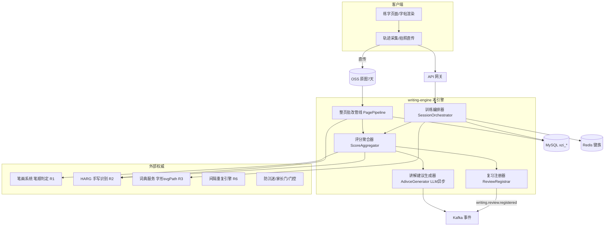
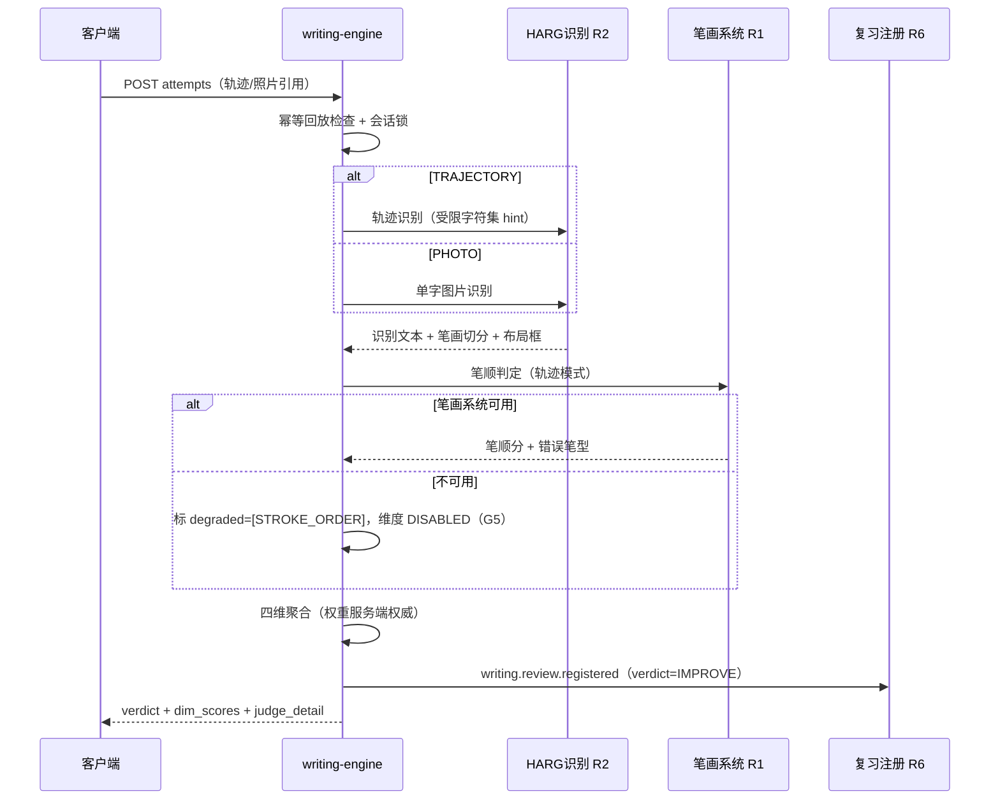
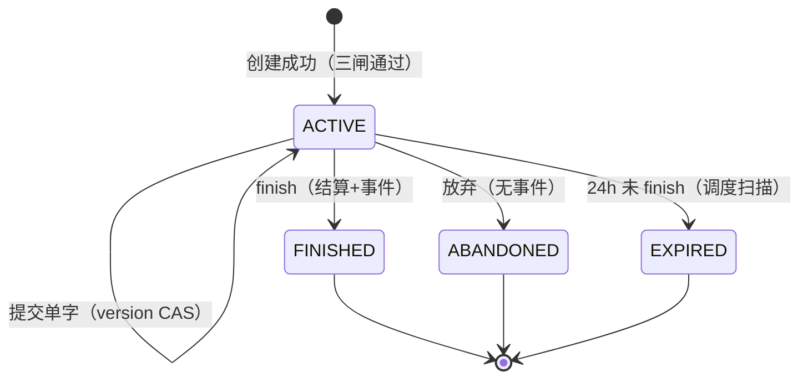
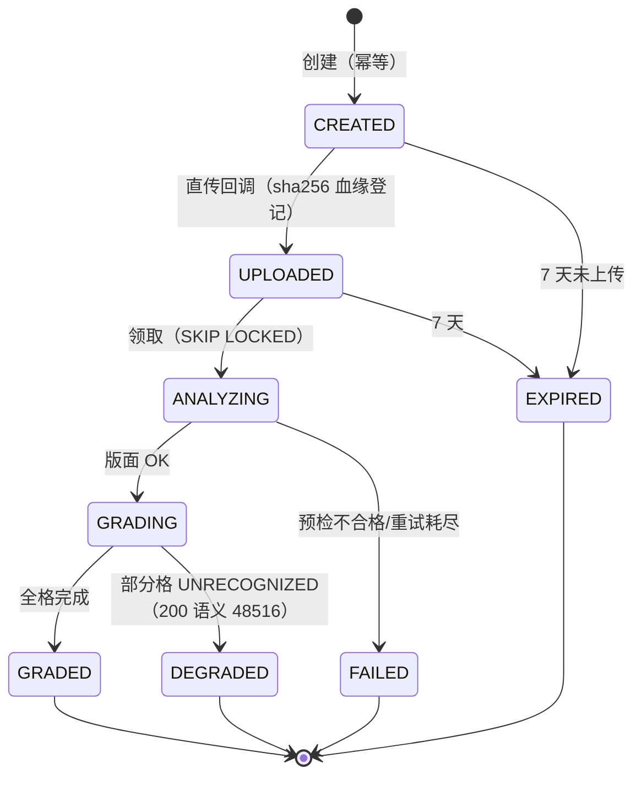

# 服务端-规范汉字书写训练引擎 详细设计

## 1. 概述

### 1.1 定位与背景

规范汉字书写训练（写字练字）域服务端权威。覆盖小学 1-6 年级语文同步写字表训练：描红跟写、临写字帖、整页练字纸拍照批改、书写四维评分、错字复习联动与书写成长画像。

缺口依据（全目录关键词扫描，2026-11-23）：`字帖` 全库零命中；`描红` 仅出现于拼音识字启蒙/Phonics/数感启蒙（字母与数字描画，非汉字书写）；`间架` 仅通用词典服务 1 处蹭词；`田字格/米字格` 仅字体资源注册与听写默写客户端两处蹭词。docs2 此前无任何"写字练字"专项文档。

### 1.2 适用学段与训练梯度

| 学段 | 训练重点 | 字格 | 评分权重倾向 |
|------|---------|------|-------------|
| 1-2 年级 | 笔顺正确、笔画完整、占位居中 | 田字格 | 笔顺 0.4 / 完整 0.3 / 结构 0.2 / 整洁 0.1 |
| 3-4 年级 | 间架结构、偏旁比例、卷面整洁 | 田字格+米字格 | 笔顺 0.3 / 完整 0.25 / 结构 0.3 / 整洁 0.15 |
| 5-6 年级 | 结构美感、行款整齐、书写速度 | 米字格+横线格 | 笔顺 0.2 / 完整 0.2 / 结构 0.35 / 整洁 0.25 |

权重表为服务端权威配置（`xzi_weight_config`），管理端修改需双人审批，次日生效；权重禁下发客户端。

### 1.3 权威边界（与已有模块分工）

| 能力 | 权威归属 | 本文关系 |
|------|---------|---------|
| 单字笔顺轨迹实时判定 | 《汉字笔画顺序检测与评估系统》 | R1 委托：描红/临写的笔顺维度调用其判定服务，本文不自研 |
| 手写文字识别（OCR/手写体） | HARG《学生手写答案识别与手写体智能批改引擎》 | R2 委托：轨迹与照片均走其识别通道，本文不自研 |
| 整页拍照任务 DAG 编排模式 | OCB《口算拍照整页批改引擎》 | 模式参考（阶段编排/直传/改判），判题语义独立，互不调 |
| 听写默写编排 | 《学生听写默写智能评估与语文基础知识自动批改引擎》 | LISTEN 模式整体委托，本文仅接收其书写维度回写 |
| 复习调度（间隔重复） | 间隔重复引擎 | R6 只写注册事件，不算下次到期 |
| 打卡/激励/时长归因 | 打卡系统/激励中心/时长归因引擎 | R4/R5 只发事件，各自为 SSOT |
| 笔顺 svgPath 字形数据 | 通用词典服务（汉字词条含笔顺 svgPath） | R3 字形与笔顺动画数据从其读取快照 |

### 1.4 名词约定

- **写字项（item）**：一个汉字在一个教材写字表中的训练单元，含字格、笔顺引用、结构类型。
- **会话（session）**：一次练字训练（3 模式之一），含若干写字项快照。
- **尝试（attempt）**：一次单字书写提交（轨迹或照片引用）。
- **整页任务（page task）**：整页练字纸拍照批改的异步任务。
- **四维**：笔顺正确性 / 笔画完整性 / 间架结构 / 整洁度。

### 1.5 非目标（明确不做）

- 不做软笔书法（毛笔）教学与评价。
- 不做书写速度竞赛、全服排名、班级排名（仅自比成长曲线）。
- 不挂钩任何社会书法考级等级。
- 不做作文卷面分的考试场景评分（归作文批改域）。
- 本版不做教师端集体练字作业（P2 预留扩展点）。

## 2. 整体架构

### 2.1 引擎架构图



### 2.2 上下游依赖

- **上游**：账号/学生档案（年级教材版本）、教材版本与章节管理（写字表来源）、防沉迷/家长门/功能门控（三闸）。
- **下游**：间隔重复引擎（复习）、打卡系统（练字打卡）、激励中心（积分/徽章）、时长归因引擎（category=WRITING）、学情画像（书写维度聚合）。

## 3. 核心数据结构

### 3.1 枚举定义

```sql
-- 训练模式
CREATE TYPE xzi_mode AS ENUM ('TRACE', 'COPY', 'LISTEN');
-- TRACE=描红跟写（客户端描红渲染，轨迹提交）
-- COPY=临写（字帖页书写，轨迹或拍照提交）
-- LISTEN=听写联动（委托听写引擎，仅接收回写）

-- 书写提交载体
CREATE TYPE xzi_submit_kind AS ENUM ('TRAJECTORY', 'PHOTO');

-- 单字裁决
CREATE TYPE xzi_verdict AS ENUM ('PASS', 'IMPROVE', 'RETRY');
-- PASS=达标（建议进入下一字）
-- IMPROVE=可订正（有错但不强制重练，入错字复习队列）
-- RETRY=建议重练（本次不计错，不处罚）

-- 结构类型
CREATE TYPE xzi_structure AS ENUM
  ('SINGLE', 'LEFT_RIGHT', 'UP_DOWN', 'UP_LEFT', 'UP_MIDDLE_DOWN',
   'LEFT_MIDDLE_RIGHT', 'SEMI_WRAP', 'FULL_WRAP', 'TRIANGLE');

-- 任务状态（整页）
CREATE TYPE xzi_page_status AS ENUM
  ('CREATED', 'UPLOADED', 'ANALYZING', 'GRADING', 'GRADED',
   'DEGRADED', 'FAILED', 'EXPIRED');
```

### 3.2 写字项主表 `xzi_char_item`

```sql
CREATE TABLE xzi_char_item (
  id              BIGINT PRIMARY KEY AUTO_INCREMENT,
  char            VARCHAR(8)  NOT NULL,               -- 汉字（可能为多字节）
  grade           TINYINT     NOT NULL,               -- 1-6
  semester        TINYINT     NOT NULL,               -- 1/2
  textbook_ver    VARCHAR(32) NOT NULL,               -- 教材版本
  unit_no         INT         NOT NULL,               -- 单元
  lesson_no       INT         NOT NULL,               -- 课
  word_seq        INT         NOT NULL,               -- 课内序号
  stroke_count    TINYINT     NOT NULL,
  structure       xzi_structure NOT NULL,
  radical         VARCHAR(8)  NOT NULL,
  grid_type       VARCHAR(16) NOT NULL,               -- TIAN/ MI / HENG
  dict_entry_id   BIGINT      NOT NULL,               -- 词典服务汉字词条 id（svgPath 血缘）
  svg_path_ver    VARCHAR(16) NOT NULL,               -- 笔顺数据版本快照（禁实时回源，G6）
  content_json    JSON        NOT NULL,               -- 见 3.3
  status          VARCHAR(16) NOT NULL DEFAULT 'PUBLISHED', -- DRAFT/PUBLISHED/OFFLINE
  created_at      DATETIME(3) NOT NULL DEFAULT CURRENT_TIMESTAMP(3),
  updated_at      DATETIME(3) NOT NULL DEFAULT CURRENT_TIMESTAMP(3) ON UPDATE CURRENT_TIMESTAMP(3),
  UNIQUE KEY uk_char_ver (char, grade, textbook_ver, unit_no, lesson_no, word_seq),
  KEY idx_scope (grade, semester, textbook_ver, status)
) ENGINE=InnoDB DEFAULT CHARSET=utf8mb4;
```

### 3.3 `content_json` 写字项载荷结构

```json
{
  "char": "永",
  "strokeCount": 5,
  "strokeNames": ["点", "横折钩", "横撇", "撇", "捺"],
  "svgRef": {"entryId": 88213, "version": "v3.2.1"},
  "gridGuide": {
    "gridType": "MI",
    "anchorPoints": ["center", "h-mid", "v-mid"],
    "partBoxes": [{"part": "丶", "box": [420, 120, 180, 180]}]
  },
  "commonMistakes": [
    {"type": "MISSING_STROKE", "desc": "易漏最后捺画"},
    {"type": "ORDER_SWAP", "desc": "三四笔易颠倒"}
  ],
  "targetSeconds": {"grade12": 25, "grade34": 18, "grade56": 12}
}
```

### 3.4 会话表 `xzi_session`

```sql
CREATE TABLE xzi_session (
  id                BIGINT PRIMARY KEY AUTO_INCREMENT,
  session_no        VARCHAR(32) NOT NULL,
  user_id           BIGINT      NOT NULL,
  child_id          BIGINT      NOT NULL,
  mode              xzi_mode    NOT NULL,
  grade             TINYINT     NOT NULL,
  textbook_ver      VARCHAR(32) NOT NULL,
  source            VARCHAR(16) NOT NULL DEFAULT 'PLAN', -- PLAN/FREE/LISTEN_CALLBACK
  plan_ref          VARCHAR(64) NULL,                   -- 每日练字计划引用（外部权威）
  items_json        JSON        NOT NULL,               -- 写字项快照数组（含 itemId/char/gridType，禁含答案）
  item_count        INT         NOT NULL,
  status            VARCHAR(16) NOT NULL DEFAULT 'ACTIVE', -- ACTIVE/FINISHED/ABANDONED/EXPIRED
  idem_key          VARCHAR(64) NOT NULL,               -- client_request_id
  started_at        DATETIME(3) NOT NULL DEFAULT CURRENT_TIMESTAMP(3),
  finished_at       DATETIME(3) NULL,
  version           INT         NOT NULL DEFAULT 0,     -- 乐观锁
  created_at        DATETIME(3) NOT NULL DEFAULT CURRENT_TIMESTAMP(3),
  UNIQUE KEY uk_user_idem (user_id, idem_key),
  UNIQUE KEY uk_session_no (session_no),
  KEY idx_child_status (child_id, status, started_at)
) ENGINE=InnoDB DEFAULT CHARSET=utf8mb4;
```

### 3.5 尝试记录表 `xzi_attempt`

```sql
CREATE TABLE xzi_attempt (
  id              BIGINT PRIMARY KEY AUTO_INCREMENT,
  session_id      BIGINT      NOT NULL,
  item_no         INT         NOT NULL,               -- 会话内序号
  char_item_id    BIGINT      NOT NULL,
  char            VARCHAR(8)  NOT NULL,               -- 快照冗余，防写字项变更
  submit_kind     xzi_submit_kind NOT NULL,
  trajectory_json JSON        NULL,                   -- TRAJECTORY：笔画轨迹（采样点数组）
  image_ref       VARCHAR(128) NULL,                  -- PHOTO：OSS key（生命周期 7 天，C3）
  duration_ms     INT         NOT NULL,
  score_total     DECIMAL(4,1) NULL,                  -- 0-100，DIMENSION_DISABLED 时为 NULL
  dim_scores      JSON        NULL,                   -- 见 3.6，禁含权重
  verdict         xzi_verdict NULL,
  judge_detail    JSON        NULL,                   -- 错因结构，见 4.6
  degraded        JSON        NULL,                   -- 降级维度数组，如 ["STROKE_ORDER"]
  client_request_id VARCHAR(64) NOT NULL,
  created_at      DATETIME(3) NOT NULL DEFAULT CURRENT_TIMESTAMP(3),
  UNIQUE KEY uk_session_item_req (session_id, item_no, client_request_id),
  KEY idx_char_item (char_item_id, created_at)
) ENGINE=InnoDB DEFAULT CHARSET=utf8mb4;
```

### 3.6 `dim_scores` 四维评分结构

```json
{
  "STROKE_ORDER":  {"score": 82, "pass": true,  "source": "STROKE_ENGINE"},
  "COMPLETENESS":  {"score": 75, "pass": true,  "source": "HARG", "missingStrokes": ["捺"]},
  "STRUCTURE":     {"score": 61, "pass": false, "source": "HARG_LAYOUT", "issues": ["右部过宽", "重心偏左"]},
  "NEATNESS":      {"score": 70, "pass": true,  "source": "HEURISTIC", "issues": ["首笔出格"]}
}
```

`source` 取值：`STROKE_ENGINE`（R1 委托）/ `HARG` / `HARG_LAYOUT` / `HEURISTIC` / `DISABLED`（维度未评）。`DISABLED` 必须伴随 `degraded` 声明，禁止静默丢维度（G4）。

### 3.7 整页批改任务表 `xzi_page_task`

```sql
CREATE TABLE xzi_page_task (
  id            BIGINT PRIMARY KEY AUTO_INCREMENT,
  task_no       VARCHAR(32) NOT NULL,
  user_id       BIGINT      NOT NULL,
  child_id      BIGINT      NOT NULL,
  image_ref     VARCHAR(128) NOT NULL,
  image_sha256  VARCHAR(64)  NOT NULL,               -- 秒传去重血缘
  grade         TINYINT     NOT NULL,
  grid_type     VARCHAR(16) NOT NULL,
  status        xzi_page_status NOT NULL DEFAULT 'CREATED',
  stage         VARCHAR(16) NOT NULL DEFAULT 'PENDING', -- 当前 DAG 阶段
  cell_count    INT         NULL,
  cell_results  JSON        NULL,                    -- 完成后写入，格级结果
  summary_json  JSON        NULL,                    -- 报告汇总
  retry_count   TINYINT     NOT NULL DEFAULT 0,
  error_code    INT         NULL,
  idem_key      VARCHAR(64) NOT NULL,
  created_at    DATETIME(3) NOT NULL DEFAULT CURRENT_TIMESTAMP(3),
  finished_at   DATETIME(3) NULL,
  expires_at    DATETIME(3) NOT NULL,                -- 创建+7天
  UNIQUE KEY uk_user_idem (user_id, idem_key),
  UNIQUE KEY uk_task_no (task_no),
  KEY idx_child_created (child_id, created_at)
) ENGINE=InnoDB DEFAULT CHARSET=utf8mb4;
```

### 3.8 书写画像表 `xzi_profile`

```sql
CREATE TABLE xzi_profile (
  id                BIGINT PRIMARY KEY AUTO_INCREMENT,
  child_id          BIGINT NOT NULL,
  level             TINYINT NOT NULL DEFAULT 1,      -- 规范字等级 1-6（仅自比成长，C6）
  total_chars       INT  NOT NULL DEFAULT 0,
  pass_rate_ema     DECIMAL(4,3) NOT NULL DEFAULT 0, -- α=0.2
  structure_weak    JSON NOT NULL,                   -- {"UP_DOWN": 0.31, "FULL_WRAP": 0.12}
  stroke_issue_ema  JSON NOT NULL,                   -- 错笔型 EMA
  neatness_baseline DECIMAL(4,1) NOT NULL DEFAULT 0,
  last_graded_at    DATETIME(3) NULL,
  version           INT  NOT NULL DEFAULT 0,
  updated_at        DATETIME(3) NOT NULL DEFAULT CURRENT_TIMESTAMP(3) ON UPDATE CURRENT_TIMESTAMP(3),
  UNIQUE KEY uk_child (child_id)
) ENGINE=InnoDB DEFAULT CHARSET=utf8mb4;
```

### 3.9 Redis 键设计

| 键 | 类型 | TTL | 说明 |
|----|------|-----|------|
| `xzi:session:{sessionNo}:lock` | String NX | 3s | 尝试提交互斥锁 |
| `xzi:idem:{userId}:{idemKey}` | String(结果引用) | 24h | 创建/提交幂等回放 |
| `xzi:page:{taskNo}:lock` | String NX | 10s | 阶段推进锁 |
| `xzi:page:daily:{childId}:{yyyyMMdd}` | Hash | 48h | 当日整页计数（Lua 日限） |
| `xzi:score:sem:{provider}` | Semaphore | — | 识别/评分并发信号量 |
| `xzi:cfg:weight:{gradeBand}` | String(JSON) | 永久+版本号 | 权重缓存（禁客户端读） |
| `xzi:item:hot:{charItemId}` | String(JSON) | 24h | 热点写字项缓存 |

### 3.10 `xzi_weight_config`（管理端配置表）

```sql
CREATE TABLE xzi_weight_config (
  id          BIGINT PRIMARY KEY AUTO_INCREMENT,
  grade_band  VARCHAR(8)  NOT NULL,        -- G12/G34/G56
  w_stroke    DECIMAL(3,2) NOT NULL,
  w_complete  DECIMAL(3,2) NOT NULL,
  w_structure DECIMAL(3,2) NOT NULL,
  w_neatness  DECIMAL(3,2) NOT NULL,
  status      VARCHAR(16) NOT NULL DEFAULT 'PENDING', -- PENDING/APPROVED/EFFECTIVE
  approve_by  BIGINT NULL,
  effective_at DATETIME(3) NULL,
  CHECK (w_stroke + w_complete + w_structure + w_neatness = 1.00),
  UNIQUE KEY uk_band_effective (grade_band, effective_at)
) ENGINE=InnoDB DEFAULT CHARSET=utf8mb4;
```

## 4. 评分引擎

### 4.1 评分总链路



### 4.2 笔顺维度（委托 R1）

- TRACE 模式必评；COPY 模式轨迹提交可评、纯照片提交笔顺维度 `DISABLED`（照片无书写时序，评笔顺无依据，禁止猜测）。
- 调用笔画系统判定服务的超时预算 800ms；超时/5xx 两种处置：首次重试 1 次，仍失败则 `degraded=["STROKE_ORDER"]`，其余三维照常（G5）；禁止 LLM 补笔顺判定（G1）。
- 笔顺分映射：笔画系统返回的错误笔型数 n，得分 = max(0, 100 - 25n)。

### 4.3 完整性维度

- 依据 HARG 笔画切分结果比对写字项 `strokeCount`：`missingStrokes` 非空即扣分，每缺 1 笔 -25；多笔（连笔误拆）每 1 处 -10；`extraStrokes` 与 `missingStrokes` 同时非空时，以 `MISSING_STROKE` 优先归因（避免双重扣罚）。

### 4.4 结构维度

- 将识别布局框与 `content_json.gridGuide.partBoxes` 标准框比对（IoU 归一化），计算：部件占比偏差（每部件权重相等）、重心偏移、出格率。出格率 > 40% 时结构分封顶 59（与 verdict 阈值联动）。
- 结构问题描述（如"右部过宽"）来自规则模板映射表（`xzi_structure_issue_tpl`），**禁 LLM 现场生成结构判语**（G1）；LLM 仅允许在异步讲解建议中扩写（§5）。

### 4.5 整洁维度

- 启发式规则：出格笔画数、涂改块数（识别置信度突降区域）、连笔粘连数。权重最低但对 5-6 年级权重上调（见 1.2）。

### 4.6 错因结构 `judge_detail`

```json
{
  "primaryIssue": "STRUCTURE_RIGHT_WIDE",
  "issues": [
    {"code": "MISSING_STROKE", "detail": "捺", "severity": "MAJOR"},
    {"code": "RIGHT_PART_WIDE", "detail": null, "severity": "MINOR"}
  ],
  "encourageTpl": "WRITING_GROWTH_03",
  "retryAdvice": "先观察米字格中线再落笔"
}
```

- `issues[].code` 为枚举（`xzi_issue_code` 共 24 项），客户端按枚举渲染成长型话术（话术模板归客户端文档，服务端只给 code + `encourageTpl` 引用）。
- 禁止下发"差/丑/难看"等评价性词汇，禁与任何同学比较（C4）。

### 4.7 verdict 裁决

| 条件 | verdict | 行为 |
|------|---------|------|
| score_total ≥ 75 且无 MAJOR issue | PASS | 画像累计，不发复习 |
| 60 ≤ score < 75 或仅有 MINOR issue | IMPROVE | 计入画像，注册复习（R6），可继续 |
| score < 60 或存在 MAJOR issue | RETRY | 不计错（本版不设强制重练门），注册复习，建议重练话术 |

`score_total` 任一为 `NULL`（全维度 DISABLED，识别失败场景）时不裁决，返回 `verdict=null` + 引导重拍（48510 语义）。

### 4.8 整页批改管线（PagePipeline）

DAG 五阶段，阶段推进持 `xzi:page:{taskNo}:lock`（NX 10s），每阶段幂等可重入：

| 阶段 | 工作 | 失败处置 |
|------|------|---------|
| ANALYZE_LAYOUT | 版面分析：格线检测、单字切割、格级 bbox（千分比） | 照片不合格 48510；布局失败重试 2 次后 FAILED |
| BATCH_RECOG | 分批调用 HARG（每批 ≤ 20 格，信号量背压） | 单格失败标记 `cell.status=UNRECOGNIZED`，不阻塞整页（降级 48516） |
| GRADE_CELLS | 逐格四维评分（笔顺维度整页 DISABLED，见 4.2） | 同上 |
| AGGREGATE | 汇总 summary：总评、薄弱结构类型 TOP3、建议字列表 | — |
| ARCHIVE | 写 cell_results/summary，发 `writing.page.graded` | — |

- 照片合规预检（模糊/倾斜/反光）前置在 ANALYZE_LAYOUT，不合格即 48510 并给出重拍引导，不消耗日限（G7）。
- 整页与单字判分口径一致（同一 ScoreAggregator），禁止整页走独立简化评分（G8）。

## 5. AI 讲解与建议生成（异步、可降级）

### 5.1 使用场景与配额

| 场景 | 触发 | 配额 |
|------|------|------|
| SESSION_ADVICE | 会话结束 | 每次 1 条，≤ 200 字 |
| PAGE_COMMENT | 整页报告 | 每次 1 条，≤ 200 字 |
| ISSUE_EXPLAIN | 单字 IMPROVE/RETRY 详情 | 每字每会话 1 次 |

- LLM 输入白名单：字、维度分（不含权重）、issues code 描述、年级；**禁输入原始轨迹坐标与照片**（C2）。
- LLM 输出仅展示用，不回写 `dim_scores`/`verdict`（G1）；生成失败降级为规则话术模板，战绩与画像不受影响（200 语义码 48530）。

### 5.2 Prompt 模板（注册进 Prompt 编排系统，模板码 `XZ_ADVICE_V1`）

```text
你是小学语文书写辅导老师。学生{{grade}}年级，练习汉字「{{char}}」。
四维表现：{{dim_summary}}（仅作背景，禁止修改任何评分）。
主要问题：{{issue_descs}}。
要求：1) 先肯定一个具体亮点；2) 只针对主要问题给一条可操作的改进建议；
3) 语气鼓励，禁止比较、禁止评价美丑、禁止出现分数复述；
4) ≤ 200 字，不要使用markdown。
```

### 5.3 讲解输出 JSON Schema

```json
{
  "type": "object",
  "required": ["encouragement", "advice"],
  "properties": {
    "encouragement": {"type": "string", "maxLength": 80},
    "advice": {"type": "string", "maxLength": 120}
  }
}
```

## 6. API 接口设计

### 6.1 接口清单

| # | 方法 | 路径 | 说明 |
|---|------|------|------|
| 1 | GET | `/api/v1/writing/characters` | 写字表查询（年级×教材×单元） |
| 2 | POST | `/api/v1/writing/sessions` | 创建练字会话（幂等） |
| 3 | GET | `/api/v1/writing/sessions/{sessionNo}` | 会话详情（只读镜像） |
| 4 | POST | `/api/v1/writing/sessions/{sessionNo}/items/{itemNo}/attempts` | 提交单字（幂等） |
| 5 | POST | `/api/v1/writing/sessions/{sessionNo}/finish` | 结束会话（结算+事件） |
| 6 | POST | `/api/v1/writing/pages` | 创建整页批改任务（幂等） |
| 7 | POST | `/api/v1/writing/pages/upload-token` | 获取直传凭证（重放 30min） |
| 8 | GET | `/api/v1/writing/pages/{taskNo}` | 轮询任务状态 |
| 9 | POST | `/api/v1/writing/pages/{taskNo}/appeals` | 家长改判申请（一次性） |
| 10 | GET | `/api/v1/writing/profile` | 书写画像 |
| 11 | GET | `/api/v1/writing/reviews` | 今日复习字（读间隔重复引擎快照） |
| 12 | POST | `/api/v1/writing/internal/listen-callback` | 听写引擎书写维度回写 |
| 13-15 | — | `/admin/writing/items*` | 写字表导入/审核/下线 |
| 16-18 | — | `/admin/writing/weights*` | 权重配置（双人审批） |
| 19-20 | — | `/admin/writing/grade-sample` | 评分抽检复核 |

gRPC（内部）：`CheckWritingGate(childId, feature)`、`GetWritingMastery(childId, charItemIds[])`、`NotifyTextbookChanged(grade, textbookVer)`。

### 6.2 创建会话

```json
// POST /api/v1/writing/sessions
// 请求
{
  "clientRequestId": "uuid-v7",
  "mode": "COPY",
  "grade": 3,
  "textbookVer": "RJ-2024",
  "unitNo": 5,
  "itemIds": [101, 102, 105]
}
// 响应 200
{
  "sessionNo": "XZ202611230001234",
  "mode": "COPY",
  "status": "ACTIVE",
  "items": [
    {"itemNo": 1, "charItemId": 101, "char": "翠", "gridType": "TIAN",
     "guide": {"strokeCount": 14, "structure": "UP_DOWN"}}
  ],
  "serverTime": "2026-11-23T16:40:00+08:00"
}
```

- 幂等：`uk_user_idem`；同键同 payload 重放返回首次结果（200 语义码 48507 仅用于同键不同 payload）。
- 单学生同模式仅允许 1 个 ACTIVE 会话（409 → 48508，引导恢复或放弃）。
- `items[].guide` 不含笔顺答案细节与 partBoxes（描红渲染数据走 `GET items/{itemNo}/guide` 按需下发，且 TRACE 模式才下发锚点）。

### 6.3 提交单字

```json
// POST .../items/1/attempts
{
  "clientRequestId": "uuid-v7",
  "submitKind": "TRAJECTORY",
  "trajectory": {"strokes": [[[x,y,t], ...], ...], "canvas": {"w": 1000, "h": 1000}},
  "durationMs": 32000
}
// 响应 200
{
  "attemptId": 9001,
  "verdict": "IMPROVE",
  "scoreTotal": 68.5,
  "dimScores": { "STROKE_ORDER": {"score": 75, "pass": true, "source": "STROKE_ENGINE"},
                 "COMPLETENESS": {"score": 70, "pass": true, "source": "HARG", "missingStrokes": []},
                 "STRUCTURE": {"score": 62, "pass": false, "source": "HARG_LAYOUT", "issues": ["下部过扁"]},
                 "NEATNESS": {"score": 80, "pass": true, "source": "HEURISTIC", "issues": []} },
  "judgeDetail": {"primaryIssue": "BOTTOM_FLAT", "issues": [{"code": "BOTTOM_FLAT", "severity": "MINOR"}],
                  "encourageTpl": "WRITING_GROWTH_05", "retryAdvice": "先把上半部分写紧凑"},
  "degraded": [],
  "profileSync": "SYNCED"
}
```

- `profileSync=STALE` 时客户端展示"成长记录同步中"角标（48514 语义，异步落画像）。
- 轨迹坐标系为千分比（与 OCB bbox 约定一致，R8）。

### 6.4 整页任务响应

```json
// GET /api/v1/writing/pages/{taskNo}  200
{
  "taskNo": "XP202611230005678",
  "status": "GRADED",
  "cellCount": 42,
  "cells": [{"cellNo": 1, "char": "永", "bbox": [120, 80, 180, 200],
             "scoreTotal": 72.0, "verdict": "IMPROVE", "primaryIssue": "CENTER_OFF"}],
  "summary": {"avgScore": 74.2, "weakStructures": ["UP_DOWN", "SEMI_WRAP"],
              "adviceRef": "adv_8f2a", "degradedCells": 0},
  "annotatedImageUrl": "https://oss.../annotated.jpg?sig=...&exp=3600"
}
```

- `annotatedImageUrl` 签名 1h；分享卡仅使用服务端生成的脱敏图（G9）。

## 7. 关键代码示例

### 7.1 幂等创建会话（Go 风格）

```go
func (s *SessionService) Create(ctx context.Context, userID int64, req CreateReq) (*Session, error) {
    replay, err := s.idem.Replay(ctx, fmt.Sprintf("xzi:idem:%d:%s", userID, req.ClientRequestID))
    if err == nil {
        return replay.(*Session), nil // 48507 仅在同键不同 payload 时由网关裁决
    }
    gate := s.gate.Check(ctx, userID, req.ChildID, FeatureWriting)
    if !gate.Allowed {
        return nil, gate.Error // 48501/48502/48503/48504 顺序裁决
    }
    if active, _ := s.repo.GetActiveByMode(ctx, req.ChildID, req.Mode); active != nil {
        return nil, ErrSessionInProgress // 48508
    }
    sess, err := s.assemble(ctx, req) // 写字项快照装配（PUBLISHED 状态过滤，G6）
    if err != nil {
        return nil, err
    }
    err = s.repo.CreateTx(ctx, sess, func(tx Tx) error {
        return s.outbox.EnqueueTx(tx, "writing.session.created", sess) // 同事务
    })
    if isDuplicateKey(err) {
        return s.repo.GetByIdem(ctx, userID, req.ClientRequestID) // 唯一键兜底
    }
    s.idem.Store(ctx, userID, req.ClientRequestID, sess)
    return sess, nil
}
```

### 7.2 四维评分聚合（评分权重服务端权威）

```go
func (a *ScoreAggregator) Aggregate(ctx context.Context, p AggregateInput) (*AttemptResult, error) {
    w := a.weights.Get(p.GradeBand) // G12/G34/G56，禁下发
    dims := map[string]*DimResult{}
    degraded := []string{}

    // R1：笔顺委托（G5 降级不猜测）
    if p.SubmitKind == Trajectory {
        so, err := a.strokeClient.Judge(ctx, p.Char, p.Trajectory)
        if err == nil {
            dims["STROKE_ORDER"] = so.ToDim()
        } else {
            degraded = append(degraded, "STROKE_ORDER")
            dims["STROKE_ORDER"] = DimDisabled("STROKE_ENGINE")
        }
    } else {
        degraded = append(degraded, "STROKE_ORDER")
        dims["STROKE_ORDER"] = DimDisabled("UNSUPPORTED_KIND") // COPY照片提交无依据，禁猜
    }

    recog, err := a.harag.Recognize(ctx, p.RecognizeInput()) // R2
    if err != nil {
        return nil, ErrRecognizeUnavailable // 48513，fail-open 为整次不评分
    }
    dims["COMPLETENESS"] = a.completeness(recog, p.Item)
    dims["STRUCTURE"] = a.structure(recog, p.Item) // 规则模板，G1 禁 LLM
    dims["NEATNESS"] = a.neatness(recog)

    total, ok := w.WeightedTotal(dims) // DISABLED 维度权重按比例重分且 degraded 声明（G4）
    if !ok {
        return &AttemptResult{Verdict: nil, RetryHint: "REPHOTO"}, nil
    }
    return a.adjudicate(total, dims, p.Item), nil
}
```

### 7.3 整页阶段推进（断点续跑）

```go
func (w *PageWorker) Run(ctx context.Context, taskNo string) error {
    for {
        task, _ := w.repo.GetForUpdateSkipLocked(ctx, taskNo)
        switch task.Stage {
        case "ANALYZE_LAYOUT":
            w.advance(ctx, task, "BATCH_RECOG", w.layout.Analyze)
        case "BATCH_RECOG":
            w.advanceBatched(ctx, task, "GRADE_CELLS", w.recognizeBatch) // 信号量背压，单格失败降级
        case "GRADE_CELLS":
            w.advanceBatched(ctx, task, "AGGREGATE", w.gradeCells)
        case "AGGREGATE":
            if err := w.advance(ctx, task, "ARCHIVE", w.aggregate); err == nil {
                w.outbox.Enqueue(ctx, "writing.page.graded", task) // 终局一次性 G10
                return nil
            }
        }
        if task.RetryCount > 2 { // FAILED 前重试 2 次
            return w.failTask(ctx, task)
        }
    }
}
```

### 7.4 日限 Lua（整页批改）

```lua
-- KEYS[1]=xzi:page:daily:{childId}:{yyyyMMdd}  ARGV[1]=limit
local n = redis.call('INCR', KEYS[1])
if n == 1 then redis.call('EXPIRE', KEYS[1], 172800) end
if n > tonumber(ARGV[1]) then
  redis.call('DECR', KEYS[1])
  return {0, n}
end
return {1, n}
```

## 8. 状态流转

### 8.1 会话状态机



### 8.2 守卫规则表

| 守卫 | 规则 | 违反处置 |
|------|------|---------|
| G1 | LLM 禁入判分与结构判语主链路 | 代码评审红线+CI 禁词扫描（llm.*score/generate.*verdict） |
| G2 | 三闸 fail-closed：实名/家长门/门控/防沉迷 | 48501/48502/48503/48504，不因运营配置放宽 |
| G3 | 跨学生数据访问 | 48518， silently 拒绝并审计 |
| G4 | DISABLED 维度必须 degraded 声明并权重重分 | 未声明即 P1 告警 |
| G5 | 笔顺委托失败降级不猜测，LLM 禁补 | 降级 48514 语义帧 |
| G6 | 写字项 svgPath 以快照版本为准，禁实时回源 | 版本缺失 fail-closed 48506 |
| G7 | 照片预检不合格不消耗日限 | 48510 |
| G8 | 整页与单字同一 ScoreAggregator | 口径漂移即对账告警 |
| G9 | 分享图必须服务端脱敏生成 | 客户端禁自行拼分享图 |
| G10 | 终局事件一次性（FINISHED/GRADED 各发一次） | 消费幂等键 task/session 终态 |
| G11 | 权重修改双人审批次日生效，禁追溯当前周期 | 当前周期继续使用旧权重 |
| G12 | 注销级联 24h 内清理画像/轨迹/照片 | 调度扫描+审计 |

### 8.3 整页任务状态机



## 9. 幂等与并发

| 场景 | 机制 |
|------|------|
| 创建会话 | `uk_user_idem` + Redis 回放 24h |
| 提交单字 | `uk_session_item_req`；会话锁 NX 3s；重复提交返回首次裁决（不重评，不重发复习） |
| 整页创建 | `uk_user_idem`；`image_sha256` 秒传（同图 24h 内返回原任务） |
| 阶段推进 | 任务锁 NX 10s + stage CAS；worker 崩溃由 90s 心跳过期重领 |
| 改判申请 | 每任务 1 次（`uk_task_appeal`）；改判只影响展示与话术，不回写识别结果（对齐 OCB R6） |
| 听写回写 | `uk_external_ref(listenAttemptId)`，重复回写幂等 |

## 10. 领域事件

### 10.1 发布（`xzi_outbox` 表，同事务写入）

| 事件 | 触发 | 关键载荷 | 消费方 |
|------|------|---------|--------|
| writing.session.created | 创建 | mode/grade/source | 漏斗分析 |
| writing.session.finished | 会话终局 | passCount/improveCount | 时长归因/学情 |
| writing.char.improved | 单字 IMPROVE | char/issueCodes | 学情画像 |
| writing.review.registered | IMPROVE/RETRY | charItemId/issueCodes | 间隔重复引擎（R6） |
| writing.page.graded | 整页终局 | avgScore/weakStructures | 家长报告/学情 |
| writing.level.upgraded | 等级提升 | old/new level | 激励中心/通知 |

### 10.2 上游订阅

| 事件 | 用途 |
|------|------|
| user.account.deleted | G12 级联清理（画像/轨迹/照片/OSS 血缘） |
| minor_protection.changed | 三闸配置热更新（fail-closed 缓存） |
| dict.char.updated | svgPath 版本变更 → 触发对应写字项快照重生成工单（人工确认） |
| textbook.content_changed | 写字表差分校验（只读比对，生产归内容生产域） |

## 11. 错误处理

### 11.1 业务错误码（48500-48599 段，全库扫描确认空闲）

| 码 | HTTP | 语义 | 用户话术 |
|----|------|------|---------|
| 48500 | 400 | 参数校验失败（mode/grade/itemIds 非法） | 请刷新后重试 |
| 48501 | 403 | 未实名/年龄不达标（适用 1-6 年级外） | 该功能需要实名认证后使用 |
| 48502 | 403 | 家长门未通过 | 请家长确认后使用 |
| 48503 | 403 | 功能门控/会员限制（若运营配置） | 当前账号暂不能使用该功能 |
| 48504 | 403 | 防沉迷限制（时段/时长） | 休息一下吧，明天再来 |
| 48505 | 404 | 会话/任务不存在或已过期 | 会话已失效，请重新开始 |
| 48506 | 404 | 写字项配置缺失或笔顺快照缺失 | 内容准备中，请稍后再试 |
| 48507 | 409 | 幂等键冲突（同键不同 payload） | 请求冲突，请刷新 |
| 48508 | 409 | 同模式已有进行中的会话 | 先完成当前练习 |
| 48509 | 409 | 会话锁竞争失败 | 操作太快了 |
| 48510 | 422 | 照片不合格（模糊/倾斜/反光/非练字纸） | 这张照片看不清，请重拍 |
| 48511 | 403 | 直传凭证过期/重放 | 请重新上传 |
| 48512 | 429 | 当日整页批改上限 | 今天批改次数已用完 |
| 48513 | 503 | 识别服务不可用，本次不评分 | 网络开小差了，请重试 |
| 48514 | 200 | 笔顺维度降级未评（语义帧） | — |
| 48515 | 200 | 整页处理中（轮询语义） | — |
| 48516 | 200 | 整页降级完成（部分格未识别） | — |
| 48517 | 410 | 会话已终局 | 本次练习已结束 |
| 48518 | 403 | 跨学生数据访问 | — |
| 48519 | 500 | 笔顺服务持续不可用（fail-closed 标记） | 评分准备中 |
| 48520 | 422 | 内容安全拦截（上传图含违规内容） | 图片无法使用 |
| 48530 | 200 | AI 讲解生成失败，使用规则话术 | — |

通用码归口全局（40001/40103/42901 等），本段不复用不重定义。

### 11.2 降级矩阵

| # | 故障 | 降级行为 |
|---|------|---------|
| D1 | HARG 不可用 | 单字/整页均不评分（48513），不进入重试风暴，信号量排队 |
| D2 | 笔画系统不可用 | 笔顺维度 DISABLED + degraded（48514），其余三维照常（G5） |
| D3 | 词典 svgPath 快照缺失 | 该写字项不可下发（48506），不实时回源 |
| D4 | LLM 讲解失败 | 规则话术兜底（48530），不影响评分与画像 |
| D5 | Redis 不可用 | 幂等退化唯一键兜底；日限退化 DB 计数（分钟级硬顶 5 次） |
| D6 | 画像写入积压 | 裁决照常，profileSync=STALE（48514 语义），对账补齐 |
| D7 | OSS 回调丢失 | 轮询补态；24h 未 UPLOADED 自动 EXPIRED |
| D8 | Kafka 不可用 | Outbox 堆积，恢复后按序补发；终态事件禁丢（G10 对账兜底） |
| D9 | 权重配置读取失败 | 使用上一生效版本缓存；无缓存 fail-closed 不开新会话 |
| D10 | 总红线 | 以下任何情况下不可降级：G1 零 LLM 判分 / G2 三闸 / G9 分享脱敏 / 判分与单字口径一致（G8） |

### 11.3 边界条件

- 同字同日多次练习：全部计画像（EMA 更新），复习注册按间隔重复引擎幂等键去重。
- 多音字/异体字：以 `xzi_char_item.char` 精确匹配，禁模糊归并；繁体字不进入小学写字表（内容生产侧保证）。
- 轨迹超大（> 256KB）：48500 拒绝，引导改用 COPY 拍照模式。
- 客户端时钟偏移：服务端时间为唯一权威，会话有效期以服务端为准。

## 12. 缓存与性能

- 热点写字项（24h 内被创建会话引用）缓存 `xzi:item:hot:*`，命中率目标 ≥ 90%；变更走版本号失效。
- 评分链路预算：单字 TRAJECTORY 提交 P95 ≤ 2.5s（笔顺 800ms + 识别 800ms + 聚合 200ms + 余量）；整页 42 格 P95 ≤ 25s。
- 识别/评分并发信号量隔离：`xzi:score:sem:harg` / `xzi:score:sem:stroke`，防故障扩散。
- 容量（DAU 50 万，写字渗透 8%≈4 万日活）：单字 attempt 20 万/日，整页 3 万/日（峰值 300 QPS）；`xzi_attempt` 月分区 12 个月；轨迹 JSON 平均 8KB（热点列压缩）。

## 13. 安全与合规

| # | 红线 |
|---|------|
| C1 | 未成年人为唯一用户群，三闸 fail-closed（G2） |
| C2 | LLM 输入白名单，禁原始轨迹与照片（§5.1） |
| C3 | 整页原图 7 天物理删除（OSS 生命周期+血缘对账）；轨迹 JSON 留存 90 天后匿名化聚合 |
| C4 | 零贬义话术、零同伴比较、零排名（含班级）；教师端本期不接书写榜 |
| C5 | 改判权限归家长（ appeal 一次性），学生端无改判入口 |
| C6 | 规范字等级 1-6 为产品内自比成长体系，禁挂钩社会书法考级，禁宣传"考级保过" |
| C7 | 画像数据家庭共享可见度默认家长全量可见（健康类敏感维度遵循家庭隐私分级框架） |
| C8 | 注销级联 24h（G12）；审计日志 3 年 |

## 14. 监控指标

| 指标 | 告警阈值 |
|------|---------|
| M1 单字评分 P95 | > 2.5s 持续 10min（P2） |
| M2 48510 照片不合格率 | > 30%（提示引导优化，P3） |
| M3 48513/48519 识别或笔顺故障率 | > 2%（P2）；> 10%（P1） |
| M4 整页任务 DEGRADED 率 | > 8%（P3） |
| M5 DISABLED 维度未声明 degraded（G4） | 任一出现即 P1 |
| M6 Outbox 积压 | > 5min（P2） |
| M7 48512 日限触发率 | > 5%（P3，运营观察） |
| M8 判分口径对账（整页 vs 单字同图抽样） | 偏差 > 3 分/千次（P2） |

## 15. 测试要点

- 幂等：同 `clientRequestId` 并发 10 次仅 1 次创建；重放返回首次快照。
- 降级：笔画系统故障注入 → 48514 语义帧 + degraded 声明；HARG 故障 → 48513 不评分。
- 口径：同一张练字纸分别走整页批改与逐字临写提交，四维分偏差 ≤ 容差（G8 对账用例）。
- 状态机：EXPIRED 扫描与 finish 竞态（finish 优先）；DEGRADED 终局事件仅一次。
- 合规：CI 禁词扫描（判分链路 llm 调用、贬义词表）；分享图脱敏断言。
- 边界：轨迹 256KB 上限；多孩子切换数据隔离（48518 用例）。

## 16. 与其他文档的关系

- R1《汉字笔画顺序检测与评估系统》：笔顺判定委托方；其轨迹协议与本文千分比坐标系一致。
- R2《学生手写答案识别与手写体智能批改引擎（HARG）》：识别委托方；受限字符集 hint 复用其约定。
- R3《通用词典与汉字字典查询服务》：字形与笔顺 svgPath 数据快照来源。
- 模式参考《服务端-口算拍照整页批改引擎（OCB）》：直传/血缘/改判/阶段 DAG，判题语义独立（不互调）。
- 下游：《间隔重复算法与遗忘曲线复习调度引擎》（复习注册）、《学生画像特征工程平台》（聚合）、《成长激励体系》（等级激励）。
- 客户端页面（字帖渲染/描红交互/整页结果页）与端到端链路列为后续批次。

## 17. 维护记录

- v1.0 (2026-11-23)：新增初版。补齐"写字练字/规范字书写"专项训练域全库零覆盖缺口（全目录关键词扫描：字帖 0 命中、描红仅学前字母描画语境、间架结构/田字格仅蹭词）。定义 TRACE/COPY/LISTEN 三模式、书写四维评分（笔顺委托 R1 可降级不猜测、识别委托 R2、结构与整洁规则化 G1 零 LLM 判分红线）、整页拍照批改 DAG（口径与单字一致 G8）、xzi_* 七表 DDL（uk 幂等 + version CAS）、48500-48599 错误码段 21 项（全库扫描确认空闲）、守卫 G1-G12、降级 D1-D10（D10 总红线四项）、合规 C1-C8（零比较零排名不挂钩考级 C6）、契约 R1-R8、监控 M1-M8、验收要点。客户端写字页面与端到端链路列为后续批次。
