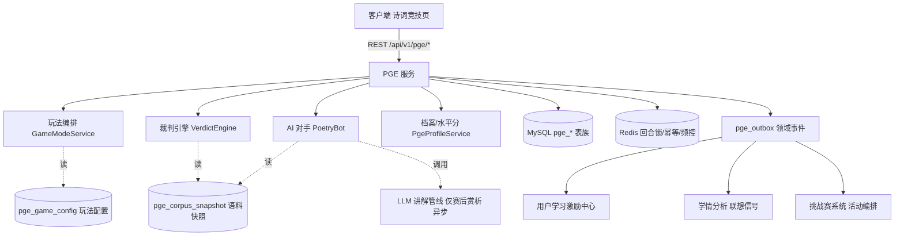
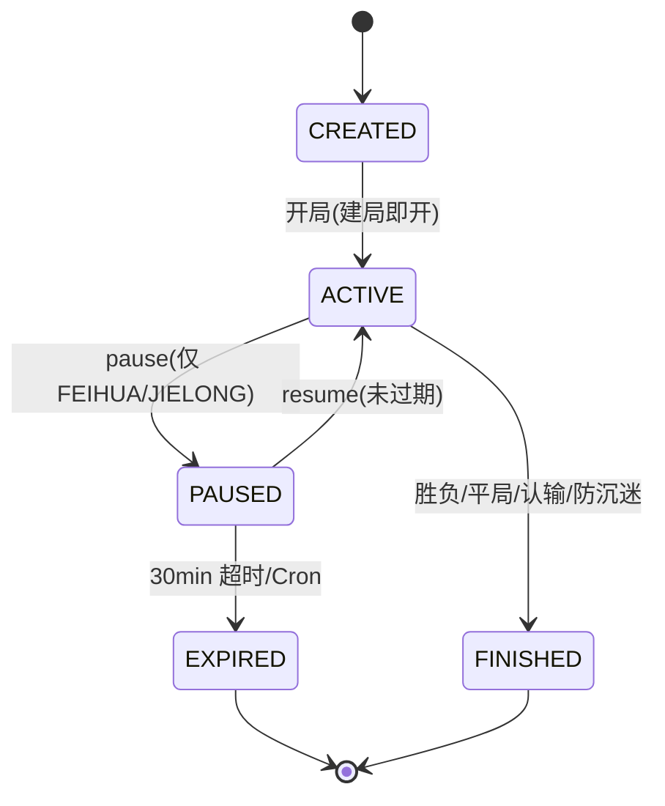

# 服务端-诗词飞花令与诗词竞技引擎 详细设计

- 版本: v1.0
- 日期: 2026-11-22
- 状态: 新增初版
- 错误码段: 48400-48499(全库扫描确认 48400-48499 段空闲;48300-48399 已被他域占用)

## 1. 模块概述

### 1.1 功能定位

诗词飞花令与诗词竞技引擎(Poetry Game Engine, 内部代号 PGE)是"诗词游戏化竞技"学习域的服务端权威。该域以课标必背古诗词与经典篇目语料为裁判依据,提供"飞花令/诗词接龙/填句闯关/宫格寻句"四类确定性规则对弈式玩法,支持学生与 AI 对手逐回合竞技,将古诗文记忆从单向背诵转化为高参与度的对抗式复现。

docs2 全库关键词扫描(飞花令/诗词接龙/九宫格/宫格寻句)确认本域此前零覆盖:《古诗文专项学习系统》覆盖背诵/默写/鉴赏/意象典故教学链路,不含任何竞技玩法;《学习挑战赛与排行榜竞技系统》是通用挑战活动编排框架,不含任何玩法规则;《思维训练与益智游戏系统》是无对手静态 puzzle。本域为"有 AI 对手、有回合制规则、有确定性裁判"的独立成域(与棋类对弈引擎同构,边界见 R3)。

### 1.2 覆盖范围

| 玩法 | 规则概述 | 主要训练目标 |
| --- | --- | --- |
| FEIHUA 飞花令 | 给定关键字,双方轮流说出含该字的完整诗句;句出语料库、句内不得重复用句 | 关键词→诗句联想检索 |
| JIELONG 诗词接龙 | 下一句首字须与上一句末字相同或同音(可配);语气词末字回退取前一实字 | 诗句链式记忆与检索 |
| FILL_BLANK 填句闯关 | 给出上句/下句,作答缺失句;选择式(4 选 1)或输入式两档 | 上下句绑定记忆 |
| GRID_RESCUE 宫格寻句 | 3×3/4×4 打乱字格中点选组成一句完整诗(诗词大会经典题型) | 字形→诗句整体识别 |

适用学段: 小学 3 年级以上(语料要求约 300+ 首存量),初高中为主战场。幼儿段不开放。

### 1.3 设计原则

1. **裁判确定性**:一切"这句算不算数"的裁决由语料库匹配完成(归一化后精确匹配),LLM 禁参与胜负判定与答案判定(与棋类引擎同一红线)。LLM 仅允许用于赛后赏析讲解,异步生成、不阻塞、不回流影响比赛结果。
2. **语料快照公平**:每局开始时冻结语料快照版本,局内裁判只依据该快照,避免运营中途改库导致同句前后判罚不一(见 §3.2)。
3. **答案键不下发**:客户端永不得拿到完整答案索引;宫格题的下发字格本身即为可见信息,但正确句的归属判定在服务端。
4. **难度只用于匹配**:用户水平分仅用于 AI 对手强度匹配,不挂全服排名(未成年人防焦虑红线,与棋类引擎一致)。
5. **激励外置**:积分/成就发放权威归用户学习激励中心,本引擎经 Outbox 事件外发,禁直接写激励表。
6. **零博弈商业化**:玩法内不设任何付费道具、不设押注、胜负不与付费权益挂钩。

### 1.4 权威边界

| 边界 | 裁决 |
| --- | --- |
| R1 诗词游戏裁判权威 | 本引擎。本域封闭,不接入多题型统一判题引擎;判题为语料匹配,LLM 禁入 |
| R2 诗词语料权威 | 篇目/诗句 SSOT 归《古诗文专项学习系统》`poem` 表。本引擎只经快照只读消费,不回写、不扩库;用户提出"库外佳句"经内容纠错通道走审核,裁判当场不认 |
| R3 与棋类对弈引擎 | 棋类=棋盘博弈(走子/局面);本域=语言检索博弈(诗句)。规则引擎、状态载体、判题语义不同构,互不委托 |
| R4 与通用挑战赛系统 | 挑战赛系统负责活动化包装(限时活动/排行榜)。本引擎不建全服榜,只产出对局结果事件;活动期编排由挑战赛系统订阅本引擎事件实现 |
| R5 与 AI 讲解链路 | 赛后"这句诗好在哪里"赏析由 AI 对话引擎承接(复用其管线),本引擎只提供 contextPack(诗句 id/局内表现),讲解结果不回写比赛记录 |
| R6 积分/成就 | 发放权威归用户学习激励中心,本引擎经 pge_outbox 事件外发,禁直接写激励表 |
| R7 学习时长归因 | 本引擎只发时长事件(category=POETRY),统一归因权威归学习时长跨模块统一归因引擎 |
| R8 防沉迷 | 本引擎只执行时段/时长/局数约束(fail-closed),不裁决不放宽 |
| R9 学情消费 | 诗词联想检索正确率等信号经事件供学情分析消费;报告生成权威归学习报告服务 |
| R10 客户端页面 | 客户端对局页面/动画为后续批次;本文只定义服务端契约与 SSE 协议 |

## 2. 整体架构

### 2.1 引擎架构图



### 2.2 模块职责

| 模块 | 职责 | 不做的事 |
| --- | --- | --- |
| 玩法编排 | 建局/回合推进/终局判定/四种玩法的回合协议 | 不做活动包装(归挑战赛系统) |
| 裁判引擎 | 诗句归一化、语料匹配、重复判定、接龙链校验 | 不用 LLM 判定,不做模糊容忍 |
| AI 对手 | 按难度档从快照选句、避让策略、响应时限模拟 | 不访问局外状态,不生成库外诗句 |
| 档案服务 | 用户玩法档案、水平分 EMA、熟练句画像 | 不写统一能力画像(只发信号) |

## 3. 核心数据结构

### 3.1 枚举定义

```typescript
// 玩法
enum PgeGameMode {
  FEIHUA      = 'FEIHUA',      // 飞花令
  JIELONG     = 'JIELONG',     // 诗词接龙
  FILL_BLANK  = 'FILL_BLANK',  // 填句闯关(单人闯关,无 AI 对手回合)
  GRID_RESCUE = 'GRID_RESCUE', // 宫格寻句(单人闯关,无 AI 对手回合)
}

// 对局状态
enum PgeSessionStatus {
  CREATED   = 'CREATED',   // 已创建待开局
  ACTIVE    = 'ACTIVE',    // 进行中
  PAUSED    = 'PAUSED',    // 暂停(仅接龙/飞花令,30 分钟内可续)
  FINISHED  = 'FINISHED',  // 已终局
  EXPIRED   = 'EXPIRED',   // 过期未续自动终止
}

// 终局原因
enum PgeFinishReason {
  WIN          = 'WIN',          // 用户胜(AI 回合失败/超时)
  LOSE         = 'LOSE',         // 用户负
  DRAW         = 'DRAW',         // 平局(回合数上限耗尽均有效)
  QUIT         = 'QUIT',         // 用户主动退出
  TIMEOUT      = 'TIMEOUT',      // 用户回合超时判负
  EXPIRED      = 'EXPIRED',      // 暂停超时
  ANTI_ADDICTION = 'ANTI_ADDICTION', // 防沉迷强制中断
}

// 回合动作类型
enum PgeTurnAction {
  QUOTE_LINE   = 'QUOTE_LINE',   // 引句(飞花令/接龙)
  PICK_OPTION  = 'PICK_OPTION',  // 选项作答(填句选择式)
  INPUT_LINE   = 'INPUT_LINE',   // 输入作答(填句输入式/接龙)
  TAP_GRID     = 'TAP_GRID',     // 宫格点选(按点击顺序传字索引序列)
  PASS         = 'PASS',         // 认输本回合(飞花令:判本回合负)
  RESIGN       = 'RESIGN',       // 认输整局
}

// 回合判定结果
enum PgeVerdict {
  VALID       = 'VALID',        // 有效
  INVALID     = 'INVALID',      // 无效(不在库/不含关键字/违反规则/本局已用)
  TIMEOUT     = 'TIMEOUT',      // 超时
  NOT_A_TURN  = 'NOT_A_TURN',   // 非该方回合(竞态)
}

// AI 对手难度
enum PgeBotLevel {
  L1_NOVICE  = 'L1_NOVICE',   // 小学 3-4 年级:常用句池,反应慢(8-15s),偶有"卡壳"(10% 概率本回合超时)
  L2_REGULAR = 'L2_REGULAR',  // 小学 5-6 年级:常用句池,5-10s
  L3_SKILLED = 'L3_SKILLED',  // 初中:全量池,3-8s,开始避让用户熟练句
  L4_MASTER  = 'L4_MASTER',   // 高中+:全量池+生僻句策略,2-5s,优先消耗用户弱项关键字
}
```

### 3.2 语料快照表(裁判依据)

```sql
-- 语料快照:每局冻结一份,裁判只依据快照,保证局内判罚一致
CREATE TABLE pge_corpus_snapshot (
  id              BIGINT UNSIGNED NOT NULL AUTO_INCREMENT,
  corpus_version  VARCHAR(32)     NOT NULL COMMENT '语料版本号,如 2026Q4-001',
  line_id         BIGINT UNSIGNED NOT NULL COMMENT '诗句行唯一 id(映射 poem 表行拆分)',
  poem_id         BIGINT UNSIGNED NOT NULL COMMENT '映射 poem.id,来源权威 R2',
  line_seq        SMALLINT        NOT NULL COMMENT '在篇目内的行序号',
  text_raw        VARCHAR(128)    NOT NULL COMMENT '原句含标点',
  text_norm       VARCHAR(128)    NOT NULL COMMENT '归一化句:去标点/繁转简/全半角统一,裁判匹配键',
  first_char      CHAR(4)         NOT NULL COMMENT '首字(接龙用,存 UTF-8 字符)',
  last_char       CHAR(4)         NOT NULL COMMENT '末字(接龙用)',
  last_char_pinyin VARCHAR(16)    NOT NULL COMMENT '末字拼音不带声调(同音匹配用)',
  keyword_index   JSON            NULL COMMENT '字→出现位置列表,如 {"花":[0,5]};飞花令裁判 O(1) 查',
  freq_band       TINYINT         NOT NULL DEFAULT 2 COMMENT '常用度分带 1-4,AI 选句与学段过滤用',
  textbook_flag   TINYINT         NOT NULL DEFAULT 0 COMMENT '是否课标/教材必背篇目',
  grade_min       TINYINT         NOT NULL COMMENT '建议最低年级',
  grade_max       TINYINT         NOT NULL COMMENT '建议最高年级',
  status          VARCHAR(16)     NOT NULL DEFAULT 'ACTIVE',
  created_at      DATETIME        NOT NULL DEFAULT CURRENT_TIMESTAMP,
  PRIMARY KEY (id),
  UNIQUE KEY uk_version_line (corpus_version, line_id),
  KEY idx_norm (text_norm),
  KEY idx_version_first (corpus_version, first_char),
  KEY idx_version_last_pinyin (corpus_version, last_char_pinyin),
  KEY idx_version_kw (corpus_version, (CAST(keyword_index AS CHAR(64)))) 
) COMMENT='PGE 语料快照,由 poem 表派生,只读';
```

快照构建为离线 Job(管理端触发):从 `poem` 表拉取 PUBLISHED 篇目,按句拆分、归一化、预计算关键字索引与同音映射,版本号单调递增。局内裁判 100% 走快照,快照行数约 4-6 万行(课标+拓展),按版本整组缓存 Redis(飞花令关键字倒排表约 20MB,可承受)。

### 3.3 玩法配置表

```sql
CREATE TABLE pge_game_config (
  id               BIGINT UNSIGNED NOT NULL AUTO_INCREMENT,
  mode             VARCHAR(16)     NOT NULL,
  grade_band       VARCHAR(8)      NOT NULL COMMENT 'P3_4/P5_6/JUNIOR/SENIOR',
  bot_level        VARCHAR(16)     NOT NULL,
  time_limit_sec   SMALLINT        NOT NULL COMMENT '用户每回合时限',
  max_rounds       SMALLINT        NOT NULL COMMENT '回合上限,耗尽判 DRAW',
  max_strikes      TINYINT         NOT NULL DEFAULT 3 COMMENT '无效作答达次数判负',
  corpus_version   VARCHAR(32)     NOT NULL,
  pool_scope       VARCHAR(16)     NOT NULL DEFAULT 'TEXTBOOK' COMMENT 'TEXTBOOK 仅必背/EXTENDED 含拓展',
  homophone_allow  TINYINT         NOT NULL DEFAULT 1 COMMENT '接龙是否允许同音',
  status           VARCHAR(16)     NOT NULL DEFAULT 'ACTIVE',
  version          INT             NOT NULL DEFAULT 1 COMMENT '乐观锁',
  updated_at       DATETIME        NOT NULL DEFAULT CURRENT_TIMESTAMP ON UPDATE CURRENT_TIMESTAMP,
  PRIMARY KEY (id),
  UNIQUE KEY uk_mode_band (mode, grade_band, status)
) COMMENT='PGE 玩法参数配置';
```

### 3.4 对局会话表

```sql
CREATE TABLE pge_session (
  id                BIGINT UNSIGNED NOT NULL AUTO_INCREMENT,
  session_no        VARCHAR(32)     NOT NULL COMMENT '业务单号 PGE+yyyymmdd+序号',
  user_id           BIGINT UNSIGNED NOT NULL,
  student_id        BIGINT UNSIGNED NOT NULL,
  mode              VARCHAR(16)     NOT NULL,
  bot_level         VARCHAR(16)     NULL COMMENT 'FEIHUA/JIELONG 才有 AI 对手',
  grade_band        VARCHAR(8)      NOT NULL,
  corpus_version    VARCHAR(32)     NOT NULL COMMENT '局内冻结快照版本',
  status            VARCHAR(16)     NOT NULL DEFAULT 'CREATED',
  current_round     SMALLINT        NOT NULL DEFAULT 0,
  current_turn_side VARCHAR(8)      NOT NULL DEFAULT 'USER' COMMENT 'USER/BOT',
  keyword           VARCHAR(8)      NULL COMMENT '飞花令关键字',
  used_line_ids     JSON            NOT NULL COMMENT '本局已用 line_id 集合,防重复',
  user_strikes      TINYINT         NOT NULL DEFAULT 0,
  bot_strikes       TINYINT         DEFAULT 0,
  config_snapshot   JSON            NOT NULL COMMENT '开局时配置快照,防中途改配',
  finish_reason     VARCHAR(20)     NULL,
  started_at        DATETIME        NULL,
  finished_at       DATETIME        NULL,
  expire_at         DATETIME        NULL COMMENT 'PAUSED 续局截止时间',
  client_request_id VARCHAR(64)     NOT NULL,
  version           INT             NOT NULL DEFAULT 1,
  created_at        DATETIME        NOT NULL DEFAULT CURRENT_TIMESTAMP,
  updated_at        DATETIME NOT NULL DEFAULT CURRENT_TIMESTAMP ON UPDATE CURRENT_TIMESTAMP,
  PRIMARY KEY (id),
  UNIQUE KEY uk_request (user_id, client_request_id),
  UNIQUE KEY uk_session_no (session_no),
  KEY idx_user_status (user_id, status),
  KEY idx_expire (status, expire_at)
) COMMENT='PGE 对局会话';
```

### 3.5 回合日志表

```sql
CREATE TABLE pge_round (
  id              BIGINT UNSIGNED NOT NULL AUTO_INCREMENT,
  session_id      BIGINT UNSIGNED NOT NULL,
  round_no        SMALLINT        NOT NULL,
  side            VARCHAR(8)      NOT NULL COMMENT 'USER/BOT',
  action          VARCHAR(16)     NOT NULL,
  payload         JSON            NULL COMMENT '引句文本/选项 id/宫格索引序列',
  matched_line_id BIGINT UNSIGNED NULL COMMENT '裁判匹配到的快照行,INVALID 为 NULL',
  verdict         VARCHAR(12)     NOT NULL,
  invalid_reason  VARCHAR(32)     NULL COMMENT 'NOT_IN_CORPUS/NO_KEYWORD/DUPLICATED/RULE_VIOLATION',
  cost_ms         INT             NULL COMMENT '用户作答耗时,BOT 为模拟耗时',
  created_at      DATETIME        NOT NULL DEFAULT CURRENT_TIMESTAMP,
  PRIMARY KEY (id),
  UNIQUE KEY uk_session_round_side (session_id, round_no, side),
  KEY idx_session (session_id)
) COMMENT='PGE 回合日志,逐回合追加';

CREATE TABLE pge_grid_round (
  id               BIGINT UNSIGNED NOT NULL AUTO_INCREMENT,
  session_id       BIGINT UNSIGNED NOT NULL,
  round_no         SMALLINT        NOT NULL,
  target_line_id   BIGINT UNSIGNED NOT NULL COMMENT '目标句快照行',
  grid_cells       JSON            NOT NULL COMMENT '字格内容[{idx,char}],含干扰字',
  distractor_count TINYINT         NOT NULL,
  user_tap_seq     JSON            NULL,
  verdict          VARCHAR(12)     NOT NULL,
  cost_ms          INT             NULL,
  created_at       DATETIME        NOT NULL DEFAULT CURRENT_TIMESTAMP,
  PRIMARY KEY (id),
  UNIQUE KEY uk_session_round (session_id, round_no)
) COMMENT='PGE 宫格题下发与作答(target_line_id 属答案键,仅服务端可见)';
```

### 3.6 用户档案表

```sql
CREATE TABLE pge_profile (
  id                BIGINT UNSIGNED NOT NULL AUTO_INCREMENT,
  user_id           BIGINT UNSIGNED NOT NULL,
  student_id        BIGINT UNSIGNED NOT NULL,
  rating            INT             NOT NULL DEFAULT 1200 COMMENT '简化 Elo,仅用于 AI 强度匹配,不公示',
  total_games       INT             NOT NULL DEFAULT 0,
  win_count         INT             NOT NULL DEFAULT 0,
  feihua_accuracy   DECIMAL(5,4)    NOT NULL DEFAULT 0 COMMENT '飞花令有效率 EMA',
  jielong_accuracy  DECIMAL(5,4)    NOT NULL DEFAULT 0 COMMENT '接龙有效率 EMA',
  fill_accuracy     DECIMAL(5,4)    NOT NULL DEFAULT 0,
  grid_accuracy     DECIMAL(5,4)    NOT NULL DEFAULT 0,
  weak_keywords     JSON            NULL COMMENT '弱项关键字 TOP20(飞花令失利聚合)',
  mastered_lines    INT             NOT NULL DEFAULT 0 COMMENT '命中过的不同诗句数(探索广度)',
  last_game_at      DATETIME        NULL,
  version           INT             NOT NULL DEFAULT 1,
  created_at        DATETIME        NOT NULL DEFAULT CURRENT_TIMESTAMP,
  updated_at        DATETIME NOT NULL DEFAULT CURRENT_TIMESTAMP ON UPDATE CURRENT_TIMESTAMP,
  PRIMARY KEY (id),
  UNIQUE KEY uk_user (user_id)
) COMMENT='PGE 用户竞技档案';
```

### 3.7 Outbox 事件表

```sql
CREATE TABLE pge_outbox (
  id              BIGINT UNSIGNED NOT NULL AUTO_INCREMENT,
  event_id        VARCHAR(64)     NOT NULL,
  event_type      VARCHAR(48)     NOT NULL,
  aggregate_id    BIGINT UNSIGNED NOT NULL COMMENT 'pge_session.id',
  payload         JSON            NOT NULL,
  status          VARCHAR(16)     NOT NULL DEFAULT 'PENDING',
  retry_count     TINYINT         NOT NULL DEFAULT 0,
  created_at      DATETIME        NOT NULL DEFAULT CURRENT_TIMESTAMP,
  sent_at         DATETIME        NULL,
  PRIMARY KEY (id),
  UNIQUE KEY uk_event (event_id)
) COMMENT='PGE 领域事件外发';
```

事件清单:

| event_type | 触发点 | 主要消费者 |
| --- | --- | --- |
| pge.game.finished | 终局 | 激励中心(完成局/胜局奖励)、学情分析、挑战赛系统 |
| pge.round.valid_quote | 每次有效引句 | 间隔重复引擎(该句 exposure 信号,可选) |
| pge.profile.updated | 档案 EMA 更新后 | 学情分析(联想检索维度) |
| pge.bot.defeated | 战胜 L3+ 对手 | 成就系统(高难度成就判定) |
| pge.session.expired | 过期清理 | 对账 Job |

### 3.8 Redis 键设计

| 键 | 类型 | TTL | 用途 |
| --- | --- | --- | --- |
| pge:session:{id}:lock | STRING | 对局存续期 | 回合提交分布式锁(SETNX,value=side+round,防双发) |
| pge:idem:{userId}:{clientRequestId} | STRING | 24h | 建局幂等回放 |
| pge:turn:{sessionId}:{round} | STRING | time_limit+5s | 回合计时与 Bot 调度占位 |
| pge:daily:{userId}:{date} | HASH | 48h | 当日对局数/无效引句数频控 |
| pge:bot:sem | 信号量 | - | AI 选句计算并发上限 50,防快照大查询打满 |
| pge:snap:{version} | HASH 分片 | 随版本 | 快照热缓存:norm 句表+关键字倒排+接龙首尾索引 |

## 4. API 接口设计

统一前缀 `/api/v1/pge`。所有写操作要求 `X-Idempotency-Key`(对齐统一幂等规范);学生身份与家长门复用全局机制。

### 4.1 建局

```http
POST /api/v1/pge/sessions
```

请求:

```json
{
  "mode": "FEIHUA",
  "botLevel": "L2_REGULAR",
  "gradeBand": "P5_6",
  "clientRequestId": "uuid-v7"
}
```

响应 200:

```json
{
  "sessionId": 90001,
  "sessionNo": "PGE20261122000123",
  "mode": "FEIHUA",
  "status": "ACTIVE",
  "keyword": "月",
  "corpusVersion": "2026Q4-001",
  "config": { "timeLimitSec": 15, "maxRounds": 20, "maxStrikes": 3 },
  "firstTurn": "USER",
  "serverTime": "2026-11-22T19:30:00+08:00"
}
```

- `FILL_BLANK`/`GRID_RESCUE` 建局即生成全部关卡题(见 4.4),`botLevel` 传 null。
- 幂等:`uk_request(user_id, client_request_id)`;重复请求返回首次结果(200 语义码 48407 仅在幂等键撞不同 payload 时返回 409)。

### 4.2 回合提交(飞花令/接龙)

```http
POST /api/v1/pge/sessions/{id}/turns
```

请求:

```json
{
  "roundNo": 3,
  "action": "QUOTE_LINE",
  "payload": { "text": "床前明月光,疑是地上霜" },
  "clientElapsedMs": 8320
}
```

响应 200:

```json
{
  "verdict": "VALID",
  "matchedLineId": 51823,
  "matchedText": "床前明月光,疑是地上霜",
  "userStrikes": 0,
  "botTurn": {
    "roundNo": 4,
    "side": "BOT",
    "text": "月落乌啼霜满天,江枫渔火对愁眠",
    "matchedLineId": 61209,
    "thinkMs": 4200
  },
  "next": { "roundNo": 5, "side": "USER", "deadlineAt": "2026-11-22T19:30:24+08:00" }
}
```

- 单接口内完成"判定用户回合→AI 走子→返回下一回合",客户端只调一次;Bot 响应在用户回合 VALID 后同步计算(选句为缓存内确定性检索,目标 P99≤300ms,见 §9)。
- INVALID 响应:`{ "verdict": "INVALID", "invalidReason": "DUPLICATED", "userStrikes": 1, "next": {...} }`,不加 Bot 回合(strikes 未满时本回合重试一次;满 max_strikes 直接终局 LOSE)。

### 4.3 暂停与续局(仅 FEIHUA/JIELONG)

```http
POST /api/v1/pge/sessions/{id}:pause
POST /api/v1/pge/sessions/{id}:resume
```

- 暂停:ACTIVE→PAUSED,`expire_at=now+30min`;暂停期间 Bot 不占位。
- 续局:PAUSED→ACTIVE,回合时限重计;过期由延迟任务置 EXPIRED 并记 finish_reason=EXPIRED。

### 4.4 闯关题获取(FILL_BLANK/GRID_RESCUE)

```http
GET /api/v1/pge/sessions/{id}/rounds/{roundNo}
```

响应(GRID_RESCUE 示例,注意不含答案):

```json
{
  "roundNo": 7,
  "mode": "GRID_RESCUE",
  "gridSize": 3,
  "cells": [
    { "idx": 0, "char": "春" }, { "idx": 1, "char": "风" }, { "idx": 2, "char": "又" },
    { "idx": 3, "char": "绿" }, { "idx": 4, "char": "江" }, { "idx": 5, "char": "岸" },
    { "idx": 6, "char": "南" }, { "idx": 7, "char": "王" }, { "idx": 8, "char": "到" }
  ],
  "timeLimitSec": 30
}
```

作答:

```http
POST /api/v1/pge/sessions/{id}/rounds/{roundNo}/answer
```

```json
{ "action": "TAP_GRID", "payload": { "seq": [2, 3, 4, 1, 5, 0, 6] }, "clientElapsedMs": 12000 }
```

服务端判定:按 seq 取字拼句→归一化→与 `pge_grid_round.target_line_id` 对应 `text_norm` 精确比对。

### 4.5 终局与结果

```http
GET /api/v1/pge/sessions/{id}/result
```

```json
{
  "sessionId": 90001,
  "status": "FINISHED",
  "finishReason": "WIN",
  "rounds": 13,
  "summary": {
    "userValidQuotes": 6,
    "userStrikes": 1,
    "botValidQuotes": 6,
    "botTimeout": true,
    "hitLineIds": [51823, 52011, 52107],
    "newWeakKeywords": ["霜"],
    "ratingDelta": 18
  },
  "appreciateUrl": "/api/v1/pge/sessions/90001/appreciate"
}
```

- `appreciateUrl`:赛后赏析(复用 AI 对话管线异步生成,回调/轮询取得;失败仅降级无赏析,不影响战绩)。

### 4.6 档案查询

```http
GET /api/v1/pge/profile
```

返回 rating(仅本人)、四玩法准确率、mastered_lines、weak_keywords;**不返回任何排名信息**。

### 4.7 管理端接口(内部)

| 接口 | 用途 |
| --- | --- |
| POST /admin/pge/corpus:snapshot | 触发快照重建(双人复核后生效,版本单调+1) |
| GET /admin/pge/corpus/versions | 快照版本列表与行数统计 |
| GET /admin/pge/sessions | 对局检索(排查判罚争议) |
| POST /admin/pge/sessions/{id}:void | 作废争议局(仅 FINISHED 前;已终局局走人工退款积分工单) |

## 5. 核心业务逻辑

### 5.1 裁判引擎(VerdictEngine)

判定流水线,全程确定性、零 LLM:

```go
// Verdict 判定:归一化 → 快照精确匹配 → 玩法规则校验
func (v *VerdictEngine) JudgeQuote(ctx context.Context, s *PgeSession, text string) (*Verdict, error) {
    norm := NormalizeLine(text) // 去标点(Unicode 标点表)/繁转简/全半角/空白剔除
    if norm == "" { return &Verdict{Result: INVALID, Reason: "NOT_IN_CORPUS"}, nil }

    line, ok := v.snapshot.ByNorm(s.CorpusVersion, norm) // Redis 热缓存,未命中回源快照表
    if !ok { return &Verdict{Result: INVALID, Reason: "NOT_IN_CORPUS"}, nil }

    used := s.UsedLineIdsSet()
    if used[line.ID] { return &Verdict{Result: INVALID, Reason: "DUPLICATED"}, nil }

    switch s.Mode {
    case FEIHUA:
        pos, ok := line.KeywordIndex[s.Keyword]
        if !ok || len(pos) == 0 { return &Verdict{Result: INVALID, Reason: "NO_KEYWORD"}, nil }
    case JIELONG:
        anchor := v.lastQuoteLastChar(s) // 上一条有效引句末字;语气词(兮/矣/焉/哉)回退前一实字
        if anchor == "" { break } // 首回合跳过链校验
        same := line.FirstChar == anchor.Char
        homo := s.ConfigSnapshot.HomophoneAllow == 1 &&
                PinyinNoTone(line.FirstChar) == anchor.PinyinNoTone
        if !same && !homo { return &Verdict{Result: INVALID, Reason: "RULE_VIOLATION"}, nil }
    }
    return &Verdict{Result: VALID, MatchedLineID: line.ID}, nil
}
```

归一化规则(唯一裁判口径,客户端与服务端共用同一套映射表下发):

1. 去除全部 Unicode 标点(CJK 标点区+ASCII 标点)与空白;
2. 繁体转简体(开放词表,固定映射表版本随快照走);
3. 全角字母数字转半角(防止形近规避);
4. 不做同音替换、不做容错字(如"偿/尝"不视为等价),宁可严不可错放——误判代价是引句无效(有 strikes 缓冲),错放代价是裁判失信。

### 5.2 AI 对手选句(PoetryBot)

选句为确定性检索+策略打分,禁 LLM:

```go
func (b *PoetryBot) Pick(ctx context.Context, s *PgeSession) (*BotMove, error) {
    cands := b.snapshot.QueryCandidates(s.CorpusVersion, Constraint{
        Mode: s.Mode, Keyword: s.Keyword, Anchor: lastAnchor(s),
        GradeBand: s.GradeBand, Pool: s.ConfigSnapshot.PoolScope,
        Exclude: s.UsedLineIdsSet(), // 本局已用,防 Bot 自重复
    })
    if len(cands) == 0 { return &BotMove{Timeout: true}, nil } // 无句可接=Bot 卡壳,判该回合负

    prof := b.profile.Load(ctx, s.UserID)
    best, bestScore := nil, -1.0
    for _, c := range cands {
        score := float64(c.FreqBand) * -1.0 // 默认偏好常用句
        if s.BotLevel >= L3_SKILLED && prof.IsFamiliar(c.PoemID) {
            score -= 2.0 // 避让用户熟练句,逼出检索深度
        }
        if s.BotLevel >= L4_MASTER && prof.WeakKeywordMatch(c) {
            score += 3.0 // 优先攻击弱项关键字
        }
        if score > bestScore { best, bestScore = c, score }
    }
    thinkMs := b.simulateThink(s.BotLevel) // 难度档映射 2-15s,含 L1 的 10% 卡壳超时
    return &BotMove{LineID: best.ID, ThinkMs: thinkMs}, nil
}
```

- L1 卡壳超时是**概率 10% 的本回合直接超时**,用于让低龄用户获得胜利体验;L4 永不卡壳。
- 选句计算信号量限流(Redis `pge:bot:sem`,上限 50),超时降级为"按 freq_band 最高取第一条",永不阻塞用户回合响应(守卫 G10 同构于棋类引擎)。

### 5.3 飞花令关键字选择

由服务端出题(不交给客户端/用户随意指定,防"我出一个你库里最少的字"套利):

- 候选关键字池: 高频意象字(月/花/春/山/风/云/雪/江/夜/人等 200 字)且 `keyword_index` 命中句数≥20;
- 开局按 `hash(session_id)` 从池内抽 1 字并限制同用户 7 日内不重字(weak_keywords 命中的弱项字优先复现,转化弱项);
- 高级档(JUNIOR+/L3+)启用"位置递进"规则:双方须在关键字出现位置序列中轮流使用新位置(同位重复无效),由 `keyword_index` 支持。

### 5.4 水平分与匹配

- 简化 Elo:K=32;仅 FEIHUA/JIELONG 有胜负,参与计分;FILL_BLANK/GRID_RESCUE 不计 rating。
- rating 只用于 Bot 强度默认值(用户可选低一档,不可选高一档;未实名/低龄默认 L1)。
- 档案 EMA 单写者:对局终局事务内更新,禁止并发双写(乐观锁 version)。

### 5.5 建局关键代码(幂等+频控+防沉迷)

```go
func (s *PgeService) CreateSession(ctx context.Context, userID uint64, req CreateReq) (*Session, error) {
    // 1. 防沉迷 fail-closed:时段/当日游戏总时长校验,不过即 48404
    if err := s.antiAddiction.Check(userID, ScenePoetryGame); err != nil { return nil, err }

    // 2. 日频控:Lua 原子自增(对局数/引句无效数)
    ok, err := s.redis.Eval(ctx, dailyLimitLua, []string{fmt.Sprintf("pge:daily:%d:%s", userID, today())},
        req.Mode, 30).Result() // 单日上限 30 局
    if err != nil || ok.(int64) != 1 { return nil, ErrDailyLimitExceeded } // 48412

    // 3. 幂等:先查 uk_request 回放
    if exist := s.repo.FindByRequestID(userID, req.ClientRequestID); exist != nil {
        return exist, nil // 200 语义码 48407 由网关对撞 payload 场景使用
    }
    // 4. 事务:插会话(uk 兜底)+ 写首回合上下文 + Outbox(pge.game.created 不入外发,仅审计)
    return s.repo.CreateTx(ctx, buildSession(userID, req)) // 冲突转 48407
}
```

## 6. 状态机与守卫

### 6.1 对局状态机



### 6.2 守卫规则

| 编号 | 守卫 | 违规处理 |
| --- | --- | --- |
| G1 | 回合提交必须持有 `pge:session:{id}:lock`,value=side+roundNo | 未持锁拒绝 48409;锁与 roundNo 不符判 NOT_A_TURN |
| G2 | 非用户回合提交一律 NOT_A_TURN | 不扣 strikes,仅提示 |
| G3 | 裁判只读建局冻结的 `corpus_version` 快照 | 快照缺失 fail-closed 拒绝开局(48411) |
| G4 | 命中句必须不在 `used_line_ids` | INVALID/DUPLICATED |
| G5 | 答案键(target_line_id/关键字索引)禁出现在任何响应体 | 出站 DTO 白名单校验,违例 P1 告警 |
| G6 | Bot 无句可接=Bot 回合负,不得编造库外诗句 | 违者即数据事故;Bot 选句全程留痕可回放 |
| G7 | 防沉迷不过即拒绝建局(fail-closed) | 48404,不因任何运营配置放宽 |
| G8 | 关卡题(FILL/GRID)按会话预生成,round 接口只读下发一次 | 重复 GET 返回同题(304/etag);作答后不再下发 |
| G9 | rating 只由 FINISHED 对局驱动,中途退出按 QUIT 负向小delta | 防刷分:QUIT 不计胜场 |
| G10 | Bot 计算超时(300ms P99 预算)降级取 freq 最高候选 | 永不阻塞用户回合 |
| G11 | 作废(void)仅限 FINISHED 之前,且留审计 | 已终局争议走人工工单 |
| G12 | 终局一次性:finish_reason 首写后不可改 | CAS `status=ACTIVE→FINISHED`,影响行数 0 即并发终局,忽略后写 |

## 7. 幂等与并发

| 场景 | 机制 |
| --- | --- |
| 建局重试 | uk_request + Redis `pge:idem` 双层;同键同 payload 返回首次结果 |
| 回合双发(双击/重连重放) | 回合锁 SETNX + `uk_session_round_side`;重复提交返回首次判定回放 |
| 暂停/续局竞态 | CAS `ACTIVE↔PAUSED`,影响行数 0 返回当前实际状态 |
| 终局扇出与档案更新同事务 | 终局 CAS + pge_outbox INSERT 同事务;档案 version 乐观锁 |
| Bot 回合与用户下一回合并发 | 单接口内串行完成,不存在跨请求 Bot 回合 |
| 日限并发 | Lua 原子计数,不依赖读后写 |

## 8. 错误码定义(48400-48499)

| 错误码 | HTTP | 含义 | 用户提示 |
| --- | --- | --- | --- |
| 48400 | 400 | 参数校验失败(mode/botLevel 非法) | 请刷新后重试 |
| 48401 | 403 | 未实名/年龄不达标 | 该玩法需要实名认证后使用 |
| 48402 | 403 | 家长门未通过 | 请家长确认后使用 |
| 48403 | 403 | 功能门控/会员限制(若运营配置) | 当前账号暂不能使用该玩法 |
| 48404 | 403 | 防沉迷限制(时段/时长/局数) | 休息一下吧,明天再来 |
| 48405 | 404 | 会话不存在或已过期 | 对局已结束 |
| 48406 | 404 | 配置缺失(玩法×学段未配置) | 该功能维护中 |
| 48407 | 409 | 幂等键冲突(同键不同 payload) | 请求冲突,请刷新 |
| 48408 | 409 | 对局进行中不可重复建局(同玩法单开一局) | 先完成当前对局 |
| 48409 | 409 | 回合锁竞争失败 | 操作太快了 |
| 48410 | 422 | INVALID 引句(细分 invalidReason) | 这句不符合规则,再想想 |
| 48411 | 500 | 快照缺失/快照构建中 | 功能准备中,请稍后再试 |
| 48412 | 429 | 单日对局上限 | 今日对战次数已用完 |
| 48413 | 429 | 引句无效频率过高(短时 10 次) | 慢慢想,不着急 |
| 48414 | 200 | Bot 无句可接(BOT 回合超时胜,语义码随正常响应) | — |
| 48415 | 200 | 赏析生成中(轮询语义) | — |
| 48416 | 200 | 赏析生成失败降级(无赏析,战绩不受影响) | — |
| 48417 | 410 | 会话已终局 | 本局已结束 |
| 48418 | 403 | 跨学生数据访问 | — |
| 48419 | 500 | 裁判缓存回源失败 | 网络开小差了,请重试 |
| 48420 | 503 | Bot 执行器不可用(降级仍可用 freq 策略) | — |

## 9. 性能与容量

- DAU 50 万估算:诗词竞技日活约 3 万,峰值并发对局 2000;回合提交峰值 QPS 约 800(含 Bot 同接口处理)。
- 裁判判定 P99≤50ms(快照 Redis 热缓存,norm 精确哈希查);Bot 选句 P99≤300ms(候选集默认≤500 条,内存打分)。
- 表容量:`pge_round` 日增约 20 万行(3 万局×7 回合),按月分区保留 6 个月;`pge_corpus_snapshot` 按版本全量保留(每版本约 5 万行),旧版本标记 ARCHIVED 后 1 年清理。
- 快照全量内存约 20MB(关键字倒排+norm 索引),单 Redis 实例可承载,无分片需求。

## 10. 降级矩阵

| 编号 | 故障 | 降级策略 |
| --- | --- | --- |
| D1 | Redis 快照缓存失效 | 回源 MySQL 快照表,性能降级但不改语义;回源失败 fail-closed(48411) |
| D2 | Bot 执行器不可用 | 降级 freq 最高选句(不依赖画像);仍不可用则 Bot 按固定节奏卡壳超时,用户可正常完局 |
| D3 | 赏析 LLM 不可用 | 48416 降级无赏析,战绩不受影响 |
| D4 | 激励中心消费失败 | Outbox 重试 8 次指数退避,最终进死信告警;不阻塞对局 |
| D5 | 管理端快照重建中 | 新局用旧版本快照(版本连续,不中断服务) |
| D6 | 学情消费积压 | 事件保留 7 天,可重放;不阻塞主链路 |
| D7 | 频控 Redis 故障 | fail-closed 拒绝建局(宁可不可用不可超放,对齐晨读引擎) |
| D8 | 客户端弱网回合重放 | 幂等回放首次判定,不重复推进回合 |
| D9 | 归档压力 | round 表分区轮转,冷数据转 ORC 归档 |
| D10 | **总红线** | 裁判确定性(G1-G6)、答案键不下发(G5)、防沉迷 fail-closed(G7)三条不可降级 |

## 11. 监控指标

| 编号 | 指标 | 告警阈值 |
| --- | --- | --- |
| M1 | 回合判定 P99 | >200ms 持续 5min 告警 |
| M2 | Bot 选句 P99 | >500ms 持续 5min 告警 |
| M3 | INVALID 引句占比 | >25%(24h)告警,疑似语料或归一化缺陷 |
| M4 | 建局成功率 | <99%(1h)P2 告警 |
| M5 | 快照回源 MySQL 次数 | >100/min 告警(缓存命中率异常) |
| M6 | Outbox 积压 | >1000 或最老 >10min 告警 |
| M7 | 防沉迷拦截量突降 | 较 7 日均值降 80% 告警(疑似被绕过) |
| M8 | 48411 出现 | 任一出现即 P1(快照缺失) |

## 12. 合规红线

| 编号 | 红线 |
| --- | --- |
| C1 | 零博弈商业化:无付费道具/押注/打赏;胜负不与会员权益挂钩 |
| C2 | 无全服排行榜;rating 不公示、不跨人比较;班级内轻排行由挑战赛系统另行裁决且默认关闭 |
| C3 | 防沉迷 fail-closed;对局时长独立计入娱乐时长并上报 |
| C4 | 语料版权:仅使用已获授权的 poem 表内容;快照派生不新增版权主体,授权到期整版本快照 fail-closed 下线 |
| C5 | 用户引句内容按 UGC 处理但不做公开展示;weak_keywords 等画像仅家长端与孩子本人可见 |
| C6 | 赏析内容由 AI 安全护栏管线过滤后下发,历史/作者信息以语料库为准,LLM 禁编造诗人轶事入正文(事实校验) |
| C7 | 未成年人数据:round 日志含作答文本,保留 6 个月,注销级联删除(订阅账号注销事件) |
| C8 | 不与社会考级/竞赛证书挂钩,不输出"段位证书"类文案 |

## 13. 契约对齐

| 编号 | 契约 |
| --- | --- |
| R1 | 判题封闭:本域判题不委托多题型统一判题引擎,LLM 禁入裁判 |
| R2 | 语料 SSOT 归古诗文专项学习系统 `poem` 表;快照为派生只读,争议判罚以快照版本+归一化口径回放裁决 |
| R3 | 与棋类引擎域界:棋盘博弈≠语言检索博弈,互不委托 |
| R4 | 与挑战赛系统:本引擎产出 `pge.game.finished` 事件;活动包装/限时榜归挑战赛系统消费编排 |
| R5 | 激励外发单写:经 pge_outbox,禁直写激励表 |
| R6 | 时长归因 category=POETRY,权威归学习时长跨模块统一归因引擎 |
| R7 | 赛后赏析复用 AI 对话管线,RAG 引用句以 snapshot line_id 溯源;赏析不回写战绩 |
| R8 | 用户提出库外佳句:当场判 INVALID,引导至内容纠错反馈通道,审核入库后下局起生效 |
| R9 | 归一化映射表版本随快照走,客户端预校验只做体验提示,一切以服务端裁判为准 |
| R10 | 客户端对局页面/动画/音效为后续批次,本文 SSE/REST 契约为权威 |
| R11 | 注销级联:订阅账号注销事件清理 pge_session/pge_round/pge_profile |
| R12 | 与教育内容版权到期预警引擎联动:授权到期→在用快照版本标记 EXPIRING→到期 fail-closed |

## 14. 验收场景

| 编号 | 场景 | 预期 |
| --- | --- | --- |
| AC01 | 飞花令关键字"月",用户引"床前明月光,疑是地上霜" | VALID,BOT 回含"月"句 |
| AC02 | 同一句本局再次引用 | INVALID/DUPLICATED,strikes+1 |
| AC03 | 引用库外自撰句 | INVALID/NOT_IN_CORPUS |
| AC04 | 引含关键字但不在快照 | INVALID(裁判只认证快照) |
| AC05 | 接龙上句末"霜",用户引首字"霜"句 | VALID |
| AC06 | 接龙上句末"霜",用户引首字同音"双"句(homophone_allow=1) | VALID |
| AC07 | 接龙上句末为语气词"兮",回退取前一实字校验 | 按回退字判定 |
| AC08 | BOT 无句可接 | BOT 回合超时,用户胜该回合(48414) |
| AC09 | L1 Bot 10% 卡壳触发 | BOT TIMEOUT,不记 Bot strikes |
| AC10 | 用户 strikes 达 max_strikes | 终局 LOSE,事件外发 |
| AC11 | 回合双发同 roundNo | 首次判定回放,回合不推进两次 |
| AC12 | 暂停 31 分钟后续局 | 48405/EXPIRED |
| AC13 | 宫格题作答字序拼句正确 | VALID,round 推进;重复 GET 同题 |
| AC14 | 防沉迷时段外建局 | 48404,无任何对局数据落库 |
| AC15 | 响应体出站校验发现 target_line_id | 拦截+告警(G5) |
| AC16 | 激励中心宕机 | 对局正常,Outbox 积压告警不阻塞 |

## 15. 关联文档

- 《古诗文专项学习系统-详细设计》(语料 SSOT,`poem` 表)
- 《服务端-棋类对弈训练引擎-详细设计》(对弈域同构参考:守卫/降级/合规模式)
- 《服务端-学习挑战赛与排行榜竞技系统-详细设计》(活动编排消费方)
- 《服务端-统一业务异常码与错误分类体系》(484xx 段登记)
- 《服务端-大模型推理统一适配层与多供应商模型调用抽象框架》(赛后赏析 LLM 通道)
- 《间隔重复算法与遗忘曲线复习调度引擎》(exposure 信号消费方)

## 16. 维护记录

- v1.0 (2026-11-22): 新增初版。补齐"诗词飞花令/诗词接龙/填句闯关/宫格寻句"竞技玩法域——全库关键词扫描(飞花令/诗词接龙/九宫格)确认零覆盖;《古诗文专项学习系统》含背诵默写鉴赏但无任何竞技玩法,《学习挑战赛与排行榜竞技系统》为通用活动框架不含玩法规则。本文定义四玩法回合协议、语料快照裁判体系(归一化确定性匹配,LLM 禁入裁判)、PoetryBot 四档确定性对手(避让/攻弱策略,禁生成库外句)、七表 DDL(uk 幂等+version CAS)、七类 Redis 键、REST 七组、双 mermaid 状态机、守卫 G1-G12、幂等六场景、Outbox 五事件五订阅、48400-48420 错误码 21 项(48400-48499 段全库扫描确认空闲)、降级 D1-D10(D10 总红线)、监控 M1-M8、合规 C1-C8(零博弈商业化/无全服榜/版权 fail-closed)、契约 R1-R12、验收 AC01-AC16。客户端对局页面列为后续批次 R10。
