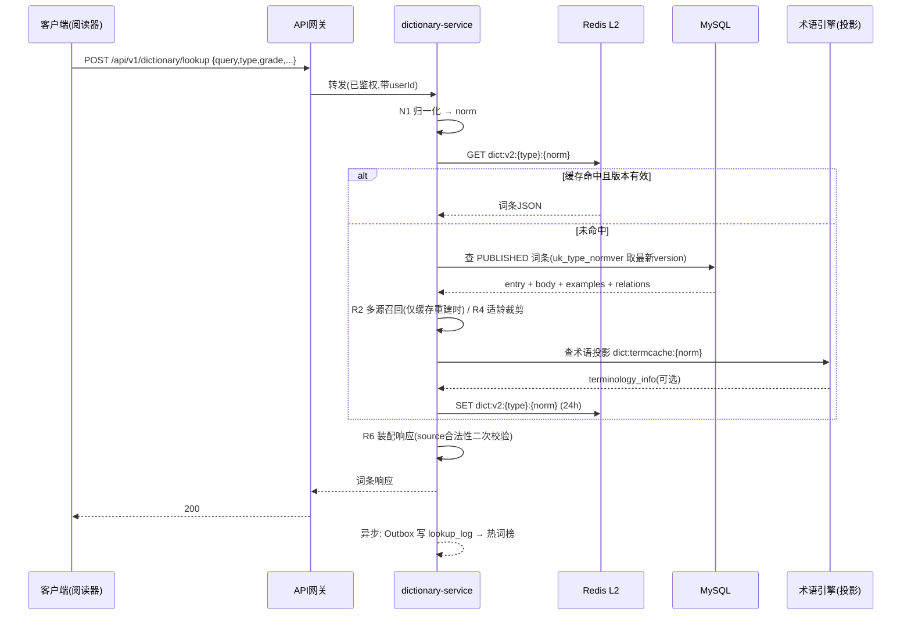

# 服务端-通用词典与汉字字典查询服务 详细设计

> 对应原始设计文档：6.5 拼音识字启蒙模块（"图文联想：结合图片、词语和生活场景辅助记忆"）、6.10 作文辅导模块（"素材推荐"）、6.12 文科背诵模块（"关键词提示"）共有的底层"字词语查询"能力；9.4 AI 对话页交互设计中"长按查词"交互。
> 《客户端-阅读器内即时查词与学科术语悬浮解释引擎》已定义 `/api/v1/dictionary/*` 客户端契约与 4003/4005 降级路径（"尝试通用词典查询"/"降级到本地缓存"），但**通用词典服务端权威**（数据来源、版权治理、多源合并、适龄装配、汉字笔顺数据）无任何文档承接，本文档补齐该空白。

## 1. 概述

### 1.1 模块定位

通用词典与汉字字典查询服务（dictionary-service，下称"词典服务"）是平台**字词语参考数据的统一查询权威（Query SSOT）**，面向全学段提供：

1. **中文词语查询**：释义（多词性）、拼音、近反义词、适龄例句。
2. **汉字字典查询**：单字的多音字拼音、部首、笔画数、间架结构、笔顺动画数据、释义、组词。
3. **成语查询**：释义、出处典故、近义/反义成语、辨析、例句。
4. **英文单词查询**：英/美音标、发音音频、多词性释义、词形变化、双语例句。
5. **学科术语聚合**：与「教育学科术语词典与智能词汇表自动构建管理引擎」（术语引擎）协作，为查词请求提供"普通词条 + 学科术语"一体化响应。
6. **批量查词**：阅读器整段文本的高频查词、生字表批量解析。

服务本身**只读为主**：不生产练习（归组词造句引擎）、不管理生词本收藏（归英语词汇记忆与单词本系统/收藏笔记系统）、不维护术语内容（归术语引擎）、不做掌握度评估（归知识掌握度融合引擎）。本服务负责**参考数据的质量、版权、合并与适龄化装配**。

### 1.2 与已有模块的边界

| 模块 | 其职责 | 与本服务的关系 |
| --- | --- | --- |
| 客户端-阅读器内即时查词引擎 | 选词交互、悬浮窗、本地迷你词典降级 | 本服务是其服务端权威（`/api/v1/dictionary/*`） |
| 服务端-教育学科术语词典引擎 | 学科术语的生产、审核、标注、`/api/v1/terms/*` | 术语数据**归其所有**；本服务查词时聚合其已发布术语（gRPC 订阅 + 缓存），不复制术语正文 |
| 服务端-组词造句启蒙练习引擎 | 组词/造句练习题生成与评估，自建 Word Bank | 其 Word Bank 的**初始化种子与扩库参考**来自本服务已发布词条（只读拉取），练习数据归其所有 |
| 语文素养专项训练系统 | 成语/常识等积累项的练习训练与掌握度 | 成语**练习内容**归其所有；成语**参考释义**归本服务，其积累卡片引用本服务 entry_id |
| 英语词汇记忆与单词本系统 | 生词本收藏、背单词流程 | 生词本的"词条快照"字段以本服务响应为准；收藏关系归其所有 |
| AI 幻觉检测/内容审核 | AI 生成内容安全审核 | 本服务 AI 扩库产出的词条释义必须经其审核管线后方可进入 PUBLISHED |

### 1.3 核心业务场景

| 场景 | 触发方 | 说明 |
| --- | --- | --- |
| S1 阅读器长按查词 | 学生 | 阅读课文时长按词语 → lookup → 悬浮窗展示适龄释义 |
| S2 生字卡扩展查询 | 拼音识字启蒙 | 学生点击"查字典" → 单字详情（部首/笔画/笔顺动画/组词） |
| S3 成语点击查询 | 语文素养/古诗文 | 成语卡片"查看释义" → idiom 详情（出处/典故/辨析） |
| S4 英文单词查询 | 英语阅读/听力 | 点击生词 → 音标+音频+释义+例句 |
| S5 批量查词 | 阅读器服务端预取 | 课文加载时批量预取文中词条，阅读期零请求延迟 |
| S6 术语增强查词 | 理科阅读器 | 查"函数"时同时返回学科术语释义与课本定位 |
| S7 管理端词条运维 | 内容编辑 | 词条 CRUD、授权源导入、AI 扩库审核、到期下线 |
| S8 热词统计回流 | 搜索联想/内容生产 | 查询日志聚合成热词榜，供搜索联想引擎与内容生产参考 |

### 1.4 设计目标

1. **低延迟**：单条 lookup P99 ≤ 80ms（命中缓存 P99 ≤ 20ms）；批量 50 词 P99 ≤ 200ms。
2. **高可用**：词典为高频只读场景，核心查询链路可用性 ≥ 99.95%；单点故障时客户端可降级本地迷你词典。
3. **版权合规**：全部词条来源可溯源（source_id），授权到期自动 fail-closed 下线，杜绝无授权内容下发。
4. **适龄化**：同一词条按学段返回不同深度（小学低段 ≤ 2 条释义，高中全量），例句难度与年级对齐。
5. **一致性**：多源词条合并有唯一裁决规则（授权源优先），任何源变更 5 分钟内全量缓存可见。

### 1.5 非目标（明确不做）

- 不做 OCR/划词（客户端职责）；不做翻译长句（归 AI 辅导/翻译能力）；不做词典 App 式的背单词功能（归单词本系统）。
- 不维护学科术语正文（只缓存术语引擎已发布数据的投影，术语引擎为 SSOT）。
- 不对外部第三方开放词典 API（开放 API 平台如需引用，走内部 gRPC，见 §14）。
- 不提供用户自定义词条（UGC 词典不做，防止错误释义传播）。

---

## 2. 整体架构

### 2.1 架构图

```
┌──────────────────────────────────────────────────────────────────┐
│        客户端（阅读器 / 生字卡 / 成语卡 / 英语阅读 / AI对话）       │
│   长按查词 · 生字详情 · 成语详情 · 生词查询 · 批量预取             │
└──────────────────────┬───────────────────────────────────────────┘
                       │ HTTP /api/v1/dictionary/*
┌──────────────────────▼───────────────────────────────────────────┐
│                     API 网关 / BFF                                │
└──────────────────────┬───────────────────────────────────────────┘
                       │
┌──────────────────────▼───────────────────────────────────────────┐
│              通用词典与汉字字典查询服务 (dictionary-service)        │
│                                                                   │
│  ┌────────────┐ ┌────────────┐ ┌────────────┐ ┌───────────────┐  │
│  │ 查询归一化  │ │ 类型路由    │ │ 适龄装配器  │ │ 术语聚合器     │  │
│  │ Normalizer │ │ TypeRouter │ │ AgeAdapter │ │ TermEnricher  │  │
│  └─────┬──────┘ └─────┬──────┘ └─────┬──────┘ └──────┬────────┘  │
│        │              │              │                │            │
│  ┌─────▼──────────────▼──────────────▼────────────────▼────────┐  │
│  │                  多源合并器 (Source Merger)                  │  │
│  │   授权源优先 · AI 源须 PUBLISHED · 版本单调 · 冲突裁决       │  │
│  └──────────────────────────┬───────────────────────────────────┘  │
│                             │                                      │
│  ┌──────────────────────────▼───────────────────────────────────┐  │
│  │  缓存层：Caffeine L1 (本地, 30s) → Redis L2 (词条, 24h)       │  │
│  └──────────────────────────┬───────────────────────────────────┘  │
│                             │                                      │
│  ┌──────────────┬───────────▼──────────────┬────────────────────┐  │
│  │ 词条存储      │  查询日志异步管道         │  管理端 API        │  │
│  │ (MySQL 分表) │  (MQ → 热词聚合)         │  (导入/审核/运维)   │  │
│  └──────────────┴──────────────────────────┴────────────────────┘  │
└───────┬────────────────────┬──────────────────────┬───────────────┘
        │ gRPC(订阅)          │ gRPC(委托)            │ 调用
┌───────▼──────┐    ┌──────────▼─────────┐    ┌───────▼──────────────┐
│ 术语引擎      │    │ AI 模型适配层       │    │ 内容安全审核管线      │
│ (术语 SSOT)   │    │ (AI 扩库/消歧兜底)  │    │ (AI 词条准入)        │
└───────────────┘    └────────────────────┘    └──────────────────────┘
```

### 2.2 查询管线总览

```
请求 → [N1 归一化] → [C1 L1 缓存] → [C2 L2 缓存] → [R1 类型路由]
     → [R2 多源召回] → [R3 合并裁决] → [R4 适龄裁剪] → [R5 术语增强]
     → [R6 响应装配] → 返回
              │未命中全部层│
              └→ [R7 未命中登记] → 返回 47701 + 客户端本地词典降级
旁路：响应成功后异步写 lookup_log（经 Outbox → MQ，不阻塞主链路）
```

**关键设计**：

- **归一化先行**：中文去空白/全半角统一/繁转简（`迴→回`）、英文小写化与词形还原（lemmatization 仅用于索引归一，不改变展示词形）。
- **读多写极少**：词条发布后 24h 内不可变（version 不变），缓存 TTL 安全；管理端修改走"新版本条目 + 旧条目 DEPRECATED"，禁止原地改（见 §7 状态机）。
- **热路径零依赖 AI**：AI 仅用于离线扩库与低频消歧兜底，lookup 主链路不调用 LLM（延迟与成本红线，G4）。

---

## 3. 核心数据结构

### 3.1 枚举定义

```java
/** 词条类型 */
public enum EntryType {
    SINGLE_CHAR,     // 汉字（字典）
    WORD,            // 中文词语
    IDIOM,           // 成语
    ENGLISH_WORD,    // 英文单词
    ENGLISH_PHRASE;  // 英文短语
}

/** 词条生命周期（见 §7 状态机） */
public enum EntryStatus {
    DRAFT,           // 草稿（AI 扩库初始态/人工录入未提交）
    IN_REVIEW,       // 审核中（等待内容安全+人工复核）
    PUBLISHED,       // 已发布（唯一可下发状态）
    DEPRECATED,      // 已废弃（新版本取代）
    OFFLINE;         // 已下线（版权到期/合规处置，fail-closed）
}

/** 数据来源类型 */
public enum SourceType {
    LICENSED,        // 授权词典（商务印书馆/外研社等合作方）
    SELF_BUILT,      // 平台自建（教研团队编纂）
    AI_EXPANDED;     // AI 扩库（必须审核后发布）
}

/** 来源优先级：合并裁决用，数字越大越优先 */
public enum SourcePriority {
    LICENSED(30),
    SELF_BUILT(20),
    AI_EXPANDED(10);
    final int priority;
}

/** 词条关系类型 */
public enum RelationType {
    SYNONYM,         // 近义
    ANTONYM,         // 反义
    DERIVATION,      // 派生（开心→开心得/开心地）
    CONTAIN_CHAR,    // 包含单字（词→字，反查用）
    IDIOM_CHAR;      // 成语包含字（成语→单字）
}

/** 适龄学段带（与统一枚举体系 stage 对齐） */
public enum GradeBand {
    BAND_EARLY,      // 幼儿~二年级（kindergarten, grade_1, grade_2）
    BAND_MIDDLE,     // 三年级~六年级
    BAND_JUNIOR,     // 初中
    BAND_SENIOR;     // 高中
}
```

### 3.2 数据库表 DDL

```sql
-- 3.2.1 词条主表（逻辑词条，跨来源合并后的对外主体）
CREATE TABLE dict_entry (
    id               BIGINT UNSIGNED NOT NULL AUTO_INCREMENT,
    entry_type       VARCHAR(20)  NOT NULL COMMENT 'SINGLE_CHAR/WORD/IDIOM/ENGLISH_WORD/ENGLISH_PHRASE',
    headword         VARCHAR(128) NOT NULL COMMENT '展示词形',
    normalized_hw    VARCHAR(128) NOT NULL COMMENT '归一化词形（查索引唯一键用）',
    pinyin           VARCHAR(256) DEFAULT NULL COMMENT '拼音（多音字以;分隔，英文词条为空）',
    pinyin_fuzzy     VARCHAR(256) DEFAULT NULL COMMENT '无声调拼音（模糊检索用）',
    difficulty       TINYINT      DEFAULT NULL COMMENT '难度 1~5（适龄推荐参考）',
    status           VARCHAR(20)  NOT NULL DEFAULT 'DRAFT',
    winning_source_id BIGINT UNSIGNED DEFAULT NULL COMMENT '合并胜出来源（R3 裁决缓存）',
    version          INT UNSIGNED NOT NULL DEFAULT 1 COMMENT '条目版本，单调递增',
    content_hash     CHAR(64)     NOT NULL COMMENT '正文摘要 SHA-256（变更检测）',
    created_at       DATETIME(3)  NOT NULL DEFAULT CURRENT_TIMESTAMP(3),
    updated_at       DATETIME(3)  NOT NULL DEFAULT CURRENT_TIMESTAMP(3) ON UPDATE CURRENT_TIMESTAMP(3),
    PRIMARY KEY (id),
    UNIQUE KEY uk_type_normver (entry_type, normalized_hw, version),
    KEY idx_type_norm (entry_type, normalized_hw),
    KEY idx_status_type (status, entry_type),
    KEY idx_pinyin_fuzzy (pinyin_fuzzy(32))
) ENGINE=InnoDB DEFAULT CHARSET=utf8mb4 COMMENT='词典词条主表';

-- 3.2.2 词条正文表（1:1 扩展，大字段拆分；单字含笔顺数据）
CREATE TABLE dict_entry_body (
    entry_id         BIGINT UNSIGNED NOT NULL,
    definitions_json JSON         NOT NULL COMMENT '释义数组（见响应结构 definitions）',
    extra_json       JSON         DEFAULT NULL COMMENT '扩展：英文词形变化/成语典故/汉字部首笔画结构等',
    PRIMARY KEY (entry_id)
) ENGINE=InnoDB DEFAULT CHARSET=utf8mb4 COMMENT='词条正文表';

-- 3.2.3 例句表
CREATE TABLE dict_example (
    id               BIGINT UNSIGNED NOT NULL AUTO_INCREMENT,
    entry_id         BIGINT UNSIGNED NOT NULL,
    sentence         VARCHAR(512) NOT NULL,
    translation      VARCHAR(512) DEFAULT NULL COMMENT '英文例句的中文翻译',
    source           VARCHAR(64)  DEFAULT NULL COMMENT '来源标注（课本例句/授权词典/AI生成）',
    grade_band       VARCHAR(20)  NOT NULL COMMENT '适龄学段带',
    is_classic       TINYINT(1)   NOT NULL DEFAULT 0 COMMENT '经典例句优先展示',
    status           VARCHAR(20)  NOT NULL DEFAULT 'PUBLISHED',
    created_at       DATETIME(3)  NOT NULL DEFAULT CURRENT_TIMESTAMP(3),
    PRIMARY KEY (id),
    KEY idx_entry (entry_id, status, grade_band)
) ENGINE=InnoDB DEFAULT CHARSET=utf8mb4 COMMENT='词典例句表';

-- 3.2.4 词条关系表（近反义/派生/字词包含）
CREATE TABLE dict_relation (
    id               BIGINT UNSIGNED NOT NULL AUTO_INCREMENT,
    entry_id         BIGINT UNSIGNED NOT NULL COMMENT '主体词条',
    rel_type         VARCHAR(20)  NOT NULL,
    rel_entry_id     BIGINT UNSIGNED NOT NULL COMMENT '客体词条',
    difference_note  VARCHAR(256) DEFAULT NULL COMMENT '近义辨析说明',
    sort_order       INT          NOT NULL DEFAULT 0,
    status           VARCHAR(20)  NOT NULL DEFAULT 'PUBLISHED',
    created_at       DATETIME(3)  NOT NULL DEFAULT CURRENT_TIMESTAMP(3),
    PRIMARY KEY (id),
    UNIQUE KEY uk_entry_rel_target (entry_id, rel_type, rel_entry_id),
    KEY idx_rel_entry (rel_entry_id, rel_type)
) ENGINE=InnoDB DEFAULT CHARSET=utf8mb4 COMMENT='词条关系表';

-- 3.2.5 数据来源与版权表（合规核心）
CREATE TABLE dict_source (
    id               BIGINT UNSIGNED NOT NULL AUTO_INCREMENT,
    source_name      VARCHAR(128) NOT NULL,
    source_type      VARCHAR(20)  NOT NULL COMMENT 'LICENSED/SELF_BUILT/AI_EXPANDED',
    priority         TINYINT      NOT NULL COMMENT '合并优先级 10/20/30',
    license_no       VARCHAR(128) DEFAULT NULL COMMENT '授权书编号',
    license_expire_at DATETIME    DEFAULT NULL COMMENT '授权到期时间（NULL=永久/自建）',
    attribution      VARCHAR(256) DEFAULT NULL COMMENT '署名要求（响应/页脚展示）',
    status           VARCHAR(20)  NOT NULL DEFAULT 'ACTIVE',
    created_at       DATETIME(3)  NOT NULL DEFAULT CURRENT_TIMESTAMP(3),
    PRIMARY KEY (id),
    KEY idx_expire (status, license_expire_at)
) ENGINE=InnoDB DEFAULT CHARSET=utf8mb4 COMMENT='词典来源版权表';

-- 3.2.6 来源快照表（每来源每词条一条，合并裁决的输入）
CREATE TABLE dict_source_snapshot (
    id               BIGINT UNSIGNED NOT NULL AUTO_INCREMENT,
    source_id        BIGINT UNSIGNED NOT NULL,
    entry_type       VARCHAR(20)  NOT NULL,
    normalized_hw    VARCHAR(128) NOT NULL,
    headword         VARCHAR(128) NOT NULL,
    body_json        JSON         NOT NULL COMMENT '该来源提供的完整词条数据',
    source_version   VARCHAR(64)  DEFAULT NULL COMMENT '来源方数据版本（授权词典修订版次）',
    imported_at      DATETIME(3)  NOT NULL DEFAULT CURRENT_TIMESTAMP(3),
    PRIMARY KEY (id),
    UNIQUE KEY uk_src_type_norm (source_id, entry_type, normalized_hw),
    KEY idx_type_norm (entry_type, normalized_hw)
) ENGINE=InnoDB DEFAULT CHARSET=utf8mb4 COMMENT='来源词条快照表';

-- 3.2.7 查询日志表（分区表，按月；异步写入）
CREATE TABLE dict_lookup_log (
    id               BIGINT UNSIGNED NOT NULL AUTO_INCREMENT,
    log_date         DATE         NOT NULL COMMENT '分区键',
    user_id_hash     CHAR(64)     DEFAULT NULL COMMENT '用户 ID SHA-256（匿名化，见合规 C2）',
    query_raw        VARCHAR(128) NOT NULL,
    entry_type       VARCHAR(20)  DEFAULT NULL,
    normalized_hw    VARCHAR(128) DEFAULT NULL,
    hit              TINYINT(1)   NOT NULL COMMENT '1=命中 0=未命中',
    grade            VARCHAR(20)  DEFAULT NULL,
    source_channel   VARCHAR(32)  DEFAULT NULL COMMENT 'reader/flashcard/idiom/english/chat',
    cost_ms          INT          DEFAULT NULL,
    created_at       DATETIME(3)  NOT NULL DEFAULT CURRENT_TIMESTAMP(3),
    PRIMARY KEY (id, log_date),
    KEY idx_norm_date (normalized_hw, log_date),
    KEY idx_logdate_hit (log_date, hit)
) ENGINE=InnoDB DEFAULT CHARSET=utf8mb4
  PARTITION BY RANGE (TO_DAYS(log_date)) (...);  -- 按月分区，保留 13 个月

-- 3.2.8 导入任务表（授权源/AI 扩库批次）
CREATE TABLE dict_import_job (
    id               BIGINT UNSIGNED NOT NULL AUTO_INCREMENT,
    source_id        BIGINT UNSIGNED NOT NULL,
    job_type         VARCHAR(20)  NOT NULL COMMENT 'LICENSED_IMPORT/AI_EXPAND/MANUAL',
    status           VARCHAR(20)  NOT NULL COMMENT 'CREATED/PARSING/MERGING/COMPLETED/FAILED',
    total_count      INT          NOT NULL DEFAULT 0,
    new_count        INT          NOT NULL DEFAULT 0,
    updated_count    INT          NOT NULL DEFAULT 0,
    skipped_count    INT          NOT NULL DEFAULT 0,
    error_report_url VARCHAR(512) DEFAULT NULL,
    operator_id      BIGINT UNSIGNED NOT NULL,
    idempotency_key  VARCHAR(64)  NOT NULL,
    created_at       DATETIME(3)  NOT NULL DEFAULT CURRENT_TIMESTAMP(3),
    completed_at     DATETIME(3)  DEFAULT NULL,
    PRIMARY KEY (id),
    UNIQUE KEY uk_idem (operator_id, idempotency_key)
) ENGINE=InnoDB DEFAULT CHARSET=utf8mb4 COMMENT='词典导入任务表';
```

### 3.3 Redis 键设计

| Key 模式 | 类型 | TTL | 说明 |
| --- | --- | --- | --- |
| `dict:l1:noop` | — | — | L1 为进程内 Caffeine，不走 Redis |
| `dict:v2:{type}:{norm}` | STRING | 24h | 合并后词条 JSON（含 version，防旧版本覆盖，见 G6） |
| `dict:hot:rank:{channel}` | ZSET | 7d | 频道热词榜（滚动窗口） |
| `dict:miss:{type}:{norm}` | STRING | 10min | 未命中短 TTL 防穿透（空值占位） |
| `dict:lock:import:{sourceId}` | STRING | 30min | 导入互斥锁 |
| `dict:idem:batch:{userId}:{reqId}` | STRING | 30min | 批量查询幂等应答快照 |
| `dict:termcache:{norm}` | HASH | 6h | 术语引擎投影缓存（字段级，失效订阅驱动） |

---

## 4. 数据来源与内容生产

### 4.1 三类来源准入规则

| 来源类型 | 准入条件 | 可否直发 | 合并优先级 |
| --- | --- | --- | --- |
| LICENSED 授权词典 | 授权书编号 + 到期时间登记；法务审核通过 | 可（仍为 PUBLISHED 状态） | 30（最高） |
| SELF_BUILT 自建 | 教研双人编纂 + 内容安全审核 | 可 | 20 |
| AI_EXPANDED AI 扩库 | AI 生成 → 敏感词过滤 → 人工复核抽检 ≥ 10% | **不可直发**（必须审核） | 10 |

**AI 扩库红线**：AI 生成释义必须标注 `source: AI生成` 进入 IN_REVIEW；人工复核重点为"释义准确性、例句适龄性、是否存在事实错误"；AI 扩库词条在响应中的 `source` 字段对前端不暴露 AI 痕迹（避免学生质疑权威性），但管理端与审计日志完整留痕（合规 C4）。

### 4.2 授权源导入管线

```
文件/接口接入 → 格式解析（xslx/mdb/json/API）→ 字段映射校验
→ 快照落库 dict_source_snapshot → 差异比对（content_hash）
→ 合并裁决（R3 规则）→ 版本递增 → 缓存刷新（失效广播）
```

- 授权源支持全量与增量两种模式；增量按 `source_version` 比对。
- 授权到期处理：到期前 30 天告警（M6）；到期后该来源全部词条 OFFLINE（fail-closed，G2），**响应中立即不再出现该来源内容**——即使缓存中有也禁止使用（缓存装配时二次校验 license_expire_at）。
- 授权到期后若词条有低优先级来源可用，自动降级用低优先级来源重新合并（保证功能可用性，同时保版权）。

### 4.3 与术语引擎的协作（投影缓存，不复制正文）

- 词典服务订阅术语引擎 gRPC 事件流（`term.published/deprecated`），维护 `dict:termcache:{norm}` 投影（仅 term_id、headword、subject、stage、定义摘要）。
- lookup 命中词条时检查投影：`is_terminology=true` 且定义摘要非空 → 响应 `terminology_info` 携带摘要与 `term_id`；客户端如需完整术语信息，走 `/api/v1/terms/{termId}`（术语引擎权威端点）。
- 投影与术语引擎失联 > 6h：跳过术语增强直接返回普通词条（降级 D3），绝不使用过期投影超过 TTL。

### 4.4 汉字笔顺与语音资源

- 笔顺数据（svgPath/stroke order）随 SELF_BUILT 来源维护，遵循通用汉字规范（GF 3002 等），逐字双人校验。
- 拼音/成语朗读音频经统一 TTS 管线生成或授权音频入库，走 CDN 分发；音频 URL 不做过期签名（公开低敏资源），但保留溯源水印参数。
- 英文单词音频优先授权源，缺失时 TTS 兑底（标注来源）。

---

## 5. 核心流程设计

### 5.1 lookup 端到端时序



### 5.2 多源合并裁决（R3）

同一 `(entry_type, normalized_hw)` 存在多个来源快照时：

1. **合法性过滤**：剔除 OFFLINE 来源、授权过期来源、未 PUBLISHED 来源。
2. **优先级选择**：`SourcePriority` 高者胜（LICENSED > SELF_BUILT > AI_EXPANDED）。
3. **字段级补充**（同优先级或胜出来源缺字段）：按优先级顺序补缺——如 LICENSED 无例句而 SELF_BUILT 有，则例句取 SELF_BUILT，并在 `extra_json.merged_from` 记录来源清单（审计可查）。
4. **冲突不合并**：同优先级两来源对同一字段内容冲突时，**不自动合并**，生成人工裁决工单（管理端"来源冲突队列"），在裁决前以先入库者为准并告警（G3，防止错误释义静默上线）。

### 5.3 多义词消歧（轻量，AI 兜底）

- 词条多义项按 `order_no`（义频）排序返回，默认全量返回但 `definitions` 前 2 条为高频义（前端默认折叠展开）。
- 请求带 `sentence_context` 时：规则消歧（上下文与义项定义/例句的关键词 overlap 打分），置信度 ≥ 0.6 时在响应 `disambiguated: true` 并将命中义项置前；低于阈值不调整顺序（不误导）。
- **不调用 LLM 做在线消歧**（G4）；离线挖掘的"义项-语境"映射表每周由 AI 批处理生成、人工抽检后热更新到 Redis。

### 5.4 适龄裁剪（R4）

| GradeBand | 释义返回上限 | 例句返回上限 | 英文例句翻译 |
| --- | --- | --- | --- |
| BAND_EARLY | 2 条（取最短） | 2 条（grade_band=E 优先） | 必带 |
| BAND_MIDDLE | 3 条 | 3 条 | 必带 |
| BAND_JUNIOR | 全量 | 4 条 | 必带 |
| BAND_SENIOR | 全量 | 5 条 | 默认不带（省流量，请求带 need_translation=true 时返回） |

### 5.5 批量查词（batch-lookup）

- 单次上限 **50 词**（G8，超出返回 47707）；词内并行查询（线程池 8，每词独立降级）。
- 批量响应按请求顺序返回数组，`null` 表示该词未命中（区别于整体失败）。
- 阅读器预取场景使用，结果客户端缓存 7 天（`cache_expire_at` 字段，与客户端契约一致）。

### 5.6 术语查询端点（聚合委托）

**GET** `/api/v1/dictionary/terminology` 由本服务提供 BFF 聚合：

- 内部先查 `dict:termcache` 投影（headword+subject 精确匹配）→ 命中返回摘要；未命中实时 gRPC 调术语引擎 `search` 并回写投影（6h TTL）。
- 术语引擎不可用时返回 47703 + 客户端降级"通用词典查询"（与客户端 4003 路径契约一致）。

---

## 6. API 接口设计

### 6.1 接口总览

| # | 名称 | 方法 | 路径 | 说明 |
| --- | --- | --- | --- | --- |
| 1 | 统一查词 | POST | `/api/v1/dictionary/lookup` | 主入口（客户端契约已定义，本服务为实现权威） |
| 2 | 英文查词 | GET | `/api/v1/dictionary/english/{word}` | 英文单词快捷入口 |
| 3 | 术语查询 | GET | `/api/v1/dictionary/terminology` | 术语聚合（委托术语引擎） |
| 4 | 批量查词 | POST | `/api/v1/dictionary/batch-lookup` | 批量（≤50） |
| 5 | 管理端-词条检索 | GET | `/api/v1/admin/dict/entries` | 多维检索（状态/来源/类型） |
| 6 | 管理端-词条详情 | GET | `/api/v1/admin/dict/entries/{id}` | 含来源快照对比 |
| 7 | 管理端-词条编辑 | PUT | `/api/v1/admin/dict/entries/{id}` | 产生新版本（禁止原地改） |
| 8 | 管理端-审核 | POST | `/api/v1/admin/dict/entries/{id}/review` | 通过/驳回（AI 扩库必经） |
| 9 | 管理端-状态变更 | POST | `/api/v1/admin/dict/entries/{id}/status` | PUBLISHED/DEPRECATED/OFFLINE |
| 10 | 管理端-导入 | POST | `/api/v1/admin/dict/import` | 授权源/AI 批次导入（幂等） |
| 11 | 管理端-导入任务查询 | GET | `/api/v1/admin/dict/import/{jobId}` | 进度与错误报告 |
| 12 | 管理端-来源冲突队列 | GET | `/api/v1/admin/dict/conflicts` | R3 规则 4 人工裁决 |
| 13 | 管理端-热词榜 | GET | `/api/v1/admin/dict/hot-words` | 查询日志聚合 |
| 14 | 内部-词条拉取 | gRPC | `DictService.GetEntries` | 组词造句引擎等内部消费（分页增量） |

### 6.2 统一查词接口（实现权威）

**POST** `/api/v1/dictionary/lookup`

请求/响应结构以《客户端-阅读器内即时查词与学科术语悬浮解释引擎》§4.1 为**展示层契约权威**，本服务补充实现约束：

- 请求 `type` 为 `AUTO` 时执行类型路由：长度 1 → SINGLE_CHAR；命中成语表 → IDIOM；否则 WORD/ENGLISH 按字符集判定。
- 响应字段 `cache_expire_at` 为服务端当前时间 + 24h（客户端缓存依据）。
- `force_refresh=true` 仅管理角色可用（学生端传 true 视为 false，G9）。

**错误码**：非法 query（空/超 128 字符）→ 47700；未命中 → 47701（HTTP 200，code 字段语义码，客户端据此走本地降级，与 4005 契约衔接）。

### 6.3 批量查词接口

**POST** `/api/v1/dictionary/batch-lookup`

```json
{
  "items": [
    {"query": "邯郸学步", "type": "idiom"},
    {"query": "悯", "type": "single_char"}
  ],
  "grade": "grade_5",
  "source_channel": "reader"
}
```

```json
{
  "code": 0,
  "message": "success",
  "data": {
    "results": [ { /* 同 lookup 响应 */ }, { /* ... */ } ],
    "missed": ["不存在词"]
  }
}
```

幂等：不要求（只读语义）；但为防重试放大流量，支持 `X-Client-Request-Id` + `dict:idem:batch:{userId}:{reqId}` 30min 应答快照（可选实现，命中直接返回快照）。

### 6.4 管理端审核接口

**POST** `/api/v1/admin/dict/entries/{id}/review`

```json
{
  "action": "APPROVE",
  "comment": "释义准确，例句适龄",
  "reviewer_id": 80021
}
```

| action | 效果 | 守卫 |
| --- | --- | --- |
| APPROVE | IN_REVIEW → PUBLISHED（version+1，缓存失效广播） | 必须双人复核（AI 扩库，G5） |
| REJECT | IN_REVIEW → DRAFT，附驳回原因 | 驳回原因必填 |
| FORCE_OFFLINE | 任意状态 → OFFLINE（合规处置） | 需安全管理员角色 + 审计日志 |

---

## 7. 状态机与守卫

### 7.1 词条生命周期状态机

```
            ┌────────┐   提交    ┌────────────┐  审核通过   ┌───────────┐
   人工录入 │ DRAFT  │──────────▶│ IN_REVIEW  │──────────▶│ PUBLISHED │
  ────────▶│(AI初始)│           │(AI扩库必经)│  双人复核   │ (唯一可   │
            └────────┘           └─────┬──────┘           │  下发态)  │
                 ▲                     │ 驳回             └─────┬─────┘
                 │                     ▼                       │ 新版本发布/版权到期/合规处置
                 │               (回到 DRAFT)            ┌─────▼─────┐   ┌──────────┐
                 │                                       │ DEPRECATED│◀─▶│ OFFLINE  │
                 │                                       │(版本取代) │   │(合规关闭)│
                 └───────────────────────────────────────┴───────────┘   └──────────┘
```

**状态转移表**：

| 当前状态 | 事件 | 目标状态 | 触发方 | 守卫 |
| --- | --- | --- | --- | --- |
| — | 录入/AI生成 | DRAFT | 系统/编辑 | 敏感词预检（硬失败拒入） |
| DRAFT | 提交审核 | IN_REVIEW | 编辑 | 必填字段完整性校验 |
| IN_REVIEW | 审核通过 | PUBLISHED | 审核员 | G5 双人复核（AI 源） |
| IN_REVIEW | 驳回 | DRAFT | 审核员 | 原因必填 |
| PUBLISHED | 新版本发布 | DEPRECATED | 系统 | 新版本须先 PUBLISHED（先立后破） |
| PUBLISHED | 授权到期/合规 | OFFLINE | 系统/安全员 | G2 fail-closed，缓存同步失效 |
| DEPRECATED | 合规处置 | OFFLINE | 安全员 | 审计日志 |
| OFFLINE | 不可恢复 | — | — | OFFLINE 为终态（错误数据不再复活） |

### 7.2 守卫规则表

| 编号 | 规则 | 级别 |
| --- | --- | --- |
| G1 | 非 PUBLISHED 词条一律不可下发（含缓存重建、批量、内部 gRPC 全部出口） | 硬 |
| G2 | 授权到期来源词条 fail-closed：装配响应时二次校验 license_expire_at，过期即视同样本不存在 | 硬（合规） |
| G3 | 同优先级来源字段冲突禁止自动合并，转人工裁决队列 | 硬 |
| G4 | lookup 主链路禁止同步调用 LLM；消歧仅用规则+离线映射表 | 硬 |
| G5 | AI 扩库词条必须双人复核后方可 PUBLISHED | 硬（合规） |
| G6 | 缓存写入携带 entry.version，仅允许新版本覆盖旧版本（防乱序旧数据回填） | 硬 |
| G7 | 词条禁止原地修改；编辑=新版本 + 旧版 DEPRECATED | 硬 |
| G8 | batch 单次 ≤ 50 词 | 硬 |
| G9 | force_refresh 仅管理角色生效 | 硬 |
| G10 | 术语正文不出现在本服务任何存储中（仅投影摘要），术语 SSOT 归术语引擎 | 硬（边界） |
| G11 | 未命中结果短 TTL 缓存（10min），防止未命中风暴打穿 DB | 软 |
| G12 | 查询日志只写哈希化 user_id，禁止明文用户标识入库 | 硬（合规） |
| G13 | OFFLINE 词条 90 天后转冷归档（归档库），主库删除 | 软 |
| G14 | 管理端导出词条数据需数据权限 + 审计（词条为授权资产，防泄漏） | 硬 |

### 7.3 竞态裁决

| 竞态 | 裁决 |
| --- | --- |
| 并发审核通过/驳回同一词条 | DB 乐观锁（version）+ 状态 CAS：`UPDATE ... SET status=? WHERE id=? AND status='IN_REVIEW'`，影响行 0 则返回 47731 |
| 导入重建缓存与在线查询并发 | 缓存双写屏障：合并完成后先写 `dict:v2:` 再删 miss 标记；查询方读到 miss 占位则回源 DB（DB 为合并后权威） |
| 授权到期瞬间正在返回的响应 | 装配阶段校验（G2）保证不发出；已发出的历史响应客户端缓存 24h 内可继续展示（不承担追溯责任，合规认可窗口） |
| 新版本发布与旧版本查询并发 | version 单调 + 缓存按 version 比较（G6），旧版本写不入 |

---

## 8. 幂等、并发与对账

### 8.1 幂等场景总表

| 场景 | 幂等键 | 机制 |
| --- | --- | --- |
| 管理端导入（重复提交/重试） | (operator_id, idempotency_key) | uk 冲突返回原任务 47720 语义 200 |
| 管理端审核（网络重试） | entry_id + status CAS | 重复审核返回当前状态，不产生副作用 |
| 批量查词（可选） | (user_id, X-Client-Request-Id) | 应答快照 30min |
| 词条编辑（双击保存） | entry_id + version | 乐观锁，冲突 47732 |

### 8.2 日终对账（04:40）

1. **库存对账**：`dict_source_snapshot` 各来源条数 vs 授权方交付清单（如有交付文件）——差异生成工单。
2. **缓存对账**：抽样 1000 热词，Redis 缓存 version vs DB 最新 version，不一致率 > 0.1% 告警（缓存失效广播漏发检测）。
3. **日志对账**：Outbox lookup_log 积压 > 5min 告警；MQ 消费失败死信人工处理。
4. **版权对账**：`dict_source.license_expire_at` 30 天内到期清单 → 法务/运营工单（M6 前置）。

---

## 9. 领域事件

### 9.1 发布事件（dict_domain_outbox 表，同事务写入）

| 事件 | 触发 | 订阅方 |
| --- | --- | --- |
| `dict.entry.published` | 词条发布 | 组词造句引擎（词库同步）、语文素养（积累项引用校验）、搜索服务（索引） |
| `dict.entry.deprecated` | 版本更替 | 同上（清理引用） |
| `dict.entry.offline` | 版权/合规下线 | 客户端缓存清理推送、搜索服务（撤索引） |
| `dict.import.completed` | 导入完成 | 管理后台通知、内容生产（缺口分析） |
| `dict.hotword.updated` | 热词榜周更新 | 搜索联想引擎（实时热搜，见《教育平台搜索智能联想与实时热搜推荐引擎》）、内容生产需求预测 |
| `dict.license.expiring` | 授权到期 T-30/T-7 | 运营/法务工单 |

### 9.2 上游订阅

| 来源 | 事件 | 用途 |
| --- | --- | --- |
| 术语引擎 | `term.published/deprecated` | 投影缓存建/删（§4.3） |
| 内容安全审核 | 审核结论回调 | AI 扩库词条准入 |

---

## 10. 错误码（47700-47799 段，全库扫描确认空闲）

| 码 | 名称 | 说明 | HTTP |
| --- | --- | --- | --- |
| 47700 | DICT_INVALID_QUERY | query 为空/超长/含非法字符 | 400 |
| 47701 | DICT_ENTRY_NOT_FOUND | 词条未命中（语义码，客户端走本地降级） | 200 |
| 47702 | DICT_TYPE_MISMATCH | type 与词条实际类型冲突且 AUTO 路由失败 | 200 |
| 47703 | DICT_TERMS_UPSTREAM_UNAVAILABLE | 术语引擎不可用（降级 D3） | 200 |
| 47704 | DICT_GRADE_INVALID | grade 枚举非法 | 400 |
| 47705 | DICT_SOURCE_FORBIDDEN | 请求来源（force_refresh）越权 | 403 |
| 47707 | DICT_BATCH_TOO_LARGE | 批量超 50 词 | 400 |
| 47710 | DICT_ADMIN_ENTRY_NOT_FOUND | 管理端词条不存在 | 404 |
| 47711 | DICT_ADMIN_STATUS_ILLEGAL | 状态转移非法（对照 §7.1 表） | 409 |
| 47712 | DICT_ADMIN_LICENSE_EXPIRED | 导入来源授权已过期 | 400 |
| 47720 | DICT_IMPORT_DUPLICATE | 导入幂等命中，返回原任务 | 200 |
| 47721 | DICT_IMPORT_FORMAT_INVALID | 导入文件格式/字段映射失败 | 400 |
| 47722 | DICT_IMPORT_RUNNING | 同来源已有导入任务运行中（锁冲突） | 409 |
| 47730 | DICT_REVIEW_NEED_SECOND | AI 词条需第二人复核（单人重复审核触发） | 409 |
| 47731 | DICT_REVIEW_STATUS_RACE | 审核状态竞态（已被他人处理） | 409 |
| 47732 | DICT_VERSION_CONFLICT | 编辑乐观锁冲突 | 409 |
| 47740 | DICT_CONFLICT_PENDING | 来源冲突待人工裁决（查询合并中间态提示） | 200 |
| 47750 | DICT_CACHE_REBUILDING | 缓存重建中（批量场景限流语义） | 200 |

> 客户端 4001-4005 为查词交互域错误码，与本段不冲突；映射关系：客户端 4005（词典服务不可用）= 网关 502/503 或本服务 47703，客户端统一封装，不新占段。

---

## 11. 降级策略

| 编号 | 故障 | 降级行为 | 红线 |
| --- | --- | --- | --- |
| D1 | Redis 全不可用 | 回源 MySQL + Caffeine L1；DB 压力过大时启动未命中限流（每秒 500 查询全局） | 不返回错误给客户端（查询必须可用） |
| D2 | MySQL 只读延迟 | 读 L2 缓存为主；缓存无则返回 47701 + 客户端本地词典 | 不从库读到未 PUBLISHED 数据（G1 恒成立） |
| D3 | 术语引擎失联 | 跳过术语增强，返回普通词条（47703 语义） | 不使用过期的术语投影（超 TTL 即弃） |
| D4 | 音频 CDN 故障 | 返回无声频词条（audio_url 置 null） | 不阻塞文本释义返回 |
| D5 | 查询日志管道积压 | 丢弃日志（采样 10% 保留），主链路不受影响 | 热词榜延迟 1 天可接受 |
| D6 | 授权源到期批量下线 | 按 §4.2 降级低优先级来源；无替代来源则该词条 47701 | **不违反版权（G2 不可降级）** |
| D7 | AI 扩库审核积压 | 暂停 AI 扩库管线，LICENSED/SELF_BUILT 不受影响 | 未审核内容永不直发（G5） |
| D8 | 批量接口被刷 | 单用户 60 queries/min 令牌桶限流 | 单条 lookup 不受影响 |

---

## 12. 监控与容量

### 12.1 监控指标（M1-M10）

| 指标 | 口径 | 告警阈值 |
| --- | --- | --- |
| M1 lookup P99 延迟 | 网关侧打点 | > 80ms 持续 10min（P2） |
| M2 缓存命中率 | hit/(hit+miss)，按 type | < 85% 持续 30min（P3） |
| M3 未命中率 | miss/总查询 | > 8% 持续 1h（P3，可能词库缺口） |
| M4 术语增强成功率 | 增强成功/术语相关查询 | < 98%（P3，检查 D3 触发频率） |
| M5 批量平均耗时 | batch-lookup P99 | > 200ms（P3） |
| M6 授权到期预警 | 30 天内到期来源数 | ≥ 1（P2 工单） |
| M7 导入失败率 | failed/total 批次 | > 5%（P3） |
| M8 审核积压 | IN_REVIEW 超 48h 词条数 | > 200（P3） |
| M9 来源冲突队列长度 | 未裁决冲突 | > 50（P3） |
| M10 Outbox 积压 | 事件消费延迟 | > 5min（P3） |

### 12.2 容量估算（DAU 50 万）

- 查询量：人均日查词 8 次 → 日 400 万次，峰值 QPS ≈ 150（早晚上学/放学双峰），批量折算系数 0.6 → 等效 QPS ≈ 240。
- 存储：词条主表预计 300 万词条（含多版本 ×1.3）≈ 2GB；例句 1500 万条 ≈ 6GB；日志 400 万/天 × 13 个月保留 ≈ 90GB（独立日志库）。
- Redis：热词缓存 50 万 × 2KB ≈ 1GB；术语投影 20 万 × 0.5KB ≈ 100MB。
- 带宽：单次响应 2-5KB → 峰值出口 ≈ 2MB/s，CDN 承载音频大头。

---

## 13. 合规要点

| 编号 | 要点 |
| --- | --- |
| C1 | **版权合规**：全部 LICENSED 来源登记授权书编号与到期时间；到期 fail-closed 自动下线（G2）；管理端导出防泄漏（G14）。 |
| C2 | **隐私**：查询日志 user_id 仅存 SHA-256 哈希（G12）；日志 13 个月后物理删除；不与其他行为数据拼接做用户级画像（词典查询属敏感学习行为）。 |
| C3 | **未成年人保护**：释义/例句经适龄过滤（§5.4）；例句内容过内容安全审核；成语典故涉及暴力/恐怖内容的低龄学段不返回。 |
| C4 | **AI 内容留痕**：AI 扩库词条管理端与审计日志永久标注生成方式与审核人；前端不展示"AI 生成"标识（避免权威性争议），但内容错误追责链路完整。 |
| C5 | **数据出境**：英文词典授权源若涉及境外服务，走国内 CDN 与境内存储，符合数据本地化要求。 |
| C6 | **署名义务**：授权协议要求署名的来源，响应 `attribution` 字段透传，客户端在词条详情页脚展示。 |

---

## 14. 契约与关联文档

### 14.1 契约裁决（R1-R10）

| 编号 | 裁决 |
| --- | --- |
| R1 | `/api/v1/dictionary/*` 展示层请求/响应字段以《客户端-阅读器内即时查词与学科术语悬浮解释引擎》§4 为权威；本服务为实现权威，字段语义冲突时以本服务 §6 为准（客户端文档承诺的扩展字段 `disambiguated`、`extra_json` 视为已对齐）。 |
| R2 | 学科术语正文 SSOT 归术语引擎（G10）；本服务术语端点为聚合代理，术语字段语义以术语引擎文档为准。 |
| R3 | 生词收藏（`/api/v1/vocabulary/collect`）归英语词汇记忆与单词本系统；本服务只读，收藏关系不入词典库。 |
| R4 | 组词造句引擎 Word Bank 自管练习用词，本服务仅作初始词源与参考（单向只读拉取，经 `dict.entry.published` 事件触发）。 |
| R5 | 热词榜数据归本服务查询日志聚合产出，`dict.hotword.updated` 为搜索联想引擎上游事件；热词榜口径与《教育平台搜索智能联想与实时热搜推荐引擎》对齐（周榜+滚动 7 天窗口）。 |
| R6 | 汉字笔顺数据与《拼音识字启蒙》生字卡的展示契约（svgPath 格式）对齐，笔顺数据 SSOT 归本服务。 |
| R7 | 成语参考数据 SSOT 归本服务；语文素养积累项（练习/掌握度）SSOT 归语文素养系统，二者经 entry_id 弱引用。 |
| R8 | 客户端本地迷你词典（离线降级）由客户端打包内置，与本服务词库无实时一致性承诺（版本随客户端发版更新）。 |
| R9 | 查询埋点（S8）与统一埋点平台的关系：词典查询业务日志走本服务管道，客户端交互埋点走埋点平台，双通道不互相同步。 |
| R10 | 英文单词释义深度分级（difficulty 1-5）口径与《英语词汇量自适应测评与词汇能力动态追踪引擎》的词频分级表对齐。 |

### 14.2 关联文档

- 《客户端-阅读器内即时查词与学科术语悬浮解释引擎》（下游消费方与展示契约）
- 《服务端-教育学科术语词典与智能词汇表自动构建管理引擎》（术语 SSOT 协作）
- 《服务端-组词造句启蒙练习引擎》（词源消费方）
- 《语文素养专项训练系统》（成语/积累项练习域）
- 《英语词汇记忆与单词本系统》（生词本边界）
- 《服务端-教育平台搜索智能联想与实时热搜推荐引擎》（热词榜消费方）
- 《拼音识字启蒙》（生字卡/笔顺展示）
- 《服务端统一业务异常码与错误分类体系》（47700-47799 段位登记）

---

## 15. 验收场景

| 编号 | 场景 | 预期 |
| --- | --- | --- |
| AC01 | 阅读器长按"邯郸学步"，type=idiom，grade_5 | 返回成语释义+出处+2 条例句+近义成语，P99 达标 |
| AC02 | 生字"悯"查询 | 返回多音字拼音、部首、笔画数、笔顺 svgPath、组词列表 |
| AC03 | 英文 elaborate 查询，grade=senior | 返回英美音标、双音标音频 URL、全量释义、5 例句不带翻译 |
| AC04 | 同一词同时存在 LICENSED 与 AI 源 | 响应内容以 LICENSED 为准，例句不足时 SELF_BUILT/AI 已审核例句补充 |
| AC05 | 授权源到期 | 到期后词条不再出现于任何响应；有低优先级源时自动切换并告警 |
| AC06 | 术语"函数"查询（subject=math） | is_terminology=true，terminology_info 含摘要与 term_id |
| AC07 | 术语引擎宕机时查"函数" | 返回普通词条 + 47703，客户端正常展示 |
| AC08 | 批量 50 词预取 | 200ms 内返回，顺序与请求一致，未命中项为 null |
| AC09 | 批量 51 词 | 47707 |
| AC10 | 不存在词查询 | 47701，10min 内重复查询不打 DB（miss 缓存） |
| AC11 | AI 扩库词条单人审核两次 | 第二次审核 47730，需第二人复核 |
| AC12 | 并发审核同一词条 | 一人成功，另一人 47731 |
| AC13 | 编辑已发布词条 | 产生 version+1 新条目，旧条目 DEPRECATED，缓存 5min 内全量刷新 |
| AC14 | Redis 全宕 | 查询仍成功（DB 直读+L1），M1 达标，告警触发 |
| AC15 | 来源字段冲突 | 不自动合并，进入冲突队列（G3），响应以先入库者为准 |
| AC16 | force_refresh 学生账号传入 | 视为 false（G9），不穿透缓存 |
| AC17 | 日终缓存对账 | 抽样不一致率 ≤ 0.1%，否则告警 |
| AC18 | 查询日志检查 | 无明文 user_id，仅哈希值（G12） |

---

## 16. 维护记录

- v1.0（2026-11-17）：初始版本。补齐《客户端-阅读器内即时查词与学科术语悬浮解释引擎》声明的"通用词典查询"服务端空白，确立 `/api/v1/dictionary/*` 实现权威、词条多源合并与版权治理模型、47700-47799 错误码段（全库扫描确认空闲）、与术语引擎/组词造句引擎/语文素养/单词本系统的边界裁决（R1-R10）。
