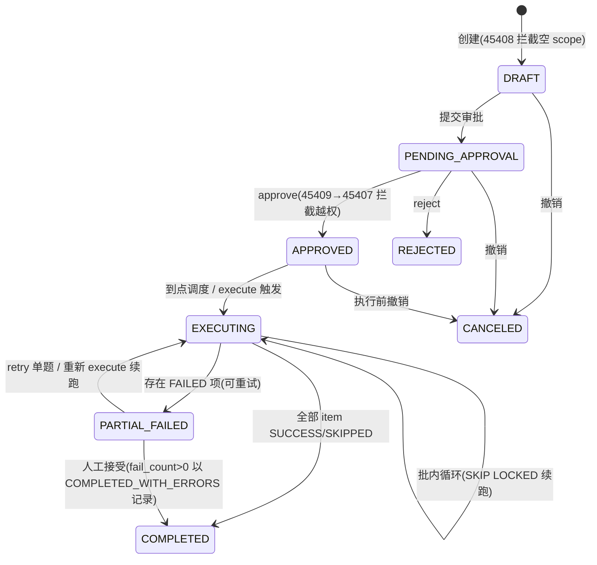

# 服务端-题库内容版本管理与历史追溯引擎 - 详细设计

- 版本: v1.0
- 日期: 2026-11-22
- 领域: QBV(Question Bank Versioning)
- 错误码段: 45400-45499(全库扫描确认空闲;题库质量监控域 QLM 使用 480xx,题目服务基础段使用 4xxxx 通用段,互不占用)
- 状态: 初版入库

## 1. 模块概述

### 1.1 功能定位

本引擎负责题库**内容级**的版本管理、历史追溯与回滚恢复,解决以下问题:

1. 题目内容(题干/选项/答案/解析/知识点关联)每次变更都留下不可变快照,任意历史版本可回放、可对比、可恢复。
2. 教材修订、考纲调整时,对受影响题目做影响面评估,并以批量迁移任务的方式安全地推进内容版本演进。
3. 内容纠错回流(解析有误、答案勘误)通过"新版本"而非"原地修改"落地,保证线上正在进行的练习、已生成的作业、已归档的错题所引用的内容语义不被篡改。

一句话:**生命周期状态决定题目"能不能用",本引擎决定题目"内容是什么、曾经是什么、可以恢复成什么"。**

### 1.2 需求背景

- 总体设计 §6.3 拍照搜题要求解析准确;§12.2 要求"对错误解析进行回流修正"。原地 UPDATE 会使已下发解析与历史答题记录失去语义锚点。
- 总体设计 §15 风险表"AI 回答不准确"应对策略含"内容回流",回流必须可审计、可回滚。
- 教材版本变更(§6.4)会引发题目所属章节、知识点映射整体迁移,需要影响评估与受控批量演进。

### 1.3 权威边界(与周边模块的分工裁决)

| 关注点 | 权威模块 | 说明 |
|--------|-----------|------|
| 题目生命周期状态(draft/published/offline/archived) | 服务端-题库质量监控与题目生命周期管理服务(QLM,480xx) | 本引擎不决策上架/下架,只消费状态 |
| 当前生效内容 | **本引擎(QBV)** | question 行仅存指针 `version_no`,内容快照 SSOT 在 question_content_version |
| 内容审核结论(pass/reject) | 服务端-教育内容审核工作流与多级审核管线 | 回滚落新版本后按 §4.3 规则决定是否重审 |
| 读路径(学生端/搜题) | 题目与题库服务 / 题目管理与题库系统 | 只读"当前版本"快照,不感知历史 |
| 答题记录引用 | 答题记录服务 | 记录快照 `content_ref = {question_id, version_no}`,与本引擎契约见 R4 |
| 质量分/难度标定 | QLM 质量评分引擎 | 与本引擎互不写对方字段 |

红线 R0:**任何模块不得直接 UPDATE question 的内容字段**;一切内容变更必须经本引擎创建新版本(契约 R2)。

### 1.4 关键术语

| 术语 | 定义 |
|------|------|
| 内容快照(snapshot) | 某题目某一版本的完整内容 JSON,不可变,落库 question_content_version |
| 当前版本(current) | question.version_no 指向的快照版本号,由 CAS 推进,非独立状态 |
| 回滚(rollback) | 以历史快照为模板**新建**一个版本(版本号递增),绝不修改历史行 |
| 迁移任务(migration) | 教材/知识点变更引发的批量版本演进任务,item 级幂等、断点续跑 |
| no-op 变更 | 新快照 hash 与当前快照 hash 相同,不产新版本(幂等返回) |

## 2. 数据结构设计

### 2.1 PostgreSQL 表结构

```sql
-- ============================================
-- 2.1.1 题目内容版本快照表(SSOT,行不可变)
-- ============================================
CREATE TABLE question_content_version (
    id                BIGSERIAL PRIMARY KEY,
    question_id       BIGINT       NOT NULL REFERENCES question(id),
    version_no        INT          NOT NULL,
    -- 完整内容快照: {content, options, official_answer, explanation,
    --   knowledge_points, tags, difficulty_score, chapter_id, attachments}
    content_snapshot  JSONB        NOT NULL,
    -- 规范化快照哈希(sha256,键排序后序列化),用于 no-op 检测与完整性校验
    snapshot_hash     CHAR(64)     NOT NULL,
    change_type       VARCHAR(20)  NOT NULL,  -- create|update|rollback|migration
    change_summary    VARCHAR(500) NOT NULL DEFAULT '',
    -- 变更字段摘要: [{field, change:"added|removed|modified", summary, old_prefix, new_prefix}]
    -- 仅存截断摘要(每段≤200字符),不存全文 diff;全文 diff 按需实时计算(见 §4.2)
    changed_fields    JSONB        NOT NULL DEFAULT '[]'::jsonb,
    -- rollback/migration 时指向来源版本;create/update 为 NULL
    base_version_no   INT,
    -- 触发迁移任务号;非迁移为 NULL
    migration_task_no VARCHAR(32),
    created_by        BIGINT       NOT NULL,
    created_at        TIMESTAMPTZ  NOT NULL DEFAULT now(),
    CONSTRAINT uk_qcv_q_ver UNIQUE (question_id, version_no),
    CONSTRAINT ck_qcv_change_type CHECK (change_type IN
        ('create','update','rollback','migration')),
    CONSTRAINT ck_qcv_version_positive CHECK (version_no >= 1)
);
CREATE INDEX idx_qcv_question_created ON question_content_version (question_id, created_at DESC);
-- 哈希去重辅助:no-op 快速判定走"当前版本行"的点查,无需此索引;此处用于审计对账
CREATE INDEX idx_qcv_hash ON question_content_version (snapshot_hash);

-- ============================================
-- 2.1.2 question 表增量(指针与审计列,内容字段逐步下线)
-- ============================================
ALTER TABLE question
    ADD COLUMN version_no        INT  NOT NULL DEFAULT 1,  -- 当前版本指针(SSOT 为 qcv)
    ADD COLUMN version_updated_at TIMESTAMPTZ,
    ADD COLUMN version_count     INT  NOT NULL DEFAULT 1;  -- 冗余计数,校验用
-- 存量数据初始化:为每题补 version_no=1 的 create 快照(一次性迁移,见 §4.6)

-- ============================================
-- 2.1.3 教材影响评估报告表
-- ============================================
CREATE TABLE question_impact_report (
    id                 BIGSERIAL PRIMARY KEY,
    report_no          VARCHAR(32)  NOT NULL UNIQUE,
    trigger_type       VARCHAR(20)  NOT NULL,  -- TEXTBOOK_REVISE|KP_REMAP|MANUAL
    scope              JSONB        NOT NULL,  -- {textbook_version_id, chapter_ids[], kp_ids[], subject_ids[]}
    total_questions    INT          NOT NULL DEFAULT 0,
    by_status          JSONB        NOT NULL DEFAULT '{}'::jsonb,  -- {published: n, offline: n, ...}
    by_subject         JSONB        NOT NULL DEFAULT '{}'::jsonb,
    affected_kp_ids    BIGINT[]     NOT NULL DEFAULT '{}',
    high_risk_count    INT          NOT NULL DEFAULT 0,  -- 引用量大/近期在用题目数
    report_json        JSONB,                          -- 明细(分页查询走 item 表)
    created_by         BIGINT       NOT NULL,
    created_at         TIMESTAMPTZ  NOT NULL DEFAULT now()
);
CREATE TABLE question_impact_item (
    id           BIGSERIAL PRIMARY KEY,
    report_no    VARCHAR(32) NOT NULL REFERENCES question_impact_report(report_no),
    question_id  BIGINT      NOT NULL,
    status       VARCHAR(20) NOT NULL,  -- 当时题目生命周期状态
    usage_90d    INT         NOT NULL DEFAULT 0,
    hit_reason   VARCHAR(50) NOT NULL,  -- chapter_changed|kp_removed|kp_remap|version_eol
    UNIQUE (report_no, question_id)
);
CREATE INDEX idx_qii_report ON question_impact_item (report_no, question_id);

-- ============================================
-- 2.1.4 批量迁移任务表
-- ============================================
CREATE TABLE version_migration_task (
    id               BIGSERIAL PRIMARY KEY,
    task_no          VARCHAR(32)  NOT NULL UNIQUE,   -- MIG+yyyyMMdd+seq,由发号器生成
    report_no        VARCHAR(32)  REFERENCES question_impact_report(report_no),
    trigger_type     VARCHAR(20)  NOT NULL,          -- TEXTBOOK_REVISE|KP_REMAP|MANUAL
    -- 迁移动作模板: {chapter_id?: newVal, knowledge_points_add?: [], knowledge_points_remove?: []}
    action_template  JSONB        NOT NULL,
    status           VARCHAR(20)  NOT NULL DEFAULT 'DRAFT',
    -- DRAFT|PENDING_APPROVAL|APPROVED|EXECUTING|COMPLETED|FAILED|REJECTED|CANCELED
    total_count      INT          NOT NULL DEFAULT 0,
    processed_count  INT          NOT NULL DEFAULT 0,
    success_count    INT          NOT NULL DEFAULT 0,
    fail_count       INT          NOT NULL DEFAULT 0,
    skip_count       INT          NOT NULL DEFAULT 0,
    idempotency_key  VARCHAR(64)  UNIQUE,            -- 创建幂等
    created_by       BIGINT       NOT NULL,
    approved_by      BIGINT,
    approved_at      TIMESTAMPTZ,
    execute_after    TIMESTAMPTZ,                    -- 计划执行时间(可延迟到低峰)
    started_at       TIMESTAMPTZ,
    finished_at      TIMESTAMPTZ,
    created_at       TIMESTAMPTZ NOT NULL DEFAULT now(),
    updated_at       TIMESTAMPTZ NOT NULL DEFAULT now(),
    CONSTRAINT ck_vmt_status CHECK (status IN
        ('DRAFT','PENDING_APPROVAL','APPROVED','EXECUTING','COMPLETED','FAILED','REJECTED','CANCELED'))
);
CREATE INDEX idx_vmt_status ON version_migration_task (status, execute_after);

CREATE TABLE version_migration_item (
    id                BIGSERIAL PRIMARY KEY,
    task_no           VARCHAR(32) NOT NULL REFERENCES version_migration_task(task_no),
    question_id       BIGINT      NOT NULL,
    from_version_no   INT         NOT NULL,
    to_version_no     INT,
    status            VARCHAR(20) NOT NULL DEFAULT 'PENDING',
    -- PENDING|EXECUTING|SUCCESS|FAILED|SKIPPED(见 §5.2 状态机)
    error_code        VARCHAR(20),
    error_msg         VARCHAR(500),
    attempt           INT         NOT NULL DEFAULT 0,
    executed_at       TIMESTAMPTZ,
    UNIQUE (task_no, question_id)     -- item 级幂等键
);
CREATE INDEX idx_vmi_pending ON version_migration_item (task_no, status) WHERE status IN ('PENDING','FAILED');
```

### 2.2 Redis 缓存结构

```text
# 单题写互斥锁(回滚/编辑保存/迁移执行三方竞争裁决,见 §6.3)
qbv:lock:q:{questionId}                 STRING  value=ownerToken  PX=30000
# 迁移任务执行互斥
qbv:lock:mig:{taskNo}                   STRING  value=workerId    PX=120000
# 版本对比结果缓存(大 diff 异步产物)
qbv:diff:{questionId}:{fromV}:{toV}     STRING  unified_diff  EX=600
# 当前版本指针缓存(读多写少,失效以事件驱动)
qbv:curver:{questionId}                 STRING  version_no  EX=3600
```

### 2.3 对象存储结构

快照内 `attachments`(图片/公式资源)为 OSS 引用 URI,版本间共享物理文件,不做快照级复制;快照仅记录 URI 列表。文件生命周期由"服务端-存储资源统一生命周期管理与过期数据自动清理引擎"裁决,引用计数低于 1 且超过 180 天才可清理(契约 R9)。

## 3. API 接口设计

统一约定:管理端接口前缀 `/api/v1/admin/qbv`;鉴权走服务端统一认证授权(RBAC:`content_editor` 可创建版本/发起评估,`content_admin` 可回滚/审批迁移,`auditor` 只读);写操作必须携带 `X-Idempotency-Key`(30 分钟窗口,见 §6.1);响应封装遵循服务端统一响应封装规范。

### 3.1 创建内容版本(编辑保存即快照)

```text
POST /api/v1/admin/qbv/questions/{questionId}/versions
Headers: X-Idempotency-Key: <uuid>
Request:
{
  "contentSnapshot": {            // 完整新内容,字段集见 §2.1.1 注释
    "content": "……",
    "options": ["A. …", "B. …"],
    "officialAnswer": "B",
    "explanation": "……",
    "knowledgePoints": [{"kpId": 8801, "weight": 0.8}],
    "tags": ["一元二次方程"],
    "difficultyScore": 0.62,
    "chapterId": 55012,
    "attachments": ["oss://pt-question/res/9f3a.png"]
  },
  "changeSummary": "勘误:第(2)问答案由 B 修正为 C,同步更新解析",
  "expectedCurrentVersion": 7     // 乐观并发:编辑页载入时的版本号
}
Response 201:
{
  "code": 0,
  "data": {
    "questionId": 100234,
    "versionNo": 8,
    "changeType": "update",
    "noChange": false,            // true 时 versionNo 返回当前版本号,HTTP 仍为 200
    "snapshotHash": "c81d…",
    "changedFields": [{"field": "officialAnswer", "change": "modified", "summary": "B → C"}]
  }
}
Error: 45405(版本基线已变化)/45416(题目已归档)/45418(幂等键冲突)/45420(版本数超限)
```

### 3.2 版本列表 / 版本详情

```text
GET /api/v1/admin/qbv/questions/{questionId}/versions?page=1&pageSize=20
Response 200: { "total": 23, "list": [
  { "versionNo": 23, "changeType": "update", "changeSummary": "…",
    "createdBy": 9001, "createdAt": "2026-11-20T09:12:33Z", "isCurrent": true },
  { "versionNo": 22, "changeType": "rollback", "baseVersionNo": 19, "isCurrent": false }
]}

GET /api/v1/admin/qbv/questions/{questionId}/versions/{versionNo}
Response 200: { "versionNo": 19, "contentSnapshot": {…}, "snapshotHash": "…",
                "changedFields": […], "createdBy": 8700, "createdAt": "…" }
Error: 45400(版本不存在)
```

### 3.3 版本对比

```text
GET /api/v1/admin/qbv/questions/{questionId}/versions/compare?from=19&to=23
Response 200(同步小 diff ≤64KB):
{ "from": 19, "to": 23,
  "fieldDiffs": [
    {"field": "officialAnswer", "change": "modified", "oldPrefix": "B", "newPrefix": "C"},
    {"field": "explanation",  "change": "modified", "oldPrefix": "由题意 f(x)…", "newPrefix": "由题意 f(x)…"}
  ],
  "unifiedDiff": "@@ -1,5 +1,6 @@ …" }
Response 202(大 diff): { "async": true, "diffJobId": "DF2211…" }  // 完成后缓存于 qbv:diff:*,轮询复用
Error: 45411(diff 超阈值转入异步后再次超限)/45400
```

### 3.4 回滚预览 / 回滚执行

```text
POST /api/v1/admin/qbv/questions/{questionId}/versions/rollback-preview
Request: { "targetVersionNo": 19 }
Response 200:
{ "targetVersionNo": 19, "targetSnapshotHash": "…",
  "currentVersionNo": 23,
  "willCreateVersionNo": 24,          // 回滚=新版本,原样告知前端展示
  "requiresReaudit": true,            // 目标版本内容未经过现行审核口径,见 §4.3
  "diffSummary": {"changedFields": […], "fieldCount": 3} }

POST /api/v1/admin/qbv/questions/{questionId}/versions/rollback
Headers: X-Idempotency-Key: <uuid>
Request: { "targetVersionNo": 19, "expectedCurrentVersion": 23, "reason": "解析勘误回退" }
Response 201: { "questionId": 100234, "newVersionNo": 24, "changeType": "rollback",
                "requiresReaudit": true, "statusHandoff": "PENDING_REVIEW" }
Error: 45404(目标版本不可回滚)/45405/45415(权限不足,非 content_admin)/45416/45413(锁超时)
```

### 3.5 教材影响评估

```text
POST /api/v1/admin/qbv/impact-assessments
Headers: X-Idempotency-Key: <uuid>
Request:
{ "triggerType": "TEXTBOOK_REVISE",
  "scope": { "textbookVersionId": 3001, "chapterIds": [55010, 55011],
             "kpRemap": [{"fromKpId": 8801, "toKpId": 8809}] } }
Response 202: { "reportNo": "RPT20261122001" }
GET  /api/v1/admin/qbv/impact-assessments/{reportNo}
Response 200: { "reportNo": "…", "totalQuestions": 1284,
  "byStatus": {"published": 1102, "offline": 96, "archived": 86},
  "highRiskCount": 47, "bySubject": {"math": 640, "physics": 260} }
GET  /api/v1/admin/qbv/impact-assessments/{reportNo}/items?hitReason=kp_removed&page=1
Error: 45412(评估范围过大,超过 5 万题需缩小 scope)/45408(scope 为空)
```

### 3.6 批量迁移任务

```text
POST /api/v1/admin/qbv/migration-tasks
Headers: X-Idempotency-Key: <uuid>
Request:
{ "reportNo": "RPT20261122001",
  "actionTemplate": { "chapterId": 55020,
      "knowledgePointsAdd": [{"kpId": 8809, "weight": 0.8}],
      "knowledgePointsRemove": [8801] },
  "questionIds": [100234, 100235],          // 缺省=报告全量;显式指定用于圈定子集
  "executeAfter": "2026-11-23T02:00:00Z" }   // 可选,低峰执行
Response 201: { "taskNo": "MIG20261122007", "status": "PENDING_APPROVAL", "totalCount": 1284 }

POST /api/v1/admin/qbv/migration-tasks/{taskNo}/approve   { "comment": "…" }
POST /api/v1/admin/qbv/migration-tasks/{taskNo}/reject    { "reason": "…" }
POST /api/v1/admin/qbv/migration-tasks/{taskNo}/execute   // 立即触发(到点任务由调度器触发)
Response 202: { "taskNo": "…", "status": "EXECUTING" }
GET    /api/v1/admin/qbv/migration-tasks/{taskNo}
Response 200: { "taskNo": "…", "status": "EXECUTING", "totalCount": 1284,
  "processedCount": 900, "successCount": 899, "failCount": 1, "skipCount": 0 }
GET    /api/v1/admin/qbv/migration-tasks/{taskNo}/items?status=FAILED&page=1
POST   /api/v1/admin/qbv/migration-tasks/{taskNo}/items/{questionId}/retry
Error: 45406(任务不存在)/45407(状态不允许)/45409(未审批)/45410(已有执行中实例)/45419(存在失败项,COMPLETED 语义见 §5.2)
```

## 4. 核心处理流程

### 4.1 编辑保存与快照创建

```text
┌──────────┐   POST /versions    ┌──────────────┐
│ 管理后台  │ ──────────────────▶ │ VersionService│
│ (编辑页)  │ ◀────────────────── │  .create()    │
└──────────┘   201 {versionNo}   └──────┬───────┘
                                        │ 单题锁 qbv:lock:q:{id}
                    ┌───────────────────┼────────────────────┐
                    ▼                   ▼                    ▼
            ① 载入当前行         ② 计算 snapshot_hash      ③ hash 相同?
        (SELECT … FOR UPDATE   (规范化序列化+sha256)           │是→noChange=true
         读 question + qcv                            否↓     返回,事务结束
         当前版本行)                          ④ 字段级 diff
                                              生成 changed_fields
                    └───────────────────┬────────────────────┘
                                        ▼
                    ⑤ 同事务执行(全部成功才提交):
                      INSERT question_content_version(v+1, change_type=update …)
                      UPDATE question SET version_no=v+1, version_count=version_count+1,
                             version_updated_at=now()
                             WHERE id=? AND version_no=?        ← CAS(expectedCurrentVersion)
                      INSERT sp_outbox(question.version.created)  ← 事件,见 §7
                    ⑥ 提交后:删锁、失效 qbv:curver:{id}
```

关键代码(Java / Spring,伪实现但结构可直接落地):

```java
@Transactional
public CreateVersionResult createVersion(Long questionId, CreateVersionCommand cmd) {
    // G1: 归档题目不可写(生命周期权威在 QLM,这里读状态做守卫)
    Question q = questionMapper.selectForUpdate(questionId);
    if (q == null) throw new BizException(404, "QUESTION_NOT_FOUND");
    if ("archived".equals(q.getStatus())) throw new BizException(45416, "QBV_QUESTION_ARCHIVED");

    // G2: 乐观并发 —— 编辑页载入版本与实际当前版本不一致则拒绝,防止覆盖他人已存内容
    if (!q.getVersionNo().equals(cmd.getExpectedCurrentVersion())) {
        throw new BizException(45405, "QBV_NOT_LATEST_VERSION");
    }
    // G3: 版本数硬上限,防历史膨胀(归档策略见 §9-D6)
    if (q.getVersionCount() >= 200) throw new BizException(45420, "QBV_VERSION_LIMIT_EXCEEDED");

    VersionRow cur = versionMapper.selectByQuestionAndVersion(questionId, q.getVersionNo());
    String newHash = SnapshotHasher.sha256Canonical(cmd.getContentSnapshot());

    // G4: no-op 检测 —— 幂等核心:重复提交/误保存不产生垃圾版本
    if (newHash.equals(cur.getSnapshotHash())) {
        return CreateVersionResult.noChange(q.getVersionNo());
    }

    List<FieldChange> diffs = FieldDiffer.diff(cur.getContentSnapshot(), cmd.getContentSnapshot());

    int nextVer = q.getVersionNo() + 1;
    versionMapper.insert(VersionRow.builder()
            .questionId(questionId).versionNo(nextVer)
            .contentSnapshot(cmd.getContentSnapshot()).snapshotHash(newHash)
            .changeType("update").changeSummary(cmd.getChangeSummary())
            .changedFields(diffs).createdBy(cmd.getOperatorId()).build());

    // CAS 双保险:WHERE version_no=expected,影响行数 0 即并发失败回滚
    int updated = questionMapper.casBumpVersion(questionId, cmd.getExpectedCurrentVersion(), nextVer);
    if (updated == 0) throw new BizException(45405, "QBV_NOT_LATEST_VERSION");

    outboxMapper.insert(OutboxEvent.of("question.version.created",
            Map.of("questionId", questionId, "versionNo", nextVer,
                   "changeType", "update", "changedFields", diffs)));
    return CreateVersionResult.created(nextVer, newHash, diffs);
}
```

### 4.2 版本对比(diff 管线)

diff 分两级,控制管理端渲染成本:

1. **字段级 diff(必产)**:对快照 JSON 逐字段比较;标量字段产出 old/new 截断前缀(≤200 字符);数组字段(选项/知识点/附件)按"元素增删改"对齐(LCS 思路,元素以规范化 hash 标识)。
2. **文本行级 unified diff(按需)**:仅对 content/officialAnswer/explanation 三类长文本,在前端展开时实时计算(google-diff-match-patch 或服务端 java-diff-utils);结果超过 64KB 转异步任务,产物缓存 `qbv:diff:*`(10 分钟)。

```java
public CompareResult compare(Long questionId, int from, int to) {
    VersionRow a = mustGet(questionId, from);          // 45400
    VersionRow b = mustGet(questionId, to);            // 45400
    List<FieldChange> fieldDiffs = FieldDiffer.diff(a.getContentSnapshot(), b.getContentSnapshot());
    // 长文本 diff 惰性:先给字段摘要;unifiedDiff 超 64KB → 202 异步(45411 仅用于异步产物再次超限>2MB)
    return CompareResult.of(from, to, fieldDiffs, unifiedDiffOrAsync(a, b));
}
```

### 4.3 回滚流程(核心红线:历史不可变)

```text
回滚 = 以目标快照为模板创建"新"版本(change_type=rollback, base_version_no=target):

① 前置校验(单题锁内,SELECT FOR UPDATE 当前行)
   - 题目存在且未归档(G1)              → 否则 45416
   - targetVersionNo ∈ [1, 当前版本号]  → 否则 45404
   - target 行存在(qcv 不可变,必存在)   → 否则 45400
   - 操作人具备 content_admin 角色      → 否则 45415
② 计算新快照 = target.content_snapshot 原样拷贝(仅附 rollback 元信息,不改内容语义)
③ no-op 检测:若 target == 当前版本(hash 相同) → noChange 返回(幂等,G5)
④ requiresReaudit 判定(§4.3.1)
⑤ 同事务:INSERT qcv(v+1, rollback, base=target) + UPDATE question CAS 推进
          + INSERT sp_outbox(question.version.rolled_back)
⑥ reaudit=true 时,同事务再插出手事件 handoff 到审核管线:
          sp_outbox(question.audit.requested, {questionId, versionNo: v+1, reason: ROLLBACK})
          → QLM 将题目置 PENDING_REVIEW(生命周期状态权威归 QLM,契约 R5)
⑦ 提交后:删锁、失效 qbv:curver:{id};管理后台展示"已回滚至 v19 内容(现 v24),待复核"
```

#### 4.3.1 requiresReaudit 判定规则

| 条件 | requiresReaudit | 说明 |
|------|-----------------|------|
| 目标版本创建时间晚于"现行审核口径生效时间"(audit_policy.changed_at) | false | 内容曾经按现行口径审过 |
| 目标版本为 create/update 且当时审核通过,但口径已升级(如新增学科术语校验) | 由审核管线配置 `rollback_reaudit_strict=true` 决定 | 默认 true,宁可多审 |
| 目标版本本身即回滚产物且其基础链任一环节未重审 | true | 链式保守判定 |
| 仅 attachments URI 列表差异(内容语义不变) | false | 纯资源引用不回审 |

**裁决**:requiresReaudit 为保守判定,审核管线拥有最终解释权(契约 R5);引擎只负责"提出重审请求",不得自行改题目生命周期状态。

### 4.4 教材影响评估流程

```sql
-- 评估=只读聚合,不产生任何写;报告落库仅为留痕与迁移任务挂载点
-- 例:教材修订影响(chapter 变更 + 知识点下线 kp_removed)
INSERT INTO question_impact_report (report_no, trigger_type, scope, …)
VALUES (:reportNo, 'TEXTBOOK_REVISE', :scopeJson, …);

INSERT INTO question_impact_item (report_no, question_id, status, usage_90d, hit_reason)
SELECT :reportNo, q.id, q.status,
       COALESCE(u.cnt, 0),
       CASE WHEN q.chapter_id IN (:changedChapters) THEN 'chapter_changed'
            WHEN kpm.knowledge_point_id IN (:removedKps) THEN 'kp_removed'
            ELSE 'kp_remap' END
FROM question q
LEFT JOIN LATERAL (
    SELECT count(*) AS cnt FROM answer_record ar
    WHERE ar.question_id = q.id AND ar.created_at > now() - interval '90 days'
) u ON true
LEFT JOIN question_knowledge_mapping kpm ON kpm.question_id = q.id
WHERE q.chapter_id IN (:changedChapters)
   OR kpm.knowledge_point_id IN (:removedKps)
   OR kpm.knowledge_point_id IN (:remapFromKps)
ON CONFLICT (report_no, question_id) DO NOTHING;

UPDATE question_impact_report r
SET total_questions = (SELECT count(*) FROM question_impact_item i WHERE i.report_no = r.report_no),
    by_status = (SELECT jsonb_object_agg(status, n) FROM
                 (SELECT status, count(*) n FROM question_impact_item
                  WHERE report_no = r.report_no GROUP BY status) t),
    high_risk_count = (SELECT count(*) FROM question_impact_item i
                       WHERE i.report_no = r.report_no AND i.usage_90d >= 50)
WHERE r.report_no = :reportNo;
```

约束:单次评估命中题目超过 5 万 → 拒绝(45412),要求按学科/章节缩小 scope 分批评估;评估本身是异步任务(202),状态不落表,以 report 行存在即完成。

### 4.5 批量迁移任务执行

```text
调度:统一延迟任务调度引擎到点触发 / 管理端 execute 立即触发;执行互斥 qbv:lock:mig:{taskNo}(120s 续约)。

循环(每批 50 题,任务内限速 200 题/分钟,保护主库):
  items = SELECT * FROM version_migration_item
          WHERE task_no=? AND status='PENDING' ORDER BY id LIMIT 50 FOR UPDATE SKIP LOCKED
  for each item:
    ① 单题锁 qbv:lock:q:{questionId}(G8:迁移与编辑互斥,编辑优先,迁移项标记 SKIPPED)
    ② 载入当前版本快照;按 actionTemplate 变换:
         chapterId 覆盖 / knowledgePoints 增删(权重保留,去重)
       变换后 snapshot 与当前 hash 相同 → SKIPPED(no-op,计数 skip_count)
    ③ 走 §4.1 同一 createVersion 事务路径,change_type=migration,
       migration_task_no=taskNo,base_version_no=from
    ④ item 置 SUCCESS + to_version_no;失败记 error_code/error_msg,attempt+1
       attempt ≥ 3 置 FAILED(不再自动重试)
    ⑤ 每批 UPDATE task 计数(processed/success/fail/skip)
  全部 item 终态 → task 置 COMPLETED(success=total) 或 FAILED 语义见 §5.2;
  COMPLETED 时插 sp_outbox(question.migration.task.completed)

断点续跑:任务中断(发布/重启)后重新 execute,PENDING 项继续;
FAILED 项不自动复活,需人工 retry 接口单题重试(幂等:item 唯一键 + from_version_no 校验)。
```

### 4.6 存量数据初始化(一次性迁移)

上线本引擎前,为每道存量题补 create 快照:

```sql
INSERT INTO question_content_version
    (question_id, version_no, content_snapshot, snapshot_hash, change_type, change_summary, created_by, created_at)
SELECT id, 1,
       jsonb_build_object('content', content, 'officialAnswer', official_answer,
                          'explanation', explanation, 'knowledgePoints', knowledge_points,
                          'tags', tags, 'difficultyScore', difficulty_score,
                          'chapterId', chapter_id, 'attachments', COALESCE(attachments, '[]'::jsonb)),
       encode(digest(canonical_json, 'sha256'), 'hex'),
       'create', '存量初始化', 0, now()
FROM question
WHERE deleted_at IS NULL
ON CONFLICT (question_id, version_no) DO NOTHING;

UPDATE question SET version_no = 1, version_count = 1
WHERE deleted_at IS NULL AND version_no IS DISTINCT FROM 1;
```

要求:分批(每批 5000)执行,记录迁移批次号;初始化完成后 question 表内容列进入"只读遗留"状态,新写入一律走引擎(契约 R2)。

## 5. 状态机与守卫

### 5.1 版本状态语义

版本行**无状态字段、永不可变**;"当前版本"是 question.version_no 指针的派生概念(`isCurrent = (version_no == question.version_no)`),列表查询时实时计算,不落库。这消除了"版本状态双写分叉"整类问题(守卫 G6)。

### 5.2 迁移任务状态机



迁移项(item)状态机:`PENDING → EXECUTING → SUCCESS | FAILED | SKIPPED`(FAILED 在 attempt<3 时由批内循环直接原地重试,不回落 PENDING;仅 attempt 达上限才落 FAILED)。

任务完成语义裁决:对外 status 只有 COMPLETED 一种成功态;存在失败项时完成态写 `COMPLETED`(fail_count>0),由看板与 45419 提示人工介入——**不引入 PARTIAL_FAILED 对外状态**,避免客户端分支爆炸(契约 R6)。

### 5.3 守卫总表

| 守卫 | 规则 | 违反后果 |
|------|------|----------|
| G1 | archived 题目拒绝一切版本写 | 45416 |
| G2 | 创建/回滚必须携带 expectedCurrentVersion 且命中,否则 45405 | 45405 |
| G3 | 单题版本数 ≤200 | 45420,触发归档评估 |
| G4 | snapshot_hash 相同 → noChange,禁止空转版本 | 幂等返回 |
| G5 | 回滚目标=当前版本(hash 相同)→ noChange | 幂等返回 |
| G6 | 版本行禁 UPDATE/DELETE;question.version_no 只能由本引擎 CAS 推进 | 代码评审红线 |
| G7 | 回滚/迁移创建的新版本必须 base_version_no 可溯 | 写库约束 |
| G8 | 单题写互斥:编辑/回滚/迁移竞争时先到先得,30s 锁超时即 45413 | 45413 |
| G9 | 迁移任务必须审批后才可执行;审批人 ≠ 创建人 | 45409/45407 |
| G10 | 评估/迁移 scope 非空且命中 ≤5 万题 | 45408/45412 |
| G11 | requiresReaudit=true 的回滚必须同事务发出审计 handoff 事件 | 事务回滚 |
| G12 | 迁移 attempt ≥3 转 FAILED,禁止无限自动重试 | 人工 retry |

## 6. 幂等性与并发控制

### 6.1 幂等键总表

| 操作 | 幂等键 | 存储 | 语义 |
|------|--------|------|------|
| 创建版本 | `X-Idempotency-Key` 请求头 | 框架级 30min 窗口(沿用接口幂等性规范) | 同键同 payload 返回首次结果;同键不同 payload → 45418 |
| 回滚 | `X-Idempotency-Key` + (questionId,targetVersionNo) | 同上 | 重试网络重发不产生双版本(G4/G5 兜底) |
| 评估报告 | scope 规范化 JSON 哈希 24h 去重 | Redis `qbv:impact:dup:{hash}` | 相同 scope 24h 内直接返回旧 reportNo |
| 迁移任务 | `idempotency_key` 列唯一 | DB 唯一约束 | 重复创建返回已有 taskNo |
| 迁移 item | `(task_no, question_id)` 唯一 | DB 唯一约束 | 重复圈题不重复生成 |
| no-op 检测 | snapshot_hash 比对 | 当前版本行点查 | 内容级幂等(任意次重复提交安全) |

### 6.2 并发场景裁决

| 场景 | 裁决 |
|------|------|
| 两人同时编辑保存 | 先提交者成功;后提交者 expectedCurrentVersion 失配 → 45405,前端提示"内容已被他人更新"并刷新基线 |
| 回滚与编辑并发 | 单题锁先到者赢;锁等待 30s 超时 → 45413;编辑者因 45405 重试时重新载入(此时看到的是回滚后的新版本) |
| 迁移执行与人工编辑同题 | G8:编辑优先。迁移项获取单题锁失败 → 该项 SKIPPED(reason=LOCK_BUSY),计数 skip,人工补处理(看板暴露) |
| 双回滚并发 | 单题锁 + CAS 双保险;后至者 expectedCurrentVersion 失配 → 45405 |
| 审批与执行并发 | 状态机校验:仅 APPROVED 可进 EXECUTING,DB 层 `UPDATE … WHERE status='APPROVED'` 影响行数裁决 |
| 任务重复触发(调度与手动) | qbv:lock:mig:{taskNo} 互斥;第二个触发者返回 202 并提示"任务执行中"(45410 仅用于管理端强制重启语义) |

### 6.3 锁策略

- 单题锁:Redis `SET qbv:lock:q:{id} ownerToken NX PX 30000`,锁内做完整事务;事务超长依赖 ownerToken 校验+续期,异常退出靠 PX 兜底。
- DB 兜底:即使 Redis 不可用,`uk_qcv_q_ver` + question CAS 仍能阻止版本号双写(可能退化为 45413/45405 错误,不会脏写)——**锁是性能设施,唯一键+CAS 才是正确性设施**(降级 D2)。

## 7. 事件集成

### 7.1 领域事件(经 sp_outbox 同事务落库,事件驱动架构统一分发)

| 事件 | 触发点 | 关键 payload |
|------|--------|--------------|
| question.version.created | 创建版本/迁移成功 | questionId, versionNo, changeType, changedFields[](摘要), operatorId |
| question.version.rolled_back | 回滚成功 | questionId, newVersionNo, baseVersionNo, requiresReaudit |
| question.audit.requested | 回滚重审 handoff(仅 reaudit=true) | questionId, versionNo, reason=ROLLBACK |
| question.migration.task.completed | 迁移任务终态 | taskNo, status, total/success/fail/skip |

### 7.2 消费方矩阵

| 消费方 | 订阅事件 | 动作 |
|--------|----------|------|
| 搜索服务(ES 索引) | version.created / rolled_back | 重建该题文档(published 时) |
| 缓存服务 | version.created / rolled_back | 失效题目详情缓存、qbv:curver:{id} |
| QLM 生命周期服务 | audit.requested | 状态置 PENDING_REVIEW(权威) |
| 审计日志系统 | 全部 | 操作留痕(操作人/前后版本/时间/IP) |
| 题目与题库服务 | version.created / rolled_back | 刷新读模型快照(契约 R4) |

## 8. 错误处理(错误码表)

统一遵循服务端统一业务异常码规范;以下为 QBV 域专属码(45400-45420,共 21 项;45421-45499 预留):

| 码 | 符号 | 语义 | 客户端/管理端提示 |
|----|------|------|-------------------|
| 45400 | QBV_VERSION_NOT_FOUND | 版本不存在或越界 | "目标版本不存在" |
| 45401 | QBV_INVALID_CONTENT_SCHEMA | 快照字段集不合法/缺必填 | "内容结构不完整,请检查字段" |
| 45402 | QBV_SNAPSHOT_INTEGRITY_FAIL | snapshot_hash 复算不一致 | "快照校验失败,请重试"(服务端告警) |
| 45403 | QBV_CONTENT_TOO_LARGE | 单快照 >1MB(富文本上限) | "内容过大,请精简或拆分附件" |
| 45404 | QBV_ROLLBACK_TARGET_INVALID | 回滚目标不可回滚(越界/被排除) | "该版本不可作为回滚目标" |
| 45405 | QBV_NOT_LATEST_VERSION | 基线版本已变化(并发) | "内容已被更新,请刷新后重试" |
| 45406 | QBV_MIGRATION_TASK_NOT_FOUND | 迁移任务不存在 | "任务不存在" |
| 45407 | QBV_MIGRATION_STATE_INVALID | 操作与任务状态不符 | "当前任务状态不允许该操作" |
| 45408 | QBV_MIGRATION_SCOPE_EMPTY | scope/圈题为空 | "没有需要迁移的题目" |
| 45409 | QBV_MIGRATION_APPROVAL_REQUIRED | 未审批即执行 | "任务需审批后才能执行" |
| 45410 | QBV_MIGRATION_ALREADY_RUNNING | 任务执行中重复强制触发 | "任务正在执行" |
| 45411 | QBV_DIFF_TOO_LARGE | diff 产物超 2MB 上限 | "版本差异过大,请分字段查看" |
| 45412 | QBV_IMPACT_SCOPE_TOO_LARGE | 评估命中 >5 万题 | "影响范围过大,请按学科/章节缩小后分批评估" |
| 45413 | QBV_LOCK_TIMEOUT | 单题锁获取超时 | "题目正被其他操作处理,请稍后重试" |
| 45414 | QBV_SNAPSHOT_STORE_FAILED | 快照写入失败(存储异常) | "保存失败,请重试"(P1 告警) |
| 45415 | QBV_UNAUTHORIZED_ROLLBACK | 回滚权限不足(非 content_admin) | "无回滚权限" |
| 45416 | QBV_QUESTION_ARCHIVED | 归档题禁止写版本 | "题目已归档,不可修改" |
| 45417 | QBV_REAUDIT_HANDOFF_FAILED | 重审事件落 Outbox 失败 | 事务回滚+告警,"回滚失败请重试" |
| 45418 | QBV_IDEMPOTENCY_CONFLICT | 同幂等键不同 payload | "请求与首次提交不一致" |
| 45419 | QBV_MIGRATION_HAS_FAILURES | 任务完成但存在失败项 | "N 道题迁移失败,请处理失败列表" |
| 45420 | QBV_VERSION_LIMIT_EXCEEDED | 版本数超 200 | "历史版本过多,请联系管理员归档整理" |

通用段映射:参数校验失败沿用 40001 系(服务端请求参数校验规范),权限不足沿用 40103(统一认证授权),不在本域重复定义(契约 R10)。

## 9. 降级矩阵

| 编号 | 故障 | 降级行为 | 红线 |
|------|------|----------|------|
| D1 | Redis 不可用 | 锁退化为 DB 唯一键+CAS 裁决;curver 缓存直读 DB | 正确性不降级(§6.3) |
| D2 | diff 异步队列积压 | 对比接口只返回字段级摘要,unifiedDiff 字段置 null+retryAfter | 不阻塞版本创建 |
| D3 | Outbox 分发延迟 | 事件滞留,搜索索引/缓存短暂旧数据;看板监控积压 | 快照主流程不受影响 |
| D4 | 评估 SQL 慢 | 大 scope 自动改并行分片(按 subject 切);仍超阈值拒绝(45412) | 评估只读,不锁业务表(FOR UPDATE 仅 item 圈定用,评估本身不加锁) |
| D5 | 迁移执行高峰 | 任务内限速器降速;人工可暂停(状态保持 EXECUTING,worker 停拉取) | 暂停不产生中间态数据 |
| D6 | 版本数逼近上限 | 提前告警;超 G3 拒绝写并提示归档(历史快照冷存,question 归档走 QLM) | 不得自动物理删除历史版本 |
| D7 | 审核管线不可用 | 回滚照常落版本,reaudit handoff 事件滞留 Outbox,恢复后补发 | requiresReaudit 判定不变,不因下游故障跳过(G11) |
| D8 | 哈希算法升级 | snapshot_hash 带算法前缀(sha256:…),新旧哈希并存不互判 | 不批量重算历史哈希(审计链) |
| D9 | 管理后台版本页不可用 | 读路径(学生端)零依赖本引擎管理端,不受影响 | 学生端永远只读当前版本 |
| D10 | 存储空间告警 | 历史快照冷层迁移(低频版本转对象存储冷存,热层留近 12 个月) | 冷存不可变,检索可回放;禁止删行 |

## 10. 监控指标与告警

| 指标 | 口径 | 告警阈值 |
|------|------|----------|
| M1 qbv_version_create_total | 按 change_type 维度计数 | — |
| M2 no-op 占比 | noChange/创建请求 | >40% 持续 1h → 提示前端保存逻辑异常(P3) |
| M3 回滚频率 | rolled_back 事件/小时 | >20/h → P2(异常批量操作) |
| M4 reaudit 占比 | requiresReaudit=true/回滚 | 环比突增 3 倍 → P3 |
| M5 迁移任务耗时 | started_at→finished_at | P99 >30min → P3 |
| M6 迁移失败率 | fail/total | 单任务 >1% 或 fail>50 → P2;45419 看板常驻 |
| M7 锁冲突率 | 45413/写请求 | >5% 持续 15min → P3 |
| M8 45405 并发拒绝率 | /写请求 | >10% → 提示编辑页并发交互设计复查(P3) |
| M9 Outbox 积压 | question.version.* 未分发 | >5min → P2 |
| M10 版本表体积 | qcv 行数/月增量 | 月增 >200 万行 → 容量评审(P3) |

## 11. 合规与审计

| 编号 | 要求 |
|------|------|
| C1 | 一切版本写操作(含回滚/迁移)记录操作人、IP、时间,审计日志保留 ≥3 年(审计日志系统权威) |
| C2 | 回滚为高风险操作:二次确认(前端)+ 角色限定(content_admin)+ 全量审计 |
| C3 | changed_fields 仅存截断摘要,快照内如含个人信息(罕见,如作文题范文引述)按数据脱敏规范先行脱敏 |
| C4 | 历史快照可能含已下线(版权到期)内容;版权引擎触发下线时,仅"当前版本"切换走 QLM,历史快照保留于受限访问域(仅审计/法务可检索) |
| C5 | 评估报告与迁移任务涉及教材修订信息,属运营内部数据,管理端接口全部鉴权+审计 |
| C6 | 未成年人保护:本引擎无学生端写入口;学生端内容纠错走"教学内容用户纠错反馈与内容质量持续迭代引擎",由其以内容运营身份发起版本变更,不直连本引擎 |
| C7 | 数据境内存储;快照与附件均不跨境 |
| C8 | 冷存快照加密(KMS),密钥管理遵循服务端密钥管理规范 |
| C9 | 删除权:题目物理删除仅在法务要求下执行,删除时同步清除 qcv 行并留存删除审计;一般下架走 QLM 状态,不删历史 |
| C10 | 45414/45417 失败必须告警且可重放,不允许静默吞错 |

## 12. 跨模块契约

| 编号 | 契约 |
|------|------|
| R1 | 生命周期状态(draft/pending_review/approved/published/offline/archived)唯一权威为 QLM;本引擎只读其状态做守卫,绝不写 |
| R2 | question 内容字段(content/official_answer/explanation/knowledge_points 等)自本引擎上线起禁止直写;唯一写入口=本引擎 createVersion/rollback/migration 路径 |
| R3 | 读路径统一经题目与题库服务/题目管理与题库系统,二者只读"question.version_no 指向的快照";历史版本读取仅限管理端(QBV API) |
| R4 | 答题记录/错题记录引用题目时落 `content_ref={question_id, version_no}`;记录不回溯更新,解析展示以当时版本为准 |
| R5 | 回滚重审:requiresReaudit 由本引擎保守提出,审核结论与状态变更归教育内容审核工作流与 QLM;本引擎不得直接改题目状态 |
| R6 | 迁移任务对外成功态只有 COMPLETED;失败项经 45419 与看板暴露,不新增部分完成态(与订单/导出域一致惯例) |
| R7 | 事件只经 sp_outbox 同事务发出;任何消费方失败不影响主事务(最终一致) |
| R8 | 幂等/限流/响应封装沿用平台统一规范;QBV 专属错误码仅限 45400-45499 |
| R9 | 快照附件为引用非拷贝;附件物理生命周期归存储资源统一生命周期管理引擎,与版本行解耦 |
| R10 | 通用错误(参数/权限/频控)不重复定义,映射 40001 系/40103 等通用码 |
| R11 | 管理后台题库工作台(管理后台-题库内容管理与生产运维工作台)为唯一人机入口;本引擎不面向学生端暴露任何接口 |
| R12 | 题库批量导入(服务端-题库批量导入与多格式文档智能解析结构化提取管线引擎)产出的新题/改题,一律调用本引擎创建版本(change_type=create/update),不得绕过 |

## 13. 验收标准

| 编号 | 场景 | 预期 |
|------|------|------|
| AC01 | 编辑保存产生 v+1,列表可见,isCurrent 正确切换 | 通过 |
| AC02 | 相同内容重复保存(no-op) | 不产新版本,返回 noChange=true,任意次重试结果一致 |
| AC03 | 并发双编辑 | 后至者 45405,题目内容与版本号不被撕裂 |
| AC04 | 回滚至 v3(当前 v7) | 新 v8 内容==v3,change_type=rollback,base=3;v3..v7 行原样不动 |
| AC05 | 重复提交同一回滚(网络重试) | 幂等:不产生 v9,返回首次结果 |
| AC06 | 回滚目标=当前版本 | noChange 返回 |
| AC07 | 回滚越权(内容编辑角色) | 45415 |
| AC08 | 归档题目发起创建/回滚 | 45416 |
| AC09 | reaudit=true 回滚 | 同事务发出 audit.requested;QLM 收到并置 PENDING_REVIEW |
| AC10 | 版本列表/详情/对比(小 diff) | 字段摘要+unified diff 正确;超大 diff 转 202 异步 |
| AC11 | 教材修订评估(chapter+kp 变更) | 报告总数/byStatus/bySubject/highRisk 与直查 SQL 一致 |
| AC12 | 评估 scope 命中 6 万题 | 45412,不产生报告 |
| AC13 | 迁移任务全流程 | 未审批执行→45409;审批→执行→item 全 SUCCESS→COMPLETED,题目产生 migration 版本,changed_fields 记录 kp/chapter 变更 |
| AC14 | 迁移中断(执行中杀进程) | 重触发后续跑,无重复版本(唯一键+幂等),计数正确 |
| AC15 | 迁移中某题被人工编辑 | 该项 SKIPPED(LOCK_BUSY),看板可见,题目内容以人工编辑为准 |
| AC16 | item 失败 3 次 | 落 FAILED,attempt=3,停止自动重试;retry 接口可单题复活 |

## 14. 关联文档

- 题库生命周期管理与版本迭代机制-详细设计.md(本引擎上线前的早期综合稿;版本/回滚/迁移内容以本文为权威,生命周期以 QLM 文档为权威)
- 服务端-题库质量监控与题目生命周期管理服务-详细设计.md(生命周期与质量分权威,480xx)
- 题目与题库服务-详细设计.md(读路径/搜题,当前版本快照消费方)
- 题目管理与题库系统-详细设计.md(题目域管理 API,导入管线对接)
- 服务端-题库批量导入与多格式文档智能解析结构化提取管线引擎-详细设计.md(批量产题入口,契约 R12)
- 服务端-教育内容审核工作流与多级审核管线-详细设计.md(回滚重审接收方)
- 管理后台-题库内容管理与生产运维工作台-详细设计.md(唯一人机入口)
- 服务端-教材修订内容变更检测与平台内容影响评估引擎-详细设计.md(教材变更事件上游)
- 服务端-教材版本间知识点映射与学生进度迁移引擎-详细设计.md(kpRemap 口径对齐)
- 服务端-存储资源统一生命周期管理与过期数据自动清理引擎-详细设计.md(附件与冷存生命周期)
- 服务端-事件驱动架构与统一事件总线详细设计.md / 接口幂等性与防重提交机制-详细设计.md(基础设施契约)

## 15. 维护记录

| 版本 | 日期 | 变更 |
|------|------|------|
| v1.0 | 2026-11-22 | 初版入库。补齐 docs2 在"题目内容级版本管理/历史追溯/回滚/教材影响批量迁移"方向零覆盖缺口(原《题库生命周期管理与版本迭代机制》为概念级伪代码稿且无错误码/守卫/幂等设计,升级不足以达到直接编码程度,故新建本引擎文档并与其划清权威边界)。45400-45499 段经全库扫描确认空闲。 |
