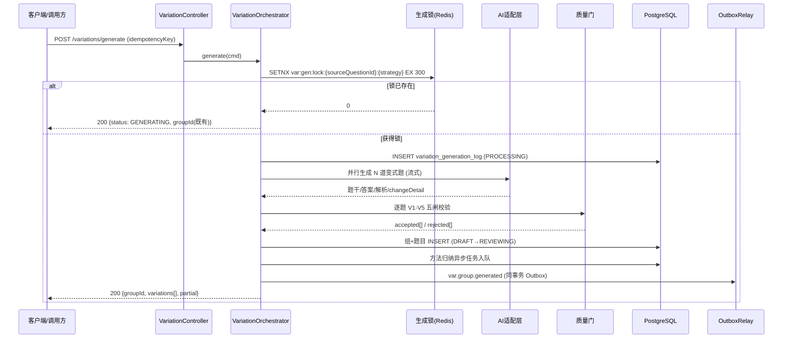

# 服务端-题目条件变式生成与解题方法归纳引擎 - 详细设计

## 1. 概述

### 1.1 模块定位

题目条件变式生成与解题方法归纳引擎（Problem Variation Generation & Solution Method Induction Engine）是题库服务与AI辅导能力之间的桥接服务。核心职责是：

1. **变式生成**：基于已有题目，通过改变条件、数据、情境、问法生成多角度练习变式题。
2. **方法归纳**：从解题过程中提取通用解题方法（题型套路、思路模板），形成可复用的方法论知识。
3. **变式编排**：将变式题按难度梯度编排为一组递进式练习，支持"一题多解、一题多变"的教学理念。

### 1.2 业务价值

| 场景 | 价值 |
|------|------|
| 学生刷完一道题后推荐"变式训练" | 加深理解，避免机械记忆单道题 |
| 错题订正后推送同型变式题 | 检验是否真正掌握解法而非记住答案 |
| 考点专题复习时按方法聚类 | 掌握一类题的通用解法而非逐题死记 |
| 理科解题辅助时自动归纳方法 | 帮助学生建立"题型→方法"的映射 |

### 1.3 设计原则

- **变式有据**：每道变式题必须标注变更维度（数值、条件、情境、问法），不可随意生成。
- **方法可验证**：归纳的解题方法必须通过至少3道同类题验证，避免"伪方法"。
- **难度可控**：变式题难度通过知识点层级和计算复杂度量化控制。
- **教育安全**：变式生成需经过内容安全审核和学科正确性校验。

---

## 2. 核心概念与数据模型

### 2.1 核心概念

```
原题 (Source Question)
  └── 变式维度 (Variation Dimension)
        ├── 数值变式：改变题干中的具体数值
        ├── 条件变式：增加/删除/替换已知条件
        ├── 情境变式：更换应用题的生活情境
        ├── 问法变式：改变提问角度或求解目标
        └── 逆向变式：将求解目标变为已知条件，原条件变为求解目标
  └── 变式题组 (Variation Group)
        ├── 变式题1 (难度: 基础)
        ├── 变式题2 (难度: 提升)
        └── 变式题3 (难度: 综合)
  └── 解题方法 (Solution Method)
        ├── 方法名称
        ├── 适用题型特征
        ├── 解题步骤模板
        ├── 关键公式/定理
        └── 易错点提示
```

### 2.2 数据库表设计

#### 2.2.1 变式题组表 `question_variation_group`

```sql
CREATE TABLE question_variation_group (
    id                  BIGSERIAL PRIMARY KEY,
    group_code          VARCHAR(64) NOT NULL UNIQUE,    -- 变式题组唯一编码
    source_question_id  BIGINT NOT NULL,                 -- 原题ID，关联question表
    variation_strategy  VARCHAR(32) NOT NULL,             -- 变式策略：NUMERIC/CONDITION/CONTEXT/QUESTION_REVERSE/MIXED
    subject_code        VARCHAR(16) NOT NULL,             -- 学科编码
    knowledge_point_ids BIGINT[] NOT NULL,                -- 关联知识点ID列表
    difficulty_base     SMALLINT NOT NULL DEFAULT 3,      -- 基础难度1-7
    method_summary_id   BIGINT,                           -- 关联的解题方法归纳ID
    status              VARCHAR(16) NOT NULL DEFAULT 'DRAFT', -- DRAFT/REVIEWING/APPROVED/DISABLED
    generated_count     SMALLINT NOT NULL DEFAULT 0,      -- 已生成变式题数量
    quality_score       DECIMAL(3,2),                     -- 质量评分0.00-1.00
    created_by          VARCHAR(32) NOT NULL DEFAULT 'SYSTEM', -- SYSTEM/AI/MANUAL
    created_at          TIMESTAMPTZ NOT NULL DEFAULT NOW(),
    updated_at          TIMESTAMPTZ NOT NULL DEFAULT NOW(),
    version             INTEGER NOT NULL DEFAULT 1
);

CREATE INDEX idx_var_group_source_q ON question_variation_group(source_question_id);
CREATE INDEX idx_var_group_kp ON question_variation_group USING GIN(knowledge_point_ids);
CREATE INDEX idx_var_group_status ON question_variation_group(status) WHERE status = 'APPROVED';
```

#### 2.2.2 变式题目表 `question_variation_item`

```sql
CREATE TABLE question_variation_item (
    id                  BIGSERIAL PRIMARY KEY,
    group_id            BIGINT NOT NULL REFERENCES question_variation_group(id),
    variation_seq       SMALLINT NOT NULL,                -- 变式题序号（决定展示顺序）
    question_id         BIGINT NOT NULL,                  -- 生成的变式题ID，关联question表
    variation_type      VARCHAR(32) NOT NULL,             -- 变式类型
    variation_desc      TEXT NOT NULL,                    -- 变式说明（如"将底边从6改为8"）
    change_detail       JSONB NOT NULL,                   -- 变更详情（结构化）
    difficulty_delta    SMALLINT NOT NULL DEFAULT 0,      -- 相对原题的难度偏移 -3~+3
    absolute_difficulty SMALLINT NOT NULL,                -- 绝对难度1-7
    estimated_time_sec  INTEGER NOT NULL DEFAULT 300,     -- 预估作答时间（秒）
    correct_rate        DECIMAL(3,2),                     -- 实际正确率（统计值）
    quality_score       DECIMAL(3,2),                     -- AI质量评分
    is_verified         BOOLEAN NOT NULL DEFAULT FALSE,   -- 是否经过人工验证
    status              VARCHAR(16) NOT NULL DEFAULT 'DRAFT',
    created_at          TIMESTAMPTZ NOT NULL DEFAULT NOW(),
    updated_at          TIMESTAMPTZ NOT NULL DEFAULT NOW(),

    UNIQUE(group_id, variation_seq)
);

CREATE INDEX idx_var_item_group ON question_variation_item(group_id);
CREATE INDEX idx_var_item_question ON question_variation_item(question_id);
```

#### 2.2.3 `change_detail` JSONB 结构定义

```json
{
  "fields": [
    {
      "field": "题干数值",
      "original": "底边长为6cm",
      "changed": "底边长为8cm",
      "changeRule": "RANDOM_INTEGER",
      "range": [4, 20]
    },
    {
      "field": "应用情境",
      "original": "长方形花坛",
      "changed": "长方形游泳池",
      "changeRule": "CONTEXT_REPLACE"
    }
  ],
  "constraints": {
    "answerType": "UNCHANGED",          // 答案类型不变
    "solutionMethod": "UNCHANGED",      // 解题方法不变
    "knowledgePoints": "STRICT_MATCH"   // 知识点严格匹配
  }
}
```

#### 2.2.4 解题方法归纳表 `solution_method`

```sql
CREATE TABLE solution_method (
    id                  BIGSERIAL PRIMARY KEY,
    method_code         VARCHAR(64) NOT NULL UNIQUE,      -- 方法编码，如"MATH-ALGEBRA-EQUATION-01"
    method_name         VARCHAR(128) NOT NULL,             -- 方法名称，如"一元二次方程求根公式法"
    subject_code        VARCHAR(16) NOT NULL,
    knowledge_point_ids BIGINT[] NOT NULL,                 -- 关联知识点
    question_type_tags  VARCHAR(32)[],                     -- 适用题型标签
    applicable_grades   VARCHAR(16)[],                     -- 适用年级
    description         TEXT NOT NULL,                     -- 方法描述
    steps               JSONB NOT NULL,                    -- 解题步骤模板（结构化）
    key_formulas        JSONB,                             -- 关键公式/定理列表
    common_errors       JSONB,                             -- 常见错误列表
    variants_count      INTEGER NOT NULL DEFAULT 0,        -- 关联变式题数量
    verified_count      INTEGER NOT NULL DEFAULT 0,        -- 已验证通过的变式题数量
    quality_score       DECIMAL(3,2),
    status              VARCHAR(16) NOT NULL DEFAULT 'DRAFT',
    created_at          TIMESTAMPTZ NOT NULL DEFAULT NOW(),
    updated_at          TIMESTAMPTZ NOT NULL DEFAULT NOW(),
    version             INTEGER NOT NULL DEFAULT 1
);

CREATE INDEX idx_sol_method_kp ON solution_method USING GIN(knowledge_point_ids);
CREATE INDEX idx_sol_method_subject ON solution_method(subject_code, status);
```

#### 2.2.5 `steps` JSONB 结构定义

```json
{
  "steps": [
    {
      "seq": 1,
      "name": "审题与条件提取",
      "description": "提取已知条件，明确求解目标",
      "template": "已知：{conditions}，求：{target}",
      "tips": ["注意隐含条件", "统一单位"]
    },
    {
      "seq": 2,
      "name": "选择解法",
      "description": "根据题目特征选择合适的方法",
      "template": "本题适用{method_name}，因为{reason}",
      "tips": []
    },
    {
      "seq": 3,
      "name": "代入计算",
      "description": "将已知条件代入公式进行计算",
      "template": "{formula} → 代入得 {substitution} → {result}",
      "tips": ["注意计算顺序", "检验中间结果"]
    },
    {
      "seq": 4,
      "name": "验证与作答",
      "description": "验证结果合理性，规范作答",
      "template": "验证：{verification}，答：{answer}",
      "tips": ["结果是否在合理范围内", "单位是否正确"]
    }
  ]
}
```

#### 2.2.6 `common_errors` JSONB 结构定义

```json
{
  "errors": [
    {
      "code": "SIGN_ERROR",
      "description": "移项时符号变化错误",
      "example": "将 -3x = 6 移项时写成 x = 6 + 3",
      "prevention": "移项变号原则：过等号变号"
    }
  ]
}
```

#### 2.2.7 变式生成请求记录表 `variation_generation_log`

```sql
CREATE TABLE variation_generation_log (
    id                  BIGSERIAL PRIMARY KEY,
    request_id          VARCHAR(64) NOT NULL UNIQUE,
    source_question_id  BIGINT NOT NULL,
    trigger_type        VARCHAR(32) NOT NULL,             -- MANUAL/AUTO_EXERCISE/AUTO_REVIEW/AUTO_ERROR_CORRECTION
    trigger_user_id     BIGINT,                           -- 触发用户ID（自动触发为空）
    variation_strategy  VARCHAR(32) NOT NULL,
    model_name          VARCHAR(64) NOT NULL,             -- 使用的AI模型
    prompt_tokens       INTEGER,
    completion_tokens   INTEGER,
    generated_count     SMALLINT NOT NULL,
    accepted_count      SMALLINT NOT NULL DEFAULT 0,      -- 通过质量校验的数量
    total_cost_cents    INTEGER,                          -- 总成本（分）
    status              VARCHAR(16) NOT NULL DEFAULT 'PROCESSING', -- PROCESSING/COMPLETED/FAILED
    error_message       TEXT,
    duration_ms         INTEGER,
    created_at          TIMESTAMPTZ NOT NULL DEFAULT NOW()
);

CREATE INDEX idx_var_gen_log_source ON variation_generation_log(source_question_id);
CREATE INDEX idx_var_gen_log_user ON variation_generation_log(trigger_user_id) WHERE trigger_user_id IS NOT NULL;
CREATE INDEX idx_var_gen_log_created ON variation_generation_log(created_at);
```

---

## 3. API 接口设计

### 3.1 生成变式题组

**POST** `/api/v1/variations/generate`

为一道原题生成一组变式题。

**请求体：**
```json
{
  "sourceQuestionId": 123456,
  "strategy": "MIXED",
  "variationCount": 3,
  "difficultyRange": {
    "min": 2,
    "max": 5
  },
  "variationTypes": ["NUMERIC", "CONDITION", "CONTEXT"],
  "options": {
    "includeMethodInduction": true,
    "validateAnswer": true,
    "targetGrade": "GRADE_8",
    "preserveKnowledgePoints": true
  }
}
```

**字段说明：**

| 字段 | 类型 | 必填 | 说明 |
|------|------|------|------|
| sourceQuestionId | long | 是 | 原题ID |
| strategy | string | 否 | 生成策略，默认MIXED |
| variationCount | int | 否 | 生成数量，默认3，最大6 |
| difficultyRange | object | 否 | 难度范围控制 |
| variationTypes | string[] | 否 | 使用的变式类型，默认全部 |
| options.includeMethodInduction | boolean | 否 | 是否同时归纳解题方法，默认true |
| options.validateAnswer | boolean | 否 | 是否校验答案正确性，默认true |
| options.targetGrade | string | 否 | 目标年级适配 |
| options.preserveKnowledgePoints | boolean | 否 | 是否严格保持知识点不变，默认true |

**响应体：**
```json
{
  "code": 0,
  "data": {
    "groupId": 789,
    "groupCode": "VAR-MATH-20260608-001",
    "sourceQuestionId": 123456,
    "strategy": "MIXED",
    "variations": [
      {
        "seq": 1,
        "questionId": 123460,
        "variationType": "NUMERIC",
        "variationDesc": "将三角形底边从6cm改为10cm，高从4cm改为5cm",
        "difficulty": 3,
        "estimatedTimeSec": 180,
        "question": {
          "stem": "一个三角形的底边长为10cm，高为5cm，求该三角形的面积。",
          "options": null,
          "answer": "25",
          "solution": "S = ½ × 底 × 高 = ½ × 10 × 5 = 25（cm²）",
          "knowledgePoints": ["KP-MATH-AREA-TRIANGLE-01"]
        }
      },
      {
        "seq": 2,
        "questionId": 123461,
        "variationType": "CONDITION",
        "variationDesc": "改为已知面积和高，求底边",
        "difficulty": 4,
        "estimatedTimeSec": 240,
        "question": {
          "stem": "一个三角形的面积为30cm²，高为6cm，求该三角形的底边长。",
          "options": null,
          "answer": "10",
          "solution": "由 S = ½ × 底 × 高，得 底 = 2S ÷ 高 = 2 × 30 ÷ 6 = 10（cm）",
          "knowledgePoints": ["KP-MATH-AREA-TRIANGLE-01"]
        }
      },
      {
        "seq": 3,
        "questionId": 123462,
        "variationType": "CONTEXT",
        "variationDesc": "更换为实际应用情境，增加面积比较",
        "difficulty": 5,
        "estimatedTimeSec": 360,
        "question": {
          "stem": "学校有一块三角形花坛，量得底边长8m，高3.5m。另一块长方形花坛长5m，宽3m。哪块花坛面积更大？大多少？",
          "options": null,
          "answer": "长方形花坛更大，大4m²",
          "solution": "三角形：S = ½ × 8 × 3.5 = 14（m²）；长方形：S = 5 × 3 = 15（m²）；15 - 14 = 1（m²），长方形花坛大1m²",
          "knowledgePoints": ["KP-MATH-AREA-TRIANGLE-01", "KP-MATH-AREA-RECT-01"]
        }
      }
    ],
    "methodInduction": {
      "methodId": 456,
      "methodName": "三角形面积公式的正逆运用",
      "applicableTypes": ["已知底和高求面积", "已知面积和一边求另一边"],
      "steps": [
        {
          "seq": 1,
          "name": "识别已知量",
          "description": "确定题目给出的是底和高，还是面积与一边"
        },
        {
          "seq": 2,
          "name": "选择公式方向",
          "description": "正用 S=½ah 或逆用 a=2S/h 或 h=2S/a"
        },
        {
          "seq": 3,
          "name": "代入计算",
          "description": "代入数值，注意单位统一"
        },
        {
          "seq": 4,
          "name": "检验作答",
          "description": "用另一种方式验证结果合理性"
        }
      ],
      "commonErrors": [
        {
          "description": "忘记乘½",
          "prevention": "三角形面积 = ½ × 底 × 高，不是底 × 高"
        },
        {
          "description": "逆用公式时混淆底和高",
          "prevention": "明确哪个量是底，哪个量是高，高必须垂直于底边"
        }
      ]
    },
    "generationLog": {
      "requestId": "REQ-VAR-20260608-001",
      "modelName": "gpt-4o",
      "promptTokens": 2850,
      "completionTokens": 1420,
      "durationMs": 4200
    }
  }
}
```

### 3.2 查询原题的变式题组

**GET** `/api/v1/variations/groups?sourceQuestionId={id}`

**查询参数：**

| 参数 | 类型 | 必填 | 说明 |
|------|------|------|------|
| sourceQuestionId | long | 是 | 原题ID |
| status | string | 否 | 过滤状态，默认APPROVED |
| page | int | 否 | 页码，默认1 |
| size | int | 否 | 每页数量，默认10 |

**响应体：**
```json
{
  "code": 0,
  "data": {
    "total": 2,
    "items": [
      {
        "groupId": 789,
        "groupCode": "VAR-MATH-20260608-001",
        "strategy": "MIXED",
        "variationCount": 3,
        "qualityScore": 0.92,
        "methodSummary": {
          "methodId": 456,
          "methodName": "三角形面积公式的正逆运用"
        },
        "variations": [
          {
            "seq": 1,
            "questionId": 123460,
            "variationType": "NUMERIC",
            "variationDesc": "将三角形底边从6cm改为10cm，高从4cm改为5cm",
            "difficulty": 3,
            "status": "APPROVED"
          }
        ],
        "createdAt": "2026-06-08T10:00:00.000Z"
      }
    ]
  }
}
```

### 3.3 获取变式题组详情（含完整题目内容）

**GET** `/api/v1/variations/groups/{groupId}`

返回完整的变式题组详情，包括每道变式题的完整题干、解析和答案。

**响应体：**
```json
{
  "code": 0,
  "data": {
    "groupId": 789,
    "groupCode": "VAR-MATH-20260608-001",
    "sourceQuestion": {
      "questionId": 123456,
      "stem": "一个三角形的底边长为6cm，高为4cm，求该三角形的面积。",
      "answer": "12",
      "difficulty": 3
    },
    "variations": [
      {
        "seq": 1,
        "questionId": 123460,
        "variationType": "NUMERIC",
        "variationDesc": "将三角形底边从6cm改为10cm，高从4cm改为5cm",
        "changeDetail": {
          "fields": [
            {"field": "底边长", "original": "6cm", "changed": "10cm"},
            {"field": "高", "original": "4cm", "changed": "5cm"}
          ]
        },
        "difficulty": 3,
        "difficultyDelta": 0,
        "estimatedTimeSec": 180,
        "question": {
          "stem": "一个三角形的底边长为10cm，高为5cm，求该三角形的面积。",
          "answer": "25",
          "solution": "S = ½ × 10 × 5 = 25（cm²）"
        }
      }
    ],
    "methodInduction": {
      "methodId": 456,
      "methodName": "三角形面积公式的正逆运用",
      "steps": ["..."],
      "commonErrors": ["..."]
    }
  }
}
```

### 3.4 获取题目对应的解题方法

**GET** `/api/v1/variations/methods?questionId={id}`

根据题目ID查找适用的解题方法归纳。

**查询参数：**

| 参数 | 类型 | 必填 | 说明 |
|------|------|------|------|
| questionId | long | 是 | 题目ID |
| includeVariations | boolean | 否 | 是否包含关联的变式题，默认false |

**响应体：**
```json
{
  "code": 0,
  "data": {
    "methods": [
      {
        "methodId": 456,
        "methodCode": "MATH-GEOM-AREA-TRIANGLE-01",
        "methodName": "三角形面积公式的正逆运用",
        "matchScore": 0.95,
        "steps": [
          {
            "seq": 1,
            "name": "识别已知量",
            "description": "确定题目给出的是底和高，还是面积与一边"
          }
        ],
        "keyFormulas": [
          {
            "name": "三角形面积公式",
            "latex": "S = \\frac{1}{2}ah",
            "variables": ["S:面积", "a:底边长", "h:高"]
          }
        ],
        "commonErrors": [
          {
            "description": "忘记乘½",
            "prevention": "三角形面积 = ½ × 底 × 高，不是底 × 高"
          }
        ],
        "relatedVariationCount": 15
      }
    ]
  }
}
```

### 3.5 查询知识点下的解题方法列表

**GET** `/api/v1/variations/methods/by-knowledge-point`

**查询参数：**

| 参数 | 类型 | 必填 | 说明 |
|------|------|------|------|
| knowledgePointId | long | 是 | 知识点ID |
| subjectCode | string | 否 | 学科编码 |
| grade | string | 否 | 年级过滤 |
| page | int | 否 | 默认1 |
| size | int | 否 | 默认20 |

### 3.6 管理接口：审核变式题组

**PUT** `/api/v1/variations/groups/{groupId}/review`

```json
{
  "action": "APPROVE",
  "reviewNote": "变式题质量良好，方法归纳准确",
  "itemReviews": [
    {"seq": 1, "action": "APPROVE"},
    {"seq": 2, "action": "APPROVE"},
    {"seq": 3, "action": "REJECT", "reason": "难度偏高，超出了知识点范围"}
  ]
}
```

### 3.7 管理接口：手动创建变式题组

**POST** `/api/v1/variations/groups`

```json
{
  "sourceQuestionId": 123456,
  "strategy": "CONDITION",
  "items": [
    {
      "questionStem": "...",
      "answer": "...",
      "solution": "...",
      "variationType": "CONDITION",
      "variationDesc": "...",
      "difficulty": 4
    }
  ],
  "methodInduction": {
    "methodName": "...",
    "steps": ["..."],
    "commonErrors": ["..."]
  }
}
```

---

## 4. 核心处理流程

### 4.1 变式生成主流程

```
┌─────────────────────────────────────────────────────────────┐
│                    变式题生成主流程                            │
├─────────────────────────────────────────────────────────────┤
│                                                             │
│  ① 接收请求                                                 │
│     ├─ 校验原题存在且已有结构化数据                            │
│     ├─ 校验知识点、学科、题型信息完整                           │
│     └─ 生成 requestId，写入 variation_generation_log          │
│                                                             │
│  ② 解题方法预提取                                            │
│     ├─ 解析原题解题步骤                                       │
│     ├─ 提取核心方法模式（公式/定理/套路）                       │
│     ├─ 识别方法适用条件                                       │
│     └─ 写入/更新 solution_method                              │
│                                                             │
│  ③ 变式题生成（并行）                                        │
│     ├─ 根据策略选择变式维度                                   │
│     ├─ 按序生成变式题（每题独立调用AI）                         │
│     ├─ 对每道变式题执行质量校验                                │
│     │   ├─ 知识点一致性校验                                   │
│     │   ├─ 答案正确性验证（AI + 规则引擎）                     │
│     │   ├─ 难度标定                                           │
│     │   └─ 内容安全审核                                       │
│     └─ 不合格的变式题最多重试2次                               │
│                                                             │
│  ④ 组装变式题组                                              │
│     ├─ 按难度排序                                            │
│     ├─ 检查变式题之间是否有重复                                │
│     ├─ 写入 question_variation_group + items                 │
│     └─ 关联解题方法                                           │
│                                                             │
│  ⑤ 更新生成日志                                              │
│     └─ 记录 token 消耗、耗时、质量统计                         │
│                                                             │
└─────────────────────────────────────────────────────────────┘
```

### 4.2 变式策略选择逻辑

```java
public enum VariationStrategy {
    NUMERIC,         // 数值变式：替换题干中的数值参数
    CONDITION,       // 条件变式：增删改已知条件
    CONTEXT,         // 情境变式：更换应用背景
    QUESTION_REVERSE,// 逆向变式：交换已知与求解
    MIXED            // 混合策略：自动组合多种变式类型
}

/**
 * 策略选择器：根据题目特征自动选择最佳变式策略
 */
public class VariationStrategySelector {
    
    public VariationStrategy select(Question question) {
        QuestionType type = question.getType();
        Subject subject = question.getSubject();
        
        // 选择题优先做条件变式和问法变式
        if (type == QuestionType.CHOICE) {
            return VariationStrategy.CONDITION;
        }
        
        // 计算题优先做数值变式
        if (type == QuestionType.CALCULATION) {
            return VariationStrategy.NUMERIC;
        }
        
        // 应用题优先做情境变式
        if (type == QuestionType.APPLICATION) {
            return VariationStrategy.CONTEXT;
        }
        
        // 证明题做逆向变式（改为开放探究题）
        if (type == QuestionType.PROOF) {
            return VariationStrategy.QUESTION_REVERSE;
        }
        
        // 默认混合策略
        return VariationStrategy.MIXED;
    }
}
```

### 4.3 数值变式生成算法

数值变式是最常见的变式类型，核心是保持题目结构和解题方法不变，只改变数值参数。

```java
/**
 * 数值变式生成器
 * 
 * 核心逻辑：
 * 1. 从题干中提取数值参数和约束
 * 2. 在约束范围内生成新数值
 * 3. 重新计算答案
 * 4. 校验新答案的合理性
 */
public class NumericVariationGenerator {
    
    public VariationResult generate(Question source, VariationConfig config) {
        // Step 1: 提取数值参数
        List<NumericParam> params = extractNumericParams(source.getStem());
        // 例：题干"一个三角形的底边长为6cm，高为4cm" →
        //     [{name:"底边", value:6, unit:"cm", min:1, max:100, integer:true},
        //      {name:"高",   value:4, unit:"cm", min:1, max:100, integer:true}]
        if (params.isEmpty()) {
            return VariationResult.fail("NO_NUMERIC_PARAM", "题干中未识别到可替换的数值参数");
        }
        
        // Step 2: 解析数值约束（来自题型规则库 + 原题隐式约束）
        List<NumericConstraint> constraints = resolveConstraints(source, params, config);
        
        // Step 3: 约束采样生成新数值（最多重试 SAMPLE_MAX_RETRY 次）
        Map<String, BigDecimal> newValues = null;
        for (int attempt = 0; attempt < SAMPLE_MAX_RETRY; attempt++) {
            Map<String, BigDecimal> candidate = sampleWithinConstraints(params, constraints);
            if (candidate == null) continue;
            // 3a. 与原题相同率检查：至少一个参数发生变化
            boolean anyChanged = params.stream().anyMatch(p ->
                candidate.get(p.getName()).compareTo(BigDecimal.valueOf(p.getValue())) != 0);
            if (!anyChanged) continue;
            // 3b. 与原题答案重合检查：新答案不得等于原答案
            BigDecimal newAnswer = recomputeAnswer(source, candidate);
            if (newAnswer == null) continue;
            if (newAnswer.compareTo(parseAnswer(source.getAnswer())) == 0) continue;
            newValues = candidate;
            break;
        }
        if (newValues == null) {
            return VariationResult.fail("SAMPLE_EXHAUSTED", "约束采样失败，无法生成合法新数值");
        }
        
        // Step 4: 重组题干并重算答案
        String newStem = substituteValues(source.getStem(), params, newValues);
        BigDecimal newAnswer = recomputeAnswer(source, newValues);
        String newSolution = rebuildSolution(source.getSolution(), params, newValues);
        
        // Step 5: 答案合理性校验（规则引擎 + 单位量纲检查）
        AnswerValidation validation = answerValidator.validate(
            source, newStem, newAnswer, newSolution);
        if (!validation.isPassed()) {
            return VariationResult.fail("ANSWER_INVALID",
                "答案校验未通过：" + validation.getReason());
        }
        
        return VariationResult.ok(newStem, newAnswer, newSolution,
            buildChangeDetail(params, newValues));
    }
    
    /**
     * 约束求解：为每个参数确定取值范围
     * 优先级：题型规则库显式约束 > 原题数值隐含范围 > 学科通用默认值
     */
    private List<NumericConstraint> resolveConstraints(
            Question source, List<NumericParam> params, VariationConfig config) {
        List<NumericConstraint> result = new ArrayList<>();
        for (NumericParam p : params) {
            NumericConstraint c = ruleRepo.findConstraint(
                source.getSubject(), source.getType(), p.getSemanticRole());
            if (c == null) {
                // 默认策略：以原值为中心上下浮动 50%~300%，保持整数性
                double lo = Math.max(p.getMinBound(), p.getValue() * 0.5);
                double hi = Math.min(p.getMaxBound(), p.getValue() * 3.0);
                c = NumericConstraint.range(p.getName(), lo, hi, p.isInteger());
            }
            // 应用全局难度约束：难度上限时收紧范围
            if (config.getTargetDifficulty() <= source.getDifficulty()) {
                c = c.tighten(0.8); // 降难：数值向原值靠拢
            }
            result.add(c);
        }
        return result;
    }
    
    private static final int SAMPLE_MAX_RETRY = 20;
}
```

**数值参数识别规则（extractNumericParams）：**

| 规则 | 说明 | 示例 |
|------|------|------|
| R1 量词锚定 | 「长为X」「面积为X」「速度为X」等量词结构后紧跟数值 | "底边长为**6cm**" |
| R2 单位后缀 | cm/m/km/g/kg/元/小时/分钟 等单位词前导数值 | "高为**4cm**" |
| R3 分数与小数 | 支持分数（¾）、小数（3.5）、百分数（25%）三种形态 | "完成了**¾**" |
| R4 排除项 | 序号、编号、年份、题号不参与替换 | "图2所示"中的 2 |

**答案重算（recomputeAnswer）双通道策略：**

1. **符号通道（优先）**：题干含可解析公式结构时，调用统一学科计算引擎（SymPy 后端）对表达式重求值，确定性 100%。
2. **LLM 通道（兜底）**：无法符号化时，将新题干+解题过程交给大模型重算，并要求输出计算过程；过程与结果分离校验，过程错误即整题作废（G4）。

### 4.4 条件/情境/逆向变式生成要点

三类变式不复用数值采样的「替换」模式，而是「结构变换」模式，共用同一质量门（§4.6）。

**条件变式（CONDITION）**：

- **增条件**：从知识点关联的常用条件库中抽取（如几何题加"AB⊥CD"），必须保持结论可推出（可行性预检委托统一学科计算引擎）。
- **删条件**：删除冗余条件（对求解无影响的条件），需通过「条件必要性检验」：删后题目仍可解，且解法不变。
- **换条件**：等价替换（如"甲比乙多3" ↔ "乙比甲少3"），需 LLM 判定等价性并给出理由，理由入 `variation_desc`。

**情境变式（CONTEXT）**：

- 情境库按学段/学科预置（小学：购物/分糖果/种树；初中：工程/行程/利润），共 1200+ 情境模板。
- 情境替换红线：不改变数学结构（数量关系映射表逐字段核对），不引入超出学段的生活概念（如小学不出现"利润率"）。

**逆向变式（QUESTION_REVERSE）**：

- 将求解目标与某一已知条件互换，互换后必须验证「可解性 + 解唯一性」（G5：解不唯一或不可解的逆向变式禁止入库）。
- 逆向变式难度自动 +1~+2，需在 `difficulty_delta` 中如实标注。

### 4.5 解题方法归纳管线

方法归纳与变式生成解耦：变式生成先行（需要方法做约束），方法归纳可异步完成，允许在生成响应中返回 `methodInduction.status=PROCESSING`。

```
方法归纳五步管线
① 解题步骤解析      从原题标准解析中提取步骤序列（步骤名/动作/公式引用）
② 方法模式抽象      将具体数值泛化为占位符，得到步骤模板 steps.template
③ 适用条件归纳      由 LLM 生成「何时用此法」的特征描述（question_type_tags）
④ 易错点挖掘        对比 ≥3 道同类题的常见错误答案，归纳 common_errors
⑤ 交叉验证          用该方法模板重解 3 道同类题，全部通过 → verified_count+1
                    任一失败 → 方法标记 UNVERIFIED，降权展示，不入推荐位
```

**验证规则（G6）**：`solution_method.status=APPROVED` 的必要条件是 `verified_count ≥ 3` 且 `variants_count ≥ 5`；否则只允许 `DRAFT/REVIEWING` 状态，学生端不可见。

### 4.6 质量校验管线与重试策略

每道变式题生成后依次过五道闸，全部通过方可入组：

| # | 校验项 | 实现 | 失败处理 |
|---|--------|------|----------|
| V1 | 知识点一致性 | 变式题 KP 集合与原题 KP 集合的 Jaccard ≥ 0.6 | 重试（Prompt 强调保持知识点） |
| V2 | 答案正确性 | 符号重算优先，LLM 重算兜底，双通道一致 | 重试，连续 2 次失败作废 |
| V3 | 难度标定 | 难度模型打分，须落在请求 difficultyRange 内 | 重采样数值/调整条件 |
| V4 | 内容安全 | 复用教育敏感词规则引擎 + AIGC 标识 | **fail-closed，直接作废不重试** |
| V5 | 组内查重 | 与同组已有变式题的题干相似度 < 0.85（SimHash） | 重试 |

**重试预算**：单题最多重试 2 次；整组重试后仍不足 `variationCount` 时，按实际成功数入组并在响应中 `partial=true` 标注（G3：不允许为凑数降低质量门）。

---

## 5. 核心流程

### 5.1 变式生成主链路（时序）



**延迟预算（P95）**：生成 3 题组端到端 ≤8s（LLM 生成 4s × 并行 / 质量门 1.5s / 落库 0.3s）；超过 12s 触发超时熔断，已生成部分按 partial 返回（D1）。

### 5.2 方法归纳异步链路

生成响应返回后，`methodInduction.status=PROCESSING`；归纳管线（§4.5）完成后通过 `var.method.verified` 事件通知推荐/考点服务更新方法索引。学生端查询时若仍为 PROCESSING，返回占位文案「方法归纳整理中」。

### 5.3 补充 DDL：Outbox 与唯一约束

```sql
-- 变式域 Outbox（同事务事件，relay 投递 Kafka topic var.domain.events）
CREATE TABLE var_outbox (
    id              BIGSERIAL PRIMARY KEY,
    aggregate_type  VARCHAR(32) NOT NULL,          -- variation_group / variation_item / solution_method
    aggregate_id    BIGINT NOT NULL,
    event_type      VARCHAR(64) NOT NULL,
    payload         JSONB NOT NULL,
    occurred_at     TIMESTAMPTZ NOT NULL DEFAULT NOW(),
    published_at    TIMESTAMPTZ,
    retry_count     SMALLINT NOT NULL DEFAULT 0
);
CREATE INDEX idx_var_outbox_unpublished ON var_outbox(id) WHERE published_at IS NULL;

-- 幂等约束：同一原题+策略在 24h 内只允许一个非终态组（防止并发重复生成）
CREATE UNIQUE INDEX uk_var_group_active
    ON question_variation_group(source_question_id, variation_strategy)
    WHERE status IN ('DRAFT','REVIEWING');

-- 方法编码唯一（已有 method_code UNIQUE）；生成日志 request_id UNIQUE（已有）
```

### 5.4 Redis 键设计

| 键模式 | 类型 | TTL | 用途 |
|--------|------|-----|------|
| `var:gen:lock:{qid}:{strategy}` | STRING | 300s | 生成互斥锁（SETNX） |
| `var:idem:{idempotencyKey}` | STRING | 24h | 幂等键 → groupId 响应快照 |
| `var:dedup:{groupId}` | SET | 永久 | 组内题干 SimHash 去重 |
| `var:quota:{userId}:{date}` | HASH | 48h | 用户日生成配额（默认 20 组/日） |
| `var:method:hot:{methodId}` | STRING | 600s | 方法详情热点缓存（DB 为权威，失效 DEL 不 SET） |

---

## 6. 关键代码补充

### 6.1 编排器：锁 + 幂等 + 落库一体

```java
@Transactional
public GenerateResult generate(GenerateCmd cmd) {
    // ① 幂等：命中直接返回快照（G1）
    String idemKey = "var:idem:" + cmd.getIdempotencyKey();
    String cached = redis.get(idemKey);
    if (cached != null) return GenerateResult.fromSnapshot(cached);

    // ② 互斥锁：同题同策略在途生成直接合并（G2）
    String lockKey = String.format("var:gen:lock:%d:%s",
        cmd.getSourceQuestionId(), cmd.getStrategy());
    if (redis.setnx(lockKey, cmd.getRequestId(), Duration.ofSeconds(300)) == 0) {
        Long existingGroupId = groupRepo.findActiveGroupId(
            cmd.getSourceQuestionId(), cmd.getStrategy());
        return GenerateResult.generating(existingGroupId); // 200 语义码 51908
    }

    try {
        // ③ 配额检查（G8：未成年人日配额硬顶）
        quotaChecker.check(cmd.getOperatorId(), cmd.isMinor());

        // ④ 并行生成 + 质量门（§4.6）
        GenerationBatch batch = generatorPool.generate(cmd);

        // ⑤ 落库（组 DRAFT→REVIEWING，单项 REJECTED 不入组）
        VariationGroup group = groupStore.save(batch, cmd);

        // ⑥ 幂等快照 + Outbox 同事务（G7/G12）
        redis.setex(idemKey, Duration.ofHours(24), group.toSnapshotJson());
        outbox.save(VarOutbox.groupGenerated(group));
        return GenerateResult.ok(group);
    } finally {
        redis.del(lockKey);
    }
}
```

### 6.2 质量门实现骨架

```java
@Component
public class QualityGate {
    private final List<VariationCheck> checks = List.of(
        new KnowledgePointConsistencyCheck(),   // V1
        new AnswerCorrectnessCheck(),           // V2
        new DifficultyRangeCheck(),             // V3
        new ContentSafetyCheck(),               // V4 fail-closed
        new IntraGroupDedupCheck()              // V5
    );

    public GateVerdict judge(VariationCandidate candidate, GroupContext ctx) {
        for (VariationCheck check : checks) {
            CheckResult r = check.check(candidate, ctx);
            if (!r.passed()) {
                // V4 安全闸失败不重试（红线）；其余按策略重试
                return r.isRetryable()
                    ? GateVerdict.retry(r.getReason())
                    : GateVerdict.reject(r.getReason());
            }
        }
        return GateVerdict.pass();
    }
}
```

---

## 7. 状态机与守卫

### 7.1 变式题组状态机

```
DRAFT ──(生成完成)──▶ REVIEWING ──(管理端审核)──▶ APPROVED ──(质量劣化/下架)──▶ DISABLED
   │                      │
   │                      └─(审核驳回)─▶ REJECTED(终态)
   └─(生成失败/全部单项作废)─▶ FAILED(终态)

说明：
- 学生端仅可见 APPROVED 组（G9：DRAFT/REVIEWING 绝不下发，fail-closed）。
- DISABLED 为可逆终态（重新审核可回 APPROVED）；REJECTED/FAILED 不可逆。
- 状态迁移全部经 CAS：UPDATE ... SET status=:to WHERE id=:id AND status=:from，
  影响行数 0 即并发冲突，抛 51907。
```

### 7.2 变式单项状态机

```
DRAFT ──(V1-V5 全过)──▶ ACCEPTED ──(组审核通过)──▶ APPROVED
  │                         │
  ├─(任一闸失败可重试)──▶ RETRYING(≤2)──▶ ACCEPTED/REJECTED
  └─(重试耗尽或 V4 安全闸)──▶ REJECTED(终态，记录原因)
```

### 7.3 解题方法状态机

```
DRAFT ──(管线完成)──▶ REVIEWING ──(verified≥3 且 variants≥5)──▶ APPROVED
                          │                                     │
                          └─(验证不足)──▶ UNVERIFIED(可用但降权)  └─(复核失效)──▶ UNVERIFIED
```

### 7.4 守卫清单（G1-G14）

| # | 守卫 | 说明 |
|---|------|------|
| G1 | 幂等键权威 | 同幂等键永远返回同一份快照；快照 24h，过期后按新请求处理 |
| G2 | 在途生成合并 | 同题同策略在途生成不重复起任务，返回既有 groupId（200 语义码） |
| G3 | 质量优先 | partial 允许，凑数不允许；质量门任何一环不可跳过/降阈值 |
| G4 | 答案双通道 | LLM 重算必须有过程，过程与结果分离校验；符号通道可用时以符号为准 |
| G5 | 逆向可解性 | 逆向变式必须验证可解 + 解唯一，否则禁止入库 |
| G6 | 方法验证门槛 | APPROVED 方法必须 verified≥3 且 variants≥5，否则学生端不可见 |
| G7 | Outbox 同事务 | 事件与状态变更同一本地事务写入，禁用事务后补偿 |
| G8 | 未成年人配额 | 免费生成日配额 20 组，超限返回 51906（引导会员权益，不静默放行） |
| G9 | 未审核不下发 | 非 APPROVED 组对学生端查询一律 404 语义（不暴露存在性） |
| G10 | 难度如实标注 | difficulty_delta 由标定模型给出，禁止为营销目的人为调低 |
| G11 | 变更可追溯 | 每道变式题 change_detail 必填，拒绝「黑盒变式」 |
| G12 | 事件至少一次 | Outbox relay 失败退避重投；消费者幂等（event_id 去重表） |
| G13 | 内容安全 fail-closed | V4 闸失败整题作废且不重试，并记录安全审计日志 |
| G14 | 注销即删 | 用户触发类生成日志 180 天后字段级匿名化（user_id 置空保留统计） |

---

## 8. 幂等与并发场景

| # | 场景 | 防护 |
|---|------|------|
| S1 | 同请求重发（网络重试） | idempotencyKey → 快照直返（G1） |
| S2 | 双击生成按钮 | 前端禁用 + 幂等键相同 → 同 S1 |
| S3 | 同题并发生成（两用户同时点） | 生成锁 SETNX + uk_var_group_active 双保险，后者合并 |
| S4 | 生成中用户退出再进 | 锁内 requestId 查询在途组，返回 GENERATING |
| S5 | 审核并发（两人同时审同组） | CAS 状态迁移，后到者 51907 |
| S6 | 单项审核与整组审核竞态 | 整组 APPROVE 以单项最新状态为准重算，REJECTED 单项自动剔除 |
| S7 | 方法验证事件重复消费 | 消费者 event_id 去重表（90 天） |
| S8 | 生成超时熔断后客户端重试 | 锁已释放则视为新请求；旧在途组由扫描器 10min 兜底置 FAILED |

---

## 9. 领域事件

### 9.1 var.domain.events 事件清单

| 事件 | 触发时机 | 关键载荷 | 消费者 |
|------|----------|----------|--------|
| var.group.generated | 组落库 | groupId/sourceQid/strategy/partial | 推荐引擎（更新变式候选集） |
| var.group.approved | 审核通过 | groupId/qualityScore | 推荐引擎、考点梳理服务 |
| var.group.disabled | 下架 | groupId/reason | 推荐引擎（即时摘除） |
| var.item.rejected | 单项作废 | itemId/reason(安全类打标) | 内容安全审计（V4 必达） |
| var.method.verified | 方法验证通过 | methodId/verifiedCount | 学情分析、AI辅导（方法注入） |
| var.quota.exhausted | 配额触顶 | userId/date | 增长运营（转化漏斗归因，未成年人除外） |

### 9.2 上游订阅

| 上游事件 | 本服务动作 |
|----------|-----------|
| question.content.updated（题目修订） | 关联组级联标记 NEEDS_REVIEW，重新过 V2 答案闸 |
| knowledge.point.remapped（知识点映射变更） | KP 一致性重检（V1），失配组 DISABLED |
| user.account.deleted（注销） | G14：触发类日志 180 天匿名化排程 |

### 9.3 对账（每日 04:50）

1. **组-项完整性**：`COUNT(items) = generated_count - rejected`（偏差 >0 告警，差异项按 REJECTED 补记）。
2. **事件完整性**：Outbox unpublished 超 30min 数量 = 0（>0 告警并触发 relay 修复）。
3. **方法有效性**：`APPROVED 方法中 verified_count<3 的数量 = 0`（>0 批量降级 UNVERIFIED）。

---

## 10. 错误码（51900-51999）

> 本域独占 51900-51999 段位（全库扫描确认空闲，已注册《服务端-统一业务异常码与错误分类体系》）。51908/51909 为 200 语义码（请求成功但业务在途/部分成功）。

| 码 | 名称 | HTTP | 语义 | 是否透传客户端 |
|----|------|------|------|----------------|
| 51900 | VAR_SOURCE_NOT_FOUND | 404 | 原题不存在或未结构化 | 是 |
| 51901 | VAR_SOURCE_NOT_READY | 422 | 原题缺少知识点/题型信息，无法变式 | 是 |
| 51902 | VAR_STRATEGY_UNSUPPORTED | 400 | 该题型不支持请求的变式策略 | 是 |
| 51903 | VAR_SAMPLE_EXHAUSTED | 422 | 约束采样失败，建议换策略 | 是 |
| 51904 | VAR_ANSWER_INVALID | 422 | 答案校验未通过（整组失败） | 是 |
| 51905 | VAR_CONTENT_SAFETY_REJECTED | 422 | 内容安全闸拦截（V4） | 是（模糊文案：「内容审核未通过」） |
| 51906 | VAR_QUOTA_EXCEEDED | 429 | 日生成配额触顶（G8） | 是（附权益引导） |
| 51907 | VAR_CONCURRENT_CONFLICT | 409 | 状态迁移并发冲突（CAS 失败） | 否（内部重试一次） |
| 51908 | VAR_GENERATING | 200 | 同题同策略在途生成中（G2 合并） | 是 |
| 51909 | VAR_PARTIAL_GENERATED | 200 | 部分成功，partial=true | 是 |
| 51910 | VAR_METHOD_NOT_READY | 200 | 方法归纳进行中（占位语义） | 是 |
| 51911 | VAR_GROUP_NOT_APPROVED | 404 | 组未审核/已下架（G9 不暴露存在性） | 是 |
| 51912 | VAR_REVIEW_ACTION_INVALID | 400 | 审核动作非法（如对 FAILED 组 APPROVE） | 管理端 |
| 51913 | VAR_LOCK_TIMEOUT | 503 | 生成锁获取异常（Redis 故障） | 否→降级 D2 |
| 51914 | VAR_LLM_TIMEOUT | 504 | LLM 生成超时熔断 | 是（引导稍后重试） |
| 51915 | VAR_INTERNAL_ERROR | 500 | 未分类内部错误 | 否 |
| 51916 | VAR_CASCADE_REVIEW | 200 | 上游变更导致组进入复核（NEEDS_REVIEW） | 内部事件载荷 |

---

## 11. 降级策略（D1-D10）

| # | 降级 | 触发 | 行为 |
|---|------|------|------|
| D1 | 生成超时熔断 | 端到端 >12s | 已生成部分按 partial 返回（51909），未完成单项作废 |
| D2 | LLM 适配层宕机 | 健康检查失败 | 生成接口 503 + 熔断；查询/方法接口不受影响（读路径无 LLM 依赖） |
| D3 | 符号计算引擎不可用 | 健康检查失败 | V2 仅剩 LLM 单通道时提高置信阈值（双次独立采样一致才通过） |
| D4 | Redis 故障 | 哨兵切换 | 幂等/锁降级为 DB 唯一约束兜底（uk_var_group_active），吞吐下降可接受 |
| D5 | 方法归纳积压 | 队列深度 >500 | 暂停 AUTO 触发类型的归纳，仅保 MANUAL；学生端展示「整理中」 |
| D6 | 推荐回调失败 | Kafka 消费滞后 | 变式候选集回退为「近 7 天 APPROVED 组按质量分排序」静态兜底 |
| D7 | 内容安全服务超时 | V4 调用 >2s | **fail-closed**：按拒绝处理（G13 红线，绝不 fail-open） |
| D8 | 配额服务故障 | 查询失败 | 免费用户按最严档（日 10 组）钳制（fail-closed） |
| D9 | Outbox relay 积压 | unpublished >1000 | 扩容 relay；消费方以 DB 兜底查询补偿 |
| D10 | 总红线 | — | 任何降级不得绕过质量门 V1-V5、不得向学生暴露 AI 生成痕迹（AIGC 标识保留）、不得突破 G8 配额 |

---

## 12. 监控指标（M1-M10）与容量

| # | 指标 | 告警阈值 |
|---|------|----------|
| M1 | 生成端到端耗时 P95/P99 | P95>8s / P99>12s |
| M2 | 生成成功率（非 519xx 错误占比） | 成功率 <85% 持续 10min |
| M3 | 质量门各闸拒绝率 | V2 >30% 或 V4 >1%（V4 即安全事件） |
| M4 | partial 组占比 | >25% 持续 1h（Prompt/约束库需优化） |
| M5 | LLM 成本（分/组） | 环比上升 >30% |
| M6 | 方法归纳管线时延 | P95 >30min |
| M7 | Outbox unpublished 积压 | >100 持续 15min |
| M8 | 在途生成锁数量 | 接近 Redis 单键热点（同题并发 >50） |
| M9 | 51906 配额触顶率 | 日触顶用户 >5%（权益配置复核） |
| M10 | 下游消费滞后（var.domain.events） | lag >1000 |

**容量估算（DAU 50 万）**：日生成请求 ≈ 8 万组（学生端变式训练入口 + 错题订正推送）；LLM 调用 ≈ 25 万次/日（生成 + 重算 + 归纳）；存储 ≈ 变式题 3 万道/日 × 2KB ≈ 60MB/日，在线保留 2 年 ≈ 44GB + 生成日志 180 天热表。

---

## 13. 合规与安全（C1-C10）

| # | 条款 |
|---|------|
| C1 | 变式题属 AIGC 内容：题干/解析落库时强制写入 aigc 标识字段，前端展示「AI 生成」水印 |
| C2 | 学生端不展示「变式题」机器生成话术，以「举一反三练习」产品化呈现（降低 AI 依赖感） |
| C3 | 生成日志含用户 ID 的仅保留 180 天；超期字段级匿名化（G14），统计口径不受影响 |
| C4 | 未成年人数据：触发场景（错题/复习）属学习必要范围，quota.exhausted 事件不向增长侧透传未成年人身份 |
| C5 | 内容安全（V4）拦截记录同步至安全审计域，保留 3 年 |
| C6 | 方法归纳的 common_errors 不得包含「某学生曾犯此错」等个体信息，仅保留通用错误模式 |
| C7 | 情境库每月过一遍敏感词与社会热点审查（如灾害、事故情境禁用） |
| C8 | 逆向变式不得涉及考试真题的「反押题」操纵，仅作能力训练用途 |
| C9 | 管理端审核操作全量审计（操作人/时间/前后状态/reason） |
| C10 | 心理危机/自伤类内容走安全审计域既有通道，本服务仅透传（不自行处置） |

---

## 14. 契约对齐（R1-R14）

| # | 契约 | 裁决 |
|-----|------|------|
| R1 | 题目写权威 | 变式题作为新题目入库走《题目管理与题库系统》的 question 写通道（状态 INIT），本服务不直写 question 主表业务字段 |
| R2 | 判题/答案校验 | 委托《服务端-统一学科计算引擎与符号推理服务》，本服务不内置公式库 |
| R3 | 知识点体系 | KP 编码与版本以《知识点体系与教材映射引擎》为 SSOT，本服务只引用不定义 |
| R4 | 内容安全 | 复用《教育场景敏感词多层次过滤与内容安全规则引擎》，不自建词库 |
| R5 | 推荐展示 | 变式组进入推荐流由《内容推荐与个性化推荐引擎》决策，本服务仅提供候选与质量分 |
| R6 | 难度标定 | 难度模型归《题目难度标定与能力评估模型》，本服务调用其打分接口 |
| R7 | 掌握度更新 | 变式题作答数据经答题记录服务进《知识追踪模型引擎》，本服务不直写掌握度 |
| R8 | 错题关联 | 错题订正后触发变式生成由错题服务发起，本服务只接收 trigger_type=AUTO_ERROR_CORRECTION |
| R9 | AI 适配 | 模型调用统一走《服务端-大模型推理统一适配层》，token 计量归其核算 |
| R10 | Prompt 模板 | Prompt 版本归《AI-Prompt编排与场景模板系统》，本服务按场景编码引用 |
| R11 | 学段边界 | 情境库/约束库按学段过滤由《年级学科基础数据管理与教材版本适配》提供映射 |
| R12 | 事件总线 | Outbox + Kafka 模式遵循《消息队列与事件驱动架构》，topic 命名 var.domain.events |
| R13 | 错误码 | 51900-51999 注册《服务端-统一业务异常码与错误分类体系》，本文为其唯一所有者 |
| R14 | API 版本 | 对外路径 /api/v1/variations/* 遵循《API网关统一接口规范与实现指南》，响应封装统一 code/data 结构 |

---

## 15. 验收场景（AC01-AC18）

| # | 场景 | 期望 |
|---|------|------|
| AC01 | 数值变式：三角形面积题生成 3 题 | 数值全部变化、答案全部正确（符号重算）、change_detail 完整 |
| AC02 | 逆向变式解不唯一 | 该变式被拒（G5），组按 partial 返回 |
| AC03 | V4 安全闸命中 | 整题作废不重试、事件 var.item.rejected 必达安全审计 |
| AC04 | 同幂等键重发 | 返回同一快照，不产生新组 |
| AC05 | 同题并发双请求 | 一锁一组合并，后到者收 51908 |
| AC06 | 免费用户日 21 组请求 | 第 21 组返回 51906 |
| AC07 | 未审核组学生端查询 | 404 语义（51911），不暴露存在性 |
| AC08 | 审核通过 → 推荐可见 | var.group.approved 消费后 ≤5s 进入候选集 |
| AC09 | 原题修订（question.content.updated） | 关联组 NEEDS_REVIEW，重过 V2 后恢复或 DISABLED |
| AC10 | 方法 verified=2 时管理端 APPROVE | 拒绝（G6），返回 51912 |
| AC11 | LLM 超时熔断 | partial 返回（≥1 题成功）或 51914（0 题成功） |
| AC12 | Redis 故障 | DB 唯一约束兜底，无重复组产生 |
| AC13 | 组内相似度 ≥0.85 的两道题 | 后者重试，SimHash 命中记录 |
| AC14 | 注销用户 180 天后 | 生成日志 user_id 已置空，统计聚合不变 |
| AC15 | 学生端响应字段 | 无 internal_reason / 无模型名 / 有 AIGC 标识 |
| AC16 | 日终对账三恒等式 | 偏差均为 0，告警静默 |
| AC17 | 难度标注 | difficulty_delta 与标定模型输出一致，抽查 100 组零人为篡改 |
| AC18 | 降级 D7 演练 | 安全服务超时 → 100% 按拒绝处理，零 fail-open |

---

## 16. 关联文档

- 《题目管理与题库系统-详细设计》（R1 变式题入库写通道）
- 《服务端-统一学科计算引擎与符号推理服务-详细设计》（R2 符号重算委托）
- 《知识点体系与教材映射引擎-详细设计》（R3 KP 编码 SSOT）
- 《教育场景敏感词多层次过滤与内容安全规则引擎-详细设计》（R4 安全闸复用）
- 《内容推荐与个性化推荐引擎-详细设计》（R5 变式候选消费）
- 《题目难度标定与能力评估模型-详细设计》（R6 难度标定委托）
- 《知识追踪模型引擎与学生能力动态评估服务-详细设计》（R7 作答数据回流）
- 《错题服务-详细设计》（R8 AUTO_ERROR_CORRECTION 触发方）
- 《服务端-大模型推理统一适配层与多供应商模型调用抽象框架-详细设计》（R9 模型调用）
- 《AI-Prompt编排与场景模板系统-详细设计》（R10 Prompt 版本）
- 《消息队列与事件驱动架构-详细设计》（R12 Outbox 模式）
- 《服务端-统一业务异常码与错误分类体系》（R13 51900-51999 段注册）
- 《服务端-答案管控与渐进式提示引擎-详细设计》（变式题答案可见性策略复用其分级规则）

---

## 17. 维护记录

### v1.0（初版截断登记）

初版完成 §1 概述/§2 数据模型（变式题组/变式单项/change_detail/解题方法/steps/common_errors/生成日志 共 4 张 DDL+3 个 JSONB 结构）/§3 API 全集（学生端 5 组+管理端 2 组）/§4.1 主流程 ASCII 图/§4.2 策略选择器完整实现/§4.3 数值变式生成器开头；截断于 §4.3 `NumericVariationGenerator.generate()` Step 1 代码行（围栏未闭合）。无质量门细节/方法归纳管线/状态机/幂等/事件/错误码/降级/监控/合规/契约/验收章节。

### v1.1（2026-10-20 烂尾补全）

补齐至 1255 行（围栏 52/52 BALANCED，UTF-8 无 BOM，零 TODO）：

1. **§4.3 收尾**：完成 NumericVariationGenerator 全实现（参数提取示例/约束求解 resolveConstraints/采样重试双检查（相同率+答案重合）/题干重组/答案合理性校验）+ 数值参数识别规则表 R1-R4 + 答案重算双通道策略（符号优先/LLM 兜底过程分离校验）。
2. **§4.4** 条件/情境/逆向三类结构变式要点（增删换条件规则、情境库 1200+ 模板与学段红线、逆向可解+解唯一 G5）。
3. **§4.5** 解题方法归纳五步管线（解析/抽象/条件归纳/易错挖掘/≥3 题交叉验证）+ G6 方法验证门槛。
4. **§4.6** 质量门 V1-V5 五闸表 + 重试预算（单题 ≤2 次，partial 允许凑数不允许）。
5. **§5 核心流程**：mermaid 生成主链路时序（锁/幂等双分支）+ 方法归纳异步链路 + var_outbox/uk_var_group_active DDL 增补 + Redis 键 5 类 + 延迟预算（P95≤8s/12s 熔断）。
6. **§6 关键代码两段**：编排器（幂等→锁→配额→并行生成→落库→快照→Outbox 七步）+ 质量门 QualityGate 骨架。
7. **§7 三状态机**（组/单项/方法）+ 守卫 G1-G14（G1 幂等权威/G2 在途合并/G3 质量优先/G4 答案双通道/G5 逆向可解/G6 方法门槛/G7 Outbox 同事务/G8 未成年配额/G9 未审不下发/G10 难度如实/G11 变更可追溯/G12 事件至少一次/G13 安全 fail-closed/G14 注销即删）。
8. **§8 幂等并发八场景；§9 var.domain.events 六事件+三上游订阅+04:50 对账三恒等式；§10 错误码 51900-51999 共 16 项（全库扫描确认段位空闲；51908/51909/51910/51916 四个 200 语义码）；§11 降级 D1-D10（D7 安全 fail-closed/D10 总红线）；§12 监控 M1-M10+DAU50 万容量（日 8 万组/LLM 25 万次/存储 44GB）；§13 合规 C1-C10（C1 AIGC 标识/C2 产品化话术/C14 180 天匿名化）；§14 契约 R1-R14（题目写权威归题库 R1/判题委托计算引擎 R2/推荐仅候选 R5）；§15 验收 AC01-AC18；§16 关联文档。**