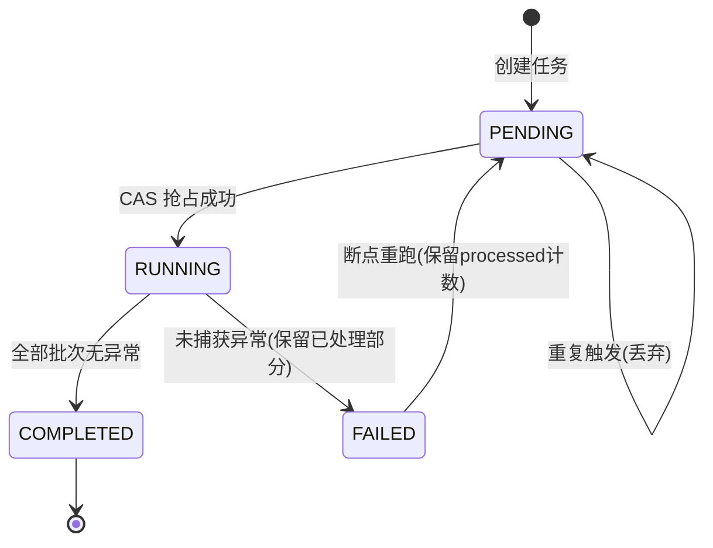
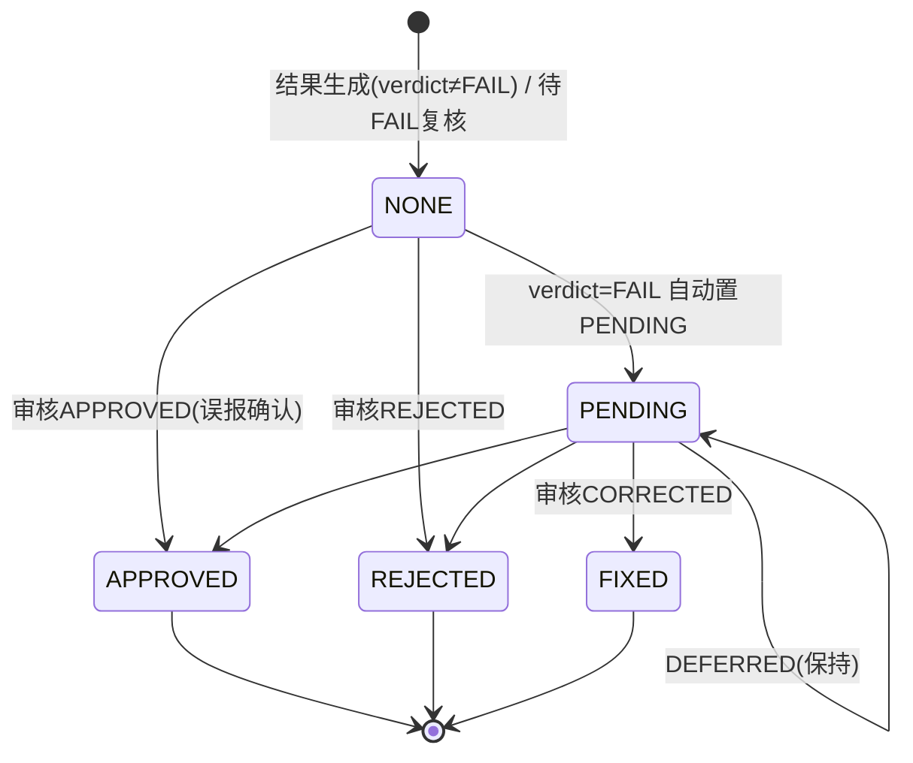

# 服务端-题目答案正确性自动验算与解析一致性校验管线引擎 详细设计

## 1. 概述

### 1.1 模块定位

本模块是教育内容质量保障体系的核心防线，专注于**题目入库前和存量题库的答案正确性自动校验**。在题库建设过程中，无论是教研人工录入、AI 自动生成还是外部资源导入，都存在答案标注错误的风险。本引擎通过多策略验算、交叉比对和一致性校验，最大限度地拦截错误答案流入学生侧。

### 1.2 核心职责

| 职责 | 说明 |
|------|------|
| 答案自动验算 | 针对客观题（选择、填空、判断），自动计算并比对标注答案 |
| 解析一致性校验 | 校验解析过程推导结果与标注答案是否一致 |
| AI 交叉验证 | 调用多个大模型独立解题，投票比对结果 |
| 符号与格式规范化 | 统一数学表达式、化学方程式、单位等格式后比对 |
| 验算报告生成 | 输出逐题验算结果、置信度、异常标记 |
| 存量题库巡检 | 定期批量扫描存量题库，发现并标记历史遗留错误 |
| 纠错工单触发 | 验算异常的题目自动生成纠错工单，流转至教研审核 |

### 1.3 依赖关系

```
                    +----------------------+
                    |  题目管理与题库系统     |
                    |  (数据来源)            |
                    +----------+-----------+
                               | 题目数据
                               v
              +--------------------------------+
              |   答案验算与一致性校验管线引擎    |
              |                                |
              |  +---------+  +-----------+    |
              |  |符号规范化|  |多策略验算器|    |
              |  +---------+  +-----------+    |
              |  +---------+  +-----------+    |
              |  |AI交叉验证|  |一致性校验器|    |
              |  +---------+  +-----------+    |
              +--------------------------------+
                               |
              +----------------+----------------+
              v                v                v
      +--------------+ +--------------+ +--------------+
      | 纠错工单系统   | | 题库质量监控  | | 内容审核工作流|
      +--------------+ +--------------+ +--------------+
```

**上游依赖：**
- 题目管理与题库系统：提供题目结构化数据
- 教材知识点体系：提供知识点上下文用于验算
- AI 模型调度服务：提供多模型调用能力

**下游消费：**
- 题库质量监控服务：接收验算结果指标
- 教育内容审核工作流：接收异常题目进入审核管线
- 教研后台：展示验算报告供人工复核

---

## 2. 数据模型

### 2.1 核心实体定义

#### 2.1.1 验算任务表 `answer_verification_task`

```sql
CREATE TABLE answer_verification_task (
    id              BIGINT PRIMARY KEY AUTO_INCREMENT,
    task_no         VARCHAR(64) NOT NULL UNIQUE COMMENT '任务编号 VRT+yyyyMMdd+序号',
    task_type       VARCHAR(32) NOT NULL COMMENT 'SINGLE/BATCH/CRON/IMPORT',
    source          VARCHAR(32) NOT NULL COMMENT 'MANUAL/CRON/IMPORT/API',
    subject_code    VARCHAR(16) COMMENT '学科代码',
    question_count  INT NOT NULL DEFAULT 0,
    status          VARCHAR(16) NOT NULL DEFAULT 'PENDING' COMMENT 'PENDING/RUNNING/COMPLETED/FAILED/PARTIAL',
    success_count   INT NOT NULL DEFAULT 0,
    fail_count      INT NOT NULL DEFAULT 0,
    skip_count      INT NOT NULL DEFAULT 0,
    warning_count   INT NOT NULL DEFAULT 0,
    started_at      DATETIME,
    completed_at    DATETIME,
    created_by      BIGINT,
    created_at      DATETIME NOT NULL DEFAULT CURRENT_TIMESTAMP,
    updated_at      DATETIME NOT NULL DEFAULT CURRENT_TIMESTAMP ON UPDATE CURRENT_TIMESTAMP,
    INDEX idx_status (status),
    INDEX idx_created (created_at),
    INDEX idx_source (source)
) ENGINE=InnoDB DEFAULT CHARSET=utf8mb4 COMMENT='答案验算任务表';
```

#### 2.1.2 题目验算结果表 `answer_verification_result`

```sql
CREATE TABLE answer_verification_result (
    id                  BIGINT PRIMARY KEY AUTO_INCREMENT,
    task_id             BIGINT NOT NULL COMMENT '关联验算任务ID',
    question_id         BIGINT NOT NULL COMMENT '题目ID',
    question_uuid       VARCHAR(64) NOT NULL COMMENT '题目UUID',
    subject_code        VARCHAR(16) NOT NULL COMMENT '学科代码',
    question_type       VARCHAR(16) NOT NULL COMMENT '题型',
    verdict             VARCHAR(16) NOT NULL COMMENT 'PASS/FAIL/WARNING/SKIP',
    confidence_score    DECIMAL(5,2) NOT NULL DEFAULT 0.00 COMMENT '置信度 0-1',
    original_answer     TEXT COMMENT '原始标注答案快照',
    calculated_answer   TEXT COMMENT '计算得出的答案',
    ai_answers          JSON COMMENT '各模型给出的答案',
    mismatch_detail     JSON COMMENT '不一致详情',
    strategies_used     JSON COMMENT '使用的验算策略列表',
    review_status       VARCHAR(16) NOT NULL DEFAULT 'NONE' COMMENT 'NONE/PENDING/APPROVED/REJECTED/FIXED',
    reviewer_id         BIGINT,
    reviewed_at         DATETIME,
    review_note         TEXT,
    corrected_answer    TEXT COMMENT '修正后的答案',
    created_at          DATETIME NOT NULL DEFAULT CURRENT_TIMESTAMP,
    updated_at          DATETIME NOT NULL DEFAULT CURRENT_TIMESTAMP ON UPDATE CURRENT_TIMESTAMP,
    INDEX idx_task (task_id),
    INDEX idx_question (question_id),
    INDEX idx_verdict (verdict),
    INDEX idx_review (review_status),
    INDEX idx_subject_type (subject_code, question_type)
) ENGINE=InnoDB DEFAULT CHARSET=utf8mb4 COMMENT='题目验算结果表';
```

#### 2.1.3 验算规则配置表 `verification_rule_config`

```sql
CREATE TABLE verification_rule_config (
    id                  INT PRIMARY KEY AUTO_INCREMENT,
    rule_code           VARCHAR(64) NOT NULL UNIQUE,
    rule_name           VARCHAR(128) NOT NULL,
    subject_code        VARCHAR(16) NOT NULL,
    question_type       VARCHAR(16) NOT NULL,
    strategy            VARCHAR(32) NOT NULL COMMENT 'CALC/SYMBOLIC/AI_VOTE/CROSS_CHECK/LOGIC',
    priority            INT NOT NULL DEFAULT 100,
    enabled             TINYINT NOT NULL DEFAULT 1,
    config_json         JSON COMMENT '策略参数配置',
    description         TEXT,
    created_at          DATETIME NOT NULL DEFAULT CURRENT_TIMESTAMP,
    updated_at          DATETIME NOT NULL DEFAULT CURRENT_TIMESTAMP ON UPDATE CURRENT_TIMESTAMP,
    INDEX idx_subject_type (subject_code, question_type),
    INDEX idx_enabled (enabled)
) ENGINE=InnoDB DEFAULT CHARSET=utf8mb4 COMMENT='验算规则配置表';
```

### 2.2 缓存设计

| 缓存 Key | 类型 | TTL | 用途 |
|-----------|------|-----|------|
| `verify:task:running:{taskId}` | Hash | 24h | 正在执行的任务进度 |
| `verify:question:{qid}:last_result` | String(JSON) | 7d | 题目最近一次验算结果 |
| `verify:rule:config:{subject}:{type}` | String(JSON) | 1h | 学科题型验算规则 |
| `verify:model:cooldown:{model}` | String | 5min | AI 模型调用冷却标记 |
| `verify:batch:queue` | List | - | 批量验算任务队列 |

---

## 3. API 接口设计

### 3.1 接口总览

| # | 接口 | 方法 | 路径 |
|---|------|------|------|
| 1 | 创建验算任务 | POST | `/api/v1/verification/tasks` |
| 2 | 查询任务列表 | GET | `/api/v1/verification/tasks` |
| 3 | 查询任务详情 | GET | `/api/v1/verification/tasks/{taskId}` |
| 4 | 查询验算结果列表 | GET | `/api/v1/verification/tasks/{taskId}/results` |
| 5 | 单题验算历史 | GET | `/api/v1/verification/questions/{questionId}/verifications` |
| 6 | 审核验算结果 | PUT | `/api/v1/verification/results/{resultId}/review` |
| 7 | 批量修正答案 | POST | `/api/v1/verification/results/batch-correct` |
| 8 | 导出验算报告 | GET | `/api/v1/verification/tasks/{taskId}/export` |
| 9 | 触发存量巡检 | POST | `/api/v1/verification/inspections` |
| 10 | 验算统计看板 | GET | `/api/v1/verification/statistics` |
| 11 | 配置验算规则 | PUT | `/api/v1/verification/rules` |
| 12 | 预检验算 | POST | `/api/v1/verification/preview` |

### 3.2 创建验算任务

```
POST /api/v1/verification/tasks
```

**请求体：**

```json
{
  "taskType": "BATCH",
  "source": "MANUAL",
  "subjectCode": "MATH",
  "questionIds": [1001, 1002, 1003],
  "options": {
    "strategies": ["CALC", "SYMBOLIC", "AI_VOTE"],
    "aiModels": ["gpt-4o", "claude-sonnet", "deepseek-coder"],
    "aiVoteThreshold": 2,
    "strictMode": true,
    "skipAlreadyVerified": true
  }
}
```

| 字段 | 类型 | 必填 | 说明 |
|------|------|------|------|
| taskType | String | 是 | SINGLE/BATCH/CRON/IMPORT |
| source | String | 是 | 触发来源 |
| subjectCode | String | 否 | 限定学科 |
| questionIds | Long[] | 条件 | taskType 为 SINGLE/BATCH 时必填 |
| options.strategies | String[] | 否 | 指定策略，不传则用默认配置 |
| options.aiModels | String[] | 否 | AI 交叉验证模型列表 |
| options.aiVoteThreshold | Integer | 否 | AI 投票通过阈值（默认2） |
| options.strictMode | Boolean | 否 | 严格模式：任何不一致即 FAIL |
| options.skipAlreadyVerified | Boolean | 否 | 跳过近期已验算题目 |

**响应：**

```json
{
  "code": 0,
  "data": {
    "taskId": 202607070001,
    "taskNo": "VRT20260707001",
    "questionCount": 3,
    "status": "PENDING",
    "estimatedDuration": 45
  }
}
```

### 3.3 查询验算结果列表

```
GET /api/v1/verification/tasks/{taskId}/results?verdict=FAIL&page=1&size=20
```

**响应：**

```json
{
  "code": 0,
  "data": {
    "total": 2,
    "page": 1,
    "size": 20,
    "records": [
      {
        "resultId": 5001,
        "questionId": 1002,
        "subjectCode": "MATH",
        "questionType": "CHOICE",
        "verdict": "FAIL",
        "confidenceScore": 0.95,
        "originalAnswer": "B",
        "calculatedAnswer": "D",
        "aiAnswers": [
          {"model": "gpt-4o", "answer": "D"},
          {"model": "claude-sonnet", "answer": "D"},
          {"model": "deepseek-coder", "answer": "D"}
        ],
        "mismatchDetail": {
          "type": "ANSWER_MISMATCH",
          "description": "标注答案B，三模型和符号计算均得出D",
          "severity": "HIGH"
        },
        "strategiesUsed": ["CALC", "SYMBOLIC", "AI_VOTE"],
        "reviewStatus": "PENDING"
      }
    ]
  }
}
```

### 3.4 审核验算结果

```
PUT /api/v1/verification/results/{resultId}/review
```

```json
{
  "action": "CORRECT",
  "correctedAnswer": "D",
  "reviewNote": "确认原答案有误，已同步更新题库",
  "notifyDependent": true
}
```

| Action | 说明 |
|--------|------|
| APPROVED | 确认验算结果，但原答案正确（验算误报） |
| REJECTED | 验算结果不正确（验算本身有误） |
| CORRECTED | 确认答案有误，修正为新答案 |
| DEFERRED | 暂缓处理，需更多人工分析 |

### 3.5 预检验算（草稿模式）

不入库，用于教研录入时实时预检：

```
POST /api/v1/verification/preview
```

```json
{
  "question": {
    "subjectCode": "MATH",
    "questionType": "CHOICE",
    "content": "已知 f(x) = x^2 - 4x + 3，求 f(x)=0 的解集",
    "options": {"A": "x=1或x=3", "B": "x=-1或x=-3", "C": "x=1或x=-3", "D": "x=-1或x=3"},
    "answer": "A",
    "explanation": "因式分解(x-1)(x-3)=0"
  },
  "strategies": ["SYMBOLIC", "AI_VOTE"]
}
```

**响应：**

```json
{
  "code": 0,
  "data": {
    "verdict": "PASS",
    "confidenceScore": 1.00,
    "details": [
      {"strategy": "SYMBOLIC", "result": "PASS", "calculatedAnswer": "A"},
      {"strategy": "AI_VOTE", "result": "PASS", "voteCount": 3, "voteAnswer": "A"}
    ]
  }
}
```

### 3.6 错误码定义

| 错误码 | HTTP | 说明 |
|--------|------|------|
| 40001 | 400 | 任务参数不合法 |
| 40002 | 400 | 不支持的题型验算 |
| 40401 | 404 | 任务不存在 |
| 40402 | 404 | 验算结果不存在 |
| 40901 | 409 | 任务正在执行中 |
| 40902 | 409 | 题目正在被其他任务验算 |
| 42901 | 429 | AI 模型调用频率超限 |
| 50001 | 500 | 验算引擎内部错误 |
| 50002 | 500 | 符号计算服务异常 |
| 50003 | 500 | AI 模型调用失败 |

---

## 4. 验算策略体系

引擎采用多策略组合验算模式，按学科和题型选择最佳策略链：

```
                +---------------------------------+
                |       策略选择器                 |
                |  学科+题型 -> 策略组合           |
                +-------+---------+-------+-------+
                        |         |       |
            +-----------+   +-----+   +---+-----------+
            v             v             v             v
      +-----------+ +-----------+ +-----------+ +-----------+
      | CALC      | | SYMBOLIC  | | AI_VOTE   | | CROSS_CHK |
      | 数值计算   | | 符号计算   | | AI多模型  | | 解析交叉   |
      +-----------+ +-----------+ +-----------+ +-----------+
```

### 4.1 策略一：数值计算验算（CALC）

**适用场景：** 小学算术、基础计算题、数值型填空题

**支持学科：** 数学、物理、化学

```python
from decimal import Decimal, getcontext
getcontext().prec = 28

class CalcStrategy:
    """数值计算验算策略"""
    
    SUPPORTED_TYPES = {"CHOICE", "FILL", "JUDGE"}
    
    def __init__(self, config: dict):
        self.tolerance = config.get("tolerance", 1e-6)
    
    def verify(self, question) -> dict:
        # 1. 从结构化题干中提取计算表达式
        calc_spec = self._extract_calculation(question)
        if not calc_spec:
            return {"strategy": "CALC", "result": "SKIP", "reason": "无法提取表达式"}
        
        # 2. 执行计算
        try:
            calculated = self._safe_eval(calc_spec["formula"], calc_spec["variables"])
        except Exception as e:
            return {"strategy": "CALC", "result": "SKIP", "reason": str(e)}
        
        # 3. 比对结果
        original = self._normalize(question.answer)
        is_match = self._compare(original, calculated)
        
        return {
            "strategy": "CALC",
            "result": "PASS" if is_match else "FAIL",
            "calculated_answer": str(calculated),
            "confidence": 0.99 if is_match else 0.85
        }
    
    def _safe_eval(self, formula: str, variables: dict) -> Decimal:
        """安全的表达式求值，仅允许数学运算"""
        # 使用白名单方式构建安全的eval上下文
        allowed_names = {**variables, **{
            "sqrt": Decimal(0).__class__,  # 占位
        }}
        # 实际实现应使用 ast 解析 + 白名单
        node = ast.parse(formula, mode="eval")
        return self._eval_node(node.body, allowed_names)
    
    def _compare(self, expected: str, actual) -> bool:
        """带容差的数值比对"""
        try:
            diff = abs(Decimal(expected) - Decimal(actual))
            return diff <= self.tolerance
        except:
            return expected.strip() == str(actual).strip()
```

### 4.2 策略二：符号计算验算（SYMBOLIC）

**适用场景：** 初高中代数、方程求解、微积分、因式分解

```python
import sympy as sp

class SymbolicStrategy:
    """符号计算验算策略 - 基于 SymPy"""
    
    def verify(self, question) -> dict:
        try:
            # 1. 解析题目为 SymPy 表达式
            expr_data = self._parse_to_sympy(question)
            if not expr_data:
                return {"strategy": "SYMBOLIC", "result": "SKIP"}
            
            # 2. 根据题目类型选择解法
            if expr_data["type"] == "equation":
                solutions = sp.solve(expr_data["equation"], expr_data["variable"])
                calculated = self._format_solutions(solutions)
            elif expr_data["type"] == "simplify":
                calculated = sp.simplify(expr_data["expression"])
            elif expr_data["type"] == "factor":
                calculated = sp.factor(expr_data["expression"])
            elif expr_data["type"] == "integral":
                calculated = sp.integrate(
                    expr_data["integrand"],
                    (expr_data["variable"], expr_data["lower"], expr_data["upper"])
                )
            else:
                return {"strategy": "SYMBOLIC", "result": "SKIP"}
            
            # 3. 比对
            is_match = self._compare_symbolic(question.answer, calculated)
            return {
                "strategy": "SYMBOLIC",
                "result": "PASS" if is_match else "FAIL",
                "calculated_answer": str(calculated),
                "confidence": 0.97 if is_match else 0.80
            }
        except Exception as e:
            return {"strategy": "SYMBOLIC", "result": "SKIP", "reason": str(e)}
```

### 4.3 策略三：AI 多模型投票验算（AI_VOTE）

**适用场景：** 全题型、全学科（兜底策略，特别是文字推理类题目）

```python
import asyncio

class AIVoteStrategy:
    """AI 多模型投票验算策略"""
    
    def __init__(self, config: dict):
        self.models = config.get("aiModels", ["gpt-4o", "claude-sonnet"])
        self.threshold = config.get("aiVoteThreshold", 2)
        self.timeout = config.get("timeout", 30)  # 单模型超时秒数
        self.max_concurrent = config.get("maxConcurrent", 3)
    
    async def verify(self, question) -> dict:
        # 1. 构建解题 Prompt
        prompt = self._build_solve_prompt(question)
        
        # 2. 并发调用多模型
        tasks = [
            self._call_model(model_name, prompt, question)
            for model_name in self.models
        ]
        results = await asyncio.gather(*tasks, return_exceptions=True)
        
        # 3. 收集有效结果
        valid_results = []
        for model_name, result in zip(self.models, results):
            if isinstance(result, Exception):
                valid_results.append({
                    "model": model_name, "answer": None, "error": str(result)
                })
            else:
                extracted = self._extract_answer(result, question.question_type)
                valid_results.append({
                    "model": model_name, "answer": extracted, "reasoning": result[:200]
                })
        
        # 4. 统计投票
        vote_counts = {}
        for r in valid_results:
            ans = r.get("answer")
            if ans is not None:
                key = self._normalize_answer(ans)
                vote_counts[key] = vote_counts.get(key, 0) + 1
        
        # 5. 判定
        if not vote_counts:
            return {"strategy": "AI_VOTE", "result": "SKIP", "reason": "所有模型调用失败"}
        
        consensus_answer = max(vote_counts, key=vote_counts.get)
        consensus_count = vote_counts[consensus_answer]
        original_norm = self._normalize_answer(question.answer)
        
        is_match = (original_norm == consensus_answer)
        confidence = consensus_count / len(valid_results)
        
        # 即使答案一致，如果置信度低于阈值也标为 WARNING
        if is_match and confidence < 0.67:
            verdict = "WARNING"
        elif is_match:
            verdict = "PASS"
        elif consensus_count >= self.threshold:
            verdict = "FAIL"
        else:
            verdict = "WARNING"  # 模型间分歧大
        
        return {
            "strategy": "AI_VOTE",
            "result": verdict,
            "calculated_answer": consensus_answer,
            "confidence": round(confidence, 2),
            "model_results": valid_results,
            "vote_distribution": vote_counts
        }
    
    def _build_solve_prompt(self, question) -> str:
        """构建要求AI独立解题的Prompt"""
        return f"""你是一位{question.subject}教师。请独立解答以下题目。

题目类型：{question.question_type}
题目内容：{question.content}
"""
        if question.options:
            prompt += f"\n选项：\n"
            for key, val in question.options.items():
                prompt += f"  {key}. {val}\n"
        
        prompt += """
要求：
1. 请给出完整的解答过程
2. 在最后明确标注你的答案
3. 答案格式要求：
   - 选择题：只输出选项字母（如 A）
   - 填空题：只输出填空内容
   - 判断题：输出 对 或 错

请解答：
"""
        return prompt
```

### 4.4 策略四：解析一致性交叉校验（CROSS_CHECK）

**适用场景：** 带有解析过程的题目（explanation 非空）

**原理：** 用 AI 检查解析过程的推导逻辑是否自洽，推导结论是否与标注答案一致

```python
class CrossCheckStrategy:
    """解析一致性交叉校验策略"""
    
    async def verify(self, question) -> dict:
        if not question.explanation:
            return {"strategy": "CROSS_CHK", "result": "SKIP", "reason": "无解析内容"}
        
        prompt = f"""请检查以下题目的解析过程是否正确，以及解析结论与标注答案是否一致。

题目：{question.content}
标注答案：{question.answer}
解析过程：{question.explanation}

请检查：
1. 解析过程中的每一步推导是否正确
2. 解析的最终结论是什么
3. 解析结论与标注答案是否一致

输出JSON格式：
{{
  "reasoning_correct": true/false,
  "conclusion_from_reasoning": "从解析推导出的答案",
  "consistent_with_answer": true/false,
  "errors_found": ["错误描述1", "错误描述2"]
}}
"""
        result = await self._call_model(prompt)
        parsed = self._parse_result(result)
        
        if not parsed.get("reasoning_correct", True):
            return {
                "strategy": "CROSS_CHK",
                "result": "FAIL",
                "confidence": 0.85,
                "detail": f"解析过程有误：{parsed.get('errors_found', [])}"
            }
        elif not parsed.get("consistent_with_answer", True):
            return {
                "strategy": "CROSS_CHK",
                "result": "FAIL",
                "confidence": 0.90,
                "detail": f"解析推导结论({parsed.get('conclusion_from_reasoning')})与标注答案不一致"
            }
        else:
            return {"strategy": "CROSS_CHK", "result": "PASS", "confidence": 0.90}
```

### 4.5 策略选择矩阵

| 学科 | 题型 | 推荐策略组合 | 说明 |
|------|------|-------------|------|
| 数学(小学) | CHOICE/FILL | CALC + AI_VOTE | 算术题可直接计算 |
| 数学(初中) | CHOICE/FILL | SYMBOLIC + AI_VOTE | 代数题用 SymPy |
| 数学(高中) | CHOICE/FILL | SYMBOLIC + CROSS_CHK + AI_VOTE | 复杂题需多策略 |
| 物理 | CHOICE/FILL | CALC + AI_VOTE | 代入公式计算 |
| 化学 | CHOICE/FILL | CALC + AI_VOTE | 化学计量计算 |
| 语文 | CHOICE | AI_VOTE + CROSS_CHK | 文本类用AI判断 |
| 英语 | CHOICE | AI_VOTE + CROSS_CHK | 语言类用AI判断 |
| 全学科 | JUDGE | AI_VOTE + CROSS_CHK | 判断题用AI |
| 全学科 | SHORT_ANSWER | CROSS_CHK + AI_VOTE | 主观题仅检查一致性 |
| 全学科 | ESSAY | SKIP | 作文题不自动验算 |

---

## 5. 核心流程：验算管线编排

### 5.1 验算管线主流程

```
题目输入 -> 策略选择 -> 策略执行(并行) -> 结果聚合 -> 裁定输出
                                     |
                            +--------+--------+
                            |                 |
                       策略执行成功        策略执行失败/跳过
                            |                 |
                     收集各策略结果      记录SKIP原因
                            |
                     +------+------+
                     |             |
                  全部PASS      存在FAIL/WARNING
                     |             |
                   最终PASS    综合裁定(见5.3)
                                   |
                            +------+------+
                            |             |
                         PASS/WARNING    FAIL
```

### 5.2 验算管线核心代码

```python
class VerificationPipeline:
    """答案验算管线编排器"""
    
    # 策略注册表
    STRATEGY_REGISTRY = {
        "CALC": CalcStrategy,
        "SYMBOLIC": SymbolicStrategy,
        "AI_VOTE": AIVoteStrategy,
        "CROSS_CHK": CrossCheckStrategy,
    }
    
    def __init__(self, rule_service: RuleConfigService, 
                 model_dispatcher: ModelDispatcher):
        self.rule_service = rule_service
        self.model_dispatcher = model_dispatcher
    
    async def verify_question(
        self, question: Question, options: VerifyOptions
    ) -> VerificationResult:
        """对单道题目执行完整验算管线"""
        
        result = VerificationResult(
            question_id=question.id,
            question_uuid=question.uuid,
            subject_code=question.subject_code,
            question_type=question.question_type,
        )
        
        # 1. 策略选择
        strategies = self._select_strategies(question, options)
        if not strategies:
            result.verdict = "SKIP"
            result.confidence = 0.0
            result.mismatch_detail = {"reason": "无适用验算策略"}
            return result
        
        result.strategies_used = [s.name for s in strategies]
        
        # 2. 并行执行策略（AI类策略受并发限制）
        ai_strategies = [s for s in strategies if s.is_async]
        sync_strategies = [s for s in strategies if not s.is_async]
        
        details = []
        
        # 同步策略直接执行
        for strategy in sync_strategies:
            detail = strategy.verify(question)
            details.append(detail)
        
        # 异步策略并发执行
        if ai_strategies:
            ai_tasks = [s.verify(question) for s in ai_strategies]
            ai_details = await asyncio.gather(*ai_tasks, return_exceptions=True)
            for strategy, detail in zip(ai_strategies, ai_details):
                if isinstance(detail, Exception):
                    details.append({
                        "strategy": strategy.name,
                        "result": "SKIP",
                        "reason": f"执行异常: {str(detail)}"
                    })
                else:
                    details.append(detail)
        
        result.strategy_details = details
        
        # 3. 结果聚合与裁定
        verdict, confidence = self._aggregate_verdicts(details, options.strict_mode)
        result.verdict = verdict
        result.confidence = confidence
        
        # 4. 提取计算答案
        calculated = self._extract_consensus_answer(details)
        result.calculated_answer = calculated
        
        # 5. 记录AI答案
        result.ai_answers = [
            {"model": d["model"], "answer": d.get("answer")}
            for d in details if d.get("strategy") == "AI_VOTE"
        ]
        
        # 6. 构建不一致详情
        if verdict != "PASS":
            result.mismatch_detail = self._build_mismatch_detail(
                question, details, verdict
            )
        
        return result
    
    def _select_strategies(
        self, question: Question, options: VerifyOptions
    ) -> list:
        """根据学科+题型+配置选择验算策略"""
        
        # 优先使用用户指定的策略
        if options.strategies:
            strategy_names = options.strategies
        else:
            # 从规则配置加载
            rules = self.rule_service.get_rules(
                subject_code=question.subject_code,
                question_type=question.question_type
            )
            strategy_names = [r.strategy for r in rules if r.enabled]
        
        # 实例化策略
        strategies = []
        for name in strategy_names:
            cls = self.STRATEGY_REGISTRY.get(name)
            if cls:
                config = self._build_strategy_config(name, options)
                strategies.append(cls(config))
        
        return sorted(strategies, key=lambda s: getattr(s, "priority", 100))
    
    def _aggregate_verdicts(
        self, details: list, strict_mode: bool
    ) -> tuple[str, float]:
        """
        多策略结果聚合裁定规则：
        
        裁定优先级：FAIL > WARNING > SKIP > PASS
        
        strict_mode=True: 任何非PASS结果 -> 最终非PASS
        strict_mode=False: 需要至少2个非SKIP策略给出FAIL才裁定FAIL
                          或1个高置信度(>=0.9)FAIL -> FAIL
        """
        valid = [d for d in details if d.get("result") != "SKIP"]
        
        if not valid:
            return "SKIP", 0.0
        
        fails = [d for d in valid if d["result"] == "FAIL"]
        warnings = [d for d in valid if d["result"] == "WARNING"]
        passes = [d for d in valid if d["result"] == "PASS"]
        
        if strict_mode:
            if fails or warnings:
                # 取最高置信度的非PASS结果
                non_pass = fails + warnings
                best = max(non_pass, key=lambda d: d.get("confidence", 0))
                return best["result"], best.get("confidence", 0.8)
        
        # 非严格模式
        if fails:
            # 高置信度FAIL直接裁定
            high_conf_fails = [f for f in fails if f.get("confidence", 0) >= 0.9]
            if high_conf_fails:
                best = max(high_conf_fails, key=lambda d: d["confidence"])
                return "FAIL", best["confidence"]
            
            # 多个FAIL也裁定FAIL
            if len(fails) >= 2:
                avg_conf = sum(f["confidence"] for f in fails) / len(fails)
                return "FAIL", avg_conf
            
            # 单个低置信度FAIL -> WARNING
            if len(fails) == 1 and len(passes) >= 1:
                return "WARNING", fails[0].get("confidence", 0.7)
        
        if warnings and not fails:
            return "WARNING", max(w["confidence"] for w in warnings)
        
        # 全PASS
        avg_conf = sum(p.get("confidence", 0.9) for p in passes) / len(passes)
        return "PASS", avg_conf
```

### 5.3 验算裁定决策表

| 场景 | 策略结果组合 | strictMode | 最终裁定 | 说明 |
|------|-------------|-----------|---------|------|
| 全策略一致PASS | CALC:PASS, AI:PASS | 任意 | PASS | 答案可信 |
| 符号计算FAIL + AI一致FAIL | CALC:FAIL, AI:FAIL | 任意 | FAIL | 答案确定有误 |
| 符号计算PASS + AI分歧 | CALC:PASS, AI:2PASS/1FAIL | False | PASS | 信任计算结果 |
| 符号计算PASS + AI分歧 | CALC:PASS, AI:2PASS/1FAIL | True | WARNING | 严格模式存疑 |
| 仅AI验算（2/3一致） | AI:2PASS/1FAIL | False | PASS | 多数一致 |
| 仅AI验算（全部分歧） | AI:1A/1B/1C | 任意 | WARNING | 无法确定 |
| 解析与答案不一致 | CROSS_CHK:FAIL | 任意 | FAIL | 解析推导矛盾 |
| 解析PASS但无其他策略 | CROSS_CHK:PASS | 任意 | WARNING | 仅单一弱策略 |
| 全部SKIP | 无可用策略 | 任意 | SKIP | 题型不支持 |

---

## 6. 批量验算与存量巡检

### 6.1 批量验算流程

```
创建批量任务
    |
    v
分页加载题目 (每批50题)
    |
    v
+---> 提取策略配置 ------+
|                       |
|    +------------------+
|    v
|   并行验算 (限流控制)
|    |         AI策略: 最多3并发
|    |         CALC/SYMBOLIC: 最多10并发
|    v
|   结果写入DB + 更新任务进度
|    |
|    v
|   发布 verdict 事件消息
|    |
+----+ 还有下一批?
     |
     v (否)
   任务完成 -> 统计汇总 -> 通知创建者
```

### 6.2 批量验算控制器

```python
class BatchVerificationController:
    """批量验算控制器"""
    
    BATCH_SIZE = 50
    AI_RATE_LIMIT = 3  # AI策略最大并发
    CALC_RATE_LIMIT = 10  # 计算/符号类策略最大并发
    PROGRESS_FLUSH_INTERVAL = 10  # 每处理10题落库刷新一次任务进度
    QUESTION_LOCK_TTL = 30 * 60  # 单题验算锁TTL（秒），防双任务重复验算

    def __init__(self, task_repo: TaskRepository,
                 result_repo: ResultRepository,
                 pipeline: VerificationPipeline,
                 outbox: OutboxPublisher,
                 redis: RedisClient):
        self.task_repo = task_repo
        self.result_repo = result_repo
        self.pipeline = pipeline
        self.outbox = outbox
        self.redis = redis
        # 两类信号量隔离：AI 调用贵且慢，计算调用快，分开限流互不影响
        self.ai_semaphore = asyncio.Semaphore(self.AI_RATE_LIMIT)
        self.calc_semaphore = asyncio.Semaphore(self.CALC_RATE_LIMIT)

    async def run(self, task_id: int) -> None:
        """批量任务主入口，由异步任务框架触发"""
        task = self.task_repo.find_by_id(task_id)
        if task is None or task.status != "PENDING":
            return  # G1：非PENDING不执行，重复触发幂等丢弃

        # CAS 抢占：PENDING -> RUNNING，防调度器重复触发双跑
        if not self.task_repo.cas_status(task_id, "PENDING", "RUNNING"):
            return

        processed = failed = skipped = warned = 0
        cursor = 0
        try:
            while True:
                question_ids = self.task_repo.page_question_ids(
                    task_id, cursor, self.BATCH_SIZE
                )
                if not question_ids:
                    break
                cursor = question_ids[-1]

                # 并发执行本批验算
                results = await asyncio.gather(*[
                    self._verify_one(task_id, qid, task.options)
                    for qid in question_ids
                ])

                # 批量落库（单事务，批内失败整批回滚后逐题补偿）
                try:
                    self.result_repo.batch_insert(results)
                except Exception:
                    for r in results:
                        self.result_repo.insert_ignore_duplicate(r)

                processed += len(results)
                failed += sum(1 for r in results if r.verdict == "FAIL")
                skipped += sum(1 for r in results if r.verdict == "SKIP")
                warned += sum(1 for r in results if r.verdict == "WARNING")

                # 每10题刷新一次进度，任务页查询可看到实时进度
                if processed % self.PROGRESS_FLUSH_INTERVAL < self.BATCH_SIZE:
                    self.task_repo.update_progress(task_id, processed,
                                                   failed, skipped, warned)

            # 终态判定：有FAIL但主体完成 -> PARTIAL 已并入 COMPLETED 语义，
            # 这里按执行完整性判定（全部批次无异常 = COMPLETED）
            self.task_repo.complete(task_id, processed, failed, skipped, warned)
            self.outbox.publish("verification.task.completed", {
                "taskId": task_id,
                "taskNo": task.task_no,
                "questionCount": processed,
                "failCount": failed,
                "warningCount": warned
            })
        except Exception as e:
            # 已处理部分保留（results已落库），任务标记FAILED允许断点重跑
            self.task_repo.mark_failed(task_id, str(e), processed)
            raise

    async def _verify_one(self, task_id: int, question_id: int,
                          options: VerifyOptions) -> VerificationResult:
        """单题验算：加题级锁防与其他任务重复验算同一题"""
        lock_key = f"verify:question:lock:{question_id}"
        locked = await self.redis.set(lock_key, str(task_id),
                                      nx=True, ex=self.QUESTION_LOCK_TTL)
        if not locked:
            # 其他任务正在验算该题：跳过并记录，避免重复消耗AI配额
            return VerificationResult.skip(
                question_id=question_id,
                reason="CONCURRENT_LOCKED"
            )

        try:
            question = self.question_client.get(question_id)
            if question is None:
                return VerificationResult.skip(
                    question_id=question_id, reason="QUESTION_NOT_FOUND"
                )
            if options.skip_already_verified:
                recent = await self.redis.get(
                    f"verify:question:{question_id}:last_result"
                )
                if recent is not None:
                    return VerificationResult.skip(
                        question_id=question_id, reason="ALREADY_VERIFIED"
                    )

            result = await self.pipeline.verify_question(question, options)
            result.task_id = task_id
            result.original_answer = question.answer

            # 结果缓存7天：skipAlreadyVerified与巡检去重都依赖该键
            await self.redis.setex(
                f"verify:question:{question_id}:last_result",
                7 * 24 * 3600,
                json.dumps({"verdict": result.verdict,
                            "confidence": result.confidence_score})
            )

            # FAIL 结果即时发布事件，纠错工单与质量监控实时消费
            if result.verdict == "FAIL":
                self.outbox.publish("verification.result.flagged", {
                    "taskId": task_id,
                    "questionId": question_id,
                    "originalAnswer": result.original_answer,
                    "calculatedAnswer": result.calculated_answer,
                    "confidence": result.confidence_score
                })
            return result
        finally:
            await self.redis.delete(lock_key)
```

### 6.3 存量题库巡检调度

存量巡检用于定期扫描历史题库，策略与批量验算共用管线，差异在**选题策略**：

| 巡检维度 | 选题规则 | 优先级 |
|---------|---------|-------|
| 未验算题目 | `last_verified_at IS NULL` | P0 |
| 验算距今超期 | `last_verified_at < NOW() - INTERVAL 180 DAY` | P1 |
| 高曝光题目 | 近90天曝光量 TOP 1% 且超30天未复验 | P1 |
| 验算置信度低 | 历史 WARNING 结果且无人工复核 | P2 |
| 抽样复验 | 已通过题目随机抽样 0.5% | P3 |

```yaml
# verification-inspection-cron.yml
cron: "0 30 3 * * 0"        # 每周日 03:30 执行，避开业务高峰
max_questions_per_run: 5000  # 单轮上限，防止长跑拖垮AI配额
priority_order:
  - P0
  - P1
  - P2
  - P3
ai_budget_guard:
  daily_max_ai_calls: 20000  # 与多模型调度成本治理对齐，超量自动暂停排队
  resume_hour: 22            # 当日22点配额重置后自动续跑
```

**巡检特殊裁决：** 抽样复验（P3）发现 FAIL 的题目，直接升级为 P0 进入全量复验该知识点下的所有题目（污染面扩散检测），防止同批次录入的系统性错误漏网。

---

## 7. 审核与批量修正关键代码

### 7.1 审核结果服务（CAS 防双人重复审核）

```python
class ReviewService:
    """验算结果人工审核服务"""

    def review(self, result_id: int, reviewer_id: int,
               action: str, corrected_answer: str | None,
               note: str, notify_dependent: bool) -> ReviewResult:
        result = self.result_repo.find_by_id(result_id)
        if result is None:
            raise BizError(40402, "验算结果不存在")

        # CAS 抢占：NONE/PENDING -> 目标状态，防两个教研同时审核互相覆盖
        target = {"APPROVED": "APPROVED", "REJECTED": "REJECTED",
                  "CORRECTED": "FIXED", "DEFERRED": "PENDING"}[action]
        if not self.result_repo.cas_review_status(
            result_id, ["NONE", "PENDING"], target
        ):
            raise BizError(40903, "该结果已被其他审核人处理")

        self.result_repo.fill_review(result_id, reviewer_id, note,
                                     corrected_answer)

        if action == "CORRECTED":
            # 答案修正走题库系统权威接口，由题库系统写题目主数据；
            # 本引擎只发布事件，禁止直接 UPDATE question 表（R1）
            self.outbox.publish("verification.answer.corrected", {
                "questionId": result.question_id,
                "oldAnswer": result.original_answer,
                "newAnswer": corrected_answer,
                "resultId": result_id,
                "reviewerId": reviewer_id
            })
        elif action == "APPROVED" and notify_dependent:
            # 验算误报：通知质量监控系统排除该题统计，防误报率虚高
            self.outbox.publish("verification.false_positive.marked", {
                "questionId": result.question_id,
                "resultId": result_id
            })

        return ReviewResult(result_id=result_id, review_status=target)
```

### 7.2 批量修正（幂等 + 题库版本乐观锁）

```python
class BatchCorrectService:
    """批量修正答案：教研确认多张 FAIL 结果后一次性修正"""

    def batch_correct(self, result_ids: list[int], reviewer_id: int,
                      idempotency_key: str) -> BatchCorrectResult:
        # 幂等闸门：同一 Idempotency-Key 30 分钟内返回首次执行结果
        cached = self.redis.get(f"verify:correct:idem:{idempotency_key}")
        if cached:
            return BatchCorrectResult.parse(cached)

        results = self.result_repo.find_by_ids(result_ids)
        done, conflicted = [], []

        for r in results:
            if r.review_status == "FIXED":
                continue  # 已修正，幂等跳过
            # 逐题调用题库系统修正接口（题库侧做版本 CAS，防止覆盖并行编辑）
            resp = self.question_client.correct_answer(
                question_id=r.question_id,
                new_answer=r.corrected_answer,
                reason=f"verification-result:{r.id}"
            )
            if resp.success:
                self.result_repo.cas_review_status(
                    r.id, ["NONE", "PENDING"], "FIXED"
                )
                done.append(r.question_id)
            else:
                conflicted.append({"questionId": r.question_id,
                                   "reason": resp.error})

        outcome = BatchCorrectResult(
            corrected_count=len(done), conflicts=conflicted
        )
        self.redis.setex(f"verify:correct:idem:{idempotency_key}",
                         1800, outcome.json())
        return outcome
```

---

## 8. 状态机与守卫

### 8.1 任务状态机



**关键裁决：** 任务状态没有 PARTIAL 终态（表结构保留兼容）。FAIL 结果属于正常业务产出（计数入 fail_count），不构成"部分完成"；执行层面只有"批次循环完整跑完（COMPLETED）"与"中途异常（FAILED，可断点重跑）"两种终态。

### 8.2 审核状态机



### 8.3 守卫规则总表

| 编号 | 规则 | 强度 |
|------|------|------|
| G1 | 任务执行入口仅接受 PENDING 状态，CAS 抢占失败直接丢弃，禁止双跑 | 强约束 |
| G2 | 单题验算锁 30min TTL，锁内其他任务跳过该题（SKIP/CONCURRENT_LOCKED），验算完成必须释放 | 强约束 |
| G3 | 答案修正禁止本引擎直接写 question 表，必须经题库系统接口 + 事件（R1） | 强约束 |
| G4 | 审核状态迁移必须 CAS（源状态 NONE/PENDING），失败返回 40903，禁止审核覆盖 | 强约束 |
| G5 | AI 调用必须经多模型调度网关，禁止直连模型供应商 SDK；冷却标记（verify:model:cooldown）生效期间该模型熔断跳过 | 强约束 |
| G6 | FAIL 结果（confidence≥0.9）必须生成待复核记录并发布 flagged 事件，禁止静默丢弃 | 强约束 |
| G7 | 验算结果（verdict/confidence）绝不暴露给学生端接口，仅教研/管理后台可见（C2） | 强约束 |
| G8 | 巡检抽样 FAIL 必须触发同知识点扩散复验，禁止单题修正后即结束 | 强约束 |
| G9 | 批量修正走 Idempotency-Key 30min 幂等窗口，重复提交返回首次结果 | 强约束 |
| G10 | 已 FIXED 的结果禁止再次修正，除非题库系统退回（新 result 记录而非改历史） | 强约束 |
| G11 | 删除/下线题目不物理删除验算结果，标记 question 失效即可（审计留痕 C1） | 强约束 |
| G12 | 异步任务异常必须落 FAILED 终态并保留 processed 计数，禁止无状态丢失 | 强约束 |

---

## 9. 幂等与并发场景

| 场景 | 机制 | 键/手段 |
|------|------|--------|
| 创建重复任务 | 同一 questionIds+options 哈希 5min 去重窗口 | `verify:task:idem:{hash}` SETNX |
| 调度器重复触发执行 | 任务级 CAS PENDING→RUNNING | `UPDATE ... WHERE status='PENDING'` |
| 双任务同时验算同题 | 题级锁 SETNX 30min | `verify:question:lock:{qid}` |
| 批量落库重试重复 | result 表 (task_id, question_id) 唯一索引 | `INSERT ... ON DUPLICATE KEY UPDATE` |
| 双人同时审核同结果 | review_status CAS | G4 |
| 批量修正重复提交 | Idempotency-Key 30min | G9 |
| 事件重发 | Outbox 表 status 轮询 + 消费方幂等键 (resultId+eventType) | — |
| 断点重跑 | FAILED 任务保留 processed 计数，重跑从 cursor 续跑 | task 表进度列 |

---

## 10. 领域事件与对账

### 10.1 Outbox 表

```sql
CREATE TABLE verify_outbox (
    id              BIGINT PRIMARY KEY AUTO_INCREMENT,
    event_type      VARCHAR(64) NOT NULL,
    aggregate_id    VARCHAR(64) NOT NULL COMMENT 'taskId或resultId',
    payload         JSON NOT NULL,
    status          VARCHAR(16) NOT NULL DEFAULT 'PENDING' COMMENT 'PENDING/SENT/FAILED/DEAD',
    retry_count     INT NOT NULL DEFAULT 0,
    next_retry_at   DATETIME,
    created_at      DATETIME NOT NULL DEFAULT CURRENT_TIMESTAMP,
    sent_at         DATETIME,
    UNIQUE KEY uk_idem (event_type, aggregate_id, payload_hash)
) ENGINE=InnoDB DEFAULT CHARSET=utf8mb4 COMMENT='验算域Outbox表';
```

> payload_hash 为 payload 规范化 JSON 的 SHA-256 前16位，同事务插入时冲突即视为重复事件丢弃。

### 10.2 事件矩阵

| 事件 | 时机 | 消费方 | 消费方动作 |
|------|------|--------|-----------|
| verification.task.completed | 批量任务完成 | 题库质量监控 | 更新验算覆盖率指标 |
| verification.result.flagged | 单题 FAIL | 纠错工单系统 | 自动生成复核工单（幂等键 resultId） |
| verification.answer.corrected | 审核 CORRECTED | 题库系统 | 修正答案主数据 + 通知使用该题的作业/试卷 |
| verification.false_positive.marked | 审核 APPROVED | 题库质量监控 | 排除误报统计、回调校准策略权重 |

### 10.3 上游订阅

| 事件 | 用途 |
|------|------|
| question.created / question.imported | 新题入库触发自动预验算（IMPORT 任务） |
| question.corrected（外部修正） | 失效该题 last_result 缓存，标记需复验 |

### 10.4 日终对账（04:10）

1. **计数恒等式：** `task.success+fail+skip+warning == result 表该 task 行数`；不等即告警，差集入补偿队列。
2. **事件恒等式：** FAIL 行数 == flagged 事件数（按 task 聚合）；缺事件补发。
3. **缓存恒等式：** last_result 缓存键数与近7天 result 行数差异 >5% 时刷新缓存，防缓存漂移导致 skipAlreadyVerified 误判。

---

## 11. 降级策略

| 编号 | 故障场景 | 降级行为 | 恢复 |
|------|---------|---------|------|
| D1 | SymPy 符号计算服务不可用 | SYMBOLIC 策略全部 SKIP，管线依赖 CALC/AI_VOTE 裁定 | 探活恢复自动启用 |
| D2 | AI 模型全部超时/熔断 | AI_VOTE SKIP；若仅剩 CALC 可用则非严格模式运行，结果标注 confidence 折扣 | 模型冷却 5min 后自动重试 |
| D3 | Redis 不可用 | 题级锁降级为 DB 唯一约束兜底（result 表 uk）；last_result 缓存跳过（不复用去重，可能重复验算） | Redis 恢复 |
| D4 | Kafka Outbox 积压 | 结果落库不阻塞，事件补偿由对账任务兜底补发 | 积压 <1000 自动恢复 |
| D5 | AI 日配额耗尽 | 巡检任务暂停排队，待配额重置后续跑（不标记 FAILED） | 22:00 配额重置 |
| D6 | 题库系统修正接口超时 | 批量修正单题失败计入 conflicts，整体不阻塞，支持人工重试 | — |
| D7 | 预检（preview）高峰期 | preview 接口降级为仅 CALC/SYMBOLIC 本地策略，AI_VOTE 返回降级标识 | 峰值过后恢复 |
| D8 | 批量任务执行节点宕机 | 任务卡在 RUNNING，由看门狗 30min 扫描重置为 PENDING 断点重跑 | 看门狗 |
| D9 | 审核工作台不可用 | 审核 API 返回 503，审核状态不变，结果保留待复核 | — |
| D10 | **总红线：内容安全与审计链路（G3/G6/G7/G11）不可降级**；降级期间宁可暂停验算，不可跳过审计或直写题库 | — | — |

---

## 12. 监控指标与告警

| 编号 | 指标 | 阈值 | 级别 |
|------|------|------|------|
| M1 | 批量任务 FAIL 率 | >5%（学科维度）持续 3 个任务 | P1（疑系统性录入错误） |
| M2 | 单题验算端到端延迟 | P95 > 20s | P2 |
| M3 | AI_VOTE 三模型全失败率 | >10% | P2（模型供应商异常） |
| M4 | AI 验算成本 | 单题成本 > 均值 3 倍 | P3 |
| M5 | Outbox 积压 | >5000 或最老 >30min | P2 |
| M6 | RUNNING 卡死任务数 | >0 持续 30min | P2（D8 看门狗失效） |
| M7 | 待复核（PENDING）积压 | >200 且最老 >72h | P2 |
| M8 | 巡检覆盖率 | 季度目标未达（如存量未验算占比 >8%） | P2 |
| M9 | 误报率（APPROVED/全部FAIL） | >15% | P3（策略需校准） |
| M10 | 修正后复验 FAIL 率 | >2%（修正引入新错误） | P1 |

---

## 13. 安全与合规

| 编号 | 条款 |
|------|------|
| C1 | 全部审核操作（人、时间、前后答案、备注）永久留痕，审计日志独立存储不可篡改 |
| C2 | 验算结果、FAIL 标记、置信度仅教研与管理后台可见；学生端任何接口不得透出（G7） |
| C3 | 验算过程不采集学生数据，仅处理题目内容本身 |
| C4 | AI 交叉验证走多模型调度网关，Prompt 中不含学生个人信息 |
| C5 | 批量修正属高危操作，仅"教研主管"角色可执行；审核 CORRECTED 需普通教研即可 |
| C6 | 题目内容属供应商版权数据时，验算结果存储遵守供应商协议保留期限 |
| C7 | 修正答案发布前触发使用该题的作业/试卷影响评估，必要时分批切换防作业批改错乱 |
| C8 | 引擎所有管理接口走统一认证授权体系，审计日志记录调用方身份 |

---

## 14. 契约对齐

| 编号 | 契约 |
|------|------|
| R1 | **题目主数据读写权威归题目管理与题库系统**；本引擎只读题目、只经 correct_answer 接口申请修正，事件驱动最终生效 |
| R2 | 验算规则配置与《教育内容审核工作流》共享题目状态机视角：待审题目不进入批量巡检，避免与审核中版本竞争 |
| R3 | FAIL 率等质量指标为《题库质量监控与题目生命周期管理服务》的权威数据源，监控引擎只消费不重复计算 |
| R4 | 纠错工单由工单系统生成，本引擎仅发事件不建工单表 |
| R5 | AI 调用经《多模型调度与成本治理》网关，配额、计费、熔断以网关为准（G5/D5） |
| R6 | preview 预检接口供教研录入页与题库系统调用，不生成 task/result 持久记录 |
| R7 | 修正事件携带 resultId 供题库系统幂等，重复消费不重复修正 |
| R8 | 符号计算能力复用《统一学科计算引擎与符号推理服务》，SymPy 实例池维护归该服务（D1 探活口径一致） |
| R9 | 导出报告走《统一文件生成与异步报表导出中心》，本引擎不自行生成文件 |
| R10 | 错误码 40001-50003 段为本文 v1.0 先登记占用，其他模块新增错误码须避让（按全库"先登记者优先"裁决） |

---

## 15. 验收场景

| 编号 | 场景 | 预期 |
|------|------|------|
| AC01 | 数学选择题标注错误（正确D标成B），CALC+AI_VOTE 均 FAIL | verdict=FAIL，confidence≥0.9，自动置 PENDING 并生成复核工单 |
| AC02 | 严格模式下 CALC PASS + AI 1/3 FAIL | verdict=WARNING |
| AC03 | 非严格模式同上组合 | verdict=PASS |
| AC04 | 解析推导结论与标注答案不一致 | CROSS_CHK=FAIL，整体 FAIL，mismatch_detail 指明矛盾点 |
| AC05 | AI 三模型全超时 | AI_VOTE SKIP，其余策略裁定，不报错 |
| AC06 | 作文题提交验算 | 直接 SKIP（策略矩阵 ESSAY 不支持） |
| AC07 | 5000 题批量任务执行中节点宕机 | 看门狗重置 PENDING，重跑从断点续，已处理结果不重复入库 |
| AC08 | 两个任务同时包含同一题 | 后到的该题 SKIP/CONCURRENT_LOCKED，不双跑 |
| AC09 | 双人同时审核同一 FAIL 结果 | 一人成功，另一人 40903 |
| AC10 | 审核 CORRECTED 后题库答案更新 | question 表答案变更，使用该题的作业收到影响通知 |
| AC11 | 同一批量修正请求重发（同 Idempotency-Key） | 返回首次结果，不重复修正 |
| AC12 | 巡检抽样发现某题 FAIL | 该题所属知识点全量题目进入 P0 复验 |
| AC13 | 学生端调用任何验算相关接口 | 403/404，无任何验算数据透出 |
| AC14 | preview 预检正确题目 | verdict=PASS，不落 task/result 表 |

---

## 16. 关联文档

- 《题目管理与题库系统-详细设计》（R1 数据权威）
- 《题库质量监控与题目生命周期管理服务-详细设计》（R3 指标消费）
- 《多模型调度与成本治理-详细设计》（R5 AI 网关与配额）
- 《统一学科计算引擎与符号推理服务-详细设计》（R8 符号计算）
- 《教育内容审核工作流与多级审核管线-详细设计》（R2 状态机协同）
- 《统一文件生成与异步报表导出中心服务-详细设计》（R9 报表导出）
- 《服务端统一认证授权与令牌管理体系-详细设计》（C8 鉴权）
- 《服务端统一业务异常码与错误分类体系-详细设计》（错误码总则，R10 段占用裁决）

---

## 17. 维护记录

| 版本 | 日期 | 说明 |
|------|------|------|
| v1.0 | 2026-08 初批次 | 初始版本：策略体系（CALC/SYMBOLIC/AI_VOTE/CROSS_CHK）/裁定决策表/管线编排/批量流程。文件在 §6.2 批量验算控制器代码中段截断（891 行，围栏未闭合），审核流/状态机/幂等/事件/降级/监控/合规/契约/验收全缺 |
| v1.1 | 2026-11-03 | 补全烂尾文档：完成 §6.2（信号量隔离限流/题级锁/CAS抢占/进度刷新/断点终态语义裁决）并新增 §6.3 存量巡检调度（五维选题优先级+配额护栏+污染面扩散复验）、§7 审核与批量修正关键代码（CAS 审核/Idempotency-Key 批量修正/答案修正事件化直写禁令 G3）、§8 双状态机+守卫 G1-G12（PARTIAL 终态语义裁决）、§9 幂等并发八场景、§10 verify_outbox+四事件矩阵+三上游订阅+04:10 对账三恒等式、§11 降级 D1-D10（D10 总红线）、§12 监控 M1-M10、§13 合规 C1-C8（学生端零透出）、§14 契约 R1-R10（题库写权威 R1/错误码段先登记裁决 R10）、§15 验收 AC01-AC14、§16 关联文档、§17 维护记录 |