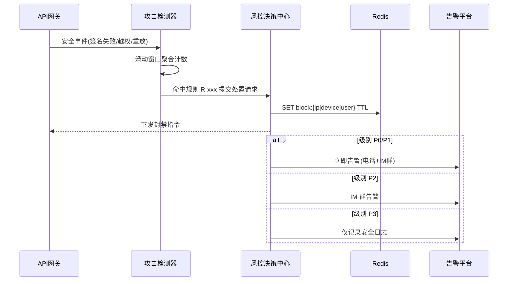

# 服务端 API 接口安全防护与渗透防御体系 - 详细设计

> 版本：1.0 | 创建日期：2026-05-26 | 状态：初稿

---

## 1. 概述

### 1.1 设计目标

本文档定义 PrimeTop 服务端所有对外暴露 API 接口的统一安全防护体系，确保：

1. **认证可靠**：每个请求经过强身份验证，防止未授权访问。
2. **防篡改防重放**：请求签名 + 时序校验，杜绝报文篡改和重放攻击。
3. **注入防御**：对 SQL 注入、XSS、命令注入等 OWASP Top 10 威胁形成纵深防御。
4. **文件安全**：上传文件类型、内容、大小严格校验，防止恶意文件上传。
5. **审计完备**：所有敏感接口调用留痕，支持事后追溯。
6. **自动响应**：异常行为自动检测、告警、临时封禁。

### 1.2 适用范围

- BFF 层对外 API（客户端直接调用）
- 内部服务间调用（Service-to-Service）
- 管理后台 API
- 第三方开放 API（B 端合作）
- Webhook 回调接口

### 1.3 与现有安全文档的关系

| 现有文档 | 覆盖范围 | 本文档定位 |
|---------|---------|-----------|
| 数据安全与隐私合规体系 | 数据分级、隐私合规、加密存储 | 本文聚焦 API 传输层与请求层安全 |
| 安全与内容合规系统 | AI 输出审核、内容过滤 | 本文聚焦接口层攻击防御 |
| 服务端密钥管理与敏感配置安全策略 | 密钥存储、轮换、分发 | 本文使用密钥但管理由该文档负责 |
| 服务端统一限流熔断与流量防护体系 | 限流、熔断、降级 | 本文聚焦安全维度的频率控制 |
| 服务端请求参数校验与数据清洗规范 | 参数校验、数据清洗 | 本文聚焦安全维度的输入过滤 |

---

## 2. 整体架构

### 2.1 安全防护分层模型

```
┌─────────────────────────────────────────────────────────┐
│                     客户端 / 调用方                       │
│              (SDK 内置签名 + 证书锁定)                    │
└─────────────────────┬───────────────────────────────────┘
                      │ HTTPS (TLS 1.2+)
                      ▼
┌─────────────────────────────────────────────────────────┐
│                  WAF / DDoS 防护层                       │
│         (Cloudflare / 阿里云 WAF / 自建 Nginx)           │
│   - IP 黑名单  - 地域封禁  - DDoS 清洗                   │
│   - SQL 注入检测  - XSS 检测  - 蜘蛛识别                 │
└─────────────────────┬───────────────────────────────────┘
                      │
                      ▼
┌─────────────────────────────────────────────────────────┐
│                  API 网关安全层                           │
│   - TLS 终止  - 请求签名验证  - JWT 校验                  │
│   - 频率限制  - 设备指纹校验  - 请求大小限制               │
└─────────────────────┬───────────────────────────────────┘
                      │
                      ▼
┌─────────────────────────────────────────────────────────┐
│                  业务服务安全层                           │
│   - RBAC 鉴权  - 数据权限隔离  - 参数安全过滤             │
│   - SQL 参数化  - 输出编码  - 文件上传校验                │
└─────────────────────┬───────────────────────────────────┘
                      │
                      ▼
┌─────────────────────────────────────────────────────────┐
│                  数据存储安全层                           │
│   - 加密存储  - 字段脱敏  - 访问审计                     │
└─────────────────────────────────────────────────────────┘
```

### 2.2 安全面数据流

```
Request → TLS验证 → WAF过滤 → 签名校验 → JWT解析 → 频率检查
       → 设备验证 → RBAC鉴权 → 参数过滤 → 业务处理 → 响应编码
       → 审计记录 → 响应返回
```

---

## 3. 请求签名机制

### 3.1 签名算法

所有客户端 API 请求必须携带签名，防止请求伪造和篡改。

#### 3.1.1 签名生成流程

```
1. 收集签名参数:
   - HTTP Method (GET/POST/PUT/DELETE)
   - 请求路径 (URI Path, 不含 query string)
   - 请求时间戳 (Unix 毫秒)
   - 请求随机数 (Nonce, UUID v4)
   - 请求体 Hash (SHA-256 of raw body, GET 请求为空字符串)
   - App 版本号
   - 设备指纹

2. 构造签名字符串 (HMAC-SHA256):
   signString = "{Method}\n{Path}\n{Timestamp}\n{Nonce}\n{BodyHash}\n{AppVersion}\n{DeviceFingerprint}"

3. 计算签名:
   signature = HMAC-SHA256(signString, appSecret)

4. 将签名信息放入请求头:
   X-PrimeTop-Signature: signature
   X-PrimeTop-Timestamp: timestamp
   X-PrimeTop-Nonce: nonce
   X-PrimeTop-AppVersion: appVersion
   X-PrimeTop-DeviceId: deviceFingerprint
```

#### 3.1.2 数据结构定义

```java
/**
 * 请求签名信息
 */
public record RequestSignature(
    /** HMAC-SHA256 签名值 (Base64 编码) */
    @NotBlank String signature,
    
    /** 请求时间戳 (Unix 毫秒) */
    @NotNull Long timestamp,
    
    /** 请求随机数 (防止重放) */
    @NotBlank String nonce,
    
    /** 客户端应用版本 */
    @NotBlank String appVersion,
    
    /** 设备指纹 */
    String deviceId
) {}

/**
 * 签名验证结果
 */
public record SignatureVerifyResult(
    boolean valid,
    SignatureRejectionReason reason,
    String clientId
) {}

public enum SignatureRejectionReason {
    MISSING_SIGNATURE,      // 缺少签名
    INVALID_FORMAT,         // 签名格式错误
    TIMESTAMP_EXPIRED,      // 时间戳过期
    NONCE_REPLAY,           // Nonce 重复使用
    SIGNATURE_MISMATCH,     // 签名不匹配
    APP_VERSION_BLOCKED,    // 应用版本已被封禁
    DEVICE_BLOCKED          // 设备已被封禁
}
```

#### 3.1.3 服务端签名验证器

```java
@Component
public class RequestSignatureVerifier {
    
    private static final long TIMESTAMP_TOLERANCE_MS = 5 * 60 * 1000; // 5 分钟容忍窗口
    
    @Autowired
    private AppSecretRepository appSecretRepository;
    
    @Autowired
    private NonceCache nonceCache; // Redis-backed
    
    @Autowired
    private BlockedDeviceService blockedDeviceService;
    
    public SignatureVerifyResult verify(HttpServletRequest request, String rawBody) {
        // 1. 提取签名头
        String signature = request.getHeader("X-PrimeTop-Signature");
        String timestampStr = request.getHeader("X-PrimeTop-Timestamp");
        String nonce = request.getHeader("X-PrimeTop-Nonce");
        String appVersion = request.getHeader("X-PrimeTop-AppVersion");
        String deviceId = request.getHeader("X-PrimeTop-DeviceId");
        
        if (isAnyBlank(signature, timestampStr, nonce, appVersion)) {
            return new SignatureVerifyResult(false, MISSING_SIGNATURE, null);
        }
        
        // 2. 时间戳校验
        long timestamp;
        try {
            timestamp = Long.parseLong(timestampStr);
        } catch (NumberFormatException e) {
            return new SignatureVerifyResult(false, INVALID_FORMAT, null);
        }
        
        long now = System.currentTimeMillis();
        if (Math.abs(now - timestamp) > TIMESTAMP_TOLERANCE_MS) {
            return new SignatureVerifyResult(false, TIMESTAMP_EXPIRED, null);
        }
        
        // 3. Nonce 防重放
        if (nonceCache.exists(nonce)) {
            return new SignatureVerifyResult(false, NONCE_REPLAY, null);
        }
        
        // 4. 设备封禁检查
        if (deviceId != null && blockedDeviceService.isBlocked(deviceId)) {
            return new SignatureVerifyResult(false, DEVICE_BLOCKED, null);
        }
        
        // 5. 构造签名字符串
        String method = request.getMethod();
        String path = request.getRequestURI();
        String bodyHash = rawBody != null ? sha256(rawBody) : "";
        
        String signString = String.join("\n",
            method, path, timestampStr, nonce, bodyHash, appVersion,
            deviceId != null ? deviceId : ""
        );
        
        // 6. 获取 AppSecret (根据平台和版本)
        String appSecret = appSecretRepository.getSecret(request.getHeader("User-Agent"));
        if (appSecret == null) {
            return new SignatureVerifyResult(false, INVALID_FORMAT, null);
        }
        
        // 7. 验证签名
        String expectedSignature = hmacSha256(signString, appSecret);
        if (!MessageDigest.isEqual(
            signature.getBytes(StandardCharsets.UTF_8),
            expectedSignature.getBytes(StandardCharsets.UTF_8)
        )) {
            return new SignatureVerifyResult(false, SIGNATURE_MISMATCH, null);
        }
        
        // 8. 记录 Nonce (TTL = 2 * 容忍窗口)
        nonceCache.put(nonce, timestamp, TIMESTAMP_TOLERANCE_MS * 2);
        
        return new SignatureVerifyResult(true, null, deviceId);
    }
}
```

### 3.2 Nonce 防重放策略

```java
/**
 * Redis-based Nonce 缓存
 * Key: primetop:nonce:{nonce_value}
 * Value: timestamp
 * TTL: 10 分钟 (2 × 容忍窗口)
 */
@Component
public class RedisNonceCache implements NonceCache {
    
    @Autowired
    private StringRedisTemplate redisTemplate;
    
    private static final String KEY_PREFIX = "primetop:nonce:";
    private static final Duration TTL = Duration.ofMinutes(10);
    
    @Override
    public boolean exists(String nonce) {
        return Boolean.TRUE.equals(
            redisTemplate.hasKey(KEY_PREFIX + nonce)
        );
    }
    
    @Override
    public void put(String nonce, long timestamp, long ttlMs) {
        redisTemplate.opsForValue()
            .set(KEY_PREFIX + nonce, String.valueOf(timestamp), TTL);
    }
}
```

### 3.3 签名密钥管理

```
密钥分发策略:
┌──────────────┐     构建时注入      ┌──────────────┐
│  密钥管理服务  │ ─────────────────→ │  客户端 APK   │
│ (KMS/HSM)    │                    │  (混淆存储)    │
└──────────────┘                    └──────────────┘
       │
       │ 版本化密钥
       ▼
┌──────────────────────────────┐
│  数据库: app_secret_versions  │
│  - platform (android/ios)    │
│  - min_version / max_version │
│  - secret_hash (存储哈希)     │
│  - active (boolean)          │
│  - created_at                │
└──────────────────────────────┘
```

**密钥轮换规则**：
1. 每个主版本使用独立密钥。
2. 版本更新时新密钥随新版本发布，旧密钥保留 90 天。
3. 发现密钥泄露时立即激活新密钥并封禁旧密钥，强制用户升级。
4. 密钥存储在 HSM/KMS 中，数据库仅存哈希值。

---

## 4. JWT 认证与会话安全

### 4.1 Token 模型

```java
/**
 * 访问令牌 (短有效期)
 */
public record AccessToken(
    /** 用户ID */
    String userId,
    /** 用户角色 */
    UserRole role,
    /** 会话ID */
    String sessionId,
    /** 设备ID */
    String deviceId,
    /** 签发时间 */
    long iat,
    /** 过期时间 */
    long exp,
    /** Token 版本 (用于强制注销) */
    long tokenVersion
) {}

/**
 * 刷新令牌 (长有效期)
 */
public record RefreshToken(
    /** 用户ID */
    String userId,
    /** 会话ID */
    String sessionId,
    /** 设备ID */
    String deviceId,
    /** 签发时间 */
    long iat,
    /** 过期时间 */
    long exp,
    /** 单次使用标识 (用后作废) */
    String jti
) {}
```

### 4.2 Token 配置

```yaml
auth:
  access-token:
    algorithm: "RS256"           # 非对称算法，公钥分发
    expiration: "30m"            # 访问令牌有效期 30 分钟
    issuer: "primetop"
    audience: "primetop-api"
    
  refresh-token:
    expiration: "30d"            # 刷新令牌有效期 30 天
    max-concurrent-sessions: 5   # 同一用户最多 5 个活跃设备
    rotation-enabled: true       # 刷新时自动轮换
    
  token-version:
    # 用户修改密码 / 管理员强制下线 时递增 tokenVersion
    # 所有旧 Token 自动失效
```

### 4.3 JWT 验证流程

```java
@Component
public class JwtAuthenticationFilter extends OncePerRequestFilter {
    
    @Autowired
    private JwtTokenProvider tokenProvider;
    
    @Autowired
    private TokenVersionService tokenVersionService;
    
    @Autowired
    private SessionService sessionService;
    
    @Override
    protected void doFilterInternal(
        HttpServletRequest request,
        HttpServletResponse response,
        FilterChain filterChain
    ) throws ServletException, IOException {
        
        // 1. 提取 Token
        String token = extractToken(request);
        if (token == null) {
            filterChain.doFilter(request, response);
            return;
        }
        
        // 2. 解析与签名验证
        AccessToken accessToken;
        try {
            accessToken = tokenProvider.parseAccessToken(token);
        } catch (JwtException e) {
            sendError(response, 401, "INVALID_TOKEN", "令牌无效或已过期");
            return;
        }
        
        // 3. 检查 Token 版本 (防止已注销 Token 复用)
        long currentVersion = tokenVersionService.getCurrentVersion(accessToken.userId());
        if (accessToken.tokenVersion() < currentVersion) {
            sendError(response, 401, "TOKEN_REVOKED", "令牌已被撤销");
            return;
        }
        
        // 4. 检查会话状态
        if (!sessionService.isActive(accessToken.sessionId())) {
            sendError(response, 401, "SESSION_EXPIRED", "会话已过期");
            return;
        }
        
        // 5. 设置认证上下文
        var authentication = new PrimeTopAuthentication(
            accessToken.userId(),
            accessToken.role(),
            accessToken.sessionId(),
            accessToken.deviceId()
        );
        SecurityContextHolder.getContext().setAuthentication(authentication);
        
        filterChain.doFilter(request, response);
    }
}
```

### 4.4 Refresh Token 轮换

```java
@Service
public class RefreshTokenService {
    
    /**
     * 刷新令牌轮换流程：
     * 1. 验证旧 Refresh Token
     * 2. 作废旧 Token (JTI 加入黑名单)
     * 3. 签发新 Access Token + Refresh Token 对
     * 4. 更新会话记录
     */
    @Transactional
    public TokenPair rotateRefreshToken(String oldRefreshToken) {
        // 解析旧 Token
        RefreshToken oldToken = tokenProvider.parseRefreshToken(oldRefreshToken);
        
        // 检查 JTI 是否已使用 (防止重放)
        if (refreshTokenBlacklist.isUsed(oldToken.jti())) {
            // 检测到重放攻击！可能是 Token 被盗
            // 立即撤销该用户所有会话
            emergencyRevokeAllSessions(oldToken.userId(), "REFRESH_TOKEN_REPLAY_DETECTED");
            throw new SecurityException("令牌重放检测，所有会话已撤销");
        }
        
        // 标记旧 Token 为已使用
        refreshTokenBlacklist.markUsed(oldToken.jti(), oldToken.exp());
        
        // 签发新 Token 对
        String sessionId = oldToken.sessionId();
        String userId = oldToken.userId();
        String deviceId = oldToken.deviceId();
        
        long tokenVersion = tokenVersionService.getCurrentVersion(userId);
        AccessToken newAccess = tokenProvider.createAccessToken(userId, sessionId, deviceId, tokenVersion);
        String newJti = UUID.randomUUID().toString();
        RefreshToken newRefresh = tokenProvider.createRefreshToken(userId, sessionId, deviceId, newJti);
        
        return new TokenPair(
            tokenProvider.serialize(newAccess),
            tokenProvider.serialize(newRefresh)
        );
    }
    
    /**
     * 紧急撤销用户所有会话
     */
    private void emergencyRevokeAllSessions(String userId, String reason) {
        // 1. 递增 tokenVersion → 所有旧 Token 自动失效
        tokenVersionService.incrementVersion(userId);
        
        // 2. 关闭所有活跃会话
        sessionService.terminateAllSessions(userId, reason);
        
        // 3. 发送安全告警
        securityAlertService.alert(SecurityEvent.builder()
            .type(SecurityEventType.TOKEN_REPLAY_DETECTED)
            .userId(userId)
            .reason(reason)
            .timestamp(Instant.now())
            .build());
        
        // 4. 记录审计日志
        auditLogService.log(AuditAction.EMERGENCY_SESSION_REVOCATION, userId, reason);
    }
}
```

### 4.5 多设备会话管理

```sql
-- 会话表
CREATE TABLE user_sessions (
    id              BIGINT PRIMARY KEY AUTO_INCREMENT,
    session_id      VARCHAR(64) NOT NULL COMMENT '会话唯一ID',
    user_id         BIGINT NOT NULL COMMENT '用户ID',
    device_id       VARCHAR(128) COMMENT '设备指纹',
    device_name     VARCHAR(128) COMMENT '设备名称',
    platform        VARCHAR(32) COMMENT 'android/ios/web',
    app_version     VARCHAR(32) COMMENT '应用版本',
    ip_address      VARCHAR(45) COMMENT '登录IP',
    geo_location    VARCHAR(128) COMMENT 'IP地理位置',
    user_agent      VARCHAR(512) COMMENT 'User-Agent',
    status          ENUM('active', 'terminated', 'expired') DEFAULT 'active',
    last_active_at  DATETIME COMMENT '最后活跃时间',
    created_at      DATETIME DEFAULT CURRENT_TIMESTAMP,
    terminated_at   DATETIME COMMENT '终止时间',
    terminate_reason VARCHAR(128) COMMENT '终止原因',
    
    INDEX idx_user_id (user_id),
    INDEX idx_session_id (session_id),
    INDEX idx_device_id (device_id),
    INDEX idx_status (status)
) ENGINE=InnoDB DEFAULT CHARSET=utf8mb4;
```

---

## 5. 注入攻击防御

### 5.1 SQL 注入防御

#### 5.1.1 纵深防御策略

```
第 1 层: WAF (Nginx/Lua 规则)
    │ 拦截明显 SQL 注入特征
    ▼
第 2 层: 参数校验 (Bean Validation)
    │ 类型检查 + 格式白名单
    ▼
第 3 层: ORM 参数化查询 (MyBatis/JPA)
    │ 强制使用参数绑定
    ▼
第 4 层: 数据库最小权限
    │ 应用账号仅授权必要 DML
```

#### 5.1.2 MyBatis 安全规范

```java
// ✅ 正确：使用参数化查询
@Mapper
public interface QuestionMapper {
    
    @Select("SELECT * FROM questions WHERE subject = #{subject} AND grade = #{grade}")
    List<Question> findBySubjectAndGrade(
        @Param("subject") String subject,
        @Param("grade") String grade
    );
}

// ❌ 错误：字符串拼接 (${} 语法)
// 绝对禁止在 MyBatis 中使用 ${} 拼接用户输入
// @Select("SELECT * FROM questions WHERE subject = '${subject}'")
```

#### 5.1.3 动态查询安全构建

```java
/**
 * 安全的动态查询构建器
 * 使用 MyBatis-Plus QueryWrapper 避免手写 SQL
 */
@Service
public class QuestionSearchService {
    
    public Page<Question> search(QuestionSearchRequest request) {
        LambdaQueryWrapper<Question> wrapper = new LambdaQueryWrapper<>();
        
        // 使用条件构造器，自动参数化
        if (request.getSubject() != null) {
            wrapper.eq(Question::getSubject, request.getSubject());
        }
        if (request.getGrade() != null) {
            wrapper.eq(Question::getGrade, request.getGrade());
        }
        if (request.getKeyword() != null) {
            // LIKE 查询自动转义特殊字符
            wrapper.like(Question::getContent, request.getKeyword());
        }
        
        // 排序字段白名单 (防止通过排序字段注入)
        Map<String, SFunction<Question, ?>> allowedSortFields = Map.of(
            "created_at", Question::getCreatedAt,
            "difficulty", Question::getDifficulty,
            "usage_count", Question::getUsageCount
        );
        
        SFunction<Question, ?> sortField = allowedSortFields.getOrDefault(
            request.getSortBy(), Question::getCreatedAt
        );
        
        wrapper.orderBy(true, request.isAsc(), sortField);
        
        return questionMapper.selectPage(request.toPage(), wrapper);
    }
}
```

#### 5.1.4 WAF SQL 注入规则 (Nginx + Lua)

```nginx
# /etc/nginx/conf.d/waf_sql_injection.conf

# SQL 注入关键字检测
set $sql_injection_patterns "";
if ($args ~* "(union.*select|insert.*into|delete.*from|update.*set|drop.*table|exec(\s|\()+|execute(\s|\()+|truncate.*table|alter.*table)") {
    set $sql_injection_patterns "detected";
}
if ($args ~* "(--|;|/\*|\*/|@@|#|char\(|concat\(|group_concat\(|0x[0-9a-f]+)") {
    set $sql_injection_patterns "detected";
}

# POST body 检测
if ($request_body ~* "(union.*select|insert.*into|delete.*from|drop.*table|exec(\s|\()+)") {
    set $sql_injection_patterns "detected";
}

# 拦截
if ($sql_injection_patterns = "detected") {
    return 403;
}
```

### 5.2 XSS 防御

#### 5.2.1 输出编码策略

```java
/**
 * 统一响应编码器
 * 所有 API 响应经过此编码器处理
 */
@Component
public class SecurityResponseEncoder {
    
    /**
     * JSON 输出编码 (默认所有 API 响应使用)
     * Jackson 配置自动转义 HTML 特殊字符
     */
    @Configuration
    public static class JacksonSecurityConfig {
        @Bean
        public ObjectMapper secureObjectMapper() {
            ObjectMapper mapper = new ObjectMapper();
            // 开启 HTML 转义
            mapper.getFactory().setCharacterEscapes(new HtmlCharacterEscapes());
            return mapper;
        }
    }
    
    /**
     * 自定义 HTML 字符转义
     */
    static class HtmlCharacterEscapes extends CharacterEscapes {
        private final int[] asciiEscapes;
        
        public HtmlCharacterEscapes() {
            asciiEscapes = CharacterEscapes.standardAsciiEscapesForJSON();
            asciiEscapes['<'] = CharacterEscapes.ESCAPE_STANDARD;
            asciiEscapes['>'] = CharacterEscapes.ESCAPE_STANDARD;
            asciiEscapes['&'] = CharacterEscapes.ESCAPE_STANDARD;
            asciiEscapes['"'] = CharacterEscapes.ESCAPE_STANDARD;
            asciiEscapes['\''] = CharacterEscapes.ESCAPE_STANDARD;
        }
        
        @Override
        public int[] getEscapeCodesForASCII() { return asciiEscapes; }
        
        @Override
        public SerializableString getEscapeSequence(int ch) {
            return new SerializedString("&#" + ch + ";");
        }
    }
}
```

#### 5.2.2 安全响应头

```java
/**
 * 全局安全响应头配置
 */
@Configuration
public class SecurityHeadersConfig {
    
    @Bean
    public WebMvcConfigurer securityHeadersConfigurer() {
        return new WebMvcConfigurer() {
            @Override
            public void addInterceptors(InterceptorRegistry registry) {
                registry.addInterceptor(new HandlerInterceptor() {
                    @Override
                    public boolean preHandle(HttpServletRequest request, 
                                            HttpServletResponse response, 
                                            Object handler) {
                        // 防止 MIME 类型嗅探
                        response.setHeader("X-Content-Type-Options", "nosniff");
                        // 防止点击劫持
                        response.setHeader("X-Frame-Options", "DENY");
                        // XSS 防护 (旧浏览器)
                        response.setHeader("X-XSS-Protection", "1; mode=block");
                        // HSTS (强制 HTTPS)
                        response.setHeader("Strict-Transport-Security", 
                            "max-age=31536000; includeSubDomains; preload");
                        // CSP (内容安全策略)
                        response.setHeader("Content-Security-Policy",
                            "default-src 'self'; script-src 'self'; style-src 'self' 'unsafe-inline'");
                        // Referrer 策略
                        response.setHeader("Referrer-Policy", "strict-origin-when-cross-origin");
                        // 权限策略
                        response.setHeader("Permissions-Policy",
                            "camera=(), microphone=(), geolocation=(), payment=()");
                        return true;
                    }
                });
            }
        };
    }
}
```

### 5.3 命令注入防御

```java
/**
 * 安全的系统命令执行工具
 * 原则：禁止直接执行用户输入拼接的命令字符串。
 * 1. 命令必须使用白名单枚举，禁止传入任意可执行路径。
 * 2. 参数以数组形式传递（ProcessBuilder），禁止经过 Shell 解析。
 * 3. 执行超时强制 kill，输出长度限制防内存打爆。
 * 4. 工作目录锁定，禁止命令逃逸到父目录。
 */
@Component
public class SafeCommandExecutor {

    /** 白名单命令：key=逻辑名，value=绝对路径 */
    private static final Map<String, String> COMMAND_WHITELIST = Map.of(
        "ffmpeg",      "/usr/local/bin/ffmpeg",
        "pdftotext",   "/usr/bin/pdftotext",
        "pdfimages",   "/usr/bin/pdfimages"
    );

    private static final Duration DEFAULT_TIMEOUT = Duration.ofSeconds(30);
    private static final int MAX_OUTPUT_BYTES = 1024 * 1024; // 1MB

    /**
     * 执行白名单命令
     * @param commandKey 命令逻辑名（必须在白名单中）
     * @param args 参数数组（逐个传递，不经过 Shell）
     */
    public CommandResult execute(String commandKey, String[] args) {
        // 1. 白名单校验
        String binaryPath = COMMAND_WHITELIST.get(commandKey);
        if (binaryPath == null) {
            throw new SecurityException("命令不在白名单: " + commandKey);
        }

        // 2. 参数安全校验：禁止路径逃逸与危险字符
        for (String arg : args) {
            validateArgument(arg);
        }

        // 3. 构造进程（不经过 Shell）
        List<String> commandWithArgs = new ArrayList<>();
        commandWithArgs.add(binaryPath);
        commandWithArgs.addAll(Arrays.asList(args));

        ProcessBuilder pb = new ProcessBuilder(commandWithArgs);
        pb.directory(new File("/tmp/primetop-sandbox")); // 锁定工作目录
        pb.redirectErrorStream(true);

        try {
            Process process = pb.start();

            // 4. 读取输出（限长）
            StringBuilder output = new StringBuilder();
            try (InputStream in = process.getInputStream()) {
                byte[] buffer = new byte[4096];
                int total = 0, read;
                while ((read = in.read(buffer)) != -1) {
                    total += read;
                    if (total > MAX_OUTPUT_BYTES) {
                        process.destroyForcibly();
                        throw new SecurityException("命令输出超限，强制终止");
                    }
                    output.append(new String(buffer, 0, read, StandardCharsets.UTF_8));
                }
            }

            // 5. 等待并超时强杀
            boolean finished = process.waitFor(DEFAULT_TIMEOUT.toMillis(), TimeUnit.MILLISECONDS);
            if (!finished) {
                process.destroyForcibly();
                throw new SecurityException("命令执行超时");
            }

            return new CommandResult(process.exitValue(), output.toString());
        } catch (IOException | InterruptedException e) {
            Thread.currentThread().interrupt();
            throw new SecurityException("命令执行失败: " + e.getMessage(), e);
        }
    }

    private void validateArgument(String arg) {
        if (arg == null) {
            throw new SecurityException("参数不能为空");
        }
        // 禁止 Shell 元字符（防御纵深，即使不经过 Shell 也拦截）
        if (arg.matches(".*[;&|`$(){}<>\\\\].*")) {
            throw new SecurityException("参数包含危险字符: " + arg);
        }
        // 禁止路径逃逸
        if (arg.contains("..")) {
            throw new SecurityException("参数禁止路径逃逸: " + arg);
        }
        if (arg.length() > 512) {
            throw new SecurityException("参数超长");
        }
    }

    public record CommandResult(int exitCode, String output) {}
}
```

### 5.4 SSRF 防御

服务端发起外部 HTTP 请求（教材资源抓取、图片转存、Webhook 回调探测）必须经统一安全出口，防止攻击者借服务端访问内网资源（SSRF）。

#### 5.4.1 防御策略

```
第 1 层: URL 协议白名单   仅允许 http/https
第 2 层: 域名白名单       业务配置的可信域名列表
第 3 层: IP 黑名单       禁止解析到内网/保留地址段
第 4 层: DNS 双重校验    连接前重新解析并校验 IP
第 5 层: 端口白名单      仅允许 80/443
第 6 层: 出网代理        生产环境统一经 NAT 网关出口
```

#### 5.4.2 安全 HTTP 客户端

```java
/**
 * SSRF 安全 HTTP 客户端（所有服务端外呼唯一入口）
 */
@Component
public class SafeHttpClient {

    /** 禁止访问的地址段 */
    private static final List<String> BLOCKED_CIDRS = List.of(
        "10.0.0.0/8", "172.16.0.0/12", "192.168.0.0/16",
        "127.0.0.0/8", "169.254.0.0/16", "0.0.0.0/8",
        "100.64.0.0/10", "224.0.0.0/4", "::1/128", "fc00::/7"
    );

    private static final Set<Integer> ALLOWED_PORTS = Set.of(80, 443);
    private static final Duration CONNECT_TIMEOUT = Duration.ofSeconds(5);
    private static final Duration READ_TIMEOUT = Duration.ofSeconds(10);

    private final RestTemplate restTemplate;
    private final DomainWhitelistService domainWhitelistService;

    public byte[] fetchBinary(String url) {
        ValidatedUrl validated = validateUrl(url);
        return restTemplate.execute(validated.url(), HttpMethod.GET, null, response -> {
            byte[] body = response.getBody().readAllBytes();
            if (body.length > 20 * 1024 * 1024) { // 20MB 上限
                throw new SecurityException("响应体超限");
            }
            return body;
        });
    }

    private ValidatedUrl validateUrl(String rawUrl) {
        // 1. 协议白名单
        URI uri;
        try {
            uri = new URI(rawUrl);
        } catch (URISyntaxException e) {
            throw new SecurityException("URL 格式非法");
        }
        String scheme = uri.getScheme();
        if (!"http".equalsIgnoreCase(scheme) && !"https".equalsIgnoreCase(scheme)) {
            throw new SecurityException("仅允许 http/https 协议");
        }

        // 2. 端口白名单
        int port = uri.getPort() == -1
            ? ("https".equalsIgnoreCase(scheme) ? 443 : 80)
            : uri.getPort();
        if (!ALLOWED_PORTS.contains(port)) {
            throw new SecurityException("端口不在白名单");
        }

        // 3. 域名白名单
        String host = uri.getHost();
        if (host == null || !domainWhitelistService.isAllowed(host)) {
            throw new SecurityException("域名不在白名单: " + host);
        }

        // 4. DNS 解析 + IP 黑名单校验（防 DNS rebinding）
        try {
            for (InetAddress addr : InetAddress.getAllByName(host)) {
                if (isBlockedIp(addr.getHostAddress())) {
                    throw new SecurityException("域名解析到禁止地址段: " + addr.getHostAddress());
                }
            }
        } catch (UnknownHostException e) {
            throw new SecurityException("域名解析失败: " + host);
        }

        // 5. 禁用重定向跟随或重定向前重新校验
        // （生产配置 RestTemplate 禁用自动跟随，由调用方逐跳重新 validateUrl）
        return new ValidatedUrl(uri.normalize().toString());
    }

    private boolean isBlockedIp(String ip) {
        for (String cidr : BLOCKED_CIDRS) {
            if (IpAddressMatcher.match(ip, cidr)) {
                return true;
            }
        }
        return false;
    }

    private record ValidatedUrl(String url) {}
}
```

### 5.5 XXE 防御

解析外部 XML（题库导入、Office 文档元数据）必须禁用外部实体。

```java
/**
 * 安全的 XML 解析器工厂
 */
public final class SecureXmlParserFactory {

    public static DocumentBuilder createDocumentBuilder() {
        try {
            DocumentBuilderFactory factory = DocumentBuilderFactory.newInstance();
            // 禁用 DTD 与外部实体（OWASP 推荐全套硬编码）
            factory.setFeature("http://apache.org/xml/features/disallow-doctype-decl", true);
            factory.setFeature("http://xml.org/sax/features/external-general-entities", false);
            factory.setFeature("http://xml.org/sax/features/external-parameter-entities", false);
            factory.setFeature("http://apache.org/xml/features/nonvalidating/load-external-dtd", false);
            factory.setXIncludeAware(false);
            factory.setExpandEntityReferences(false);
            // 防止 Billion Laughs 实体扩展攻击
            factory.setFeature("http://apache.org/xml/features/limits/entity-expansion-limit", 100);
            return factory.newDocumentBuilder();
        } catch (ParserConfigurationException e) {
            throw new IllegalStateException("XML 解析器安全配置失败", e);
        }
    }
}
```

### 5.6 反序列化安全

```java
@Configuration
public class SecureJacksonConfig {
    @Bean
    public ObjectMapper objectMapper() {
        ObjectMapper mapper = new ObjectMapper();
        // 禁止多态反序列化（防 Jackson  gadget 链）
        mapper.deactivateDefaultTyping();
        // 反序列化失败即拒绝，不尝试容错
        mapper.configure(DeserializationFeature.FAIL_ON_UNKNOWN_PROPERTIES, false);
        return mapper;
    }
}
```

---

## 6. 越权访问防御（RBAC 与数据权限）

### 6.1 RBAC 配置

```java
@Configuration
@EnableMethodSecurity(prePostEnabled = true)
public class SecurityConfig {

    @Bean
    public SecurityFilterChain filterChain(HttpSecurity http) throws Exception {
        http
            .csrf(csrf -> csrf.disable()) // 纯 API，CSRF 由签名+Token 双机制防护
            .authorizeHttpRequests(auth -> auth
                // 公开接口
                .requestMatchers("/api/v1/public/**", "/health", "/metrics").permitAll()
                // 学生端
                .requestMatchers("/api/v1/student/**").hasRole("STUDENT")
                // 家长端
                .requestMatchers("/api/v1/parent/**").hasRole("PARENT")
                // 教师端
                .requestMatchers("/api/v1/teacher/**").hasRole("TEACHER")
                // 管理后台
                .requestMatchers("/api/v1/admin/**").hasRole("ADMIN")
                // 内部服务间调用
                .requestMatchers("/internal/**").hasRole("SERVICE")
                .anyRequest().authenticated()
            )
            .sessionManagement(session -> session
                .sessionCreationPolicy(SessionCreationPolicy.STATELESS))
            .exceptionHandling(handling -> handling
                .authenticationEntryPoint(new PrimeTopAuthEntryPoint())
                .accessDeniedHandler(new PrimeTopAccessDeniedHandler()));
        return http.build();
    }
}
```

### 6.2 对象级权限校验（防 IDOR）

所有涉及资源 ID 的接口必须校验资源归属，禁止仅靠路径鉴权。

```java
/**
 * 对象级权限检查切面
 * 在 Service 方法上标注 @OwnershipCheck(resourceType="mistake")，
 * 框架自动校验 resourceId 属于当前登录用户（或其家长/教师授权范围）。
 */
@Service
public class MistakeBookService {

    /**
     * 查询错题详情（防 IDOR：必须校验错题归属）
     */
    public MistakeDetail getMistakeDetail(Long mistakeId, Long currentUserId) {
        MistakeBook mistake = mistakeBookRepository.findById(mistakeId)
            .orElseThrow(() -> new BizException(40401, "错题不存在"));

        // 归属校验：本人 / 家长（绑定关系）/ 教师（班级授权）
        if (!mistake.getStudentId().equals(currentUserId)
            && !familyGuard.isParentOf(currentUserId, mistake.getStudentId())
            && !classroomGuard.isAuthorizedTeacher(currentUserId, mistake.getStudentId())) {
            // 统一返回 404 而非 403，避免资源存在性探测
            throw new BizException(40401, "错题不存在");
        }

        return MistakeDetail.from(mistake);
    }
}
```

**红线 G1**：所有按 ID 查询资源并在响应中返回资源内容的接口，必须实现归属校验；校验失败返回 404（不返回 403），防止横向探测资源是否存在。

---

## 7. 敏感数据接口防护

### 7.1 响应脱敏

```java
/**
 * 响应脱敏注解：标注在 DTO 字段上，按角色自动脱敏
 */
@Target(ElementType.FIELD)
@Retention(RetentionPolicy.RUNTIME)
public @interface SensitiveField {
    SensitiveType type();
    /** 可见完整数据的最小角色 */
    UserRole minVisibleRole() default UserRole.ADMIN;
}

public enum SensitiveType {
    PHONE,       // 138****5678
    ID_CARD,     // 1101**********1234
    REAL_NAME,   // 张*
    ADDRESS      // 北京市****
}

@Component
public class SensitiveFieldSerializer extends JsonSerializer<String> {

    @Override
    public void serialize(String value, JsonGenerator gen, SerializerProvider provider)
            throws IOException {
        UserRole currentRole = SecurityContextHolder.getCurrentRole();
        SensitiveField annotation = (SensitiveField) gen.getCurrentValue()
            .getClass().getDeclaredField(gen.getOutputContext().getCurrentName())
            .getAnnotation(SensitiveField.class);

        if (annotation != null && currentRole.ordinal() < annotation.minVisibleRole().ordinal()) {
            gen.writeString(mask(value, annotation.type()));
        } else {
            gen.writeString(value);
        }
    }

    private String mask(String value, SensitiveType type) {
        return switch (type) {
            case PHONE -> value.replaceAll("(\\d{3})\\d{4}(\\d{4})", "$1****$2");
            case ID_CARD -> value.replaceAll("(\\d{4})\\d{10}(\\w{4})", "$1**********$2");
            case REAL_NAME -> value.charAt(0) + "*".repeat(Math.max(0, value.length() - 1));
            case ADDRESS -> value.length() > 6 ? value.substring(0, 6) + "****" : "****";
        };
    }
}
```

### 7.2 批量拉取限速与防爬

| 接口类型 | 单用户限速 | 单 IP 限速 | 单日上限 | 风控动作 |
|---------|-----------|-----------|---------|---------|
| 题目详情查询 | 60 次/分 | 300 次/分 | 5000 次 | 超限触发滑块验证 |
| 错题本导出 | 2 次/天 | — | — | 二次短信验证 |
| 学情报告拉取 | 30 次/分 | 150 次/分 | 2000 次 | 超限临时封禁 30 分钟 |
| 搜索接口 | 30 次/分 | 120 次/分 | — | 超限降级返回缓存 |

限速维度实现采用滑动窗口（Redis Lua 原子计数），超限后的处置动作由统一风控决策中心下发（与《服务端-教育平台统一风控决策中心与用户安全画像引擎》对接，本体系只负责采集信号与执行处置）。

---

## 8. 管理后台安全

### 8.1 访问控制矩阵

| 控制项 | 规则 |
|-------|------|
| 网络层 | 仅公司办公网 VPN + 运维堡垒机 IP 白名单可访问 |
| 认证层 | 账号密码 + TOTP MFA 双因子，密码策略：≥12 位 + 90 天轮换 |
| 会话层 | 空闲 30 分钟强制登出，绝对 8 小时过期 |
| 权限层 | 最小权限 RBAC，按岗位分配角色 |
| 高危操作 | 双人审批（权限变更、数据导出、内容下线） |

### 8.2 管理员操作审计

```java
/**
 * 管理后台操作审计切面
 */
@Aspect
@Component
public class AdminAuditAspect {

    @Around("@annotation(adminAudit)")
    public Object audit(ProceedingJoinPoint pjp, AdminAudit adminAudit) throws Throwable {
        AdminOperator operator = SecurityContextHolder.getAdminOperator();
        long start = System.currentTimeMillis();
        try {
            Object result = pjp.proceed();
            writeAudit(operator, adminAudit.action(), "SUCCESS", null, start);
            return result;
        } catch (Exception e) {
            writeAudit(operator, adminAudit.action(), "FAILED", e.getMessage(), start);
            throw e;
        }
    }

    private void writeAudit(AdminOperator operator, String action,
                            String result, String error, long start) {
        AdminAuditLog log = AdminAuditLog.builder()
            .operatorId(operator.id())
            .operatorName(operator.name())
            .operatorRole(operator.role())
            .action(action)
            .result(result)
            .errorMessage(error)
            .ipAddress(operator.ipAddress())
            .durationMs(System.currentTimeMillis() - start)
            .createdAt(Instant.now())
            .build();
        // 异步写入审计存储（防审计失败阻塞业务，审计服务宕机进本地队列重放）
        auditLogWriter.submit(log);
    }
}
```

---

## 9. 第三方开放 API 与 Webhook 安全

### 9.1 第三方 API 认证

```
B 端机构调用：
1. 接入审批通过后签发 appKey / appSecret（与客户端密钥隔离的密钥池）
2. 调用头携带：X-App-Key、X-Timestamp、X-Nonce、X-Signature（同 §3 算法）
3. 额外强制：调用方服务器 IP 白名单 + 可选 mTLS 双向认证
4. 数据范围：appKey 绑定机构 ID，服务端强制按机构隔离数据（行级权限）
```

### 9.2 Webhook 回调验签

```java
/**
 * Webhook 入口验签过滤器
 */
@Component
@Order(1)
public class WebhookSignatureFilter extends OncePerRequestFilter {

    @Override
    protected void doFilterInternal(HttpServletRequest request,
                                    HttpServletResponse response,
                                    FilterChain chain) throws IOException, ServletException {
        if (!request.getRequestURI().startsWith("/webhooks/")) {
            chain.doFilter(request, response);
            return;
        }

        String appKey = request.getHeader("X-Webhook-Key");
        String signature = request.getHeader("X-Webhook-Signature");
        String timestamp = request.getHeader("X-Webhook-Timestamp");

        // 1. 时间窗校验（5 分钟）
        if (!isTimestampValid(timestamp)) {
            sendError(response, 401, "WEBHOOK_TIMESTAMP_EXPIRED");
            return;
        }

        // 2. 密钥获取（按 appKey 路由到对应第三方配置）
        String secret = webhookSecretRepository.getSecret(appKey);
        if (secret == null) {
            sendError(response, 401, "WEBHOOK_APPKEY_INVALID");
            return;
        }

        // 3. 验签：HMAC-SHA256(rawBody, secret)
        String rawBody = new String(request.getInputStream().readAllBytes(), StandardCharsets.UTF_8);
        String expected = HmacUtils.hmacSha256Hex(secret, rawBody);
        if (!MessageDigest.isEqual(
            signature.getBytes(StandardCharsets.UTF_8),
            expected.getBytes(StandardCharsets.UTF_8))) {
            sendError(response, 401, "WEBHOOK_SIGNATURE_INVALID");
            return;
        }

        // 4. 事件 ID 幂等（防第三方重试导致重复处理）
        String eventId = request.getHeader("X-Webhook-Event-Id");
        if (eventId != null && !webhookIdempotencyCache.tryAcquire(eventId, Duration.ofHours(24))) {
            response.setStatus(200); // 重复事件直接确认，不重复处理
            return;
        }

        chain.doFilter(request, response);
    }
}
```

---

## 10. 安全监控与自动响应

### 10.1 攻击检测规则表

| 规则 ID | 检测规则 | 阈值 | 动作 | 级别 |
|--------|---------|------|------|------|
| R-SIGN-01 | 签名连续失败 | 同一 IP 5 分钟内 ≥20 次 | 临时封禁 IP 30 分钟 | P2 |
| R-SIGN-02 | 时间戳异常 | 同一设备 10 分钟内 ≥10 次过期时间戳 | 设备风控标记 | P3 |
| R-AUTH-01 | 撞库尝试 | 同一 IP 1 小时内尝试 ≥10 个不同账号 | 封禁 IP + 告警 | P1 |
| R-AUTH-02 | Token 爆破 | 同一用户 10 分钟内 ≥5 次 401 | 账号临时锁定 15 分钟 | P1 |
| R-IDOR-01 | 越权探测 | 同一用户 10 分钟内触发 ≥10 次 40401 越权 | 会话强制下线 + 人工复核 | P0 |
| R-SCAN-01 | 扫描器特征 | UA 命中扫描器字典 或路径遍历特征 ≥3 次 | 封禁 IP 24 小时 | P2 |
| R-REPLAY-01 | Nonce 重放 | 同一 Nonce 重放 ≥1 次 | 设备封禁 + 告警 | P0 |

### 10.2 自动封禁流程



### 10.3 关键代码

```java
/**
 * 攻击检测器：消费网关安全事件流，命中规则触发处置
 */
@Component
public class AttackDetector {

    private static final String KEY_PREFIX = "primetop:sec:cnt:";

    /**
     * Lua 脚本：窗口计数 + 阈值判断原子执行
     */
    private static final String DETECT_LUA = """
        local key = KEYS[1]
        local window = tonumber(ARGV[1])
        local threshold = tonumber(ARGV[2])
        local now = tonumber(ARGV[3])
        redis.call('ZREMRANGEBYSCORE', key, 0, now - window)
        local count = redis.call('ZCARD', key)
        if count >= threshold then
            return 1
        end
        redis.call('ZADD', key, now, now .. ':' .. math.random())
        redis.call('EXPIRE', key, math.ceil(window / 1000))
        return 0
        """;

    public boolean checkThreshold(String dimension, String ruleId,
                                  long windowMs, int threshold) {
        String key = KEY_PREFIX + ruleId + ":" + dimension;
        Long result = redisTemplate.execute(
            detectScript,
            List.of(key),
            String.valueOf(windowMs),
            String.valueOf(threshold),
            String.valueOf(System.currentTimeMillis())
        );
        return result != null && result == 1;
    }
}

/** Redis 键设计 */
// primetop:sec:cnt:{ruleId}:{dimension}   ZSET  事件时间窗口计数
// primetop:sec:block:ip:{ip}              STRING  IP 封禁(值为原因+规则ID)
// primetop:sec:block:device:{fp}          STRING  设备封禁
// primetop:sec:block:user:{userId}        STRING  用户临时锁定
// primetop:sec:alert:dedup:{ruleId}:{dim} STRING  告警去重(同规则同维度 30 分钟只报一次)
```

---

## 11. 审计日志

### 11.1 审计范围

| 事件类型 | 触发接口 | 记录内容 |
|---------|---------|---------|
| 登录/登出 | 全部认证接口 | 用户、IP、设备、结果 |
| 敏感数据访问 | 实名信息、支付记录、学情原始数据 | 用户、资源 ID、查询条件 |
| 权限变更 | 角色分配、家长绑定 | 操作者、目标、变更前后 |
| 高危操作 | 数据导出、账号封禁、内容下线 | 操作者、审批单号、范围 |
| 安全事件 | §10 全部规则命中 | 规则 ID、维度、处置动作 |

### 11.2 存储设计

```sql
CREATE TABLE security_audit_logs (
    id              BIGINT PRIMARY KEY AUTO_INCREMENT,
    event_type      VARCHAR(32) NOT NULL COMMENT '事件类型',
    actor_id        BIGINT COMMENT '操作主体用户ID',
    actor_type      VARCHAR(16) COMMENT 'student/parent/teacher/admin/service',
    actor_role      VARCHAR(32) COMMENT '操作角色',
    target_type     VARCHAR(64) COMMENT '目标资源类型',
    target_id       VARCHAR(64) COMMENT '目标资源ID',
    action          VARCHAR(128) NOT NULL COMMENT '动作描述',
    result          ENUM('SUCCESS','FAILED','BLOCKED') NOT NULL,
    detail          JSON COMMENT '变更前后快照/查询条件',
    ip_address      VARCHAR(45) COMMENT '来源IP',
    device_id       VARCHAR(128) COMMENT '设备指纹',
    session_id      VARCHAR(64) COMMENT '会话ID',
    request_id      VARCHAR(64) COMMENT '全链路请求ID',
    created_at      DATETIME NOT NULL DEFAULT CURRENT_TIMESTAMP,

    INDEX idx_actor (actor_id, created_at),
    INDEX idx_event_type (event_type, created_at),
    INDEX idx_target (target_type, target_id),
    INDEX idx_created (created_at)
) ENGINE=InnoDB DEFAULT CHARSET=utf8mb4 COMMENT='安全审计日志';
```

**保留策略**：在线保留 180 天，之后按月分区归档至冷存储（与《服务端数据归档与生命周期管理策略》一致），留存期 3 年满足等保与未成年人保护合规要求。审计日志只追加不改（应用层禁止 UPDATE/DELETE，DB 账号仅授 INSERT/SELECT）。

---

## 12. 错误码

错误码段位 **50800-50899**（全库扫描确认空闲）。统一经 `服务端统一业务异常码与错误分类体系` 的 5xxxx 安全/权限大类归类。

| 错误码 | HTTP | 含义 | 客户端处理 |
|-------|------|------|-----------|
| 50800 | 403 | 请求签名缺失 | 检查 SDK 版本，引导升级 |
| 50801 | 403 | 请求签名无效 | 同上 |
| 50802 | 403 | 请求时间戳过期 | 校时后重试 |
| 50803 | 403 | Nonce 重放拒绝 | 重新生成 Nonce 重试 |
| 50804 | 403 | 应用版本被封禁 | 强制升级弹窗 |
| 50805 | 403 | 设备已被封禁 | 提示联系客服，不解封路径 |
| 50810 | 401 | 访问令牌无效 | 走刷新流程 |
| 50811 | 401 | 令牌已被撤销 | 强制重新登录 |
| 50812 | 401 | 会话已过期 | 重新登录 |
| 50813 | 401 | 刷新令牌重放，会话已全部撤销 | 强制重新登录 + 安全提示 |
| 50820 | 403 | 无接口访问权限 | 隐藏入口/提示无权限 |
| 50821 | 403 | 资源不存在或无权访问（IDOR 统一 404 语义） | 提示资源不存在 |
| 50830 | 403 | 操作触发风控限制 | 滑块验证/稍后重试 |
| 50831 | 403 | IP 已被临时封禁 | 提示网络环境异常 |
| 50832 | 423 | 账号临时锁定 | 显示解锁倒计时 |
| 50840 | 401 | Webhook 验签失败 | 仅服务端日志，不对第三方响应细节 |
| 50841 | 401 | Webhook 时间戳过期 | 同上 |
| 50850 | 403 | 管理后台来源 IP 不在白名单 | 拒绝并记录审计 |
| 50851 | 401 | 管理后台 MFA 验证失败 | 拒绝并计数，5 次锁 30 分钟 |

**映射裁决**：通用 40101/40301 基础段保留给业务鉴权失败；本文档安全维度错误统一收敛至 508xx 段，不重复定义语义。

---

## 13. 降级策略

| 编号 | 故障场景 | 降级行为 | 恢复 |
|------|---------|---------|------|
| D1 | Redis 不可用（Nonce/封禁计数） | 签名验证转为本地 5 分钟窗口校验 + Nonce 去重降级为时间戳强校验；封禁计数暂停（不阻止业务） | Redis 恢复后重建窗口 |
| D2 | 审计服务不可用 | 审计事件写本地磁盘队列（最多 1GB），按 1000 条/批重放 | 自动 |
| D3 | 风控决策中心超时 | 网关默认放行 + 本地规则兜底（签名/JWT 校验不受影响，属 fail-closed 核心） | 自动 |
| D4 | WAF 规则库更新失败 | 沿用上一版本规则，告警提示 | 人工 |
| D5 | MFA 服务不可用 | 管理后台切换备用 TOTP 验证通道；双通道均不可用则仅允许堡垒机内网访问 | 人工 |
| D6 | 域名白名单服务不可用 | 外呼全部拒绝（SSRF 防护 fail-closed） | 自动 |

**总红线**：签名验证、JWT 校验、归属校验属于 fail-closed 核心安全链路，任何依赖故障均不得跳过；仅监控、审计、风控增强层允许降级放行。

---

## 14. 监控指标

| 编号 | 指标 | 告警阈值 |
|------|------|---------|
| M1 | 签名验证失败率（5 分钟） | >5% 持续 10 分钟 → P2 |
| M2 | 401/50810-50813 响应占比 | >10% 突增 → P2（疑似 Token 服务故障或攻击） |
| M3 | Nonce 重放命中次数 | >0 即告警 → P0（密钥泄露信号） |
| M4 | 撞库规则 R-AUTH-01 触发量 | 每小时 >100 → P1 |
| M5 | IDOR 越权探测触发量 | 每小时 >10 → P0 |
| M6 | IP 封禁中数量 | >1 万 → P2（疑似大面积攻击） |
| M7 | 审计日志写入延迟 | P99 >5s → P2 |
| M8 | Webhook 验签失败率 | >1% → P2（疑似伪造回调） |
| M9 | 管理后台非常用时段登录 | 每日 23:00-06:00 登录 >0 → P3 记录复核 |
| M10 | 安全事件流处理延迟 | P99 >2s → P2 |

**容量估算（DAU 50 万）**：签名验证 QPS 峰值约 8000（含内部调用 60%），Nonce 键约 900 万/日（TTL 10 分钟，峰值常驻约 60 万，Redis 占用约 150MB）；安全事件流约 2000 事件/s（大部分为正常请求计数事件）；审计日志约 300 万行/日（在线 180 天约 5.4 亿行，按月分区 + 冷归档）。

---

## 15. 合规红线

| 编号 | 红线 |
|------|------|
| C1 | 未成年人个人信息接口响应默认最小化，非必要字段一律不下发（与《服务端-未成年人数据隐私合规自动化》对齐） |
| C2 | 安全日志可记录用户 ID 与资源 ID，禁止记录请求体中的敏感内容（密码、验证码、支付信息） |
| C3 | 封禁/锁定必须有自动解除机制或人工申诉通道，禁止无期限静默封禁 |
| C4 | 管理后台审计日志留存 ≥3 年，不得提供删除入口 |
| C5 | 密钥（appSecret/JWT 私钥）严禁出现在代码库、配置文件、日志中，统一由 KMS 管理 |
| C6 | 第三方合作机构 API 数据范围以协议为准，超范围访问立即熔断并通知商务 |
| C7 | 渗透测试报告与漏洞修复记录属内部机密文档，禁止外发 |
| C8 | 等保三级要求项（双因子、审计、入侵检测）为上线硬性门槛，未完成不得发布对应管理功能 |

---

## 16. 契约对齐

| 编号 | 契约 |
|------|------|
| R1 | 密钥生成/轮换/吊销权威归《服务端密钥管理与敏感配置安全策略》，本文档只消费 |
| R2 | 频率限制基础设施（滑动窗口/令牌桶组件）复用《服务端统一限流熔断与流量防护体系》，本文档只定义安全维度的阈值与处置 |
| R3 | 风控决策与封禁执行权威归《服务端-教育平台统一风控决策中心与用户安全画像引擎》，本文档检测器只上报信号 |
| R4 | 参数校验基础规范归《服务端请求参数校验与数据清洗规范》，本文档只补充安全维度过滤规则 |
| R5 | 审计存储与归档归《服务端审计日志与操作追溯系统》，本文档定义安全事件的产生端契约 |
| R6 | 数据脱敏规则库（字段级策略）归《服务端-数据脱敏规则引擎与敏感信息动态遮蔽服务》，本文档响应脱敏只引用策略结果 |
| R7 | 客户端证书锁定与 SDK 签名实现归客户端安全文档，本文档为服务端验证权威 |
| R8 | 告警通道（电话/IM/短信）复用统一告警平台，本文档只定义触发条件 |
| R9 | Webhook 事件的业务处理幂等由各业务方实现，本文档只保证入口验签与事件 ID 去重 |
| R10 | 错误码统一收敛至《服务端统一业务异常码与错误分类体系》的 5xxxx 安全大类，不另立段 |

---

## 17. 验收场景

| 编号 | 场景 | 预期 |
|------|------|------|
| AC01 | 请求缺少 X-PrimeTop-Signature | 返回 50800 |
| AC02 | 请求体被篡改（修改后重发原签名） | 返回 50801 |
| AC03 | 时间戳偏移 10 分钟 | 返回 50802 |
| AC04 | 同一 Nonce 在 10 分钟内重放 | 第二次返回 50803，且命中 R-REPLAY-01 告警 |
| AC05 | 已被封禁设备调用任意接口 | 返回 50805，全接口拦截 |
| AC06 | 使用旧版本 App（密钥已吊销） | 返回 50804，提示升级 |
| AC07 | 伪造 JWT 签名 | 返回 401，不计入业务错误率 |
| AC08 | 修改密码后携带旧 Token 访问 | 返回 50811（Token 版本失效） |
| AC09 | Refresh Token 重放 | 触发会话全撤销 + 50813 + P0 告警 |
| AC10 | 学生 A 尝试访问学生 B 的错题详情（枚举 ID） | 返回 40401（语义 50821），触发 R-IDOR-01 计数 |
| AC11 | 同一 IP 1 小时尝试 10 个账号密码 | IP 封禁 + P1 告警 |
| AC12 | 上传文件名 `../../../etc/passwd` 或含命令注入字符 | 参数校验拦截，记录安全日志 |
| AC13 | 服务端抓取资源目标域名解析到 10.x.x.x | 拒绝并返回 SSRF 拦截日志 |
| AC14 | 解析含外部实体的 XML | XXE 被禁用，解析报错且不发起外部请求 |
| AC15 | 管理后台非白名单 IP 登录 | 返回 50850，审计记录 |
| AC16 | 审计服务宕机期间执行高危操作 | 操作成功，事件入本地队列，恢复后零丢失补写 |
| AC17 | Redis 宕机时发起合法请求 | 核心签名/JWT 校验仍生效（fail-closed 验证） |
| AC18 | Webhook 回调签名被篡改 | 返回 50840，业务零副作用 |

---

## 18. 关联文档

- 《服务端密钥管理与敏感配置安全策略》（密钥管理权威）
- 《服务端统一限流熔断与流量防护体系》（限流基础设施）
- 《服务端-教育平台统一风控决策中心与用户安全画像引擎》（封禁执行权威）
- 《服务端审计日志与操作追溯系统》（审计存储权威）
- 《服务端统一认证授权与令牌管理体系》（认证体系总纲）
- 《服务端-数据脱敏规则引擎与敏感信息动态遮蔽服务》（脱敏规则库）
- 《服务端请求参数校验与数据清洗规范》（参数校验基础）
- 《服务端统一业务异常码与错误分类体系》（错误码总纲）
- 《设备指纹与反作弊风控引擎》（设备维度风控）
- 《服务端API接口安全防护与渗透防御体系》v1.0（本文档前身）

---

## 维护记录

| 版本 | 日期 | 变更内容 |
|------|------|---------|
| v1.0 | 2026-05-26 | 初稿：整体架构/请求签名/JWT 认证/SQL 注入/XSS 防御 |
| v1.1 | 2026-10-21 | 补全烂尾文档：原文件 749 行截断于 §5.3 命令注入防御代码行中段（围栏未闭合），§5.3 后半及全部后续章节缺失。补齐至 1545 行（围栏 64/64 配对核验通过，UTF-8 无 BOM，零占位符）。本次补齐：§5.3 命令注入防御收尾（白名单命令/参数数组传递/超时强杀/输出限长）、§5.4 SSRF 防御（六层防御策略 + SafeHttpClient 全实现）、§5.5 XXE 防御、§5.6 反序列化安全；新增 §6 RBAC 与越权防御（Spring Security 配置 + IDOR 对象级归属校验 + G1 红线）、§7 敏感数据接口防护（响应脱敏注解 + 批量拉取限速表）、§8 管理后台安全（访问控制矩阵 + 操作审计切面）、§9 第三方开放 API 与 Webhook 安全（验签过滤器含时间窗/事件 ID 幂等）、§10 安全监控与自动响应（7 条检测规则表 + 自动封禁 mermaid 时序 + Lua 原子计数器 + Redis 键设计）、§11 审计日志（范围/DDL/保留策略）、§12 错误码 50800-50899 共 22 项（全库扫描确认 508 段位空闲）、§13 降级 D1-D6（总红线 fail-closed 核心安全链路不可降级）、§14 监控 M1-M10 + DAU50 万容量估算、§15 合规红线 C1-C8、§16 契约对齐 R1-R10、§17 验收场景 AC01-AC18、§18 关联文档 |