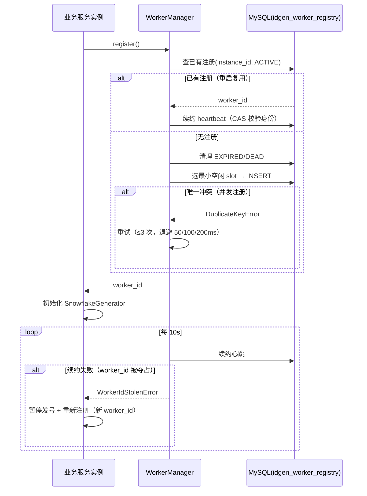
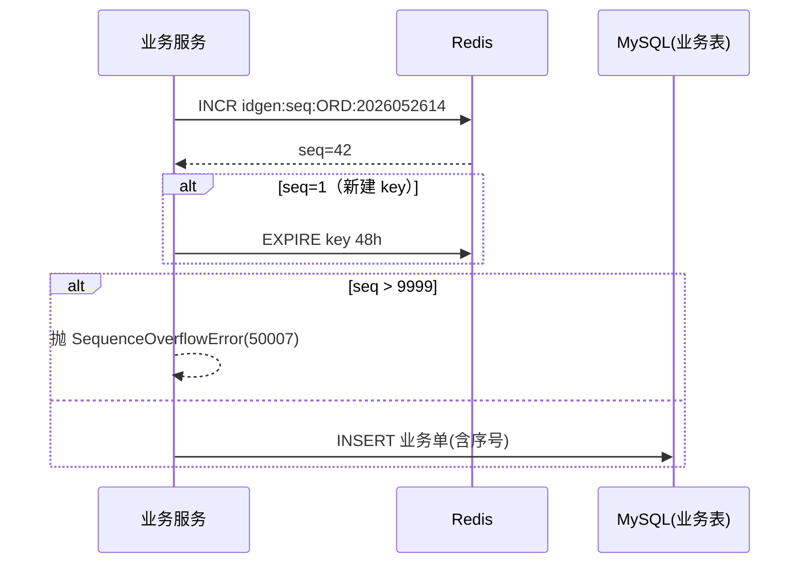

# 服务端分布式唯一ID生成与序号管理服务 - 详细设计

## 1. 概述

### 1.1 设计目标

为 PrimeTop 全平台提供统一、高性能、趋势递增的全局唯一标识生成服务，覆盖所有业务实体（用户、题目、订单、学习记录、错题、对话、报告等），支撑日新增数千万条记录的规模。

### 1.2 核心需求

| 需求 | 说明 |
|------|------|
| 全局唯一 | 分布式环境下，任意节点生成的 ID 不重复 |
| 趋势递增 | ID 整体趋势递增，利于 MySQL InnoDB 聚簇索引写入性能 |
| 高性能 | 单节点 QPS ≥ 50万，P99 延迟 ≤ 1μs（本地模式） |
| 信息安全 | ID 不可逆推业务量、不可枚举、不可推测创建时间 |
| 可读性（可选） | 部分业务场景需要人类可读的序号（订单号、报告编号） |
| 多类型支持 | 支持纯数字主键、带前缀业务序号、短码标识三种形态 |

### 1.3 ID 类型矩阵

| 类型 | 格式示例 | 用途 | 特点 |
|------|----------|------|------|
| 主键ID (Primary Key) | `1234567890123456` (BIGINT) | 所有表主键 | 纯数字、趋势递增、高性能 |
| 业务序号 (Business Code) | `ORD20260526143700001` | 订单号、报告编号 | 带前缀、时间嵌入、人类可读 |
| 短码 (Short Code) | `a7Xk9m` | 分享链接、邀请码 | 短、Base62 编码、不可枚举 |

---

## 2. 整体架构

### 2.1 架构图

```text
┌─────────────────────────────────────────────────────────┐
│                    业务服务层                              │
│  用户服务  题目服务  学习服务  订单服务  报告服务  ...       │
└──────────┬──────────────────────────────────┬────────────┘
           │ 调用                              │ 调用
           ▼                                  ▼
┌─────────────────────┐          ┌──────────────────────────┐
│  PrimaryKeyGenerator│          │  BusinessCodeGenerator   │
│  (Snowflake 改进版)  │          │  (序号生成器)              │
│                     │          │                          │
│  · 本地时钟驱动      │          │  · 前缀+日期+序列          │
│  · WorkerID 自动分配 │          │  · Redis 原子序列          │
│  · 时钟回拨容忍      │          │  · 按业务域隔离            │
└──────────┬──────────┘          └──────────┬───────────────┘
           │                                │
           ▼                                ▼
┌─────────────────────┐          ┌──────────────────────────┐
│  WorkerID 管理器      │          │  Redis 序列池             │
│  (MySQL 持久化)       │          │  · INCR 原子自增          │
│  · 注册/心跳/回收     │          │  · 预取批量分配            │
└─────────────────────┘          │  · 按 date+prefix 分 key  │
                                  └──────────────────────────┘
           │
           ▼
┌──────────────────────────────────────────────────────────┐
│                   ShortCodeGenerator                      │
│  · Base62 编码                                            │
│  · 唯一性保证 (Bloom Filter + DB 唯一索引)                  │
└──────────────────────────────────────────────────────────┘
```

### 2.2 模块分层

```text
primetop/
└── common/
    └── idgen/
        ├── __init__.py                  # 公共导出
        ├── engine.py                    # ID 生成引擎主入口
        ├── snowflake.py                 # Snowflake 改进算法
        ├── worker_manager.py            # WorkerID 管理
        ├── business_code.py             # 业务序号生成器
        ├── short_code.py                # 短码生成器
        ├── config.py                    # 配置
        ├── exceptions.py                # 异常定义
        └── metrics.py                   # 监控指标
```

---

## 3. 主键ID生成器 — Snowflake 改进算法

### 3.1 ID 结构设计

采用改进型 Snowflake 算法，64 bit 布局如下：

```text
┌─────────────────────────┬──────────┬───────────┬──────────────┐
│     41 bit timestamp     │ 2 bit DC │ 10 bit WID │ 11 bit seq   │
│    (毫秒级，约69年)       │ 数据中心  │  WorkerID  │ 毫秒内序列    │
└─────────────────────────┴──────────┴───────────┴──────────────┘

总长度: 64 bit (BIGINT UNSIGNED)
最大值: 2^64 - 1 = 18446744073709551615
```

| 字段 | 位数 | 范围 | 说明 |
|------|------|------|------|
| timestamp | 41 | 0 ~ 2^41-1 | 自定义纪元起的毫秒数，可用约 69 年 |
| datacenter_id | 2 | 0 ~ 3 | 支持 4 个数据中心/可用区 |
| worker_id | 10 | 0 ~ 1023 | 每个数据中心最多 1024 个 Worker |
| sequence | 11 | 0 ~ 2047 | 单 Worker 单毫秒最多 2048 个 ID |

### 3.2 自定义纪元

```python
# 以 2025-01-01 00:00:00 UTC 为纪元起点
# 可用至 2025 + 69 ≈ 2094 年
PRIMETOP_EPOCH_MS = 1735689600000  # 2025-01-01T00:00:00Z
```

### 3.3 核心实现

```python
# primetop/common/idgen/snowflake.py

import time
import threading
from primetop.common.idgen.exceptions import ClockMovedBackwardError, SequenceOverflowError


class SnowflakeGenerator:
    """
    改进型 Snowflake ID 生成器
    
    特点:
    - 41 bit 时间戳 + 2 bit 数据中心 + 10 bit WorkerID + 11 bit 序列
    - 单 Worker 单毫秒最大 2048 ID (204.8 万/秒)
    - 时钟回拨容忍 5ms，超出则抛异常
    - 线程安全（无锁 CAS）
    """

    __slots__ = (
        '_datacenter_id', '_worker_id',
        '_sequence', '_last_timestamp',
        '_lock',
    )

    # 位移常量
    DATACENTER_ID_SHIFT = 21   # sequence_bits + worker_id_bits = 11 + 10
    WORKER_ID_SHIFT = 11       # sequence_bits = 11
    TIMESTAMP_SHIFT = 23       # sequence_bits + worker_id_bits + datacenter_bits = 11 + 10 + 2

    # 掩码
    SEQUENCE_MASK = (1 << 11) - 1      # 0x7FF,   2047
    WORKER_ID_MASK = (1 << 10) - 1     # 0x3FF,   1023
    DATACENTER_ID_MASK = (1 << 2) - 1  # 0x3,     3

    # 时钟回拨容忍阈值
    CLOCK_BACKWARD_TOLERANCE_MS = 5

    def __init__(self, datacenter_id: int, worker_id: int, epoch_ms: int):
        if datacenter_id < 0 or datacenter_id > self.DATACENTER_ID_MASK:
            raise ValueError(f"datacenter_id 范围: 0~{self.DATACENTER_ID_MASK}")
        if worker_id < 0 or worker_id > self.WORKER_ID_MASK:
            raise ValueError(f"worker_id 范围: 0~{self.WORKER_ID_MASK}")

        self._datacenter_id = datacenter_id
        self._worker_id = worker_id
        self._epoch_ms = epoch_ms
        self._sequence = 0
        self._last_timestamp = -1
        self._lock = threading.Lock()

    def generate(self) -> int:
        """生成一个唯一 ID"""
        with self._lock:
            now = self._current_millis()

            # 时钟回拨检测
            if now < self._last_timestamp:
                diff = self._last_timestamp - now
                if diff <= self.CLOCK_BACKWARD_TOLERANCE_MS:
                    # 等待追回
                    time.sleep(diff / 1000.0)
                    now = self._current_millis()
                else:
                    raise ClockMovedBackwardError(
                        f"时钟回拨 {diff}ms，超出容忍阈值 "
                        f"{self.CLOCK_BACKWARD_TOLERANCE_MS}ms"
                    )

            if now == self._last_timestamp:
                self._sequence = (self._sequence + 1) & self.SEQUENCE_MASK
                if self._sequence == 0:
                    # 序列溢出，等待下一毫秒
                    now = self._wait_next_millis(self._last_timestamp)
            else:
                self._sequence = 0

            self._last_timestamp = now

            return (
                ((now - self._epoch_ms) << self.TIMESTAMP_SHIFT)
                | (self._datacenter_id << self.DATACENTER_ID_SHIFT)
                | (self._worker_id << self.WORKER_ID_SHIFT)
                | self._sequence
            )

    def generate_batch(self, count: int) -> list[int]:
        """批量生成 ID，减少锁竞争"""
        if count <= 0 or count > 2048:
            raise ValueError("batch size 范围: 1~2048")

        ids = []
        with self._lock:
            for _ in range(count):
                now = self._current_millis()

                if now < self._last_timestamp:
                    now = self._wait_next_millis(self._last_timestamp)

                if now == self._last_timestamp:
                    self._sequence = (self._sequence + 1) & self.SEQUENCE_MASK
                    if self._sequence == 0:
                        now = self._wait_next_millis(self._last_timestamp)
                else:
                    self._sequence = 0

                self._last_timestamp = now
                ids.append(
                    ((now - self._epoch_ms) << self.TIMESTAMP_SHIFT)
                    | (self._datacenter_id << self.DATACENTER_ID_SHIFT)
                    | (self._worker_id << self.WORKER_ID_SHIFT)
                    | self._sequence
                )
        return ids

    def _current_millis(self) -> int:
        return int(time.time() * 1000)

    def _wait_next_millis(self, last: int) -> int:
        now = self._current_millis()
        while now <= last:
            time.sleep(0.0001)  # 100μs
            now = self._current_millis()
        return now

    @classmethod
    def extract_timestamp(cls, id_: int, epoch_ms: int) -> int:
        """从 ID 中提取时间戳（毫秒）"""
        return (id_ >> cls.TIMESTAMP_SHIFT) + epoch_ms

    @classmethod
    def extract_datacenter_id(cls, id_: int) -> int:
        """从 ID 中提取数据中心 ID"""
        return (id_ >> cls.DATACENTER_ID_SHIFT) & cls.DATACENTER_ID_MASK

    @classmethod
    def extract_worker_id(cls, id_: int) -> int:
        """从 ID 中提取 Worker ID"""
        return (id_ >> cls.WORKER_ID_SHIFT) & cls.WORKER_ID_MASK

    @classmethod
    def extract_sequence(cls, id_: int) -> int:
        """从 ID 中提取序列号"""
        return id_ & cls.SEQUENCE_MASK
```

### 3.4 性能预算

| 指标 | 目标 | 说明 |
|------|------|------|
| 单线程 QPS | ≥ 204.8 万/秒 | 理论值：2048 × 1000 |
| 实际单线程 QPS | ≥ 100 万/秒 | 考虑锁开销和系统调用 |
| P50 延迟 | ≤ 0.5μs | 本地生成，无网络 |
| P99 延迟 | ≤ 1μs | 本地生成 |
| 时钟回拨容忍 | ≤ 5ms | 自动等待追回 |

---

## 4. WorkerID 管理器

### 4.1 数据模型

```sql
-- WorkerID 注册表
CREATE TABLE idgen_worker_registry (
    worker_id       SMALLINT UNSIGNED NOT NULL COMMENT 'Worker ID (0~1023)',
    datacenter_id   TINYINT UNSIGNED  NOT NULL COMMENT '数据中心 ID (0~3)',
    service_name    VARCHAR(64)       NOT NULL COMMENT '服务名称，如 learning-service',
    instance_id     VARCHAR(128)      NOT NULL COMMENT '实例标识 (pod名/容器ID)',
    ip_address      VARCHAR(45)       NOT NULL COMMENT '实例 IP',
    pid             INT UNSIGNED      NOT NULL COMMENT '进程 PID',
    heartbeat_at    DATETIME(3)       NOT NULL COMMENT '最近心跳时间',
    status          ENUM('ACTIVE', 'EXPIRED', 'DEAD') NOT NULL DEFAULT 'ACTIVE',
    created_at      DATETIME          NOT NULL DEFAULT CURRENT_TIMESTAMP,

    PRIMARY KEY (datacenter_id, worker_id),
    UNIQUE KEY uk_instance (datacenter_id, instance_id),
    INDEX idx_status_heartbeat (status, heartbeat_at),
    INDEX idx_service (service_name)
) ENGINE=InnoDB DEFAULT CHARSET=utf8mb4 COMMENT='ID生成器Worker注册表';
```

### 4.2 WorkerID 分配策略

```python
# primetop/common/idgen/worker_manager.py

import os
import socket
import logging
from datetime import datetime, timedelta
from typing import Optional

import db

logger = logging.getLogger(__name__)


class WorkerManager:
    """
    WorkerID 自动分配与生命周期管理

    策略:
    1. 首次启动：查询可用 slot，选择最小 worker_id 注册
    2. 心跳续约：每 10s 更新 heartbeat_at
    3. 故障检测：超过 30s 无心跳标记 EXPIRED
    4. 死亡回收：超过 5 分钟无心跳标记 DEAD，释放 slot
    5. 优雅关闭：主动注销，立即释放 slot
    """

    HEARTBEAT_INTERVAL_SEC = 10
    EXPIRE_THRESHOLD_SEC = 30
    DEAD_THRESHOLD_SEC = 300   # 5 分钟
    MAX_WORKER_ID = 1023

    def __init__(self, datacenter_id: int, service_name: str):
        self._datacenter_id = datacenter_id
        self._service_name = service_name
        self._instance_id = os.environ.get(
            'HOSTNAME', socket.gethostname()
        )
        self._ip = self._detect_ip()
        self._pid = os.getpid()
        self._worker_id: Optional[int] = None
        self._heartbeat_timer = None

    @property
    def worker_id(self) -> int:
        if self._worker_id is None:
            raise RuntimeError("WorkerID 尚未分配，请先调用 register()")
        return self._worker_id

    async def register(self) -> int:
        """
        注册并获取 WorkerID

        流程:
        1. 检查本实例是否已有注册（重启复用）
        2. 清理过期 slot
        3. 分配最小可用 worker_id
        """
        # 1. 检查已有注册
        existing = await self._find_existing_registration()
        if existing is not None:
            self._worker_id = existing
            await self._renew_heartbeat()
            logger.info(
                f"复用已有 WorkerID: dc={self._datacenter_id} "
                f"worker={self._worker_id}"
            )
            return self._worker_id

        # 2. 清理过期 Worker
        await self._cleanup_expired()

        # 3. 分配新 WorkerID
        self._worker_id = await self._allocate_slot()
        await self._insert_registration()

        logger.info(
            f"分配新 WorkerID: dc={self._datacenter_id} "
            f"worker={self._worker_id} instance={self._instance_id}"
        )
        return self._worker_id

    async def _find_existing_registration(self) -> Optional[int]:
        """查找本实例的已有注册"""
        row = await db.fetch_one("""
            SELECT worker_id FROM idgen_worker_registry
            WHERE datacenter_id = %s
              AND instance_id = %s
              AND status = 'ACTIVE'
        """, (self._datacenter_id, self._instance_id))
        return row['worker_id'] if row else None

    async def _allocate_slot(self) -> int:
        """分配最小可用 WorkerID"""
        rows = await db.fetch_all("""
            SELECT worker_id FROM idgen_worker_registry
            WHERE datacenter_id = %s AND status = 'ACTIVE'
            ORDER BY worker_id
        """, (self._datacenter_id,))

        used = {row['worker_id'] for row in rows}

        for wid in range(self.MAX_WORKER_ID + 1):
            if wid not in used:
                return wid

        raise RuntimeError(
            f"数据中心 {self._datacenter_id} 的 WorkerID 已耗尽"
        )

    async def _insert_registration(self):
        """插入注册记录"""
        await db.execute("""
            INSERT INTO idgen_worker_registry
                (worker_id, datacenter_id, service_name,
                 instance_id, ip_address, pid, heartbeat_at, status)
            VALUES (%s, %s, %s, %s, %s, %s, %s, 'ACTIVE')
        """, (
            self._worker_id, self._datacenter_id, self._service_name,
            self._instance_id, self._ip, self._pid,
            datetime.utcnow(),
        ))

    async def renew_heartbeat(self):
        """外部调用的心跳续约"""
        await self._renew_heartbeat()

    async def _renew_heartbeat(self):
        await db.execute("""
            UPDATE idgen_worker_registry
            SET heartbeat_at = %s, status = 'ACTIVE'
            WHERE datacenter_id = %s AND worker_id = %s
        """, (datetime.utcnow(), self._datacenter_id, self._worker_id))

    async def _cleanup_expired(self):
        """清理过期和死亡的 Worker"""
        now = datetime.utcnow()

        # 标记过期
        await db.execute("""
            UPDATE idgen_worker_registry
            SET status = 'EXPIRED'
            WHERE datacenter_id = %s
              AND status = 'ACTIVE'
              AND heartbeat_at < %s
        """, (self._datacenter_id, now - timedelta(seconds=self.EXPIRE_THRESHOLD_SEC)))

        # 标记死亡（释放 slot）
        await db.execute("""
            UPDATE idgen_worker_registry
            SET status = 'DEAD'
            WHERE datacenter_id = %s
              AND status = 'EXPIRED'
              AND heartbeat_at < %s
        """, (self._datacenter_id, now - timedelta(seconds=self.DEAD_THRESHOLD_SEC)))

    async def deregister(self):
        """优雅关闭，主动释放 WorkerID"""
        if self._worker_id is not None:
            await db.execute("""
                UPDATE idgen_worker_registry
                SET status = 'DEAD'
                WHERE datacenter_id = %s AND worker_id = %s
            """, (self._datacenter_id, self._worker_id))
            logger.info(
                f"注销 WorkerID: dc={self._datacenter_id} "
                f"worker={self._worker_id}"
            )
            self._worker_id = None

    @staticmethod
    def _detect_ip() -> str:
        """检测本机 IP"""
        try:
            with socket.socket(socket.AF_INET, socket.SOCK_DGRAM) as s:
                s.connect(('8.8.8.8', 80))
                return s.getsockname()[0]
        except Exception:
            return '127.0.0.1'
```

### 4.3 心跳机制

```python
# 心跳启动（在 FastAPI lifespan 中集成）

import asyncio
from contextlib import asynccontextmanager


@asynccontextmanager
async def idgen_lifespan(app):
    """ID 生成器生命周期管理"""
    dc_id = int(os.environ.get('DATACENTER_ID', '0'))
    service = os.environ.get('SERVICE_NAME', 'unknown')

    manager = WorkerManager(dc_id, service)
    worker_id = await manager.register()

    # 初始化全局生成器
    generator = SnowflakeGenerator(
        datacenter_id=dc_id,
        worker_id=worker_id,
        epoch_ms=PRIMETOP_EPOCH_MS,
    )
    idgen_engine.init_primary_generator(generator)

    # 启动心跳
    async def heartbeat_loop():
        while True:
            await asyncio.sleep(WorkerManager.HEARTBEAT_INTERVAL_SEC)
            try:
                await manager.renew_heartbeat()
            except Exception as e:
                logger.error(f"心跳续约失败: {e}")

    task = asyncio.create_task(heartbeat_loop())

    yield  # 应用运行中

    # 关闭
    task.cancel()
    await manager.deregister()
```

---

## 5. 业务序号生成器

### 5.1 设计思路

部分业务场景需要人类可读的序号（订单号、报告编号、工单号等），这类序号需要：
- 包含业务前缀，一眼识别类型
- 嵌入日期，方便排序和追溯
- 严格连续或分段连续，满足审计要求
- 高可用，依赖 Redis 原子操作

### 5.2 序号格式

```text
[前缀][日期][小时][4位流水号]

示例:
  ORD2026052614370001   — 订单号
  RPT2026052608000012   — 学习报告编号
  TK2026052616000099    — 工单号
  INV2026052618000001   — 邀请码批次号

结构:
  前缀     3~4 字母
  日期     YYYYMMDD    8 位
  小时     HH          2 位
  序号     0001~9999    4 位（每小时 9999 个，单日 24 万个）

总长度: 17~18 字符
```

### 5.3 业务前缀注册表

```python
# primetop/common/idgen/business_code.py

from enum import Enum
from datetime import datetime
import redis


class BusinessPrefix(str, Enum):
    """业务前缀注册表"""
    ORDER = "ORD"           # 订单
    REPORT = "RPT"          # 学习报告
    TICKET = "TK"           # 工单
    INVITE = "INV"          # 邀请码批次
    EXPORT = "EXP"          # 数据导出
    REFUND = "REF"          # 退款
    RECEIPT = "REC"         # 收据
    CAMPAIGN = "CMP"        # 活动
    COUPON = "CPN"          # 优惠券
    CERT = "CRT"            # 证书
    EXAM_PAPER = "EXM"      # 试卷
    ERROR_BOOK = "EBK"      # 错题导出


class BusinessCodeGenerator:
    """
    业务序号生成器

    基于 Redis INCR 实现原子自增序列。
    Key 设计: idgen:seq:{prefix}:{YYYYMMDDHH}
    TTL: 48 小时（保留到次日对账）
    """

    # 每小时最大序号
    MAX_SEQ_PER_HOUR = 9999

    def __init__(self, redis_client: redis.Redis):
        self._redis = redis_client

    def generate(self, prefix: BusinessPrefix) -> str:
        """
        生成一个业务序号

        Args:
            prefix: 业务前缀

        Returns:
            如 "ORD2026052614370001"
        """
        now = datetime.utcnow()
        date_str = now.strftime('%Y%m%d')
        hour_str = now.strftime('%H')

        redis_key = f"idgen:seq:{prefix.value}:{date_str}{hour_str}"

        seq = self._redis.incr(redis_key)

        # 首次创建设置 TTL
        if seq == 1:
            self._redis.expire(redis_key, 48 * 3600)

        if seq > self.MAX_SEQ_PER_HOUR:
            raise SequenceOverflowError(
                f"业务序号 [{prefix.value}] 在 {date_str}{hour_str} 时段已耗尽 "
                f"(max={self.MAX_SEQ_PER_HOUR})"
            )

        return f"{prefix.value}{date_str}{hour_str}{seq:04d}"

    def generate_batch(self, prefix: BusinessPrefix, count: int) -> list[str]:
        """
        批量生成连续序号

        用于批量导出、批量生成报告等场景
        """
        if count <= 0 or count > self.MAX_SEQ_PER_HOUR:
            raise ValueError(f"batch size 范围: 1~{self.MAX_SEQ_PER_HOUR}")

        now = datetime.utcnow()
        date_str = now.strftime('%Y%m%d')
        hour_str = now.strftime('%H')

        redis_key = f"idgen:seq:{prefix.value}:{date_str}{hour_str}"

        # INCRBY 原子获取范围
        end_seq = self._redis.incrby(redis_key, count)
        start_seq = end_seq - count + 1

        if end_seq == count:
            self._redis.expire(redis_key, 48 * 3600)

        if end_seq > self.MAX_SEQ_PER_HOUR:
            # 超限回滚
            self._redis.incrby(redis_key, -count)
            raise SequenceOverflowError(
                f"业务序号 [{prefix.value}] 剩余空间不足 "
                f"(请求 {count}，剩余 {self.MAX_SEQ_PER_HOUR - (end_seq - count)})"
            )

        return [
            f"{prefix.value}{date_str}{hour_str}{seq:04d}"
            for seq in range(start_seq, end_seq + 1)
        ]
```

### 5.4 序号容量规划

| 业务 | 前缀 | 估计峰值/小时 | 容量上限 | 充裕度 |
|------|------|-------------|---------|--------|
| 订单 | ORD | 500 | 9,999 | 20× |
| 学习报告 | RPT | 2,000 | 9,999 | 5× |
| 工单 | TK | 100 | 9,999 | 100× |
| 数据导出 | EXP | 50 | 9,999 | 200× |
| 退款 | REF | 200 | 9,999 | 50× |

若单时段 9999 不够，可扩展为 6 位序号（999999/小时），只需修改格式和 `MAX_SEQ_PER_HOUR`。

---

## 6. 短码生成器

### 6.1 设计思路

分享链接和邀请码需要短小精悍的标识符，要求：
- 6~8 字符长度
- Base62 编码（0-9, a-z, A-Z）
- 不可枚举、不可推测
- 全局唯一

### 6.2 实现

```python
# primetop/common/idgen/short_code.py

import hashlib
import os
import time
from collections.abc import Sequence

ALPHABET = "0123456789abcdefghijklmnopqrstuvwxyzABCDEFGHIJKLMNOPQRSTUVWXYZ"
BASE = len(ALPHABET)  # 62


def base62_encode(num: int) -> str:
    """将整数编码为 Base62 字符串"""
    if num == 0:
        return ALPHABET[0]
    chars = []
    while num > 0:
        num, remainder = divmod(num, BASE)
        chars.append(ALPHABET[remainder])
    return ''.join(reversed(chars))


def base62_decode(s: str) -> int:
    """将 Base62 字符串解码为整数"""
    num = 0
    for ch in s:
        num = num * BASE + ALPHABET.index(ch)
    return num


class ShortCodeGenerator:
    """
    短码生成器

    策略: 基于 Snowflake ID 的 Base62 编码 + 随机混淆

    格式:
    - 标准短码 (6字符): ID % 62^6 的 Base62 编码 + 校验位
    - 长短码 (8字符): 完整 ID 的 Base62 编码
    """

    # 6 字符 Base62 可表示的最大值
    CODE_6_MAX = 62 ** 6   # 56,800,235,584
    # 8 字符 Base62 可表示的最大值
    CODE_8_MAX = 62 ** 8   # 218,340,105,584,896

    # 混淆盐，防止连续 ID 生成连续短码
    OBFUSCATION_SALT = 0x5BD1E995

    def __init__(self, snowflake: 'SnowflakeGenerator'):
        self._snowflake = snowflake
        self._counter = 0

    def generate(self, length: int = 6) -> str:
        """
        生成一个短码

        Args:
            length: 短码长度，6 或 8

        Returns:
            如 "a7Xk9m"
        """
        if length not in (6, 8):
            raise ValueError("短码长度仅支持 6 或 8")

        snowflake_id = self._snowflake.generate()

        if length == 6:
            # 截取 + 混淆
            truncated = snowflake_id % self.CODE_6_MAX
            obfuscated = self._obfuscate(truncated)
            code = base62_encode(obfuscated)
            return code.zfill(6)[-6:]
        else:
            # 完整编码
            code = base62_encode(snowflake_id)
            return code.zfill(8)[-8:]

    def generate_with_check(
        self,
        length: int,
        existence_check_fn,
        max_retries: int = 5,
    ) -> str:
        """
        生成短码并检查唯一性

        Args:
            length: 短码长度
            existence_check_fn: 异步/同步函数，接收短码返回是否已存在
            max_retries: 最大重试次数

        用于分享链接等需要绝对唯一的场景
        """
        for attempt in range(max_retries):
            code = self.generate(length)
            if not existence_check_fn(code):
                return code

        # 极端情况：增加随机性重试
        for attempt in range(max_retries):
            random_id = int.from_bytes(os.urandom(8), 'big')
            if length == 6:
                code = base62_encode(random_id % self.CODE_6_MAX).zfill(6)[-6:]
            else:
                code = base62_encode(random_id % self.CODE_8_MAX).zfill(8)[-8:]

            if not existence_check_fn(code):
                return code

        raise RuntimeError(f"短码生成失败: 重试 {max_retries * 2} 次后仍有冲突")

    @staticmethod
    def _obfuscate(value: int) -> int:
        """简单混淆，使连续输入产生不连续输出"""
        # MurmurHash 风格的位混合
        value ^= value >> 16
        value = (value * ShortCodeGenerator.OBFUSCATION_SALT) & 0xFFFFFFFF
        value ^= value >> 13
        return value
```

### 6.3 短码唯一性保障

短码用于分享链接、邀请码等绝对不可重复的场景，采用 **三层防护** 设计：

| 层级 | 机制 | 语义 | 兜底 |
|------|------|------|------|
| L1 | Snowflake 截断 + 混淆 | 单调发号窗口内（62^6≈568 亿个）理论无碰撞 | L2 |
| L2 | Redis Bloom Filter 预检 | `BF.EXISTS=0` 可直接使用；`=1`（含 ~1% 误判）转 L3 | L3 |
| L3 | 业务表唯一索引 + 占码登记 | `INSERT` 冲突即重生成，最终裁决 | 重试上限后抛错 |

**占码守卫**（由分享服务等在生成短链时调用，`db_insert_fn` 为业务表插入，如 `INSERT INTO short_link(code, ...)`）：

```python
# primetop/common/idgen/short_code.py（续）

class ShortCodeUniquenessGuard:
    """
    短码占码守卫：Bloom 预检 + DB 唯一索引裁决

    使用约定:
    - db_check_fn(code) -> bool: 业务表是否已存在该短码
    - db_insert_fn(code): 业务表原子占码 INSERT（uk 冲突抛 DuplicateKeyError）
    - claim 成功返回 True 表示短码已归本调用方所有，必须随后完成业务落库
    """

    BLOOM_KEY = "idgen:bloom:short_code"

    def __init__(self, redis_client, db_check_fn, db_insert_fn):
        self._redis = redis_client
        self._db_check_fn = db_check_fn
        self._db_insert_fn = db_insert_fn

    async def claim(self, code: str) -> bool:
        # L2: Bloom 预检（Bloom 故障时直查 DB，见降级 D5）
        try:
            exists = await self._redis.execute_command(
                "BF.EXISTS", self.BLOOM_KEY, code)
        except Exception:
            exists = 1  # Bloom 不可用保守降级为"可能存在"
        if exists and await self._db_check_fn(code):
            return False

        # L3: DB 原子占码
        try:
            await self._db_insert_fn(code)
        except DuplicateKeyError:
            await self._redis.execute_command("BF.ADD", self.BLOOM_KEY, code)
            return False

        # 登记 Bloom，加速后续重复拦截
        try:
            await self._redis.execute_command("BF.ADD", self.BLOOM_KEY, code)
        except Exception:
            pass  # Bloom 登记失败不影响已占码结果
        return True
```

**守卫规则：**
- G6：短码必须经 `claim()` 占码成功方可下发给客户端；直接 `generate()` 不查重的短码仅限无唯一性要求的展示场景（如临时会话标识）。
- G9：Bloom Filter 初始化容量 1 亿、误判率 0.1%（`BF.RESERVE`），写满后按周重建并全量回灌 DB 已用短码，防止误判率劣化拖慢 L3。

### 6.4 短码容量与碰撞概率

**Snowflake 截断分支**（主路径）：连续发号在取模回绕前（62^6=568 亿个）值域不重复，冲突仅发生于多 Worker 同毫秒截断同值的极小概率事件，由 `claim()` 兜底重试，无容量风险。

**随机重试分支**（`generate_with_check` 中 `os.urandom` 兜底）适用生日悖论估算 `p ≈ 1 - exp(-n²/2N)`：

| 长度 | 空间 N | 单日生成 1 万 | 单日生成 5 万 | 单日生成 10 万 |
|------|--------|--------------|--------------|----------------|
| 6 位 | 5.68×10¹⁰ | p≈0.09% | p≈2.2% | p≈8.8% |
| 8 位 | 2.18×10¹⁴ | p≈2.3×10⁻⁷ | p≈5.7×10⁻⁶ | p≈2.3×10⁻⁵ |

结论：**随机分支单日生成须 ≤1 万（6 位）**，超过时运营侧应改发 8 位短码； Snowflake 分支不设日限额，受全局发号速率约束（单 Worker 204.8 万/秒）。

---

## 7. 引擎主入口（engine.py）

### 7.1 统一门面

```python
# primetop/common/idgen/engine.py

import os
from dataclasses import dataclass

from primetop.common.idgen.snowflake import SnowflakeGenerator
from primetop.common.idgen.business_code import (
    BusinessCodeGenerator, BusinessPrefix)
from primetop.common.idgen.short_code import (
    ShortCodeGenerator, ShortCodeUniquenessGuard)

PRIMETOP_EPOCH_MS = 1735689600000  # 2025-01-01T00:00:00Z，全局唯一，上线后禁止变更


@dataclass(frozen=True)
class ParsedId:
    """ID 解析结果（仅供内部排障，禁止对外暴露）"""
    timestamp_ms: int
    datacenter_id: int
    worker_id: int
    sequence: int


class IdGenEngine:
    """
    全局 ID 生成门面（进程内单例）

    初始化时机: FastAPI lifespan（见 §4.3），初始化完成前调用任何
    next_* 方法抛 RuntimeError（fail-closed，禁止半成品发号）。
    """

    _primary: SnowflakeGenerator | None = None
    _biz: BusinessCodeGenerator | None = None
    _short: ShortCodeGenerator | None = None

    @classmethod
    def init(cls, *, redis_client, datacenter_id: int | None = None,
             service_name: str | None = None,
             epoch_ms: int = PRIMETOP_EPOCH_MS) -> None:
        import primetop.common.idgen.worker_manager as wm

        dc = datacenter_id if datacenter_id is not None else int(
            os.environ.get('DATACENTER_ID', '0'))
        svc = service_name or os.environ.get('SERVICE_NAME', 'unknown')

        manager = wm.WorkerManager(dc, svc)
        # register() 内部处理复用/分配；worker_id 被夺占时抛
        # WorkerIdStolenError，生成器保持未初始化态（fail-closed）
        worker_id = cls._run_sync(manager.register())

        cls._primary = SnowflakeGenerator(dc, worker_id, epoch_ms)
        cls._biz = BusinessCodeGenerator(redis_client)
        cls._short = ShortCodeGenerator(cls._primary)

    # ---- 主键 ID ----
    @classmethod
    def next_id(cls) -> int:
        return cls._require_primary().generate()

    @classmethod
    def next_ids(cls, count: int) -> list[int]:
        return cls._require_primary().generate_batch(count)

    # ---- 业务序号 ----
    @classmethod
    def next_code(cls, prefix: BusinessPrefix) -> str:
        return cls._require_biz().generate(prefix)

    @classmethod
    def next_codes(cls, prefix: BusinessPrefix, count: int) -> list[str]:
        return cls._require_biz().generate_batch(prefix, count)

    # ---- 短码 ----
    @classmethod
    def next_short_code(cls, length: int = 6) -> str:
        """仅用于无唯一性要求的场景；唯一性场景用 next_claimed_short_code"""
        return cls._require_short().generate(length)

    @classmethod
    async def next_claimed_short_code(cls, guard: ShortCodeUniquenessGuard,
                                      length: int = 6) -> str:
        """带占码守卫的短码生成（分享/邀请等唯一性场景唯一入口）"""
        return await cls._require_short().generate_with_check(
            length, guard.claim)

    # ---- 解析（内部排障专用）----
    @classmethod
    def parse(cls, id_: int) -> ParsedId:
        g = cls._require_primary()
        return ParsedId(
            timestamp_ms=g.extract_timestamp(id_, PRIMETOP_EPOCH_MS),
            datacenter_id=g.extract_datacenter_id(id_),
            worker_id=g.extract_worker_id(id_),
            sequence=g.extract_sequence(id_),
        )

    @classmethod
    def _require_primary(cls) -> SnowflakeGenerator:
        if cls._primary is None:
            raise RuntimeError(
                "IdGenEngine 未初始化（worker_id 未分配或已被夺占）")
        return cls._primary

    @classmethod
    def _require_biz(cls) -> BusinessCodeGenerator:
        if cls._biz is None:
            raise RuntimeError("IdGenEngine 未初始化")
        return cls._biz

    @classmethod
    def _require_short(cls) -> ShortCodeGenerator:
        if cls._short is None:
            raise RuntimeError("IdGenEngine 未初始化")
        return cls._short
```

### 7.2 业务侧调用示例

```python
# 订单服务：主键 + 订单号一次生成
async def create_order(user_id: int, amount: int) -> Order:
    order_id = IdGenEngine.next_id()                    # BIGINT 主键
    order_no = IdGenEngine.next_code(BusinessPrefix.ORDER)  # ORD2026052614370001
    order = Order(id=order_id, order_no=order_no, user_id=user_id, amount=amount)
    ...

# 分享服务：带占码守卫的短码（唯一性场景）
async def create_share_link(user_id: int, target_type: str, target_id: int) -> str:
    guard = ShortCodeUniquenessGuard(redis, db.check_short_code, db.insert_short_code)
    code = await IdGenEngine.next_claimed_short_code(guard, length=6)
    await db.bind_short_link(code, user_id, target_type, target_id)
    return f"https://pt.top/s/{code}"
```

---

## 8. 配置项

| 配置 | 环境变量 / 常量 | 默认值 | 说明 |
|------|----------------|--------|------|
| 自定义纪元 | `PRIMETOP_EPOCH_MS`（代码常量） | 1735689600000 | **上线后禁止变更**（R4） |
| 数据中心 ID | `DATACENTER_ID` | 0 | 0~3，由部署平台注入，禁止硬编码 |
| 服务名 | `SERVICE_NAME` | unknown | Worker 注册用 |
| 时钟回拨容忍 | `IDGEN_CLOCK_TOLERANCE_MS` | 5 | 超阈值 fail-closed |
| 心跳间隔 | `IDGEN_HEARTBEAT_INTERVAL_SEC` | 10 | |
| 过期阈值 | `IDGEN_WORKER_EXPIRE_SEC` | 30 | 无心跳标记 EXPIRED |
| 死亡阈值 | `IDGEN_WORKER_DEAD_SEC` | 300 | EXPIRED 超时标记 DEAD 并释放 slot |
| Redis 连接 | `IDGEN_REDIS_URL` | — | 业务序号/Bloom 共用，与业务 Redis 逻辑隔离（独立 db 索引） |

---

## 9. 核心流程

### 9.1 服务启动 WorkerID 注册时序



### 9.2 业务序号生成时序



**延迟预算**：`next_id()` 本地生成 P99 ≤ 1μs；`next_code()` Redis RTT P99 ≤ 5ms；`next_claimed_short_code()` Bloom 命中 P99 ≤ 3ms、Bloom 未命中（查 DB）P99 ≤ 15ms。

---

## 10. 状态机与守卫

### 10.1 WorkerRegistry 状态机

```text
                 ┌──────────┐  心跳丢失>30s   ┌──────────┐  持续无心跳>300s  ┌────────┐
   注册(最小空slot)▶│ ACTIVE   │──────────────▶│ EXPIRED  │────────────────▶│  DEAD  │
                 └────┬─────┘               └────┬─────┘                 └───┬────┘
                      │ 优雅关闭(deregister)      │ 本实例心跳恢复续约          │ slot 可被
                      │ (标记DEAD,立即释放)       │ (CAS 校验 instance_id)     │ 重新分配
                      ▼                          ▼ (失败→worker_id被夺占)        ▼
                 ┌──────────┐               重新 register() 申请新 slot      新实例注册
                 │  DEAD    │
                 └──────────┘
```

| 转移 | 触发 | 动作 |
|------|------|------|
| （无）→ ACTIVE | 注册（最小空 slot INSERT 成功） | 开始发号 |
| ACTIVE → EXPIRED | 心跳丢失 > 30s（清理任务标记） | 保留 slot 300s 可恢复 |
| EXPIRED → ACTIVE | 本实例心跳恢复且 slot 未被夺占 | CAS 续约成功，继续发号 |
| EXPIRED → DEAD | 持续无心跳 > 300s | 释放 slot，可被重新分配 |
| ACTIVE → DEAD | 优雅关闭 / 死亡回收 | 释放 slot |

### 10.2 守卫总表

| 编号 | 规则 | 级别 |
|------|------|------|
| G1 | 同一 (datacenter_id, worker_id) 任一时刻只有一个 ACTIVE 持有者（DB 主键 + 续约 CAS 双保险） | 强约束 |
| G2 | worker_id 被夺占后旧实例立即暂停发号，重新注册成功前 `next_*` 抛 50014（fail-closed） | 强约束 |
| G3 | 时钟回拨 > 5ms 抛 `ClockMovedBackwardError`(50001)，禁止发号 | 强约束 |
| G4 | 毫秒内序列耗尽必须等待下一毫秒，禁止复用/回绕序列 | 强约束 |
| G5 | Redis 宕机时业务序号 fail-closed（50006），禁止本地计数替代（防重号） | 强约束 |
| G6 | 短码唯一性场景必须经 `claim()` 占码 | 强约束 |
| G7 | DEAD slot 回收后方可重新分配；EXPIRED slot 分配前必须二次确认持有者已死亡 | 强约束 |
| G8 | 纪元使用时间超过 2^41ms（约 69 年）前 1 年必须启动方案迁移，溢出时 fail-closed | 强约束 |
| G9 | 业务序号每小时 9999 硬顶，溢出拒绝（50007），禁止顺延侵占下一时段 | 强约束 |
| G10 | `register()` 幂等：同 instance_id 重复调用复用已有注册，不重复占 slot | 强约束 |

---

## 11. 幂等与并发场景

| 场景 | 并发问题 | 裁决 |
|------|----------|------|
| 两实例同时注册选中最小空 slot | 读-选-插入非原子 | DB 主键 (dc, worker_id) 冲突，败方捕获 DuplicateKeyError 重试（≤3 次退避），F2 补丁 |
| 实例重启再次 register | 重复占 slot | 先查 instance_id 已有 ACTIVE 注册，复用（G10） |
| 网络分区 30s+ 后恢复，原 slot 已被新实例持有 | 双实例同 worker_id 发号（致命） | 续约 CAS `WHERE worker_id=? AND instance_id=?`，失败即判定夺占，旧实例停号重注册（F1 补丁，G1/G2） |
| 心跳并发更新 | 互相覆盖 | 幂等（同值覆盖无影响）+ CAS 身份校验 |
| INCR / INCRBY | 并发自增 | Redis 单线程原子，天然安全 |
| 批量序号超限回滚 | 回滚期间另一请求 INCR | 回滚用 INCRBY(-count) 原子完成；中间窗口新号段与本批交错无重复（值域唯一） |
| 短码 claim 与业务落库之间服务崩溃 | 短码已占未绑定 | 占码即写业务表（同事务或先占后绑由调用方保证）；孤儿短码由业务侧过期回收后补登 Bloom |
| 批量生成部分失败 | 一半成功一半异常 | 主键批量纯内存无失败面；业务序号批量 Redis 返回即成功，DB 写失败由业务事务回滚（序号跳号可接受，见 R2） |

---

## 12. 错误码（50000-50099）

本组件为进程内库，无 REST 出口；错误码仅用于日志、告警与指标标签，**不透传客户端**。段位 500xx 经全库扫描确认空闲。

| 错误码 | 标识 | 含义 | 处置 |
|--------|------|------|------|
| 50001 | CLOCK_MOVED_BACKWARD | 时钟回拨超容忍阈值 | fail-closed，监控 M3 告警 |
| 50002 | SEQUENCE_OVERFLOW_WAIT | 毫秒内序列耗尽等待（非错误） | 仅计数观测 |
| 50003 | WORKER_ID_EXHAUSTED | WorkerID 耗尽（>1024 实例/DC） | 扩容数据中心或实例合并 |
| 50004 | WORKER_REGISTER_CONFLICT | 注册唯一冲突 | 自动重试 ≤3 次 |
| 50005 | WORKER_HEARTBEAT_FAILED | 心跳写库失败 | 指数退避重试，连续 3 次告警 |
| 50006 | REDIS_SEQ_UNAVAILABLE | Redis 序号池不可用 | fail-closed（G5） |
| 50007 | BIZ_SEQ_HOURLY_EXHAUSTED | 业务序号时段耗尽 | 拒绝 + 容量告警 |
| 50008 | SHORT_CODE_CONFLICT | 短码冲突重试（命中守卫） | 自动重试，连续计数 |
| 50009 | SHORT_CODE_RETRY_EXHAUSTED | 短码重试耗尽 | 抛错，人工介入 |
| 50010 | EPOCH_OVERFLOW | 纪元溢出（理论） | fail-closed（G8） |
| 50011 | BATCH_SIZE_INVALID | 批量参数非法 | 参数校验拒绝 |
| 50012 | INVALID_PREFIX | 未注册业务前缀 | 注册表新增需评审（R5） |
| 50013 | BLOOM_UNAVAILABLE | Bloom 故障降级直查 DB | 自动降级（D5） |
| 50014 | WORKER_ID_NOT_ASSIGNED / STOLEN | 未注册或已被夺占 | fail-closed（G2） |

---

## 13. 降级矩阵

| 编号 | 故障场景 | 降级策略 | 恢复 |
|------|----------|----------|------|
| D1 | Worker 注册表短暂不可用 | 已持有 worker_id 的实例照常发号；新实例启动阻塞重试（≤60s 后失败退出，K8s 重启） | 表恢复后正常注册 |
| D2 | Redis 宕机（业务序号/Bloom） | 业务序号 fail-closed（G5）；主键 Snowflake 本地发号不受影响；短码唯一性场景转 DB 直查（D5） | Redis 恢复 |
| D3 | 时钟回拨 ≤5ms | 自动等待追回，无感 | NTP 校正 |
| D4 | 时钟回拨 >5ms | fail-closed 抛 50001，禁止发号 | NTP 强制同步后恢复 |
| D5 | Bloom Filter 不可用 | 每次 claim 直查 DB（P99 15ms），吞吐量降至 DB 上限 | Bloom 恢复 |
| D6 | 短码 DB 占码冲突率升高（>1%） | 自动切换 8 位短码（空间扩大 3844 倍） | 冲突率回落后配置回切 |
| D7 | 心跳写库连续失败 | 本地继续发号（worker_id 未过期窗口 30s 内）；连续失败 >3 次主动停号重注册 | 写库恢复 |
| D8 | metrics 上报失败 | 静默丢弃，绝不阻塞发号主链路 | 上报恢复 |
| D9 | 单 Worker 序列耗尽（>204.8 万/s） | 等待下一毫秒（50002 计数），无感 | 实例扩容分摊 |
| D10 | 总红线 | **唯一性不可降级**：任何降级路径不得跳过唯一性检查或放宽 G1-G10 守卫 | — |

---

## 14. 监控指标与容量

### 14.1 指标定义（metrics.py，对应 §2.2 模块分层）

```python
# primetop/common/idgen/metrics.py

from prometheus_client import Counter, Histogram, Gauge

# 发号
idgen_generate_total = Counter(
    'idgen_generate_total', 'ID 生成次数', ['kind'])  # kind: primary|biz|short
idgen_generate_latency = Histogram(
    'idgen_generate_latency_seconds', '生成延迟', ['kind'])

# 异常
idgen_clock_rollback_total = Counter(
    'idgen_clock_rollback_total', '时钟回拨次数', ['within_tolerance'])
idgen_errors_total = Counter(
    'idgen_errors_total', '错误次数', ['code'])  # 50001~50014

# 业务序号
idgen_biz_seq_exhausted_total = Counter(
    'idgen_biz_seq_exhausted_total', '时段序号耗尽次数', ['prefix'])

# 短码
idgen_short_code_conflict_total = Counter(
    'idgen_short_code_conflict_total', '短码冲突重试次数', ['length'])

# Worker 注册表
idgen_workers_active = Gauge(
    'idgen_workers_active', 'ACTIVE Worker 数', ['datacenter_id'])
idgen_worker_stolen_total = Counter(
    'idgen_worker_stolen_total', 'worker_id 被夺占次数')
```

### 14.2 告警阈值（M1-M10）

| 编号 | 指标 | 阈值 | 级别 |
|------|------|------|------|
| M1 | idgen_errors_total{code="50001"} | >0 | P1（时钟异常） |
| M2 | idgen_workers_active / DC | >900（90%） | P2 |
| M3 | idgen_worker_stolen_total | 任意发生 | P2（观察网络分区） |
| M4 | 50007 时段耗尽 | 任意发生 | P2（容量） |
| M5 | 短码冲突率（50008/生成量） | >0.1%（6 位） | P3 |
| M6 | 50009 重试耗尽 | 任意发生 | P1 |
| M7 | next_code() P99 | >20ms（Redis RTT 基线 ×4） | P3 |
| M8 | 心跳失败率 | 连续 3 次 | P2 |
| M9 | 50014 未初始化调用 | 任意发生 | P1（服务启动缺陷） |
| M10 | 时钟回拨等待时长 P99 | >4ms | P3（NTP 质量预警） |

### 14.3 容量基线（DAU 50 万）

| 项 | 估算 |
|----|------|
| 主键发号 | 日新增约 3000 万条记录（答题/行为/日志明细主键另计），峰值 2 万 QPS，单 Worker 余量 100× |
| 业务序号 | 订单峰值 500/小时，上限 9999，余量 20× |
| 短码 | 分享日活 5 万次 → Snowflake 分支无压力；随机分支红线 ≤1 万/日 |
| 注册表 | 实例数 ≤200（K8s Pod），单 DC 上限 1024，余量 5× |
| Bloom | 1 亿容量 × 0.1% 误判，Redis 内存约 120MB |

---

## 15. 合规要点

| 编号 | 规则 |
|------|------|
| C1 | ID/序号/短码均不含 PII，禁止将手机号、姓名等编入任何标识 |
| C2 | 短码经混淆不可枚举，禁止对外提供遍历接口（分享链接须配合鉴权/过期校验，权威归分享服务） |
| C3 | `parse()` 解析能力仅供内部排障，禁止暴露管理端以外的任何接口 |
| C4 | worker 注册与发号审计日志留存 180 天（instance_id/IP/时间），支撑安全溯源 |
| C5 | 时钟源必须经 NTP 校准，容器环境禁用宿主机时钟漂移未监控的部署 |
| C6 | 纪元与位布局变更视为 breaking change，需全员评审并保留新旧双读窗口（R4） |
| C7 | 注销用户的历史 ID 不做回收复用（所有 ID 一次性使用） |
| C8 | 随机短码分支禁用时间种子伪随机，必须使用 CSPRNG（`os.urandom`） |

---

## 16. 契约对齐（R1-R10）

| 编号 | 裁决 |
|------|------|
| R1 | 主键 ID 形态（BIGINT 雪花改进版）为全平台唯一主键方案，禁止业务自造发号器；业务表主键统一 `BIGINT UNSIGNED` |
| R2 | 订单号/报告号等人类可读序号**格式权威归本文**（`[前缀][YYYYMMDD][HH][4 位流水]`）；消费方（订单服务/学情报告/支付对账）只消费不自定义。序号允许跳号（事务回滚/批量失败），连续性不做承诺，对账以唯一性为准 |
| R3 | 雪花 worker_id 发放表与《服务端数据库读写分离与分库分表演进策略》`id_worker_node`（分片环境租约形态）为同一语义演进：MVP 单库用本文 `idgen_worker_registry`，水平分表后切换 `id_worker_node` 租约，实现期二者保留一张（后者落地时删除前者），禁止双写并存 |
| R4 | `PRIMETOP_EPOCH_MS` 与 64bit 位布局为全局常量，任何服务不得自定义纪元 |
| R5 | `BusinessPrefix` 新增前缀需评审登记（防前缀碰撞与语义泛滥），管理端变更走配置中心双人审批 |
| R6 | 短码存在性检查函数（`db_check_fn`/`db_insert_fn`）由调用方业务域提供，本组件不感知业务表结构；唯一索引必须建在业务表（兜底 L3） |
| R7 | 报告编号 RPT 前缀与《学习报告生成与交付服务》对齐：编号在报告创建时一次性生成，重试复用原编号（幂等），禁止一报告多号 |
| R8 | 指标命名 `idgen_*` 与监控平台规范对齐；各业务服务不得自行包装发号计数 |
| R9 | 分享短链长度/字符集变更需与《统一短链服务与深链接跳转编排引擎》《分享与社交裂变系统》三方会签（外链已投放不可失效） |
| R10 | 进程内门面 `IdGenEngine` 为唯一入口，禁止绕过门面直接实例化 `SnowflakeGenerator`（监控/守卫统一在门面生效） |

---

## 17. 验收场景

| 编号 | 场景 | 预期 |
|------|------|------|
| AC01 | 单实例串行生成 100 万个 ID | 全部唯一，趋势递增，无异常 |
| AC02 | 32 线程并发生成 1000 万个 ID | 全部唯一，P99 ≤ 1μs |
| AC03 | 单 Worker 压测 204.8 万/秒边界 | 序列正确回绕等待，无重复无负数 |
| AC04 | 时钟回拨 3ms | 自动等待追回，无重复 |
| AC05 | 时钟回拨 10ms | 抛 50001，停号，恢复后正常 |
| AC06 | 两实例并发注册 | 分配不同 worker_id，无死锁 |
| AC07 | 实例重启 register | 复用原 worker_id（G10），不新增注册行 |
| AC08 | 模拟网络分区 40s 后恢复，期间新实例占用其 slot | 旧实例续约 CAS 失败→停号→重注册新 worker_id，全程无重复 ID（F1 回归） |
| AC09 | 单 DC 注册 1025 个实例 | 第 1025 个抛 50003 |
| AC10 | Redis 宕机调用 next_code | 抛 50006（fail-closed），next_id 不受影响 |
| AC11 | 单小时第 10000 个订单号 | 抛 50007，下一小时正常归零 |
| AC12 | 批量生成 500 个 RPT 序号 | 连续 500 个，格式正确，Redis 仅 1 次 INCRBY |
| AC13 | Bloom 命中误判场景 | 多查一次 DB 后正确占码，无错判 |
| AC14 | 短码 DB 唯一冲突 | 自动重试生成新码，重试计数入 M5 |
| AC15 | 随机分支单日 1 万短码占码 | 碰撞自动规避，无重复下发 |
| AC16 | 优雅停机 | deregister 释放 slot，注册表状态 DEAD，新实例可立即复用 |

---

## 18. 关联文档

| 文档 | 关系 |
|------|------|
| 服务端数据库读写分离与分库分表演进策略 | R3 worker_id 租约表演进；主键基因法依赖本文发号 |
| 服务端分布式锁实现与并发资源竞争防护规范 | 同级基础设施，锁与发号并发防护互补 |
| 支付与会员订阅-核心流程技术实现详细设计 | 订单号 ORD 前缀消费方（R2） |
| 学习报告生成与交付服务 | 报告编号 RPT 前缀消费方（R7） |
| 统一短链服务与深链接跳转编排引擎 / 分享与社交裂变系统 | 短码长度/字符集会签（R6/R9） |
| 服务端统一数据对账与跨服务一致性校验引擎 | 序号跳号口径消费（R2 唯一性不承诺连续） |
| 日志与监控告警体系 | idgen_* 指标接入与告警路由 |

---

## 19. v1.0 缺陷登记与修复补丁

| 编号 | 缺陷 | 修复 |
|------|------|------|
| F1 | §4.2 `_renew_heartbeat` 无实例身份校验：网络分区 >30s 期间原 slot 被新实例分配，旧实例恢复后续约直接置 ACTIVE，导致**双实例同 worker_id 发号（ID 重复致命）** | §19.1 补丁：续约改 CAS（`WHERE worker_id=? AND instance_id=?`），影响行数为 0 即判定夺占抛 `WorkerIdStolenError`，门面 G2 停号重注册 |
| F2 | §4.2 `_allocate_slot` 读-选-插入非原子，并发注册同 slot 时未处理 `DuplicateKeyError` | §19.1 补丁：捕获冲突退避重试 ≤3 次 |
| F3 | §3.3 `generate_batch` 时钟回拨分支静默等待下一毫秒，绕过 `generate()` 的 5ms 容忍/抛错策略，策略不一致 | §19.1 补丁：批量路径统一调用回拨裁决方法（容忍等待 / 超限抛 50001） |
| F4 | §2.2 模块分层列出 `metrics.py` 但正文缺失实现 | §14.1 补齐完整指标代码 |

### 19.1 修复补丁代码

```python
# === F1/F2: worker_manager.py 补丁 ===

class WorkerIdStolenError(RuntimeError):
    """worker_id 被其他实例夺占（原实例网络分区后恢复）"""


async def _renew_heartbeat(self):
    # F1: CAS 续约——校验持有者身份，防双实例同 worker_id
    result = await db.execute("""
        UPDATE idgen_worker_registry
        SET heartbeat_at = %s, status = 'ACTIVE'
        WHERE datacenter_id = %s AND worker_id = %s AND instance_id = %s
    """, (datetime.utcnow(), self._datacenter_id,
           self._worker_id, self._instance_id))
    if result == 0:
        raise WorkerIdStolenError(
            f"worker_id={self._worker_id} 已被其他实例持有，"
            f"本实例停号并重新注册")


async def _allocate_slot_with_retry(self) -> int:
    # F2: 冲突退避重试（DB 主键兜底并发安全）
    for attempt in range(3):
        try:
            return await self._allocate_and_insert()
        except DuplicateKeyError:
            await asyncio.sleep(0.05 * (2 ** attempt))
    raise RuntimeError("WorkerID 分配重试 3 次仍冲突，实例启动失败")


# === F3: snowflake.py generate_batch 回拨裁决统一 ===

def _resolve_backward_clock(self, now: int) -> int:
    """统一回拨裁决：容忍阈值内等待追回，超限抛错（G3）"""
    if now >= self._last_timestamp:
        return now
    diff = self._last_timestamp - now
    if diff <= self.CLOCK_BACKWARD_TOLERANCE_MS:
        time.sleep(diff / 1000.0)
        return self._current_millis()
    raise ClockMovedBackwardError(
        f"时钟回拨 {diff}ms，超出容忍阈值 "
        f"{self.CLOCK_BACKWARD_TOLERANCE_MS}ms")

# generate_batch 循环内首行改为:
#     now = self._resolve_backward_clock(self._current_millis())
# 替换原 `if now < self._last_timestamp: now = self._wait_next_millis(...)`
```

---

## 20. 维护记录

| 版本 | 日期 | 说明 |
|------|------|------|
| v1.0 | 2026-08 初批次 | 初始版本：概述/架构/Snowflake 改进算法/WorkerID 管理器/业务序号生成器/短码生成器。文件在 §6.2 `_obfuscate` 方法代码中段截断（围栏未闭合 @L691），§6.2 收尾及唯一性保障/引擎门面/配置/流程/状态机/幂等/错误码/降级/监控/合规/契约/验收全缺 |
| v1.1 | 2026-10-26 | 补全烂尾文档：§6.2 收尾（`_obfuscate` 完成+闭合围栏）；新增 §6.3 短码唯一性三层防护（Bloom+DB uk）与占码守卫代码、§6.4 容量与碰撞概率（生日悖论两分支口径）、§7 引擎门面 engine.py 与业务调用示例、§8 配置项、§9 启动注册/业务序号 mermaid 时序×2+延迟预算、§10 WorkerRegistry 状态机+守卫 G1-G10、§11 幂等并发八场景、§12 错误码 50000-50014 共 14 项（500xx 段位全库扫描确认空闲，内部码不透传）、§13 降级 D1-D10（D10 总红线唯一性不可降级）、§14 监控 M1-M10+metrics.py 实现（修复 F4）+容量基线、§15 合规 C1-C8、§16 契约 R1-R10（关键裁决 R3 与分库分表文档 id_worker_node 演进关系/R2 序号跳号不承诺连续）、§17 验收 AC01-AC16、§18 关联文档、§19 v1.0 缺陷登记 F1-F4 与修复补丁（F1 双实例同 worker_id 致命竞态为最高优先修复） |