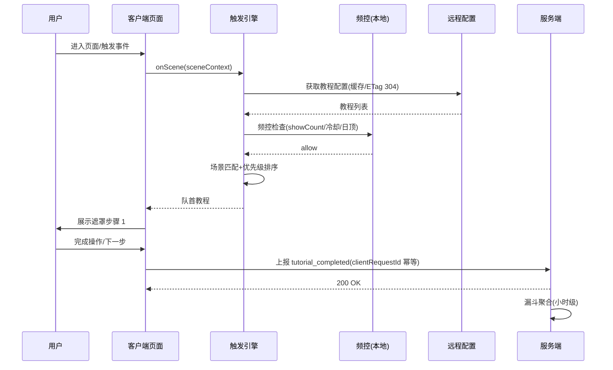

# 用户引导与新手教程系统 - 详细设计

> 版本：v1.1 | 日期：2026-10-27 | 状态：已补全（§4.2-§17）

## 1. 模块概述

### 1.1 定位

用户引导与新手教程系统（Onboarding & Tutorial System）负责管理用户首次使用及版本升级后的引导流程，包括注册引导、角色识别、学段年级选择、教材版本配置、核心功能教程、渐进式功能解锁提示等。目标是让用户在 3 分钟内完成初始化并进入核心学习场景，同时降低不同学段用户的认知负担。

### 1.2 设计原则

| 原则 | 说明 |
|------|------|
| 渐进式披露 | 不一次展示所有功能，按需触发 |
| 分龄适配 | 幼儿/小学/初中/高中引导流程差异大，UI 和文案需自适应 |
| 可跳过但可回溯 | 引导步骤可跳过，但后续可在设置中重新触发 |
| 数据驱动 | 引导完成率、每步流失率需埋点追踪 |
| 零打扰 | 引导不打断已注册用户的正常使用 |

### 1.3 引导场景全景

```
用户首次启动 APP
  │
  ├─→ 欢迎页（品牌展示、隐私协议）
  ├─→ 注册/登录
  ├─→ 角色选择（学生/家长/教师）
  │     ├─ 学生 → 学段年级选择 → 教材版本 → 兴趣标签 → 首页
  │     ├─ 家长 → 绑定学生 → 首页（家长视角）
  │     └─ 教师 → 学校信息 → 创建/加入班级 → 教师工作台
  ├─→ 首页功能引导（Coach Marks + 短视频）
  └─→ 首次使用各功能时的场景化教程
```

---

## 2. 引导流程状态机

### 2.1 用户引导状态定义

```typescript
/** 用户引导状态枚举 */
enum OnboardingStep {
  WELCOME = 'welcome',              // 欢迎页
  PRIVACY_AGREEMENT = 'privacy',     // 隐私协议确认
  REGISTER = 'register',             // 注册/登录
  ROLE_SELECT = 'role_select',       // 角色选择
  GRADE_SELECT = 'grade_select',     // 学段年级选择（学生）
  TEXTBOOK_SELECT = 'textbook',      // 教材版本选择（学生）
  INTEREST_TAG = 'interest_tag',     // 兴趣标签（学生）
  PARENT_BIND = 'parent_bind',       // 绑定学生（家长）
  TEACHER_SETUP = 'teacher_setup',   // 教师信息（教师）
  FIRST_TUTORIAL = 'first_tutorial', // 首页功能引导
  COMPLETED = 'completed',           // 引导完成
}

/** 用户引导状态记录 */
interface UserOnboardingState {
  userId: string;
  currentStep: OnboardingStep;
  completedSteps: OnboardingStep[];
  skippedSteps: OnboardingStep[];
  stepData: Record<string, any>;     // 各步骤产生的临时数据
  startedAt: number;                 // 引导开始时间戳
  completedAt?: number;              // 引导完成时间戳
  version: number;                   // 引导流程版本号
}
```

### 2.2 状态流转图

```
WELCOME ──→ PRIVACY_AGREEMENT ──→ REGISTER ──→ ROLE_SELECT
                                                    │
                                    ┌───────────────┼───────────────┐
                                    ▼               ▼               ▼
                              GRADE_SELECT    PARENT_BIND    TEACHER_SETUP
                                    │               │               │
                                    ▼               │               │
                            TEXTBOOK_SELECT         │               │
                                    │               │               │
                                    ▼               │               │
                             INTEREST_TAG           │               │
                                    │               │               │
                                    └───────┬───────┘───────────────┘
                                            ▼
                                    FIRST_TUTORIAL
                                            │
                                            ▼
                                       COMPLETED
```

### 2.3 状态持久化

```typescript
// 客户端本地存储 key
const STORAGE_KEY = 'onboarding_state';

// 引导状态 API
interface OnboardingService {
  /** 获取当前引导状态 */
  getState(): Promise<UserOnboardingState | null>;

  /** 更新引导步骤 */
  updateStep(step: OnboardingStep, data?: Record<string, any>): Promise<void>;

  /** 跳过当前步骤 */
  skipStep(step: OnboardingStep): Promise<void>;

  /** 完成引导 */
  complete(): Promise<void>;

  /** 重置引导（设置页触发） */
  reset(): Promise<void>;
}
```

---

## 3. 各步骤详细设计

### 3.1 欢迎页（WELCOME）

#### 3.1.1 功能说明

展示品牌形象，最多 3 页滑动轮播，每页包含：
- 全屏插画/动画
- 一句话价值主张
- 底部"下一步"按钮

#### 3.1.2 数据结构

```typescript
interface WelcomePage {
  pageIndex: number;
  illustration: string;    // 插画资源 URL 或本地 asset path
  headline: string;        // 主标题
  subtitle: string;        // 副标题
}

// 欢迎页配置
const WELCOME_PAGES: WelcomePage[] = [
  {
    pageIndex: 0,
    illustration: 'assets/onboarding/welcome_1.json',  // Lottie 动画
    headline: 'AI 智能助学',
    subtitle: '从启蒙到高考，全学段陪伴',
  },
  {
    pageIndex: 1,
    illustration: 'assets/onboarding/welcome_2.json',
    headline: '教材同步',
    subtitle: '紧贴课堂进度，精准匹配教材',
  },
  {
    pageIndex: 2,
    illustration: 'assets/onboarding/welcome_3.json',
    headline: '个性化学习',
    subtitle: '智能规划路径，薄弱点精准突破',
  },
];
```

#### 3.1.3 交互逻辑

- 支持左右滑动切换
- 底部显示页码指示器（圆点）
- 最后一页按钮文案变为"开始使用"
- 可点击"跳过"直接进入下一步
- 已登录用户自动跳过欢迎页

### 3.2 隐私协议确认（PRIVACY_AGREEMENT）

#### 3.2.1 功能说明

展示并获取用户对隐私政策、用户协议、儿童个人信息保护规则的同意。

#### 3.2.2 界面布局

```
┌─────────────────────────────────────┐
│                                     │
│         📋 使用条款与隐私政策        │
│                                     │
│  ☑ 我已阅读并同意                   │
│     《用户服务协议》                 │
│     《隐私政策》                     │
│     《儿童个人信息保护规则》         │
│                                     │
│  ┌─────────────────────────────┐    │
│  │          同意并继续          │    │
│  └─────────────────────────────┘    │
│                                     │
│          不同意，退出                │
│                                     │
└─────────────────────────────────────┘
```

#### 3.2.3 数据结构

```typescript
interface PrivacyConsent {
  userId: string;
  userAgreement: boolean;           // 用户协议同意
  privacyPolicy: boolean;           // 隐私政策同意
  childProtection: boolean;         // 儿童信息保护规则
  consentVersion: string;           // 协议版本号
  consentedAt: number;              // 同意时间戳
  ipAddress: string;                // 同意时 IP
  deviceInfo: DeviceInfo;           // 设备信息
}
```

#### 3.2.4 API 接口

```
POST /api/v1/user/consent
Request:
{
  "userAgreement": true,
  "privacyPolicy": true,
  "childProtection": true,
  "consentVersion": "1.0.0"
}
Response:
{
  "code": 0,
  "data": {
    "consentedAt": 1716364800000
  }
}
```

#### 3.2.5 业务规则

- 14 周岁以下用户必须额外展示《儿童个人信息保护规则》
- 协议更新时（版本号变更）需再次弹出确认
- 不同意则退出 APP，不记录任何用户数据
- 同意记录存入数据库，用于合规审计

### 3.3 注册/登录（REGISTER）

#### 3.3.1 支持的注册方式

| 方式 | 优先级 | 说明 |
|------|--------|------|
| 手机号+验证码 | P0 | 主流程 |
| 微信一键登录 | P0 | Android/iOS |
| Apple ID 登录 | P1 | iOS 必须 |
| QQ 登录 | P2 | 后续扩展 |

#### 3.3.2 注册数据结构

```typescript
interface RegistrationRequest {
  method: 'phone' | 'wechat' | 'apple' | 'qq';
  // 手机号注册
  phone?: string;
  verifyCode?: string;
  // 第三方登录
  thirdPartyToken?: string;
  thirdPartyOpenId?: string;
  // 通用
  deviceInfo: {
    platform: 'android' | 'ios';
    deviceId: string;
    osVersion: string;
    appVersion: string;
    screenHeight: number;
    screenWidth: number;
  };
}
```

#### 3.3.3 API 接口

```
# 发送验证码
POST /api/v1/auth/sms/send
Request: { "phone": "13800138000", "purpose": "register" }
Response: { "code": 0, "data": { "expireIn": 300, "retryAfter": 60 } }

# 验证码登录/注册（自动判断）
POST /api/v1/auth/sms/verify
Request: { "phone": "13800138000", "code": "123456", "deviceInfo": {...} }
Response: {
  "code": 0,
  "data": {
    "accessToken": "eyJ...",
    "refreshToken": "eyJ...",
    "isNewUser": true,             // 新用户标识
    "onboardingRequired": true     // 是否需要引导流程
  }
}

# 第三方登录
POST /api/v1/auth/third-party
Request: { "provider": "wechat", "token": "xxx", "deviceInfo": {...} }
Response: (同上)
```

#### 3.3.4 关键逻辑

- 验证码 5 分钟有效，60 秒冷却重发
- 新用户（isNewUser=true）进入引导流程
- 老用户直接进入首页
- 登录失败超过 5 次触发图形验证码

### 3.4 角色选择（ROLE_SELECT）

#### 3.4.1 功能说明

让用户明确自身角色，后续引导流程根据角色分支。

#### 3.4.2 界面设计

```
┌─────────────────────────────────────┐
│                                     │
│          你是哪类用户？             │
│                                     │
│  ┌──────────┐  ┌──────────┐         │
│  │   🎒     │  │   👨‍👩‍👧   │         │
│  │   学生   │  │   家长   │         │
│  │  学习辅助 │  │ 学习监督 │         │
│  └──────────┘  └──────────┘         │
│                                     │
│       ┌──────────┐                  │
│       │   👩‍🏫     │                  │
│       │   教师   │                  │
│       │  班级管理 │                  │
│       └──────────┘                  │
│                                     │
│  💡 选择后可在设置中修改            │
│                                     │
└─────────────────────────────────────┘
```

#### 3.4.3 数据结构

```typescript
type UserRole = 'student' | 'parent' | 'teacher';

interface RoleSelection {
  userId: string;
  role: UserRole;
  selectedAt: number;
}
```

#### 3.4.4 分龄 UI 差异

| 角色选择页变体 | 说明 |
|---------------|------|
| 标准版 | 三角色卡片并排（默认） |
| 简化版（低龄检测） | 如果通过设备信息或账号信息判断可能是儿童，突出学生选项 |

### 3.5 学段年级选择（GRADE_SELECT）

> 仅学生角色需要此步骤

#### 3.5.1 数据结构

```typescript
/** 学段定义 */
enum Phase {
  KINDERGARTEN = 'kindergarten',    // 幼儿（3-6岁）
  PRIMARY = 'primary',              // 小学（1-6年级）
  JUNIOR = 'junior',                // 初中（7-9年级）
  SENIOR = 'senior',                // 高中（10-12年级）
}

/** 年级选择结果 */
interface GradeSelection {
  phase: Phase;
  grade: number;          // 1-12（K=0）
  semester: 'first' | 'second';  // 上/下学期
  entranceYear: number;   // 入学年份（用于自动推算年级）
}

/** 学段年级树形结构 */
interface GradeOption {
  phase: Phase;
  phaseLabel: string;
  grades: {
    grade: number;
    label: string;         // "一年级"、"初一"、"高一"等
    semesters: {
      value: 'first' | 'second';
      label: string;       // "上学期"、"下学期"
    }[];
  }[];
}
```

#### 3.5.2 级联选择配置

```typescript
const GRADE_OPTIONS: GradeOption[] = [
  {
    phase: Phase.KINDERGARTEN,
    phaseLabel: '幼儿启蒙',
    grades: [
      { grade: 0, label: '幼儿园', semesters: [
        { value: 'first', label: '上学期' },
        { value: 'second', label: '下学期' },
      ]},
    ],
  },
  {
    phase: Phase.PRIMARY,
    phaseLabel: '小学',
    grades: Array.from({ length: 6 }, (_, i) => ({
      grade: i + 1,
      label: `${['一','二','三','四','五','六'][i]}年级`,
      semesters: [
        { value: 'first', label: '上学期' },
        { value: 'second', label: '下学期' },
      ],
    })),
  },
  // ... 初中、高中类似
];
```

#### 3.5.3 交互设计

- 三步级联：学段 → 年级 → 学期
- 智能默认：根据当前月份推断学期（9-1月为上学期，2-6月为下学期）
- 提供"快速入口"：通过入学年份自动推算年级

#### 3.5.4 API 接口

```
POST /api/v1/student/profile/grade
Request: {
  "phase": "junior",
  "grade": 8,
  "semester": "second",
  "entranceYear": 2022
}
Response: {
  "code": 0,
  "data": {
    "availableTextbooks": ["pep", "bjnu", "suja"],  // 该年级可用的教材版本
    "gradeLabel": "初二下学期"
  }
}
```

### 3.6 教材版本选择（TEXTBOOK_SELECT）

#### 3.6.1 数据结构

```typescript
/** 教材版本 */
interface TextbookEdition {
  id: string;             // "pep"
  name: string;           // "人教版"
  shortName: string;      // "人教"
  publisher: string;      // "人民教育出版社"
  subjects: SubjectInfo[];
  isRecommended: boolean; // 是否为推荐版本（按地区热门度）
}

interface SubjectInfo {
  subjectId: string;
  subjectName: string;    // "数学"
  editions: TextbookEdition[];
}

/** 教材选择结果 */
interface TextbookSelection {
  selections: {
    subjectId: string;
    editionId: string;
  }[];
}

/** 按学段分组的教材选择配置 */
interface TextbookConfig {
  phase: Phase;
  grade: number;
  subjects: SubjectInfo[];
  defaultEdition: string;  // 默认教材版本
}
```

#### 3.6.2 教材选择 UI 流程

```
┌──────────────────────────────────────┐
│  选择你使用的教材版本                │
│                                      │
│  📚 数学                             │
│  ┌────────┐ ┌────────┐ ┌────────┐   │
│  │ 人教版* │ │ 北师大 │ │ 苏教版 │   │
│  └────────┘ └────────┘ └────────┘   │
│                                      │
│  📚 语文                             │
│  ┌────────┐                          │
│  │ 部编版* │ （语文全国统一）         │
│  └────────┘                          │
│                                      │
│  📚 英语                             │
│  ┌────────┐ ┌────────┐              │
│  │ 人教版* │ │ 外研版 │              │
│  └────────┘ └────────┘              │
│                                      │
│  💡 标 * 为推荐版本，可稍后修改      │
│                                      │
│  ┌──────────────────────────────┐    │
│  │           确认选择            │    │
│  └──────────────────────────────┘    │
│  不确定？稍后在设置中配置            │
└──────────────────────────────────────┘
```

#### 3.6.3 智能推荐逻辑

```typescript
/**
 * 根据地区和年级推荐默认教材版本
 * 规则优先级：地区统计 > 全国热门 > 默认
 */
function getDefaultEditions(
  region: string,       // 省份编码，如 "310000"（上海）
  phase: Phase,
  grade: number
): Record<string, string> {
  // 1. 语文默认部编版（全国统一）
  // 2. 数学/英语根据地区热门版本推荐
  // 3. 理科（初中+）默认人教版
  // ...
}

// API: 获取教材推荐
// GET /api/v1/textbook/recommend?region=310000&phase=junior&grade=8
```

### 3.7 兴趣标签选择（INTEREST_TAG）

> 仅学生角色，用于个性化推荐冷启动

#### 3.7.1 数据结构

```typescript
/** 兴趣标签 */
interface InterestTag {
  id: string;
  label: string;          // "数学思维"
  icon: string;           // emoji 或图标名
  category: string;       // "学科兴趣" | "学习目标" | "学习风格"
}

/** 分学段的标签配置 */
interface InterestTagConfig {
  phase: Phase;
  minSelect: number;      // 最少选择数
  maxSelect: number;      // 最多选择数
  tags: InterestTag[];
}

const TAG_CONFIGS: Record<Phase, InterestTagConfig> = {
  kindergarten: {
    phase: Phase.KINDERGARTEN,
    minSelect: 1,
    maxSelect: 3,
    tags: [
      { id: 'pinyin', label: '学拼音', icon: '🔤', category: '学科兴趣' },
      { id: 'reading', label: '认汉字', icon: '📖', category: '学科兴趣' },
      { id: 'math_basics', label: '数数字', icon: '🔢', category: '学科兴趣' },
      { id: 'english_song', label: '英文儿歌', icon: '🎵', category: '学科兴趣' },
    ],
  },
  senior: {
    phase: Phase.SENIOR,
    minSelect: 2,
    maxSelect: 5,
    tags: [
      { id: 'gaokao_math', label: '高考数学', icon: '📐', category: '学习目标' },
      { id: 'gaokao_physics', label: '高考物理', icon: '⚡', category: '学习目标' },
      { id: 'essay_writing', label: '作文提升', icon: '✍️', category: '学科兴趣' },
      { id: 'exam_strategy', label: '应试技巧', icon: '🎯', category: '学习风格' },
      { id: 'deep_thinking', label: '深度思考', icon: '🧠', category: '学习风格' },
      // ... 更多标签
    ],
  },
  // ... primary, junior
};
```

#### 3.7.2 交互逻辑

- 分两屏展示：学科兴趣 + 学习目标/风格
- 标签选中后高亮，达到上限时禁用未选标签
- 底部显示"已选 N/M"
- 可跳过（使用系统默认推荐）

### 3.8 首页功能引导（FIRST_TUTORIAL）

#### 3.8.1 Coach Mark 系统

用户首次进入首页时，通过 Coach Mark（教练标记）逐一引导核心功能区域。

```typescript
/** Coach Mark 配置 */
interface CoachMark {
  id: string;
  targetElement: string;     // 目标 UI 元素引用
  title: string;
  description: string;
  position: 'top' | 'bottom' | 'left' | 'right';
  arrow: boolean;
  overlay: boolean;          // 是否半透明遮罩
  action?: {
    type: 'tap' | 'swipe' | 'input';
    target: string;
  };
  delay?: number;            // 延迟显示（毫秒）
}

/** 首页 Coach Mark 序列 */
const HOME_TUTORIAL_SEQUENCE: CoachMark[] = [
  {
    id: 'hm_quick_ai',
    targetElement: 'home_quick_ai_button',
    title: '有什么不会的？问 AI',
    description: '点击这里随时向 AI 提问，支持文字、语音和拍照',
    position: 'bottom',
    arrow: true,
    overlay: true,
  },
  {
    id: 'hm_photo_search',
    targetElement: 'home_photo_button',
    title: '拍照搜题',
    description: '拍下题目，AI 帮你分步解析',
    position: 'bottom',
    arrow: true,
    overlay: true,
  },
  {
    id: 'hm_today_task',
    targetElement: 'home_today_task',
    title: '今日学习任务',
    description: '每天为你安排学习计划，完成后获得奖励',
    position: 'bottom',
    arrow: true,
    overlay: true,
  },
  {
    id: 'hm_tab_sync',
    targetElement: 'tab_sync_class',
    title: '同步课堂',
    description: '按你的教材章节同步学习',
    position: 'top',
    arrow: true,
    overlay: true,
  },
];
```

#### 3.8.2 Coach Mark 展示逻辑

```typescript
class CoachMarkManager {
  private shownKeys: Set<string>;

  constructor() {
    // 从本地存储加载已展示的 coach mark
    this.shownKeys = new Set(
      JSON.parse(localStorage.getItem('shown_coach_marks') || '[]')
    );
  }

  /**
   * 判断是否需要显示某个 coach mark
   * 条件：未展示过 + 对应元素可见 + 用户在当前页面停留 > 500ms
   */
  shouldShow(id: string): boolean {
    return !this.shownKeys.has(id);
  }

  /** 标记已展示 */
  markShown(id: string): void {
    this.shownKeys.add(id);
    localStorage.setItem('shown_coach_marks', JSON.stringify([...this.shownKeys]));
  }

  /** 展示一组序列化 coach mark */
  async playSequence(sequence: CoachMark[]): Promise<void> {
    for (const mark of sequence) {
      if (!this.shouldShow(mark.id)) continue;
      await this.showMark(mark);
      await this.waitForDismiss(mark);
      this.markShown(mark.id);
    }
  }
}
```

#### 3.8.3 分龄差异

| 学段 | 引导内容 | 风格 |
|------|----------|------|
| 幼儿 | 仅引导语音按钮和卡片区域 | 大字体、动画角色引导、语音播报 |
| 小学 | 拍题、AI问答、同步课堂 | 卡通图标、简洁文字 |
| 初中 | 拍题、错题本、考点梳理 | 图标+短文字、快速展示 |
| 高中 | 错题本、考点梳理、学习规划 | 极简文字提示、可一键跳过 |

### 3.9 家长绑定流程（PARENT_BIND）

> 仅家长角色

#### 3.9.1 数据结构

```typescript
/** 家长-学生绑定请求 */
interface ParentBindRequest {
  method: 'qr_code' | 'link' | 'manual';
  // 扫码绑定
  studentQrCode?: string;
  // 链接绑定
  inviteCode?: string;
  // 手动绑定（输入学生账号手机号）
  studentPhone?: string;
  relation: 'father' | 'mother' | 'grandfather' | 'grandmother' | 'other';
}

/** 绑定关系 */
interface ParentStudentBinding {
  id: string;
  parentId: string;
  studentId: string;
  relation: string;
  status: 'pending' | 'confirmed' | 'rejected';
  createdAt: number;
  confirmedAt?: number;
}
```

#### 3.9.2 绑定流程

```
家长选择绑定方式
  │
  ├─→ 方式1：扫码绑定
  │     学生APP → 个人中心 → "邀请家长" → 生成动态二维码（5分钟有效）
  │     家长APP → 扫码 → 确认关系 → 绑定成功
  │
  ├─→ 方式2：链接分享
  │     学生APP → 分享邀请链接（微信/QQ）
  │     家长点击 → 打开APP → 确认绑定
  │
  └─→ 方式3：手机号绑定
        家长输入学生手机号 → 学生端收到确认通知 → 学生确认 → 绑定成功
```

#### 3.9.3 API 接口

```
# 生成学生端邀请码
POST /api/v1/parent-bind/invite
Request: { "studentId": "xxx" }
Response: {
  "code": 0,
  "data": {
    "inviteCode": "ABC123",
    "qrCodeUrl": "https://cdn.primetop.com/qr/xxx.png",
    "expiresAt": 1716365100000
  }
}

# 家长发起绑定
POST /api/v1/parent-bind/request
Request: {
  "method": "invite_code",
  "inviteCode": "ABC123",
  "relation": "mother"
}
Response: {
  "code": 0,
  "data": {
    "bindingId": "bind_xxx",
    "status": "pending"
  }
}

# 学生确认绑定
POST /api/v1/parent-bind/confirm
Request: {
  "bindingId": "bind_xxx",
  "action": "confirm"   // confirm | reject
}
Response: {
  "code": 0,
  "data": { "status": "confirmed" }
}
```

---

## 4. 场景化功能教程系统

### 4.1 概述

除了首次引导，用户首次使用各功能模块时，触发轻量级的场景化教程。每个教程包含 2-5 步操作引导。

### 4.2 教程注册表

```typescript
/** 功能教程定义 */
interface FeatureTutorial {
  id: string;                     // 全局唯一，如 'tut_photo_search'
  featureName: string;            // 关联功能模块名，如 'photo_search'
  triggerCondition: TutorialTrigger;
  steps: TutorialStep[];
  priority: number;               // 展示优先级（同页冲突时数值大者先展示）
  cooldownDays: number;           // 完成/跳过后冷却天数（0=仅一次）
  maxShowCount: number;           // 最大展示次数（防疲劳硬顶，含未完成中断）
  targetPhase: Phase[];           // 适用学段（空数组=全学段）
  minAppVersion: string;          // 最低 App 版本（语义化版本比较）
  contentVersion: string;         // 教程内容版本（配置更新递增）
  status: 'draft' | 'published' | 'archived';
}

/** 触发条件：全部条件满足才允许进入候选队列 */
interface TutorialTrigger {
  type: 'first_enter_page' | 'first_use_feature' | 'event' | 'manual';
  pageRoute?: string;             // first_enter_page：目标路由
  featureKey?: string;            // first_use_feature：功能标识
  eventName?: string;             // event：埋点事件名（如 'mistake.first_view'）
  manualKey?: string;             // manual：设置页/运营位触发键
  delayMs?: number;               // 进入页面后延迟展示（默认 500）
  requireIdleMs?: number;         // 要求页面无交互静默时长（默认 800）
}

/** 教程单步定义 */
interface TutorialStep {
  stepIndex: number;
  type: 'coach_mark' | 'highlight' | 'modal' | 'video' | 'interactive';
  targetElement?: string;         // coach_mark/highlight：目标元素 key
  title: string;
  description: string;
  mediaUrl?: string;              // video 步骤的短视频地址（≤30s，CDN）
  position?: 'top' | 'bottom' | 'left' | 'right' | 'center';
  overlay: boolean;               // 是否半透明遮罩（遮罩区域外点击=跳过本教程）
  action?: {                      // interactive：要求用户完成指定操作才推进
    type: 'tap' | 'swipe' | 'input';
    target: string;
  };
  skippable: boolean;             // 本步是否可跳过（interactive 步骤建议 false）
}

/** 内置教程注册表示例（完整清单由远程配置下发，本地仅兜底） */
const BUILTIN_TUTORIALS: FeatureTutorial[] = [
  {
    id: 'tut_photo_search',
    featureName: 'photo_search',
    triggerCondition: { type: 'first_enter_page', pageRoute: '/photo/search', delayMs: 600 },
    steps: [
      {
        stepIndex: 0, type: 'coach_mark', targetElement: 'camera_shutter_btn',
        title: '对准题目拍照', description: '保持光线充足，尽量只拍一道题',
        position: 'top', overlay: true, skippable: true,
      },
      {
        stepIndex: 1, type: 'coach_mark', targetElement: 'album_pick_btn',
        title: '也可以从相册选图', description: '支持截图和保存的题目照片',
        position: 'top', overlay: true, skippable: true,
      },
    ],
    priority: 80,
    cooldownDays: 0, maxShowCount: 3,
    targetPhase: [], minAppVersion: '1.0.0', contentVersion: '3',
    status: 'published',
  },
  {
    id: 'tut_mistake_book',
    featureName: 'mistake_book',
    triggerCondition: { type: 'event', eventName: 'mistake.first_view', delayMs: 400 },
    steps: [
      {
        stepIndex: 0, type: 'modal', title: '错题本会帮你自动收录',
        description: '拍题和练习中的错题会自动进来，也可以手动添加',
        position: 'center', overlay: true, skippable: true,
      },
      {
        stepIndex: 1, type: 'interactive', targetElement: 'mistake_add_btn',
        title: '试试添加一道错题', description: '点这里上传你的第一道错题',
        position: 'bottom', overlay: true, skippable: false,
        action: { type: 'tap', target: 'mistake_add_btn' },
      },
    ],
    priority: 60,
    cooldownDays: 0, maxShowCount: 3,
    targetPhase: [Phase.PRIMARY, Phase.JUNIOR, Phase.SENIOR],
    minAppVersion: '1.0.0', contentVersion: '2',
    status: 'published',
  },
];
```

#### 4.2.1 教程配置来源与优先级

| 优先级 | 来源 | 说明 |
|--------|------|------|
| 1 | 远程配置（CDN） | 运营可热更新；按 `contentVersion` 增量下发；拉取失败降级用本地内置 |
| 2 | 本地内置包 | 随 App 版本打包（`BUILTIN_TUTORIALS`）；仅当远程不可用时启用 |

**版本裁决规则**：客户端保存 `remoteContentVersion`；远程配置 `contentVersion` 与本地一致时直接复用缓存。单条教程校验失败（schema 不合法、目标学段不含当前用户、`minAppVersion` 高于当前版本）时**只隔离该条**，不整包丢弃（守卫 G3）。

### 4.3 触发引擎

#### 4.3.1 触发判定流程

```
页面进入/事件上报
  │
  ▼
收集候选教程  ──过滤──▶  ① status=published 且本地未过期
  │                     ② targetPhase 含当前用户学段（空=全学段）
  ▼                     ③ appVersion ≥ minAppVersion
频控检查              ──过滤──▶  ④ showCount < maxShowCount
  │                     ⑤ 非冷却期（完成/跳过时间 + cooldownDays > now）
  ▼                     ⑥ 当日已展示教程数 < DAILY_CAP（默认 3）
场景匹配              ──过滤──▶  ⑦ triggerCondition 匹配当前场景
  │                     ⑧ 页面停留 ≥ delayMs 且静默 ≥ requireIdleMs
  ▼
优先级排序（priority 降序）──▶ 取队首 1 个进入展示队列
```

#### 4.3.2 频控参数

| 参数 | 默认值 | 说明 |
|------|--------|------|
| DAILY_CAP | 3 | 单用户单日教程展示上限（含中断），远程可调 |
| SESSION_GAP_MS | 10 分钟 | 同一会话内两次教程展示的最小间隔 |
| RETRY_AFTER_DISMISS_DAYS | 7 | 用户主动关闭（非跳过）后重试间隔 |
| DAILY_CAP_PHASE_OVERRIDE | 幼儿=1 | 幼儿段单日上限收紧，禁放宽（合规 C2） |

#### 4.3.3 触发仲裁伪代码

```typescript
class TutorialTriggerEngine {
  /** 页面/事件入口 */
  async onScene(scene: SceneContext): Promise<FeatureTutorial | null> {
    const all = await this.tutorialRepo.getActiveTutorials();
    const candidates = all.filter(t =>
      t.status === 'published'
      && this.phaseMatch(t, scene.userPhase)
      && this.versionMatch(t, scene.appVersion)
      && (await this.frequencyControl.allow(t.id, scene.userId))
      && this.triggerMatch(t.triggerCondition, scene)
    );
    if (candidates.length === 0) return null;
    candidates.sort((a, b) => b.priority - a.priority);
    return candidates[0];
  }
}
```

### 4.4 教程执行器

#### 4.4.1 执行状态机

```
        触发
          │
          ▼
      QUEUED ──同会话更高优先级抢占──▶ QUEUED（重排）
          │ show()
          ▼
      SHOWING ──用户点击遮罩外/关闭──▶ DISMISSED
          │                            （计 showCount+1，按 RETRY 规则冷却）
          │ 逐步推进（步骤内 action 完成或 skippable 跳过）
          ▼
      STEP_RUNNING ──最后一步完成──▶ COMPLETED
          │                          （showCount+1，永久冷却，上报服务端）
          │ 用户点"跳过本教程"
          ▼
       SKIPPED（showCount+1，冷却 cooldownDays）
```

| 状态 | 说明 | 终态 |
|------|------|------|
| QUEUED | 已进入展示队列，等待场景静默条件满足 | 否 |
| SHOWING | 遮罩展示中，未开始第一步 | 否 |
| STEP_RUNNING | 某一步执行中（含 interactive 等待操作） | 否 |
| COMPLETED | 全部步骤完成 | 是 |
| SKIPPED | 用户主动跳过 | 是 |
| DISMISSED | 用户关闭（消极信号，区别于跳过） | 是 |

#### 4.4.2 执行器实现

```typescript
class TutorialPlayer {
  private current: TutorialSession | null = null;

  /** 开始播放教程 */
  async start(tutorial: FeatureTutorial): Promise<void> {
    if (this.current) return;              // 守卫 G1：同时只允许一个教程实例
    this.current = {
      tutorialId: tutorial.id,
      contentVersion: tutorial.contentVersion,
      currentStep: 0,
      state: 'SHOWING',
      startedAt: Date.now(),
      clientRequestId: uuid(),             // 完成上报幂等键
    };
    await this.renderStep(tutorial.steps[0]);
  }

  /** 步骤推进（interactive 步骤由 action 回调驱动，其余由用户点击"下一步"驱动） */
  async next(): Promise<void> {
    const session = this.current!;
    const tutorial = await this.repo.get(session.tutorialId);
    if (session.currentStep + 1 >= tutorial.steps.length) {
      await this.finish('COMPLETED');
    } else {
      session.currentStep += 1;
      await this.renderStep(tutorial.steps[session.currentStep]);
    }
  }

  /** interactive 步骤：监听目标元素操作完成 */
  async onActionFulfilled(target: string): Promise<void> {
    const session = this.current!;
    const step = (await this.repo.get(session.tutorialId)).steps[session.currentStep];
    if (step.type === 'interactive' && step.action?.target === target) {
      await this.next();
    }
  }

  private async finish(state: 'COMPLETED' | 'SKIPPED' | 'DISMISSED'): Promise<void> {
    const session = this.current!;
    session.state = state;
    this.frequencyControl.record(session.tutorialId, state);   // 本地频控落盘
    await this.tracker.reportTutorialResult(session);          // 埋点 + 服务端上报
    this.current = null;
  }
}
```

#### 4.4.3 埋点事件

| 事件名 | 触发时机 | 关键属性 |
|--------|----------|----------|
| tutorial_shown | 遮罩展示 | tutorial_id, content_version, step_index=0 |
| tutorial_step_view | 每步渲染 | tutorial_id, step_index, step_type |
| tutorial_step_action | interactive 步骤操作达成 | tutorial_id, step_index |
| tutorial_completed | 全部步骤完成 | tutorial_id, duration_ms |
| tutorial_skipped | 用户跳过 | tutorial_id, step_index |
| tutorial_dismissed | 用户关闭 | tutorial_id, step_index |
| onboarding_step_view / onboarding_step_complete | 首次引导主流程（§3） | step, role, phase |

---

## 5. 核心流程

### 5.1 场景化教程触发时序



### 5.2 首次引导主流程衔接

§3 的 WELCOME→…→COMPLETED 主流程为** onboarding 域**，其状态权威归《端到端流程设计-用户注册与首次使用引导完整链路》（服务端 profile + 10xxx 错误码段）。本文档仅消费其结果：

- 主流程 COMPLETED 后，客户端拉取首页 Coach Mark 序列（§3.8），进入场景化教程体系（§4）。
- 主流程中任一步跳过不阻塞 COMPLETED； skippedSteps 持久化，设置页"重新引导"只重放指定步骤（R2）。

---

## 6. API 设计

### 6.1 客户端接口

```
# 1. 拉取教程配置（增量）
GET /api/v1/tutorials?contentVersion={localVersion}&phase={phase}
Response:
{
  "code": 0,
  "data": {
    "contentVersion": 17,
    "changed": [ {tutorial JSON…} ],      // 新增/变更
    "removed": ["tut_legacy_1"],           // 下线教程 id
    "serverTime": 1729920000000
  }
}
# 语义：changed 为空且 contentVersion 一致时返回 304（HTTP 缓存协商）

# 2. 教程进度上报（跨设备同步 + 漏斗）
POST /api/v1/tutorials/progress
Headers: X-Idempotency-Key: {clientRequestId}
Request:
{
  "tutorialId": "tut_photo_search",
  "contentVersion": 3,
  "result": "COMPLETED",          // COMPLETED | SKIPPED | DISMISSED
  "lastStepIndex": 1,
  "durationMs": 12500,
  "clientRequestId": "uuid-v4"
}
Response: { "code": 0, "data": { "receivedAt": 1729920000123 } }

# 3. 设置页-可重放教程列表
GET /api/v1/tutorials/replayable
Response:
{
  "code": 0,
  "data": {
    "items": [
      { "tutorialId": "tut_photo_search", "title": "拍照搜题", "status": "COMPLETED", "completedAt": 1729800000000 }
    ]
  }
}

# 4. 重新引导（重置指定教程频控，供设置页触发）
POST /api/v1/tutorials/{tutorialId}/replay
Response: { "code": 0, "data": { "reset": true } }
```

### 6.2 管理端接口

| 接口 | 说明 | 权限 |
|------|------|------|
| GET /admin/v1/tutorials | 列表（分页/筛选 status/phase） | 运营 |
| POST /admin/v1/tutorials | 新建教程（草稿） | 运营 |
| PUT /admin/v1/tutorials/{id} | 编辑（draft 任意改；published 仅内容字段，触发条件变更需走审核） | 运营 |
| POST /admin/v1/tutorials/{id}/publish | 发布（双人复核 G9） | 运营+审核 |
| POST /admin/v1/tutorials/{id}/archive | 归档（已下发客户端的教程标记 removed，不下发删除指令） | 运营 |
| GET /admin/v1/tutorials/{id}/stats | 漏斗数据：shown→step_view→completed/skipped/dismissed | 运营 |

### 6.3 幂等与限流

| 接口 | 幂等机制 | 限流 |
|------|----------|------|
| GET /tutorials | ETag/304，天然幂等 | 单用户 60 次/小时 |
| POST /tutorials/progress | X-Idempotency-Key + DB 唯一键 (user_id, tutorial_id, client_request_id) | 单用户 30 次/分钟 |
| POST /tutorials/{id}/replay | 目标记录不存在幂等返回 200 | 单用户 10 次/天 |
| 管理端写接口 | 表单 version 乐观锁（CAS） | 按角色配额 |

---

## 7. 状态机与守卫

### 7.1 教程配置生命周期（服务端）

```
DRAFT ──publish(双人复核)──▶ PUBLISHED ──archive──▶ ARCHIVED
  │                            │
  └──edit──────────────────────┘（published 仅允许内容字段编辑，触发条件变更须先回退 draft）
```

### 7.2 守卫表

| 编号 | 规则 | 失败处理 |
|------|------|----------|
| G1 | 同时只允许一个教程实例在播 | 后到触发直接丢弃并记日志 |
| G2 | 教程展示不得打断答题/考试/测评进行态 | 进行态页面触发引擎整体挂起 |
| G3 | 单条教程配置非法只隔离该条 | 记 TUT_CONFIG_SCHEMA_INVALID，其余教程不受影响 |
| G4 | showCount / 日顶 / 冷却三重频控任一不满足不展示 | 静默丢弃（不打断用户） |
| G5 | DISMISSED 计入消极信号，按 RETRY_AFTER_DISMISS_DAYS 冷却，且下次展示降优先级 | 引擎内降权 |
| G6 | interactive 步骤必须绑定真实可点元素；元素不存在时降级为 coach_mark 并记警告 | 单步降级，教程继续 |
| G7 | 教程文案/媒体未过内容安全审核不得 publish | 管理端拦截 |
| G8 | 未成年人账号禁投营销/付费引导类教程（targetPhase 含未成年学段 + 内容含营销要素） | publish 拦截 + 客户端兜底过滤 |
| G9 | published 状态变更（发布/回退/归档）需双人复核 | 第二人确认后生效 |
| G10 | 主流程 onboarding 状态只读消费，教程系统禁止回写 | 客户端断言 + 服务端 403 |

---

## 8. 幂等与并发场景

| 场景 | 裁决 |
|------|------|
| 进度上报重试（弱网） | clientRequestId 唯一键去重，重复返回首次结果 |
| 多端同时触发同教程 | 展示各自独立（客户端本地行为）；进度上报 first-write-wins，后到晚到端按服务端记录校准本地 |
| 上报时教程已被归档 | 200 受理但不入漏斗（记 discarded），不报错 |
| replay 与进行态并发 | replay 只重置服务端/本地频控，不影响在播实例 |
| 配置拉取与展示并发 | 展示用内存快照（当次 onScene 取到的版本），不边播边换内容 |
| 远程配置降级本地内置 | 以本地内置包为准，恢复后重新比对 contentVersion |

---

## 9. 事件与对账

- 教程域不产生跨域业务事件（成长激励/家长通知等由消费方订阅埋点流自行决策，R6）。
- 进度上报表 `tutorial_progress_log`（user_id, tutorial_id, client_request_id 唯一键, result, duration_ms, created_at）按月分区，保留 180 天，供漏斗与频控对账。
- 日终对账：客户端本地 completed 集合 vs 服务端 progress 表，差异 >1% 告警（客户端丢报）。

---

## 10. 错误码

10xxx 数字段归《端到端流程设计-用户注册与首次使用引导完整链路》专属，本文不重复占用。教程域采用符号化错误码（进程/模块内语义，不透传用户）：

| 符号码 | 含义 | 处理 |
|--------|------|------|
| TUT_CONFIG_FETCH_FAILED | 远程配置拉取失败 | 降级本地内置包（D1） |
| TUT_CONFIG_SCHEMA_INVALID | 单条教程配置校验失败 | 隔离该条（G3） |
| TUT_NOT_FOUND | 教程不存在/已归档 | 管理端 404；客户端静默忽略 |
| TUT_STEP_OUT_OF_RANGE | 步骤索引越界 | 对齐 10112 语义，客户端断言终止播放 |
| TUT_PROGRESS_REJECTED | 进度上报被拒（限流/键冲突且首次不存在） | 客户端重拉服务端状态校准 |
| TUT_ADMIN_FORBIDDEN | 管理端权限不足 | 403 |
| TUT_PUBLISH_REVIEW_REQUIRED | 发布缺双人复核 | 409，提示待审核 |

---

## 11. 降级策略

| 编号 | 场景 | 降级行为 |
|------|------|----------|
| D1 | 远程配置不可用 | 本地内置教程包兜底；网络恢复后按 contentVersion 增量同步 |
| D2 | 上报接口不可用 | 本地队列保留最近 50 条，下次启动补报；不阻塞教程流程 |
| D3 | 目标元素找不到（改版/低端机渲染差异） | G6 单步降级为 modal 说明，教程可继续 |
| D4 | 视频步骤媒体加载失败 | 降级为图文步骤（title+description） |
| D5 | 频控数据损坏（本地存储异常） | 重置为初始态（视为新用户），服务端进度不受影响 |
| D6 | 管理端 stats 服务异常 | 不影响 publish/archive 主流程，仅看板不可见 |
| D7 | 埋点平台异常 | 教程展示主链路不依赖埋点回执，照常播放 |
| D8 | 总红线 | G8（未成年禁营销）与 G2（不打断考试）无降级路径 |

---

## 12. 监控指标

| 指标 | 口径 | 告警阈值 |
|------|------|----------|
| 教程触达率 | shown / 满足触发场景 UV | 环比降 >20% 告警（疑似触发引擎故障） |
| 教程完成率 | completed / shown | 单教程 <15% 连续 3 天，提示内容过长或交互不合理 |
| 主动关闭率 | dismissed / shown | 单教程 >30% 连续 3 天，强制降优先级并通知运营 |
| 配置拉取成功率 | 200/304 占比 | <99% 持续 10 分钟 P2 |
| 进度上报成功率 | 2xx 占比 | <99.5% 持续 10 分钟 P2 |
| 日对账差异率 | 客户端 completed vs 服务端 | >1% 告警 |

---

## 13. 合规红线

| 编号 | 红线 |
|------|------|
| C1 | 教程不得诱导未成年人充值/购买；含付费引导要素的教程 targetPhase 不得包含未成年学段 |
| C2 | 幼儿段单日教程上限默认 1 且不可远程放宽（管理端硬编码上限） |
| C3 | 教程遮罩必须提供明确的跳过/关闭入口，禁止无关闭入口的全屏拦截 |
| C4 | 教程进度数据不与个性化推荐画像融合，禁用于营销定向（R7） |
| C5 | 重新引导入口必须在设置页可见且操作零成本，不得借教程重复索要已授权权限 |
| C6 | 内容安全：教程文案/媒体发布前须过敏感词与版权审核（G7） |
| C7 | 注销即删：tutorial_progress_log 随账号注销 30 天内物理删除 |

---

## 14. 契约对齐

| 编号 | 契约 |
|------|------|
| R1 | onboarding 主流程状态权威归注册引导 E2E 文档（10xxx 错误码段归其专属），本文只读消费 |
| R2 | 主流程步骤可跳过但 skippedSteps 持久化，重放粒度为"步骤"而非"整段" |
| R3 | 教程配置热更新走配置中心/CDN，与 App 发版解耦；字段 schema 变更需兼容旧版本客户端（忽略未知字段） |
| R4 | 频控 SSOT 在客户端本地（展示判定必须本地可用），服务端仅记录与对账 |
| R5 | 管理端内容审核委托内容安全规则引擎，不自建审核管线 |
| R6 | 教程域不出业务事件；成长激励等消费方订阅埋点流（tutorial_completed） |
| R7 | 埋点数据流向埋点平台，教程域不持有用户画像 |
| R8 | 客户端目标元素 key 与组件库 key 注册表对齐，组件改版须同步更新教程配置（CI 静态检查） |
| R9 | 多端进度冲突 first-write-wins，与 E2E 建档多端裁决（10114）语义一致 |
| R10 | 短链/二维码（家长绑定邀请码）委托统一短链服务，不重复造码 |
| R11 | 教程内嵌视频走多媒体分发服务 CDN，不直传源站 |
| R12 | 注销清理委托账号生命周期服务，按 C7 时限执行 |

---

## 15. 验收场景

| 编号 | 场景 | 预期 |
|------|------|------|
| AC01 | 首次安装进入，主流程完成到 COMPLETED | ≤3 分钟可达首页，每步可跳过 |
| AC02 | 跳过教材选择步骤 | 进入首页，设置页可重新配置 |
| AC03 | 首次进入拍照搜题页停留 600ms 无操作 | 触发 tut_photo_search 遮罩 |
| AC04 | 展示第 2 次后关闭 | showCount=2，不再自动触发直至重置 |
| AC05 | 单日已展示 3 个教程后再触发新场景 | 静默丢弃，无遮罩 |
| AC06 | interactive 步骤目标元素被改版移除 | 降级 modal，教程继续完成 |
| AC07 | 弱网下重复点击完成上报 | 服务端仅记录一条（clientRequestId 幂等） |
| AC08 | 远程配置拉取失败 | 本地内置教程兜底可用 |
| AC09 | 单条配置非法 | 仅该条不展示，其余正常 |
| AC10 | 考试进行态进入错题页 | 触发引擎挂起，无教程弹出（G2） |
| AC11 | 未成年账号 + 营销类教程发布 | 管理端 publish 拦截（G8） |
| AC12 | 发布未经双人复核 | 409 TUT_PUBLISH_REVIEW_REQUIRED |
| AC13 | 设置页触发重放已完成教程 | 频控重置，可再次播放 |
| AC14 | 多端同时完成同教程 | 服务端 first-write-wins，两端最终一致 |
| AC15 | 注销账号 | tutorial_progress_log 30 天内删除 |
| AC16 | 幼儿账号当日已展示 1 个教程 | 第二个触发被丢弃（C2） |

---

## 16. 关联文档

- 《端到端流程设计-用户注册与首次使用引导完整链路》（onboarding 主流程权威，10xxx 错误码段）
- 《客户端-登录注册与入门引导页面架构设计》（主流程页面实现）
- 《客户端-首页与学习工作台页面架构与交互设计》（Coach Mark 宿主页面）
- 《配置中心与动态配置管理》（教程配置下发通道）
- 《客户端埋点事件体系与数据采集规范》（§4.4.3 事件注册）
- 《统一短链服务与深链接跳转编排引擎》（家长绑定邀请码）
- 《安全与内容合规系统》（G7/C6 内容审核）
- 《防沉迷与未成年人保护机制》（C2/G2 联动）

---

## 17. 维护记录

| 版本 | 日期 | 说明 |
|------|------|------|
| v1.0 | 2026-05-22 | 初始版本：模块概述/引导流程状态机/主流程各步骤（欢迎页/隐私/注册/角色/年级/教材/兴趣/Coach Mark/家长绑定）。文件在 §4.2 `FeatureTutorial` 接口定义中段截断（围栏未闭合 @L813），教程注册表/触发引擎/执行器/API/状态机/幂等/错误码/降级/监控/合规/契约/验收全缺 |
| v1.1 | 2026-10-27 | 补全烂尾文档：§4.2 收尾（FeatureTutorial/TutorialTrigger/TutorialStep 完整定义+内置注册表）并新增 §4.2.1 配置来源优先级、§4.3 触发引擎（八重过滤链+频控参数+仲裁代码）、§4.4 执行器（六态状态机+TutorialPlayer 代码+7 埋点）、§5 核心流程（mermaid 时序+主流程衔接裁决）、§6 API（客户端 4+管理端 6+幂等限流表）、§7 配置生命周期+守卫 G1-G10、§8 幂等并发六场景、§9 对账、§10 符号化错误码 TUT_*（10xxx 段归注册引导 E2E 专属，本文不占用）、§11 降级 D1-D8、§12 监控六项、§13 合规 C1-C7、§14 契约 R1-R12、§15 验收 AC01-AC16、§16 关联文档 |