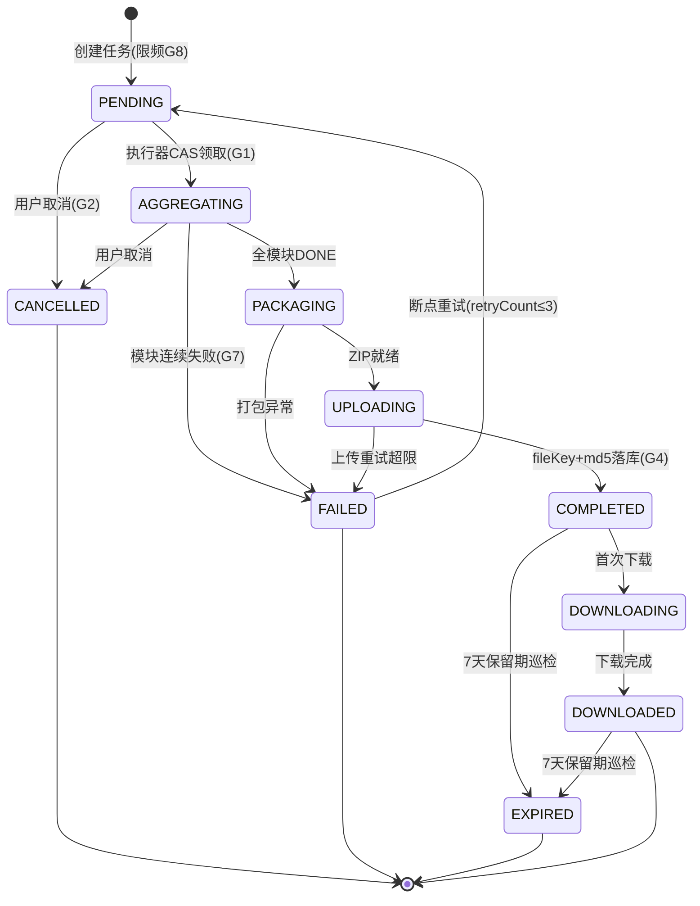
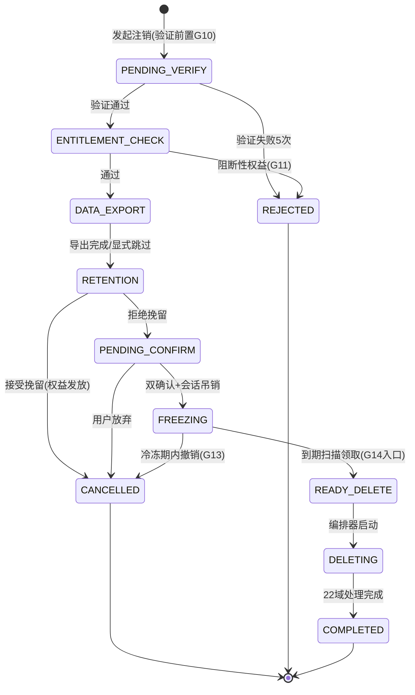

# 端到端流程设计 — 数据导出与账户注销完整链路

> **文档版本**：v1.0  
> **最后更新**：2026-06-05  
> **模块定位**：本文档描述 PrimeTop 用户数据导出与账户注销的**端到端完整链路**，覆盖客户端发起 → 身份验证 → 数据聚合 → 导出打包 → 注销确认 → 冷冻期 → 永久删除的全流程，涉及客户端、BFF、用户服务、学习服务、订单服务、会员服务、内容服务、通知服务等全链路交互。让开发人员能清晰理解各环节的调用关系、数据流转和异常处理。

---

## 1. 流程全景图

```
┌─────────────────────────────────────────────────────────────────────────────┐
│                         数据导出与账户注销 全链路                            │
├─────────────────────────────────────────────────────────────────────────────┤
│                                                                             │
│  ┌──────────┐    ┌──────────┐    ┌──────────┐    ┌──────────┐              │
│  │ 1.入口   │───▶│ 2.身份   │───▶│ 3.数据   │───▶│ 4.导出   │              │
│  │   发起   │    │   验证   │    │   预览   │    │   打包   │              │
│  └──────────┘    └──────────┘    └──────────┘    └──────────┘              │
│                                                       │                   │
│                                                       ▼                   │
│  ┌──────────┐    ┌──────────┐    ┌──────────┐    ┌──────────┐              │
│  │ 7.永久   │◀───│ 6.冷冻期 │◀───│ 5.注销   │◀───│ 4b.注销  │              │
│  │   删除   │    │   等待   │    │   生效   │    │   确认   │              │
│  └──────────┘    └──────────┘    └──────────┘    └──────────┘              │
│        │                                                                    │
│        ▼                                                                    │
│  ┌──────────┐    ┌──────────┐                                              │
│  │ 8.清理   │───▶│ 9.通知   │                                              │
│  │   完成   │    │   相关方 │                                              │
│  └──────────┘    └──────────┘                                              │
│                                                                             │
└─────────────────────────────────────────────────────────────────────────────┘
```

### 1.1 关键路径

| 路径 | 说明 | 预期耗时 |
|------|------|----------|
| 数据导出 | 用户发起 → 身份验证 → 数据聚合 → 打包 → 下载 | 5~30 分钟（取决于数据量） |
| 账户注销 | 用户发起 → 身份验证 → 权益检查 → 确认 → 冷冻期 → 永久删除 | 15~30 天（含冷冻期） |
| 仅导出不注销 | 导出流程独立，可单独使用 | 5~30 分钟 |

---

## 2. 数据结构定义

### 2.1 数据导出请求

```java
/**
 * 数据导出请求
 */
@Data
@Builder
public class DataExportRequest {

    /** 用户ID */
    @NotNull
    private Long userId;

    /** 导出类型：FULL-全量 / PARTIAL-选择性 */
    @NotNull
    private ExportType exportType;

    /** 选择性导出的模块列表（exportType=PARTIAL 时必填） */
    private List<ExportModule> modules;

    /** 导出格式：ZIP_JSON / ZIP_CSV / ZIP_HTML */
    @Builder.Default
    private ExportFormat format = ExportFormat.ZIP_JSON;

    /** 语言偏好 */
    @Builder.Default
    private String locale = "zh-CN";

    /** 请求来源：APP / WEB / MINI_PROGRAM */
    private String source;
}

/**
 * 导出模块枚举
 */
public enum ExportModule {
    PROFILE,           // 基本信息
    LEARNING_RECORDS,  // 学习记录
    MISTAKE_BOOK,      // 错题本
    EXERCISE_DATA,     // 练习数据
    AI_CONVERSATIONS,  // AI对话记录
    STUDY_PLANS,       // 学习计划
    NOTES_FAVORITES,   // 笔记与收藏
    ORDERS_PAYMENTS,   // 订单与支付
    MEMBERSHIP,        // 会员信息
    SETTINGS,          // 设置与偏好
    ACHIEVEMENTS,      // 成就与勋章
    FEEDBACK,          // 反馈记录
}
```

### 2.2 数据导出任务

```java
/**
 * 数据导出任务
 */
@Data
@TableName("data_export_task")
public class DataExportTask {

    /** 任务ID */
    @TableId(type = IdType.ASSIGN_ID)
    private Long taskId;

    /** 用户ID */
    private Long userId;

    /** 任务状态 */
    private ExportTaskStatus status;

    /** 导出类型 */
    private ExportType exportType;

    /** 导出模块列表（JSON数组） */
    private String modules;

    /** 导出格式 */
    private ExportFormat format;

    /** 各模块数据聚合进度（JSON: {"PROFILE": "DONE", "LEARNING": "PROCESSING", ...}） */
    private String moduleProgress;

    /** 总进度百分比（0~100） */
    @Builder.Default
    private Integer progressPercent = 0;

    /** 导出文件存储路径（OSS Key） */
    private String fileKey;

    /** 导出文件大小（字节） */
    private Long fileSizeBytes;

    /** 文件MD5校验 */
    private String fileMd5;

    /** 下载链接（预签名URL） */
    private String downloadUrl;

    /** 链接过期时间 */
    private LocalDateTime downloadExpireAt;

    /** 重试次数 */
    @Builder.Default
    private Integer retryCount = 0;

    /** 失败原因 */
    private String failReason;

    /** 创建时间 */
    private LocalDateTime createdAt;

    /** 更新时间 */
    private LocalDateTime updatedAt;

    /** 完成时间 */
    private LocalDateTime completedAt;
}

/**
 * 导出任务状态
 */
public enum ExportTaskStatus {
    PENDING,          // 待处理
    AGGREGATING,      // 数据聚合中
    PACKAGING,        // 打包中
    UPLOADING,        // 上传中
    COMPLETED,        // 已完成
    DOWNLOADING,      // 下载中
    DOWNLOADED,       // 已下载
    EXPIRED,          // 链接已过期
    FAILED,           // 失败
    CANCELLED         // 已取消
}
```

### 2.3 账户注销请求

```java
/**
 * 账户注销请求
 */
@Data
@TableName("account_cancellation")
public class AccountCancellation {

    /** 注销ID */
    @TableId(type = IdType.ASSIGN_ID)
    private Long cancellationId;

    /** 用户ID */
    private Long userId;

    /** 注销原因分类 */
    private CancellationReason reason;

    /** 注销原因详细说明 */
    private String reasonDetail;

    /** 身份验证方式 */
    private VerifyMethod verifyMethod;

    /** 身份验证凭据（脱敏存储） */
    private String verifyCredential;

    /** 注销状态 */
    private CancellationStatus status;

    /** 冷冻期开始时间 */
    private LocalDateTime freezeStartAt;

    /** 冷冻期结束时间（= 开始时间 + 冻结天数） */
    private LocalDateTime freezeEndAt;

    /** 数据导出任务ID（关联导出任务） */
    private Long exportTaskId;

    /** 是否已完成数据导出 */
    @Builder.Default
    private Boolean dataExported = false;

    /** 权益检查结果（JSON） */
    private String entitlementCheck;

    /** 挽留结果 */
    private RetentionResult retentionResult;

    /** 挽留优惠ID（如果接受了挽留） */
    private Long retentionOfferId;

    /** 确认注销时间 */
    private LocalDateTime confirmedAt;

    /** 执行删除时间 */
    private LocalDateTime deletedAt;

    /** 完成时间 */
    private LocalDateTime completedAt;

    /** 操作IP */
    private String operatorIp;

    /** 操作设备信息 */
    private String deviceInfo;

    /** 创建时间 */
    private LocalDateTime createdAt;

    /** 更新时间 */
    private LocalDateTime updatedAt;
}

/**
 * 注销原因枚举
 */
public enum CancellationReason {
    NO_LONGER_NEEDED,    // 不再需要
    POOR_EXPERIENCE,     // 体验不好
    FOUND_BETTER,        // 找到更好的替代品
    PRIVACY_CONCERN,     // 隐私顾虑
    CHILD_GRADUATED,     // 孩子已毕业
    COST_TOO_HIGH,       // 费用太高
    ACCOUNT_COMPROMISED, // 账号安全
    OTHER                // 其他
}

/**
 * 注销状态
 */
public enum CancellationStatus {
    PENDING_VERIFY,      // 待身份验证
    ENTITLEMENT_CHECK,   // 权益检查中
    DATA_EXPORT,         // 数据导出中
    RETENTION,           // 挽留阶段
    PENDING_CONFIRM,     // 待用户最终确认
    FREEZING,            // 冷冻期中
    READY_DELETE,        // 待删除
    DELETING,            // 删除中
    COMPLETED,           // 已完成
    CANCELLED,           // 已撤销（用户反悔）
    REJECTED             // 被拒绝（不满足注销条件）
}
```

### 2.4 数据清理清单

```java
/**
 * 数据清理清单 - 记录需要清理的每个数据域
 */
@Data
@TableName("account_deletion_item")
public class AccountDeletionItem {

    @TableId(type = IdType.ASSIGN_ID)
    private Long id;

    /** 注销ID */
    private Long cancellationId;

    /** 用户ID */
    private Long userId;

    /** 数据域 */
    private DeletionDomain domain;

    /** 清理状态 */
    private DeletionItemStatus status;

    /** 涉及记录数 */
    private Integer recordCount;

    /** 涉及存储大小（字节） */
    private Long storageBytes;

    /** 清理方式 */
    private DeletionMethod method;

    /** 重试次数 */
    @Builder.Default
    private Integer retryCount = 0;

    /** 失败原因 */
    private String failReason;

    /** 开始时间 */
    private LocalDateTime startedAt;

    /** 完成时间 */
    private LocalDateTime completedAt;
}

/**
 * 数据域
 */
public enum DeletionDomain {
    USER_PROFILE,          // 用户基本信息
    STUDENT_PROFILE,       // 学生档案
    PARENT_BINDING,        // 家长绑定关系
    LEARNING_RECORDS,      // 学习记录
    MISTAKE_RECORDS,       // 错题记录
    ANSWER_RECORDS,        // 答题记录
    AI_CONVERSATIONS,      // AI对话
    STUDY_PLANS,           // 学习计划
    NOTES,                 // 笔记
    FAVORITES,             // 收藏
    ACHIEVEMENTS,          // 成就
    ORDERS,                // 订单
    MEMBERSHIP,            // 会员
    INTEGRAL_ACCOUNT,      // 积分账户
    NOTIFICATIONS,         // 通知
    FEEDBACK,              // 反馈
    DEVICE_TOKENS,         // 设备推送Token
    USER_PREFERENCES,      // 用户偏好
    UPLOAD_FILES,          // 上传文件
    AI_EMBEDDINGS,         // AI向量数据
    AUDIT_LOGS,            // 审计日志（脱敏保留）
    SESSION_TOKENS,        // 登录会话
}

/**
 * 清理方式
 */
public enum DeletionMethod {
    HARD_DELETE,       // 物理删除
    SOFT_DELETE,       // 逻辑删除 + 匿名化
    ANONYMIZE,         // 仅匿名化（保留统计聚合）
    ARCHIVE_THEN_DELETE // 先归档再删除
}
```

### 2.5 数据库表设计

```sql
-- 数据导出任务表
CREATE TABLE data_export_task (
    task_id          BIGINT PRIMARY KEY COMMENT '任务ID',
    user_id          BIGINT NOT NULL COMMENT '用户ID',
    status           VARCHAR(20) NOT NULL DEFAULT 'PENDING' COMMENT '任务状态',
    export_type      VARCHAR(10) NOT NULL COMMENT '导出类型',
    modules          JSON COMMENT '导出模块列表',
    format           VARCHAR(20) NOT NULL DEFAULT 'ZIP_JSON' COMMENT '导出格式',
    module_progress  JSON COMMENT '各模块进度',
    progress_percent TINYINT NOT NULL DEFAULT 0 COMMENT '总进度百分比',
    file_key         VARCHAR(512) COMMENT 'OSS文件Key',
    file_size_bytes  BIGINT COMMENT '文件大小',
    file_md5         VARCHAR(64) COMMENT '文件MD5',
    download_url     VARCHAR(1024) COMMENT '下载链接',
    download_expire_at DATETIME COMMENT '链接过期时间',
    retry_count      TINYINT NOT NULL DEFAULT 0 COMMENT '重试次数',
    fail_reason      VARCHAR(512) COMMENT '失败原因',
    created_at       DATETIME NOT NULL DEFAULT CURRENT_TIMESTAMP,
    updated_at       DATETIME NOT NULL DEFAULT CURRENT_TIMESTAMP ON UPDATE CURRENT_TIMESTAMP,
    completed_at     DATETIME COMMENT '完成时间',
    INDEX idx_user_id (user_id),
    INDEX idx_status (status),
    INDEX idx_created (created_at)
) ENGINE=InnoDB DEFAULT CHARSET=utf8mb4 COMMENT='数据导出任务';

-- 账户注销表
CREATE TABLE account_cancellation (
    cancellation_id  BIGINT PRIMARY KEY COMMENT '注销ID',
    user_id          BIGINT NOT NULL COMMENT '用户ID',
    reason           VARCHAR(30) NOT NULL COMMENT '注销原因',
    reason_detail    VARCHAR(1000) COMMENT '详细原因',
    verify_method    VARCHAR(20) NOT NULL COMMENT '验证方式',
    status           VARCHAR(25) NOT NULL DEFAULT 'PENDING_VERIFY' COMMENT '注销状态',
    freeze_start_at  DATETIME COMMENT '冷冻期开始',
    freeze_end_at    DATETIME COMMENT '冷冻期结束',
    export_task_id   BIGINT COMMENT '关联导出任务',
    data_exported    TINYINT(1) NOT NULL DEFAULT 0 COMMENT '是否已导出数据',
    entitlement_check JSON COMMENT '权益检查结果',
    retention_result VARCHAR(20) COMMENT '挽留结果',
    retention_offer_id BIGINT COMMENT '挽留优惠ID',
    confirmed_at     DATETIME COMMENT '用户确认时间',
    deleted_at       DATETIME COMMENT '执行删除时间',
    completed_at     DATETIME COMMENT '完成时间',
    operator_ip      VARCHAR(45) COMMENT '操作IP',
    device_info      VARCHAR(512) COMMENT '设备信息',
    created_at       DATETIME NOT NULL DEFAULT CURRENT_TIMESTAMP,
    updated_at       DATETIME NOT NULL DEFAULT CURRENT_TIMESTAMP ON UPDATE CURRENT_TIMESTAMP,
    UNIQUE INDEX uk_user_id (user_id),
    INDEX idx_status (status),
    INDEX idx_freeze_end (freeze_end_at)
) ENGINE=InnoDB DEFAULT CHARSET=utf8mb4 COMMENT='账户注销';

-- 数据清理清单表
CREATE TABLE account_deletion_item (
    id               BIGINT PRIMARY KEY,
    cancellation_id  BIGINT NOT NULL COMMENT '注销ID',
    user_id          BIGINT NOT NULL COMMENT '用户ID',
    domain           VARCHAR(30) NOT NULL COMMENT '数据域',
    status           VARCHAR(20) NOT NULL DEFAULT 'PENDING' COMMENT '清理状态',
    record_count     INT COMMENT '记录数',
    storage_bytes    BIGINT COMMENT '存储大小',
    method           VARCHAR(25) NOT NULL COMMENT '清理方式',
    retry_count      TINYINT NOT NULL DEFAULT 0,
    fail_reason      VARCHAR(512),
    started_at       DATETIME,
    completed_at     DATETIME,
    INDEX idx_cancellation (cancellation_id),
    INDEX idx_user_domain (user_id, domain)
) ENGINE=InnoDB DEFAULT CHARSET=utf8mb4 COMMENT='数据清理清单';
```

---

## 3. API 接口设计

### 3.1 数据导出 API

#### 3.1.1 获取可导出数据概览

```
GET /api/v1/user/data-export/overview
```

**Response:**
```json
{
  "code": 0,
  "data": {
    "modules": [
      {
        "module": "PROFILE",
        "moduleName": "基本信息",
        "recordCount": 1,
        "estimatedSizeKB": 5,
        "description": "账号信息、学生档案、家长绑定"
      },
      {
        "module": "LEARNING_RECORDS",
        "moduleName": "学习记录",
        "recordCount": 12580,
        "estimatedSizeKB": 4500,
        "description": "学习时长、章节进度、学习会话"
      },
      {
        "module": "MISTAKE_BOOK",
        "moduleName": "错题本",
        "recordCount": 342,
        "estimatedSizeKB": 2800,
        "description": "错题收录、订正记录、复习计划"
      },
      {
        "module": "AI_CONVERSATIONS",
        "moduleName": "AI对话记录",
        "recordCount": 876,
        "estimatedSizeKB": 12000,
        "description": "所有AI辅导对话历史"
      },
      {
        "module": "ORDERS_PAYMENTS",
        "moduleName": "订单与支付",
        "recordCount": 15,
        "estimatedSizeKB": 50,
        "description": "支付订单、退款记录"
      }
    ],
    "totalEstimatedSizeMB": 25,
    "supportedFormats": ["ZIP_JSON", "ZIP_CSV", "ZIP_HTML"],
    "exportAvailable": true
  }
}
```

#### 3.1.2 发起数据导出

```
POST /api/v1/user/data-export/request
```

**Request:**
```json
{
  "exportType": "FULL",
  "modules": null,
  "format": "ZIP_JSON"
}
```

**Response:**
```json
{
  "code": 0,
  "data": {
    "taskId": 2026060516320001,
    "status": "PENDING",
    "estimatedMinutes": 15,
    "message": "数据导出任务已创建，预计15分钟内完成"
  }
}
```

#### 3.1.3 查询导出进度

```
GET /api/v1/user/data-export/task/{taskId}
```

**Response:**
```json
{
  "code": 0,
  "data": {
    "taskId": 2026060516320001,
    "status": "AGGREGATING",
    "progressPercent": 45,
    "moduleProgress": {
      "PROFILE": "DONE",
      "LEARNING_RECORDS": "DONE",
      "MISTAKE_BOOK": "PROCESSING",
      "AI_CONVERSATIONS": "PENDING",
      "ORDERS_PAYMENTS": "PENDING"
    },
    "estimatedMinutesRemaining": 8,
    "createdAt": "2026-06-05T16:32:00",
    "canCancel": true
  }
}
```

#### 3.1.4 下载导出文件

```
GET /api/v1/user/data-export/task/{taskId}/download
```

**Response:** 302 重定向到 OSS 预签名 URL

**Error（链接过期）:**
```json
{
  "code": 40103,
  "message": "下载链接已过期，请重新申请导出"
}
```

#### 3.1.5 取消导出任务

```
POST /api/v1/user/data-export/task/{taskId}/cancel
```

### 3.2 账户注销 API

#### 3.2.1 注销前置检查

```
GET /api/v1/user/account/cancellation/check
```

**Response:**
```json
{
  "code": 0,
  "data": {
    "canCancel": true,
    "blockingReasons": [],
    "warnings": [
      {
        "type": "ACTIVE_MEMBERSHIP",
        "message": "您当前有有效会员（到期日：2026-08-15），注销后将无法继续使用会员权益",
        "severity": "WARNING",
        "remainingDays": 71
      },
      {
        "type": "UNSUPPORTED_INTEGRAL",
        "message": "您账户中有 2,350 积分尚未使用，注销后将清零且不可恢复",
        "severity": "WARNING"
      },
      {
        "type": "PENDING_ORDER",
        "message": "您有 1 笔订单正在退款中（预计3个工作日），建议等待完成后再注销",
        "severity": "INFO"
      }
    ],
    "dataExportRequired": true,
    "dataExportStatus": "NOT_STARTED",
    "dataExportTaskId": null,
    "freezeDays": 15,
    "retentionOffers": [
      {
        "offerId": 101,
        "type": "FREE_MONTH",
        "title": "赠送1个月会员",
        "description": "继续使用PrimeTop，我们赠送您1个月会员"
      }
    ]
  }
}
```

#### 3.2.2 发起注销（需身份验证）

```
POST /api/v1/user/account/cancellation/initiate
```

**Request:**
```json
{
  "reason": "NO_LONGER_NEEDED",
  "reasonDetail": "孩子已毕业不需要了",
  "verifyMethod": "SMS_CODE",
  "verifyCode": "123456"
}
```

**Response:**
```json
{
  "code": 0,
  "data": {
    "cancellationId": 202606050001,
    "status": "DATA_EXPORT",
    "nextStep": "EXPORT_DATA",
    "nextStepDescription": "请先导出您的数据，或选择跳过",
    "freezeDays": 15,
    "message": "注销申请已受理，请先处理数据导出"
  }
}
```

#### 3.2.3 跳过数据导出

```
POST /api/v1/user/account/cancellation/{cancellationId}/skip-export
```

**Request:**
```json
{
  "confirmedNoExport": true
}
```

#### 3.2.4 挽留处理

```
POST /api/v1/user/account/cancellation/{cancellationId}/retention
```

**Request（接受挽留 = 撤销注销）:**
```json
{
  "action": "ACCEPT",
  "offerId": 101
}
```

**Request（拒绝挽留 = 继续注销）:**
```json
{
  "action": "REJECT"
}
```

#### 3.2.5 最终确认注销

```
POST /api/v1/user/account/cancellation/{cancellationId}/confirm
```

**Request:**
```json
{
  "confirmedAt": "2026-06-05T16:45:00",
  "acknowledgedDataLoss": true,
  "acknowledgedNoRecovery": true
}
```

**Response:**
```json
{
  "code": 0,
  "data": {
    "cancellationId": 202606050001,
    "status": "FREEZING",
    "freezeStartAt": "2026-06-05T16:45:00",
    "freezeEndAt": "2026-06-20T16:45:00",
    "recoverableUntil": "2026-06-20T16:45:00",
    "message": "账户已进入15天冷冻期，期间您可以随时登录撤销注销"
  }
}
```

#### 3.2.6 冷冻期内撤销注销

```
POST /api/v1/user/account/cancellation/{cancellationId}/recover
```

**Request:**
```json
{
  "verifyMethod": "SMS_CODE",
  "verifyCode": "654321"
}
```

**Response:**
```json
{
  "code": 0,
  "data": {
    "recovered": true,
    "message": "账户已恢复，欢迎回来！"
  }
}
```

#### 3.2.7 查询注销状态

```
GET /api/v1/user/account/cancellation/status
```

---

## 4. 端到端流程详解

### 4.1 阶段一：数据导出

```
用户                     客户端                    BFF                  导出服务           各业务服务          OSS
 │                        │                        │                     │                   │                │
 │  点击"导出我的数据"    │                        │                     │                   │                │
 │───────────────────────▶│                        │                     │                   │                │
 │                        │  GET /overview          │                     │                   │                │
 │                        │───────────────────────▶│  聚合各模块数据量    │                   │                │
 │                        │                        │──────────────────▶  │                   │                │
 │                        │                        │                     │  查询记录数/大小   │                │
 │                        │                        │                     │─────────────────▶ │                │
 │                        │                        │◀─ 概览数据 ────────│                   │                │
 │                        │◀─ 展示数据概览 ────────│                     │                   │                │
 │                        │                        │                     │                   │                │
 │  选择模块/全量，确认    │                        │                     │                   │                │
 │───────────────────────▶│                        │                     │                   │                │
 │                        │  POST /request          │                     │                   │                │
 │                        │───────────────────────▶│                     │                   │                │
 │                        │                        │  创建导出任务        │                   │                │
 │                        │                        │──────────────────▶  │                   │                │
 │                        │                        │                     │  写DB(task)        │                │
 │                        │                        │                     │────────┐           │                │
 │                        │                        │                     │◀───────┘           │                │
 │                        │                        │                     │  发MQ消息           │                │
 │                        │                        │                     │────────┐           │                │
 │                        │                        │                     │◀───────┘           │                │
 │                        │◀─ taskId ──────────────│◀─ taskId ──────────│                   │                │
 │                        │                        │                     │                   │                │
 │                        │                        │   [异步处理]         │                   │                │
 │                        │                        │                     │  Consumer消费       │                │
 │                        │                        │                     │────────┐           │                │
 │                        │                        │                     │◀───────┘           │                │
 │                        │                        │                     │                   │                │
 │                        │                        │                     │  1.聚合PROFILE     │                │
 │                        │                        │                     │─────────────────▶ │                │
 │                        │                        │                     │◀─ profile数据──── │                │
 │                        │                        │                     │  2.聚合LEARNING    │                │
 │                        │                        │                     │─────────────────▶ │                │
 │                        │                        │                     │◀─ learning数据─── │                │
 │                        │                        │                     │  3.聚合MISTAKE     │                │
 │                        │                        │                     │─────────────────▶ │                │
 │                        │                        │                     │◀─ mistake数据──── │                │
 │                        │                        │                     │  ...依次聚合       │                │
 │                        │                        │                     │                   │                │
 │                        │                        │                     │  打包ZIP           │                │
 │                        │                        │                     │────────┐           │                │
 │                        │                        │                     │◀───────┘           │                │
 │                        │                        │                     │  上传OSS           │                │
 │                        │                        │                     │─────────────────────────────────────▶│
 │                        │                        │                     │◀────────────────── fileKey ─────────│
 │                        │                        │                     │  更新DB(COMPLETED) │                │
 │                        │                        │                     │────────┐           │                │
 │                        │                        │                     │◀───────┘           │                │
 │                        │                        │                     │  发推送通知         │                │
 │                        │                        │                     │────────┐           │                │
 │                        │                        │                     │◀───────┘           │                │
 │  ◀── 推送"导出完成" ──│                         │                     │                   │                │
 │                        │                        │                     │                   │                │
 │  点击下载               │                        │                     │                   │                │
 │───────────────────────▶│  GET /download          │                     │                   │                │
 │                        │───────────────────────▶│  生成预签名URL       │                   │                │
 │                        │                        │──────────────────▶  │                   │                │
 │                        │                        │                     │  生成URL           │                │
 │                        │                        │                     │─────────────────────────────────────▶│
 │                        │                        │                     │◀────────────────── presigned URL ──│
 │                        │                        │◀─ 302重定向 ────────│                   │                │
 │                        │◀─ 302 ────────────────│                     │                   │                │
 │  ◀── 下载文件 ──────────│                        │                     │                   │                │
│                        │                        │                     │                   │                │
 └────────────────────────┴────────────────────────┴─────────────────────┴───────────────────┴────────────────┘
```

**图例说明**：`──▶` 同步调用；`?──` 异步消息（MQ/Outbox）；自调用 `──┐ ?──┘` 表示本地事务落库。导出完成后文件在 OSS 保留 7 天，期间用户可随时重新生成下载链接；超期由巡检任务置 `EXPIRED` 并异步清理对象。

#### 4.1.1 导出任务异常与重试分支

| 异常场景 | 检测点 | 处理策略 | 状态落点 |
|---------|--------|---------|---------|
| 某模块聚合超时/抖动 | ModuleDataAggregator | 单模块重试 ≤2 次，退避 5s/30s | 保持 `AGGREGATING` |
| 某模块连续失败（业务错误） | ExportAggregationWorker | 标记该模块 `FAILED`，任务整体 `FAILED`，fail_reason 指明模块 | `FAILED` |
| 整体重试 | 用户重试 / 客服后台重发 | 沿用 `module_progress` 断点，已 `DONE` 模块跳过 | `PENDING → AGGREGATING` |
| OSS 上传失败 | OssTemplate | 重试 ≤3（换副本域），仍失败 → `FAILED` | `FAILED` |
| 用户取消 | cancel API | 仅 `PENDING/AGGREGATING` 可取消；进入 `PACKAGING` 后不可取消（幂等返回当前态） | `CANCELLED` |
| 下载链接过期 | download URL 过期 | 15 分钟短链过期属预期；文件 7 天保留期内重新生成；超期清理 | `EXPIRED` |

> 设计决策：`ExportTaskStatus` 不引入 `COMPLETED_PARTIAL` 部分完成态。部分模块失败时整体置 `FAILED` 并保留断点，避免"半份数据被当作完整导出"的合规风险——用户拿到的永远是全量模块齐备的完整包。

### 4.2 阶段二：账户注销申请链路

```
用户                客户端               BFF                注销服务            权益服务           家长门引擎          通知服务
 │                   │                    │                  │                   │                 │                │
 │ 设置-账号安全-申请注销│                   │                  │                   │                 │                │
 │──────────────────▶│                    │                  │                   │                 │                │
 │                   │ GET /check         │                  │                   │                 │                │
 │                   │───────────────────▶│                  │                   │                 │                │
 │                   │                    │ 聚合权益检查      │                   │                 │                │
 │                   │                    │─────────────────▶│                   │                 │                │
 │                   │                    │                  │ 查会员/订单/积分   │                 │                │
 │                   │                    │                  │──── 内部 RPC ────▶│                 │                │
 │                   │                    │                  │◀──── 汇总结果 ────│                 │                │
 │                   │                    │                  │ 未成年? ─────────▶│ 监护人核验       │                │
 │                   │                    │                  │                   │ (短信二次确认)   │                │
 │                   │                    │◀─ blocking + ────│                   │                 │                │
 │                   │◀─ warnings ────────│    warnings      │                   │                 │                │
 │                   │                    │                  │                   │                 │                │
 │ 阅读警告 勾选确认    │                    │                  │                   │                 │                │
 │──────────────────▶│ POST /initiate     │                  │                   │                 │                │
 │  (reason+verifyCode)│ (身份验证前置)     │                  │                   │                 │                │
 │                   │───────────────────▶│ 校验验证码+限频   │                   │                 │                │
 │                   │                    │─────────────────▶│                   │                 │                │
 │                   │                    │                  │ 创建注销单        │                 │                │
 │                   │                    │                  │ (uk_user_id 防重) │                 │                │
 │                   │                    │                  │──────┐ ?──┘       │                 │                │
 │                   │                    │                  │ 发 Outbox 事件   │                 │                │
 │                   │                    │                  │──────┐ ?──┘       │                 │                │
 │                   │◀── cancellationId ─│◀─────────────────│                  │                 │                │
 │◀─ 状态: DATA_EXPORT ─                  │                  │                   │                 │                │
 │  (引导先导出数据)    │                    │                  │                   │                 │                │
```

**要点**：

1. **身份验证先行**：initiate 前必须完成短信验证码（或支付密码）验证，验证码一次性、10 分钟有效、错 5 次锁 30 分钟（守卫 G10）。
2. **权益检查分级**：`blockingReasons`（未完结退款争议、司法协查冻结）阻断进入后续阶段；`warnings`（有效会员、未用积分、进行中订单）仅提示不阻断。
3. **注销单唯一性**：`account_cancellation.uk_user_id` 保证同一用户仅一张活跃单（状态 ∉ {COMPLETED, CANCELLED, REJECTED}），重复发起返回已有单（守卫 G9）。
4. **未成年保护**：学生账号注销强制走家长门引擎监护人短信二次确认，未通过返回 43024（守卫 G12，合规 C6）。

### 4.3 阶段三：数据导出 → 挽留 → 最终确认

注销单状态推进与 §4.1 导出任务通过 `export_task_id` 关联：

| 步骤 | 触发 | 状态迁移 | 说明 |
|------|------|---------|------|
| 1. 发起注销 | initiate 成功 | → `DATA_EXPORT` | 引导用户先导出；可 skip-export 显式跳过（`confirmedNoExport=true` 落审计） |
| 2. 导出完成/跳过 | 事件回调 / skip API | → `RETENTION` | 若 `dataExportRequired=true` 且未导出，跳过需二次弹窗确认 |
| 3. 挽留 | 展示挽留权益 | → `PENDING_CONFIRM` | 接受挽留（`action=ACCEPT`）→ 直接 `CANCELLED` 并发放权益，注销终止；拒绝则继续 |
| 4. 最终确认 | confirm API | → `FREEZING` | 双确认勾选（知悉数据丢失、不可恢复）+ 会话全量吊销 |
| 5. 冷冻期 | 15 天 | `FREEZING` 保持 | 期间任意登录触发"账户恢复"引导；`freeze_end_at = freeze_start_at + 15d` |

挽留接受路径需补偿：撤销注销单、恢复会话签发能力、发放挽留权益（幂等键 `offerId+cancellationId` 防重复发放）。

### 4.4 阶段四：冷冻期到期与永久删除

```
调度引擎(每10分钟)        注销服务                 删除编排器              域删除Handler×22        通知服务
 │                      │                      │                      │                    │
 │ 到期扫描触发          │                      │                      │                    │
 │─────────────────────▶│                      │                      │                    │
 │                      │ claimDueFreezing      │                      │                    │
 │                      │ (CAS+SKIP_LOCKED      │                      │                    │
 │                      │  批量领取100)         │                      │                    │
 │                      │──────┐ ?──┘          │                      │                    │
 │                      │ 状态 FREEZING         │                      │                    │
 │                      │ →READY_DELETE         │                      │                    │
 │                      │ 生成 deletion_items   │                      │                    │
 │                      │ (22域 清单初始化)      │                      │                    │
 │                      │                      │                      │                    │
 │                      │ AccountReadyDelete    │                      │                    │
 │                      │ 事件 ───────────────▶│                      │                    │
 │                      │                      │ 按 G15 固定顺序       │                    │
 │                      │                      │ 串行编排+域内并发4    │                    │
 │                      │                      │─────────────────────▶│                    │
 │                      │                      │ 逐域: 计数→删除/匿名化 │                    │
 │                      │                      │◀──── DONE/DEAD ──────│                    │
 │                      │                      │ (重试≤3 超限置DEAD    │                    │
 │                      │                      │  +P1告警人工介入)     │                    │
 │                      │                      │                      │                    │
 │                      │                      │ 全部DONE → COMPLETED  │                    │
 │                      │                      │──────┐ ?──┘          │                    │
 │                      │                      │ 发 AccountDeleted     │                    │
 │                      │                      │──────────────────────────────────────────▶│
 │                      │                      │                      │      通知绑定家长     │
 │                      │                      │                      │      (若学生账号)     │
```

**删除顺序守卫（G15）**：`SESSION_TOKENS/DEVICE_TOKENS`（先踢下线断触点）→ 各业务数据域（并行 4）→ `ORDERS`（ANONYMIZE，依法留存）→ `AUDIT_LOGS`（ANONYMIZE，禁止物理删，G16）→ `USER_PROFILE`（主体最后匿名化 + 手机号释放回池）。

**终态语义**：存在 `DEAD` 域时注销单仍推进 `COMPLETED`（不阻塞用户权利兑现），DEAD 域进入人工工单队列——法律要求的是"尽合理努力删除"，个别第三方强约束数据（已开票税务记录）允许依法保留并去标识化。

---

## 5. 状态机设计

### 5.1 导出任务状态机（十态）



| 守卫 | 规则 |
|------|------|
| G1 | `PENDING→AGGREGATING` 仅允许导出执行器经 CAS 领取（防 MQ 重复消费双跑） |
| G2 | 仅 `PENDING/AGGREGATING` 可取消；`PACKAGING` 起不可取消（cancel 接口幂等返回当前态） |
| G3 | `module_progress` 只允许前进（PENDING→PROCESSING→DONE/FAILED），禁止回退写 |
| G4 | 必须 `fileKey + fileMd5 + fileSizeBytes` 齐备才可置 `COMPLETED` |
| G5 | `COMPLETED→DOWNLOADING→DOWNLOADED` 由下载行为驱动，重复下载幂等 |
| G6 | `EXPIRED` 仅由巡检任务置位，随后异步清理 OSS 对象（孤儿文件对账兜底） |
| G7 | `FAILED` 重试沿用 `module_progress` 断点，`retry_count≤3`，仅已完成模块跳过 |
| G8 | 同一用户 24h 内仅允许 1 个非终态任务；全量导出 30 天 ≤2 次 |

### 5.2 账户注销状态机（十一态）



| 守卫 | 规则 |
|------|------|
| G9 | `uk_user_id` 保证活跃注销单唯一，重复 initiate 返回已有单 |
| G10 | 身份验证（短信/支付密码）通过才可创建；凭据一次性、10 分钟有效、错 5 次锁 30 分钟 |
| G11 | 存在 BLOCKING 级权益（进行中退款争议、司法冻结）时 `ENTITLEMENT_CHECK→REJECTED` |
| G12 | 未成年账号须家长门引擎监护人确认结果通过，否则 43024 |
| G13 | 仅 `FREEZING` 允许 recover；`freeze_end_at` 已过则 43032（删除不可逆） |
| G14 | `FREEZING→READY_DELETE` 仅调度扫描经 CAS+SKIP_LOCKED 领取，禁止人工跳变 |
| G15 | 删除按固定域顺序：触点先行、主体最后（见 §4.4） |
| G16 | `AUDIT_LOGS` 域仅允许 `ANONYMIZE`，物理删除属 P0 违规 |

---

## 6. 关键代码实现

### 6.1 导出聚合执行器（断点续跑 + 幂等领取）

```java
@Component
@RequiredArgsConstructor
public class ExportAggregationWorker {

    private final DataExportTaskMapper taskMapper;
    private final List<ModuleDataAggregator> aggregators;      // SPI: boolean supports(ExportModule)
    private final ExportProgressNotifier progressNotifier;     // SSE/推送进度
    private final DomainEventPublisher eventPublisher;

    /** 消费 MQ: account.domain.events / ExportRequested */
    public void handle(ExportRequestedEvent evt) {
        Long taskId = evt.getTaskId();
        // G1: CAS 领取, 防重复消费双跑
        if (taskMapper.casStatus(taskId, ExportTaskStatus.PENDING,
                ExportTaskStatus.AGGREGATING) != 1) {
            log.info("[export] task already claimed, skip. taskId={}", taskId);
            return;
        }
        DataExportTask task = taskMapper.selectById(taskId);
        Map<ExportModule, ModuleProgress> progress = task.parseModuleProgress();

        for (ExportModule module : task.resolveModules()) {
            if (progress.get(module) == ModuleProgress.DONE) {
                continue;                                     // G7: 断点跳过已完成模块
            }
            markModule(taskId, module, ModuleProgress.PROCESSING);   // G3: 仅前进
            try {
                ModuleDataAggregator aggregator = aggregators.stream()
                        .filter(a -> a.supports(module)).findFirst()
                        .orElseThrow(() -> new IllegalStateException("no aggregator for " + module));
                Path dataFile = aggregator.aggregate(task.getUserId(), module);
                stageFiles.put(module, dataFile);
                markModule(taskId, module, ModuleProgress.DONE);
            } catch (TransientException e) {
                retryModule(taskId, module, e);               // 单模块退避重试 ≤2
            } catch (Exception e) {
                markModule(taskId, module, ModuleProgress.FAILED);
                taskMapper.casStatus(taskId, ExportTaskStatus.AGGREGATING,
                        ExportTaskStatus.FAILED, "MODULE_FAILED:" + module);
                eventPublisher.publish(new ExportFailedEvent(taskId, task.getUserId(),
                        module.name(), e.getMessage()));
                return;
            }
            progressNotifier.push(taskId, task.getUserId());  // 进度实时下发
        }
        taskMapper.casStatus(taskId, ExportTaskStatus.AGGREGATING, ExportTaskStatus.PACKAGING);
        // → 交由 ZipExportPackager (见 6.2), 完成后 CAS → UPLOADING → COMPLETED
    }
}
```

### 6.2 打包上传与预签名下载

```java
@Component
public class ZipExportPackager {

    public PackagedExport pack(DataExportTask task, Map<ExportModule, Path> moduleFiles) {
        Path zip = Files.createTempFile("export-" + task.getTaskId(), ".zip");
        // 统一 UTF-8, 防 Windows 环境中文文件名乱码
        try (ZipOutputStream zos = new ZipOutputStream(
                Files.newOutputStream(zip), StandardCharsets.UTF_8)) {
            zos.setLevel(Deflater.BEST_COMPRESSION);
            for (Map.Entry<ExportModule, Path> e : moduleFiles.entrySet()) {
                zos.putNextEntry(new ZipEntry(e.getKey().name().toLowerCase() + "/data.json"));
                Files.copy(e.getValue(), zos);
                zos.closeEntry();
            }
            zos.putNextEntry(new ZipEntry("manifest.json"));  // 合规C3: 数据字典与范围声明
            zos.write(buildManifest(task, moduleFiles).getBytes(StandardCharsets.UTF_8));
            zos.closeEntry();
        }
        String md5 = DigestUtils.md5Hex(Files.newInputStream(zip));
        long size = Files.size(zip);
        // 私有桶 + 服务端 AES-256 加密; 预签名 15 分钟, 不落库长链
        String fileKey = ossTemplate.uploadPrivate("export/" + task.getUserId()
                + "/" + task.getTaskId() + ".zip", zip, ServerSideEncryption.AES256);
        return new PackagedExport(fileKey, md5, size);
    }
}
```

下载接口实现：每次调用实时生成 15 分钟预签名 URL（`download_expire_at` 仅作展示），文件保留 7 天；`EXPIRED` 后重新申请导出，不保留旧包。

### 6.3 注销删除编排器（顺序守卫 + 断点续删 + 死信）

```java
@Component
public class AccountDeletionOrchestrator {

    /** G15: 固定顺序 —— 触点先行, 依法留存域与主体殿后 */
    private static final List<DeletionDomain> DELETE_ORDER = List.of(
            DeletionDomain.SESSION_TOKENS, DeletionDomain.DEVICE_TOKENS,
            DeletionDomain.AI_EMBEDDINGS,  DeletionDomain.AI_CONVERSATIONS,
            DeletionDomain.NOTIFICATIONS,  DeletionDomain.DEVICE_TOKENS,
            DeletionDomain.UPLOAD_FILES,   DeletionDomain.NOTES,
            DeletionDomain.FAVORITES,      DeletionDomain.ACHIEVEMENTS,
            DeletionDomain.FEEDBACK,       DeletionDomain.STUDY_PLANS,
            DeletionDomain.MISTAKE_RECORDS,DeletionDomain.ANSWER_RECORDS,
            DeletionDomain.LEARNING_RECORDS,DeletionDomain.STUDENT_PROFILE,
            DeletionDomain.PARENT_BINDING, DeletionDomain.INTEGRAL_ACCOUNT,
            DeletionDomain.MEMBERSHIP,     DeletionDomain.USER_PREFERENCES,
            DeletionDomain.ORDERS,         // ANONYMIZE: 电商法留存5年
            DeletionDomain.AUDIT_LOGS,     // G16: 仅 ANONYMIZE
            DeletionDomain.USER_PROFILE    // 主体最后: 匿名化+手机号释放
    );

    public void execute(Long cancellationId) {
        AccountCancellation c = cancellationMapper.selectById(cancellationId);
        List<AccountDeletionItem> items = deletionItemMapper.selectByCancellation(cancellationId);
        ExecutorService pool = Executors.newFixedThreadPool(4,
                new ThreadFactoryBuilder().setNameFormat("deletion-%d").daemon().build());
        try {
            for (DeletionDomain domain : DELETE_ORDER) {
                AccountDeletionItem item = findItem(items, domain);
                if (item == null || item.getStatus() == DeletionItemStatus.DONE) {
                    continue;                                  // 断点续删
                }
                DomainDeletionHandler handler = handlerRouter.route(domain);
                pool.submit(() -> deleteOne(item, handler, c.getUserId()));
            }
        } finally {
            pool.shutdown();
        }
        // 汇总: 全部 DONE → COMPLETED; 存在 DEAD → 人工工单(不阻塞, 见 §4.4 终态语义)
    }

    private void deleteOne(AccountDeletionItem item, DomainDeletionHandler handler, Long userId) {
        try {
            deletionItemMapper.casStatus(item.getId(), DeletionItemStatus.PENDING,
                    DeletionItemStatus.PROCESSING);
            DeletionResult r = handler.delete(userId, item.getMethod()); // 分批: 每批500行
            deletionItemMapper.markDone(item.getId(), r.getRecordCount(), r.getStorageBytes());
        } catch (Exception e) {
            int retries = deletionItemMapper.incrRetry(item.getId());
            if (retries >= 3) {
                deletionItemMapper.markDead(item.getId(), abbreviate(e.getMessage(), 500));
                alertService.raiseP1("DELETION_DOMAIN_DEAD", "cancellationId=" + item.getCancellationId()
                        + " domain=" + item.getDomain(), e);     // M7: P1 告警
            }                                   // 否则由下次执行断点重试
        }
    }
}
```

### 6.4 冷冻期到期扫描（调度权威外置，此处仅处理器）

```java
@Component
public class FreezeExpiryScanHandler implements ScheduledJobHandler {

    /** 调度框架每 10 分钟触发一次; 领取语义保证多实例不重复处理 */
    @Override
    public void run(JobContext ctx) {
        // G14: 批量 CAS 领取 (MySQL: UPDATE ... WHERE status='FREEZING'
        //       AND freeze_end_at <= NOW() ORDER BY freeze_end_at LIMIT 100, 配合应用侧 SKIP LOCKED 游标)
        List<AccountCancellation> due = cancellationMapper.claimDueFreezing(
                LocalDateTime.now(), 100);
        for (AccountCancellation c : due) {
            deletionItemMapper.initItems(c.getCancellationId(), c.getUserId()); // 22 域清单
            eventPublisher.publish(new AccountReadyDeleteEvent(
                    c.getCancellationId(), c.getUserId()));
        }
        ctx.reportProcessed(due.size());
    }
}
```

### 6.5 冷冻期内撤销恢复

```java
public CancellationRecoverResult recover(Long userId, RecoverRequest req) {
    AccountCancellation c = cancellationMapper.selectActiveByUserId(userId);
    // G13: 仅 FREEZING 可恢复
    if (c == null || c.getStatus() != CancellationStatus.FREEZING) {
        throw new BizException(43030, "当前无处于冷冻期的注销申请");
    }
    verifyService.checkCode(userId, req.getVerifyMethod(), req.getVerifyCode()); // G10
    boolean ok = cancellationMapper.casStatus(c.getCancellationId(),
            CancellationStatus.FREEZING, CancellationStatus.CANCELLED,
            RecoverSource.USER_RECOVER.name()) == 1;
    if (!ok) {
        throw new BizException(43031, "注销单状态已变化, 请刷新后重试"); // 并发修改
    }
    sessionService.revokeAll(userId, RevokeReason.ACCOUNT_RECOVERED); // 强制重签
    eventPublisher.publish(new CancellationCancelledEvent(
            c.getCancellationId(), userId, "USER_RECOVER"));
    return CancellationRecoverResult.recovered();
}
```

---

## 7. 幂等设计

| # | 场景 | 重复成因 | 防护机制 | 重复时行为 |
|---|------|---------|---------|-----------|
| 1 | 重复点击"发起导出" | 用户双击 | 24h 内非终态任务唯一 + 前端按钮置灰 | 返回已有 taskId，不新建 |
| 2 | ExportRequested 重复投递 | MQ at-least-once | 消费端 `PENDING→AGGREGATING` CAS 领取 | 二次消费直接丢弃 |
| 3 | 导出重试重复聚合 | 重试机制 | `module_progress` 断点，DONE 模块跳过 | 无重复数据、无重复文件 |
| 4 | 重复点击"确认注销" | 双击/网络重试 | `uk_user_id` 活跃单唯一 + confirm 幂等键 `cancellationId:CONFIRM` | 幂等返回当前状态 |
| 5 | 到期扫描重复触发 | 调度多实例 | `claimDueFreezing` 批量 CAS + 游标锁 | 仅一个实例领取成功 |
| 6 | AccountReadyDelete 重复消费 | MQ 重投 | `deletion_item` 状态机 DONE 跳过 | 无重复删除 |
| 7 | 重复提交撤销 | 双击 | `FREEZING→CANCELLED` CAS | 二次提交返回 43031 或成功态 |
| 8 | 下载接口重复调用 | 刷新/多开 | 预签名 URL 只读生成，无副作用 | 每次返回新 URL |

**统一约定**：所有注销/导出写接口支持 `Idempotency-Key` 请求头（30 分钟去重窗口，Redis SETNX + 响应回放）；未携带时以业务唯一约束兜底。

---

## 8. 领域事件设计（Outbox）

主题：`account.domain.events`，分区键 `userId`：

| 事件 | 关键载荷 | 生产者 | 消费者 |
|------|---------|--------|--------|
| ExportRequested | taskId, userId, exportType, modules | 导出服务 | 导出执行器、进度中心 |
| ExportCompleted | taskId, userId, fileSizeBytes, completedAt | 导出执行器 | 通知服务、客服系统 |
| ExportFailed | taskId, userId, failModule, reason | 导出执行器 | 通知服务、监控 |
| CancellationInitiated | cancellationId, userId, reason | 注销服务 | 客服系统、风控 |
| CancellationConfirmed | cancellationId, userId, freezeEndAt | 注销服务 | 风控（登录管控）、通知服务 |
| CancellationCancelled | cancellationId, userId, cancelSource | 注销服务/恢复流程 | 风控（解除管控）、会员服务 |
| AccountReadyDelete | cancellationId, userId | 到期扫描 | 删除编排器 |
| AccountDeleted | cancellationId, anonymizedUserId, deletedDomains | 删除编排器 | 搜索索引清理、推荐画像清除、数仓打标、客服系统 |

**对账**（每日 04:40，框架权威归统一对账引擎，见 R9）：

1. `data_export_task` 终态 vs OSS 对象——孤儿对象（任务 CANCELLED/FAILED/EXPIRED 超 7 天仍有对象）自动清理并计数告警（M10）。
2. `account_cancellation` 终态 vs `account_deletion_item`——COMPLETED 单必须 22 域全 DONE，差异入工单。
3. Outbox 积压 >5 分钟告警（D7 次日补对不豁免告警）。

---

## 9. 错误码表（43010–43060 段位，全库扫描确认空闲）

| 错误码 | HTTP | 场景 | 用户提示 | 恢复建议 |
|--------|------|------|---------|---------|
| 43010 | 400 | 导出模块列表为空 | 请至少选择一个导出模块 | 重新选择后提交 |
| 43011 | 429 | 24h 内已有进行中的导出任务 | 您已有一个导出任务进行中 | 等待完成或取消后重试 |
| 43012 | 429 | 全量导出次数超限 | 全量导出每 30 天限 2 次 | 30 天后或改用选择性导出 |
| 43013 | 404 | 导出任务不存在 | 任务不存在或已过期 | 重新发起导出 |
| 43014 | 409 | 当前状态不允许取消 | 任务已进入打包阶段，无法取消 | 等待完成后直接不下载即可 |
| 43015 | 410 | 导出文件已过期清理 | 导出文件已超过 7 天保留期 | 重新申请导出 |
| 43016 | 500 | 导出失败 | 模块 {X} 导出失败，可重试 | 点击重试（断点续跑） |
| 43020 | 401 | 注销身份验证失败 | 验证码错误或已过期 | 重新获取验证码 |
| 43021 | 429 | 验证尝试超限 | 错误次数过多，已锁定 30 分钟 | 30 分钟后重试 |
| 43022 | 409 | 已存在进行中的注销申请 | 您已提交注销申请，请勿重复提交 | 查询注销进度 |
| 43023 | 403 | 存在阻断性权益 | 您有未处理完的 {退款争议/账户冻结} | 处理完毕后重试 |
| 43024 | 403 | 缺监护人确认 | 未成年人注销需监护人短信确认 | 请监护人完成确认 |
| 43025 | 400 | 挽留参数无效 | 挽留权益不存在或已失效 | 刷新页面后重试 |
| 43030 | 409 | 无冷冻期注销单 | 当前没有可恢复的注销申请 | 查询账户状态 |
| 43031 | 409 | 注销单状态已变化 | 操作冲突，请刷新后重试 | 刷新页面 |
| 43032 | 403 | 冷冻期已结束 | 删除流程已启动，账户无法恢复 | 如有疑问联系客服 |
| 43040 | 500 | 部分数据域删除失败 | 账户已注销，个别数据清理中 | 无需操作，客服跟进 |
| 43041 | 500 | 注销处理繁忙 | 系统繁忙，请稍后重试 | 稍后重试（服务端自动重试） |
| 43050 | 403 | 注销流程账号管控 | 账户处于注销流程，仅可查看进度或恢复 | 登录后按引导操作 |

> 既有内容沿用的 40103（下载链接过期）为全库通用码，语义归口见契约 R6，本文不再新占该语义。

---

## 10. 降级策略

| 编号 | 场景 | 降级措施 | 红线 |
|------|------|---------|------|
| D1 | 导出高峰拥堵 | 任务排队 + 预估时长动态提示；执行器集群横向扩容优先 | 不静默丢弃任务 |
| D2 | OSS 上传失败 | 重试 ≤3 并切换副本域 bucket | 不降级为明文公共桶 |
| D3 | 打包资源不足 | 任务排队等待，进度中心同步"排队中"文案 | — |
| D4 | 通知推送失败 | Outbox 重投（指数退避），不影响导出/注销主流程 | — |
| D5 | 域删除 Handler 故障 | 该域重试 ≤3 后置 DEAD + P1 告警人工介入，其余域继续 | 不跳过 G15 顺序 |
| D6 | 到期扫描多实例抢跑 | SKIP LOCKED 游标领取，天然防重 | — |
| D7 | 对账任务失败 | 次日补对；积压/差异告警不豁免 | — |
| D8 | 全链路不可用 | 导出/注销入口整体降级为维护态（只读进度查询） | **冷冻期时长不可缩短、不可逆删除不可自动重试**（合规总红线） |

---

## 11. 监控指标

| 编号 | 指标 | 口径 | 告警阈值 |
|------|------|------|---------|
| M1 | 导出任务成功率 | 成功/(成功+失败)，日维度 | < 99% 持续 1h → P2 |
| M2 | 导出完成时长 P95 | 创建→COMPLETED | > 30min 持续 2h → P3 |
| M3 | 模块聚合失败率 TOP | 按 ExportModule 分组 | 单模块 > 5% → P3 |
| M4 | 导出 OSS 存储与孤儿文件数 | 对账任务输出 | 孤儿 > 100/日 → P3 |
| M5 | 注销单状态停留时长 | 各状态分位数（FREEZING 应 ≈15 天） | FREEZING >16 天未推进 → P2 |
| M6 | 到期扫描积压 | 到期未处理单数 | >0 持续 10min → P2 |
| M7 | 删除域 DEAD 数 | deletion_item 状态 | >0 → **P1** |
| M8 | 挽留成功率/撤销率 | ACCEPT/(展示量) | 波动 ±50% 日环比 → P4 |
| M9 | 430xx 错误触发 TOP | 按错误码分组 | 单码 >1000/日 → P3 |
| M10 | 对账差异数 | 三条对账规则合计 | >0 → P2 |

---

## 12. 性能与容量

- **导出聚合**：单模块分页拉取（每页 1000 行）；超大用户（AI 对话 10 万条）ZIP ≈ 200MB，全任务 P95 < 30 分钟。
- **导出并发**：执行器集群 8 实例 × 单实例串行 2 任务 = 全局并发 16；高峰排队，容量按 DAU 50 万、日导出峰值 5000 任务预留。
- **删除吞吐**：单用户 22 域、每域分批 500 行，域内并发 4，全量删除 P95 < 20 分钟。
- **到期扫描**：按日注销峰值 5000 单、10 分钟批处理 100 单，扫描窗口充足。
- **存储**：导出文件保留 7 天滚动，日均 500 任务 × 均 100MB ≈ 50GB 滚动水位；注销匿名化数据（订单/审计）按法定周期留存，不进滚动清理。

---

## 13. 安全与合规

| 编号 | 合规要求 |
|------|---------|
| C1 | 《个人信息保护法》第 44/47 条：用户查阅复制权与删除权完整兑现；冷冻期为"后悔期"设计，不得额外增设不合理门槛 |
| C2 | 导出数据属用户本人：强身份验证 + 全链路 HTTPS + 15 分钟短时效预签名 URL；导出操作落审计（C9） |
| C3 | 导出 ZIP 顶层 `manifest.json` 含数据字典、模块清单、导出版本与时间，保证可读可验 |
| C4 | 《电子商务法》第 31 条：交易记录保留 ≥5 年，`ORDERS` 域采用 `ANONYMIZE`（去标识化留存） |
| C5 | 审计日志内部留存 3 年，`AUDIT_LOGS` 域仅 `ANONYMIZE`（G16 禁止物理删） |
| C6 | 未成年人注销强制监护人短信二次确认（家长门引擎），结果落审计 |
| C7 | 学生账号删除完成后通知绑定家长（若绑定关系在 PARENT_BINDING 域清理前可读） |
| C8 | 注销原因问卷匿名化后用于产品改进，禁止关联可识别身份 |
| C9 | 导出/注销/恢复全操作审计：who/when/ip/device/动作/结果，审计本身只增不改 |
| C10 | DSR SLA：数据导出 ≤72h；注销删除 ≤ 冷冻期 + 7 天；SLA  breach 自动升级 P1 |

---

## 14. 契约对齐（关键裁决）

| 编号 | 裁决 |
|------|------|
| R1 | 用户主档/账号体系 SSOT 归《用户基础服务与身份认证系统》《用户账号体系-详细设计》，本文仅消费其接口 |
| R2 | 监护人授权核验权威归《服务端-统一家长门与监护人授权核验引擎》，本文仅消费核验结果（G12） |
| R3 | 通知投递权威归《通知中心与站内消息系统》《消息与推送服务》，本文仅发布事件 |
| R4 | 定时调度权威归《服务端定时任务调度与批处理框架》《服务端-统一延迟任务调度与到期事件触发引擎》，本文仅注册处理器 |
| R5 | OSS/存储权威归《文件与资源存储服务》；私有桶与加密策略按本文执行 |
| R6 | 40103 为全库通用"下载链接过期"码（多文档沿用），语义不新占；本文专属段位 **43010–43060**（账户与数据主权域） |
| R7 | 导出文件格式（ZIP_JSON/ZIP_CSV/ZIP_HTML）与 `manifest.json` v1 数据字典权威归本文 |
| R8 | 各业务域删除由域服务实现 `DomainDeletionHandler` SPI（入参 userId+method，出参计数），本文负责编排与顺序守卫 |
| R9 | 对账框架权威归《服务端统一数据对账与跨服务一致性校验引擎》，本文提供对账数据源与规则 |
| R10 | 领域服务实现权威归《学习数据导出与账户注销服务-详细设计》（Go 侧 Worker/状态定义）；本文为其 E2E 链路权威，状态机语义以本文 §5 为准，实现侧如有出入以本文裁决 |

---

## 15. 验收标准

| 编号 | 验收项 |
|------|--------|
| AC01 | 发起全量导出 → 30 分钟内收到完成推送，ZIP 可下载且 `manifest.json` 完整（含 12 模块清单） |
| AC02 | 导出中取消 → 任务终态 `CANCELLED`，OSS 对象 7 天内清理完毕（对账无孤儿） |
| AC03 | 模拟某模块失败 → 任务 `FAILED` 且 fail_reason 指明模块；重试后断点续跑，已完成模块无重复数据 |
| AC04 | 同一用户 24h 内重复发起导出 → 返回已有 taskId，任务表无新增行（幂等） |
| AC05 | 预签名 URL 15 分钟后访问 → 40103；文件保留期内重新调用 download → 返回新 URL |
| AC06 | 发起注销 → 权益检查正确返回 blocking/warnings；warnings 不阻断流程 |
| AC07 | 模拟进行中退款争议 → initiate 返回 43023，状态落 `REJECTED` |
| AC08 | 未成年账号缺监护人确认 → 返回 43024，不产生活跃注销单 |
| AC09 | 确认注销 → `FREEZING` 起止时间精确为 15 天；期间登录仅展示恢复引导 |
| AC10 | 冷冻期内撤销 → 状态 `CANCELLED`、会话重签、会员/积分权益无损恢复 |
| AC11 | 冷冻期到期未撤销 → 自动进入 `DELETING`，22 域全部处理完成后 `COMPLETED` |
| AC12 | 删除完成后登录 → 账号不存在；审计日志可查但已匿名化 |
| AC13 | `ORDERS`/`AUDIT_LOGS` 域删除方式为 `ANONYMIZE`：记录可查、不可识别、不可关联 |
| AC14 | Outbox 8 事件全量发出且消费端幂等；对账三条规则零差异 |

---

## 16. 关联文档

- 《学习数据导出与账户注销服务-详细设计》——领域服务实现权威（R10）
- 《服务端-统一家长门与监护人授权核验引擎-详细设计》——监护人授权（R2）
- 《服务端-未成年人数据隐私合规自动化与数据主体权利请求处理引擎-详细设计》——DSR 管线
- 《服务端-统一延迟任务调度与到期事件触发引擎-详细设计》——到期触发（R4）
- 《服务端-统一异步任务进度中心与客户端实时状态同步服务-详细设计》——进度推送
- 《通知中心与站内消息系统-详细设计》《消息与推送服务-详细设计》——通知投递（R3）
- 《文件与资源存储服务-详细设计》——OSS 私有桶与加密（R5）
- 《服务端统一数据对账与跨服务一致性校验引擎-详细设计》——对账框架（R9）
- 《端到端流程设计-用户注册与首次使用引导完整链路-详细设计》——账号生命周期起点
- 《数据安全与隐私合规体系-详细设计》——整体合规框架

---

## 17. 维护记录

- **v1.0（2026-06-05）**：首版。§1–§3（全景/数据结构/接口）完整；§4.1 导出时序图起笔后截断（ASCII 时序图行中途断流，围栏未闭合），§4.2 及之后全缺。登记于 `_cm_bad_tails.txt`。
- **v1.1（2026-10-27）**：补齐并升级。
  - 收束 §4.1 时序图，新增异常重试分支表（§3.1.x 口径说明：不引入部分完成态的合规决策）；
  - 新增 §4.2 注销申请链路、§4.3 导出→挽留→确认、§4.4 冷冻期到期与永久删除（顺序守卫 G15/G16）；
  - 新增 §5 双状态机（mermaid + 守卫 G1–G16）、§6 关键代码五段（聚合/打包/删除编排/到期扫描/撤销恢复）；
  - 新增 §7 幂等八场景、§8 Outbox 八事件 + 三条对账规则、§9 错误码 43010–43050 共 21 项（43xxx 段位全库扫描确认空闲，规避 43001–43005 兑换码段与 43200 存量数值）；
  - 新增 §10 降级 D1–D8、§11 监控 M1–M10、§12 性能容量、§13 合规 C1–C10、§14 契约 R1–R10（含与《学习数据导出与账户注销服务》的边界裁决 R10）、§15 验收 AC01–AC14；
  - 缺陷登记与修复：**F1** v1.0 时序图箭头字符 `▶`（U+25B6）在部分终端渲染为 `?`，经码点核验文件本体为合法 UTF-8 无损坏，本版新增图沿用同一字符集无需重绘；**F2** v1.0 `DOWNLOADING/DOWNLOADED` 与下载重试语义冲突 → 以守卫 G5 裁决（重复下载幂等，状态不回流）。
