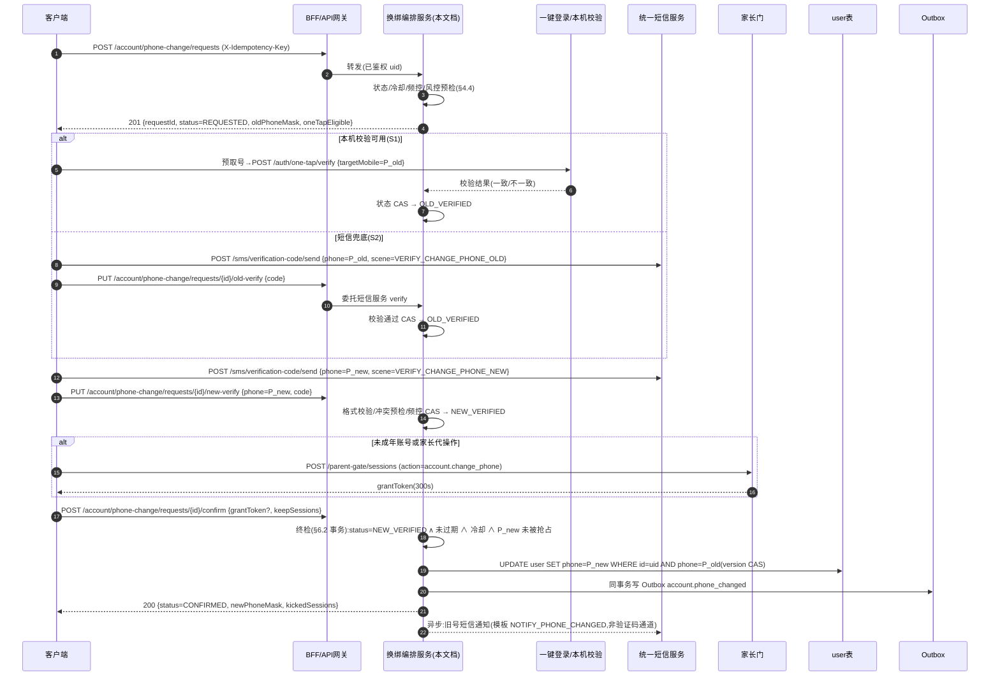

# 账号体系-换绑手机号-详细设计

- **版本**:v1.0
- **日期**:2026-11-17
- **状态**:初版
- **定位**:账号域「换绑手机号」场景的服务端编排权威文档

---

## 1. 定位与权威边界

### 1.1 本文档解决什么问题

已登录用户将账号绑定的手机号从旧号 `P_old` 变更为新号 `P_new`,且**账号 ID(user_id)不变**。覆盖:

1. 自助换绑标准链路(核验旧号归属 → 核验新号归属 → 确认生效);
2. 新号已被其他账号注册时的冲突分流(引导账号合并,本文档不实现合并);
3. 未成年人账号换绑的家长门前置;
4. 旧号停用/丢失的人工兜底入口定义(仅接口与流转,不含客服坐席细节);
5. 换绑生效后的会话处理、旧号通知、审计与事件扇出。

### 1.2 权威边界裁决(R 编号与 §13 契约对齐)

| 边界 | 权威归属 | 本文档姿态 |
| --- | --- | --- |
| R1 手机号写权威 | **本文档定义的换绑编排** | user.phone 唯一写入口之一(注册首绑/人工换绑为另两个),双写禁止 |
| R2 短信验证码收发 | 统一短信验证码服务与多渠道通知发送网关 | 复用,新增 scene `VERIFY_CHANGE_PHONE_OLD` / `VERIFY_CHANGE_PHONE_NEW`,不自带发码 |
| R3 本机号码校验 | 手机号一键登录与号码认证 | 复用 `POST /auth/one-tap/verify` 校验"本机 SIM == P_old",零短信成本优先通道 |
| R4 新号已注册冲突处理 | 用户账号合并与多账号数据迁移服务 | 只检测与分流,合并全流程委托,本文档不含迁移逻辑 |
| R5 未成年人家长授权 | 统一家长门与监护人授权核验引擎 | 复用 Grant Token(action=`account.change_phone`),不自建家长验证 |
| R6 账号封禁/风控裁决 | 用户违规处罚执行与账号状态管控 + 统一风控决策中心 | 只读消费处置状态,不裁决 |
| R7 会话踢出/设备管理 | 用户设备管理与多端登录策略 | 复用其登出接口,不自建设备表 |
| R8 错误码 | 服务端统一业务异常码与错误分类体系 | 用户服务(01)新增场景码 **09 换绑手机号**,登记于 §9 |
| R9 注销级联 | 账号注销链路(数据导出与账户注销) | 换绑请求记录按用户注销编排清理,反向不影响 |

### 1.3 明确不做什么(Non-Goals)

- **不改 user_id**、不迁移任何业务数据(换绑 ≠ 合并 ≠ 注销重建);
- 不处理 P_new 为空号/回收号的质量判定(复用短信发送结果,运营商层失败即失败);
- 不含客服坐席话术与工单系统内部流程(仅定义人工换绑接口契约,详见《客服与工单系统》);
- 不实现家长门 UI(复用统一家长门组件)。

---

## 2. 名词定义与场景范围

### 2.1 名词

| 名词 | 定义 |
| --- | --- |
| P_old | 当前绑定手机号(唯一登录标识) |
| P_new | 目标新手机号 |
| 换绑申请单 | phone_change_request 一行,一次换绑意图的全生命周期载体 |
| 本机校验 | 运营商网关校验"本机 SIM 号码 == 待确认号码",token 一次性 |
| 合并分流 | 新号已注册时引导至账号合并服务的入口动作 |

### 2.2 触发场景矩阵

| 场景 | 旧号可用性 | 前置通道 | 说明 |
| --- | --- | --- | --- |
| S1 标准换绑 | 本机 SIM 即旧号 | 本机校验优先 | 零短信成本主路径 |
| S2 标准换绑(跨设备/Web) | 旧号可收短信 | 旧号短信验证码 | 无 SIM/PC 端降级 |
| S3 旧号停用/丢失 | 不可收码 | **禁止自助**,转人工 | 风控高危,见 §4.5 |
| S4 新号已注册 | — | 任意 | 冲突分流至合并 |
| S5 未成年学生账号 | — | 任意 | 家长门 Grant 前置 |
| S6 家长代换绑孩子账号 | — | 家长门 V3 | 家长端入口,作用域 childUserId |

### 2.3 前置条件

- 账号状态 `ACTIVE`(封禁/禁用/注销中一律拒绝,R6);
- 距离上次换绑成功 ≥ **30 天**(同账号冷却,对齐实名域身份证 30 天换绑上限的账号安全基线);
- P_new 通过格式校验(11 位、1 开头)且未命中全局风控黑名单。

---

## 3. 数据模型

### 3.1 换绑申请单表 `phone_change_request`

```sql
CREATE TABLE `phone_change_request` (
  `id`                 BIGINT UNSIGNED NOT NULL AUTO_INCREMENT,
  `request_id`         CHAR(36)     NOT NULL COMMENT 'UUID v7,客户端生成,幂等键',
  `user_id`            BIGINT UNSIGNED NOT NULL COMMENT '发起账号(SSOT user 主键)',
  `operator_user_id`   BIGINT UNSIGNED NOT NULL COMMENT '实际操作人=S6 时为家长 user_id,否则=user_id',
  `old_phone_enc`      VARBINARY(255) NOT NULL COMMENT 'AES-256-GCM 加密旧号(留审计,可解)',
  `old_phone_mask`     VARCHAR(20)  NOT NULL COMMENT '138****8000 脱敏展示',
  `new_phone_enc`      VARBINARY(255) NULL COMMENT '加密新号,NEW_VERIFIED 后回填',
  `new_phone_mask`     VARCHAR(20)  NULL,
  `old_verify_method`  VARCHAR(16)  NULL COMMENT 'ONE_TAP / SMS,OLD_VERIFIED 后回填',
  `old_verified_at`    DATETIME(3)  NULL,
  `new_verified_at`    DATETIME(3)  NULL,
  `parent_grant_id`    CHAR(32)     NULL COMMENT '未成年人/代操作时的家长门凭证 ID',
  `status`             VARCHAR(16)  NOT NULL DEFAULT 'REQUESTED'
      COMMENT 'REQUESTED/OLD_VERIFIED/NEW_VERIFIED/CONFIRMED/EXPIRED/CANCELLED/REJECTED/MANUAL_PENDING',
  `reject_reason`      VARCHAR(32)  NULL COMMENT '风控码或冲突码快照',
  `expire_at`          DATETIME(3)  NOT NULL COMMENT '创建+30min,惰性过期',
  `confirm_ip`         VARCHAR(45)  NULL,
  `confirm_device_id`  VARCHAR(64)  NULL,
  `idempotency_key`    VARCHAR(64)  NOT NULL COMMENT '客户端 X-Idempotency-Key',
  `version`            INT          NOT NULL DEFAULT 0 COMMENT '乐观锁',
  `created_at`         DATETIME(3)  NOT NULL DEFAULT CURRENT_TIMESTAMP(3),
  `updated_at`         DATETIME(3)  NOT NULL DEFAULT CURRENT_TIMESTAMP(3) ON UPDATE CURRENT_TIMESTAMP(3),
  PRIMARY KEY (`id`),
  UNIQUE KEY `uk_request_id` (`request_id`),
  UNIQUE KEY `uk_idempotency` (`user_id`, `idempotency_key`),
  UNIQUE KEY `uk_user_active_flow` (`user_id`, `active_flag`) COMMENT 'MySQL 不支持部分索引,以 generated 列实现活跃唯一',
  KEY `idx_user_created` (`user_id`, `created_at`),
  KEY `idx_status_expire` (`status`, `expire_at`)
) ENGINE=InnoDB DEFAULT CHARSET=utf8mb4 COMMENT='换绑手机号申请单';
```

> `active_flag` 实现(守卫 G2「同账号仅一条活跃申请」的 DB 兜底):

```sql
ALTER TABLE `phone_change_request`
  ADD COLUMN `active_flag` BIGINT UNSIGNED
  GENERATED ALWAYS AS (IF(status IN ('REQUESTED','OLD_VERIFIED','NEW_VERIFIED'), id, 0)) STORED;
```

活跃状态 = `REQUESTED / OLD_VERIFIED / NEW_VERIFIED`;`MANUAL_PENDING` 属人工流,不占活跃位(允许自助与人工并行存在,先到者胜,见 §8.4)。

### 3.2 换绑审计表 `phone_change_audit_log`

只追加,不更新;手机号一律脱敏(掩码 + HMAC),**不落明文**。

```sql
CREATE TABLE `phone_change_audit_log` (
  `id`              BIGINT UNSIGNED NOT NULL AUTO_INCREMENT,
  `request_id`      CHAR(36)     NOT NULL,
  `user_id`         BIGINT UNSIGNED NOT NULL,
  `operator_user_id` BIGINT UNSIGNED NOT NULL,
  `action`          VARCHAR(32)  NOT NULL COMMENT 'CREATE/OLD_VERIFY_PASS/OLD_VERIFY_FAIL/NEW_CODE_SENT/NEW_VERIFY_PASS/NEW_VERIFY_FAIL/CONFIRM/CANCEL/EXPIRE/REJECT/MANUAL_GRANT/MANUAL_APPLY',
  `detail_json`     JSON         NULL COMMENT '扩展字段,禁存明文手机号',
  `ip`              VARCHAR(45)  NULL,
  `device_id`       VARCHAR(64)  NULL,
  `created_at`      DATETIME(3)  NOT NULL DEFAULT CURRENT_TIMESTAMP(3),
  PRIMARY KEY (`id`),
  KEY `idx_request` (`request_id`),
  KEY `idx_user_created` (`user_id`, `created_at`)
) ENGINE=InnoDB DEFAULT CHARSET=utf8mb4 COMMENT='换绑审计日志,保留 180 天滚动归档';
```

### 3.3 冷却与频控(Redis 键总表)

| 键 | 类型 | TTL | 语义 |
| --- | --- | --- | --- |
| `pc:cooldown:user:{uid}` | String(上次成功时间戳) | 永久(覆盖写) | 30 天冷却判定,confirm 成功时写入 |
| `pc:one_tap:req:{requestId}` | String(一次性) | 10 min | 本机校验通过暂存,防重放 |
| `pc:newphone:bindcount:{phoneHash}` | Hash(date→count) | 40 天 | 同一新号 30 天内被不同账号绑定计数,≥2 拒绝(防养号/号商) |
| `pc:flow:{uid}` | String(request_id) | 30 min | 活跃申请指针,加速校验,DB 为最终权威 |
| `pc:sms:old:{uid}` / `pc:sms:new:{uid}` | String | 60 s | 发码间隔本地预检(权威仍在短信服务) |

`phoneHash = HMAC-SHA256(serverSalt, phone)`,serverSalt 存密钥管理服务(复用《服务端密钥管理与敏感配置安全策略》)。

---

## 4. 核心流程

### 4.1 标准换绑时序(S1/S2 合并主链路)



### 4.2 新号已注册冲突分流(S4)

```text
new-verify 预检或 confirm 终检发现 P_new 已绑定其他 user'
→ 申请单置 REJECTED(reason=PHONE_ALREADY_REGISTERED),不计冷却(G8:冲突拒绝不消耗换绑额度)
→ 响应 010904 + body.conflict = { registered: true }
→ 客户端展示「该手机号已注册账号」双选:
   ① 使用其他手机号重试(回到 new-verify);
   ② 合并账号:跳转账号合并入口(委托账号合并服务,携带 P_new 作为目标账号登录标识)
→ 合并成功后 P_new 归属目标账号,原账号被合并停用,不存在「换绑覆盖抢占」路径(G7)
```

**红线 G7**:任何情况下不允许「新号已注册仍强制覆盖绑定」。覆盖=吞并他人账号,仅合并服务在本人双账号验证后有权变更手机号归属(R4)。

### 4.3 前置校验流水线(apply 时执行)

| 序 | 校验 | 失败返回 |
| --- | --- | --- |
| 1 | 登录态有效 + 账号 ACTIVE | 010301/010204 |
| 2 | 同账号无活跃申请(uk_user_active_flow) | 010910(附 activeRequestId) |
| 3 | 30 天冷却(pc:cooldown:user) | 010911(retryAfterSec) |
| 4 | 全局风控(设备/IP/账号黑名单只读消费) | 010912(不透内部细节) |
| 5 | P_old 命中风控黑名单(涉诈/号商号段) | 010913→强制人工 |
| 6 | 写入申请单 + 审计 CREATE | — |

### 4.4 人工兜底(S3,仅定义契约)

旧号停用/丢失时自助通道全部关闭:

1. 客户端在换绑入口检测「旧号无法接收验证码」→ 不开放验证码输入,仅展示「联系客服」;
2. 客服侧(管理端接口 §5.4)发起 `MANUAL_PENDING` 申请,要求:实名信息核验 + 人脸/支付凭证等强核验(复用实名服务能力,具体材料清单归客服域),双人复核;
3. 人工单生效同样走 30 天冷却与审计,old_verify_method=`MANUAL`;
4. 人工换绑后 **24 小时内** 若旧号持有人申诉(凭运营商过户/补卡证明),客服可回滚(§7 守卫 G11)。

---

## 5. API 设计

统一前缀 `/api/v1/account/phone-change`,鉴权:学生/通用登录态;S6 家长代操作需家长登录态 + 家长门 Grant。响应遵循《服务端统一响应封装与分页查询规范》。

### 5.1 学生端/通用接口

| 方法 | 路径 | 说明 | 幂等 |
| --- | --- | --- | --- |
| POST | `/requests` | 创建换绑申请 | X-Idempotency-Key 30min 窗口 |
| GET | `/requests/{requestId}` | 查询状态(30s 轮询用) | 读 |
| PUT | `/requests/{requestId}/old-verify` | 旧号短信验证码核验(本机校验通道见 §5.3) | (user_id,requestId,code) 单次 |
| PUT | `/requests/{requestId}/new-verify` | 新号验证码核验 + 冲突预检 | (user_id,requestId,code) 单次 |
| POST | `/requests/{requestId}/confirm` | 确认生效(未成年人带 grantToken) | (user_id,requestId) confirm 单次 |
| POST | `/requests/{requestId}/cancel` | 取消 | CAS 到 CANCELLED |

**创建请求**

```json
// POST /api/v1/account/phone-change/requests
// Header: X-Idempotency-Key: 7c9e6679-7425-40de-944b-e07fc1f90ae7
{ "clientMeta": { "entry": "settings" } }

// 200
{
  "code": 0,
  "data": {
    "requestId": "pcr_01JCX4...",
    "status": "REQUESTED",
    "oldPhoneMask": "138****8000",
    "oneTapEligible": true,
    "expiresInSec": 1800
  }
}
```

**旧号核验(短信通道)**

```json
// PUT /requests/{id}/old-verify
{ "code": "482913" }
// 200 { "code": 0, "data": { "status": "OLD_VERIFIED", "next": "SEND_NEW_CODE" } }
```

**新号核验**

```json
// PUT /requests/{id}/new-verify
{ "phone": "13900139000", "code": "775201" }
// 200 { "code": 0, "data": { "status": "NEW_VERIFIED" } }
// 409 冲突: { "code": 010904, "message": "该手机号已注册账号", "data": { "conflict": { "registered": true } } }
```

**确认**

```json
// POST /requests/{id}/confirm
{ "grantToken": "eyJhbGciOi...", "keepSessions": false }
// 200 { "code": 0, "data": { "status": "CONFIRMED", "newPhoneMask": "139****9000", "kickedSessions": 2 } }
```

### 5.2 本机校验通道(复用声明,不新造端点)

S1 路径客户端直接调用《手机号一键登录与号码认证》既有接口:

```text
POST /auth/one-tap/verify { targetMobile: P_old, token: <预取号token> }
→ 200 { consistent: true, verifyTicket: "vt_xxx"(10min 有效,一次性) }
→ 客户端随后:PUT /requests/{id}/old-verify { verifyTicket: "vt_xxx" }
```

`verifyTicket` 由本机校验服务签发、换绑编排服务一次性消费(SETNX `pc:one_tap:req:{requestId}`),两侧不重复校验。本机校验不一致不允许重试超过 2 次,超出强制转短信通道(防撞库)。

### 5.3 管理端接口(仅客服/风控角色,双人复核)

| 方法 | 路径 | 说明 |
| --- | --- | --- |
| POST | `/admin/v1/account/phone-change/manual-requests` | 人工换绑申请(客服发起,需工单号关联) |
| POST | `/admin/v1/account/phone-change/manual-requests/{id}/approve` | 复核通过生效(与发起人不同账号) |
| GET | `/admin/v1/account/phone-change/records` | 查询(脱敏),审计追溯 |

### 5.4 限流与频控总表

| 维度 | 限制 | 超限响应 |
| --- | --- | --- |
| 创建申请 | 单账号 30 天 1 次成功/申请单存活期内 1 条活跃 | 010911 / 010910 |
| 新号绑定热度 | 同 P_new 30 天内被 ≥2 个不同账号绑定 | 010914 |
| 验证码 | 60s 间隔、5 错锁 1h(权威在短信服务) | 透传短信服务码 |
| confirm | 单申请单 1 次 | 010909 |
| 管理端人工 | 单人日 ≤20 单,超限需主管角色 | 010915 |

---

## 6. 关键代码示例

### 6.1 创建申请(双保险幂等 + 频控)

```java
@PostMapping("/requests")
public PhoneChangeResponse create(@RequestHeader("X-Idempotency-Key") String idemKey,
                                  @Authentication UserPrincipal me) {
    // 1) 幂等重放:同 (user_id, idempotency_key) 直接返回原单
    Optional<PhoneChangeRequest> replay = repository.findByUserIdAndIdempotencyKey(me.id(), idemKey);
    if (replay.isPresent()) return PhoneChangeResponse.of(replay.get());

    // 2) 冷却与风控(Lua 原子,见 6.3)
    FrequencyGuard.check(me.id(), me.deviceId(), me.ip());

    // 3) 创建(uk_user_active_flow 兜底并发,冲突转 010910)
    PhoneChangeRequest req = PhoneChangeRequest.builder()
        .requestId(UuidV7.generate())
        .userId(me.id()).operatorUserId(me.id())
        .oldPhoneEnc(crypto.encrypt(me.phone()))
        .oldPhoneMask(Masker.phone(me.phone()))
        .status(REQUESTED)
        .expireAt(Instant.now().plus(30, MINUTES))
        .idempotencyKey(idemKey)
        .build();
    try {
        repository.insert(req);                    // DB 内 CAS:uk_user_active_flow
        redis.opsForValue().set("pc:flow:" + me.id(), req.getRequestId(), 30, MINUTES);
        audit.log(req, "CREATE", me);
        return PhoneChangeResponse.of(req);
    } catch (DuplicateKeyException e) {
        throw new BizException(ErrorCode.PC_ACTIVE_FLOW_EXISTS);   // 010910
    }
}
```

### 6.2 确认执行器(核心事务)

```java
@Transactional
public ConfirmResult confirm(String requestId, UserPrincipal me,
                             String grantToken, boolean keepSessions) {
    PhoneChangeRequest req = repository.findByRequestIdForUpdate(requestId);
    // G3:状态+过期双检,乐观锁兜底
    if (req.getStatus() != NEW_VERIFIED) throw new BizException(PC_INVALID_STATE);      // 010909
    if (req.getExpireAt().isBefore(now())) { transition(req, EXPIRED); throw new BizException(PC_EXPIRED); } // 010908

    // G4:未成年人/代操作必须消费有效 Grant(权威归家长门,本地验签+一次性)
    if (requiresParentGate(req.getUserId())) {
        parentGateClient.consume(grantToken, "account.change_phone", req.getUserId());
    }

    String newPhone = crypto.decrypt(req.getNewPhoneEnc());
    // G5:终态抢占检查(注册发生在 new-verify 之后、confirm 之前的窗口)
    if (userRepository.existsByPhone(newPhone)) throw new BizException(PHONE_ALREADY_REGISTERED); // 010904

    // G6:user.phone 唯一约束 + P_old 前置条件双保险
    int updated = userRepository.changePhone(req.getUserId(), newPhone,
                                             crypto.decrypt(req.getOldPhoneEnc()));
    if (updated != 1) throw new BizException(PC_CONCURRENT_CONFLICT);                    // 010916

    // G1:冷却计数 + 新号热度计数(同事务内 Redis 不可回滚,故用 Outbox 补偿,见 §8.3)
    transition(req, CONFIRMED);                       // CAS expected=NEW_VERIFIED
    outbox.insert("account.phone_changed", req);      // 同事务 Outbox,见 §8.4
    audit.log(req, "CONFIRM", me);

    // 会话处理(委托设备管理 R7),失败不阻断主事务,异步补偿
    int kicked = keepSessions ? 0 : deviceClient.logoutOthers(req.getUserId(), me.deviceId());

    // 旧号通知(异步,通知服务),非验证码通道
    eventBus.publishAsync(new PhoneChangedNotifyEvent(req.getOldPhoneEnc()));

    return new ConfirmResult(CONFIRMED, Masker.phone(newPhone), kicked);
}
```

```sql
-- userRepository.changePhone 对应 SQL(唯一索引 uk_phone 保证抢占安全)
UPDATE `user`
SET `phone` = #{newPhone}, `phone_updated_at` = NOW(3), `version` = `version` + 1
WHERE `id` = #{userId} AND `phone` = #{oldPhone};
-- 影响行数 0 → 010916(并发冲突或 P_old 已被他人变更)
```

### 6.3 频控 Lua(创建申请时执行,原子四合一)

```lua
-- KEYS[1]=pc:cooldown:user:{uid}  KEYS[2]=pc:newphone:bindcount:{phoneHash}
-- KEYS[3]=pc:flow:{uid}           KEYS[4]=pc:rate:create:{uid}
local lastOk = redis.call('GET', KEYS[1])
if lastOk and (tonumber(lastOk) + 2592000) > tonumber(ARGV[1]) then
  return {err = 'COOLDOWN'}                       -- 30 天
end
if redis.call('EXISTS', KEYS[3]) == 1 then
  return {err = 'ACTIVE_FLOW'}                    -- 010910
end
if redis.call('INCR', KEYS[4]) == 1 then
  redis.call('EXPIRE', KEYS[4], 86400)
end
if tonumber(redis.call('GET', KEYS[4])) > 5 then
  return {err = 'RATE_LIMIT'}                     -- 日 5 次申请上限
end
return {ok = 1}
```

---

## 7. 状态机与守卫

### 7.1 状态机

```text
REQUESTED --old核验通过--> OLD_VERIFIED --new核验通过--> NEW_VERIFIED --confirm--> CONFIRMED(终态)
    |                        |                        |
    |--取消/过期--> CANCELLED / EXPIRED(终态)        |
    |--风控/冲突拒绝--> REJECTED(终态)                |
S3: 人工通道独立存在 MANUAL_PENDING --双人复核--> CONFIRMED / REJECTED
```

| 转移 | 触发 | 守卫 |
| --- | --- | --- |
| *→REQUESTED | 创建申请 | G1 双保险幂等 |
| REQUESTED→OLD_VERIFIED | one-tap ticket 消费或旧码核验 | 票据一次性,重试≤2 |
| OLD_VERIFIED→NEW_VERIFIED | 新码核验 + 冲突预检 | P_new 未注册(预检)+ 频控 |
| NEW_VERIFIED→CONFIRMED | confirm | G3-G7 全过 |
| *→EXPIRED | 惰性过期(读写时检查)或 30min 定时扫描 | 仅活跃态可过期 |
| *→CANCELLED | 用户主动取消 | 仅活跃态 |
| *→REJECTED | 风控/冲突 | 冲突拒绝不记冷却(G8) |

### 7.2 守卫总表

| 守卫 | 规则 | 违反后果 |
| --- | --- | --- |
| G1 | 幂等:create 幂等键重放/confirm 单发;用户注册回调、定时任务均不得绕过幂等键 | 重复写直接拒绝 |
| G2 | 同账号同时仅 1 条活跃申请(uk_user_active_flow) | 010910 |
| G3 | confirm 前置状态必须为 NEW_VERIFIED 且未过期 | 010909/010908 |
| G4 | 未成年/代操作必须携带并消费家长门 Grant(action 精确匹配) | 010905 |
| G5 | P_new 终检与写入同事务窗口内防抢占(exists+uk 双保险) | 010904/010916 |
| G6 | P_new 不允许覆盖已注册账号;覆盖只可能由合并服务完成 | 010904 分流 |
| G7 | 换绑只改 phone 字段,禁止级联修改 user_id/任何业务归属 | 代码评审红线 |
| G8 | REJECTED(冲突/风控)不写入冷却,避免消耗用户额度 | — |
| G9 | 敏感字段(old/new 号)全程密文,日志/审计只存掩码+HMAC | 合规 C1 |
| G10 | 人工单必须双人复核且关联工单号 | 010915 |
| G11 | 人工单 24h 申诉回滚窗,回滚须旧号权属证明 | 人工流程 |
| G12 | 注销中/封禁账号全链路拒绝(只读消费处置状态) | 010204 |

---

## 8. 幂等、并发与事件

### 8.1 幂等场景总表

| 场景 | 机制 |
| --- | --- |
| 重复创建(双击/重试) | X-Idempotency-Key + uk(user_id, idempotency_key) 30min 重放 |
| 验证码重复发送 | 权威在短信服务(60s 间隔),本域仅预检 |
| old-verify/new-verify 重放 | 状态幂等:已 OLD_VERIFIED 再传同 ticket 直接返回成功(响应重放安全) |
| confirm 重试/双击 | uk 语义:(user_id,request_id) 仅允许 CONFIRMED 一次;重复 confirm 返回当前终态而非报错 |
| 定时过期扫描 vs 用户 confirm | DB 行锁 FOR UPDATE 串行,先到者胜 |
| 换绑 vs 同时登录 | 登录只读 phone,无写冲突;confirm 与改密/注销互斥(账号级行锁) |

### 8.2 并发裁决

1. **并发创建**:uk_user_active_flow 兜底,后到者 010910;
2. **confirm 与 cancel 并发**:行锁内 CAS,先到者胜,后到者按当前终态返回;
3. **两设备同时换绑**:同账号活跃唯一,G2 裁决;
4. **new-verify 通过后 P_new 被他注册**:confirm 终检 G5 拦截;
5. **人工与自助并行**:互不阻塞,confirm 时以 user.phone 前置条件(G6 SQL)裁决,后到者 010916。

### 8.3 补偿矩阵

| 异常 | 检测 | 补偿 |
| --- | --- | --- |
| user 更新成功但 Outbox 失败 | 同事务保证,Outbox 与业务表同库同事务 | 不可能出现单点(同库事务) |
| confirm 成功但会话踢出失败 | 设备服务超时 | Outbox 消费者重试 3 次,仍失败记录待办(不阻断) |
| 旧号通知短信失败 | 通知服务回执 | 不重发(告知性通知),记录日志 |
| 冷却计数写失败 | Redis 宕 | confirm 依赖 DB 权威:uk_phone + phone_updated_at 字段兜底冷却判定(读 DB) |
| 定时过期扫描积压 | EXPIRED 延迟 | 惰性过期优先;扫描仅兜底,积压 >10min 告警 M6 |

### 8.4 领域事件(Outbox,同事务)

```sql
CREATE TABLE `account_outbox` (
  `id`          BIGINT UNSIGNED NOT NULL AUTO_INCREMENT,
  `event_id`    CHAR(36)     NOT NULL,
  `event_type`  VARCHAR(48)  NOT NULL,
  `payload_json` JSON        NOT NULL,
  `status`      VARCHAR(16)  NOT NULL DEFAULT 'PENDING',
  `created_at`  DATETIME(3)  NOT NULL DEFAULT CURRENT_TIMESTAMP(3),
  PRIMARY KEY (`id`),
  UNIQUE KEY `uk_event_id` (`event_id`),
  KEY `idx_status_created` (`status`, `created_at`)
) ENGINE=InnoDB DEFAULT CHARSET=utf8mb4;
```

| 事件 | 消费方 | 语义 |
| --- | --- | --- |
| `account.phone_changed` | 登录风控引擎(更新绑定手机画像) | 纯增量 |
| `account.phone_changed` | 设备管理(刷新登录标识索引) | 幂等 upsert |
| `account.phone_changed` | 消息服务(旧号通知/新号欢迎) | 模板渲染,禁验证码通道 |
| `account.phone_changed` | 审计中心(归档审计日志) | 只追加 |
| `account.phone_change_rejected` | 风控决策中心(频控/黑名单学习信号) | 仅风控域内部使用 |

消费幂等:消费方以 `event_id` 建唯一索引;事件至少一次投递。

---

## 9. 错误码(用户服务 01,新增场景码 09 换绑手机号)

> 依据《服务端统一业务异常码与错误分类体系》§4.3 场景码表,01-08 已分配,**09 此前空闲**(2026-11-17 全库扫描 01xxxx 无 09 段占用),本文档登记为「换绑手机号」。通用码(010101/010103/010204/010301 等)直接复用不重复定义。

| 异常码 | 错误 | HTTP | 严重度 | message | detail |
| --- | --- | --- | --- | --- | --- |
| 010901 | 手机号格式错误 | 400 | LOW | 手机号格式不正确 | P_new 校验 |
| 010902 | 本机校验不一致 | 400 | LOW | 本机号码校验未通过 | 超限后转短信通道 |
| 010903 | 新号验证码错误/过期 | 400 | LOW | 验证码错误或已过期 | 透传短信服务语义 |
| 010904 | 新号已注册 | 409 | LOW | 该手机号已注册账号 | body.conflict.registered=true,引导合并 |
| 010905 | 缺少家长授权 | 403 | MEDIUM | 请让家长确认后继续 | 触发家长门 |
| 010906 | 本机校验重试超限 | 429 | LOW | 校验次数过多,请使用短信验证 | ≥2 次 |
| 010908 | 申请单已过期 | 410 | LOW | 换绑申请已超时,请重新开始 | 惰性过期 |
| 010909 | 非法状态流转 | 409 | LOW | 当前状态不允许该操作 | 状态机守卫 |
| 010910 | 存在活跃申请 | 409 | LOW | 您已有一条进行中的换绑申请 | 附 activeRequestId |
| 010911 | 换绑冷却中 | 429 | LOW | 30 天内仅可换绑一次 | retryAfterSec |
| 010912 | 风控拦截 | 403 | MEDIUM | 当前操作存在风险,请稍后再试 | 不透内部规则 |
| 010913 | 强制人工核验 | 403 | MEDIUM | 为保障账号安全,请联系客服处理 | S3/S5 高危 |
| 010914 | 新号绑定热度异常 | 409 | LOW | 该手机号暂不可绑定,请更换 | 养号防护 |
| 010915 | 人工单权限/限额不足 | 403 | MEDIUM | 无人工换绑权限或超出日限额 | 管理端 |
| 010916 | 并发冲突 | 409 | LOW | 手机号信息已变更,请刷新后重试 | P_old 前置条件失败 |

客户端处理映射:010904 → 冲突双选弹窗;010905 → 拉起家长门组件;010911/010906 → 倒计时 UI;其余 Toast + 重试。

---

## 10. 降级矩阵

| 编号 | 故障点 | 降级行为 | 红线 |
| --- | --- | --- | --- |
| D1 | 本机校验供应商故障 | oneTapEligible=false,全量转短信通道 | — |
| D2 | 短信服务故障 | 创建申请允许,old/new 核验返回 010103 语义「请稍后重试」 | 不得本地绕过验证码 |
| D3 | Redis 宕 | 频控读 DB(phone_updated_at 冷却),创建申请允许但 confirm 加 DB 行锁 | 冷却判定不可失效 |
| D4 | 家长门服务故障 | 未成年人换绑直接 010913 引导人工 | **G4 不可降级跳过** |
| D5 | 风控中心超时 | 默认放行低风险,高风险名单本地缓存兜底(30min TTL) | 黑名单 fail-closed |
| D6 | 设备服务超时 | 会话踢出异步补偿,不阻断 confirm | — |
| D7 | Outbox 积压 | 事件重投,消费方幂等 | 业务事务不依赖消费成功 |
| D8 | 管理端人工接口故障 | 人工单暂停受理,自助链路不受影响 | — |
| D9 | 审计写入失败 | **整个操作回滚拒绝执行** | 审计不可降级(C1) |

---

## 11. 监控指标

| 编号 | 指标 | 阈值/告警 |
| --- | --- | --- |
| M1 | 换绑成功率(confirm/apply) | 日 <70% 告警(排查 010904 占比) |
| M2 | 010904 冲突占比 | >30% 说明引导文案或合并入口有问题,P2 |
| M3 | 010912/010913 风控拦截率 | 突增 3 倍告警(黑产攻击信号),P1 |
| M4 | confirm P99 延迟 | >800ms 告警(含事务) |
| M5 | 本机校验通道占比 | <40% 说明降级频繁,核查供应商 |
| M6 | EXPIRED 扫描积压 | >10min P2 |
| M7 | Outbox 积压 | >5min P2;account.phone_changed 丢失对账=0 容忍 |
| M8 | 人工单量 | 日 >50 单 P2(自助流程存在缺陷信号) |

容量(DAU 50 万):换绑为低频操作,日申请峰值预估 2000 单,confirm QPS 峰值 <1;短信通知 2000 条/日对通知服务可忽略;audit 表 2000 行/日,180 天滚动 ≈ 36 万行,单表无压力。

---

## 12. 合规要点

| 编号 | 要求 |
| --- | --- |
| C1 | 手机号属 PIPL 敏感个人信息:传输 TLS1.3、存储 AES-256-GCM、日志只存掩码 + HMAC;审计失败即拒单(D9) |
| C2 | 未成年人账号换绑须经监护人授权(G4/家长门),家长代操作全程留痕 operator_user_id≠user_id |
| C3 | 换绑成功后**必须**向旧号发送变更通知短信(防静默劫持,给用户最后的发现窗口);申诉通道随通知文案给出 |
| C4 | 审计日志保留 180 天滚动归档;数据境内存储;注销用户按 22 域注销编排清理申请单与审计(180 天合规下限后匿名化) |
| C5 | 人工换绑双人复核 + 工单关联,防客服内鬼;管理端全量审计 |
| C6 | 客户端展示一律掩码;任何接口不返回完整他人手机号 |
| C7 | 风控拦截话术中性,不暴露规则细节;不将换绑数据用于营销画像 |

---

## 13. 契约对齐(R 汇总)

1. R1 与《账号体系-详细设计》:user.phone 唯一索引与 `phone_updated_at` 字段为本文档前置依赖,已存在则不新增;
2. R2 与《统一短信验证码服务》:scene 白名单新增 `VERIFY_CHANGE_PHONE_OLD/NEW`、`NOTIFY_PHONE_CHANGED`(通知模板),须经短信服务 scene 注册表登记;
3. R3 与《手机号一键登录与号码认证》§3.4:verifyTicket 签发方/消费方/一次性语义以双方文档一致;
4. R4 与《用户账号合并与多账号数据迁移服务》:冲突只分流不实现;合并完成后若原账号 phone 释放,不反向触发本文档流程;
5. R5 与《统一家长门》:action 枚举值 `account.change_phone` 登记;Grant 消费一次性语义以家长门为准;
6. R6 与《用户违规处罚执行与账号状态管控》:账号状态只读,处置状态变更(如封禁)后活跃申请单由过期扫描收口,不主动取消;
7. R7 与《用户设备管理与多端登录策略》:logoutOthers 接口语义(保当前设备)以设备文档为准;
8. R8 与《服务端统一业务异常码与错误分类体系》:场景码 09 登记;010101/010103/010204/010301 复用不重复;
9. R9 与《端到端流程设计-数据导出与账户注销完整链路》:注销清理 22 域清单新增 phone_change_request/phone_change_audit_log/account_outbox(account 域);
10. R10 与《客户端-设置页面与偏好配置交互设计》:入口、掩码展示、冲突双选 UI 以客户端文档为准,本文档只供接口契约。

---

## 14. 验收场景

| 编号 | 场景 | 预期 |
| --- | --- | --- |
| AC01 | 本机 SIM=旧号标准换绑 | one-tap 通过,全流程 0 条验证码短信(仅新号 1 条) |
| AC02 | Web 端换绑 | oneTapEligible=false,双短信通道完成 |
| AC03 | 新号已注册 | 010904 + 冲突弹窗,不出现覆盖绑定入口 |
| AC04 | 合并后重试换绑 | 合并释放原号后,P_new 绑定状态以合并结果为准 |
| AC05 | 未成年学生换绑 | 无 grantToken confirm → 010905;带有效 Token 成功 |
| AC06 | 家长代孩子换绑 | operator_user_id=家长,审计可区分 |
| AC07 | 30 天内二次换绑 | 010911 + retryAfterSec 正确 |
| AC08 | 冲突拒绝后重试 | 不消耗冷却额度(G8),换新号可继续 |
| AC09 | 双击 confirm | 仅一次生效,重放返回终态不报错 |
| AC10 | 双设备并发申请 | 后者 010910 |
| AC11 | new-verify 后 P_new 被他人注册 | confirm G5 拦截 010904 |
| AC12 | 旧号停用 | 无自助入口,仅客服引导;人工单双人复核生效 |
| AC13 | confirm 成功 | 旧号收到通知短信;其他会话被踢(keepSessions=false);登录风控画像更新 |
| AC14 | Redis 全宕 | 冷却以 DB 判定,流程可用(D3) |
| AC15 | 审计写入失败 | 操作整体拒绝(D9),无任何残留中间态 |

---

## 15. 关联文档

- 《账号体系-详细设计》(user 表与登录注册基础)
- 《账号体系-手机号一键登录与号码认证-详细设计》§3.4(本机校验)
- 《账号体系-第三方登录与授权集成-详细设计》(冲突话术一致性)
- 《服务端-用户账号合并与多账号数据迁移服务-详细设计》(合并分流)
- 《服务端-统一家长门与监护人授权核验引擎-详细设计》(Grant)
- 《服务端-统一短信验证码服务与多渠道通知发送网关-详细设计》(验证码 scene)
- 《服务端-用户违规处罚执行与账号状态管控服务-详细设计》(状态只读)
- 《用户设备管理与多端登录策略-详细设计》(会话踢出)
- 《服务端统一业务异常码与错误分类体系-详细设计》§4.3(错误码)
- 《客户端-设置页面与偏好配置交互设计-详细设计》(入口交互)
- 《端到端流程设计-数据导出与账户注销完整链路-详细设计》(注销级联)

---

## 16. 维护记录

- **v1.0(2026-11-17)**:新增初版。补齐 docs2 账号域空白:换绑手机号在《账号体系》《手机号一键登录与号码认证》《第三方登录与授权集成》中均被引用为场景,但无编排权威文档。错误码 0109xx 段全库扫描确认空闲后登记(统一异常码体系用户服务 01 场景码 09)。
